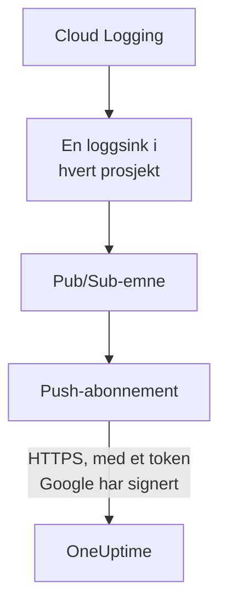

# Strøm Google Cloud-logger

Et tilkoblet Google Cloud-prosjekt kan strømme loggene sine til OneUptime så snart de skrives. Cloud Logging sender dem via en loggsink til et Pub/Sub-emne, og push-abonnementet til emnet leverer hver oppføring til OneUptime innen ett minutt, som en OneUptime-logg arkivert under ressursen den gjelder. Én kommando i Google Cloud Shell setter det opp, og det er ingenting å kjøre. Cloud Monitoring har ingen eksport som pusher målinger, så tilkoblingen fortsetter å lese målinger etter tidsplanen.

:::cards
- [Slik fungerer det](#slik-fungerer-det): En loggsink i hvert prosjekt, et emne og push-abonnementet til det.
- [Sett opp strømming](#sett-opp-strømming): Velg hvilke logger, lag en strømnøkkel og kjør én kommando.
- [Hva som kommer](#hva-som-kommer): Logger på ressursene de kommer fra.
- [Hva kommandoen oppretter](#hva-kommandoen-oppretter): Hver ressurs og hver tillatelse kommandoen oppretter i prosjektene dine.
- [Stopp strømmingen](#stopp-strømmingen): Slå av nøklene, og slett deretter det kommandoen opprettet.
:::

## Slik fungerer det



- **En loggsink i hvert prosjekt.** Sinken i hvert prosjekt sender oppføringene filteret treffer til ett Pub/Sub-emne, i prosjektet til tilkoblingens egen tjenestekonto.
- **To kontroller på hvert push.** Pub/Sub signerer et OpenID Connect-token for en tjenestekonto laget bare for pushene, og tokenets audience er tilkoblingens strømnøkkel. OneUptime tar bare imot et push når Google har signert tokenet for den tjenestekontoen og nøkkelen er en av tilkoblingens. Nøkkelen navngir tilkoblingen, og dermed prosjektet: ingenting i et push avgjør hvor det skrives. OneUptime lagrer bare nøkkelens SHA-256.
- **Ingenting går tapt mens OneUptime ikke kan ta imot det.** Pub/Sub pusher en avvist oppføring igjen, med pauser fra 10 sekunder opp til 10 minutter mellom forsøkene, og tar vare på den i en dag.

## Før du begynner

- **Et tilkoblet Google Cloud-prosjekt.** Koble det til først under **Sky → Koble til**: se [Koble til en skykonto](/docs/telemetry/cloud-accounts).
- **En prosjekteier eller administrator.** Bare de kan lage en strømnøkkel og stoppe strømmingen.
- **Google Cloud Shell**, pålogget som **Owner** av prosjektene, eller som noen som får lage tjenestekontoer, Pub/Sub-emner og loggsinker i dem.
- **En HTTPS-adresse, på en selvhostet OneUptime.** Pub/Sub pusher bare til `https://`-adresser, med et sertifikat Google stoler på, og adressen må kunne nås fra Google Cloud.

## Sett opp strømming

:::steps
### Åpne strømmedialogen

Gå til **Sky → Koble til**, og velg **Strøm logger** i raden til Google Cloud-prosjektet.

### Velg hvilke logger

**Advarsler og feil** strømmer hver oppføring med alvorlighetsgrad `WARNING` eller høyere: det som gikk galt, ikke hver forespørsel. **Hver logg** strømmer hver oppføring unntatt Data Access-revisjonsloggene, som registrerer hver lesing og kan overgå alt annet et prosjekt skriver. **Ditt eget filter** strømmer oppføringene en Cloud Logging-spørring treffer, skrevet i feltet **Filter**.

### Lag en strømnøkkel

Velg **Lag en strømnøkkel**. Nøkkelen vises bare denne ene gangen, i kommandoen: OneUptime lagrer bare SHA-256 av den.

### Kjør kommandoen i Google Cloud Shell

Kopier kommandoen, kjør den i Google Cloud Shell og vent til den er ferdig. Den forteller hvert prosjekt den satte opp en sink i, og stopper ved det første trinnet Google avviser, med Googles begrunnelse.

### Vent på det første pushet

Dialogen spør med noen sekunders mellomrom hva som har kommet. Pub/Sub pusher en oppføring innen ett minutt etter at et prosjekt har skrevet en som filteret tar imot; dialogen forteller da hva som kom hvorfra, og raden til tilkoblingen sier **Strømmer**.
:::

**Flere felt** inneholder resten:

| Felt | Hva det gjør |
| --- | --- |
| **Prosjekter** | Prosjektene det skal strømmes logger fra: først de tilkoblingen leser. Emnet lages i prosjektet til tilkoblingens tjenestekonto. Høyst 100 |
| **Sett det opp på en annen måte** | Push-endepunktet, push-tjenestekontoen og nøkkelen, for å sette det opp med Terraform eller konsollen |

## Hva som kommer

| Hva | Hvor det havner |
| --- | --- |
| Logger | I loggutforskeren, under tilkoblingens telemetritjeneste, med prosjektet, regionen og loggnavnet som attributter |
| Logger for en ressurs OneUptime kjenner | Også på den ressursen: siden dens i Sky får en fane **Logger** |

Hver logg beholder tiden for oppføringen på nanosekundet, alvorlighetsgraden, tracen og spanet, og HTTP-forespørselen under navnene fra OpenTelemetrys semantiske konvensjoner. Den arkiveres under en ressurs når den overvåkede ressursen er en type OneUptime leser målingene til, for eksempel en VM (`gce_instance`), en Cloud Run-tjeneste (`cloud_run_revision`) eller en Cloud SQL-instans (`cloudsql_database`), og bærer ressursens ID som `cloud.resource_id`. Forespørselsloggene til en ekstern lastbalanserer, skrevet under `http_load_balancer`, arkiveres under URL-kartet dens, den `https_lb_rule` målingene dens havner på.

Loggene til en instansgruppe er VM-enes, så siden dens har ingen fane **Logger**. En oppføring av en annen type strømmes likevel, under prosjektet sitt.

## Hva kommandoen oppretter

Ressursene den lager, er oppkalt etter de første 8 tegnene i tilkoblingens ID. Den gir ikke OneUptime tilgang til prosjektene dine: oppføringer flyter bare ut.

| Ressurs | Hva den får gjøre |
| --- | --- |
| En tjenestekonto, `oneuptime-push-<suffix>`, i prosjektet til tilkoblingens tjenestekonto | Har ingen rolle: Pub/Sub signerer tokenene for pushene sine for den |
| Rollen **Service Account OpenID Connect Identity Token Creator** for Pub/Sub-tjenesteagenten, bare på den tjenestekontoen | Lar Pub/Sub lage de tokenene, og ingenting annet |
| Et Pub/Sub-emne, `oneuptime-stream-<suffix>` | Har oppføringene sinkene sender |
| Push-abonnementet til det, `oneuptime-stream-<suffix>-push` | Pusher hver oppføring til OneUptime, med en bekreftelsesfrist på 60 sekunder, og tar vare på det det ikke kunne pushe i en dag |
| En loggsink i hvert prosjekt, `oneuptime-stream-<suffix>` | Sender oppføringene filteret treffer til emnet |
| Rollen **Pub/Sub Publisher** for skriveren til hver sink, bare på emnet | Lar sinken publisere til emnet, og ingenting annet |

Kommandoen slår på API-ene for Pub/Sub og Cloud Logging i emnets prosjekt hvis de er av. Google fakturerer Pub/Sub for loggene det leverer: strøm bare loggene du trenger.

## Stopp strømmingen

:::steps
### Slå av nøklene

Velg **Stopp strømmingen** i raden til prosjektet under **Sky → Koble til**. Alle strømnøklene til tilkoblingen slutter å virke med en gang, og OneUptime avviser det Pub/Sub pusher. Det som er levert, blir værende.

### Slett det kommandoen opprettet

Sinkene, emnet og push-abonnementet blir værende i Google Cloud, og Pub/Sub fortsetter å pushe, til de slettes. Dialogen viser kommandoen, for prosjektene tilkoblingen leser:

```bash
for SOURCE in 'acme-prod' 'acme-data'; do
  gcloud logging sinks delete oneuptime-stream-6f1c3a2e --project "$SOURCE" --quiet
done
gcloud pubsub subscriptions delete oneuptime-stream-6f1c3a2e-push --project 'acme-prod' --quiet
gcloud pubsub topics delete oneuptime-stream-6f1c3a2e --project 'acme-prod' --quiet
gcloud iam service-accounts delete 'oneuptime-push-6f1c3a2e@acme-prod.iam.gserviceaccount.com' --project 'acme-prod' --quiet
```
:::

For å endre hvilke logger som strømmes, åpner du **Strøm logger** igjen, velger **Lag en ny nøkkel** og kjører den nye kommandoen. Nøkkelen den erstatter, virker i 24 timer til, så ingen push avvises mens abonnementet oppdateres. Høyst 3 erstattede nøkler virker samtidig.

## Sett det opp på en annen måte

Gi et Pub/Sub-emne et push-abonnement med disse verdiene, og la Pub/Sub-tjenesteagenten lage tokener for push-tjenestekontoen:

| Innstilling | Verdi |
| --- | --- |
| Push-endepunkt | `https://oneuptime.com/telemetry/gcp-pubsub/v1/logs` |
| Autentisering | Et OpenID Connect-token for `oneuptime-push-<suffix>@<project>.iam.gserviceaccount.com` |
| Audience | Strømnøkkelen |
| Nyttelast | Innpakket, slik Pub/Sub sender den med mindre noe annet er angitt |
| Bekreftelsesfrist | 60 sekunder |
| Oppbevaring av meldinger | 1 dag |

Send deretter loggene fra hvert prosjekt til emnet med en loggsink, og gi skriveren til hver sink **Pub/Sub Publisher** på emnet. På en selvhostet OneUptime erstatter du `https://oneuptime.com` med HTTPS-adressen til din OneUptime.

OneUptime svarer på hvert push slik Pub/Sub forventer:

| Svar | Når | Hva Pub/Sub gjør |
| --- | --- | --- |
| `204` | Oppføringen ble tatt imot, eller var tatt imot før, eller meldingen er ingen loggoppføring | Går videre |
| `400` | Det er ikke et Pub/Sub-push OneUptime kan lese | Pusher det igjen, med lengre pause hver gang, i en dag |
| `401` | Tokenet er ikke ett Google har signert for push-tjenestekontoen, eller audiencen er ikke en nøkkel for tilkoblingen | Pusher det igjen, med lengre pause hver gang, i en dag |
| `402` | Prosjektet kan ikke faktureres for telemetri | Pusher det igjen, med lengre pause hver gang, i en dag |
| `403` | Tilkoblingen er slått av, eller prosjektet kan ikke ta imot telemetri | Pusher det igjen, med lengre pause hver gang, i en dag |
| `413` | Forespørselen er større enn 1 MiB, eller oppføringen større enn 512 KiB | Pusher det igjen, med lengre pause hver gang, i en dag |
| `429` | Tilkoblingens abonnement pushet mer enn 12 000 oppføringer på ett minutt | Pusher det igjen, med lengre pause hver gang, i en dag |
| `503` | OneUptime kunne ikke sjekke tokenet eller sette oppføringen i kø akkurat da | Pusher det igjen, med lengre pause hver gang, i en dag |

## Feilsøking

:::details Dialogen fortsetter å vente på det første pushet
Sjekk at kommandoen ble ferdig uten å stoppe, og at et prosjekt har skrevet en oppføring filteret tar imot: med **Advarsler og feil** sender et rolig prosjekt ingenting. `gcloud pubsub subscriptions describe oneuptime-stream-6f1c3a2e-push --project acme-prod` viser endepunktet til abonnementet. På en selvhostet OneUptime sjekker du at Google Cloud når adressen over HTTPS.
:::

:::details Tilkoblingen sier Strøm avvist
Dialogen og verktøytipset til raden sier hvorfor. En feil nøkkel betyr at abonnementet pusher med en nøkkel som ikke lenger virker: lag en ny nøkkel og kjør kommandoen igjen. Et push som ikke er signert for push-tjenestekontoen, betyr at abonnementet signerer som en annen konto, eller at Pub/Sub ikke får signere for den: kjør kommandoen igjen.
:::

:::details Loggene til en ressurs vises ikke på siden dens
Siden viser loggene Cloud Logging arkiverer under ressursens overvåkede ressurs, med etikettene målingene dens har. Logger en arbeidsbelastning skriver under en annen ressurs, for eksempel en containers, strømmes bare under prosjektet sitt.
:::

## Neste trinn

:::cards
- [Koble til en skykonto](/docs/telemetry/cloud-accounts): Hva en tilkobling leser, og hvor ofte.
- [Strøm Azure Monitor-målinger og -logger](/docs/telemetry/cloud-streaming-azure): Målingene og loggene til et Azure-abonnement, lest fra hendelseshuber.
- [Strøm CloudWatch-målinger og -logger](/docs/telemetry/cloud-streaming): Målingene og loggene til en AWS-konto, levert av Amazon Data Firehose.
- [Loggutforsker](/docs/telemetry/logs-explorer): Søk og filtrer i det strømmene har levert.
:::
