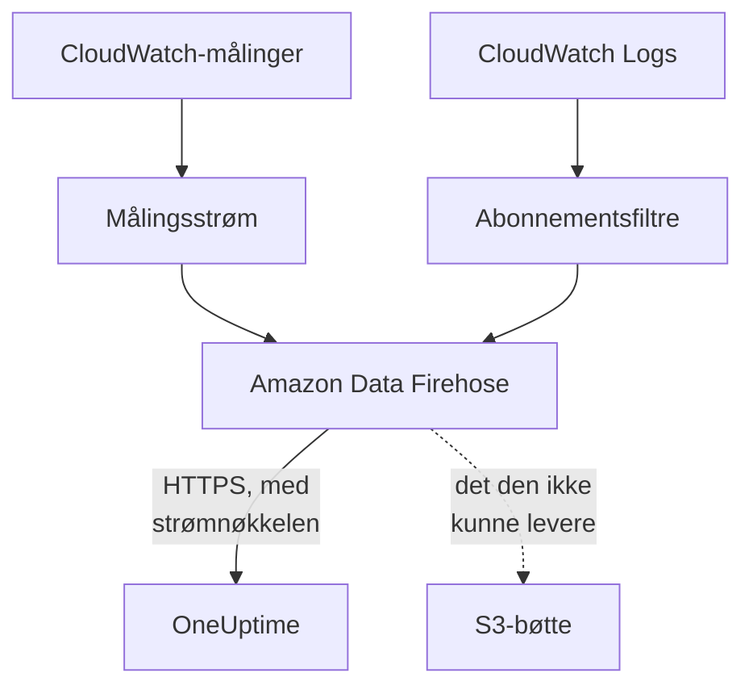

# Strøm CloudWatch-målinger og -logger

En tilkoblet AWS-konto kan strømme CloudWatch-målingene og -loggene sine til OneUptime via Amazon Data Firehose. Målinger kommer da noen få minutter etter at CloudWatch har dem, i stedet for ved tilkoblingens neste lesing, og CloudWatch Logs kommer som OneUptime-logger, hver arkivert under ressursen den handler om. Én kommando i AWS CloudShell setter alt opp, og det er ingenting å kjøre.

:::cards
- [Slik fungerer det](#slik-fungerer-det): En målingsstrøm og loggabonnementer i hver region, levert av Firehose.
- [Sett opp strømming](#sett-opp-strømming): Velg hva som skal strømmes, lag en strømnøkkel og kjør én kommando.
- [Hva som kommer](#hva-som-kommer): Målinger på ressursene de måler, og logger på ressursene de kommer fra.
- [Hva stakken oppretter](#hva-stakken-oppretter): Hver ressurs og hver tillatelse kommandoen oppretter i kontoen din.
- [Stopp strømmingen](#stopp-strømmingen): Slå av nøklene, og slett deretter stakkene.
:::

## Slik fungerer det



- **Én stakk i hver region.** Kommandoen ruller ut en CloudFormation-stakk i hver region du strømmer fra. Målingsstrømmen og abonnementsfiltrene for logger gir alt videre til to Firehose-strømmer, og Firehose leverer det til OneUptime over HTTPS.
- **Strømnøkkelen sier hvem det tilhører.** Firehose sender tilkoblingens strømnøkkel med hver levering. Nøkkelen navngir tilkoblingen, og dermed prosjektet: ingenting i en levering avgjør hvor den skrives. OneUptime lagrer bare nøkkelens SHA-256.
- **Lesingene overlater strømmede målinger til strømmen.** Så lenge en strøm leverer et navnerom i en region, slutter tilkoblingens lesinger å skrive målingene i det navnerommet, så ingen datapunkter telles to ganger. Lesingene fortsetter å finne ressurser, tilstanden deres og endringene deres, og tar et navnerom tilbake etter 15 minutter uten levering.
- **Ingenting går tapt mens OneUptime ikke kan ta imot det.** Firehose sender en avvist pakke på nytt i opptil en time og tar så vare på den i 30 dager i stakkens S3-bøtte.

## Før du begynner

- **En tilkoblet AWS-konto.** Koble den til først under **Sky → Koble til**: se [Koble til en skykonto](/docs/telemetry/cloud-accounts).
- **En prosjekteier eller administrator.** Bare de kan lage en strømnøkkel og stoppe strømmingen.
- **AWS CloudShell i den kontoen**, logget inn som en som har lov til å opprette CloudFormation-stakker og IAM-roller.
- **En HTTPS-adresse, på en selvdriftet OneUptime.** Firehose leverer bare til `https://`-adresser på port 443, med et sertifikat AWS stoler på, og adressen må kunne nås fra AWS.

## Sett opp strømming

:::steps
### Åpne strømmedialogen

Gå til **Sky → Koble til**, og velg **Strøm målinger og logger** i raden til AWS-kontoen.

### Velg hva som skal strømmes

**Målinger** strømmer hver nøkkelmåling for hver ressurs, én gang i minuttet: målingene OneUptime viser i diagrammer og vurderer hver ressurs etter. **Målinger og logger** legger til CloudWatch Logs, og **Logger** strømmer bare CloudWatch Logs.

For logger oppgir du **Logggrupper**, én per linje, med navn i **Region** ved siden av eller med ARN i sin egen region, eller du velger **Alle kontoens logggrupper, også nye**. Én kommando abonnerer på høyst 50 logggrupper med navn, i høyst 10 regioner.

### Lag en strømnøkkel

Velg **Lag en strømnøkkel**. Nøkkelen vises bare denne ene gangen, i kommandoen: OneUptime lagrer bare SHA-256-en dens.

### Kjør kommandoen i AWS CloudShell

Kopier kommandoen, kjør den i AWS CloudShell og vent til den er ferdig. Den skriver malen til `oneuptime-stream.json` og ruller den ut i hver region, med nøkkelen som en parameter som aldri vises igjen.

### Vent på den første leveringen

Dialogen spør med noen sekunders mellomrom hva som har kommet. Firehose leverer innen noen få minutter etter at kommandoen er ferdig; dialogen sier da hva som kom hvorfra, og tilkoblingens rad sier **Strømmer**.
:::

**Flere felt** inneholder resten:

| Felt | Hva det gjør |
| --- | --- |
| **Alle målinger, ikke bare nøkkelmålingene** | Strømmer alle målinger CloudWatch har for kontoen, også dine egne. AWS fakturerer hver måleoppdatering en strøm sender, så det kan koste mange ganger mer |
| **Regioner** | Hvor det strømmes fra: først regionene der tilkoblingen fant ressurser. Står feltet tomt, strømmer kommandoen fra AWS CloudShells egen region. Høyst 30 |
| **Sett det opp på en annen måte** | Endepunktene for målinger og logger og nøkkelen, for å sette opp strømmene med Terraform eller konsollen |

**Last ned malen** lagrer malen kommandoen ruller ut, så du kan rulle den ut på din egen måte.

## Hva som kommer

| Hva | Hvor det havner |
| --- | --- |
| Målinger | På skyressursene de måler, med navnene og attributtene tilkoblingens lesinger gir dem |
| Logger | I loggutforskeren, under tilkoblingens telemetritjeneste, med konto, region og logggruppe som attributter |
| Logger fra en logggruppe som AWS navngir etter en ressurs | Også på den ressursen: siden dens i Sky får en fane **Logger** |

En logggruppe arkiveres under en ressurs når AWS har navngitt den etter en:

| Logggruppe | Ressurstype |
| --- | --- |
| `/aws/lambda/<function>` | `AWS::Lambda::Function` |
| `/aws/rds/instance/<instance>/<log>` | `AWS::RDS::DBInstance` |
| `/aws/rds/cluster/<cluster>/<log>` | `AWS::RDS::DBCluster` |
| `/aws/docdb/<cluster>/<log>` | `AWS::DocDB::DBCluster` |
| `/aws/neptune/<cluster>/<log>` | `AWS::Neptune::DBCluster` |
| `/aws/redshift/cluster/<cluster>/<log>` | `AWS::Redshift::Cluster` |
| `/aws/OpenSearchService/domains/<domain>/<log>` | `AWS::OpenSearchService::Domain` |
| `/aws/aes/domains/<domain>/<log>` | `AWS::OpenSearchService::Domain` |
| `/aws/apprunner/<service>/<service-id>/<log>` | `AWS::AppRunner::Service` |
| `/aws/elasticbeanstalk/<environment>/<log>` | `AWS::ElasticBeanstalk::Environment` |
| `/aws/ecs/containerinsights/<cluster>/performance` | `AWS::ECS::Cluster` |

Hver logg bærer ressursens ID som `cloud.resource_id`, og loggene til en Lambda-funksjon bærer også `faas.name`, så de vises også på funksjonen under Serverless. En logggruppe med et annet navn strømmes likevel, under sin konto og region. Alvorlighetsgraden til en logg er den meldingen oppgir, slik Lambda skriver den.

## Hva stakken oppretter

Stakken heter `OneUptimeStream-` fulgt av de første 8 tegnene i tilkoblingens ID. Den gir OneUptime ingen tilgang til kontoen din: data strømmer bare ut.

| Ressurs | Hva den har lov til |
| --- | --- |
| En CloudWatch-målingsstrøm i formatet OpenTelemetry 1.0 | Bare legge poster i Firehose-strømmen for målinger |
| Abonnementsfiltre for logger, eller én kontoomfattende abonnementspolicy for hver logggruppe | Bare legge poster i Firehose-strømmen for logger |
| To Firehose-strømmer, `OneUptime-<suffix>-metrics` og `OneUptime-<suffix>-logs` | Levere til OneUptime med GZIP, en buffer på 1 MiB eller 60 sekunder og en time med nye forsøk, og skrive det de ikke kunne levere, til bøtten |
| En S3-bøtte for det som ikke kunne leveres | Offentlig tilgang blokkert, kryptert, tømt etter 30 dager og beholdt når stakken slettes |
| En logggruppe, `/aws/kinesisfirehose/OneUptime-<suffix>` | Inneholder Firehoses egne leveringsfeil og strømmes aldri |
| Tre IAM-roller | Hver stoler på én AWS-tjeneste i denne kontoen og tillater bare det radene over sier |

AWS fakturerer målingsstrømmen for hver måleoppdatering den sender, og Firehose for det den leverer. Strøm bare målingene og logggruppene du trenger.

## Stopp strømmingen

:::steps
### Slå av nøklene

Velg **Stopp strømmingen** i kontoens rad under **Sky → Koble til**. Alle strømnøklene til tilkoblingen slutter å virke med en gang, OneUptime avviser det strømmene leverer, og tilkoblingen leser igjen alle målingene etter tidsplanen sin. Det strømmene har levert, blir værende.

### Slett stakkene

Strømmene blir værende i AWS, og AWS fakturerer dem, til stakkene deres er slettet. Dialogen viser kommandoen, for regionene strømmene leverte fra og de der tilkoblingen fant ressurser:

```bash
for REGION in us-east-1 eu-west-1; do
  aws cloudformation delete-stack --region "$REGION" --stack-name OneUptimeStream-6f1c3a2e
done
```
:::

For å endre hva en stakk strømmer, åpner du **Strøm målinger og logger** igjen, velger **Lag en ny nøkkel** og kjører den nye kommandoen. Nøkkelen den erstatter, virker i 24 timer til, så ingen levering avvises mens stakkene oppdateres. Høyst 3 erstattede nøkler virker samtidig.

## Sett det opp på en annen måte

Gi hver Firehose-strøm et HTTP-endepunktmål med disse verdiene, og målingsstrømmen utdataformatet OpenTelemetry 1.0:

| Innstilling | Verdi |
| --- | --- |
| Endepunkt for målinger | `https://oneuptime.com/telemetry/aws-firehose/v1/metrics` |
| Endepunkt for logger | `https://oneuptime.com/telemetry/aws-firehose/v1/logs` |
| Tilgangsnøkkel | Strømnøkkelen, sendt som `X-Amz-Firehose-Access-Key` |
| Innholdskoding | `GZIP` |
| Buffer | 1 MiB eller 60 sekunder |
| Varighet for nye forsøk | 3600 sekunder, med en S3-bøtte for det som ikke kunne leveres |

På en selvdriftet OneUptime bytter du ut `https://oneuptime.com` med HTTPS-adressen til OneUptime-en din. Endepunktet for målinger tar også imot en målingsstrøm i JSON-formatet.

OneUptime svarer på hver levering slik Firehose forventer:

| Svar | Når | Hva Firehose gjør |
| --- | --- | --- |
| `200` | Leveringen ble tatt imot, eller den var tatt imot før | Går videre |
| `400` | Det er ikke en Firehose-levering OneUptime kan lese, for eksempel en med mer enn 10 000 poster | Sender den på nytt i opptil en time |
| `401` | Nøkkelen er ikke en av tilkoblingens nøkler | Sender den på nytt i opptil en time |
| `402` | Prosjektet kan ikke faktureres for telemetri | Sender den på nytt i opptil en time |
| `403` | Tilkoblingen er slått av, eller prosjektet kan ikke ta imot telemetri | Sender den på nytt i opptil en time |
| `413` | Forespørselen er større enn 4 MiB, eller blir større enn 32 MiB pakket ut | Tar vare på den i bøtten |
| `429` | Tilkoblingens strømmer sendte mer enn 600 leveringer på et minutt | Sender den på nytt senere |

## Feilsøking

:::details Dialogen venter fortsatt på den første leveringen
Sjekk at kommandoen ble ferdig i hver region uten feil: `aws cloudformation describe-stacks --stack-name OneUptimeStream-6f1c3a2e` viser stakkens status. En målingsstrøm leverer bare målinger CloudWatch har, så en region uten ressurser sender ingenting. På en selvdriftet OneUptime må du sjekke at AWS når adressen dens over HTTPS på port 443.
:::

:::details Tilkoblingen sier Strøm avvist
Dialogen og radens verktøytips sier hvorfor. En feil nøkkel betyr at stakkene kjører med en nøkkel som ikke virker lenger: lag en ny nøkkel og kjør kommandoen igjen. Firehose fortsetter å sende det den holder på, og det tas imot så snart nøkkelen er riktig.
:::

:::details Loggene til en Lambda-funksjon vises ikke på siden dens
Siden viser loggene fra logggruppen som er navngitt etter funksjonen, `/aws/lambda/<function>`. En funksjon som skriver til en logggruppe med et annet navn, strømmer loggene sine bare under sin konto og region.
:::

## Neste trinn

:::cards
- [Koble til en skykonto](/docs/telemetry/cloud-accounts): Hva en tilkobling leser, og hvor ofte.
- [Skyressurser (IaaS og PaaS)](/docs/telemetry/cloud-resources): Hver ressurstype OneUptime gjenkjenner.
- [Loggutforsker](/docs/telemetry/logs-explorer): Søk i og filtrer det strømmene har levert.
:::
