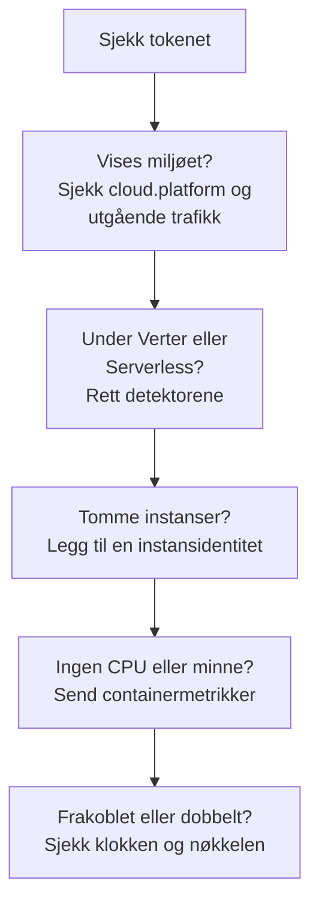

# Feilsøking i skyen

Finn ut hvorfor et skymiljø mangler, er arkivert på feil sted, er tomt eller finnes to ganger. Seksjonene står i den rekkefølgen tingene svikter, og hver seksjon utelukker ett lag, så jobb deg nedover fra toppen. Feil som hører til én plattform, står til slutt på siden for den plattformen: [AWS ECS / Fargate](/docs/telemetry/cloud-aws-ecs), [Google Cloud Run](/docs/telemetry/cloud-gcp-cloud-run), [Azure Container Apps](/docs/telemetry/cloud-azure-container-apps) og [Andre skyplattformer](/docs/telemetry/cloud-other-platforms).



## Sjekk tokenet først

Det er den billigste sjekken, og ingenting nedenfor fungerer uten den:

```bash
curl -i https://oneuptime.com/otlp/v1/validate \
  -H "x-oneuptime-token: YOUR_TELEMETRY_INGESTION_TOKEN"
```

| Svar | Hva det betyr |
| ------------------------- | -------------------------------------------------------------------------------------------------------------------------- |
| `200`, `"valid": true` | Tokenet er godtatt. `keyType` skal være `Server`: en nøkkel av typen `Browser` avvises fra en collector eller en backend-tjeneste. |
| `401`, `"valid": false` | Tokenet mangler, er ukjent, tilbakekalt, deaktivert eller utløpt, og svarets `message` sier hvilket. Opprett en ny nøkkel under **Prosjektinnstillinger → Telemetri og APM → Inntaksnøkler**, og rull den ut på nytt. |

Hvis du hoster OneUptime selv, bruker du `https://YOUR-ONEUPTIME-HOST/otlp/v1/validate`. Kjør sjekken inne fra oppgaven, instansen eller replikaen når du kan (ECS Exec, `az containerapp exec`): den beviser at selve arbeidsbelastningen kan nå OneUptime, ikke bare den bærbare datamaskinen din.

## Miljøet vises ikke

Ingenting under **Sky → All Environments** ett minutt etter den første forespørselen. Sjekk disse tre, i denne rekkefølgen.

**`cloud.platform` mangler, eller er ikke en administrert verdi.** OneUptime arkiverer telemetri under Skymiljøer bare når ressursen bærer en av disse verdiene: `aws_ecs`, `aws_elastic_beanstalk`, `aws_app_runner`, `gcp_cloud_run`, `gcp_app_engine`, `azure_container_apps`, `azure_container_instances` eller `azure_app_service`. De vanlige årsakene:

- Ressursdetektoren er slått av i SDK-en (`OTEL_NODE_RESOURCE_DETECTORS`, `OTEL_EXPERIMENTAL_RESOURCE_DETECTORS`, `-Dotel.resource.providers.<cloud>.enabled=true`).
- Collectorens pipeline hopper over prosessoren `resourcedetection`.
- På en plattform uten detektor har `OTEL_RESOURCE_ATTRIBUTES` en skrivefeil.

Azure-detektorene for Node.js og .NET skriver `azure.container_apps`, `azure.app_service` og `azure.functions`; OneUptime skriver dem om til verdiene med understrek, så de teller med. For å se hva telemetrien din bærer, åpner du tjenesten under **Tjenester**, åpner et av sporene dens fra fanen **Spor**, og leser ressursattributtene. Hvis `cloud.platform` ikke er der, er det hele problemet.

**Tokenet er feil.** Sjekken av tokenet svarte `401`. Collectoren logger det som `Permanent error: ... 401`. En SDK logger det én gang og slutter å prøve på nytt, noe som er riktig OTLP-oppførsel og lett å overse.

**Utgående trafikk er blokkert.** Collectoren logger `connection refused`, `context deadline exceeded`, `i/o timeout` eller en DNS-feil:

- **ECS og Fargate:** et privat subnett trenger en NAT-gateway eller `assignPublicIp=ENABLED`, og sikkerhetsgruppen må tillate utgående trafikk på TCP 443.
- **Cloud Run:** **VPC egress: All traffic** trenger Cloud NAT.
- **Container Apps:** en brukerdefinert rute til en brannmur må tillate OneUptime-verten.
- **Overalt:** en selvhostet OneUptime bak et privat DNS-navn må kunne slås opp fra arbeidsbelastningens nettverk.

## Det vises under Verter i stedet

Ressursen bærer plattformen til en virtuell maskin (`aws_ec2`, `gcp_compute_engine` eller `azure_vm`), så OneUptime arkiverer den under **Verter**: riktig for en virtuell maskin, feil for administrert databehandling. Detektoren til en virtuell maskin vant over den administrerte: `detectors: [ec2, elastic_beanstalk]` i en collector, der den første detektoren som setter `cloud.platform`, vinner, eller en SDK der rekkefølgen favoriserer EC2-detektoren. Sett `elastic_beanstalk` først, eller sett `cloud.platform` selv i `OTEL_RESOURCE_ATTRIBUTES` og behold bare detektoren `env`.

## Det vises bare under Serverløse funksjoner

Ressursen bærer `faas.name`, men ingen administrert `cloud.platform`. Cloud Run og App Engine setter begge når GCP-detektoren kjører. Hvis du setter `faas.name` for hånd, eller en collector forkaster ressursattributtene som SDK-ens detektor satte, er bare den serverløse siden oppfylt. Slå på detektoren, eller sett `cloud.platform=gcp_cloud_run` (eller `gcp_app_engine`), `cloud.account.id` og `cloud.region` selv.

> [!NOTE]
> På Cloud Run og App Engine skal en tjeneste vises begge steder: miljøet samler prosjektet og regionen, og **Serverløse funksjoner** viser den enkelte tjenesten.

## Instanser er tom

Miljøet er der, men fanen **Instanser** viser ingenting: telemetrien bærer ingen instansidentitet. OneUptime gir en instans navn fra det første av disse ressursattributtene det finner:

1. `aws.ecs.task.id`
2. `aws.ecs.task.arn` (forkortet til oppgave-ID-en)
3. `faas.instance`
4. `azure.container_app.instance.id`
5. `service.instance.id`
6. `container.id`
7. `host.id`
8. `host.name`

Plattformens egen identitet kommer før `service.instance.id`, så en ID som SDK-en finner på for hver prosess (Node.js-SDK-en gjør det som standard), ikke kan skille en oppgave fra CPU og minne for sidecaren. Hva som setter identiteten på hver plattform:

| Plattform | Hva som setter identiteten |
| ----------------------------------------- | ------------------------------------------------------------------------------------------------------------------------------------------------ |
| ECS | Detektoren `ecs` setter oppgavens ARN |
| Cloud Run, App Engine | Detektoren `gcp` setter `faas.instance` |
| Container Apps | Collectorens detektor `azurecontainerapps` setter replika-ID-en; eller sett `service.instance.id` fra `CONTAINER_APP_REPLICA_NAME`, eller kjør vertsdetektoren |
| App Runner, Container Instances | Vertsdetektorens `host.name` |
| App Service, Elastic Beanstalk | Plattformens detektor setter `service.instance.id`; på Beanstalk sletter du den, så `host.id` gir hver instans navn |

En instans vises innen ett minutt etter det første signalet som bærer attributtet.

## CPU og minne er tomme

Instansene er oppført, men flisene **CPU** og **Minne** i oversikten, og kolonnene for CPU og minne i **Instanser**, er tomme. De kommer fra metrikker, ikke spor: datapunkter fra `container.cpu.utilization` og `container.memory.usage` (eller `container.memory.usage.total`) der ressursen bærer den samme instansidentiteten som sporene, og `cloud.platform`.

- **På ECS** leverer receiveren `awsecscontainermetrics` i en sidecar-collector dem som `ecs.task.cpu.utilized` og `ecs.task.memory.utilized`. Behold den i pipelinen `metrics`, og behold også `resourcedetection` i den pipelinen, ellers kommer metrikkene uten `cloud.platform` og arkiveres et annet sted.
- **På Cloud Run, Container Apps og de andre plattformene** viser ikke plattformen containerbruken til en sidecar. Flisene forblir tomme med mindre du sender de metrikkene selv: les flisene for forespørsler i stedet.
- **Med SDK direct** sender ingenting containermetrikker, så tomme fliser er forventet.

## Miljøet viser Frakoblet

Et miljø viser **Frakoblet** når det ikke har kommet telemetri for det på 15 minutter, og det neste spennet, den neste loggen eller metrikken bringer det tilbake. Tid da OneUptime selv var nede eller holdt på å ta igjen etterslep, teller ikke med. Mens telemetrien strømmer, kan tidspunktet for sist sett ligge opptil fem minutter etter, og derfor er terskelen 15.

- **Et travelt miljø viser Frakoblet:** eksportøren stoppet. Sjekk collectorens logger for feilene `401` og feilene med utgående trafikk ovenfor.
- **Et testmiljø som skalerer til null om natten,** viser Frakoblet fram til den første forespørselen om morgenen, og det er riktig.

Instanser følger to klokker:

- **Stale:** fanen **Instanser** merker en oppgave, instans eller replika som **Stale** når den ikke har rapportert de siste 15 minuttene, og oversikten teller bare de andre som levende.
- **Slettet:** en opprydding sletter instansrader som ikke er sett på `CLOUD_INSTANCE_STALE_MINUTES` (standard 15, minst 10), målt fra miljøets egen siste telemetri, så et avbrudd i collectoren fryser den klokken i stedet for å slette den sist kjente listen over oppgaver. Serverløse funksjoner bruker `SERVERLESS_INSTANCE_STALE_MINUTES`. En høyere terskel beholder rader lenger; den endrer ikke når de blir **Stale**.

## To miljøer der det burde være ett

Miljønøkkelen er `cloud.platform|cloud.account.id|cloud.region`, sammenlignet tegn for tegn. Hvis noen arbeidsbelastninger setter `cloud.account.id` og andre ikke gjør det, én skriver `eastus` og en annen `East US`, eller én collector kjører detektoren `ecs` og en annen ikke gjør det, får du `aws_ecs|123456789012|us-east-1` og `aws_ecs||us-east-1` side om side.

Åpne **Oversikt** for hvert miljø: **Miljønøkkel** viser hvilken del som er forskjellig. Rett arbeidsbelastningen som mangler verdien. Miljøet med den tomme delen slutter å motta telemetri, og du kan arkivere det.

## Et håndlaget miljø matcher aldri

Inntaket matcher et miljø bare på nøkkelen, og nøkkelen må være nøyaktig `platform|account|region`, for eksempel `aws_ecs|123456789012|us-east-1`: den samme plattformverdien, konto-ID-en og regionen som telemetrien bærer. Opprettingsskjemaet (**Opprett Skyressurs** under **Sky → All Environments**) bygger nøkkelen fra feltene **Skyplattform**, **Sky-konto-ID** og **Skyregion**, så de tre må stemme overens med telemetrien tegn for tegn. Gjør de ikke det, oppretter inntaket et nytt miljø med nøkkelen det kom fram til, og ditt forblir tomt. Arkiver det håndlagde miljøet og la inntaket opprette det riktige, eller opprett det på nytt med de rettede verdiene.

## Fortsatt problemer

Samle inn dette før du ber om hjelp:

- Ressursattributtene fra ett ekte spenn eller én loggpost fra arbeidsbelastningen. Collectorens eksportør `debug` skriver dem ut, eller åpne et spor fra tjenesten under **Tjenester**.
- Svaret fra sjekken `/otlp/v1/validate`, kjørt inne fra arbeidsbelastningen.
- De siste 50 linjene i collectorens logg, eller SDK-ens diagnoselogg med `OTEL_LOG_LEVEL=debug`.
- **Miljønøkkel** for hvert miljø som dukket opp.

Kontakt deretter support@oneuptime.com, eller opprett en sak på [GitHub](https://github.com/OneUptime/oneuptime).

## Neste steg

:::cards
- [Skymiljøer](/docs/telemetry/cloud-environments): Slik identifiseres miljøer og instanser.
- [AWS ECS / Fargate](/docs/telemetry/cloud-aws-ecs): ECS-oppsettet, med en komplett oppgavedefinisjon.
- [OpenTelemetry](/docs/telemetry/open-telemetry): Endepunkter, grenser og hva hvert svar betyr.
:::
