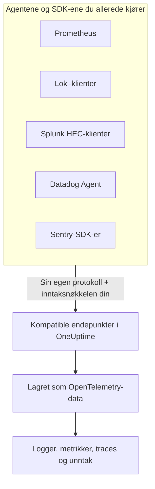

# Prometheus, Loki, Splunk, Datadog & Sentry

Kjører du allerede Prometheus, en Loki-klient, en Splunk-forwarder, Datadog Agent eller et Sentry-SDK? Behold det. OneUptime tar imot det hvert av disse verktøyene sender, på stiene verktøyet allerede bruker, og lagrer det som OpenTelemetry-data. Å prøve OneUptime krever bare en ny URL og nøkkel, ikke ny instrumentering, og drop-filtrene, scrub-reglene, loggpipelinene, dataoppbevaringen og inntaksbudsjettene dine gjelder for disse dataene som for alle andre.

:::cards
- [Prometheus remote write](#prometheus-remote-write): Metrikker fra Prometheus, Grafana Alloy eller en hvilken som helst annen avsender av remote write.
- [Loki](#loki): Logger fra Promtail, Grafana Alloy, Fluent Bit eller Vector.
- [Splunk HTTP Event Collector](#splunk-http-event-collector): Logger og metrikkhendelser fra en hvilken som helst HEC-klient.
- [Datadog Agent](#datadog-agent): Metrikker og logger fra Datadog Agent.
- [Sentry-SDK-er](#sentry-sdk-er): Feil, transaksjoner og logger fra et hvilket som helst Sentry-SDK.
:::

## Slik fungerer det



Hvert endepunkt svarer slik verktøyet selv forventer — en `204` til Prometheus og Loki, HECs `{"text": "Success", "code": 0}`, Datadogs `202`, Sentrys hendelses-ID — så verktøyet melder suksess og feil slik det alltid har gjort. Deretter behandles dataene nøyaktig som data fra et OpenTelemetry-SDK.

## Før du begynner

- **Et OneUptime-prosjekt** – i OneUptime Cloud faktureres telemetri per inntatt GB, og et prosjekt på Free-planen trenger en betalingsmetode før det kan sende telemetri.
- **Inntaksnøkkel for telemetri** – opprett en **Server**-nøkkel under **Produkter → Prosjektinnstillinger → Telemetri og APM → Inntaksnøkler**, og kopier **Hemmelig nøkkel**. Hvert verktøy sender den der det sender sin egen legitimasjon. Sentry-DSN-en til en nettleserapp tar i stedet en nøkkel av typen **Nettleser**, med opprinnelsene til nettstedet ditt på.
- **Verten din** – eksemplene bruker `oneuptime.com`. Hvis du hoster OneUptime selv, bruker du din egen vert.

> [!TIP]
> Fanen Oppsettveiledning på Logger, Målinger, Spor og Unntak har disse verktøyene med blant sine måter å sende på, med verten din og en nøkkel du velger, allerede fylt inn.

## Endepunkter

| Verktøy | Pek det mot | Hvor nøkkelen skal |
| --- | --- | --- |
| Prometheus remote write | `https://oneuptime.com/telemetry/prometheus/api/v1/write` | Et bearer-token, eller basic auth med nøkkelen som passord. |
| Loki | `https://oneuptime.com/telemetry/loki/api/v1/push` | Basic auth med nøkkelen som passord, eller et bearer-token. |
| Splunk HTTP Event Collector | `https://oneuptime.com/telemetry/services/collector` | HEC-tokenet: `Authorization: Splunk <key>`. |
| Datadog Agent | `https://oneuptime.com/telemetry/datadog` | API-nøkkelen: `DD-API-KEY`. |
| Sentry-SDK-er | DSN-en `https://<key>@oneuptime.com/telemetry/sentry/1` | Den offentlige nøkkelen i DSN-en. |

Hvert endepunkt tar også imot nøkkelen i headeren `x-oneuptime-token`, og headeren `x-oneuptime-service-name` angir tjenesten alt verktøyet sender, hører til. En nøkkel kan skrives som sine 32 heksadesimale sifre uten bindestreker; i Sentry-DSN-en og API-nøkkelen til Datadog må den skrives slik.

## Prometheus remote write

Legg til OneUptime som et remote write-mål. Prometheus fortsetter å skrape som nå og sender en kopi av hver sample:

```yaml title="prometheus.yml"
remote_write:
  - url: https://oneuptime.com/telemetry/prometheus/api/v1/write
    authorization:
      credentials: YOUR_TELEMETRY_KEY
```

Med Grafana Alloy legger du til en `prometheus.remote_write`-komponent og videresender skrapingene dine til den:

```text title="config.alloy"
prometheus.remote_write "oneuptime" {
  endpoint {
    url          = "https://oneuptime.com/telemetry/prometheus/api/v1/write"
    bearer_token = "YOUR_TELEMETRY_KEY"
  }
}
```

Remote write 1.0 og 2.0 tas begge imot, snappy-komprimert slik alle avsendere sender dem.

### Hva en serie blir til

- **Navnet og etikettene beholdes.** `http_requests_total{job="checkout", code="500"}` er metrikken `http_requests_total` med attributtene `job` og `code`, så en spørring som flyttes fra Grafana, finner den.
- **Jobben er tjenesten.** Hver `job` blir en tjeneste, og hver `instance` blir tjenesteinstansen dens, slik OpenTelemetrys Prometheus-regler kartlegger dem.
- **Typene beholdes.** Tellere, og bøttene og antallene i et histogram, er kumulative summer, så ratene deres vises riktig i diagrammer. En type kommer fra metadataene avsenderen sender med; uten dem er et navn som slutter på `_total`, en teller, og en `_bucket` med en `le`-etikett en histogrambøtte.
- **Native histogrammer** blir eksponentielle histogrammer, og native histogrammer med egendefinerte bøtter blir vanlige histogrammer.
- **Beholdes ikke:** staleness-markører og andre samples med NaN eller uendelige verdier, `_created`-seriene til tellere, og exemplars.

## Loki

OneUptime tar imot push-API-et til Loki på Lokis egen sti, i JSON eller som den snappy-komprimerte protobufen Promtail og Grafana Alloy sender. Legg til OneUptime som klient:

```yaml title="promtail.yaml"
clients:
  - url: https://oneuptime.com/telemetry/loki/api/v1/push
    bearer_token: YOUR_TELEMETRY_KEY
```

I Fluent Bit tar `loki`-utdataen verten og stien hver for seg:

```text title="fluent-bit.conf"
[OUTPUT]
    Name         loki
    Match        *
    Host         oneuptime.com
    Port         443
    Tls          On
    Uri          /telemetry/loki/api/v1/push
    Http_User    oneuptime
    Http_Passwd  YOUR_TELEMETRY_KEY
    Labels       job=fluent-bit
```

### Hva en strøm blir til

- **Hver oppføring er en logg**, med sitt eget tidsstempel ned til nanosekundet og linjen sin som innhold.
- **Etiketter og strukturerte metadata er attributter**, under navnene de har i Loki.
- **Tjenesten** kommer fra den første av `service_name`, `service`, `app`, `application`, `name`, `app_kubernetes_io_name`, `container`, `container_name`, `component`, `workload` og `job` som en strøm har, slik Loki finner den. En `host`- eller `hostname`-etikett angir verten.
- **Nivået** kommer fra en `level`-, `detected_level`- eller `severity`-etikett eller -metadata, ellers fra en logfmt-`level=` eller `level`-feltet i en JSON-linje.
- **Sporingskontekst:** en `trace_id` og `span_id` i de strukturerte metadataene knytter loggen til tracen.

## Splunk HTTP Event Collector

Bruk OneUptime som HTTP Event Collector, med inntaksnøkkelen din som HEC-token. Docker-loggdriveren til Splunk legger til stien selv, så den tar bare verten:

```bash
docker run \
  --log-driver=splunk \
  --log-opt splunk-url=https://oneuptime.com \
  --log-opt splunk-token=YOUR_TELEMETRY_KEY \
  --log-opt splunk-format=json \
  your-image
```

Alle andre HEC-klienter poster til `/services/collector/event` eller `/services/collector/raw`. Slik sender du én hendelse:

```bash
curl https://oneuptime.com/telemetry/services/collector/event \
  -H "Authorization: Splunk YOUR_TELEMETRY_KEY" \
  -d '{"event": "Payment failed for order 42", "sourcetype": "app", "fields": {"service": "checkout"}}'
```

En `200` med `{"text": "Success", "code": 0}` betyr at hendelsen ble tatt imot. Endepunktet svarer også med HECs egne koder — `No data` (5), `Invalid data format` (6) med nummeret på hendelsen som ikke var gyldig, og `Event field is required` (12) — og svarer på `GET /services/collector/health` uten token.

### Hva en hendelse blir til

- **En logg**, med `time` fra hendelsen som tidsstempel. Er hendelsen en streng, er den innholdet; er den et objekt, er `message`, `msg`, `log`, `line` eller `text` innholdet, og de andre feltene er attributter.
- **Metadataene beholdes:** `host` er verten, og `source`, `sourcetype` og `index` beholdes som `com.splunk.source`, `com.splunk.sourcetype` og `com.splunk.index`. `host`, `source`, `sourcetype` og `index` i spørrestrengen fyller inn det en hendelse utelater.
- **Feltene er attributter.** Et `service.name`-felt angir tjenesten, og det gjør også `service`-feltet i en logg.
- **Metrikkhendelser** (`"event": "metric"`, med `metric_name` og `_value`, eller `metric_name:<name>`-felter) lagres som metrikker, aldri som logger.
- **Tilbys ikke:** indexer acknowledgement. En klient som ber om det, får ingen `ackId`.

## Datadog Agent

Pek metrikkene og loggene til Agenten mot OneUptime, med inntaksnøkkelen din som API-nøkkel:

```yaml title="datadog.yaml"
api_key: YOUR_TELEMETRY_KEY_WITHOUT_HYPHENS
dd_url: https://oneuptime.com/telemetry/datadog
logs_enabled: true
logs_config:
  use_http: true
  logs_dd_url: oneuptime.com:443
apm_config:
  enabled: false
process_config:
  process_collection:
    enabled: false
```

Agenten legger til sine egne stier på `dd_url`, og sender logger til `/api/v2/logs` på verten og porten som `logs_dd_url` angir. OneUptime svarer på disse stiene i roten bare for en request som har en `DD-API-KEY`-header. Start Agenten på nytt etter endringen; `datadog-agent status` viser API-nøkkelen som gyldig når OneUptime godtar den.

### Hva dataene fra Agenten blir til

- **Metrikker** beholder navnene sine. Gauges forblir gauges, counts blir summer, og rates blir gauges av verdien per sekund.
- **Distributions** blir summaries med antall, sum, minimum og maksimum.
- **Service checks** blir en metrikk oppkalt etter sjekken, der verdien er statusen til sjekken: 0 OK, 1 advarsel, 2 kritisk, 3 ukjent.
- **Logger** beholder melding, status, vert og tjeneste, og resten av feltene som attributter.
- **Tagger er attributter**, og taggene `service`, `env` og `version` angir tjenesten, miljøet og versjonen.
- **Leses ikke ennå:** APM-traces, prosesser, containere, nettverksdata og profiler. La dem være slått av i `datadog.yaml`, som ovenfor.

HTTP API-klientene til Datadog — et loggbibliotek som poster til `/api/v2/logs`, et skript som poster serier — kan sende til det samme endepunktet med `DD-API-KEY`-headeren.

## Sentry-SDK-er

Bytt ut DSN-en der du setter opp Sentry. Resten av Sentry-koden din forblir som den er:

```javascript
Sentry.init({
  dsn: "https://YOUR_TELEMETRY_KEY_WITHOUT_HYPHENS@oneuptime.com/telemetry/sentry/1",
  release: "checkout@1.4.2",
  environment: "production",
});
```

```python
sentry_sdk.init(
    dsn="https://YOUR_TELEMETRY_KEY_WITHOUT_HYPHENS@oneuptime.com/telemetry/sentry/1",
    release="checkout@1.4.2",
    environment="production",
)
```

Ettallet `1` på slutten av DSN-en kreves av SDK-ene til Sentry og leses ikke. DSN-en til en nettleserapp er offentlig, så bruk en inntaksnøkkel av typen **Nettleser** der, med opprinnelsene til nettstedet ditt på.

### Hva en konvolutt blir til

- **Feil** vises i Unntak, med stack trace og unntakene som forårsaket dem, gruppert som alle andre unntak. Hver feil er et span i tracen sin, under spannet som var aktivt.
- **Transaksjoner** og spannene deres vises i Spor.
- **Sentry-logger** og meldinger som fanges med `capture_message`, vises i Logger.
- **Tjenesten** er en `service`-tagg, ellers navnet på releasen før `@`: `checkout@1.4.2` er `checkout`. Releasen er tjenesteversjonen, og miljøet beholdes.
- **Beholdes ikke:** økter, replays, vedlegg, profiler og check-ins. SDK-et sender dem fortsatt; OneUptime tar imot dem og forkaster dem.

## Grenser og inntaksbudsjetter

- **Requeststørrelse** – ingressen i OneUptime godtar requester på opptil 4 MB under `/telemetry`, og innholdet i hver request kan være på høyst 64 MB dekomprimert.
- **Inntaksbudsjetter** – Prometheus remote write og Loki sjekkes mot budsjettet for metrikker eller logger før innholdet leses, og avvises med `403` når det er brukt opp. En HEC-batch, en Datadog-nyttelast eller en Sentry-konvolutt kan inneholde flere signaler, så hvert signal telles mot sitt eget budsjett når det lagres, og forkastes når det budsjettet er brukt opp.

## Feilsøking

### Alle requester avvises med 401

Nøkkelen kom ikke fram der endepunktet ser etter den, eller den er ikke en nøkkel i dette prosjektet. Sammenlign legitimasjonsinnstillingen i verktøyet med tabellen [Endepunkter](#endepunkter), og sjekk at nøkkelen ikke er slått av eller utløpt.

### Et Sentry-SDK sier at DSN-en er ugyldig

SDK-ene til Sentry avviser en DSN der nøkkelen har bindestreker. Skriv nøkkelen som sine 32 heksadesimale sifre, uten bindestrekene.

### Datadog-metrikker kommer fram, men ikke logger

Sjekk at `logs_config.use_http` er `true`, og at `logs_config.logs_dd_url` er en vert og en port, ikke en URL. Agenten sender logger over TCP når `use_http` ikke er satt.

### Prometheus melder 415

Avsenderen ba om en remote write-protokoll som OneUptime ikke leser. Send remote write 1.0 eller 2.0.
