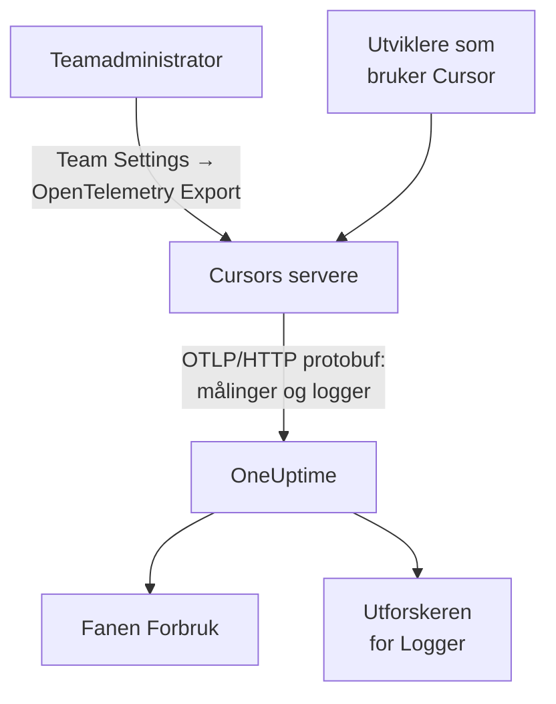

# Cursor

Cursor eksporterer teamets telemetri fra Cursors egne servere. En teamadministrator legger til OneUptime som destinasjon én gang, i Cursors dashbord, og hele teamets tokens, anslåtte kostnad og verktøykall kommer inn: ingenting å installere eller sette opp på utviklernes maskiner.

:::cards
- [Sett det opp](#sett-det-opp): Opprett en nøkkel i OneUptime og en destinasjon i Cursor.
- [Hva du får](#hva-du-får-og-hva-du-ikke-får): Målinger og logger; ingen traces.
- [Hvem brukte hva](#tilordning-til-ansatte): Personer kommer inn som Cursor-bruker-id-er.
- [Feilsøking](#feilsøking): Hva du sjekker når ingenting kommer inn.
:::

## Slik fungerer det



## Før du begynner

- **Cursors Enterprise-abonnement.** Skjermen OpenTelemetry Export finnes ikke i de andre abonnementene.
- **Et endpoint Cursor kan nå fra internett.** Det er Cursor som kobler til deg, fra et fast sett med adresser. OneUptime Cloud trenger ikke noe mer; en selvdriftet OneUptime bak en brannmur må tillate de utgående adressene Cursor oppgir på siden [OpenTelemetry Export](https://cursor.com/docs/enterprise/opentelemetry-export).

## Sett det opp

:::steps
### Opprett en inntaksnøkkel

I OneUptime åpner du **Prosjektinnstillinger → Telemetri og APM → Inntaksnøkler**, klikker på **Opprett ingestion-nøkkel** og kopierer nøkkelen. OTLP-basis-URL-en din er `https://oneuptime.com/otlp`, eller `https://YOUR-ONEUPTIME-HOST/otlp` hvis du drifter OneUptime selv.

### Opprett destinasjonen i Cursor

I Cursors nettdashbord åpner du som teamadministrator **Team Settings → OpenTelemetry Export** og oppretter en destinasjon:

| Felt | Verdi |
| --- | --- |
| Endpoint (base URL) | `https://oneuptime.com/otlp` |
| Header name | `x-oneuptime-token` |
| Header value | `YOUR_INGESTION_TOKEN` |

Skriv inn basis-URL-en uten `/v1`: Cursor legger selv til `/v1/metrics` og `/v1/logs`, og `https://oneuptime.com/otlp/v1` ville sende til `/otlp/v1/v1/metrics`, der ingenting kommer fram.

### Test og slå på

Klikk på **Test connection** for å sjekke URL-en og headeren, og deretter på **Enable**. Eksporten starter i løpet av omtrent ett minutt; senere endringer i headeren tar omtrent 30 sekunder.

### Sjekk at data kommer inn

Bruk Cursor i et minutt eller to, åpne deretter **Logger** i OneUptime, og filtrer på tjenestenavnet `cursor`: `cursor.api.request`-poster med antall tokens betyr at nøkkelen og URL-en er riktige.
:::

Cursor snakker bare OTLP over HTTP med binær protobuf (ingen gRPC, ingen JSON), som OneUptime godtar som den er. Den lagrer headeren kryptert og sender til én destinasjon per team: for å sende til OneUptime og et annet sted setter du en collector foran.

## Hva du får, og hva du ikke får

| Signal | Fra Cursor |
| --- | --- |
| Målinger: tokens, anslått kostnad, verktøykall | Ja, som deltaer |
| Logghendelser: forespørsler, feil, korrigeringer, skills, hooks, plugins, skyagenter | Ja |
| Tekst fra prompter og svar | Bare hvis du slår på familien `conversation_content` |
| Traces | Nei |
| Noe fra før du slo på destinasjonen | Nei |

I OneUptime vises Cursor altså på fanen **Forbruk** under **Produkter → AI / LLM**, fra `cursor.token.usage` og `cursor.cost.usage`, men aldri under **Kall** eller **Samtaler**, som bygges fra traces. Detaljene per forespørsel er hendelsen `cursor.api.request` i utforskeren for **Logger**.

### Familier

Hvert signal, og hver familie av telemetri, har sin egen bryter i Cursors innstillinger:

| Familie | Dekker |
| --- | --- |
| `model_usage` | `cursor.token.usage`, `cursor.cost.usage` og hendelsene `cursor.api.request`, `cursor.api.error` og `cursor.api.correction` |
| `tool_calls` | `cursor.tool.calls` |
| `skills_hooks_plugins` | Hendelser fra skills, hooks og plugins |
| `cloud_agents` | `cursor.cloud_agent.*`-hendelser |
| `grok_bot_agent_actions` | `cursor.grok_bot.*`-hendelser; krever Action Recording |
| `conversation_content` | Meldingstekst og inndata og utdata fra MCP-verktøy; av som standard |

Alle familier unntatt `conversation_content` starter som på. Familier Cursor legger til senere, starter også som på, med mindre du slår av `auto_enable_new_families`.

## Målinger og hendelser

Alle tre målingene er deltasummer:

| Måling | Enhet | Attributter |
| --- | --- | --- |
| `cursor.token.usage` | `{token}` | `cursor.token.type`: `input`, `output`, `cache_read`, `cache_creation`; `cursor.model.name`; `cursor.api.status`: `success`, `errored`, `aborted`; `cursor.api.billable` |
| `cursor.cost.usage` | `USD` | `cursor.model.name` |
| `cursor.tool.calls` | `{call}` | `cursor.tool.kind`: `builtin`, `mcp`; `cursor.tool.name`; `cursor.tool.status`: `success`, `failure`, `aborted`; `cursor.mcp.server.name` |

Datapunktene bærer ingen samtale- eller forespørsels-id, så kostnad per økt finnes ikke i målingene. `cursor.model.name` er den forespurte modellen, med rutede valg slått sammen: en inndeling etter modell har en rad som heter `Auto`, som ikke kan fordeles på modellene Cursor rutet den til.

Logghendelsen du oftest kommer til å bruke, er `cursor.api.request`: én per forespørsel, med antall input-, output- og cachetokens, modellen og om den ble fakturert. `cursor.api.error` registrerer en mislykket forespørsel (uten feilmeldingen), og `cursor.api.correction` kommer senere for å si at en forespørsel likevel ikke ble fakturert. Cursors [formatreferanse](https://cursor.com/docs/enterprise/opentelemetry-export/wire) viser alle hendelser og attributter.

Hver post bærer disse ressursattributtene:

| Attributt | Hva det er |
| --- | --- |
| `service.name` | Alltid `cursor`: filtrer utforskerne for **Logger** og **Målinger** på det |
| `cursor.team.id` | Teamet ditt, et heltall; alltid til stede |
| `cursor.user.id` | Personen, et heltall innenfor teamet; valgfritt |
| `cursor.surface` | Hvor aktiviteten kom fra, som `desktop`, `cli`, `cloud_agent` eller `bugbot` |
| `cursor.entrypoint` | Hvordan den startet, som `desktop`, `cli`, `web`, `api` eller `github_pr` |

## Tilordning til ansatte

**Cursor nevner en person med `cursor.user.id`, et heltall bare Cursor kan gjøre om til et navn, og utelater det ofte for skyagenter.** OneUptime leser det som den ansatte, og `cursor.team.id` som teamet, så fanen **Forbruk** rangerer personer og team uten oppsett, men personer vises som heltall.

- Begge kommer inn som ressursattributter (`resource.cursor.user.id`, `resource.cursor.team.id`), som OneUptime leser.
- Cursor kan også sende `cursor.user.email`, men OneUptime leser den ikke ennå, så den ansattes e-postkolonne forblir tom for Cursor.
- `gen_ai.user`, `llm.user` og LiteLLMs sluttbruker-id-er leses aldri som den ansatte: de nevner kundene dine, ikke de ansatte. Se [Tilordning til ansatte og team](/docs/telemetry/ai-coding-assistants#tilordning-til-ansatte-og-team).

### Hvor Cursor vises på fanen Forbruk

Cursor sender målinger og ingen GenAI-spans, og målingene fyller bare hullene i spans: **hvis det samme prosjektet mottar GenAI-spans med kostnad, vises ikke Cursors forbruk.** Send Cursor til et eget prosjekt. Se [Spans kommer først, målinger fyller hullene](/docs/telemetry/ai-llm-observability#spans-kommer-først-målinger-fyller-hullene).

| Inndeling | For Cursor |
| --- | --- |
| **Ansatt** | Ja, etter `cursor.user.id` |
| **Team** | Ja, etter `cursor.team.id` |
| **Modell** | Ja, etter `cursor.model.name` |
| **Leverandør** | Nei: Cursor sier aldri hvilken leverandør som betjente et kall |
| **Applikasjon / Tjeneste** | Nei: Cursors målinger hører ikke til noen OneUptime-tjeneste |

En Cursor-rad bærer bare kostnad: cellene for kall og tokens viser `—`, fordi `cursor.cost.usage` ikke har detaljer per kall. `cursor.token.usage` fyller fortsatt tokentotalene over tabellen (typene `input` og `output`; cachetokens er utelatt), og du kan vise den i et dashbord etter `cursor.token.type`.

:::details Gjør en Cursor-bruker-id om til en person
Navn og fakturerte beløp ligger i Cursors Admin API, som OneUptime ikke kaller: kall det selv hvis du trenger det. Det er bare for Enterprise, på `https://api.cursor.com`, og tar en administrator-API-nøkkel som brukernavn med et tomt passord:

```bash
curl -u YOUR_API_KEY: https://api.cursor.com/teams/members
```

`GET /teams/members` viser e-posten og navnet til hvert medlem. `POST /teams/filtered-usage-events` returnerer fakturert forbruk per hendelse; summer `chargedCents` for å få forbruket. `conversationId` der samsvarer med `cursor.conversation.id` på Cursors logghendelser, som knytter en person og et fakturert beløp til en økt du allerede ser, når begge sider bærer den. Cursor dokumenterer ikke at heltallet `cursor.user.id` og bruker-id-ene i Admin API-et er de samme, så sjekk det på ditt eget team før du fakturerer noen ut fra det.
:::

## Slik leverer Cursor

Disse reglene endrer hva du ser i grafer, så kjenn dem før du rapporterer et hull:

- **Målinger sendes høyst én gang.** En mislykket eksport prøves ikke på nytt, så et kort hull etter en feil er forventet: ikke tilkall noen for hull i Cursors målinger.
- **Logger sendes minst én gang**, dedupliseres på `cursor.event.id` og prøves automatisk på nytt i omtrent 7 dager.
- **Det finnes ingen rekkefølge.** En `cursor.api.correction` kommer etter forespørselen den korrigerer: sorter etter postens tidsstempel, aldri etter ankomst.
- **Ingenting fylles inn i ettertid.** Ingenting fra før du slo på destinasjonen kommer inn, og en destinasjon som blir stående ødelagt, mister det Cursor ikke fikk sendt.
- **Å slå av eller slette en destinasjon mister data underveis.** For å bytte inntaksnøkkel redigerer du destinasjonens header i stedet for å slette og opprette den på nytt.

## Kostnad er et anslag, ikke en faktura

Cursor dokumenterer `cursor.cost.usage` som et beste anslag. Det skiller ikke inkludert forbruk fra forbruk som faktureres ved behov; med dine egne modellnøkler gjenspeiler det bare Cursors tokenpris, ikke fakturaen fra leverandøren din; og en senere `cursor.api.correction` kan trekke tilbake forbruk som allerede er telt. Les det som en trend. For et tall som stemmer med fakturaen, summerer du `chargedCents` fra Cursors Admin API.

## Feilsøking

:::details Ingenting kommer inn
Kjør **Test connection** på nytt i Cursor. Sjekk at basis-URL-en ikke slutter på `/v1`, at headernavnet er `x-oneuptime-token` og verdien nøyaktig nøkkelen, og at familien `model_usage` er slått på. Eksporten starter omtrent ett minutt etter at du slår på destinasjonen.
:::

:::details Ingenting kommer inn til en selvdriftet OneUptime
Cursor kobler til fra sine egne servere: OTLP-endpointet ditt må kunne nås fra internett, under et offentlig DNS-navn, og slippe Cursors utgående adresser gjennom brannmuren din.
:::

:::details Logger kommer inn, men fanen Forbruk viser ikke noe forbruk fra Cursor
Prosjektet mottar også GenAI-spans med kostnad, så Cursors målinger leses ikke. Send Cursor til et eget prosjekt, med sin egen inntaksnøkkel.
:::

:::details Personer vises som tall
Det er `cursor.user.id`: den eneste person-id-en OneUptime leser fra Cursor i dag. Knytt den til navn med Cursors Admin API.
:::

## Neste steg

:::cards
- [AI-kodeassistenter](/docs/telemetry/ai-coding-assistants): Slik tilordnes forbruk på tvers av alle kodeassistenter.
- [AI-gatewayer](/docs/telemetry/ai-gateways): Fullstendige traces og prompter for modellkallene dine egne apper gjør.
- [Metrikk-overvåking](/docs/monitor/metrics-monitor): Varsle på `cursor.cost.usage`, `cursor.token.usage` eller `cursor.tool.calls`.
:::
