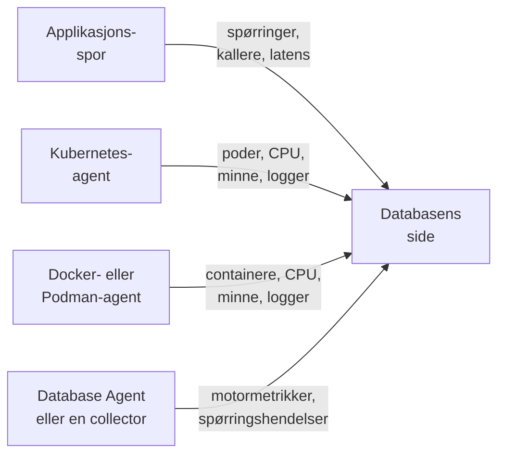

# Databaser

**Databases** gir hver databaseserver som prosjektet ditt kjører eller snakker med, sin egen side: hvem som kaller den og hvor raskt, hvor den kjører, motorens egne helsemetrikker, loggene og sporene dens, hendelsene, varslene og det planlagte vedlikeholdet som er knyttet til den, og varslingsmonitorene som anbefales for motoren. Databaser har etiketter, eiere, etikett- og eierregler, oppbevaring per database og arkivering, som alle andre ressurser. Åpne dem under **Produkter → Ressurser → Databaser**.

:::cards
- [Database Agent](#database-agent): Motormetrikker for PostgreSQL, MySQL, SQL Server, Oracle, Redis, MongoDB, Elasticsearch og Memcached.
- [Slik oppdages databaser](#slik-oppdages-databaser): Fra spor, Kubernetes, Docker, Podman og collectorer.
- [Varsler for en database](#varsler-for-en-database): Anbefalte monitorer og monitorer du bygger selv.
- [Feilsøking](#feilsøking): Et diagnoseskript, og de vanlige problemene.
:::

## Slik fungerer det

De fleste databaser dukker opp av seg selv. OneUptime setter sammen hver database fra opptil fire kilder, og hver kilde bidrar med noe forskjellig:

| Kilde | Hva den trenger fra deg | Hva den legger til databasens side |
| --- | --- | --- |
| **Applikasjonsspor** | Instrumenterte applikasjoner (OpenTelemetry) | Spørringer fra applikasjoner: kallrate, feil, latens og tjenestene som kaller den |
| **Kubernetes** | [Kubernetes-agenten til OneUptime](/docs/telemetry/kubernetes-agent) | Hvor den kjører: poder, CPU og minne, og podenes logger |
| **Docker / Podman** | [Docker-agenten](/docs/telemetry/docker-host) eller [Podman-agenten](/docs/telemetry/podman-host) | Hvor den kjører: containerne, CPU-en og minnet deres, og loggene deres |
| **Database Agent** (en OpenTelemetry Collector) | [Database Agent](#database-agent) eller din egen collector | **Engine metrics**: tilkoblinger, gjennomstrømning, treffrate i hurtigbufferen, låser, replikeringsforsinkelse, minne, så langt motoren har dem (se [Hva som samles inn](#hva-som-samles-inn)), pluss valgfrie spørringsprøver, toppspørringer og motorens loggfil |



Motormetrikker kommer bare fra en collector som snakker med selve databasen (eller, for en administrert skydatabase, med leverandørens overvåkings-API). Spor og containerinventarer forteller OneUptime at en database finnes og hvordan den brukes, men ikke hvordan den har det innvendig; statusen **Engine metrics** på hver database viser om den delen er tilkoblet.

Du kan også legge til en database manuelt: **Databases → Opprett Database** med motor, adresse og port. For en helsesjekk fra en probe som ikke trenger noen agent i det hele tatt, se [Databasehelse-overvåking](/docs/monitor/database-health-monitor).

## Støttede databaser

OneUptime kjenner motorene nedenfor ved navn: den normaliserer det instrumenteringer legger i `db.system.name` (eller den eldre `db.system`) til verdien i den andre kolonnen, viser motorens navn, bruker standardporten dens når et span eller en adresse mangler port, gjenkjenner containerimagene og Helm-chartene dens og vet hvor motormetrikkene kommer fra. En motor som ikke står på listen, fungerer likevel overalt der en database kjennes igjen på adressen sin; den vises bare under det rå navnet spanene dine rapporterer, og opprettes aldri bare fra spor.

En **familie** er motoren som en fork eller en protokollkompatibel motor nås gjennom: klientbiblioteker kan ikke skille MariaDB fra MySQL eller Valkey fra Redis, så et span sier `mysql` eller `redis` mens et containerimage, et Helm-chart eller Database Agent navngir forken. Begge havner i samme database, og databasen viser den mer spesifikke motoren så snart containerimaget dens, eller en kilde som er minst like sterk som den bak den nåværende motoren, navngir den (se [Hvilken motor en database viser](#hvilken-motor-en-database-viser)).

**Opprettet fra spor** sier om klientspan alene oppretter en database for den motoren (se [Fra applikasjonsspor](#fra-applikasjonsspor)): en administrert tjeneste som nås gjennom leverandørens delte API-vert, og en motor som kjører inne i applikasjonens prosess, gjør det aldri. **Engine metrics** sier hvor motorens egne helsemetrikker kommer fra: en konfigurasjon for Database Agent, en collector-contrib-receiver du legger til i din egen collector, motorens eget Prometheus-endepunkt (`:port/path`, skrapet med collectorens `prometheus`-receiver), skyleverandørens overvåkings-API eller ingenting innebygd. Fanen **Dokumentasjon** på hver database gjør dette til en ferdig collectorkonfigurasjon for den databasen.

| Motor | `db.system.name` | Standardport | Familie | Opprettet fra spor | Engine metrics |
| --- | --- | --- | --- | --- | --- |
| Actian Ingres | `actian.ingres` | — | — | Ja | Ingenting innebygd |
| Actian Zen (Pervasive PSQL) | `pervasive` | 1583 | — | Ja | Ingenting innebygd |
| Aerospike | `aerospike` | 3000 | — | Ja | receiver `aerospike` |
| Amazon DocumentDB | `aws.documentdb` | 27017 | MongoDB | Ja | receiver `awsfirehose` (skyovervåking) |
| Amazon DynamoDB | `aws.dynamodb` | 443 | — | Nei (sky-API) | receiver `awsfirehose` (skyovervåking) |
| Amazon Neptune | `aws.neptune` | 8182 | — | Ja | receiver `awsfirehose` (skyovervåking) |
| Amazon Redshift | `aws.redshift` | 5439 | PostgreSQL | Ja | receiver `awsfirehose` (skyovervåking) |
| Apache Derby | `derby` | 1527 | — | Nei (i prosessen) | Ingen (i prosessen) |
| Apache Doris | `doris` | 9030 | MySQL | Ja | Prometheus, `:8030/metrics` |
| Apache Druid | `druid` | 8888 | — | Ja | Ingenting innebygd |
| Apache Geode | `geode` | 10334 | — | Ja | Ingenting innebygd |
| Apache HBase | `hbase` | — | — | Ja | Ingenting innebygd |
| Apache Hive | `hive` | 10000 | — | Ja | Ingenting innebygd |
| Apache Ignite | `ignite` | 10800 | — | Ja | Ingenting innebygd |
| Apache Impala | `impala` | 21050 | — | Ja | Ingenting innebygd |
| Apache Pinot | `pinot` | 8099 | — | Ja | Ingenting innebygd |
| Apache Solr | `solr` | 8983 | — | Ja | Ingenting innebygd |
| ArangoDB | `arangodb` | 8529 | — | Ja | Prometheus, `:8529/_admin/metrics/v2` |
| Azure Cosmos DB | `azure.cosmosdb` | 443 | — | Nei (sky-API) | receiver `azure_monitor` (skyovervåking) |
| Cassandra | `cassandra` | 9042 | — | Ja | Ingenting innebygd |
| Chroma | `chroma` | 8000 | — | Ja | Ingenting innebygd |
| Claris FileMaker | `filemaker` | 2399 | — | Ja | Ingenting innebygd |
| ClickHouse | `clickhouse` | 9000 | — | Ja | Prometheus, `:9363/metrics` |
| Cloud Bigtable | `gcp.bigtable` | 443 | — | Nei (sky-API) | receiver `googlecloudmonitoring` (skyovervåking) |
| Cloud Firestore | `gcp.firestore` | 443 | — | Nei (sky-API) | receiver `googlecloudmonitoring` (skyovervåking) |
| Cloud Spanner | `gcp.spanner` | 443 | — | Nei (sky-API) | receiver `google_cloud_spanner` |
| CockroachDB | `cockroachdb` | 26257 | PostgreSQL | Ja | Prometheus, `:8080/_status/vars` |
| Couchbase | `couchbase` | 11210 | — | Ja | Prometheus, `:8091/metrics` |
| CouchDB | `couchdb` | 5984 | — | Ja | receiver `couchdb` |
| Databricks | `databricks` | 443 | — | Ja | Ingenting innebygd |
| Dragonfly | `dragonfly` | 6379 | Redis | Ja | Database Agent (receiver `redis`) |
| DuckDB | `duckdb` | — | — | Nei (i prosessen) | Ingen (i prosessen) |
| Elasticsearch | `elasticsearch` | 9200 | — | Ja | Database Agent (receiver `elasticsearch`) |
| etcd | `etcd` | 2379 | — | Ja | Prometheus, `:2379/metrics` |
| FerretDB | `ferretdb` | 27017 | MongoDB | Ja | Prometheus, `:8088/debug/metrics` |
| Firebird | `firebirdsql` | 3050 | — | Ja | Ingenting innebygd |
| FoundationDB | `foundationdb` | 4500 | — | Ja | Ingenting innebygd |
| Google BigQuery | `bigquery` | 443 | — | Nei (sky-API) | receiver `googlecloudmonitoring` (skyovervåking) |
| Greenplum | `greenplum` | 5432 | PostgreSQL | Ja | Ingenting innebygd |
| H2 | `h2database` | 9092 | — | Nei (i prosessen) | Ingen (i prosessen) |
| Hazelcast | `hazelcast` | 5701 | — | Ja | Ingenting innebygd |
| HyperSQL | `hsqldb` | 9001 | — | Nei (i prosessen) | Ingen (i prosessen) |
| IBM Db2 | `ibm.db2` | 50000 | — | Ja | Ingenting innebygd |
| IBM Informix | `ibm.informix` | 9088 | — | Ja | Ingenting innebygd |
| IBM Netezza | `ibm.netezza` | 5480 | — | Ja | Ingenting innebygd |
| InfluxDB | `influxdb` | 8086 | — | Ja | Prometheus, `:8086/metrics` |
| InstantDB | `instantdb` | — | — | Nei (i prosessen) | Ingen (i prosessen) |
| InterBase | `interbase` | 3050 | Firebird | Ja | Ingenting innebygd |
| InterSystems IRIS / Caché | `intersystems.cache` | 1972 | — | Ja | Prometheus, `:52773/api/monitor/metrics` |
| KeyDB | `keydb` | 6379 | Redis | Ja | Database Agent (receiver `redis`) |
| MariaDB | `mariadb` | 3306 | MySQL | Ja | Database Agent (receiver `mysql`) |
| Meilisearch | `meilisearch` | 7700 | — | Ja | Prometheus, `:7700/metrics` |
| Memcached | `memcached` | 11211 | — | Ja | Database Agent (receiver `memcached`) |
| Milvus | `milvus` | 19530 | — | Ja | Prometheus, `:9091/metrics` |
| MongoDB | `mongodb` | 27017 | — | Ja | Database Agent (receiver `mongodb`) |
| MySQL | `mysql` | 3306 | — | Ja | Database Agent (receiver `mysql`) |
| Neo4j | `neo4j` | 7687 | — | Ja | Prometheus, `:2004/metrics` |
| OceanBase | `oceanbase` | 2881 | MySQL | Ja | Ingenting innebygd |
| OpenSearch | `opensearch` | 9200 | Elasticsearch | Ja | Database Agent (receiver `elasticsearch`) |
| Oracle | `oracle.db` | 1521 | — | Ja | Database Agent (receiver `oracledb`) |
| Pinecone | `pinecone` | 443 | — | Nei (sky-API) | Ingenting innebygd |
| PostgreSQL | `postgresql` | 5432 | — | Ja | Database Agent (receiver `postgresql`) |
| Presto | `presto` | 8080 | — | Ja | Ingenting innebygd |
| Progress OpenEdge | `progress` | — | — | Ja | Ingenting innebygd |
| Qdrant | `qdrant` | 6333 | — | Ja | Prometheus, `:6333/metrics` |
| QuestDB | `questdb` | 8812 | PostgreSQL | Ja | Prometheus, `:9003/metrics` |
| RavenDB | `ravendb` | 8080 | — | Ja | Ingenting innebygd |
| Redis | `redis` | 6379 | — | Ja | Database Agent (receiver `redis`) |
| Riak KV | `riak` | 8087 | — | Ja | receiver `riak` |
| SAP ASE (Sybase) | `sybase` | 5000 | — | Ja | Ingenting innebygd |
| SAP HANA | `sap.hana` | 30015 | — | Ja | receiver `saphana` |
| SAP MaxDB | `sap.maxdb` | 7210 | — | Ja | Ingenting innebygd |
| ScyllaDB | `scylladb` | 9042 | Cassandra | Ja | Prometheus, `:9180/metrics` |
| SingleStore | `singlestore` | 3306 | MySQL | Ja | Prometheus, `:9104/metrics` |
| Snowflake | `snowflake` | 443 | — | Ja | receiver `snowflake` |
| Software AG Adabas | `softwareag.adabas` | — | — | Ja | Ingenting innebygd |
| SQL Server | `microsoft.sql_server` | 1433 | — | Ja | Database Agent (receiver `sqlserver`) |
| SQLite | `sqlite` | — | — | Nei (i prosessen) | Ingen (i prosessen) |
| StarRocks | `starrocks` | 9030 | MySQL | Ja | Prometheus, `:8030/metrics` |
| SurrealDB | `surrealdb` | 8000 | — | Ja | Ingenting innebygd |
| Teradata | `teradata` | 1025 | — | Ja | Ingenting innebygd |
| TiDB | `tidb` | 4000 | MySQL | Ja | Prometheus, `:10080/metrics` |
| Trino | `trino` | 8080 | — | Ja | Prometheus, `:8080/metrics` |
| Typesense | `typesense` | 8108 | — | Ja | Ingenting innebygd |
| Valkey | `valkey` | 6379 | Redis | Ja | Database Agent (receiver `redis`) |
| Vertica | `vertica` | 5433 | — | Ja | Ingenting innebygd |
| Vitess | `vitess` | 3306 | MySQL | Ja | Prometheus, `:15000/metrics` |
| Weaviate | `weaviate` | 8080 | — | Ja | Prometheus, `:2112/metrics` |
| YugabyteDB | `yugabytedb` | 5433 | PostgreSQL | Ja | Prometheus, `:9000/prometheus-metrics` |

De vanlige andre stavemåtene godtas også: `postgres` og `pg`, `mssql` og `sqlserver`, `oracle`, `mongo`, `scylla`, `dragonflydb`, `memsql` og alle eldre `db.system`-verdier OpenTelemetry har brukt (`db2`, `hanadb`, `cosmosdb`, `dynamodb`, `spanner`, `redshift`, `informix`, `maxdb`, `cache`, `h2`, `firebird`, `edb`, `cloudscape`, …). En administrert tjeneste som snakker protokollen til en motor (Amazon RDS og Aurora, Azure Database, Cloud SQL, AlloyDB, Neon, Supabase, PlanetScale, ElastiCache, Memorystore, MongoDB Atlas), er den motoren.

## Slik oppdages databaser

Hver database husker kilden som opprettet den (kolonnen **Discovered from**), og det første elementet i **Feed** sier hva som fant den: Kubernetes-arbeidslasten og klyngen dens, Docker- eller Podman-containeren (eller Compose- eller Swarm-tjenesten) og verten dens, endepunktet applikasjonene kalte, eller Database Agent (med versjon) eller collectoren som rapporterte den. Senere kilder legger til i den samme databasen i stedet for å opprette en ny, så lenge de beskriver samme endepunkt (se [Endepunkter](#endepunkter-og-regelen-om-én-eier)).

### Fra applikasjonsspor

Hvert 10. minutt oppsummerer OneUptime CLIENT-spanene applikasjonene dine har sendt de siste 15 minuttene som bærer `db.system.name` (eller den eldre `db.system`). Serveren kommer fra `server.address` (eller den eldre `net.peer.name`, deretter `network.peer.address` / `net.sock.peer.addr`) og porten fra `server.port` (eller `net.peer.port`, `network.peer.port`, `net.sock.peer.port`); når spanet ikke har noen port, antas motorens standardport. Motornavn normaliseres (se [Støttede databaser](#støttede-databaser)), så `postgres`, `pg` og `postgresql` er én motor, det samme er `mssql` og `microsoft.sql_server`; `mariadb` og `mysql` er to motorer i én familie.

En database **opprettes** bare fra spor når alle disse betingelsene er oppfylt; alt annet teller fortsatt for en database som allerede finnes, men oppretter aldri en:

- adressen navngir én server i hele prosjektet: et DNS-navn, ikke en IP-literal og ikke et navn som bare løses opp på én maskin eller i ett nettverk, med mindre kallerens Kubernetes-klynge kvalifiserer det (se [Endepunkter](#endepunkter-og-regelen-om-én-eier));
- porten er en som en server lytter på. Operativsystemer gir klientenden av en tilkobling en port fra 32768 og oppover (Linux' standardområde for kortlivede porter starter der; Windows og macOS bruker 49152–65535), så en port fra 32768 og oppover oppretter aldri en database med mindre det er motorens egen standardport (50000 for IBM Db2). eBPF-instrumentering, også Kubernetes-agentens, kan koble seg på en langvarig tilkobling midt i strømmen og bytte om de to endene. Spanet oppgir da klientens egen port som server, og uten denne regelen ville hver tilkobling blitt sin egen database;
- motoren er en som OneUptime kjenner, med en egen adresse: kolonnen **Opprettet fra spor** under [Støttede databaser](#støttede-databaser). Sky-API-er der alle kunder deler verten (DynamoDB, BigQuery, Spanner, Firestore, Bigtable, Cosmos DB, Pinecone), motorer som kjører inne i applikasjonen din (SQLite, DuckDB, H2, HyperSQL, Derby) og motorer OneUptime ikke kjenner, opprettes aldri fra spor; legg dem til manuelt;
- endepunktet mottok minst 10 spørringer i 15-minuttersvinduet en kjøring ser på, slik at et engangsskript ikke oppretter en database. Spanene for tilkoblingshåndtering i et klientbibliotek (`pg.connect` og `pg-pool.connect` fra node-postgres, `redis-connect`, `connect`, …) er ikke spørringer: de teller verken her eller i **Queries** for en database;
- prosjektet er under [budsjettet for automatisk oppretting](#budsjettet-for-automatisk-oppretting).

Hvert CLIENT-span for en database merkes også med endepunktet sitt når det tas inn, så snart en database eier et endepunkt, viser seksjonen **Queries from applications** og fanen **Spor** hvert kall til den, også kall som ble gjort før databasen ble opprettet. `db.client.*`-metrikker (for eksempel `db.client.operation.duration`) som bærer en `server.address`, merkes på samme måte.

**Klynger og vertslister.** En tilkoblingsstreng som lister opp flere verter (`m1:27017,m2:27017,m3:27017`), er én database, uansett hvilken rekkefølge en klient lister dem i. Medlemmer av MongoDB Atlas (`cluster0-shard-00-01.ab1cd.mongodb.net`) blir én database oppkalt etter klyngen deres (`cluster0.ab1cd.mongodb.net`), og hvert medlem som sees, blir et av endepunktene dens. Drivere som rapporterer hvert medlem av en Cassandra-ring, en Redis Cluster, en Elasticsearch-klynge eller ElastiCache-noder hver for seg, gir fortsatt én database per medlem: ingenting i disse vertsnavnene sier hvilken klynge de hører til. Behold én, og [slå sammen](#endepunkter-og-regelen-om-én-eier) de andre med den.

### Fra Kubernetes

Hvert 5. minutt ser OneUptime på podene i hver tilkoblet Kubernetes-klynge og gjenkjenner databasearbeidslaster:

1. **Først operator- og chartetiketter**: CloudNativePG, Zalando (Spilo), Crunchy PGO, Bitnami-charter, ECK, Altinity ClickHouse, cass-operator, Percona, Oracle MySQL-operatoren og Vitess-operatoren (`vtgate`-podene dens er databasen; `vttablet`, `vtctld`, `vtorc` og `vtbackup` er deler av den, ikke medlemmer). Én operatorklynge blir én database. Vitess-klyngens egen vtgate-Service har et hashet navn, så legg den til på fanen **Endepunkter** for databasen hvis applikasjoner kobler til gjennom den.
2. **Ellers containerimager**, etter nøyaktig imagenavn: de offisielle imagene, Bitnamis (inkludert de flyttede repositoriene `bitnamilegacy` og `bitnamisecure`) og Red Hat / OpenShift-imagene for hver motor under [Støttede databaser](#støttede-databaser) som leverer et (`postgres`, `bitnami/postgresql`, `rhel9/postgresql-16`, `mysql`, `mariadb`, `mssql/server`, `gvenzl/oracle-free`, `redis`, `valkey/valkey`, `mongo`, `cockroachdb/cockroach`, `pingcap/tidb`, `clickhouse/clickhouse-server`, `qdrant/qdrant`, …). En fork gjenkjennes som seg selv: et `mariadb`-image er MariaDB, et `valkey/valkey`-image er Valkey. Eksportører, operatorer, administrasjonsgrensesnitt, connection poolere (pgbouncer, pgpool, ProxySQL, HAProxy, Cloud SQL Proxy) og sikkerhetskopieringsverktøy er ikke databaser. En pod som også kjører en applikasjonscontainer, behandles heller ikke som en database (en app med en database-sidecar er fortsatt appen), men et StatefulSet der databasecontaineren deklarerer motorens standardport, kan ha én ekstra container som OneUptime ikke gjenkjenner (for eksempel en loggsender).

Et databaseimage gjør ikke en pod til en databaseserver, men bare positive bevis gjør den til noe annet. En container der programmet er et klient- eller dumpverktøy (`psql`, `redis-cli`, `mongosh`, `pg_dump`, `mysql`), en keep-alive (`sleep infinity`, `tail -f /dev/null`) eller et interaktivt skall (eller der `sh -c`-skriptet ikke kjører annet enn slike verktøy, innebygde skallkommandoer og enkle hjelpeprogrammer som `echo` og `cp`), er en klient- eller feilsøkingskjøring, ikke en database; det samme gjelder en Redis- eller Valkey-Sentinel (`redis-sentinel`, `redis-server --sentinel`). Det gjelder også bak en starter: `env` (med `NAME=value`-innstillingene sine), `nohup`, `setsid`, `tini`, `dumb-init` og `docker-entrypoint.sh` i et image gjennomskues til programmet de starter, og det samme gjør `exec`, `env` og `nohup` inne i et skript, så `env PGPASSWORD=… psql` og `tini -- redis-cli` er klientkjøringer, mens `tini -- docker-entrypoint.sh postgres` er serveren, og det er også `docker-entrypoint.sh -c max_connections=200`, imagets egen server startet med et flagg. Et skript som deretter starter noe annet (`sleep 5 && exec redis-server`, `bash -ecx 'exec cockroach start …'`), en skriptfil (`sh /start.sh`), en wrapper som tar egne argumenter før programmet (`gosu postgres …`, `timeout 30 …`), eller et skript som er for langt til å lese, regnes som en mulig server. Fullførte poder, batchjobber og engangspoder fra `kubectl run` som ikke deklarerer noen port, er heller ikke databaser.

En database dukker opp når en av podene dens har vært Ready i omtrent 10 minutter (når bare en sidecar hindrer poden i å bli Ready, teller en klar databasecontainer i stedet). En pod i en krasjløkke blir Ready på nytt ved hver omstart, så den blir aldri en database, og det blir heller ikke en CI-jobb eller en pod som krasjet etter ett minutt. Når en database er opprettet, oppdateres den ved hver kjøring.

Poder grupperes etter StatefulSet, Deployment eller operatorklynge, så et StatefulSet med tre medlemmer er én database med tre medlemmer. **Instanser** på siden dens teller podene der databasecontaineren kjører: ikke en som venter i `CrashLoopBackOff` eller `ImagePullBackOff`, eller en som er avsluttet, selv om Kubernetes fortsatt kan rapportere en slik pod som Running; en arbeidslast som er skalert til null, viser 0 og beholder siden sin til [automatisk arkivering](#livssyklus-arkivering-og-oppbevaring) fjerner den. Veien tilbake fungerer også: StatefulSet- eller Deployment-siden for arbeidslasten og siden for hver av podene dens navngir databasen den kjører, med en lenke **Open database**, også for et StatefulSet eller Deployment med et annet navn enn databasen (Bitnamis `shop-redis-master` for `shop-redis`, Perconas `cluster1-pxc` for `cluster1`), mens en pooler- eller sikkerhetskopieringsarbeidslast som en operator merker som del av en klynge, sier at den er en del av klyngen til den databasen.

Kubernetes-agenten rapporterer ikke Service-objekter, så Service-navnene til en database kommer fra konvensjonene som charter og operatorer følger: navnet på det eiende StatefulSet eller Deployment, StatefulSettets headless Service (og hvert medlem bak den, `<pod>.<headless-service>`), og operatorenes proxy- og pooler-Services: HAProxy og ProxySQL fra Percona XtraDB Cluster, ruteren og HAProxy fra Percona Server for MySQL, mongos fra Percona Server for MongoDB, pgBouncer fra Crunchy og poolerne fra Zalando og CloudNativePG. Hver blir et endepunkt kvalifisert av klyngen (`postgres.prod.svc.cluster.local:5432@my-cluster`), så samme navn i to klynger forblir to databaser. Så lenge prosjektet har nøyaktig én klynge, legges også det ukvalifiserte `postgres.prod.svc.cluster.local:5432` til, og det frigis igjen omtrent 2 timer etter at en ny klynge dukker opp. Legg til en Service med et annet navn på fanen **Endepunkter** for databasen.

Applikasjoner der telemetrien går gjennom Kubernetes-agenten, bærer namespacet og klyngen sin, så kallene deres leses slik podens resolver leser dem: `postgres` (fra samme namespace), `postgres.prod` (Servicen `postgres` i namespace `prod`), `postgres.prod.svc` og hele navnet knyttes alle til databasen, og det samme gjør `mongo-0.mongo-headless`, et StatefulSet-medlem i kallerens eget namespace.

OneUptime leser podmetadata, etiketter, imager, deklarerte porter og hva kommandolinjen til en container kjører (navnet på programmet, flaggene til et skall og hvilke kjente klient-, keep-alive- og skallkommandoer skriptet kjører; alle andre kommandoer noteres bare som ukjente), aldri miljøvariabler, argumentverdier, skripttekst eller hemmeligheter.

### Fra Docker og Podman

Hvert 5. minutt klassifiseres containerne på hver tilkoblet Docker- eller Podman-vert etter image på samme måte, og grupperes og filtreres deretter etter navn og Compose-, Swarm- og Testcontainers-etiketter, aldri etter kommandoen de kjører (se nedenfor). Containere fra én Compose-tjeneste (etter Compose-etikettene for prosjekt og tjeneste) eller én Swarm-tjeneste er én database med flere medlemmer, og arbeidslasten dens er den tjenesten (`Compose service/<project>-<service>`, `Swarm service/<service>`). Alle andre containere er sin egen database under sitt nøyaktige navn (`Container/<name>`), så `redis-6379` og `redis-6380` forblir to. Testcontainers, engangskjøringer med `docker compose run`, containere som kubelet kjører på en Docker-node (Kubernetes-oppdagelsen finner dem som poder) og containere som kjører i mindre enn 10 minutter, blir aldri databaser. Alderen til en container er oppetiden, så en som allerede har kjørt så lenge, blir en database ved den første kjøringen etter at agenten er installert. **Instanser** teller de kjørende containerne, og siden for hver container lenker tilbake til databasen (**Open database**). En vert som er registrert to ganger under samme navn, leses én gang, via registreringen som sist ble sett.

Agenten sender disse etikettene med metrikkene til hver container når `otel-collector-config.yaml` kopierer dem (`container_labels_to_metric_labels`). En eldre Docker- eller Podman-agent gjør ikke det: oppdater den, ellers er hver container sin egen database, også Testcontainers-kjøringer og engangskjøringer.

I motsetning til i Kubernetes leses aldri kommandolinjen til en container (agentene sender den ikke, siden den kan inneholde hemmeligheter), så en langvarig klient- eller feilsøkingscontainer fra et databaseimage (`sleep infinity`, en `psql`- eller `redis-cli`-løkke) blir en database når den har kjørt i 10 minutter. Arkiver den for å avvise den: en database som en person har arkivert, forblir arkivert. Lar du den være, blir den [arkivert automatisk](#livssyklus-arkivering-og-oppbevaring) 7 dager etter at containeren stopper.

Containernavn løses bare opp i ett Docker-nettverk, så disse databasene får **ingen** endepunkter automatisk; siden deres viser containernes egne metrikker og logger. For å knytte spørringene applikasjonene dine sender, legger du til adressen de bruker, på fanen [Endepunkter](#endepunkter-og-regelen-om-én-eier).

For motormetrikker installerer du [Database Agent](#database-agent) fra databasens egen fane **Dokumentasjon**: installasjonskommandoen og `.env` inneholder `DATABASE_SERVER_ID`, allerede utfylt, slik at dataene fra agenten havner i denne databasen. En agent som er installert uten den, matches i stedet via `DATABASE_SERVER_ADDRESS`, som en containerdatabase ikke eier: et DNS-navn registrerer serveren som en ny database (én side med containerne, en annen med motormetrikkene; se [To databaser for én server](#to-databaser-for-én-server)), og en privat IP eller et containernavn knyttes ikke til noe.

### Fra Database Agent eller din egen collector

Når motormetrikker eller logger kommer fra en databasereceiver i en collector, knytter OneUptime dem til en database i det øyeblikket de tas inn: direkte via id når dataene bærer `oneuptime.database.server.id` (agentens `DATABASE_SERVER_ID`), ellers via endepunktet dataene navngir (`server.address` / `server.port`):

- data som er knyttet via id, havner i den databasen og vises på sidene dens (og bare der), uansett hvilken adresse de rapporterer: en privat IP, et klyngelokalt navn, en adresse som en annen database eier, eller ingen i det hele tatt. En rapportert adresse som navngir én server i hele prosjektet og ennå ikke tilhører noen database, legges til i databasen som et endepunkt, slik at applikasjonsspor til den adressen også havner der;
- ellers knytter et endepunkt som en database allerede eier, dataene til den databasen, uansett hva som opprettet den;
- ellers **opprettes** en database, men bare fra et navn som betyr én server i hele prosjektet (et DNS-navn, en offentlig IP eller et klyngelokalt navn, `.internal`- eller `.local`-navn som dataene kvalifiserer med Kubernetes-klyngen sin, `k8s.cluster.name`, som Database Agent aldri setter) og bare for en motor som kan opprettes av seg selv (kolonnen **Opprettet fra spor** under [Støttede databaser](#støttede-databaser): aldri en delt sky-API, en motor i prosessen eller en ukjent motor). Private IP-er og link-local-IP-er, navn med én etikett (`db`) og ukvalifiserte klyngelokale (`postgres.prod.svc.cluster.local`), `.internal`- eller `.local`-navn kan bety en annen server i hvert nettverk; IP-en til en pod endres ved hver omstart; og et navn med én etikett som collectorens eget namespace har fullført, kan være en Service eller collectorens egen pod. Data som navngir en av disse, havner bare i en database som allerede har den som endepunkt: arbeidslasten som er oppdaget i Kubernetes, for Service-navnene dens. Opprett den databasen manuelt (**Databases → Opprett Database**, samme adresse og port) eller knytt agenten til den med `DATABASE_SERVER_ID`. I et prosjekt med en Kubernetes-klynge avvises et klyngelokalt Service-navn uten klyngen sin: opprett databasen som `postgres.prod.svc.cluster.local:5432@my-cluster`, og legg deretter til det ukvalifiserte `postgres.prod.svc.cluster.local:5432` (det agenten rapporterer) på fanen **Endepunkter** dens;
- en receiverbatch som ikke navngir noen server i det hele tatt, ignoreres (se [Bruke din egen OpenTelemetry Collector](#bruke-din-egen-opentelemetry-collector)).

Databaser som en collector oppretter, teller mot [budsjettet for automatisk oppretting](#budsjettet-for-automatisk-oppretting) som alle andre oppdagede databaser; en database du har opprettet manuelt og knyttet med `DATABASE_SERVER_ID`, trenger aldri en oppretting. Se [Database Agent](#database-agent).

### Hvilken motor en database viser

Når kildene er uenige om motoren til en database, vinner det sterkeste beviset: en motor som en person har satt, deretter en collector eller Database Agent (motoren som rapporterer om seg selv), deretter et containerimage eller et Helm-chart, og deretter klientspan; en PostgreSQL-driver rapporterer `postgresql` selv når den snakker med CockroachDB. En kilde flytter bare en database til en annen motorfamilie når beviset er sterkere enn det som navnga den nåværende motoren, og en motor som en person har satt, endres aldri av oppdagelsen. Innenfor en familie presiserer en fork motoren når kilden som navngir den, er minst like sterk som den som navnga den nåværende motoren, eller er et containerimage: et span sier `redis`, imaget sier `valkey`, og databasen viser Valkey, selv der `redis`-receiveren til en collector sa `redis`, siden den ikke kan skille de to. Applikasjonsspor alene presiserer aldri en motor som et image eller en collector har bestemt: en klient navngir protokollen den snakker, og MariaDB Connector/J rapporterer `mariadb` mot en MySQL-server. En collector navngir forken når den setter den i `db.system.name` (Database Agent gjør det, fra `DATABASE_SYSTEM`), eller når `db.system.version` i batchen navngir den: en versjonsstreng som bærer navnet på forken (`8.0.11-TiDB-v7.5.1`), eller en hovedversjon som bare forken har gitt ut; MySQL har ingen 10.x eller 11.x, så `mysql` med `11.4.13`, det nakne tallet `mysql`-receiveren rapporterer for MariaDB 11.4, er MariaDB (se [Bruke din egen OpenTelemetry Collector](#bruke-din-egen-opentelemetry-collector)). En fork angres bare av et containerimage som navngir motoren i familien, og bare når ikke noe annet enn applikasjonsspor har navngitt forken; en collector eller et spor som navngir familien, angrer aldri en. En Kubernetes-arbeidslast der imaget skifter til en fork i samme familie (`redis` til `valkey`), forblir den samme databasen.

### Budsjettet for automatisk oppretting

Spor, Kubernetes, Docker, Podman og collectorer oppretter bare databaser av seg selv så lenge prosjektet har færre enn 500 aktive, ikke-arkiverte oppdagede databaser (`DATABASE_SERVER_AUTO_CREATE_BUDGET`, se [Justering for selvhosting](#justering-for-selvhosting)). Databaser du oppretter manuelt, teller aldri og blokkeres aldri; arkiverte databaser teller ikke, så [automatisk arkivering](#livssyklus-arkivering-og-oppbevaring) frigjør budsjett; og databaser som allerede finnes, fortsetter å bli matchet og oppdatert. Når budsjettet er nådd, oppretter collectordata for et nytt endepunkt ingenting (de havner bare i eksisterende databaser), og OneUptime logger en advarsel høyst én gang hvert 10. minutt per prosjekt.

## Database Agent

OneUptime Database Agent er en forhåndskonfigurert OpenTelemetry Collector for **PostgreSQL**, **MySQL / MariaDB**, **SQL Server**, **Oracle**, **Redis / Valkey / KeyDB / Dragonfly**, **MongoDB**, **Elasticsearch / OpenSearch** og **Memcached**. Den består bare av konfigurasjon: en standard `otel/opentelemetry-collector-contrib`-container som kjører collectorens native receiver for motoren din, med en konfigurasjon som merker hver batch med identiteten til databasen og sender den til OneUptime over OTLP. Ingenting installeres på databaseserveren. Den samme `docker-compose.yml` kjører også [database-AI-agenten](#ai-agent) ved siden av collectoren, for OneUptime AI. For de andre motorene under [Støttede databaser](#støttede-databaser), se [Bruke din egen OpenTelemetry Collector](#bruke-din-egen-opentelemetry-collector); fanen **Dokumentasjon** på hver database har konfigurasjonen.

**Én agent overvåker én databaseserver.** Identiteten settes på alt agenten sender, så kjør én agent (én installasjonsmappe) per server, og én per replika hvis du vil ha replikaer på egne sider.

Agenten ligger i [mappen DatabaseAgent](https://github.com/OneUptime/oneuptime/tree/master/agents/DatabaseAgent): `docker-compose.yml`, én collectorkonfigurasjon per receiver (`configs/postgresql.yaml`, `configs/mysql.yaml`, `configs/sqlserver.yaml`, `configs/oracledb.yaml`, `configs/redis.yaml`, `configs/mongodb.yaml`, `configs/elasticsearch.yaml`, `configs/memcached.yaml`), `install.sh`, `troubleshoot.sh` og en systemd-enhet. En fork eller en kompatibel erstatning kjører konfigurasjonen for familien sin og rapporterer sitt eget navn: `DATABASE_SYSTEM=mariadb` kjører `configs/mysql.yaml`, og databasen vises som MariaDB.

### Før du begynner

- Docker Engine 20.10 eller nyere med Docker Compose v2-tillegget, på en maskin som når porten til databasen (eller en Kubernetes-klynge: se [Kubernetes](#kubernetes)).
- En innlogging på databasen som kan opprette overvåkingsbrukeren og gi den statistikkrettighetene nedenfor.
- En inntaksnøkkel. Opprett en under **Prosjektinnstillinger → Telemetri og APM → Inntaksnøkler** og kopier verdien.

:::steps
### Opprett en overvåkingsbruker

Gi agenten sin egen innlogging med lesetilgang til motorens statistikk: aldri en administrator og aldri innloggingen til en applikasjon. Hvis du allerede har opprettet en overvåkingsbruker for [Databasehelse-overvåking](/docs/monitor/database-health-monitor#opprett-en-overvåkingsbruker), dekker rettighetene for PostgreSQL, MySQL og SQL Server også agenten.

:::tabs
@tab PostgreSQL
```sql
CREATE USER oneuptime_monitor WITH PASSWORD 'a-strong-password';
GRANT pg_monitor TO oneuptime_monitor;
```

`pg_monitor` er en innebygd rolle (PostgreSQL 10 og nyere) som gir lesetilgang til statistikk- og overvåkingsvisningene og ingen tilgang til tabellene dine. Den er ikke valgfri: uten den feiler ikke `pg_stat_activity`, men returnerer bare agentens egen økt, så antallet tilkoblinger viser `1` på en server som egentlig er full. Receiveren kobler til hver database for å lese statistikk per database, så brukeren trenger også `CONNECT` på hver av dem (`PUBLIC` har det som standard). PostgreSQL-receiveren starter ikke uten passord.

Toppspørringer (`DATABASE_QUERY_EVENTS=true`) leser også `pg_stat_statements`: last den inn med `shared_preload_libraries = 'pg_stat_statements'` (en omstart) og opprett den i hver overvåket database:

```sql
CREATE EXTENSION IF NOT EXISTS pg_stat_statements;
```

Utførelsesplaner for toppspørringer krever `SELECT` på tabellene spørringene berører, noe `pg_monitor` ikke gir; gi det per skjema (`GRANT SELECT ON ALL TABLES IN SCHEMA app TO oneuptime_monitor`) hvis du vil ha planer. Uten det kommer toppspørringer likevel inn, med tomme planer, og collectoren logger `failed to explain` for hver av dem; diagnoseskriptet rapporterer det som en advarsel, ikke som en manglende rettighet.

På en administrert tjeneste der `pg_monitor` ikke er tilgjengelig, dekker `pg_read_all_stats` de samme visningene. Agenten hopper allerede over de interne databasene i Amazon RDS, Azure, Cloud SQL og AlloyDB som ingen kundeinnlogging kan åpne.
@tab MySQL / MariaDB
```sql
CREATE USER 'oneuptime_monitor'@'%' IDENTIFIED BY 'a-strong-password';
GRANT PROCESS, REPLICATION CLIENT ON *.* TO 'oneuptime_monitor'@'%';
GRANT SELECT ON performance_schema.* TO 'oneuptime_monitor'@'%';
```

`PROCESS` og `REPLICATION CLIENT` dekker de globale statustellerne, InnoDB-statusen og replikastatusen; `performance_schema` (slått på som standard siden MySQL 5.6) leses for spørringsprøver og toppspørringer. MariaDB 10.5.9 og nyere har flyttet replikastatusen til et eget privilegium, så kjør også `GRANT SLAVE MONITOR ON *.* TO 'oneuptime_monitor'@'%';` der. Sett `DATABASE_SYSTEM=mariadb` for en MariaDB-server: den samme konfigurasjonen overvåker den, og databasen vises som MariaDB. Det er den pålitelige måten. En agent som er installert som `mysql` mot MariaDB 10 eller nyere, havner også der, via versjonsnummeret (`11.4.13`; MySQL har aldri gitt ut en 10.x eller 11.x), men en MariaDB 5.5 forblir MySQL.
@tab SQL Server
```sql
CREATE LOGIN oneuptime_monitor WITH PASSWORD = 'a-strong-password';
GRANT VIEW SERVER STATE TO oneuptime_monitor;
GRANT VIEW ANY DEFINITION TO oneuptime_monitor;
```

`VIEW SERVER STATE` (på SQL Server 2022 og nyere holder `VIEW SERVER PERFORMANCE STATE`) leser de dynamiske administrasjonsvisningene som hver metrikk kommer fra, og gir ingen tilgang til dataene dine. Receiveren setter innloggingen inn i en tilkoblingsstreng uten anførselstegn, så brukernavnet og passordet kan ikke inneholde semikolon (`;`) eller doble anførselstegn (`"`), og ikke begynne eller slutte med et mellomrom; `install.sh` avviser dem. Driveren forhandler krypteringen med serveren selv, så TLS-variablene gjelder ikke.

For en navngitt instans (`sql1.corp\INST01`) peker du `DATABASE_ENDPOINT` mot instansens egen TCP-port, aldri mot 1433 for standardinstansen, som i stedet når standardinstansen. SQL Server Configuration Manager viser den (TCP/IP-protokollen for instansen, IPAll), eller kjør `SELECT local_tcp_port FROM sys.dm_exec_connections WHERE session_id = @@SPID;` på instansen. `install.sh` avviser `host\instance` og ber om `host:port`.
@tab Oracle
```sql
-- In the pluggable database the agent connects to, e.g. ALTER SESSION SET CONTAINER = FREEPDB1;
CREATE USER oneuptime_monitor IDENTIFIED BY "a-strong-password";
GRANT CREATE SESSION TO oneuptime_monitor;
GRANT SELECT_CATALOG_ROLE TO oneuptime_monitor;
```

`SELECT_CATALOG_ROLE` leser `V$`- og `DBA_`-visningene som metrikkene, spørringsprøvene og toppspørringene kommer fra, og gir ingen tilgang til tabellene dine. `DATABASE_ORACLE_SERVICE` navngir tjenesten agenten kobler til (`FREEPDB1`, `ORCLPDB1`, …).
@tab Redis / Valkey / KeyDB / Dragonfly
```text
ACL SETUSER oneuptime_monitor on >a-strong-password -@all +info +ping
```

Receiveren kjører bare `INFO`. Gjør brukeren varig med `ACL SAVE` (eller en `user`-linje i `redis.conf` / ACL-filen din). På en server som bare er beskyttet av `requirepass`, lar du `DATABASE_USERNAME` stå tom og setter `DATABASE_PASSWORD`; på en server uten autentisering lar du begge stå tomme. Sett `DATABASE_SYSTEM` til `valkey`, `keydb` eller `dragonfly` for slike servere. Receiveren leser versjonen fra `redis_version` i `INFO`, som Valkey holder på `7.2.4` (Redis-versjonen den er forket fra), og som Dragonfly setter til Redis-versjonen den emulerer. OneUptime ignorerer den for dem, så en Valkey- eller Dragonfly-database viser versjonen til containerimaget sitt når Kubernetes, Docker eller Podman kjører den, og ingen med bare agenten.
@tab MongoDB
```js
db.getSiblingDB("admin").createUser({
  user: "oneuptime_monitor",
  pwd: "a-strong-password",
  roles: [{ role: "clusterMonitor", db: "admin" }],
});
```

`clusterMonitor` dekker alle metrikker. Utførelsesplaner for toppspørringer krever i tillegg `{ role: "read", db: "<database>" }` for hver overvåket database; uten det kommer toppspørringer likevel inn, med tomme planer. Agenten kobler til nøyaktig ett medlem (`direct_connection`), så kjør én agent per medlem av replica settet.
@tab Elasticsearch / OpenSearch
```text
POST /_security/role/oneuptime_monitor
{ "cluster": ["monitor"], "indices": [{ "names": ["*"], "privileges": ["monitor"] }] }

POST /_security/user/oneuptime_monitor
{ "password": "a-strong-password", "roles": ["oneuptime_monitor"] }
```

`monitor`-rettighetene leser node-, klynge- og indeksstatistikk og ingen dokumenter. På OpenSearch med sikkerhetstillegget gir du i stedet klyngetillatelsen `cluster_monitor` og indekstillatelsen `indices_monitor` på `*`; på en klynge uten sikkerhet lar du `DATABASE_USERNAME` og `DATABASE_PASSWORD` stå tomme. Én agent overvåker hele klyngen gjennom ett endepunkt, en URL (`http://search.internal:9200`, eller `https://` for TLS). Sett `DATABASE_SYSTEM=opensearch` for en OpenSearch-klynge.
@tab Memcached
Memcached har ingen brukere: receiveren kjører `stats` over tekstprotokollen, så la `DATABASE_USERNAME` og `DATABASE_PASSWORD` stå tomme. En server som er startet med SASL-autentisering (`-S`), kan ikke overvåkes på denne måten.
:::

### Installer og start agenten

:::tabs
@tab install.sh
Last ned installasjonsskriptet og kjør det på maskinen som skal være vert for agenten:

```bash
curl -sSL https://raw.githubusercontent.com/OneUptime/oneuptime/master/agents/DatabaseAgent/install.sh -o install.sh
bash install.sh
```

Skriptet spør om OneUptime-URL-en og inntaksnøkkelen din, motoren, endepunktet det skal kobles til, og overvåkingslegitimasjonen (passordet leses uten ekko) og, for en motor som [AI-agenten](#ai-agent) støtter, om den kan bruke rettinger og i så fall om en egen innlogging for den. Det laster ned `docker-compose.yml` og den tilsvarende `configs/<receiver>.yaml` (lagret som `otel-collector-config.yaml`) til `/opt/oneuptime-database-agent`, skriver en `.env`-fil med rettighetene `0600` og starter agenten. Når endepunktet bare betyr noe på denne maskinen (`localhost`, `host.docker.internal`), spør det også om vertsnavnet applikasjonene dine bruker, fordi det navnet er identiteten til databasen; når det navnet bare løses opp i ett nettverk (en privat eller link-local-IP, et navn med én etikett, et klyngelokalt navn, `.internal`- eller `.local`-navn), ber det om id-en til databasen i OneUptime (`DATABASE_SERVER_ID`), fordi et slikt navn aldri oppretter en av seg selv.

Hvert spørsmål kan besvares med en eksportert variabel med samme navn, og `INSTALL_DIR` velger mappen, for eksempel `INSTALL_DIR=/opt/oneuptime-database-agent-orders bash install.sh` for en ny database. Når du kjører skriptet på nytt, gjenbrukes alle verdier i den eksisterende `.env` (se [Oppgradering og avinstallering](#oppgradering-og-avinstallering)).

Alle tegn er tillatt i passordet, bortsett fra de få som tilkoblingsstrengen til SQL Server ikke kan bære (se fanen SQL Server under [Opprett en overvåkingsbruker](#opprett-en-overvåkingsbruker)). Collectoren utvider `$` i verdiene den leser én gang til (`$$` blir `$`, og `${NAME}` blir en annen variabel), så skriptet skriver hver `$` i `DATABASE_USERNAME` og `DATABASE_PASSWORD` doblet, i tillegg til å sette verdiene i anførselstegn for Docker Compose.
@tab Docker Compose
Last ned `docker-compose.yml` og konfigurasjonen for motoren din fra [mappen DatabaseAgent](https://github.com/OneUptime/oneuptime/tree/master/agents/DatabaseAgent) til én mappe, og lagre konfigurasjonen som `otel-collector-config.yaml`:

```bash
curl -fsSL https://raw.githubusercontent.com/OneUptime/oneuptime/master/agents/DatabaseAgent/docker-compose.yml -o docker-compose.yml
curl -fsSL https://raw.githubusercontent.com/OneUptime/oneuptime/master/agents/DatabaseAgent/configs/postgresql.yaml -o otel-collector-config.yaml
```

Opprett en `.env`-fil ved siden av dem (`chmod 600 .env`; den inneholder et passord):

```bash
# DATABASE_USERNAME and DATABASE_PASSWORD are escaped for the collector: every $ is written as $$.
ONEUPTIME_URL=YOUR_ONEUPTIME_URL
ONEUPTIME_TELEMETRY_INGESTION_KEY=YOUR_TELEMETRY_INGESTION_KEY
DATABASE_SYSTEM=postgresql
DATABASE_ENDPOINT=db.example.com:5432
DATABASE_ENDPOINT_HOST=db.example.com
DATABASE_ENDPOINT_PORT=5432
DATABASE_ORACLE_SERVICE=
DATABASE_SERVER_ADDRESS=db.example.com
DATABASE_SERVER_PORT=5432
DATABASE_USERNAME=oneuptime_monitor
DATABASE_PASSWORD='a-strong-password'
DATABASE_TLS_INSECURE=true
DATABASE_TLS_INSECURE_SKIP_VERIFY=false
DATABASE_COLLECTION_INTERVAL=30s
DATABASE_QUERY_EVENTS=false
DATABASE_SERVER_ID=
```

Sett passordet i enkle anførselstegn, og skriv hver `$` i det som `$$`. Den første linjen sier det med ordene fra `.env` som `install.sh` skriver, og `install.sh` leser filen på samme måte når det kjøres på nytt på denne mappen (`INSTALL_DIR`). Start den:

```bash
docker compose up -d
```
:::

### Finn databasen i OneUptime

Etter den første innsamlingen vises databasen under **Databases**, eller, hvis OneUptime allerede hadde oppdaget den fra spor eller containere på samme adresse, endres statusen **Engine metrics** til Tilkoblet. For en privat IP eller et navn som bare løses opp i nettverket ditt (`db.prod.internal`, et klyngelokalt navn), oppretter du først databasen eller setter `DATABASE_SERVER_ID` (se [Fra Database Agent eller din egen collector](#fra-database-agent-eller-din-egen-collector)).
:::

### Miljøvariabler

| Variabel | Påkrevd | Beskrivelse |
| --- | --- | --- |
| `ONEUPTIME_URL` | Ja | URL-en til OneUptime-instansen din (for eksempel `https://oneuptime.com` eller den selvhostede verten din) |
| `ONEUPTIME_TELEMETRY_INGESTION_KEY` | Ja | Inntaksnøkkelen fra **Prosjektinnstillinger → Telemetri og APM → Inntaksnøkler** |
| `DATABASE_SYSTEM` | Ja | Motoren, satt som `db.system.name`: `postgresql`, `mysql`, `mariadb`, `redis`, `valkey`, `keydb`, `dragonfly`, `mongodb`, `microsoft.sql_server`, `oracle.db`, `elasticsearch`, `opensearch` eller `memcached`. `install.sh` godtar de vanlige stavemåtene og laster ned den tilsvarende konfigurasjonen |
| `DATABASE_ENDPOINT` | Ja | `host:port` som agenten kobler til. Bruk `host.docker.internal:<port>` når agenten kjører på databasemaskinen (se [Feilsøking](#feilsøking) hvis det avvises). For Elasticsearch / OpenSearch en URL: `http://host:9200`, eller `https://` for TLS |
| `DATABASE_ENDPOINT_HOST` | SQL Server | Verten i `DATABASE_ENDPOINT` for seg; SQL Server-receiveren tar vert og port hver for seg. `install.sh` skriver den |
| `DATABASE_ENDPOINT_PORT` | SQL Server | Porten i `DATABASE_ENDPOINT` for seg. `install.sh` skriver den |
| `DATABASE_ORACLE_SERVICE` | Oracle | Oracle-tjenesten som det skal kobles til, for eksempel `FREEPDB1` eller `ORCLPDB1` |
| `DATABASE_SERVER_ADDRESS` | Ja | Identiteten til databasen, satt som `server.address`: vertsnavnet **applikasjonene** dine bruker for å nå den. Aldri `localhost`; OneUptime ignorerer adresser som bare betyr noe på én maskin. Et navn som bare løses opp i ett nettverk (en privat IP, et navn med én etikett, et klyngelokalt navn, `.internal`- eller `.local`-navn), havner bare i en database som allerede har det som endepunkt. Hold den stabil; en endring registrerer en ny database |
| `DATABASE_SERVER_PORT` | Ja | Porten applikasjonene dine bruker, satt som `server.port` |
| `DATABASE_USERNAME` | PostgreSQL, MySQL, SQL Server, Oracle | Overvåkingsbrukeren. Valgfri for Redis-, MongoDB- og Elasticsearch-servere uten autentisering; brukes ikke for Memcached |
| `DATABASE_PASSWORD` | PostgreSQL, SQL Server, Oracle | Passordet. I `.env` setter du det i enkle anførselstegn og skriver hver `$` som `$$` (`install.sh` gjør begge deler for deg) |
| `DATABASE_TLS_INSECURE` | Nei | `true` (standard) kobler til uten TLS; `false` slår på TLS |
| `DATABASE_TLS_INSECURE_SKIP_VERIFY` | Nei | `true` godtar et sertifikat som collectorimaget ikke stoler på (selvsignert, privat CA). Standard er `false` |
| `DATABASE_COLLECTION_INTERVAL` | Nei | Hvor ofte motorens statistikk leses. Standard er `30s` |
| `DATABASE_QUERY_EVENTS` | Nei | `true` sender spørringsprøver og toppspørringer som logger (PostgreSQL, MySQL, MongoDB, SQL Server og Oracle). De inneholder spørringstekst. Standard er `false` |
| `DATABASE_SERVER_ID` | Nei | Id-en til en database som OneUptime allerede viser (fanen **Dokumentasjon** har den, allerede utfylt). Dataene havner da direkte i den databasen og vises på sidene dens, uansett hvilken adresse de rapporterer (eller ingen); det er veien å gå i Kubernetes og for private IP-er. Det må være en database i prosjektet som inntaksnøkkelen tilhører |

### Hva som samles inn

| Motor | Receiver | Også slått på av agenten (av upstream) | Spørringshendelser |
| --- | --- | --- | --- |
| PostgreSQL | `postgresql`: tilkoblinger mot `max_connections`, commits og rollbacks, blokklesinger, database- og tabellstørrelser, radoperasjoner, replikeringsforsinkelse i byte, WAL-alder, checkpoints, vacuums | `postgresql.blks_hit` / `postgresql.blks_read` (treffrate i hurtigbufferen), `postgresql.deadlocks`, `postgresql.temp_files`, `postgresql.tup_*` (radgjennomstrømning), `postgresql.database.locks`, `postgresql.wal.delay` (replikeringsforsinkelse i tid) | spørringsprøver (`pg_stat_activity`), toppspørringer (`pg_stat_statements`) |
| MySQL / MariaDB | `mysql`: tråder og tilkoblinger, bruk og lesinger i buffer pool, rad- og tabellåser, handlers, radoperasjoner (bare MySQL), oppetid | `mysql.query.count`, `mysql.query.slow.count`, `mysql.commands`, `mysql.connection.count`, `mysql.connection.errors`, `mysql.max_used_connections`, `mysql.replica.time_behind_source`, `mysql.client.network.io` | spørringsprøver, toppspørringer (`performance_schema`) |
| SQL Server | `sqlserver`: brukertilkoblinger, batchforespørsler, kompileringer, treffrate i bufferhurtigbufferen, page life expectancy, låseventetider | `sqlserver.deadlock.rate`, `sqlserver.processes.blocked`, `sqlserver.memory.grants.pending.count`, `sqlserver.cpu.utilization`, `sqlserver.database.io`, `sqlserver.database.latency`, `sqlserver.availability_group.database_replica.secondary_lag` | spørringsprøver, toppspørringer (dynamiske administrasjonsvisninger) |
| Oracle | `oracledb`: økter, utførelser, commits og rollbacks, parses, logiske og fysiske lesinger, CPU-tid, PGA, tablespace-størrelser (en tilkobling til en pluggable database rapporterer verken antall prosesser eller grenser for økter eller prosesser) | `oracledb.db.time`, `oracledb.tablespace.utilization`, `oracledb.sga.usage`, `oracledb.sga.limit` | spørringsprøver, toppspørringer (`V$SESSION`, `V$SQL`) |
| Redis / Valkey / KeyDB / Dragonfly | `redis`: klienter, kommandoer per sekund, keyspace-treff og -bom, minne, evictions, utløp, replikeringsoffset, oppetid | `redis.maxmemory`, `redis.role`, `redis.replication.replica_offset`, `redis.cmd.latency` | — |
| MongoDB | `mongodb`: tilkoblinger, operasjoner og tiden deres, hurtigbufferoperasjoner, minne, data-, lagrings- og indeksstørrelser, markører, økter | `mongodb.uptime`, `mongodb.operation.latency.time`, `mongodb.page_faults`, `mongodb.lock.deadlock.count`, `mongodb.active.reads`, `mongodb.active.writes` | spørringsprøver (`$currentOp`), toppspørringer (profiler eller `getLog`) |
| Elasticsearch / OpenSearch | `elasticsearch`: klyngehelse, shards og ventende oppgaver, dokumenter per node, operasjoner og tiden deres, trådbassenger, hurtigbuffere, disk, JVM-heap og GC, størrelser og operasjoner per indeks | `jvm.memory.heap.utilization`, `elasticsearch.process.cpu.usage`, `elasticsearch.node.operations.current` | — |
| Memcached | `memcached`: tilkoblinger, kommandoer, treff og bom, evictions, elementer, byte, nettverk, tråder, CPU (alle slått på som standard) | — | — |

PostgreSQL-receiverens feature gate `postgresqlreceiver.preciselagmetrics`, som er slått på som standard, registrerer replikeringsforsinkelsen i tid som `postgresql.wal.delay` i stedet for `postgresql.wal.lag`, og den metrikken er slått av upstream; derfor slår agenten den på. Hver konfigurasjon lister flere valgfrie metrikker i en kommentar; slå dem på på samme måte. Seksjonen **Engine metrics** på oversikten til en database viser et utvalgt sett for hver motor i denne tabellen (for Elasticsearch / OpenSearch klyngehelse, noder, ikke-tildelte shards, ventende oppgaver, JVM-heap, ledig disk, søk og indeksering; for Memcached tilkoblinger, minne, elementer, get-treff og -bom, kommandoer og evictions), og fanen **Målinger** har alt. Der viser en metrikk som oversikten viser, oversiktens verdi (seriene kombinert på samme måte, en teller som rate per sekund) med en bildetekst som sier hvordan (_total of series_, _per second, all series_); alle andre rader viser gjennomsnittet av seriene sine, og det gjør også alle rader mens du filtrerer listen etter et attributt. MariaDB rapporterer `mysql.buffer_pool.limit` som antall sider i buffer poolen i stedet for byte, som receiveren oppgir, så på en MariaDB-database leses den raden og grafen i sider. MariaDB har ingen `Innodb_rows_*`-statustellere, så receiveren sender ingen `mysql.row_operations` for den, og en MariaDB-oversikt har ingen graf **Row operations**; **Handler operations** viser radlesingene og -skrivingene.

**Version** for databasen kommer fra receiveren der den rapporterer en: `db.system.version` (MySQL / MariaDB, MongoDB), `redis.version` (Redis, KeyDB), `oracle.db.version` (Oracle) og `elasticsearch.node.version` (Elasticsearch / OpenSearch). Receiverne for PostgreSQL, SQL Server og Memcached rapporterer ingen, så med bare agenten viser disse databasene ingen versjon; en som også kjører i Kubernetes, Docker eller Podman, viser versjonen til containerimaget sitt.

Spørringsprøver og toppspørringer kommer inn på fanen **Logger** for databasen, med spørringsteksten som melding. Receiverne sender dem med tom body og spørringen i `db.query.text`; konfigurasjonens prosessor `transform/query_event_body` kopierer den til body, beholder attributtet og gir en hendelse uten spørringstekst hendelsesnavnet sitt (`db.server.query_sample`, `db.server.top_query`).

Hver batch bærer `db.system.name` (fra `DATABASE_SYSTEM`), `server.address`, `server.port`, `oneuptime.database.agent` og `oneuptime.agent.version`, pluss `oneuptime.database.server.id` når `DATABASE_SERVER_ID` er satt. Konfigurasjonen sletter `service.name` slik at dataene aldri kan registrere en fantom-Service, konfigurasjonene for SQL Server og Oracle slår av `host.name` for receiverne sine (navnet på databasemaskinen), og ingen konfigurasjon har en `resourcedetection`-prosessor, så ingen maskin tar noen gang plassen til identiteten til databasen.

### Valgfritt: send databasens loggfil

Konfigurasjonene for PostgreSQL, MySQL, Redis og MongoDB har en utkommentert `filelog`-receiver. Fjern kommentaren, legg den til i `logs`-pipelinen, og monter motorens loggmappe på `/var/log/database` i `docker-compose.yml` (for eksempel `- /var/log/postgresql:/var/log/database:ro`). Collectoren kjører som en ikke-root-bruker, så filene må kunne leses av den. Prosessoren `resource` setter den samme identiteten, så linjene havner på fanen **Logger** for databasen.

### Kjøre som en systemd-tjeneste

```bash
sudo cp /opt/oneuptime-database-agent/systemd/oneuptime-database-agent.service /etc/systemd/system/
sudo systemctl daemon-reload
sudo systemctl enable --now oneuptime-database-agent
```

Enheten forutsetter `/opt/oneuptime-database-agent` (installasjonsskriptets standard). For en ny database kopierer du den under et nytt navn og endrer `WorkingDirectory`.

### Oppgradering og avinstallering

Kjør `install.sh` på nytt: det gjenbruker alle verdier i den eksisterende `.env`, erstatter `docker-compose.yml`, `otel-collector-config.yaml` og systemd-enheten med de gjeldende versjonene og gjenoppretter agentens container slik at den nye konfigurasjonen trer i kraft. En fil du hadde redigert (`network_mode: host`, en `filelog`-receiver og monteringen dens, ekstra metrikker), beholdes ved siden av den nye som `<file>.bak.<timestamp>`, og skriptet lister den opp til slutt slik at du kan bruke endringen på nytt. Bruk alle endringer i `.env` eller `otel-collector-config.yaml` med `docker compose up -d --force-recreate`: collectoren leser konfigurasjonen sin bare ved oppstart, og en vanlig `docker compose up -d` lar den kjørende containeren være når bare konfigurasjonsfilen er endret. Skriptet registrerer i `.agent-files.sha256` hva det har installert, så en fil ingen har redigert, erstattes uten kopi, uansett hvor mye den nye versjonen har endret seg; i en mappe uten den registreringen (en du har satt opp manuelt) beholdes hver fil som avviker fra den nye versjonen, siden den kan inneholde endringer. For å fjerne agenten: `cd /opt/oneuptime-database-agent && docker compose down`, og slett deretter overvåkingsbrukeren (og AI-agentens egen innlogging, hvis du opprettet en).

Agenten rapporterer collectorversjonen som filene låser, som sin **Agent version**. Når den er eldre enn versjonen denne OneUptime-utgivelsen låser, vises et varseltegn ved siden av den på databasens **Oversikt**. Velg det for å se hvordan du oppgraderer: med installasjonsskriptet, med Docker Compose eller, for en database i Kubernetes, med Deploymenten fra oppsettsveiledningen.

## AI-agent

`docker-compose.yml` for Database Agent kjører også **Database-AI-agenten**, tjenesten `oneuptime-database-ai-agent` (image `oneuptime/resource-ai-agent:release`). Mens OneUptime AI undersøker en hendelse eller et varsel for denne databasen, ber den agenten om diagnoser (`db sessions --limit 20`, `db long-queries --min-seconds 30`, `db locks`, `db replication`, `db settings work_mem`) og bruker, bare hvis du tillater det, en retting: å avbryte én kjørende spørring eller avslutte én økt. `db` er ikke SQL: hver kommando er én operasjon fra en fast katalog som agenten kjører gjennom motorens egen driver, i en skrivebeskyttet økt med en tidsgrense på hver setning. OneUptime AI skriver aldri SQL, en Redis-kommando eller MongoDB-skallkode, og spørringstekst kommer tilbake med hver literal erstattet av `?`.

- **AI-undersøkelser er slått på som standard.** Så snart agenten kobler til, undersøker OneUptime AI hendelser og varsler for denne databasen med den, og databasens **Oversikt** viser agentens status. For å stoppe setter du `ONEUPTIME_AI_INVESTIGATION=false` der agenten kjører (**Endre** under **Hva AI kan gjøre** på siden til AI-agenten viser hvordan), eller du lar være å installere agenten.
- Den støtter PostgreSQL, MySQL (og MariaDB og Percona Server), Redis (og Valkey, KeyDB og Dragonfly) og MongoDB. For SQL Server, Oracle, Elasticsearch / OpenSearch og Memcached kjører den ingenting og sier det på databasens side **KI → AI-agent**.
- Den registrerer seg som databasen collectoren rapporterer (`DATABASE_SERVER_ID`, eller `DATABASE_SYSTEM`, `DATABASE_SERVER_ADDRESS` og `DATABASE_SERVER_PORT`), og kobler til `DATABASE_ENDPOINT` med collectorens overvåkingsinnlogging fra samme `.env`. **Innloggingen er den harde grensen**: overvåkingsinnloggingen kan lese og ingenting annet.
- Den er **skrivebeskyttet** med mindre du setter `ONEUPTIME_AI_ALLOW_WRITES=true`. Rettinger krever en egen innlogging for AI-agenten som kan sende signaler til andre økter (`pg_signal_backend` på PostgreSQL, privilegiet `CONNECTION_ADMIN` på MySQL 8, `+client|kill` for en Redis-ACL-bruker, handlingen `killop` på MongoDB), satt som `ONEUPTIME_AI_DATABASE_USERNAME` / `ONEUPTIME_AI_DATABASE_PASSWORD` i samme `.env`, slik at collectorens forblir skrivebeskyttet (agentens README har rettighetene, og [Legitimasjon og minste rettigheter](/docs/ai/infrastructure-ai-agents#credentials-and-least-privilege) de andre ressursenes). Den avslutter aldri sin egen økt. `ONEUPTIME_AI_FIXES` i samme `.env` sier hvordan rettinger kjøres (`ask-for-approval`, der en person godkjenner hver retting, `automatic` eller `bypass-approval`), og siden til AI-agenten viser det skrivebeskyttet ([Hva AI kan gjøre, satt av agenten](/docs/ai/infrastructure-ai-agents#what-ai-may-do-set-by-the-agent)).
- Den kjører som UID 1000 uten capabilities. Slett tjenesten `oneuptime-database-ai-agent` fra `docker-compose.yml` hvis du ikke bruker OneUptime AI.

Dens egne variabler, i samme `.env` (compose-filen sender dem bare til AI-agenten; kjør `docker compose up -d` etter å ha endret en):

| Variabel | Standard | Beskrivelse |
| --- | --- | --- |
| `ONEUPTIME_AI_INVESTIGATION` | `true` | `false` hindrer OneUptime AI i å kjøre selv de skrivebeskyttede diagnosene under en undersøkelse |
| `ONEUPTIME_AI_FIXES` | `ask-for-approval` med `ONEUPTIME_AI_ALLOW_WRITES=true`, ellers `off` | Hvordan rettinger kjøres: `off`, `ask-for-approval`, `automatic` eller `bypass-approval`. Alle moduser utenom `off` krever også `ONEUPTIME_AI_ALLOW_WRITES=true`. Databasens AI-agentside viser begge skrivebeskyttet |
| `ONEUPTIME_AI_ALLOW_WRITES` | `false` | `true` lar den bruke rettinger; alt annet holder den skrivebeskyttet |
| `ONEUPTIME_AI_WRITE_TARGETS` | enhver økt | Kommaseparerte `session:<id>`-globs som en retting kan berøre |
| `ONEUPTIME_AI_PROTECTED_TARGETS` | — | Kommaseparerte `session:<id>`-globs som en retting aldri berører |
| `ONEUPTIME_AI_DATABASE_USERNAME` | overvåkingsinnloggingen | AI-agentens egen innlogging, som brukes i stedet for `DATABASE_USERNAME` / `DATABASE_PASSWORD` når en av disse to er satt. Skrives slik den er: i motsetning til collectorens innlogging dobles ikke `$` |
| `ONEUPTIME_AI_DATABASE_PASSWORD` | — | Passordet til den innloggingen; sett det i enkle anførselstegn |
| `ONEUPTIME_AI_DATABASE_NAME` | `postgres` / `admin` | PostgreSQL: databasen agenten kobler til. MongoDB: innloggingens autentiseringsdatabase |
| `ONEUPTIME_AI_DATABASE_CA_FILE` | — | En PEM-CA-pakke, montert i containeren (se de utkommenterte `volumes` for `oneuptime-database-ai-agent`), som serverens sertifikat bekreftes mot når `DATABASE_TLS_INSECURE=false` |
| `ONEUPTIME_AI_AGENT_RESOURCE_NAME` | collectorens identitet | Registrerer AI-agenten som en annen database enn collectorens: id-en dens i OneUptime eller `<engine>\|<address>:<port>`. La den stå tom |
| `LOG_LEVEL` | `info` | AI-agentens loggnivå: `debug`, `info`, `warn` eller `error` |

Hva den kan kjøre, hvordan rettinger fungerer og hvordan du feilsøker den: [Infrastructure AI Agents](/docs/ai/infrastructure-ai-agents#database-servers).

## Kubernetes

Databaser som kjører i en klynge med OneUptimes Kubernetes-agent, [oppdages automatisk](#fra-kubernetes) med podene, ressursbruken og loggene sine. Motormetrikker krever Database Agent ved siden av dem: kjør den som en liten Deployment i databasens namespace, knyttet til den oppdagede databasen via id-en.

Fanen **Dokumentasjon** i appen for en oppdaget database gjengir dette manifestet ferdig utfylt for den databasen: namespace, motor, adresse og id. Manuelt:

:::steps
### Legg konfigurasjonen og hemmelighetene i namespacet

Legg konfigurasjonen for motoren din i et ConfigMap og hemmelighetene i en Secret (skriv hver `$` i passordet som `$$`; collectoren utvider den):

```bash
curl -fsSL https://raw.githubusercontent.com/OneUptime/oneuptime/master/agents/DatabaseAgent/configs/postgresql.yaml -o config.yaml
kubectl -n prod create configmap oneuptime-database-agent --from-file=config.yaml=config.yaml
kubectl -n prod create secret generic oneuptime-database-agent \
  --from-literal=ONEUPTIME_TELEMETRY_INGESTION_KEY='YOUR_TELEMETRY_INGESTION_KEY' \
  --from-literal=DATABASE_PASSWORD='a-strong-password'
```

### Bruk Deploymenten

```yaml
apiVersion: apps/v1
kind: Deployment
metadata:
  name: oneuptime-database-agent
  namespace: prod
spec:
  replicas: 1
  selector:
    matchLabels:
      app.kubernetes.io/name: oneuptime-database-agent
  template:
    metadata:
      labels:
        app.kubernetes.io/name: oneuptime-database-agent
    spec:
      containers:
        - name: otel-collector
          image: otel/opentelemetry-collector-contrib:0.161.0
          env:
            - name: ONEUPTIME_URL
              value: "YOUR_ONEUPTIME_URL"
            - name: ONEUPTIME_TELEMETRY_INGESTION_KEY
              valueFrom:
                secretKeyRef:
                  name: oneuptime-database-agent
                  key: ONEUPTIME_TELEMETRY_INGESTION_KEY
            - name: DATABASE_SYSTEM
              value: "postgresql"
            - name: DATABASE_ENDPOINT
              value: "postgres.prod.svc.cluster.local:5432"
            - name: DATABASE_ENDPOINT_HOST
              value: "postgres.prod.svc.cluster.local"
            - name: DATABASE_ENDPOINT_PORT
              value: "5432"
            - name: DATABASE_ORACLE_SERVICE
              value: ""
            - name: DATABASE_SERVER_ADDRESS
              value: "postgres.prod.svc.cluster.local"
            - name: DATABASE_SERVER_PORT
              value: "5432"
            - name: DATABASE_USERNAME
              value: "oneuptime_monitor"
            - name: DATABASE_PASSWORD
              valueFrom:
                secretKeyRef:
                  name: oneuptime-database-agent
                  key: DATABASE_PASSWORD
            - name: DATABASE_TLS_INSECURE
              value: "true"
            - name: DATABASE_TLS_INSECURE_SKIP_VERIFY
              value: "false"
            - name: DATABASE_COLLECTION_INTERVAL
              value: "30s"
            - name: DATABASE_QUERY_EVENTS
              value: "false"
            - name: DATABASE_SERVER_ID
              value: "YOUR_DATABASE_ID"
          volumeMounts:
            - name: config
              mountPath: /etc/otelcol-contrib
              readOnly: true
          resources:
            requests:
              cpu: 50m
              memory: 64Mi
            limits:
              memory: 320Mi
      volumes:
        - name: config
          configMap:
            name: oneuptime-database-agent
```
:::

To verdier knytter metrikkene til databasen OneUptime allerede har oppdaget:

- `DATABASE_SERVER_ID`: id-en til databasen fra fanen **Dokumentasjon**. Et klyngelokalt navn er bare unikt i én klynge, så det oppretter aldri en database av seg selv; id-en knytter dataene direkte til den oppdagede databasen, og de vises på sidene til den databasen selv når prosjektet har flere klynger. Uten den havner dataene bare i en database som allerede har det vanlige `<service>.<namespace>.svc.cluster.local:<port>` som endepunkt, noe OneUptime bare legger til automatisk så lenge prosjektet har nøyaktig én klynge.
- `DATABASE_SERVER_ADDRESS`: det fulle navnet til Servicen, `<service>.<namespace>.svc.cluster.local`, med `DATABASE_ENDPOINT` som peker på den samme Servicen. For metrikker per medlem kjører du én agent per medlem med begge satt til headless-navnet til den poden (`<pod>.<headless-service>.<namespace>.svc.cluster.local`) og samme `DATABASE_SERVER_ID`: seriene til medlemmene holdes da atskilt av `server.address`.

Agenten setter aldri `k8s.cluster.name`. OneUptime leser det attributtet som Kubernetes-agentens eget heartbeat, så Database Agent ville fått klyngen til å se tilkoblet ut, eller registrert en ny klynge ved en skrivefeil.

Collectorimaget monterer ConfigMapet på stien som standardkommandoen allerede leser, så det trengs ingen `args`. Det oppdages ikke selv som en database: collectorer gjenkjennes som infrastruktur.

## Bruke din egen OpenTelemetry Collector

Hvis du allerede kjører collectorer, legger du receiveren til i en av dem i stedet for å kjøre agenten. OneUptime gjenkjenner data fra collector-contrib-receiverne `postgresql`, `mysql`, `sqlserver`, `oracledb`, `redis`, `mongodb`, `mongodbatlas`, `elasticsearch`, `memcached`, `couchdb`, `riak`, `saphana`, `snowflake`, `aerospike` og `googlecloudspanner` (nyere collectorer konfigurerer dem for Atlas og Spanner som `mongodb_atlas` og `google_cloud_spanner`), og fra alle ressurser som bærer både `db.system.name` (eller den eldre `db.system`) og `server.address` (for eksempel en Prometheus-skraping av motorens eget metrikkendepunkt som du merker selv). Fanen **Dokumentasjon** på hver database gjengir den komplette collectorkonfigurasjonen for motoren: receiver eller Prometheus-skraping, identitetsmerking, eksportør og pipeline. Tre regler:

1. **Hver batch må navngi serveren.** OneUptime leser `server.address` / `server.port`, deretter en `host:port` i `service.instance.id`, deretter `mysql.instance.endpoint`, deretter `mongodb_atlas.host.name` / `mongodb_atlas.process.port` og deretter `saphana.host` (med SAP HANAs standardport, 30015); verdier som ikke identifiserer noe (`unknown`, en container-id, podens eget navn), regnes som manglende. Receivere som ikke rapporterer noen av disse (Redis med mindre `resource_attributes.server.address` og `server.port` er slått på, Memcached, Elasticsearch, CouchDB, Snowflake, Riak, Aerospike og Cloud Spanner), ignoreres til du setter `server.address` og `server.port` med en `resource`-prosessor, slik agentkonfigurasjonene gjør (eller setter `oneuptime.database.server.id`). Batcher fra `saphana`-receiveren knyttes via HANAs eget vertsnavn; sett likevel `server.address` og `server.port` (eller id-en) når det vertsnavnet er et navn med én etikett (som bare havner i en database som allerede har det, og aldri oppretter en) eller ikke er adressen applikasjonene dine bruker. Én receiverinstans per pipeline, ellers slår merkingen dem sammen. En receiver som peker på en fork, rapporterer familien sin: med standardinnstillingene sier `mysql`-receiveren `mysql` for MariaDB og TiDB, og `redis`-receiveren sier `redis` for Valkey. `mysql`-receiveren navngir MariaDB selv når `resource_attributes.db.system.name` er slått på (den er av som standard): da rapporterer den `mariadb`. En `db.system.version` med serverens egen versjonsstreng presiserer også motoren når den navngir MariaDB, TiDB, Vitess eller OceanBase (`8.0.11-TiDB-v7.5.1` er TiDB). `mysql`-receiveren rapporterer bare tallet der (`11.4.13`, aldri `11.4.13-MariaDB`); det navngir likevel MariaDB 10 og nyere, fordi MySQL aldri har gitt ut en 10.x eller 11.x, men ikke en MariaDB 5.5, og heller ikke TiDB, Vitess eller OceanBase, som har MySQLs numre. Å sette navnet på forken i `db.system.name` er den pålitelige måten å se den som seg selv; Database Agent gjør det, fra `DATABASE_SYSTEM`.
2. **Hold `service.name` utenfor ressursen.** Data med et `service.name` rutes først til den Servicen. Prometheus-receiveren setter den alltid (til jobbnavnet), så slett den, og også `service.instance.id`, skrapemålet, i `resource`-prosessoren.
3. **Navngi serveren applikasjonene dine bruker.** Et loopback-endepunkt (`localhost:5432`) navngir ingen server. OneUptime faller bare tilbake på `host.name` til collectormaskinen for en collector som kjører direkte på en VM eller en fysisk vert (`resourcedetection`-detektoren `system` rapporterer `os.type`, og ingenting merker den som container, pod eller serverløs oppgave); alle andre steder ignoreres batchen. Å sette `server.address` til navnet applikasjonene bruker, er uansett mer pålitelig, og det er det som knytter motormetrikker til applikasjonsspor. Gi databasereceivere en egen pipeline, slik agentkonfigurasjonene gjør: dataene fra receiveren tilhører uansett databasen sin (se [Metrikkene havner på en vert](#metrikkene-havner-på-en-vert-eller-en-ny-service-dukker-opp)), men en `resource`-prosessor som setter identiteten til en database, setter den på hver ressurs i pipelinen, også vertsmetrikker.

For å knytte en receiver til en database som OneUptime allerede viser, uansett adresse, setter du også `oneuptime.database.server.id` til id-en til den databasen (fanen **Dokumentasjon** har den). Verdier som collectoren leser fra miljøet, utvides én gang til, så skriv hver `$` i et passord som `$$`.

Hvis du slår på spørringshendelsene til en receiver (`db.server.query_sample`, `db.server.top_query`), kopierer du spørringsteksten inn i loggens body slik agentkonfigurasjonene gjør: receiverne lar body stå tom, og fanen **Logger** ville vist `{}` som meldingen for hver hendelse:

```yaml
processors:
  transform/query_event_body:
    error_mode: ignore
    log_statements:
      - set(log.body, log.attributes["db.query.text"]) where (log.body == nil or log.body == "") and log.attributes["db.query.text"] != nil and log.attributes["db.query.text"] != ""
      - set(log.body, log.event_name) where (log.body == nil or log.body == "") and log.event_name != ""
```

Legg den til i `logs`-pipelinen, før `batch`.

## Endepunkter og regelen om én eier

Et endepunkt er en `host:port` som en database svarer på. Fanen **Endepunkter** for en database lister dem opp: det primære (endepunktet databasen ble opprettet fra, som ikke kan fjernes) og eventuelle aliaser. Alt som navngir et endepunkt (et span, en `db.client.*`-metrikk, en receiverbatch, en monitor for databasehelse eller SQL-spørringer), tilskrives databasen som eier det, så endepunkter er det som binder spor, Kubernetes, motormetrikker og varsler sammen til én side.

- **Én eier.** Et endepunkt tilhører høyst én database i et prosjekt. Å legge til et alias som en annen database allerede eier, avvises, med navnet på den databasen når du kan se den.
- **Å legge til eller fjerne et alias er en redigering.** Det krever tillatelse til å redigere den databasen (en redigeringstillatelse som er avgrenset av etiketter eller eiere, dekker bare databasene den når), og det primære endepunktet kan aldri fjernes. Hvert alias som legges til eller fjernes på denne måten, havner i **Feed** for databasen, med endepunktet og hvem som endret det; oppdagelsens egne endepunktendringer gjør ikke det.
- **Slå sammen to databaser som er én server.** Noter endepunktene til den du ikke beholder, slett den, og legg straks til disse endepunktene som aliaser på den andre. Sletting frigjør hvert endepunkt i den slettede databasen, også det primære; arkivering gjør ikke det: en arkivert database beholder endepunktene sine. Når aliasene er lagt til, havner alt som navngir dem, i databasen du beholdt, så den slettede kommer ikke tilbake.
- **Kanoniske former.** Endepunkter lagres med små bokstaver og en port (motorens standard når ingen er oppgitt), IPv6 i hakeparenteser. Kubernetes-navn utvides til `<service>.<namespace>.svc.cluster.local`, og navn som bare løses opp i ett nettverk, får klyngen som suffiks (`postgres.prod.svc.cluster.local:5432@my-cluster`) når klyngen er kjent. En tilkoblingsstreng som lister opp flere verter, er ett endepunkt, uansett hvilken rekkefølge den lister dem i.
- **Navngitte SQL Server-instanser.** To navngitte instanser på én vert er to databaser. En adresse som navngir en instans og ingen port (`sql1.corp\INST01`, eller `db.mssql.instance_name` i et span, eller instansdelen av en `db.namespace` på formen `instance|database`), blir endepunktet `sql1.corp\inst01`, uten port. En kjent port identifiserer allerede instansen, så `sql1.corp:14330` trenger ikke noe instansnavn, og `MSSQLSERVER`, standardinstansen, er ingen instans i det hele tatt. Hvis noen applikasjoner navngir en instans og andre porten dens, slår du sammen de to databasene som ovenfor.
- **Navn som bare gjelder lokalt, identifiserer aldri en database.** `localhost`, `127.0.0.1`, `::1`, `host.docker.internal`, `host.containers.internal`, alle andre `*.docker.internal`-navn og `host.<tool>.internal`-navnene til minikube, k3d, Lima, OrbStack og Rancher Desktop peker et annet sted for hver kaller, vanligvis på en sidecar-proxy som Cloud SQL Auth Proxy eller pgbouncer på localhost. Kall til dem tilskrives ingen database, og de kan ikke legges til som aliaser.
- **Navn som bare løses opp i ett nettverk** (et navn med én etikett som `postgres`, et klyngelokalt navn, et `.internal`-, `.local`-, `.home.arpa`- eller `.localdomain`-navn, en privat IP som `10/8`, `172.16/12`, `192.168/16`, `100.64/10` eller `fc00::/7`), kvalifiseres med kallerens klynge når kalleren kjører i Kubernetes. Uten en klynge (et kall fra en VM, en bærbar PC, en serverløs funksjon eller Database Agent) registreres de på span og receiverdata, men oppretter aldri en database: de knyttes bare til en database som allerede har nøyaktig det endepunktet, en du har opprettet med den adressen, eller en du har lagt det til som alias i fordi navnet virkelig er unikt i prosjektet ditt. Link-local-adresser (`169.254/16`, `fe80::/10`) oppretter aldri en database, heller ikke fra en pod: hver nettverkslenke har sine egne.
- **Kall fra Kubernetes bærer klyngen sin.** En applikasjon der telemetrien går gjennom Kubernetes-agenten, rapporterer namespacet og klyngen sin, så kallene leses slik podens resolver leser dem (`postgres` som Servicen i sitt eget namespace, `postgres.prod` som Servicen `postgres` i namespace `prod`), og navn som bare løses opp i klyngen, registreres med klyngen knyttet til. Et todelt navn som kalles fra en VM, er et vanlig DNS-navn.
- **Oppgi klyngen selv.** Når du skriver inn et endepunkt (adressen til en database du oppretter, eller et alias på fanen Endepunkter), skriver du klyngen etter en `@` for et navn som bare løses opp i én klynge eller ett nettverk: `postgres.prod.svc.cluster.local:5432@my-cluster` eller `postgres.prod:5432@my-cluster`, med klyngenavnet Kubernetes-agenten din ble installert med; ellers vil ikke kall fra den klyngen passe. På en database som er oppdaget i Kubernetes, får et navn som skrives uten klynge, databasens klynge. Tillegget avvises på et navn som løses likt overalt (`db.example.com@prod`), et navn med én etikett trenger først namespacet sitt (`postgres.prod@prod`, ikke `postgres@prod`), og `user@host` (`admin@10.0.0.5:5432`) avvises: databasebrukeren hører ikke hjemme i et endepunkt.
- **Motoruavhengige.** Endepunkter bærer ingen motor, så protokollkompatible motorer smelter sammen: en CockroachDB- eller YugabyteDB-klynge som applikasjoner når med en PostgreSQL-driver, en MariaDB-server de når med en MySQL-driver, eller en OpenSearch-klynge som klienter rapporterer som Elasticsearch, havner likevel i databasen sin, som viser den spesifikke motoren så snart et image, et chart eller agenten navngir den.
- **Oppdagede endepunkter flytter videre.** Kolonnen **Added by** sier om en person eller oppdagelsen la til et endepunkt. Oppdagelsen vedlikeholder sine egne: et Kubernetes-Service-navn frigis omtrent 2 timer etter at arbeidslasten slutter å produsere det (en omdøpt Service, eller den ukvalifiserte formen når prosjektet har en ny klynge), og når en arbeidslast erstattes (en Deployment som er blitt et StatefulSet, et image som gjenkjennes som en annen motor), flyttes endepunktene til den gamle databasen til den nye når den gamle arbeidslasten ikke har vært sett på en time. De flyttes også bort fra et urørt duplikat som applikasjonsspor opprettet før arbeidslasten ble oppdaget, et som ingen de siste 30 dagene har omdøpt, beskrevet, merket, gitt en eier, knyttet til en hendelse, et varsel eller planlagt vedlikehold, lagt til et endepunkt i, endret oppbevaringen for eller gjenopprettet fra arkivet. Endepunkter som en person har lagt til, flyttes eller frigis aldri. **Last Matched** oppdateres høyst én gang i timen; for et Kubernetes-Service-navn er det da arbeidslasten sist produserte det.

Navnet til en database er som standard motoren og endepunktet (`PostgreSQL db.example.com:5432`) eller, for en database som er oppdaget fra containerne sine, motoren og arbeidslasten: `<namespace>/<workload>` i Kubernetes (`PostgreSQL data/postgres`), og på Docker eller Podman navnet på containeren, Compose-tjenesten (`<project>-<service>`) eller Swarm-tjenesten. Det kan endres fritt; navnet er ikke identiteten. Den standarden gjør etikett- og eierregler etter navn enkle: et navnemønster `^PostgreSQL` treffer alle PostgreSQL-databaser, og `^MariaDB` alle MariaDB-databaser.

## Varsler for en database

Fanene **Varsler** og **Hendelser** for en database viser hva monitorene som navngir den, har åpnet. Mens databasen er i et pågående vindu for planlagt vedlikehold, åpner disse monitorene ingen nye hendelser eller varsler, med mindre de også navngir en ressurs utenfor vinduet. Statusen deres oppdateres fortsatt, og det de åpnet før vinduet, løses fortsatt. Databaser kan også knyttes manuelt til hendelser, varsler og planlagt vedlikehold, som alle andre ressurser: oppretter du en fra databasens egen fane **Hendelser**, **Varsler** eller **Planlagt vedlikehold**, er databasen allerede valgt.

### Anbefalte monitorer

Fanen **Recommendations** for databasen tilbyr ferdige metrikkmonitorer for motoren (tilkoblinger nær grensen, replikeringsforsinkelse, press på minne og hurtigbuffer, blokkerte økter, fulle tablespaces, klyngehelse, omstarter og en sjekk **Engine Metrics Stopped** som utløses når motorens metrikker slutter å komme) for disse motorene: PostgreSQL, MySQL, MariaDB, SQL Server, Oracle, Redis, Valkey, KeyDB, Dragonfly, Memcached, MongoDB, CouchDB, Elasticsearch og OpenSearch. De leser metrikkene som motorens receiver i collectoren rapporterer, så de tilbys når en av disse metrikkene har kommet inn merket med databasens `oneuptime.database.server.id` de siste 30 dagene (loggene dens, en annen receiver, som `mongodbatlas`-receiveren for en MongoDB Atlas-klynge, eller en eksportør teller ikke, og inntil da forklarer fanen hvorfor den er tom), og hver av dem filtrerer på databasens `oneuptime.database.server.id`. Merket ved siden av fanen teller dem som ikke er opprettet ennå.

Dokumentasjonen til en receiver lister hva den kan rapportere, ikke hva som kommer fra hvert oppsett, så monitorene for SQL Server og Oracle leser bare metrikker som er sett komme fra Database Agents egne konfigurasjoner. Derfor har SQL Server ingen monitor for transaksjonslogg eller låseventetid (bare Windows-ytelsestellere rapporterer dem, og agenten kobler til direkte) og Oracle ingen for grensen for økter eller prosesser (en tilkobling til en pluggable database rapporterer dem ikke).

### Monitorer du bygger selv

En monitor du bygger selv, knytter varslene og hendelsene sine til en database når den navngir databasen:

- **Via id.** En **Målinger**-monitor over en motormetrikk, eller en **Logger**-monitor over spørringshendelsene og loggfilen, som filtrerer på `oneuptime.database.server.id`, id-en på databasens fane **Dokumentasjon**. For å overvåke mange databaser med én monitor grupperer du i stedet spørringen etter `oneuptime.database.server.id`: hver serie knyttes da til sin egen database og dempes bare av det planlagte vedlikeholdet til den databasen.
- **Via endepunkt.** Monitorer for **Database Health** og **SQL Query** knyttes til databasen der endepunktene inkluderer verten og porten de kobler til (for en navngitt SQL Server-instans `host\instance`, verten og instansen: driveren ignorerer porten for en navngitt instans og spør SQL Browser om instansens egen), og det samme gjør metrikk- og **Spor**-monitorer som filtrerer på `server.address`, med `server.port` eller ellers standardporten til motoren som et filter på `db.system.name` eller en receivermetrikk (`postgresql.backends`) navngir. En sporingsmonitor på de mislykkede kallene til `orders-db.example.com` tilhører den databasen. Adressen leses på samme måte som adressen i et span, så et filter på `k8s.namespace.name` eller `k8s.cluster.name` ved siden av et klyngelokalt navn fullfører og kvalifiserer det; en probe bærer ingen klynge, så den passer bare til et navn som bare løses opp i én klynge, så lenge databasen også har det ukvalifisert (et prosjekt med én Kubernetes-klynge).

Den raskeste måten å bygge en på er fra selve grafen: en graf som er åpnet fra databasens fane **Målinger**, har **Create monitor**, som åpner en ny metrikkmonitor over den metrikken (med grafens aggregering, attributtfiltre og tidsrom), filtrert på databasens `oneuptime.database.server.id`, så den tilhører databasen fra starten. En utvalgt gauge som grafen legger sammen på tvers av serier (tilkoblinger per database, én agent per medlem av replica settet), blir en monitor som varsler for hver serie (en monitor kan ikke legge sammen serier), og en der grafen viser den høyeste eller laveste av seriene sine, leses med Max eller Min; en linje under knappen sier det. Knappen er deaktivert, og sier hvorfor, for en kumulativ teller (grafen viser raten, og en monitor har ingen rate) og for en metrikk som ikke bærer databasens id: `db.client.*`-metrikker fra applikasjonene som kaller den, eller CPU og minne for podene og containerne den kjører som. Bygg dem i stedet fra metrikkutforskeren.

Å gruppere etter `server.address` knytter ingenting: grupper etter `oneuptime.database.server.id`. Grafer legger en databases hendelser og varsler over når de er filtrert etter `oneuptime.database.server.id`, aldri etter `oneuptime.database.server.name`, som er et visningsnavn laget fra dataene og ikke databasens eget navn.

### Hva du bør varsle på

Gauges med terskel (tilkoblinger mot grensen, minne, replikeringsforsinkelse, treffrate i hurtigbufferen, blokkerte økter) eller et forhold mellom to gauges fra samme skraping. En kumulativ teller (trege spørringer, vranglåser, avviste tilkoblinger, evictions) bare vokser, og monitorer har ingen ratefunksjon, så en terskel på råverdien utløses én gang og faller aldri tilbake; fanen **Målinger** viser den likevel som rate. For å varsle på en av dem gjør du den om til deltaer i collectoren med en `cumulativetodelta`-prosessor: hvert punkt er da økningen siden det forrige, og en sum over monitorens vindu setter terskelen. I agentens `otel-collector-config.yaml` legger du til prosessoren og plasserer den i `metrics`-pipelinen før `batch`:

```yaml
processors:
  cumulativetodelta/alerting:
    include:
      metrics:
        - postgresql.deadlocks
        - postgresql.rollbacks
      match_type: strict

service:
  pipelines:
    metrics:
      processors: [memory_limiter, resource, transform/optional_identity, cumulativetodelta/alerting, batch]
```

List bare tellerne du varsler på: fra da av viser databasens grafer disse metrikkene per intervall. En oppgradering erstatter konfigurasjonen og beholder den redigerte kopien din ved siden av (se [Oppgradering og avinstallering](#oppgradering-og-avinstallering)), så bruk endringen på nytt etterpå.

SQL Servers `sqlserver.*.rate`-metrikker (batchforespørsler, kompileringer, låseventetider, vranglåser) er forkledde tellere: via agentens direkte tilkobling bærer de tellerens total siden serveren startet i stedet for en rate per sekund (bare Windows-ytelsestellere rapporterer raten), og `cumulativetodelta` lar dem være fordi receiveren rapporterer dem som gauges. Varsle i stedet på SQL Servers øyeblikksverdier: blokkerte økter, ventende minnetildelinger, page life expectancy, treffrate i bufferhurtigbufferen.

For en probe som sjekker en database uten noen agent, se [Databasehelse-overvåking](/docs/monitor/database-health-monitor).

## Livssyklus, arkivering og oppbevaring

- **Last seen** oppdateres av alle kilder, og merket i databasens topptekst leser det: _Seen recently_ så lenge en kilde har sett databasen de siste 30 minuttene, _Not seen recently_ etter det, og _Never seen_ før noen kilde har sett den. Det sier ingenting om motormetrikker, som har sin egen status.
- **Engine metrics** viser _Tilkoblet_ så lenge collectordata fortsetter å komme, _Frakoblet_ når en collector som har rapportert, stopper i 15 minutter, og _Ikke tilkoblet_ når ingen Database Agent eller collector noen gang har rapportert. De 15 minuttene er et minimum: OneUptime registrerer en collectors heartbeat bare omtrent hvert 5. minutt mens data flyter, så den venter 7 minutter i tillegg, regnet fra det sist registrerte heartbeatet, og sjekker hvert 5. minutt; en collector som stopper, viser _Frakoblet_ mellom 15 og omtrent 27 minutter etter det siste datapunktet. Listens filter **Engine metrics** tilbyr alle tre.
- **Arkiver for å avvise.** Å slette en oppdaget database fjerner den bare til en kilde ser den igjen: det neste spanet eller den neste poden bringer den tilbake som en ny database. For å avvise en for godt **arkiverer** du den: en arkivert database beholder endepunktene sine, så alt som passer til dem, forblir knyttet til den arkiverte databasen i stedet for å opprette en ny.
- **Databaser opprettet for porten til en klient.** En database som applikasjonsspor opprettet for en port fra 32768 og oppover (annen enn motorens standardport), slettes, ikke arkiveres, hvis ingen har investert i den, omdøpt den, beskrevet den, arkivert den eller gjenopprettet den. Oppdagelsen oppretter dem ikke lenger (se [Én database per tilkobling](#én-database-per-tilkobling-hver-på-en-annen-høy-port)), og en slettet en kommer ikke tilbake.
- **Automatisk arkivering.** En oppdaget database som ingen kilde har sett på 7 dager, arkiveres automatisk, med mindre noen har investert i den: etiketter eller eiere som en person har lagt til, en hendelse, et varsel eller planlagt vedlikehold, et endepunkt som en person har lagt til, eller en oppbevaringsinnstilling. Etiketter og eiere som etikett- eller eierregler eller `oneuptime.label.*`-attributter har knyttet til av seg selv, teller ikke (ellers ville en generell regel holdt på alle databaser for alltid) før en person lagrer dem på databasen. Databaser i en Kubernetes-klynge eller på en Docker- eller Podman-vert som selv har blitt stille, arkiveres ikke så lenge den er taus: en database regnes bare som usett når den sluttet å bli sett godt før klyngen eller verten sin.
- **Gjenoppretting.** En automatisk arkivert database gjenopprettes automatisk så snart en kilde ser den igjen, unntatt databasen til en Kubernetes-, Docker- eller Podman-arbeidslast, som bare arbeidslasten eller en collector bringer tilbake: applikasjonsspor som fortsatt navngir Servicen, gjenoppretter den ikke og regnes ikke som å se den (**Last seen** flytter seg ikke). Databaser du har opprettet, og databaser som en person har arkivert, arkiveres eller gjenopprettes aldri av oppdagelsen. En database som en person gjenoppretter, forblir gjenopprettet i 30 dager (eller arkivvinduet, hvis det er lengre) selv om ingenting ser den; fra neste observasjon gjelder 7-dagersregelen igjen.
- **Oppbevaring.** Oppbevaringsinnstillingen på databasens fane **Innstillinger** gjelder for telemetri som en collector eller agenten samler inn fra selve databasen: motormetrikker, spørringshendelser og loggfilen, også data fra en databasereceiver som deler collector med verts- eller Kubernetes-metrikker. Uten en innstilling gjelder prosjektets standard. Applikasjonsspor følger oppbevaringen til tjenesten som sendte dem, og containerlogger og -metrikker følger oppbevaringen til klyngen eller verten sin.

## Justering for selvhosting

Selvhostede installasjoner kan justere oppdagelsen med disse miljøvariablene på OneUptime-appen:

| Variabel | Standard | Hva den styrer |
| --- | --- | --- |
| `DATABASE_SERVER_MIN_CALLS` | `10` | Spørringer et endepunkt trenger innenfor 15-minuttersvinduet som hver 10-minutterskjøring ser på, før spor oppretter en database for det (tilkoblingsspan som `pg.connect` teller ikke) |
| `DATABASE_SERVER_AUTO_CREATE_BUDGET` | `500` | Aktive, ikke-arkiverte oppdagede databaser et prosjekt kan ha før spor, Kubernetes, Docker, Podman og collectorer slutter å opprette nye. Bare databaser som er opprettet manuelt, er unntatt; `0` slår av automatisk oppretting |
| `DATABASE_SERVER_AUTO_ARCHIVE_DAYS` | `7` | Dager uten observasjon før en urørt oppdaget database arkiveres (minst 1) |
| `DATABASE_SERVER_COLLECTOR_STALE_MINUTES` | `15` | Minutter med stillhet fra collectoren før Engine metrics viser Frakoblet (minst 10): minst så lenge etter de siste dataene, og opptil omtrent 12 minutter mer (se [Livssyklus](#livssyklus-arkivering-og-oppbevaring)) |

## Feilsøking

### Kjør diagnoseskriptet først

```bash
curl -sSL https://raw.githubusercontent.com/OneUptime/oneuptime/master/agents/DatabaseAgent/troubleshoot.sh -o troubleshoot.sh
bash troubleshoot.sh    # add -d <dir> if you installed outside /opt/oneuptime-database-agent
```

Det sjekker containeren, identiteten i `.env`, TCP-tilgjengeligheten til databasen fra agentens eget nettverk, innloggings-, rettighets- og TLS-feil i collectorloggen (og navngir alle andre receiverfeil det finner der) og inntaksnøkkelen. Nøkkelsjekken er viktig: OneUptimes OTLP-endepunkter avviser en feil nøkkel med `401` (`422` for en deaktivert nøkkel eller en nettlesernøkkel), og collectoren forkaster hver batch den ikke kan levere, og logger én `Exporting failed`-linje per batch som er lett å overse blant receiverens utdata. Skriptet kaller `GET <url>/otlp/v1/validate`, som svarer `200` eller `401` direkte. Det kjører probene sine fra et fastlåst curl-image og gir det nøkkelen via stdin, aldri på en kommandolinje.

### Agenten kjører, men ingen database vises

- `DATABASE_SERVER_ADDRESS` er `localhost`, `127.0.0.1` eller `host.docker.internal`: adresser som bare gjelder lokalt, ignoreres. Bruk navnet applikasjonene dine bruker.
- Det er en privat IP, et navn med én etikett eller et klyngelokalt navn (`*.svc.cluster.local`): slike navn oppretter aldri en database av seg selv. Opprett databasen manuelt med den adressen og porten, eller sett `DATABASE_SERVER_ID`. I et prosjekt med en Kubernetes-klynge oppretter du et klyngelokalt Service-navn med klyngen (`postgres.prod.svc.cluster.local:5432@my-cluster`), siden det ukvalifiserte navnet avvises der, og legger deretter til det ukvalifiserte navnet agenten rapporterer, på databasens fane **Endepunkter**.
- `DATABASE_SERVER_ID` er ikke id-en til en database i prosjektet som inntaksnøkkelen tilhører.
- Inntaksnøkkelen er feil: kjør diagnoseskriptet.
- Din egen collector sender receiverbatcher uten `server.address`: **receiverbatcher som ikke navngir serveren sin, ignoreres**. Slå på `resource_attributes.server.address` / `server.port` (Redis), eller sett begge med en `resource`-prosessor (Memcached, Elasticsearch, CouchDB, Snowflake, Riak, Aerospike, Cloud Spanner). En ressurs du merker selv, trenger `db.system.name` (eller den eldre `db.system`) ved siden av `server.address`.
- Batchene fra din egen collector navngir en server bare med et navn med én etikett (for eksempel SAP HANAs eget vertsnavn), som aldri oppretter en database. Sett `server.address` / `server.port` til navnet applikasjonene bruker, eller `oneuptime.database.server.id`.

### Collectoren kan ikke koble til databasen

Inne i agentens container er `localhost` selve containeren. Bruk `host.docker.internal:<port>` (compose-filen knytter den til maskinen, også på Linux) med databasen lyttende på Docker-broens adresse også, eller fjern kommentaren fra `network_mode: host` i `docker-compose.yml` og bruk `localhost:<port>`. For eksterne servere sjekker du DNS, brannmurer og serverens egen tillatelsesliste (`pg_hba.conf`, `bind-address`, `bind`, `net.bindIp`).

### Innloggings-, rettighets- eller TLS-feil i collectorloggen

- `password authentication failed`, `Access denied for user`, `Login failed for user`, `ORA-01017`, `WRONGPASS`, `Authentication failed`: sjekk legitimasjonen. Collectoren utvider `$` i dem én gang til, så hver `$` må skrives som `$$` i `.env` eller i en Kubernetes-Secret (`install.sh` gjør det). Sett et passord med `#`, mellomrom eller anførselstegn i anførselstegn i `.env`. På SQL Server feiler en innlogging som inneholder `;` eller `"`, eller med mellomrom rundt, alltid: tilkoblingsstrengen kan ikke bære dem (se fanen SQL Server under [Opprett en overvåkingsbruker](#opprett-en-overvåkingsbruker)).
- Tilkoblinger alltid `1`, `permission denied`, `Access denied; you need … privilege(s)` (MySQL- / MariaDB-feil 1227: `PROCESS`, eller `SLAVE MONITOR` på MariaDB 10.5.9 og nyere), `NOPERM`, `not authorized`, `VIEW SERVER STATE`, `ORA-00942`: overvåkingsbrukeren mangler rettigheten sin; se [Opprett en overvåkingsbruker](#opprett-en-overvåkingsbruker).
- `ORA-12514` eller `ORA-12505`: Oracle-lytteren svarer (så tilkoblingssjekken går gjennom), men kjenner ikke tjenesten `DATABASE_ORACLE_SERVICE` navngir; `lsnrctl services` på databaseverten lister dem den kjenner.
- `ORA-28000` eller `ORA-28001`: Oracle-overvåkingsbrukeren er låst, eller passordet er utløpt.
- `failed to explain` på PostgreSQL-toppspørringer er ikke en manglende rettighet: utførelsesplaner krever `SELECT` på tabellene dine, som `pg_monitor` med vilje ikke gir. Metrikker og toppspørringer påvirkes ikke; bare planene forblir tomme.
- `SSL is not enabled on the server`: sett `DATABASE_TLS_INSECURE=true`. En server som krever TLS: `DATABASE_TLS_INSECURE=false`, pluss `DATABASE_TLS_INSECURE_SKIP_VERIFY=true` for et sertifikat imaget ikke stoler på. For Elasticsearch / OpenSearch avgjør `http://` eller `https://` i `DATABASE_ENDPOINT` det.
- Feil med `pg_stat_statements`: opprett utvidelsen, eller sett `DATABASE_QUERY_EVENTS=false`.
- For alle andre receiverfeil skriver diagnoseskriptet ut den hyppigste, slik databasedriveren formulerte den (med passordet sladdet).

### Metrikkene havner på en vert, eller en ny Service dukker opp

OneUptime tilskriver bare en batch til en database når batchen navngir databasens server eller bærer `oneuptime.database.server.id`. En batch som ikke gjør det, tilskrives etter de andre attributtene: til collectorens vert når `resourcedetection` la til `host.name`, eller til en Service når den bærer `service.name`, som vinner selv over identiteten til en database. Sett `server.address` / `server.port` (se [Bruke din egen OpenTelemetry Collector](#bruke-din-egen-opentelemetry-collector)), og slett `service.name` i `resource`-prosessoren.

Dataene fra en databasereceiver tilhører databasen selv når receiveren deler en collector (og en pipeline) med verts- eller Kubernetes-metrikker: hver receiver sender ut sin egen ressurs, så en PostgreSQL-receiver som er lagt til i en pipeline for vertsmetrikker eller Kubernetes-agenten, tilskrives databasen sin, ikke verten eller klyngen, og den verken registrerer en inventarvert eller holder en i live med et heartbeat. Bare en enkelt ressurs som selv også bærer `system.*`- eller `process.*`-metrikker, forblir en vert. Collectorer som ble satt opp slik før databasen fantes, sender nå disse dataene til databasen (opprettet automatisk når adressen tillater det), så:

- gjelder databasens oppbevaring for dem (sett den på databasens fane **Innstillinger**) og, til du setter en, prosjektets standard, ikke vertens eller klyngens;
- bærer radene deres `oneuptime.database.server.id` i stedet for `oneuptime.host.id`: en monitor eller et dashbord som grupperte slike metrikker etter `oneuptime.host.id`, bør i stedet filtrere eller gruppere etter `oneuptime.database.server.id`.

### To databaser for én server

Kildene navnga den forskjellig: en IP ett sted og et DNS-navn et annet, to DNS-navn, en SQL Server-instans navngitt etter instansen ett sted og etter porten et annet, eller et klyngemedlem som en driver rapporterte for seg (Cassandra, Redis Cluster, Elasticsearch, ElastiCache). Slett den du ikke beholder, og legg til endepunktene som aliaser på den andre (se [Endepunkter](#endepunkter-og-regelen-om-én-eier)). Å peke agenten mot databasen med `DATABASE_SERVER_ID` unngår problemet for motormetrikker, særlig for en database som er oppdaget fra Docker- eller Podman-containerne sine og ikke har noe endepunkt agentens adresse kan passe til: installer agenten fra fanen **Dokumentasjon** for den databasen, der id-en allerede er utfylt.

### Én database per tilkobling, hver på en annen høy port

Mange databaser med samme vert og forskjellige porter fra 32768 og oppover, som `Redis my-worker.default.svc.cluster.local:46600`, `…:46482` og `…:60538`, alle funnet av **Applikasjonsspor**, er ikke databaser. De er klientens egen ende av hver tilkobling. eBPF-instrumentering som koblet seg på tilkoblingene midt i strømmen, byttet om de to endene, så hvert span oppga den kallende arbeidslasten og dens kortlivede port som server. Oppdagelsen oppretter ikke lenger en database for en slik port (se [Fra applikasjonsspor](#fra-applikasjonsspor)). De som ble opprettet før, slettes innen 5 minutter, med mindre noen har omdøpt, beskrevet, merket, gitt en eier, arkivert eller gjenopprettet en av dem, knyttet den til en hendelse, et varsel eller planlagt vedlikehold, lagt til et endepunkt i den eller endret oppbevaringen. Slett dem selv.

### En database som applikasjonene mine bruker, ble ikke opprettet

Den falt sannsynligvis utenfor [opprettingsregelen](#fra-applikasjonsspor): en IP-adresse, et navn som bare gjelder lokalt eller har én etikett, et navn som bare løses opp i ett nettverk (et `.internal`- eller `.local`-navn, et klyngelokalt navn) og kalles fra utenfor Kubernetes, en port fra 32768 og oppover som ikke er motorens standardport (for eksempel en tilfeldig publisert Docker-port), færre enn 10 spørringer de siste 15 minuttene (tilkoblingsspan som `pg.connect` og `pg-pool.connect` teller ikke), en motor som aldri opprettes fra spor (en delt sky-API, en motor i prosessen eller en OneUptime ikke kjenner), eller prosjektets [budsjett for automatisk oppretting](#budsjettet-for-automatisk-oppretting). Opprett den manuelt med adressen applikasjonene dine bruker: seksjonen **Queries from applications** fylles fra spanene som allerede er lagret.

### En Kubernetes-database ble ikke oppdaget

Klyngen må være tilkoblet (med Kubernetes-agenten kjørende), og en av databasens poder må ha vært Ready i omtrent 10 minutter; en pod i `CrashLoopBackOff` blir Ready på nytt ved hver omstart. En pod som også kjører en applikasjonscontainer, en klient- eller feilsøkingskjøring av et databaseimage (direkte, via `sh -c` eller bak `env`, `nohup`, `tini`, `dumb-init` eller `docker-entrypoint.sh`), en `kubectl run`-pod som ikke deklarerer noen port, et image OneUptime ikke gjenkjenner, eller en connection pooler er ikke en database. Opprett den manuelt og legg til Service-navnene som endepunkter med klyngen knyttet til (`postgres.prod.svc.cluster.local:5432@my-cluster`), slik at kall fra applikasjoner i klyngen passer.

### Seksjonen Queries from applications er tom

Spanene mangler `db.system.name` / `db.system` eller `server.address`, eller de bruker en adresse som ikke er et av databasens endepunkter: sammenlign fanen **Endepunkter** med `server.address` på et span i utforskeren **Spor**, og legg til aliaset som mangler.

### Engine metrics viser Frakoblet eller Ikke tilkoblet

_Ikke tilkoblet_: ingen Database Agent eller collector har noen gang rapportert for denne databasen; installer agenten fra fanen **Dokumentasjon**. _Frakoblet_: en har rapportert og har ikke sendt noe på minst 15 minutter (se [Livssyklus](#livssyklus-arkivering-og-oppbevaring)); kjør [diagnoseskriptet](#kjør-diagnoseskriptet-først) der den kjører. Anbefalte monitorer vises på fanen **Recommendations** når motorreceiverens egne metrikker har kommet inn.

### Varslene fra en monitor vises ikke på databasen

Monitoren navngir ikke databasen. Filtrer eller grupper en metrikk- eller loggmonitor etter `oneuptime.database.server.id`, eller sjekk at verten og porten som en monitor for databasehelse, SQL-spørringer, metrikker eller spor navngir, er et av databasens endepunkter, nøyaktig slik fanen **Endepunkter** lister det (se [Monitorer du bygger selv](#monitorer-du-bygger-selv)).

## Neste trinn

:::cards
- [Metrikk-overvåking](/docs/monitor/metrics-monitor): Varsle på motormetrikkene til en database, filtrert på `oneuptime.database.server.id`.
- [Databasehelse-overvåking](/docs/monitor/database-health-monitor): Sjekk PostgreSQL, MySQL eller SQL Server fra en probe, uten agent.
- [OpenTelemetry](/docs/telemetry/open-telemetry): Instrumenter applikasjonene dine, slik at databasekallene deres fyller **Queries from applications**.
- [Infrastructure AI Agents](/docs/ai/infrastructure-ai-agents): Hva database-AI-agenten kan kjøre, og hvordan rettinger fungerer.
:::
