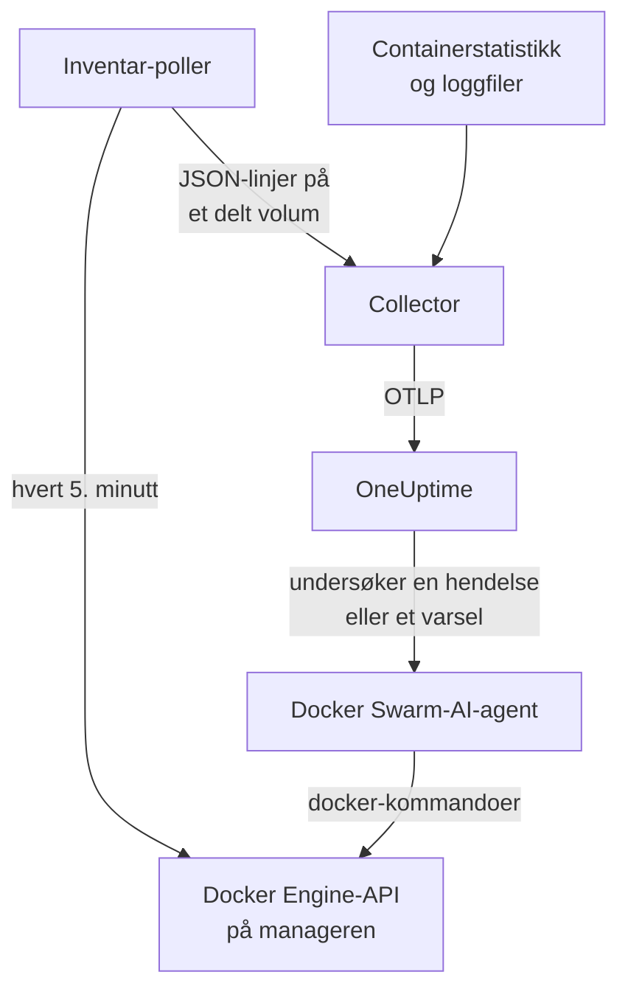

# Docker Swarm-agent

OneUptimes Docker Swarm-agent overvåker en Docker Swarm-klynge: nodene, tjenestene, oppgavene, stackene, overlay-nettverkene, secrets, configs og volumene, pluss metrikkene og loggene til hver container. Du kjører den med Docker Compose på en manager-node i swarmen, og klyngen vises i OneUptime med alt dette. [Docker Swarm-overvåkere](/docs/monitor/docker-swarm-monitor) varsler ut fra det som kommer inn.

:::cards
- [Installer agenten](#installer-agenten): Installasjonsskriptet eller Docker Compose, på en manager-node.
- [Hva agenten samler inn](#hva-agenten-samler-inn): Inventaret, klyngens tellinger, og containermetrikker og -logger.
- [AI-agent](#ai-agent): La OneUptime AI lese swarmen mens den undersøker.
- [Feilsøking](#feilsøking): Et diagnoseskript, og de vanlige problemene.
:::

## Slik fungerer det

Agenten er tre containere, alle definert i én `docker-compose.yml`:

1. **Collector**: en OpenTelemetry Collector som leser `docker_stats` for metrikkene til hver container, følger containernes loggfiler og følger filen med inventar-snapshotet. Den stempler alt med navnet på klyngen din (`docker.swarm.cluster.name`) og sender det til OneUptime over OTLP.
2. **Inventar-poller**: en liten sidecar med `curl` og `jq` som hvert 5. minutt går gjennom API-et til swarm-manageren (`/nodes`, `/services`, `/tasks`, `/networks`, `/secrets`, `/configs`, `/volumes`) og finner stackene ut fra tjenesteetiketten `com.docker.stack.namespace`. Den skriver én JSON-linje per objekt, som collectoren videresender.
3. **AI-agent**: `oneuptime-docker-swarm-ai-agent`, som kjører `docker`-kommandoene OneUptime AI ber om mens den undersøker en hendelse eller et varsel på denne klyngen. Den er skrivebeskyttet med mindre du tillater rettinger (se [AI-agent](#ai-agent)).



Klyngen registrerer seg med de første dataene sine, under klyngenavnet du konfigurerer.

## Før du begynner

- En **manager**-node i swarmen som agenten kan kjøre på: inventar-polleren og AI-agenten kaller API-endepunkter som bare managere svarer på.
- Docker Engine 20.10 eller nyere med Docker Compose v2-pluginen.
- En inntaksnøkkel. Opprett en under **Prosjektinnstillinger → Telemetri og APM → Inntaksnøkler** og kopier verdien.
- Utgående HTTPS fra noden til OneUptime-URL-en din.

### Hvor du kjører agenten

Kjør den på en manager-node. Collectoren rapporterer containerne på noden den kjører på, så for containermetrikker fra alle noder må du kjøre collectoren på hver node, alle med samme `DOCKER_SWARM_CLUSTER_NAME`; inventar-polleren og AI-agenten trenger bare å kjøre på én manager. `install.sh` utelater AI-agenten på en node som ikke er manager (og fjerner en den installerte der tidligere). En AI-agent som likevel startes på en worker, registrerer seg aldri for klyngen: den venter til noden er manager, så den kan ikke fortrenge managerens AI-agent. Ruller du ut agenten som en swarm-stack i stedet for med Compose? Hold inventar-polleren og AI-agenten på managere med begrensningen `node.role == manager`.

## Installer agenten

:::steps
### Installer og start agenten

:::tabs
@tab install.sh
Last ned installasjonsskriptet og kjør det på en manager-node:

```bash
curl -sSL https://raw.githubusercontent.com/OneUptime/oneuptime/master/agents/DockerSwarmAgent/install.sh -o install.sh
sh install.sh
```

Skriptet spør etter OneUptime-URL-en din, inntaksnøkkelen og et navn på klyngen. Det installerer til `/opt/oneuptime-docker-swarm-agent`, skriver en `.env`-fil som bare eieren kan lese, og starter alle tre containerne. Legg til `--no-ai-agent` for å utelate AI-agenten.
@tab Docker Compose
Last ned `docker-compose.yml`, `otel-collector-config.yaml` og `inventory-snapshot.sh` fra [DockerSwarmAgent-mappen](https://github.com/OneUptime/oneuptime/tree/master/agents/DockerSwarmAgent) til en ny mappe på en manager-node:

```bash
curl -fsSL https://raw.githubusercontent.com/OneUptime/oneuptime/master/agents/DockerSwarmAgent/docker-compose.yml -o docker-compose.yml
curl -fsSL https://raw.githubusercontent.com/OneUptime/oneuptime/master/agents/DockerSwarmAgent/otel-collector-config.yaml -o otel-collector-config.yaml
curl -fsSL https://raw.githubusercontent.com/OneUptime/oneuptime/master/agents/DockerSwarmAgent/inventory-snapshot.sh -o inventory-snapshot.sh
chmod +x inventory-snapshot.sh
```

Opprett en `.env`-fil ved siden av dem. Den inneholder inntaksnøkkelen, så hold den privat med `chmod 600 .env`:

```bash title=".env"
ONEUPTIME_URL=https://oneuptime.com
ONEUPTIME_SERVICE_TOKEN=your-telemetry-ingestion-key
DOCKER_SWARM_CLUSTER_NAME=my-swarm
```

Start agenten:

```bash
docker compose up -d
```
:::

### Sjekk at agenten kjører

```bash
docker compose ps
docker compose logs --tail 50 oneuptime-docker-swarm-agent oneuptime-docker-swarm-inventory
```

`docker compose ps` viser tre containere: collectoren (`oneuptime-docker-swarm-agent`), inventar-polleren (`oneuptime-docker-swarm-inventory`) og AI-agenten (`oneuptime-docker-swarm-ai-agent`).

### Finn klyngen i OneUptime

Åpne **Produkter → Infrastruktur → Docker Swarm → Alle klynger**. Klyngen vises i løpet av noen minutter, og sidene **Noder**, **Tjenester**, **Oppgaver**, **Stacks**, **Nettverk**, **Hemmeligheter**, **Configs** og **Volumer** fylles etter det første inventar-snapshotet, innen 5 minutter.
:::

## Miljøvariabler

Installasjonsskriptet skriver de tre første til `/opt/oneuptime-docker-swarm-agent/.env`; en Docker Compose-installasjon leser dem fra `.env` ved siden av `docker-compose.yml`. Legg til eller endre hvilken som helst av dem der, og kjør deretter `docker compose up -d` i den mappen.

| Variabel | Påkrevd | Beskrivelse |
| --- | --- | --- |
| `ONEUPTIME_URL` | Ja | OneUptime-URL-en din, for eksempel `https://oneuptime.com` eller den selvhostede instansen din. Bruk `http://` og porten hvis instansen bare bruker HTTP. |
| `ONEUPTIME_SERVICE_TOKEN` | Ja | Inntaksnøkkelen fra **Prosjektinnstillinger → Telemetri og APM → Inntaksnøkler**. |
| `DOCKER_SWARM_CLUSTER_NAME` | Ja | Klyngens navn i OneUptime, og nøkkelen som dataene fra hver node samles under: stemplet på alt som ressursattributtet `docker.swarm.cluster.name`. Hold det stabilt: å endre det senere registrerer en ny klynge. Standard er `docker-swarm`. |
| `DOCKER_INVENTORY_INTERVAL_SECONDS` | Nei | Hvor ofte inventar-polleren tar et snapshot, i sekunder. Standard er `300`. |
| `DOCKER_API_VERSION` | Nei | Docker Engine-API-versjonen collectoren og inventar-polleren snakker. Standard er `1.44`; tom forhandler den med daemonen (se [Feilsøking](#feilsøking)). AI-agenten forhandler den med mindre du angir en. |

AI-agentens egne innstillinger står under [AI-agent](#ai-agent).

## Hva agenten samler inn

| Signal | Kilde | Hvor det vises |
| --- | --- | --- |
| Nodene, tjenestene, oppgavene, stackene, nettverkene, secrets, configs og volumene | Inventar-polleren, fra API-et til swarm-manageren | Klyngens lister og detaljsider |
| Klyngetellinger (klare noder, kjørende oppgaver, tjenester, stacker, …) | Det samme snapshotet | Kortene i oversikten og merkene i sidemenyen |
| Containerens CPU, minne, antall prosesser og oppetid | Mottakeren `docker_stats` | Siden **Målinger** |
| Containerens stdout- og stderr-logger | Mottakeren `filelog` | Siden **Logger** |

### Slik skiller den seg fra Docker-agenten

[Docker-agenten](/docs/telemetry/docker-host) modellerer én vert og stempler `host.name` og `container.runtime=docker`. Docker Swarm-agenten stempler med vilje bare `docker.swarm.cluster.name`: OneUptime legger da dataene under swarm-klyngen i stedet for å registrere hver node som en egen vert.

## Merk klyngen med prosjektetiketter

Et ressursattributt som starter med `oneuptime.label.`, blir en prosjektetikett på klyngen: `oneuptime.label.<dimension>=<value>` er etiketten `<dimension>:<value>`. Legg til attributtene i prosessoren `resource` i `otel-collector-config.yaml`, ved siden av `docker.swarm.cluster.name`:

```yaml
processors:
  resource:
    attributes:
      # ...existing attributes...
      - key: oneuptime.label.team
        value: platform
        action: upsert
      - key: oneuptime.label.env
        value: production
        action: upsert
```

Collectoren leser konfigurasjonen bare når den starter: Kjør `docker compose restart oneuptime-docker-swarm-agent`. Klyngen viser deretter etikettene `team:platform` og `env:production`. Etiketter sammenlignes uten hensyn til store og små bokstaver, så en eksisterende etikett `Production` gjenbrukes i stedet for å dupliseres, og agenten fjerner aldri en etikett som noen har lagt til i OneUptime.

## Kjør som en systemd-tjeneste

For å starte agenten sammen med noden og starte den på nytt når den feiler, installer systemd-enheten dens. Den forutsetter at agenten ligger i `/opt/oneuptime-docker-swarm-agent`, der installasjonsskriptet legger den:

```bash
sudo curl -fsSL https://raw.githubusercontent.com/OneUptime/oneuptime/master/agents/DockerSwarmAgent/systemd/oneuptime-docker-swarm-agent.service -o /etc/systemd/system/oneuptime-docker-swarm-agent.service
sudo systemctl daemon-reload
sudo systemctl enable --now oneuptime-docker-swarm-agent
```

## Oppgradere agenten

Agenten rapporterer collector-versjonen den kjører. Når den er eldre enn versjonen denne OneUptime-utgivelsen fester, vises et varseltegn ved siden av agentens versjon på klyngens side **Oversikt**. Velg det for å se disse kommandoene.

Kjør installasjonsskriptet på nytt på manager-noden, og svar på spørsmålene med samme URL, nøkkel og klyngenavn. Det laster ned de nyeste filene, henter imagene og starter agenten på nytt:

```bash
curl -sSL https://raw.githubusercontent.com/OneUptime/oneuptime/master/agents/DockerSwarmAgent/install.sh -o install.sh
sh install.sh
```

Skriptet skriver `.env` på nytt ut fra svarene dine. Det beholder bare AI-agentens mållister og hva AI kan gjøre (`ONEUPTIME_AI_INVESTIGATION`, `ONEUPTIME_AI_FIXES`): Legg til igjen eventuelle variabler du satte selv, som `DOCKER_API_VERSION`. Har du slått på AI-rettinger? Kjør det som `ONEUPTIME_AI_ALLOW_WRITES=true sh install.sh` for å beholde dem på. Utelot du AI-agenten? Send `--no-ai-agent` igjen.

Med Docker Compose laster du ned de tre filene på nytt i agentens mappe (og gjør deretter eventuelle endringer du hadde gjort i `docker-compose.yml`, på nytt), og så henter du images og starter på nytt:

```bash
docker compose pull
docker compose up -d
```

Collector-versjonen er festet i filene, så å hente nye images alene flytter ikke agenten fremover.

## Avinstallere agenten

```bash
cd /opt/oneuptime-docker-swarm-agent
docker compose down
```

## AI-agent

Swarmens `docker-compose.yml` (og `install.sh`) kjører også **Docker Swarm-AI-agenten**: en tredje container, `oneuptime-docker-swarm-ai-agent` (image `oneuptime/resource-ai-agent:release`), som kjører de skrivebeskyttede `docker`-kommandoene OneUptime AI ber om mens den undersøker en hendelse eller et varsel på denne klyngen — `docker node ls`, `docker service ps web --no-trunc`, `docker service logs --tail 200 web` — og, bare hvis du tillater det, bruker rettinger som en rullerende omstart av en navngitt tjeneste. Den leser de samme `ONEUPTIME_URL`, `ONEUPTIME_SERVICE_TOKEN` og `DOCKER_SWARM_CLUSTER_NAME` som collectoren, så den betjener nettopp denne klyngen, og den vises på klyngens side **KI → AI-agent** i OneUptime.

- **AI-undersøkelser er på som standard.** Så snart agenten kobler seg til, undersøker OneUptime AI hendelser og varsler på denne klyngen med den, og klyngens **Oversikt** viser agentens status. For å stoppe, sett `ONEUPTIME_AI_INVESTIGATION=false` der agenten kjører (**Endre** under **Hva AI kan gjøre** på AI-agentsiden viser hvordan), eller utelat agenten.
- I likhet med inventar-polleren **må den kjøre på en manager-node**: Kommandoer for noder, tjenester og oppgaver finnes bare på managere. På en worker kjører den ingenting og registrerer seg ikke for klyngen før noden er manager (`/status` sier hvorfor). Kjør én per klynge.
- Den er **skrivebeskyttet** med mindre du setter `ONEUPTIME_AI_ALLOW_WRITES=true` i `.env` og kjører `docker compose up -d` (eller kjører `install.sh` med den; installasjonsprogrammet skriver `ONEUPTIME_AI_ALLOW_WRITES`, `ONEUPTIME_AI_INVESTIGATION`, `ONEUPTIME_AI_FIXES`, `ONEUPTIME_AI_WRITE_TARGETS` og `ONEUPTIME_AI_PROTECTED_TARGETS` fra miljøet sitt til `.env`, og en ny kjøring beholder det `.env` allerede har for de fire siste med mindre du sender den variabelen, selv tom); `ONEUPTIME_AI_WRITE_TARGETS` (glob-mønstre for tjeneste- og nodenavn, for eksempel `web_*,api_*`) begrenser hva en retting kan røre. `ONEUPTIME_AI_FIXES` i samme `.env` sier hvordan rettinger kjøres — `ask-for-approval` (en person godkjenner hver enkelt), `automatic` eller `bypass-approval` — og AI-agentsiden viser det skrivebeskyttet ([Hva AI kan gjøre, fastsatt av agenten](/docs/ai/infrastructure-ai-agents#what-ai-may-do-set-by-the-agent)). Å drenere en node krever alltid godkjenning fra en person, uansett modus.
- Den kjører som root med Docker-socketen montert, fordi socketen eies av root — og på en manager kontrollerer den som kan bruke socketen hele swarmen, `:ro` eller ikke. Agentens kommandopolicy er grensen: Den oppretter eller fjerner aldri tjenester eller stacker, rører aldri secrets eller configs, og endrer aldri seg selv, collectoren, inventar-polleren eller noe i `ONEUPTIME_AI_PROTECTED_TARGETS` (glob-mønstre for tjeneste- og nodenavn).
- `install.sh --no-ai-agent` utelater den; du kan også slette tjenesten `oneuptime-docker-swarm-ai-agent` fra `docker-compose.yml`.

Hva den kan kjøre, hvordan rettinger fungerer og hvordan du feilsøker den: [Infrastructure AI Agents](/docs/ai/infrastructure-ai-agents#docker-swarm-clusters).

## Feilsøking

:::details Kjør diagnoseskriptet først
Agenten leveres med et skript, [`troubleshoot.sh`](https://github.com/OneUptime/oneuptime/blob/master/agents/DockerSwarmAgent/troubleshoot.sh), som sjekker hele kjeden: containerne, at inventar-polleren kjører på en manager (`docker node ls`), snapshot-filen, klyngenavnet som er stemplet på alt, tokenets form, collectorens egne metrikker, og om OneUptime godtar inntaksnøkkelen. Den siste sjekken betyr mest. OneUptime avviser en dårlig nøkkel med `401` (`422` for en deaktivert nøkkel eller en nettlesernøkkel), og collectoren logger det som én `Exporting failed`-linje per batch, som er lett å overse. Skriptet spør `GET <url>/otlp/v1/validate` for et direkte `200` (gyldig) eller `401` (ugyldig). Kjør det på manager-noden:

```bash
curl -sSL https://raw.githubusercontent.com/OneUptime/oneuptime/master/agents/DockerSwarmAgent/troubleshoot.sh -o troubleshoot.sh
bash troubleshoot.sh    # add -d <dir> if you installed outside /opt/oneuptime-docker-swarm-agent
```
:::

:::details Klyngen vises aldri
Kjør diagnoseskriptet først. Ellers leser du collectorens logger (`docker compose logs oneuptime-docker-swarm-agent`), sjekker at `ONEUPTIME_SERVICE_TOKEN` og `ONEUPTIME_URL` i `.env` stemmer, og at noden når OneUptime-URL-en din.
:::

:::details Det vises ikke noe inventar
Sjekk at inventar-polleren kjører på en manager: `docker node ls` må lykkes der. Se deretter etter linjer med `failed to emit ...` i loggene: `docker compose logs oneuptime-docker-swarm-inventory`.
:::

:::details Klyngen skifter til frakoblet
En klynge blir frakoblet når OneUptime ikke har mottatt noe fra den på 15 minutter; OneUptime sjekker hvert 5. minutt, og tid da OneUptime selv ikke mottok data, teller ikke. Sørg for at collector-containeren holder seg oppe: `docker compose ps` viser den.
:::

:::details Collectoren avslutter med "client version is too new"
Collectorens logger viser:

```text
Error: cannot start pipelines: failed to start "docker_stats" receiver:
Error response from daemon: client version 1.44 is too new.
Maximum supported API version is 1.41
```

Daemonens høyeste API-versjon er lavere enn standarden `1.44` (Docker Engine 20.10 stopper på `1.41`), så mottakeren `docker_stats` kan ikke starte, og containeren starter på nytt i en løkke. Finn daemonens høyeste versjon:

```bash
docker version --format '{{ .Server.APIVersion }}'
```

Sett `DOCKER_API_VERSION` til den verdien i `.env`, og kjør `docker compose up -d` på hver node agenten kjører på. Nyere daemoner støtter fortsatt eldre API-versjoner, så innstillingen fortsetter å virke etter at du har oppgradert Docker. Eller sett `DOCKER_API_VERSION=` (tom) for at collectoren skal forhandle versjonen med daemonen i stedet for å feste en.
:::

:::details Klyngen vises under feil navn
Klyngens navn kommer fra `DOCKER_SWARM_CLUSTER_NAME`. Endre det i `.env`, og kjør `docker compose up -d`: Et nytt navn registrerer en ny klynge i stedet for å gi den gamle nytt navn.
:::

## Neste trinn

:::cards
- [Docker Swarm-overvåking](/docs/monitor/docker-swarm-monitor): Varsle om noder, tjenester, oppgaver og containere.
- [Infrastructure AI Agents](/docs/ai/infrastructure-ai-agents): Hva Docker Swarm-AI-agenten kan kjøre, og hvordan rettinger fungerer.
- [Docker-agent](/docs/telemetry/docker-host): Overvåk heller én enkelt Docker-vert.
:::
