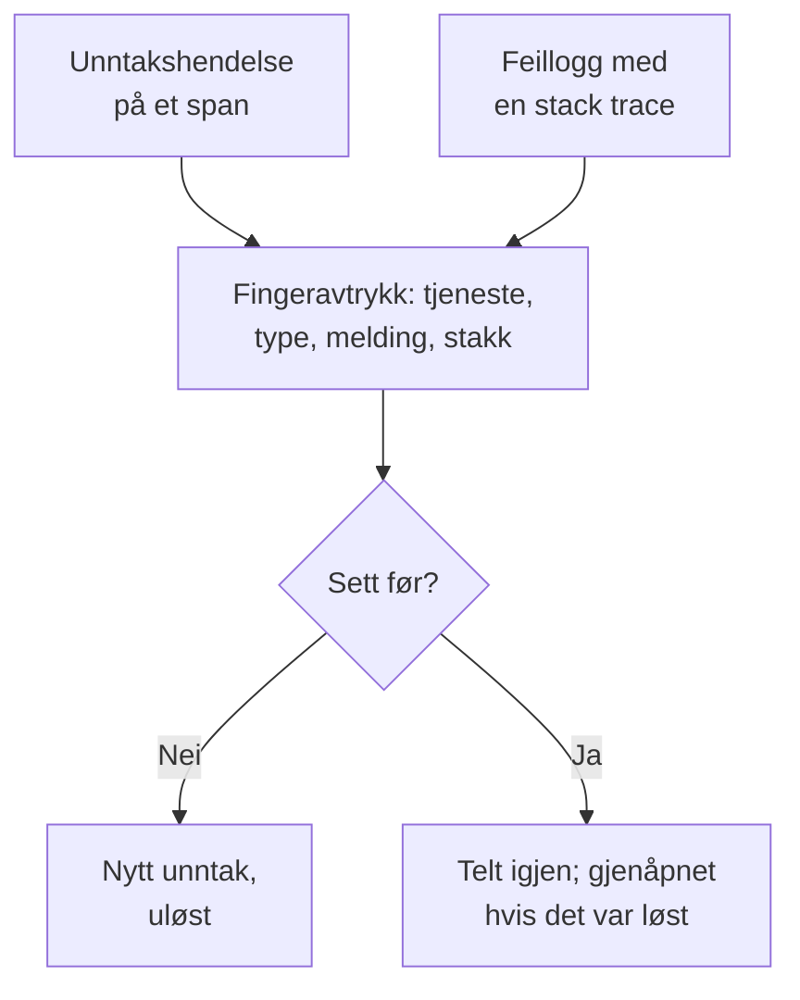

# Unntakssporing

Unntakssporing samler feilene koden din kaster, og grupperer hver forekomst av den samme feilen i ett unntak, med stack trace, utvikling og forespørslene det skjedde i. Gå gjennom dem som en oppgaveliste: rett, løs eller arkiver støyen, og la AI åpne en pull request for dem den kan rette.

:::cards
- [Hvor unntak kommer fra](#hvor-unntak-kommer-fra): Spans og logger tjenestene dine allerede sender.
- [Gå gjennom listen](#gå-gjennom-listen): Det uløste først, støyen skjult.
- [Siden til et unntak](#siden-til-et-unntak): Stack trace, forekomster og kontekst.
- [Rett det med AI](#rett-det-med-ai): En pull request med rettingen, eller en regresjonstest.
- [Finn og rett nye og økende unntak med AI](#finn-og-rett-nye-og-økende-unntak-med-ai): Pull requests for unntakene OneUptime finner.
:::

## Hvor unntak kommer fra

Du sender ikke unntak for seg. OneUptime finner dem i telemetrien tjenestene dine allerede sender:

- en unntakshendelse på et span, som er det `recordException()` i OpenTelemetry skriver;
- en logg med attributtene `exception.type`, `exception.message` eller `exception.stacktrace`;
- en logg med alvorlighetsgraden Error eller Fatal der meldingen inneholder en stack trace, når loggen ikke ble skrevet inne i et span (spannet melder det allerede).

Hver forekomst grupperes med de tidligere forekomstene av samme feil i ett unntak:

- **Ett unntak per tjeneste og feil.** Fingeravtrykket lages fra tjenesten, unntakstypen, meldingen og stack trace. Verdier som endrer seg fra kall til kall, tas ut først: UUID-er og andre ID-er, tidsstempler, IP- og e-postadresser, og tall med sju sifre eller flere. Derfor er `Order id=1042 not found` og `Order id=2077 not found` ett unntak.
- **En ny forekomst gjenåpner et løst unntak.** Skjer det igjen etter at du løste det, holdt ikke rettingen, og unntaket merkes som **Regresjon**. En forekomst fra før du løste det, som først når OneUptime senere, gjenåpner det ikke.
- **Et arkivert unntak forblir arkivert.** De nye forekomstene telles fortsatt, men de sender ikke lenger varsler.

> [!TIP]
> For å holde en forventet feil utenfor unntakssporingen, som ugyldig inndata tjenesten din avviste, setter du attributtet `error.class` til `user-error` eller `expected-denial` på spannets unntakshendelse. Da registrerer ikke OneUptime noe unntak for den.

## Før du begynner

- **Spans eller logger som kommer inn.** Instrumenter tjenestene dine med [OpenTelemetry](/docs/telemetry/open-telemetry). Fanen **Oppsettveiledning** viser koden for språket ditt.
- **En rolle som kan lese telemetri.** Project Owner, Project Admin, Project Member, Viewer, Telemetry Admin, Telemetry Member eller Telemetry Viewer, eller en egendefinert rolle med tillatelsen Read Telemetry Service Exception. Å løse og arkivere krever Project Owner eller Project Admin, eller tillatelsen Edit Telemetry Service Exception.

## Gå gjennom listen

:::steps
### Åpne unntak

Gå til **Produkter → Observerbarhet → Unntak**. Merket på fanen **Unntak** teller de uløste problemene, og listen åpnes på unntakene under **Uløst**.

### Velg en status

Bytt mellom **Uløst**, **Løst**, **Arkivert** og **Alle**. Diagrammet over listen viser hvor mange forekomster som var **Uhåndtert**, og hvor mange som var **Håndtert** over tid. En rad merket **Regresjon** kom tilbake etter at den ble løst, og en merket **Ny** ble sett første gang i løpet av de siste 24 timene.

### Velg hva som teller som et problem

**Problemer**, som er standard, skjuler brukerfeil og forventede avvisninger, slik at listen viser det som trenger retting. **User errors** viser bare dem, og **Alle** viser alle unntak.

### Søk og filtrer

Skriv et søk som `type:TypeError env:production`, se [Søkesyntaks](/docs/telemetry/search-syntax#unntak), eller klikk på en verdi i sidepanelet **Filtre**: en tjeneste, en vert eller en annen ressurs, en **Unntakstype**, et **Miljø** eller en **Error Class**.

### Åpne et unntak

Klikk på en rad for å åpne siden til unntaket.
:::

## Siden til et unntak

Sidemenyen på siden samler det du gjør med et unntak:

| Side | Hva den viser |
| --- | --- |
| **Oversikt** | Meldingen, tjenesten, hvor ofte det skjedde og når det først og sist ble sett, utviklingen over tid, og den siste forekomsten: release, miljø, span, spor og brukerøkt. Øverst OneUptime AIs forklaring av hva som skjedde, når AI er på. |
| **Stack trace** | Rammene i stakken. For nettleserkode de opprinnelige filene og linjene, når du har lastet opp [Source maps](/docs/telemetry/source-maps) for releasen. |
| **Occurrences** | Hver forekomst, med tidspunkt, melding og sporet den skjedde i. |
| **Context** | Attributtene til den siste forekomsten, øktopptaket når det finnes, og trinnene som førte frem til den. |
| **Logger** | Loggene som ble skrevet rundt den siste forekomsten. |
| **AI Assistance** | AI-oppgaver som retter unntaket eller tester det. |
| **Innstillinger** | Løs eller arkiver unntaket. Den ligger under **Administrer**, som er lukket i starten. |

## Løs, gjenåpne og arkiver

Knappene øverst på siden til unntaket, siden **Innstillinger** og menyen ⋯ på raden i listen endrer statusen:

| Handling | Når du bruker den | Hva som skjer etterpå |
| --- | --- | --- |
| **Løs** | Du har rullet ut rettingen. | Det forlater listen **Uløst**. En ny forekomst gjenåpner det. |
| **Løs i neste utgivelse** | Rettingen kommer i din neste utgivelse. | Det forlater listen **Uløst**. Forekomster fra utgivelsen det sist ble sett i, gjenåpner det ikke, men en fra en hvilken som helst annen utgivelse gjør det. |
| **Gjenåpne** | Rettingen virket ikke. | Det er uløst igjen. |
| **Arkiver** | Det er støy du ikke tenker å rette. | Det forlater listen. Nye forekomster telles, men sender ikke lenger varsler. |
| **Fjern fra arkiv** | Du vil høre om det igjen. | Det er tilbake i listen det hører hjemme i. |

**Løs i neste utgivelse** ligger i menyen ved siden av **Løs**, i radens meny ⋯, under **Massehandlinger** og på **Innstillinger**, så lenge forekomstene av unntaket oppgir utgivelsen sin: ressursattributtet `service.version`.

**Innstillinger** viser hvem som sist løste eller arkiverte unntaket, og når. Knappene der heter **Merk som løst** eller **Merk som uløst**, og **Arkiver** eller **Fjern fra arkiv**.

For å endre flere samtidig krysser du av radene deres i listen, eller boksen over radene for alle unntak på siden, og bruker de samme handlingene under **Massehandlinger**. Resultatet viser hvilke unntak som ble endret, hvilke som ble latt være, og hvorfor.

## Feilklasser

Hvert unntak har en feilklasse, som sier hvem sitt problem det er. OneUptime AI setter den når den går gjennom en innsikt om unntaket, som et nytt unntak eller et som øker kraftig: se [AI SRE](/docs/ai/ai-sre#innsikt-proaktiv-oppdagelse). Et unntak den ikke har gått gjennom, forblir `unknown`.

| Klasse | Hva den betyr | I **Problemer** |
| --- | --- | --- |
| `code-fault` | En feil i koden. Den eneste klassen AI retter på egen hånd. | Ja |
| `infrastructure` | Et tidsavbrudd, en brutt forbindelse eller oppbrukte ressurser. | Ja |
| `unknown` | Ikke klassifisert ennå. | Ja |
| `user-error` | Resultatet av ugyldig inndata fra en bruker. | Nei |
| `expected-denial` | En kontroll som gjør jobben sin, som en avvist pålogging. | Nei |

Med **Arkiver forventede unntak** slått på, i innstillingene for AI-innsikt, arkiveres unntak som gjennomgangen finner ut er forventede avvisninger, for deg.

## Forklar det med AI

Øverst på et unntaks **Oversikt** spør **Forklar med OneUptime AI** OneUptime AI om hva som gikk galt. Den leser stack trace, sporet og loggene for den siste forekomsten og tjenestens utrullinger rundt tidspunktet da unntaket begynte, og svarer i kortet **Hva som skjedde**:

| Del | Hva den sier |
| --- | --- |
| **Hva som skjedde** | En setning eller to, hvor sikker OneUptime AI er, og hvor feilen ligger: koden, en avhengighet, infrastrukturen, ugyldig inndata eller konfigurasjonen. |
| **Sannsynlig rotårsak** | Årsaken og rammen, spanet, logglinjen eller utrullingen som viser den. |
| **Foreslått retting** | Hva som må endres. |
| **Hvor du bør se** | Rammene i stack trace du bør åpne først. |
| **Neste steg** | Høyst tre steg for å bekrefte eller rette det. |

Forklaringen lagres på unntaket, så den neste som åpner det leser den med en gang, og **Forklar på nytt** ber om en ny. **Åpne en pull-forespørsel med rettingen** åpner unntakets side **AI Assistance**, og **Still et oppfølgingsspørsmål** åpner Ask AI om unntaket.

ID-er, e-post- og IP-adresser og tokener fjernes fra alt som sendes, og av et spans attributter sendes bare noen få, som ruten og statuskoden. Forklaringen bruker prosjektets LLM-leverandør og AI-kreditter og tilbys ikke mens **Aktiver AI** er av. Alle som kan lese unntaket, kan be om en.

## Rett det med AI

Siden **AI Assistance** tilbyr tre oppgaver. Hver kjører som en AI-oppgave som åpner en pull request i kodelageret ditt:

| Oppgave | Hva pull requesten gjør |
| --- | --- |
| **Fix this exception with AI** | Retter rotårsaken. Start den med **Fiks med AI**. |
| **Generate Regression Test** | Legger til en test som feiler til feilen er rettet. |
| **Forbedre feilhåndtering** | For forventede feil: validerer inndata tidligere, holder brukerdata ute av meldinger og merker feilen som håndtert. |

AI trenger tre ting først: en LLM-leverandør, et tilkoblet lager (på GitHub, GitLab, Forgejo eller Gitea, eller en hvilken som helst Git-server), og en AI-agent på nett som kjører oppgaven. Siden sjekker hver av dem og lenker til det som mangler. Oppgavene står på pause mens unntaket er løst eller arkivert. Se [Kode](/docs/ai/ai-agent).

## Finn og rett nye og økende unntak med AI

Hvert 15. minutt går OneUptime gjennom unntakene dine etter nye, etter dem som plutselig skjer langt oftere, og etter tjenester der unntakene ikke har noen stack trace, og registrerer det den finner som KI-innsikt, med bevisene. Deretter undersøker OneUptime AI hvert funn og åpner en pull request for hvert den kan rette. Ingenting flettes noen gang: teamet ditt gjennomgår hver pull request.

| Funn | Når OneUptime registrerer det | Pull requesten |
| --- | --- | --- |
| **Nytt unntak** | Et unntak som ble sett for første gang i løpet av de siste 24 timene, og som allerede har skjedd 3 ganger eller mer. | Retter unntaket, eller håndterer det bedre. |
| **Topp i unntak** | Et unntak som har skjedd 10 ganger eller mer i løpet av den siste timen, med 5 ganger eller mer sin timerate fra de 24 timene før. | Retter unntaket, eller håndterer det bedre. |
| **Manglende stack trace** | Unntakene en tjeneste registrerte det siste døgnet har ingen stack trace og har til sammen skjedd 20 ganger eller mer. | Får tjenesten til å registrere en stack trace med hvert unntak. |

Pull requesten for et nytt eller økende unntak er unntakets egen AI-oppgave, den som siden **AI Assistance** til unntaket starter, og den venter til OneUptime AI har undersøkt funnet. Finner den koden som har skylden (`code-fault`), retter pull requesten den, slik **Fix this exception with AI** gjør. Finner den en forventet feil (`user-error` eller `expected-denial`), håndterer pull requesten feilen bedre, slik **Forbedre feilhåndtering** gjør. Enhver annen konklusjon åpner ingen pull request av seg selv. Med **Arkiver forventede unntak** slått på arkiveres en forventet avvisning i stedet og får ingen pull request.

OneUptime AI åpner bare selv en for et unntak som er kastet i din egen kode: et unntak der stack tracen har en ramme fra koden din, og ikke bare rammer fra biblioteker eller kjøretidsmiljøet. En pull request som noen lukket uten å flette den, setter de automatiske på pause for det unntaket. Alle kan fortsatt be om hvilken som helst av dem med **Fiks med AI** på funnet.

### Slå det på

**Unntak → KI → Innstillinger** har bryteren **Finn og rett nye og økende unntak**, som er på for nye prosjekter. Så lenge den er av, hører nye og økende unntak som før til KI-innsikt: se [AI SRE](/docs/ai/ai-sre#innsikt-proaktiv-oppdagelse). Når **Aktiver AI** er av, blir de fortsatt funnet, men OneUptime AI gjør ingenting med dem. For å åpne pull requests trenger OneUptime AI et kodelager koblet til i [Kode](/docs/ai/ai-agent): siden sier først hva som mangler. Koden i hvert kodelager endres på Runneren kodelageret velger i Kode.

OneUptime AI åpner selv høyst 5 pull requests per dag (UTC), én for hvert funn, og aldri flere enn et kodelagers grense for åpne AI-pull requests.

### AI-regler

Uten regler undersøker OneUptime AI hvert unntak den finner med en gang, og åpner en pull request for hvert den kan rette. **AI-regler** under **Flere innstillinger** snevrer det inn, i tre trinn:

| Trinn | Hva det avgjør |
| --- | --- |
| **Treff** | Hvilke tjenester: de valgte, de med bestemte etiketter eller de der navnet passer til et mønster. |
| **Undersøke** | **Med en gang**, eller **Bare hvis fortsatt funnet etter en ventetid**: et unntak som forsvinner i ventetiden, blir ikke undersøkt. |
| **Rettelse** | **Ikke rett**, **Spør før retting** eller **Rett uten å spørre**. Å spørre først overlater pull requesten til en person: funnet tilbyr **Fiks med AI**. |

Under **Flere felt** velger en regel kodelagrene, MCP-serverne og LLM-leverandøren OneUptime AI kan bruke for den. Er ingenting valgt, kan den bruke alle, og prosjektets standard LLM-leverandør.

### Se hva den gjorde

- **Unntak → KI → Innsikt** viser hva OneUptime fant, hvert funn med bevisene, rammene fra koden din i stack tracen medregnet. **View Exception Group** åpner unntaket, og for en tjenestes manglende stack traces åpner **Åpne i Unntak** de uløste unntakene dens fra det siste døgnet.
- **Unntak → KI → Logger** viser hver undersøkelse og hver pull request, nyeste først, med status for hver og hva hver undersøkelse fant.
- Pull requesten sier hvorfor den ble åpnet, med en lenke til funnet. Den for et nytt eller økende unntak lenker også til unntaket og vises på siden **AI Assistance** til unntaket. I Kode nevner oppgaven unntaket den retter, eller funnet den kom fra.

## Innsikt i unntak

Fanen **Innsikt** teller unntakene dine under **Uløst**, **Løst** og **Arkivert** og løsningsraten din, og viser de vanligste unntakene, tjenestene de rammer og de som sist ble sett.

## Feilsøking

:::details Et unntak jeg nettopp kastet, er ikke i listen
Sjekk visningen først: **Problemer** skjuler brukerfeil og forventede avvisninger, så velg **Alle**. Utvid deretter tidsintervallet, og kontroller at unntaket ble registrert på et span eller i en logg med en stack trace.
:::

:::details Én feil vises som flere unntak
Fingeravtrykket inkluderer meldingen og stack trace. Når de er forskjellige, for eksempel når en melding inneholder et kort tall eller et navn som endrer seg ved hvert kall, er hver variant et eget unntak.
:::

:::details Et løst unntak kommer stadig tilbake
En ny forekomst gjenåpner et løst unntak med vilje: feilen skjer fortsatt. Kontroller at rettingen nådde releasen som rapporterer den, eller arkiver unntaket hvis du ikke lenger vil høre om det. Hvis gamle pods av utgivelsen fortsetter å rapportere det under en utrulling, bruker du **Løs i neste utgivelse** i stedet.
:::

## Neste steg

:::cards
- [Unntak-overvåking](/docs/monitor/exceptions-monitor): Få varsel når unntak øker kraftig.
- [Source maps](/docs/telemetry/source-maps): Lesbare stack traces for nettleserkode.
- [Kode](/docs/ai/ai-agent): Hvordan AI retter kode og åpner pull requests.
- [Sporutforsker](/docs/telemetry/traces-explorer): Se forespørselen et unntak skjedde i.
:::
