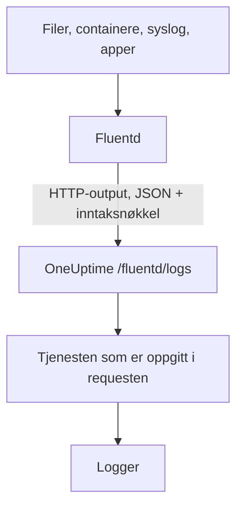

# Fluentd

[Fluentd](https://www.fluentd.org/) samler logger fra filer, containere, syslog, applikasjoner og [mange andre kilder](https://www.fluentd.org/datasources). Den innebygde [HTTP-outputen](https://docs.fluentd.org/output/http) sender dem til Fluentd-endepunktet i OneUptime, der de blir søkbare under **Produkter → Logger**.

:::cards
- [Konfigurer Fluentd](#konfigurer-fluentd): Legg til en HTTP-output som peker mot OneUptime.
- [Slik leses postene](#slik-leses-postene): Hvilke felt som blir meldingen, alvorlighetsgraden og attributter.
- [Selvhostet OneUptime](#selvhostet-oneuptime): Pek Fluentd mot din egen instans.
:::

## Slik fungerer det



Fluentd sender poster i bunker som JSON, med inntaksnøkkelen din i headeren `x-oneuptime-token` og tjenestenavnet i `x-oneuptime-service-name`. OneUptime gjør hver post til en logg for den tjenesten, og oppretter tjenesten første gang den sender.

## Før du begynner

- **Installer Fluentd** – se [installasjonsveiledningen](https://docs.fluentd.org/installation).
- **Et OneUptime-prosjekt.** I OneUptime Cloud faktureres telemetri per inntatt GB – se [priser](https://oneuptime.com/pricing) – og et prosjekt på Free-planen trenger en betalingsmetode før det kan sende telemetri.
- **En inntaksnøkkel for telemetri.** Hvis du ikke har en:

:::steps
### Åpne inntaksnøklene

Gå til **Produkter → Prosjektinnstillinger**, åpne **Telemetri og APM** i sidemenyen, og velg **Inntaksnøkler**.


### Opprett en nøkkel

Klikk på **Opprett inntaksnøkkel**. Dialogen har allerede fylt inn navnet på nøkkelen og valgt **Server** – den typen nøkkel en applikasjon eller en collector sender med – så klikk på **Opprett inntaksnøkkel** for å opprette den, eller gi den nytt navn først.

### Kopier hemmeligheten

Den nye nøkkelen åpnes på sin egen side. Kopier **Hemmelig nøkkel**: Det er `YOUR_SERVICE_TOKEN` i konfigurasjonen nedenfor.


:::

## Konfigurer Fluentd

Konfigurasjonsfilen til Fluentd er vanligvis `/etc/fluent/fluentd.conf`, eller `/etc/td-agent/td-agent.conf` for den eldre td-agent-pakken.

:::steps
### Legg til en HTTP-output

Legg til en `<match>`-seksjon som sender poster til OneUptime. Erstatt `YOUR_SERVICE_TOKEN` med inntaksnøkkelen din og `YOUR_SERVICE_NAME` med navnet loggene skal vises under – hvilket navn du vil:

```text title="fluentd.conf"
# Send the time Fluentd gave each event: the HTTP output sends only the record
<filter **>
  @type record_transformer
  enable_ruby true
  <record>
    fluentd_time ${time.utc.strftime("%Y-%m-%dT%H:%M:%S.%NZ")}
  </record>
</filter>

# Match all patterns
<match **>
  @type http

  endpoint https://oneuptime.com/fluentd/logs
  open_timeout 2

  headers {"x-oneuptime-token":"YOUR_SERVICE_TOKEN", "x-oneuptime-service-name":"YOUR_SERVICE_NAME"}

  content_type application/json
  json_array true

  # Send a batch again when OneUptime is busy (429) or restarting (502, 503, 504)
  retryable_response_codes 429,502,503,504

  <format>
    @type json
  </format>
  <buffer>
    # Keep the batches on disk until OneUptime takes them: a restart of Fluentd loses none
    @type file
    path /var/log/fluent/buffer/oneuptime
    total_limit_size 512m
    flush_interval 10s
    chunk_limit_size 900k
    # Try again at least every 30 seconds, for up to 72 hours
    retry_max_interval 30s
    retry_timeout 72h
  </buffer>
</match>

# Keep Fluentd's own logs out of OneUptime
<label @FLUENT_LOG>
  <match **>
    @type null
  </match>
</label>
```

`json_array true` sender hver chunk i bufferen som én JSON-matrise, og `flush_interval 10s` sender bufferen hvert 10. sekund. `chunk_limit_size 900k` holder hver request under 1 MB, det meste OneUptime tar imot på dette endepunktet.

Standardinnstillingen til Fluentd fungerer også: uten `content_type` og `json_array true` sender Fluentd linjedelt JSON, én post per linje, og OneUptime leser hver linje som posten den er, med `compress gzip` eller uten.

`@type file` holder batchene som ennå skal sendes i mappen `path` angir, så en omstart av Fluentd mister ingen av dem; en buffer i minnet, standarden til Fluentd, mister det den holder. Brukeren til Fluentd må kunne skrive i mappen: `/var/log/fluent` er fluent-package sin, `/var/log/td-agent` td-agent sin og `/fluentd/log` den i imaget `fluent/fluentd`. `total_limit_size 512m` holder høyst 512 MB der; når den er full, tar Fluentd ikke imot flere poster før en batch er sendt.

`retryable_response_codes 429,502,503,504` sender en batch på nytt når OneUptime har mye å gjøre (`429`) eller starter på nytt (`502`, `503`, `504`); uten den kaster Fluentd en batch ved ethvert svar unntatt `503`. `retry_max_interval 30s` venter høyst 30 sekunder mellom forsøkene, og `retry_timeout 72h` kaster en batch som fortsatt ikke kan sendes etter 72 timer. Filteret `record_transformer` legger til tidspunktet Fluentd ga hver post, som `fluentd_time`: HTTP-outputen sender bare posten, og OneUptime leser tidspunktet for en logg fra den.

### Start Fluentd på nytt

Start Fluentd-tjenesten på nytt, slik at den laster den nye outputen.

### Sjekk at loggene kommer frem

Noen sekunder etter neste tømming vises loggene under **Produkter → Logger**. Tjenesten står under **Produkter → Tjenester** – fantes den ikke fra før, oppretter OneUptime den.
:::

## Fullstendig eksempel

Denne konfigurasjonen tar imot poster over forward-protokollen til Fluentd på port `24224`, bare fra denne verten, og sender alle til OneUptime:

```text title="fluentd.conf"
####
## Source descriptions:
##

## built-in TCP input
## @see https://docs.fluentd.org/input/forward
<source>
  @type forward
  port 24224
  # This host alone: see "Take records from other hosts" to open it
  bind 127.0.0.1
</source>

# Send the time Fluentd gave each event: the HTTP output sends only the record
<filter **>
  @type record_transformer
  enable_ruby true
  <record>
    fluentd_time ${time.utc.strftime("%Y-%m-%dT%H:%M:%S.%NZ")}
  </record>
</filter>

<match **>
  @type http

  endpoint https://oneuptime.com/fluentd/logs
  open_timeout 2

  headers {"x-oneuptime-token":"YOUR_SERVICE_TOKEN", "x-oneuptime-service-name":"YOUR_SERVICE_NAME"}

  content_type application/json
  json_array true

  # Send a batch again when OneUptime is busy (429) or restarting (502, 503, 504)
  retryable_response_codes 429,502,503,504

  <format>
    @type json
  </format>
  <buffer>
    # Keep the batches on disk until OneUptime takes them: a restart of Fluentd loses none
    @type file
    path /var/log/fluent/buffer/oneuptime
    total_limit_size 512m
    flush_interval 10s
    chunk_limit_size 900k
    # Try again at least every 30 seconds, for up to 72 hours
    retry_max_interval 30s
    retry_timeout 72h
  </buffer>
</match>

# Keep Fluentd's own logs out of OneUptime
<label @FLUENT_LOG>
  <match **>
    @type null
  </match>
</label>
```

`bind 127.0.0.1` tar bare imot poster fra denne verten, som de fra loggdriveren `fluentd` i Docker, som sender til `localhost:24224`. For å sende ulike kilder som ulike tjenester bruker du én `<match>`-seksjon per tag, hver med sin egen `x-oneuptime-service-name` og sin egen buffer-`path`: Fluentd starter ikke med to buffere på samme sti.

## Ta imot poster fra andre verter

Med `bind 0.0.0.0` og ingen `<security>`-seksjon kan alle som når port `24224`, sende logger til OneUptime under inntaksnøkkelen din. For å ta imot poster fra Fluentd eller Fluent Bit på andre verter lytter du på alle adresser, krever en delt nøkkel av hver avsender og bruker TLS. Erstatt `<source>`-seksjonen i det fullstendige eksempelet med:

```text title="fluentd.conf on this host"
<source>
  @type forward
  port 24224
  bind 0.0.0.0
  <transport tls>
    cert_path /etc/fluent/certs/fluentd.crt
    private_key_path /etc/fluent/certs/fluentd.key
  </transport>
  <security>
    self_hostname fluentd.example.com
    shared_key YOUR_SHARED_KEY
  </security>
</source>
```

`cert_path` og `private_key_path` er et sertifikat for navnet til denne verten, her `fluentd.example.com`, og nøkkelen til det, som brukeren til Fluentd må kunne lese. Fluentd advarer når nøkkelen ikke har noen passordfrase; `private_key_passphrase` setter en. Erstatt `YOUR_SHARED_KEY` med en lang tilfeldig hemmelighet, for eksempel en fra `openssl rand -base64 32`, og gi hver avsender den samme:

```text title="fluentd.conf on each sender"
<match **>
  @type forward
  transport tls
  # The certificate of the authority that signed this host's; not needed for a public one
  tls_cert_path /etc/fluent/certs/ca.crt
  <security>
    self_hostname app-1.example.com
    shared_key YOUR_SHARED_KEY
  </security>
  <server>
    host fluentd.example.com
    port 24224
  </server>
  <buffer>
    @type file
    path /var/log/fluent/buffer/forward
  </buffer>
</match>

# Keep Fluentd's own logs out of OneUptime
<label @FLUENT_LOG>
  <match **>
    @type null
  </match>
</label>
```

`forward`-outputen til Fluent Bit tar de samme innstillingene: `Shared_Key`, `Self_Hostname`, `tls On` og `tls.ca_file`.

En avsender uten nøkkelen, eller uten TLS, blir avvist. Selve nøkkelen krysser aldri nettverket: hver side beviser at den har den. Uten TLS kan alle på nettverket mellom vertene lese postene. Åpne port `24224` i brannmuren til verten bare for vertene som sender. Kjører Fluentd fra Docker Compose-filen i loggveiledningen, publiserer du porten på alle adresser der også, `"24224:24224"`, og monterer mappen til sertifikatet i containeren.

## Slik leses postene

OneUptime leser disse feltene fra hver post:

| Loggfelt | Leses fra postens første tilstedeværende felt av | Merknader |
| --- | --- | --- |
| Innhold | `message`, `log`, `msg`, `body`, `text` | Logglinjen. En post uten noen av dem lagres i sin helhet, som JSON. |
| Alvorlighetsgrad | `level`, `severity`, `loglevel`, `log_level`, `priority`, `severityText`, `severity_text` | Navn som `trace`, `debug`, `info`, `notice`, `warn`, `error`, `critical` og `fatal`, med store eller små bokstaver. Alle andre verdier lagres som `Unspecified`. |
| Trace-ID | `trace_id`, `traceId`, `traceid` | Kobler loggen til sitt trace. |
| Span-ID | `span_id`, `spanId`, `spanid` | Kobler loggen til sitt span. |
| Tjeneste | headeren `x-oneuptime-service-name` | `Fluentd` når headeren ikke er satt. |
| Tid | `time`, `timestamp`, `@timestamp`, `ts`, `fluentd_time` | Et ISO 8601-tidspunkt, for eksempel `2026-11-14T08:00:00.123Z`, eller sekunder, millisekunder, mikrosekunder eller nanosekunder siden epoken; et tidspunkt uten tidssone er UTC. Et tidspunkt før 2000, eller mer enn en dag fram i tid, leses ikke. Feltet tidspunktet leses fra, lagres ikke som attributt. En post uten tidspunkt lagres på tidspunktet OneUptime mottar den. |

Alle andre felt blir en attributt med navnet `fluentd.` etterfulgt av feltnavnet, som du kan søke og filtrere på: Et felt `container_name` er `@fluentd.container_name` i loggutforskeren. Et nestet objekt flates ut med punktum, som `fluentd.kubernetes.pod_name`, og en liste lagres som JSON.

Fluentd-logger går gjennom [loggpipelinene](/docs/telemetry/log-pipelines), drop-filtrene og maskeringsreglene dine som alle andre logger.

## Selvhostet OneUptime

Erstatt `https://oneuptime.com` i `endpoint` med URL-en til OneUptime-instansen din: `http(s)://YOUR_ONEUPTIME_HOST/fluentd/logs`.

## Feilsøking

:::details Fluentd logger `401` fra HTTP-outputen
Inntaksnøkkelen mangler, er ukjent eller utløpt. Sjekk verdien av `x-oneuptime-token` i `headers`.
:::

:::details Fluentd logger `402` eller `422`
`402`: I OneUptime Cloud er prosjektet på Free-planen og har ingen betalingsmetode. Legg til en under **Prosjektinnstillinger → Fakturering og fakturaer → Fakturering**. `422`: Nøkkelen er deaktivert, eller det er en nettlesernøkkel. Slå **Aktivert** på igjen i nøkkelens innstillinger, eller opprett en **Server**-nøkkel.
:::

:::details Fluentd logger `413`
Requesten er over 1 MB, det meste OneUptime tar imot på dette endepunktet. Sett `chunk_limit_size 900k` i `<buffer>`-seksjonen, som i konfigurasjonen ovenfor.
:::

:::details Fluentd logger `429`, `502`, `503` eller `504`
OneUptime har mye å gjøre eller starter på nytt. Med `retryable_response_codes 429,502,503,504` i `<match>`-seksjonen, som i konfigurasjonen ovenfor, beholder Fluentd batchen og sender den på nytt; uten den kaster Fluentd batchen. Med `@type file` i `<buffer>`-seksjonen beholder Fluentd også batchen når den starter på nytt.
:::

:::details Logger viser tidspunktet OneUptime mottok dem, ikke sitt eget
OneUptime leser tidspunktet for en logg fra posten, og HTTP-outputen til Fluentd sender bare posten. En `<parse>`-seksjon tar feltet `time` ut av posten som tidspunktet for hendelsen: legg til `time_key fluentd_time` i den, så den ikke leser tidspunktet til noen post og lar `time` være som det er. Legg også til filteret `record_transformer` fra konfigurasjonen ovenfor: det legger til tidspunktet Fluentd ga hver post, som `fluentd_time`.
:::

:::details En JSON-linje der `time` er `null`, `true`, en liste eller et objekt, kommer aldri fram
`json`-parseren til Fluentd leser feltet `time` på en linje som tidspunktet for hendelsen, og kaster uten advarsel en linje der `time` verken er tekst eller et tall. Legg til `time_key fluentd_time` i `<parse>`-seksjonen dens, som ovenfor: da lar Fluentd `time` stå i posten som det er. Med filteret `record_transformer` ovenfor lagrer OneUptime loggen på tidspunktet Fluentd leste den, `fluentd_time`; uten det på tidspunktet OneUptime mottar den.
:::

:::details Loggene kommer under tjenesten `Fluentd`
Headeren `x-oneuptime-service-name` mangler. Legg den til i `headers` i hver `<match>`-seksjon.
:::

:::details Logginnholdet viser hele posten som JSON
OneUptime henter innholdet fra det første tilstedeværende feltet av `message`, `log`, `msg`, `body` eller `text`, og lagrer hele posten når den ikke har noen av dem. Gi feltet med logglinjen din nytt navn til ett av disse, for eksempel med filteret `record_transformer` i Fluentd.
:::

Har du spørsmål eller trenger hjelp med konfigurasjonen, kan du skrive til oss på support@oneuptime.com.

## Neste steg

:::cards
- [Loggpipelines](/docs/telemetry/log-pipelines): Tolk og berik loggene Fluentd sender.
- [Søkesyntaks](/docs/telemetry/search-syntax): Finn loggene i loggutforskeren.
- [Fluent Bit](/docs/telemetry/fluentbit): En lettere agent som sender over OpenTelemetry.
- [Logg-monitor](/docs/monitor/logs-monitor): Varsle når samsvarende logger dukker opp.
:::
