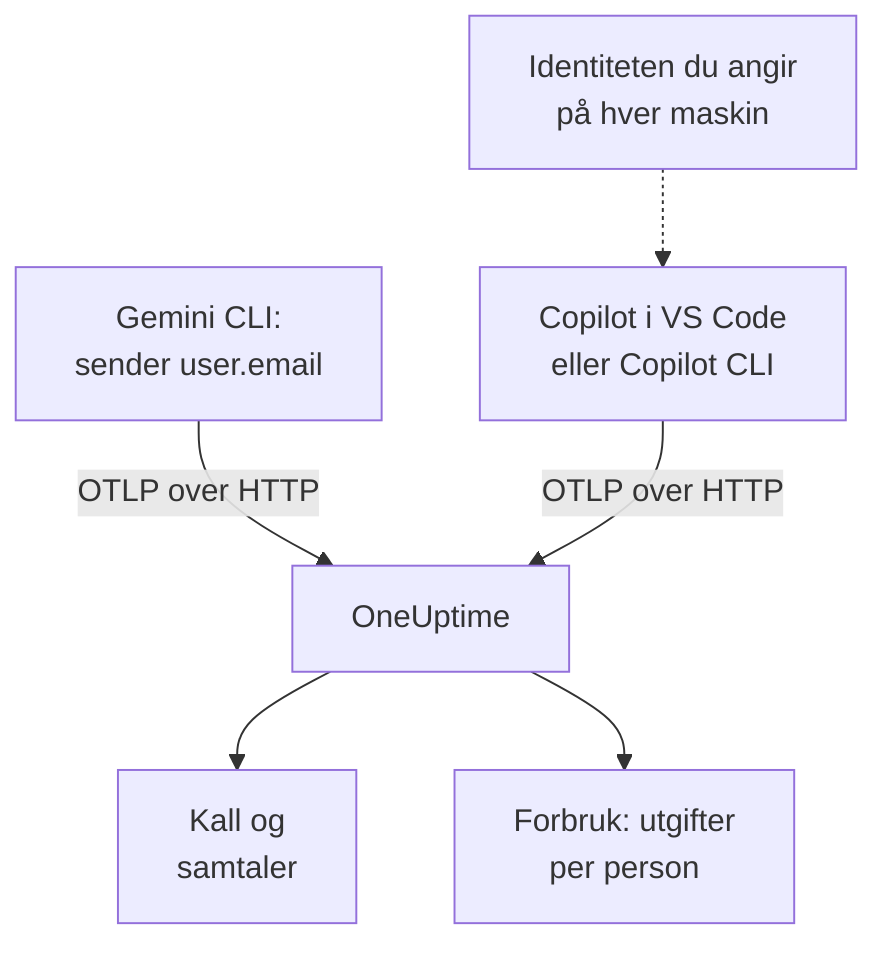

# Gemini CLI og GitHub Copilot

Gemini CLI og GitHub Copilot eksporterer begge OpenTelemetry selv: rett dem mot OneUptime, så kommer modellkallene, tokenene, kostnadene og verktøykallene deres inn i [AI / LLM](/docs/telemetry/ai-llm-observability), ved siden av AI-kallene fra dine egne apper. De skiller seg i det som betyr mest for viderefakturering: Gemini CLI navngir personen på hver post, og Copilot navngir ingen, så du navngir hver utvikler selv.

:::cards
- [Gemini CLI](#sett-opp-gemini-cli): Slå på telemetri, med traser, og send den rett til OneUptime.
- [GitHub Copilot](#sett-opp-github-copilot): Eksporter fra VS Code eller Copilot CLI.
- [Navngi hver utvikler](#navngi-hver-utvikler): Identiteten Copilot utelater.
- [Feilsøking](#feilsøking): Hva du sjekker når ingenting kommer frem.
:::

## Slik fungerer det



| | Gemini CLI | GitHub Copilot |
| --- | --- | --- |
| Sender | Traser, metrikker og logger | Traser, metrikker og hendelser, bare fra agentflatene sine |
| Navngir personen | `user.email`, når noen er logget inn | Ingen: du angir `enduser.id` og `user.email` |
| Prompttekst | Sendes, med mindre du slår av `logPrompts` | Sendes ikke, med mindre du slår på `captureContent` |
| Sender som standard til | `http://localhost:4317`, over gRPC | `http://localhost:4318`, over HTTP |

## Før du begynner

- En ingestion-nøkkel: åpne **Prosjektinnstillinger → Telemetri og APM → Inntaksnøkler**, og klikk på **Opprett ingestion-nøkkel**.
- OTLP-basis-URL-en din: `https://oneuptime.com/otlp`, eller `https://YOUR-ONEUPTIME-HOST/otlp` hvis du hoster OneUptime selv.
- Nøkkelen følger med i hodet `x-oneuptime-token` på hver eksportforespørsel.

## Sett opp Gemini CLI

Gemini CLI sender traser, metrikker og logghendelser, og setter `user.email` på hver post når noen er logget inn. OneUptime leser `user.email` som den ansatte, så forbruket til hver person vises uten tilordningstabell og uten oppsett per maskin.

:::steps
### Slå på telemetri

Legg til en blokk `telemetry` i brukerinnstillingsfilen på hver maskin, eller i `.gemini/settings.json` i et repository:

```json title="~/.gemini/settings.json"
{
  "telemetry": {
    "enabled": true,
    "target": "local",
    "otlpEndpoint": "https://oneuptime.com/otlp",
    "otlpProtocol": "http",
    "otlpHeaders": {
      "x-oneuptime-token": "YOUR_INGESTION_TOKEN"
    },
    "traces": true,
    "logPrompts": false
  }
}
```

### Start en ny økt

Gemini CLI leser innstillingene sine når den starter, så start den på nytt og kjør en prompt.

### Sjekk at data kommer frem

Åpne **Produkter → AI / LLM → Kall**: kallene står under tjenesten `gemini-cli`, med modellen og tokenene.
:::

Tre innstillinger i den blokken betyr mer enn resten:

- `otlpProtocol: "http"`. Gemini CLI bruker gRPC med mindre du sier noe annet. Over HTTP legger den selv til `/v1/traces`, `/v1/metrics` og `/v1/logs` i basis-URL-en. OneUptime tar også imot gRPC på port 443 (se [OTLP over gRPC](/docs/telemetry/open-telemetry#otlp-over-grpc)), men HTTP er enklere.
- `traces: true`. Den er av som standard, og uten den bærer spanene til Gemini CLI verken modell eller tokentellinger, så ingenting kan prises. Gemini CLI sender heller ingen kostnadsmetrikk: slå på traser for å se hva kallene koster.
- `logPrompts: false`. Les advarselen nedenfor.

> [!WARNING]
> `logPrompts` er `true` som standard, så når du slår på telemetri, sendes teksten utviklerne dine skriver: ofte kildekode, kundedata og innlimte påloggingsopplysninger. Sett den til `false` i den samme endringen som slår på telemetri. Vil du ha prompter til feilsøking, bestem det med vilje, og masker det som trengs med renseregler under **Spor → Innstillinger**.

### Innstillinger for en flåte

Hver innstilling har en miljøvariabel, og variablene går foran et repositorys `.gemini/settings.json`, noe som gjør dem til stedet for en flåtepolicy som rulles ut med MDM:

```bash
export GEMINI_TELEMETRY_ENABLED=true
export GEMINI_TELEMETRY_TARGET=local
export GEMINI_TELEMETRY_OTLP_ENDPOINT="https://oneuptime.com/otlp"
export GEMINI_TELEMETRY_OTLP_PROTOCOL=http
export GEMINI_TELEMETRY_OTLP_HEADERS="x-oneuptime-token=YOUR_INGESTION_TOKEN"
export GEMINI_TELEMETRY_TRACES_ENABLED=true
export GEMINI_TELEMETRY_LOG_PROMPTS=false
```

| Innstilling | Variabel | Standard | Hva den gjør |
| --- | --- | --- | --- |
| `enabled` | `GEMINI_TELEMETRY_ENABLED` | `false` | Slår på telemetri |
| `target` | `GEMINI_TELEMETRY_TARGET` | `local` | `local` sender til endepunktet du angir; `gcp` sender til Google Cloud |
| `otlpEndpoint` | `GEMINI_TELEMETRY_OTLP_ENDPOINT` | `http://localhost:4317` | Hvor telemetrien sendes |
| `otlpProtocol` | `GEMINI_TELEMETRY_OTLP_PROTOCOL` | `grpc` | `grpc` eller `http` |
| `otlpHeaders` | `GEMINI_TELEMETRY_OTLP_HEADERS` | Ingen | Hoder på hver eksport: et objekt i filen, `key=value`-par eller JSON i variabelen |
| `traces` | `GEMINI_TELEMETRY_TRACES_ENABLED` | `false` | Setter modellen, tokenene og innholdet på spans |
| `logPrompts` | `GEMINI_TELEMETRY_LOG_PROMPTS` | `true` | Setter prompttekst i logghendelser |
| `outfile` | `GEMINI_TELEMETRY_OUTFILE` | Ingen | Skriver telemetri til en fil i stedet, for å se hva som ville blitt sendt |

Kommandolinjeflagg går foran variablene `GEMINI_TELEMETRY_*`, som går foran standardvariablene `OTEL_EXPORTER_OTLP_*`, som går foran `settings.json`. Gemini CLI leser også `OTEL_EXPORTER_OTLP_HEADERS`, så et hode du allerede har angitt for andre verktøy, når frem til den også.

:::details Send gjennom en OpenTelemetry Collector i stedet
En collector på hver maskin, eller én per team, kan samle, prøve på nytt og videresende telemetri før den når OneUptime. La Gemini CLI stå på standardene sine, som sender gRPC til `http://localhost:4317`, og la collectoren legge til nøkkelen:

```yaml title="otel-collector-config.yaml"
receivers:
  otlp:
    protocols:
      grpc:
        endpoint: 0.0.0.0:4317
      http:
        endpoint: 0.0.0.0:4318

exporters:
  otlphttp:
    endpoint: "https://oneuptime.com/otlp"
    headers:
      "x-oneuptime-token": "YOUR_INGESTION_TOKEN"

service:
  pipelines:
    traces:
      receivers: [otlp]
      exporters: [otlphttp]
    metrics:
      receivers: [otlp]
      exporters: [otlphttp]
    logs:
      receivers: [otlp]
      exporters: [otlphttp]
```

Se [OpenTelemetry](/docs/telemetry/open-telemetry) for hvordan du kjører en collector.
:::

### Hva Gemini CLI sender

| Metrikk | Hva den bærer |
| --- | --- |
| `gen_ai.client.token.usage` | Inn- og utdatatokens: serien OneUptime teller |
| `gemini_cli.token.usage` | De samme tokenene under Gemini CLIs eget navn, pluss tokenene `thought`, `cache` og `tool`; telles ikke, så tokens aldri telles to ganger |
| `gen_ai.client.operation.duration` | Hvor lang tid hvert modellkall tok |
| `gemini_cli.api.request.count` | Modellkall |
| `gemini_cli.tool.call.count` | Verktøykall |
| `gemini_cli.session.count` | Startede økter |
| `gemini_cli.lines.changed` | Linjer agenten endret |

Logghendelsene omfatter `gemini_cli.user_prompt`, `gemini_cli.api_request`, `gemini_cli.api_response`, `gemini_cli.api_error`, `gemini_cli.tool_call` og `gemini_cli.file_operation`. Hver post bærer `session.id`, `installation.id`, `active_approval_mode` og, når noen er logget inn, `user.email`. OneUptime leser `session.id` som en samtale-ID, så en hel økt i Gemini CLI vises som én samtale under **Samtaler**, uansett hvor mange traser den brukte.

Metrikkene er vanlige OpenTelemetry-metrikker: vis hvilken som helst av dem i et diagram på et dashbord, eller varsle på en med en [Metrikk-overvåking](/docs/monitor/metrics-monitor).

## Sett opp GitHub Copilot

GitHub dokumenterer OpenTelemetry bare for agentflatene til Copilot:

| Flate | Sender OpenTelemetry |
| --- | --- |
| Copilot Chat og agentmodus i VS Code | Ja |
| Copilot CLI | Ja |
| Copilot SDK | Ja |
| Agentarbeidsflyter i JetBrains-IDE-er | Ja, angitt i innstillingene for Copilot-pluginen |
| Innebygde fullføringer, Copilot på github.com, kodegjennomgang med Copilot | Ikke dokumentert |

Et team som mest bruker innebygde fullføringer, ser derfor inaktivt ut i OneUptime, uansett hvordan eksporten er satt opp.

:::tabs
@tab VS Code
```json title="settings.json"
{
  "github.copilot.chat.otel.enabled": true,
  "github.copilot.chat.otel.exporterType": "otlp-http",
  "github.copilot.chat.otel.otlpEndpoint": "https://oneuptime.com/otlp",
  "github.copilot.chat.otel.captureContent": false
}
```
@tab Copilot CLI
```bash
export COPILOT_OTEL_ENABLED=true
export OTEL_EXPORTER_OTLP_ENDPOINT="https://oneuptime.com/otlp"
export OTEL_EXPORTER_OTLP_HEADERS="x-oneuptime-token=YOUR_INGESTION_TOKEN"
```
@tab Administrerte innstillinger
```json
{
  "telemetry": {
    "enabled": true,
    "endpoint": "https://oneuptime.com/otlp",
    "protocol": "http/protobuf",
    "serviceName": "github-copilot",
    "captureContent": false,
    "lockCaptureContent": true,
    "headers": {
      "x-oneuptime-token": "YOUR_INGESTION_TOKEN"
    }
  }
}
```
:::

- Innstillingene i VS Code har ingen nøkkel for hoder: angi `OTEL_EXPORTER_OTLP_HEADERS` i miljøet VS Code starter fra, som for Copilot CLI. Miljøvariabler går foran innstillingene i VS Code.
- Administrerte innstillinger, som en virksomhet ruller ut til VS Code og Copilot CLI, bærer nøkkelen i `headers` og går foran det hver utvikler angir. `lockCaptureContent` holder innsamling av prompter avslått for alle. `protocol` er der dataformatet, `http/protobuf` eller `http/json`.
- `captureContent` er av som standard, så prompter og svar sendes ikke med mindre du slår den på.

## Navngi hver utvikler

Copilot sender ingen identitet OneUptime kan bruke. Innstillingen `captureIdentity` legger til `user.name`, og Copilot CLI kan legge til `enduser.pseudo.id`, men OneUptime leser ingen av dem som den ansatte. Uten en identitet havner hele forbruket til Copilot i én rad **Ikke tilordnet** på fanen **Forbruk**.

Angi identiteten på hver maskin, i miljøet VS Code og Copilot CLI starter fra: en skallprofil eller et skript som MDM-løsningen din kjører.

```bash
export OTEL_RESOURCE_ATTRIBUTES="enduser.id=alice@example.com,user.email=alice@example.com,team.id=platform,cost_center=eng-tools"
```

| Attributt | OneUptime leser det som |
| --- | --- |
| `enduser.id` | Den ansattes ID |
| `user.email` | Den ansattes e-postadresse: navnet fanen **Forbruk** viser |
| `team.id`, `team`, `cost_center`, `department` | Teamet eller kostnadsstedet |

Dette er ressursattributter, så de kommer inn som `resource.enduser.id`, `resource.user.email` og så videre: OneUptime leser hver identitets- og teamnøkkel med eller uten prefikset `resource.`. Gemini CLI sender allerede `user.email`; gi den `OTEL_RESOURCE_ATTRIBUTES` bare for teamet.

- Angi identiteten før det første kallet: kall som kom inn uten en, kan ikke tilordnes i ettertid.
- Utelat `resourceAttributes` fra de administrerte innstillingene til Copilot: de går foran `OTEL_RESOURCE_ATTRIBUTES` og ville erstatte identiteten du angir på hver maskin.
- Ikke bruk `gen_ai.user` eller `llm.user`. I en app som betjener kunder, navngir de kunden, så OneUptime leser dem aldri som den ansatte.

## Slik ser dataene fra Copilot ut

Copilot følger OpenTelemetrys GenAI-konvensjoner, så kallene vises i **Kall**, **Samtaler** og **Forbruk** som kallene fra dine egne apper.

| Span | Ett per |
| --- | --- |
| `invoke_agent` | Agenttur |
| `chat` | Modellkall |
| `execute_tool` | Verktøykall |
| `execute_hook` | Hook-kjøring |

Spanene bærer modellen, `gen_ai.usage.input_tokens`, `gen_ai.usage.output_tokens` og `gen_ai.conversation.id`, så en hel agenttur vises som én samtale. Begge flatene sender også metrikkene `gen_ai.client.token.usage` og `gen_ai.client.operation.duration`, og hendelser på OTLP-loggsignalet: behold en pipeline `logs` i alle collectorer du setter imellom.

OneUptime priser hvert kall ut fra modellen og tokenene, med satsene under **Priser**. Det er hva tokenene ville kostet til listepris, ikke hva GitHub fakturerer deg: Copilot betales per lisens og per premium-forespørsel.

Lisenser, lisensaktivitet og fakturering av premium-forespørsler finnes ikke i OpenTelemetry i det hele tatt: de ligger i REST-API-et til GitHub, som OneUptime ikke leser. Hent lisens- og faktureringstall fra GitHub.

## Feilsøking

:::details Ingenting kommer fra Gemini CLI
Den vanlige årsaken er at `otlpProtocol` står på standardverdien `grpc` mens endepunktet er HTTP-URL-en. Sett `otlpProtocol` til `http`, og sjekk at `otlpEndpoint` er basis-URL-en som slutter på `/otlp`, og at hodet `x-oneuptime-token` er angitt. Angi `outfile` en kort stund for å se hva Gemini CLI ville sendt.
:::

:::details Kallene fra Gemini CLI kommer uten modell, tokens eller kostnad
`traces` er av. Slå den på: uten den bærer spanene til Gemini CLI verken modell eller tokentellinger, og den sender ingen kostnadsmetrikk.
:::

:::details Forbruket til Copilot vises som Ikke tilordnet
Identiteten nådde ikke frem til eksportøren. Sjekk at `OTEL_RESOURCE_ATTRIBUTES` er angitt i miljøet VS Code eller Copilot CLI startet fra, og at de administrerte innstillingene til Copilot ikke angir `resourceAttributes`, som ville erstattet den.
:::

:::details Copilot sender ingenting i det hele tatt
Sjekk at personene du forventer, bruker en agentflate og ikke innebygde fullføringer, og at `OTEL_EXPORTER_OTLP_HEADERS` bærer nøkkelen: innstillingene i VS Code kan ikke det.
:::

:::details Nøkkelen avvises
OneUptime svarer `401` på en manglende, ukjent eller utløpt nøkkel, og `422` på en deaktivert nøkkel eller en nettlesernøkkel. Bruk en servernøkkel, sendt i `x-oneuptime-token`.
:::

## Neste steg

:::cards
- [AI-kodeassistenter](/docs/telemetry/ai-coding-assistants): Hvem som bruker hvilket verktøy, og hva hver person og hvert team bruker.
- [AI- / LLM-observerbarhet](/docs/telemetry/ai-llm-observability): Attributtene OneUptime leser, hvordan kostnader beregnes, og daglige budsjetter.
- [AI-gatewayer](/docs/telemetry/ai-gateways): Verktøy uten egen eksport, gjennom en gateway.
:::
