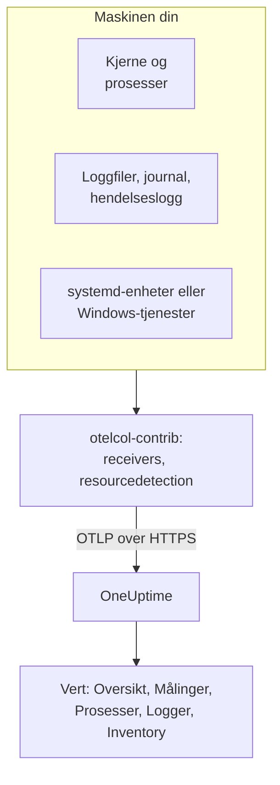

# OpenTelemetry-collector på verten

Kjør OpenTelemetry Collector på en Linux-, macOS- eller Windows-maskin for å sende metrikkene, prosessene, loggene og tjenestetilstandene dens til OneUptime. Maskinen vises under **Produkter → Infrastruktur → Verter** med egne sider, uten noen OneUptime-agent å installere: collectoren er upstream-utgivelsen `otelcol-contrib`. [Vertsmonitorer](/docs/monitor/host-monitor) varsler på det den sender.

:::cards
- [Installer collectoren](#installer-collectoren): Tre trinn på Linux, macOS eller Windows.
- [Velg hva som skal samles inn](#velg-hva-som-skal-samles-inn): Metrikker, fillogger, journalen, hendelseslogger og tjenestetilstander.
- [Inventarattributter](#inventarattributter-ip-mac-serienummer-produsent-modell-fastvare): IP, MAC, serienummer, produsent, modell og fastvare for CMDB-en din.
- [Send mindre](#redusere-mengden-data-som-samles-inn): Færre logglinjer, grovere intervaller, færre serier.
:::

## Slik fungerer det

Collectoren leser maskinen gjennom receiverne sine, stempler hver post med maskinens identitet og sender den til OneUptime over OTLP med inntaksnøkkelen din. OneUptime registrerer verten ut fra de første metrikkene og fyller ut sidene dens etter hvert som dataene kommer inn.



| Det du ser på verten | Hvor det kommer fra |
| --- | --- |
| **Oversikt** og **Målinger** | Receiveren `hostmetrics`: CPU, minne, disker, filsystemer, nettverk, last, paging. |
| **Prosesser** | Scraperen `process` i `hostmetrics`: ett sett serier per prosess. |
| **Logger** | Receiverne `filelog`, `journald` og `windowseventlog`. |
| **Systemd Units** (Linux) | Receiveren `systemd`. |
| **Tjenester** (Windows) | Receiveren `windows_service`. |
| Inventarelementet | Prosessoren `resourcedetection`, pluss [attributtene du stempler](#inventarattributter-ip-mac-serienummer-produsent-modell-fastvare). |
| **Agentversjon** | `oneuptime.agent.version` i prosessoren `resource`. |

En vert registreres så snart en batch som har `host.name`, også har `hostmetrics`- eller `process`-metrikker, eller et `os.type`-attributt. Prosessoren `resourcedetection` setter alle sammen, og derfor setter hver konfigurasjon den først. `host.id` eller `host.arch` alene registrerer ikke en vert, og telemetri med en Kubernetes-identitet (`k8s.cluster.name`, `k8s.node.name`, `k8s.pod.name`) lagres i stedet under klyngen sin: overvåk Kubernetes-noder med [Kubernetes-agenten](/docs/telemetry/kubernetes-agent).

## Før du begynner

- En inntaksnøkkel. Opprett en under **Prosjektinnstillinger → Telemetri og APM → Inntaksnøkler** og kopier verdien. Collectoren sender den som headeren `x-oneuptime-token`.
- Administratorrettigheter på maskinen: `sudo` på Linux og macOS, en PowerShell-ledetekst med forhøyede rettigheter på Windows.
- Utgående HTTPS fra maskinen til OneUptime-URL-en din.
- Contrib-distribusjonen av collectoren, `otelcol-contrib`. Kjernebygget `otelcol` mangler receiverne og prosessorene disse konfigurasjonene bruker. Receiveren `systemd` (Linux) fungerer fra v0.143.0 og receiveren `windows_service` (Windows) fra v0.155.0; kommandoene nedenfor installerer v0.161.0, utgivelsen OneUptime fester.

## Installer collectoren

:::steps
### Lagre konfigurasjonen

Lagre dette som `config.yaml` i mappen du skal kjøre installasjonskommandoene fra, og erstatt `YOUR_TELEMETRY_INGESTION_TOKEN` med inntaksnøkkelen din (og endepunktet med din egen URL hvis du kjører selvhostet).

:::tabs
@tab Linux
```yaml title="config.yaml"
receivers:
  hostmetrics:
    collection_interval: 30s
    scrapers:
      cpu:
        metrics:
          system.cpu.utilization:
            enabled: true
          system.cpu.logical.count:
            enabled: true
      memory:
        metrics:
          system.memory.utilization:
            enabled: true
      disk:
      filesystem:
        metrics:
          system.filesystem.utilization:
            enabled: true
      load:
      network:
      paging:
      processes:
      process:
        mute_process_name_error: true
        mute_process_exe_error: true
        mute_process_io_error: true
        metrics:
          process.cpu.utilization:
            enabled: true
          process.memory.utilization:
            enabled: true

  # The systemd journal: every unit's logs, info and above.
  journald:
    directory: /var/log/journal
    priority: info

  # Powers the Systemd Units tab (otelcol-contrib v0.143.0+).
  systemd:
    collection_interval: 30s
    units: ["*.service"]
    metrics:
      systemd.service.cpu.time:
        enabled: false

processors:
  # Stamps host.name, host.id and os.type: this is how OneUptime attaches
  # telemetry to the host. Without it the host's pages stay empty.
  resourcedetection:
    detectors: [system, env]
    system:
      hostname_sources: [os]
      resource_attributes:
        host.name:
          enabled: true
        host.id:
          enabled: true
        host.arch:
          enabled: true
        host.ip:
          enabled: true
        host.mac:
          enabled: true
        os.type:
          enabled: true
        os.description:
          enabled: true
        os.version:
          enabled: true
  # The collector release this config is for: the host's Agent Version.
  resource:
    attributes:
      - key: oneuptime.agent.version
        value: "0.161.0"
        action: upsert
  batch:

exporters:
  otlphttp/oneuptime:
    endpoint: https://oneuptime.com/otlp
    headers:
      x-oneuptime-token: YOUR_TELEMETRY_INGESTION_TOKEN

service:
  pipelines:
    metrics:
      receivers: [hostmetrics, systemd]
      processors: [resourcedetection, resource, batch]
      exporters: [otlphttp/oneuptime]
    logs:
      receivers: [journald]
      processors: [resourcedetection, resource, batch]
      exporters: [otlphttp/oneuptime]
```
@tab macOS
```yaml title="config.yaml"
receivers:
  hostmetrics:
    collection_interval: 30s
    scrapers:
      cpu:
        metrics:
          system.cpu.utilization:
            enabled: true
          system.cpu.logical.count:
            enabled: true
      memory:
        metrics:
          system.memory.utilization:
            enabled: true
      disk:
      filesystem:
        metrics:
          system.filesystem.utilization:
            enabled: true
      load:
      network:
      paging:
      processes:
      process:
        mute_process_name_error: true
        mute_process_exe_error: true
        mute_process_io_error: true
        metrics:
          process.cpu.utilization:
            enabled: true
          process.memory.utilization:
            enabled: true

  filelog/system:
    include:
      - /var/log/install.log
      - /var/log/wifi.log
    start_at: end

processors:
  # Stamps host.name, host.id and os.type: this is how OneUptime attaches
  # telemetry to the host. Without it the host's pages stay empty.
  resourcedetection:
    detectors: [system, env]
    system:
      hostname_sources: [os]
      resource_attributes:
        host.name:
          enabled: true
        host.id:
          enabled: true
        host.arch:
          enabled: true
        host.ip:
          enabled: true
        host.mac:
          enabled: true
        os.type:
          enabled: true
        os.description:
          enabled: true
        os.version:
          enabled: true
  # The collector release this config is for: the host's Agent Version.
  resource:
    attributes:
      - key: oneuptime.agent.version
        value: "0.161.0"
        action: upsert
  batch:

exporters:
  otlphttp/oneuptime:
    endpoint: https://oneuptime.com/otlp
    headers:
      x-oneuptime-token: YOUR_TELEMETRY_INGESTION_TOKEN

service:
  pipelines:
    metrics:
      receivers: [hostmetrics]
      processors: [resourcedetection, resource, batch]
      exporters: [otlphttp/oneuptime]
    logs:
      receivers: [filelog/system]
      processors: [resourcedetection, resource, batch]
      exporters: [otlphttp/oneuptime]
```
@tab Windows
```yaml title="config.yaml"
receivers:
  hostmetrics:
    collection_interval: 30s
    scrapers:
      cpu:
        metrics:
          system.cpu.utilization:
            enabled: true
          system.cpu.logical.count:
            enabled: true
      memory:
        metrics:
          system.memory.utilization:
            enabled: true
      disk:
      filesystem:
        metrics:
          system.filesystem.utilization:
            enabled: true
      load:
      network:
      paging:
      processes:
      process:
        mute_process_name_error: true
        mute_process_exe_error: true
        mute_process_io_error: true
        metrics:
          process.cpu.utilization:
            enabled: true
          process.memory.utilization:
            enabled: true

  windowseventlog/system:
    channel: System
    start_at: end

  windowseventlog/application:
    channel: Application
    start_at: end

  windowseventlog/security:
    channel: Security
    start_at: end

  # Powers the Services tab (otelcol-contrib v0.155.0+).
  windows_service:
    collection_interval: 30s

processors:
  # Stamps host.name, host.id and os.type: this is how OneUptime attaches
  # telemetry to the host. Without it the host's pages stay empty.
  resourcedetection:
    detectors: [system, env]
    system:
      hostname_sources: [os]
      resource_attributes:
        host.name:
          enabled: true
        host.id:
          enabled: true
        host.arch:
          enabled: true
        host.ip:
          enabled: true
        host.mac:
          enabled: true
        os.type:
          enabled: true
        os.description:
          enabled: true
        os.version:
          enabled: true
  # The collector release this config is for: the host's Agent Version.
  resource:
    attributes:
      - key: oneuptime.agent.version
        value: "0.161.0"
        action: upsert
  batch:

exporters:
  otlphttp/oneuptime:
    endpoint: https://oneuptime.com/otlp
    headers:
      x-oneuptime-token: YOUR_TELEMETRY_INGESTION_TOKEN

service:
  pipelines:
    metrics:
      receivers: [hostmetrics, windows_service]
      processors: [resourcedetection, resource, batch]
      exporters: [otlphttp/oneuptime]
    logs:
      receivers:
        - windowseventlog/system
        - windowseventlog/application
        - windowseventlog/security
      processors: [resourcedetection, resource, batch]
      exporters: [otlphttp/oneuptime]
```
:::

Hver konfigurasjon er den dashbordet skriver under **Produkter → Infrastruktur → Verter → Dokumentasjon**, med en loggpipeline lagt til: prosessorene er `resourcedetection`, `resource` og `batch`, og eksportøren er `otlphttp/oneuptime`. Den setter ingen `service.name`, så vertens telemetri tilhører verten selv, lagret som `host/<hostname>`. Legg til en `service.name` i prosessoren `resource` bare hvis du vil ha den lagret under en telemetritjeneste med det navnet i stedet.

### Installer og start collectoren

:::tabs
@tab Linux
På Debian eller Ubuntu:

```bash
VERSION=0.161.0                      # the release OneUptime pins
ARCH=$(dpkg --print-architecture)   # amd64 or arm64

curl -fL -o /tmp/otelcol-contrib.deb \
  "https://github.com/open-telemetry/opentelemetry-collector-releases/releases/download/v${VERSION}/otelcol-contrib_${VERSION}_linux_${ARCH}.deb"
sudo dpkg -i /tmp/otelcol-contrib.deb
```

På RHEL, CentOS, Fedora eller Amazon Linux:

```bash
VERSION=0.161.0
ARCH=$(uname -m | sed 's/x86_64/amd64/;s/aarch64/arm64/')

curl -fL -o /tmp/otelcol-contrib.rpm \
  "https://github.com/open-telemetry/opentelemetry-collector-releases/releases/download/v${VERSION}/otelcol-contrib_${VERSION}_linux_${ARCH}.rpm"
sudo rpm -Uvh /tmp/otelcol-contrib.rpm
```

Pakken installerer `/usr/bin/otelcol-contrib` og en systemd-enhet, og starter den med en standardkonfigurasjon. Legg din på plass, la collectorens bruker lese journalen, og start den på nytt:

```bash
sudo install -m 0644 config.yaml /etc/otelcol-contrib/config.yaml
sudo usermod -aG systemd-journal otelcol-contrib
sudo systemctl enable otelcol-contrib
sudo systemctl restart otelcol-contrib
sudo systemctl status otelcol-contrib
```

Den pakkede enheten kjører collectoren som den uprivilegerte brukeren `otelcol-contrib`. Gruppen `systemd-journal` lar den lese journalen; for å følge filer i `/var/log` (lesbare for gruppen `adm` på Debian og Ubuntu), legg til den gruppen også. For at scraperen `process` skal se prosessene til andre brukere, gi den capabilityen `CAP_SYS_PTRACE`.
@tab macOS
```bash
VERSION=0.161.0
ARCH=$(uname -m | sed 's/x86_64/amd64/')   # arm64 on Apple silicon, amd64 on Intel

curl -fL -o /tmp/otelcol-contrib.tar.gz \
  "https://github.com/open-telemetry/opentelemetry-collector-releases/releases/download/v${VERSION}/otelcol-contrib_${VERSION}_darwin_${ARCH}.tar.gz"

sudo mkdir -p /usr/local/otelcol-contrib /usr/local/bin /etc/otelcol-contrib
sudo tar -xzf /tmp/otelcol-contrib.tar.gz -C /usr/local/otelcol-contrib
sudo ln -sf /usr/local/otelcol-contrib/otelcol-contrib /usr/local/bin/otelcol-contrib
sudo install -m 0644 config.yaml /etc/otelcol-contrib/config.yaml
```

Opprett `/Library/LaunchDaemons/com.oneuptime.otelcol-contrib.plist`, slik at launchd starter collectoren sammen med Mac-en og starter den på nytt hvis den stopper:

```xml title="/Library/LaunchDaemons/com.oneuptime.otelcol-contrib.plist"
<?xml version="1.0" encoding="UTF-8"?>
<!DOCTYPE plist PUBLIC "-//Apple//DTD PLIST 1.0//EN" "http://www.apple.com/DTDs/PropertyList-1.0.dtd">
<plist version="1.0">
<dict>
  <key>Label</key><string>com.oneuptime.otelcol-contrib</string>
  <key>ProgramArguments</key>
  <array>
    <string>/usr/local/bin/otelcol-contrib</string>
    <string>--config=/etc/otelcol-contrib/config.yaml</string>
  </array>
  <key>RunAtLoad</key><true/>
  <key>KeepAlive</key><true/>
  <key>StandardOutPath</key><string>/var/log/otelcol-contrib.out.log</string>
  <key>StandardErrorPath</key><string>/var/log/otelcol-contrib.err.log</string>
</dict>
</plist>
```

Last den inn:

```bash
sudo launchctl load -w /Library/LaunchDaemons/com.oneuptime.otelcol-contrib.plist
sudo launchctl list | grep otelcol-contrib
```

Bruk denne tarballen, ikke Homebrew: Homebrew-formelen er kjernebygget, som nekter å starte med denne konfigurasjonen.
@tab Windows
Fra en PowerShell-ledetekst med forhøyede rettigheter, i mappen som inneholder `config.yaml`, kjør denne blokken som en helhet: hver linje avhenger av variablene over den.

```powershell
$VERSION = "0.161.0"                          # the release OneUptime pins; v0.155.0+ has the Services tab
$ARCH    = "amd64"                            # use "arm64" on ARM hosts
$dest    = "C:\Program Files\otelcol-contrib"
$tar     = "$env:TEMP\otelcol-contrib.tar.gz"

# Note the "-contrib" in the asset name; otelcol_... is the wrong archive.
$url = "https://github.com/open-telemetry/opentelemetry-collector-releases/releases/download/v$VERSION/otelcol-contrib_${VERSION}_windows_${ARCH}.tar.gz"

New-Item -ItemType Directory -Force -Path $dest | Out-Null
Invoke-WebRequest -Uri $url -OutFile $tar
tar -xf $tar -C $dest                          # tar.exe ships with Windows 10 1803+ / Server 2019+
Get-ChildItem $dest                            # expect otelcol-contrib.exe, not otelcol.exe
Copy-Item config.yaml "$dest\config.yaml" -Force

# --% hands the rest of the line to sc.exe unchanged, so its quoting
# survives PowerShell — keep the command on one line.
sc.exe --% create "otelcol-contrib" binPath= "\"C:\Program Files\otelcol-contrib\otelcol-contrib.exe\" --config=\"C:\Program Files\otelcol-contrib\config.yaml\"" start= auto DisplayName= "OpenTelemetry Collector (OneUptime)"
sc.exe description "otelcol-contrib" "Collects host telemetry and forwards it to OneUptime over OTLP."
sc.exe start "otelcol-contrib"
sc.exe query "otelcol-contrib"
```

Tjenesten kjører som `LocalSystem`, som kan lese hendelsesloggen `Security` og alle Windows-tjenester. På Windows emulerer scraperen `load` bare et lastgjennomsnitt fra telleren *Processor Queue Length*, med start på 0.

Navnet på utgivelsesfilen må begynne med `otelcol-contrib_`. Kjernearkivet `otelcol_<version>_windows_amd64.tar.gz` pakker ut `otelcol.exe`, som ikke har noen `windowseventlog`- eller `windows_service`-receiver; å gi den nytt navn til `otelcol-contrib.exe` legger dem ikke til. Foretrekker du et installasjonsprogram? Den samme [utgivelsessiden](https://github.com/open-telemetry/opentelemetry-collector-releases/releases) har en signert `otelcol-contrib_<version>_windows_x64.msi`, som registrerer tjenesten for deg: pek den mot denne `config.yaml` og behold tjenesten på `LocalSystem`.
:::

### Sjekk at verten vises

Åpne **Produkter → Infrastruktur → Verter → Alle verter**. Verten vises under vertsnavnet sitt når de første metrikkene kommer inn, vanligvis innen 30 sekunder, og sidene **Oversikt**, **Målinger**, **Prosesser** og **Logger** fylles ut. Hvis den ikke gjør det, les collectorens egne logger:

:::tabs
@tab Linux
```bash
sudo journalctl -u otelcol-contrib -f
```
@tab macOS
```bash
tail -f /var/log/otelcol-contrib.err.log
```
@tab Windows
```powershell
Get-WinEvent -LogName Application -MaxEvents 20 | Where-Object ProviderName -eq "otelcol-contrib"
```
:::
:::

For å lage en testlogglinje, kjør `logger "hello from oneuptime"` (Linux, macOS) eller `eventcreate /T INFORMATION /ID 999 /L APPLICATION /SO OneUptimeTest /D "hello from oneuptime"` (Windows, med forhøyede rettigheter), og se deretter på vertens side **Logger**.

## Velg hva som skal samles inn

Hver konfigurasjon har samme form: receivere for det som skal leses, prosessorene `resourcedetection`, `resource` og `batch`, og eksportøren `otlphttp/oneuptime`. Legg til receiverne nedenfor under `receivers:` og i pipelinen deres, og start deretter collectoren på nytt (`sudo systemctl restart otelcol-contrib`, `launchctl unload` og `load` på en Mac, `Restart-Service otelcol-contrib` på Windows). Flett hvert utdrag inn i seksjonene konfigurasjonen din har: en ny `processors:`- eller `service:`-nøkkel erstatter den første.

### Vertsmetrikker

`hostmetrics` fungerer på alle operativsystemer. Den leser CPU, minne, disker, filsystemer, nettverk, last, paging og prosesser fra kjernen, hvert `collection_interval`. `*.utilization`-metrikkene og `system.cpu.logical.count` er av som standard i receiveren, og vertens grafer og Host-varslingsmalene leser dem, så hold dem aktivert slik konfigurasjonene over gjør. Scraperen `process` forsyner siden **Prosesser**; den er også den største kilden til serier (se [Send mindre](#redusere-mengden-data-som-samles-inn)).

På Linux leser collectoren `/proc` og `/sys`. En collector i en container må montere vertens og sette `HOST_PROC` og `HOST_SYS` (se [I en Docker-container](#i-en-docker-container)); en native installasjon trenger ingenting.

### Fillogger

Følg en hvilken som helst loggfil på disken med en `filelog`-receiver, og legg den til i `logs`-pipelinen:

```yaml
receivers:
  filelog/app:
    include:
      - /var/log/myapp/*.log
    start_at: end
    multiline:
      # A new entry starts with a timestamp; continuation lines (the
      # "at ...", "File ...", "Caused by: ..." frames) are folded into it.
      line_start_pattern: '^\d{4}-\d{2}-\d{2}[ T]\d{2}:\d{2}:\d{2}'
```

`start_at: end` leser bare nye linjer; bruk `beginning` for å lese filene fra starten ved første kjøring. Collectoren husker posisjonen sin i hver fil, så den fortsetter riktig etter en omstart.

OneUptime søker gjennom feil- og fatal-logglinjer etter stakksporinger og grupperer dem i **Unntak**, under verten. For det må en stakksporing over flere linjer (Java, Python, .NET, Ruby) komme inn som én post, og det er det `multiline` gjør; uten den er hver ramme en egen logg. Hvis applikasjonen din kan skrive OpenTelemetry-attributtene `exception.type`, `exception.message` og `exception.stacktrace` selv, er det enda mer pålitelig.

På en systemd-vert gjentar `/var/log/syslog` og `/var/log/messages` det journalen allerede har, så les det ene eller det andre.

### systemd-journal

På en systemd-vert leser receiveren `journald` loggene til alle enheter på ett sted, med de strukturerte feltene deres. Linux-konfigurasjonen over leser dem alle fra `info` og oppover; begrens den til noen enheter:

```yaml
receivers:
  journald:
    directory: /var/log/journal
    units:
      # Drop this list to ingest everything; restrict it to limit volume.
      - ssh.service
      - cron.service
      - nginx.service
    priority: info
```

Receiveren kjører `journalctl`, som alle systemd-verter har, og collectorens bruker må være med i gruppen `systemd-journal`.

### Linux-tjenester (systemd-enheter, metrikker)

Vertens side **Systemd Units** viser hver enhet og tilstanden dens, fra [`systemdreceiver`](https://github.com/open-telemetry/opentelemetry-collector-contrib/tree/main/receiver/systemdreceiver) (konfigurasjonstype `systemd`), Linux-motstykket til siden **Tjenester** på Windows. Linux-konfigurasjonen over slår den på:

```yaml
receivers:
  systemd:
    collection_interval: 30s
    # The service manager to read: "system" (default) or "user".
    scope: system
    # Which units to scrape, as systemctl unit patterns. The default is
    # every service; widen it to include timers, sockets or mounts, or
    # narrow it to cut volume on hosts with hundreds of units:
    units: ["*.service"]
    # units: [nginx.service, postgresql.service, "*.timer"]
    metrics:
      # Per-service CPU time is on by default and doubles this receiver's
      # datapoint count. The Systemd Units tab does not use it, so turn it
      # off unless you chart it. On v0.142.0 the key is
      # systemd.unit.cpu.time — naming a metric the running build does not
      # have stops the collector at startup.
      systemd.service.cpu.time:
        enabled: false

service:
  pipelines:
    metrics:
      receivers: [hostmetrics, systemd]
      processors: [resourcedetection, resource, batch]
```

Receiveren kom først i `otelcol-contrib` v0.142.0, og v0.143.0 er den første utgivelsen som er verdt å kjøre. På alt eldre feiler det å legge til `systemd` ved oppstart med `'receivers' unknown type: "systemd"`; v0.142.0 alene kaller CPU-metrikken sin `systemd.unit.cpu.time` og ser etter cgroup-statistikk på hver enhet, noe som logger en scrape-feil for hver enhet som ikke er `.service`.

Den sender `systemd.unit.state` som et tilstandssett: ved hver scrape får hver enhet ett datapunkt per mulig tilstand (`active`, `reloading`, `inactive`, `failed`, `activating`, `deactivating`, `maintenance`, `refreshing`), `1` for tilstanden den er i og `0` for resten. Enhetsnavnet er ressursattributtet `systemd.unit.name` og tilstanden datapunktattributtet `systemd.unit.active_state`. Fordi enhetsnavnet er et ressursattributt, må `resourcedetection` bli værende i metrikkpipelinen: den stempler `host.name` på hver enhets ressurs, og uten den knyttes prøvene aldri til en vert.

Den leser enhetstilstanden over system-D-Bus, med de skrivebeskyttede kallene `systemctl list-units` gjør, som systemd tillater uten privilegier. Den pakkede tjenesten, som kjører som brukeren `otelcol-contrib` og ikke root, trenger derfor ingen ekstra rettigheter. Den trenger likevel bussen: en collector i en container har ingen `/run/dbus/system_bus_socket` med mindre du monterer vertens, så bruk en native installasjon. Receiveren er alfa og bare for Linux.

> [!WARNING]
> Tilstandssettet koster åtte datapunkter per enhet per scrape, og `systemd.service.cpu.time`, som er på som standard, legger til to til (`user` og `system`): 10 datapunkter per enhet per scrape. En vert som følger 300 enheter hvert 30. sekund, sender omtrent 6 000 datapunkter i minuttet fra denne receiveren alene, eller omtrent 4 800 med CPU-metrikken av. Begrens `units:` til tjenestene du varsler på, eller øk `collection_interval`, før du slår den på i en hel flåte.

### Apple Unified Log

macOS skriver systemloggene sine til Apple Unified Log, som leses med `log show` og `log stream`, i stedet for til `/var/log/system.log`. For å samle den inn, strøm den til en fil med et lite skript, `/usr/local/otelcol-contrib/log-stream.sh`:

```bash title="/usr/local/otelcol-contrib/log-stream.sh"
#!/bin/bash
exec /usr/bin/log stream --style ndjson --level info \
  --predicate 'subsystem != "com.apple.cfnetwork"' \
  >> /var/log/apple-unified.log
```

Gjør det kjørbart og kjør det under launchd (eller `nohup` for en rask test), og pek deretter en `filelog`-receiver mot filen:

```yaml
receivers:
  filelog/apple-unified:
    include:
      - /var/log/apple-unified.log
    start_at: end
    operators:
      - type: json_parser
        timestamp:
          parse_from: attributes.timestamp
          layout: "%Y-%m-%d %H:%M:%S.%f%j"
```

Mange Mac-flåter klarer seg godt med vertsmetrikker og noen få fillogger, uten unified log.

### Windows-hendelseslogger

Windows-konfigurasjonen over abonnerer på kanalene `System`, `Application` og `Security`. For å begrense den høyvolums `Security`-kanalen til noen hendelses-ID-er:

```yaml
windowseventlog/security:
  channel: Security
  start_at: end
  query: "*[System[(EventID=4625 or EventID=4740)]]"
```

For å lese en annen kanal (alt under *Event Viewer → Applications and Services Logs*), bruk det nøyaktige navnet:

```yaml
windowseventlog/iis:
  channel: Microsoft-IIS-Logging/Logs
  start_at: end
```

### Windows-tjenester (metrikker)

Vertens side **Tjenester** viser hver Windows-tjeneste med tilstand og oppstartstype, fra [`windowsservicereceiver`](https://github.com/open-telemetry/opentelemetry-collector-contrib/tree/main/receiver/windowsservicereceiver) (konfigurasjonstype `windows_service`). Den følger med `otelcol-contrib` fra v0.155.0: på tidligere utgivelser feiler det å legge til `windows_service` ved oppstart med `'receivers' unknown type: "windows_service"`. Windows-konfigurasjonen over slår den på:

```yaml
receivers:
  windows_service:
    collection_interval: 30s
    # Collect every service by default. To cut volume — and avoid the
    # "access denied" noise from services the collector can't open —
    # list just the ones you care about:
    # include_services: [Spooler, W3SVC, MSSQLSERVER]
    # Or collect everything except a few:
    # exclude_services: [TrustedInstaller]

service:
  pipelines:
    metrics:
      receivers: [hostmetrics, windows_service]
```

Den sender én `windows.service.status`-måler per tjeneste, Win32-tjenestetilstanden (`4` er kjører, `1` er stoppet), med attributtene `name` og `startup_mode`. Collectoren leser alle tjenester som `LocalSystem` og hopper over dem den ikke kan åpne. Receiveren er alfa og bare for Windows; hvis en scrape-feil eller en `access denied` på én tjeneste påvirker de andre, begrens den med `include_services`.

`include_services` kan bare begrense settet. Hvis du lister opp tjenester og fortsatt ser alle, har den redigerte konfigurasjonen ikke nådd collectoren som kjører: start tjenesten på nytt, sjekk at `include_services` er en utfylt liste på samme innrykk som `collection_interval`, og gi siden **Tjenester** noen minutter, til tjenestene som ble rapportert før endringen, forlater det rullerende vinduet. Navnene er de nøyaktige tjenestenøkkelnavnene, med skille mellom store og små bokstaver (`Spooler`, `W3SVC`), som `Get-Service | Select-Object Name` viser.

### Etiketter

Ethvert ressursattributt som begynner med `oneuptime.label.`, blir en prosjektetikett på verten: `oneuptime.label.<dimension>=<value>` er etiketten `<dimension>:<value>`. Legg til en prosessor for dem og navngi den i pipelinene:

```yaml
processors:
  resource/oneuptime-labels:
    attributes:
      - key: oneuptime.label.team
        value: payments
        action: upsert
      - key: oneuptime.label.env
        value: production
        action: upsert

service:
  pipelines:
    metrics:
      processors: [resourcedetection, resource, resource/oneuptime-labels, batch]
```

Etiketter sammenlignes uten skille mellom store og små bokstaver, så en eksisterende `Production`-etikett gjenbrukes i stedet for å dupliseres, og etiketter som er lagt til i OneUptime, fjernes aldri av collectoren.

### Inventarattributter (IP, MAC, serienummer, produsent, modell, fastvare)

Hver vert får også et inventarelement: posten en CMDB-eksport leser. Detaljene fylles rett fra ressursattributtene på telemetrien du sender, så det som kommer inn, er det en CMDB-synkronisering kan hente.

| Det du vil ha | Attributt | Hvor det kommer fra |
| --- | --- | --- |
| IP-adresser | `host.ip` | `resourcedetection`, kommaseparert når maskinen har flere |
| MAC-adresser | `host.mac` | `resourcedetection`, én per grensesnitt som er oppe, kommaseparert |
| Arkitektur | `host.arch` | `resourcedetection` |
| Maskin-ID | `host.id` | `resourcedetection`: maskinens GUID på Windows, `/etc/machine-id` på Linux |
| OS | `os.type`, `os.description`, `os.version` | `resourcedetection` |
| Serienummer | `host.serial_number` | Stemplet av deg, fra WMI eller DMI |
| Produsent | `device.manufacturer` | Stemplet av deg, fra WMI eller DMI |
| Modell | `device.model.name` | Stemplet av deg, fra WMI eller DMI |
| Fastvareversjon (BIOS eller UEFI) | `device.firmware.version` | Stemplet av deg, fra WMI eller DMI |

Konfigurasjonene over aktiverer alle oppdagede attributter: i systemdetektoren er bare `host.name` og `os.type` på som standard, og derfor lister de opp de andre under `resource_attributes`. Bygger du en egen konfigurasjon, behold den `resourcedetection`-blokken: uten den finnes det ingen `host.name`, og dermed ingen vert og intet inventarelement i det hele tatt.

#### Serienummer, produsent, modell og fastvareversjon har ingen detektor

De ligger i maskinens fastvare, som collectoren ikke leser. På Linux er det ingen innstilling du kan endre: den pakkede collectoren kjører som den uprivilegerte brukeren `otelcol-contrib`, og `/sys/class/dmi/id/product_serial` kan bare leses av root. Les dem derfor én gang, når maskinen klargjøres, og stemple dem på ressursen med en egen prosessor:

```yaml
processors:
  resource/oneuptime-hardware:
    attributes:
      - key: host.serial_number
        value: "7XYZ123"
        action: upsert
      - key: device.manufacturer
        value: "Dell Inc."
        action: upsert
      - key: device.model.name
        value: "OptiPlex 7090"
        action: upsert
      - key: device.firmware.version
        value: "1.21.0"
        action: upsert

service:
  pipelines:
    metrics:
      processors: [resourcedetection, resource, resource/oneuptime-hardware, batch]
```

Legg `resource/oneuptime-hardware` til prosessorlisten du allerede har, i stedet for å lime inn denne linjen over den: fjerner du `resource`, mister verten sin **Agentversjon**. Behold `resourcedetection` først uansett: det er den som knytter batchen til verten.

`host.manufacturer`, `host.model.name`, `host.firmware.version` og `host.bios.version` godtas som alternative skrivemåter og lagres under `device.*`-nøklene over, så en konfigurasjon skrevet på begge måter havner på ett sted; når begge finnes, vinner `device.*`-verdien. Serienummeret går den andre veien: `device.serial_number` godtas og lagres som `host.serial_number`.

> [!NOTE]
> På en ressurs uten vertsidentitet betyr `device.manufacturer` «mobilapp»: det er ett av attributtene som markerer en batch som mobil Real User Monitoring. En verts ressurs har alltid `host.name` eller `host.id`, så en collector-konfigurasjon som den over forveksles aldri med en telefon, men ikke gjenbruk den samme blokken i SDK-konfigurasjonen til en mobilapp.

#### Lese verdiene

På Windows, fra en PowerShell-ledetekst med forhøyede rettigheter. Den skriver ut YAML-blokken for maskinen du kjører den på:

```powershell
$bios = Get-CimInstance -ClassName Win32_BIOS
$cs   = Get-CimInstance -ClassName Win32_ComputerSystem

# Quote for YAML: trim, escape any embedded quote, wrap in single quotes.
# The cast to string first is what keeps this working on machines whose
# firmware leaves a field empty — .Trim() on $null throws.
function Format-YamlValue($value) {
  "'" + ("$value".Trim() -replace "'", "''") + "'"
}

@"
  resource/oneuptime-hardware:
    attributes:
      - key: host.serial_number
        value: $(Format-YamlValue $bios.SerialNumber)
        action: upsert
      - key: device.manufacturer
        value: $(Format-YamlValue $cs.Manufacturer)
        action: upsert
      - key: device.model.name
        value: $(Format-YamlValue $cs.Model)
        action: upsert
      - key: device.firmware.version
        value: $(Format-YamlValue $bios.SMBIOSBIOSVersion)
        action: upsert
"@
```

Den skriver ut én prosessoroppføring, allerede med innrykk: legg den inn i `processors:`-blokken du har, ikke som en ny `processors:`-nøkkel. Bruk `Get-CimInstance`, ikke den utfasede `Get-WmiObject`, som PowerShell 7 og nyere ikke lenger har. Et felt fastvaren lar stå tomt, skrives ut som `''`: dropp det attributtet i stedet for å sende et tomt. Virtuelle maskiner har ofte ikke noe serienummer i det hele tatt.

På Linux, som root:

```bash
cat /sys/class/dmi/id/product_serial   # host.serial_number
cat /sys/class/dmi/id/sys_vendor       # device.manufacturer
cat /sys/class/dmi/id/product_name     # device.model.name
cat /sys/class/dmi/id/bios_version     # device.firmware.version
```

`bios_version` er den av de fire som alle brukere kan lese. På maskiner uten `/sys/class/dmi` returnerer `dmidecode -s system-serial-number`, `-s system-manufacturer`, `-s system-product-name` og `-s bios-version` de samme verdiene. Virtuelle maskiner rapporterer hypervisoren sin her (`QEMU`, `VMware, Inc.`, `Amazon EC2`), som vanligvis er det du vil ha i en CMDB.

På en Mac:

```bash
ioreg -l | awk -F'"' '/IOPlatformSerialNumber/{print $4}'   # host.serial_number
sysctl -n hw.model                                          # device.model.name
system_profiler SPHardwareDataType | awk -F': ' '/System Firmware Version/{print $2}'   # device.firmware.version
```

Produsenten er `Apple Inc.` `hw.model` returnerer modellidentifikatoren, for eksempel `Mac14,7` eller `MacBookPro18,3`, ikke markedsføringsnavnet, som Mac-en ikke rapporterer: kartlegg identifikatoren i CMDB-en din hvis du trenger et. Legg den i `device.model.name` likevel: `device.model.identifier` markerer en batch som en mobilapp uansett hva annet den har, så en Mac som er stemplet med den, lagres som en telefon og kobles fra verten sin.

#### Bruke miljøvariabler i stedet

Detektoren `env` er på, så `OTEL_RESOURCE_ATTRIBUTES` fungerer i stedet for prosessoren:

```text
OTEL_RESOURCE_ATTRIBUTES=host.serial_number=7XYZ123,device.manufacturer=Dell%20Inc.,device.model.name=OptiPlex%207090
```

Prosentkod hver verdi. Variabelen leses som en W3C Baggage-liste med `key=value`, der `,` og `=` skiller oppføringer og mellomrom ikke er portable mellom collector-versjoner; anførselstegn hjelper ikke, og `device.manufacturer="Dell Inc."` kan komme frem med anførselstegnene i verdien. På Windows koder `[System.Uri]::EscapeDataString($value)` en verdi.

Sett den på collectorens egen tjeneste, aldri for hele maskinen:

- **Linux:** `sudo systemctl edit otelcol-contrib`, deretter en `[Service]`-seksjon med `Environment="OTEL_RESOURCE_ATTRIBUTES=…"`.
- **Windows:** verdien `Environment` (type `REG_MULTI_SZ`) under `HKLM\SYSTEM\CurrentControlSet\Services\otelcol-contrib`. `sc.exe create` kan ikke sette miljøvariabler for tjenester, og `setx` setter en variabel som tjenesten som kjører, aldri leser igjen.

> [!WARNING]
> Ikke sett den for hele maskinen (`setx /M`, `/etc/environment`). Hver OpenTelemetry SDK-prosess på maskinen arver `OTEL_RESOURCE_ATTRIBUTES`, så applikasjonene dine ville rapportert maskinens `device.manufacturer` som sin egen, og en applikasjonsressurs med `device.manufacturer` og uten `host.name` eller `host.id` leses som en mobilapp, noe som kobler den fra tjenesten sin.

Prosessoren er lettere å få riktig: den er avgrenset til collectoren per konstruksjon, og verdiene endres aldri for en maskin. Foretrekk den med mindre du allerede bruker maler for miljøfiler.

#### En MAC-adresse er ikke en stemplet verdi

`host.mac` kommer fra detektoren `system`, som `host.ip`: én adresse per nettverksgrensesnitt som er oppe, loopback unntatt, i IEEE-formen OpenTelemetry spesifiserer (`AC-DE-48-23-45-67`). En maskin som kjører Docker eller Hyper-V, rapporterer også de virtuelle svitsjene sine, og derfor er verdien en liste. Et grensesnitt som rapporterer plassholderen med bare nuller (`00-00-00-00-00-00`), utelates.

Ingenting på maskinen rapporterer en fastvareversjon som er tilgjengelig som oppgradering, så OneUptime registrerer den installerte versjonen.

#### Sjekke at det fungerte

Åpne vertens element under **Produkter → Inventar** og se på kortet **Eiendelsdetaljer**. Verdiene vises innen noen minutter etter neste batch; en detalj collectoren ikke har rapportert, vises som ukjent, med en lenke tilbake til denne seksjonen. Fordi de er stemplet og ikke oppdaget, oppdaterer de seg ikke selv: stemple dem på nytt etter et hovedkortbytte, en fastvareoppdatering eller en ny installasjon av systemet.

## Andre måter å kjøre collectoren på

### I en Docker-container

Kjør collectoren i en container som ser vertens prosesser og filsystemer, fra mappen som inneholder `config.yaml`:

```bash
docker run -d \
  --name otel-collector \
  --restart unless-stopped \
  --network host \
  --pid host \
  -v $(pwd)/config.yaml:/etc/otelcol-contrib/config.yaml:ro \
  --volume /:/hostfs:ro,rslave \
  -e HOST_PROC=/hostfs/proc \
  -e HOST_SYS=/hostfs/sys \
  -e HOST_ETC=/hostfs/etc \
  -e HOST_VAR=/hostfs/var \
  -e HOST_RUN=/hostfs/run \
  -e HOST_DEV=/hostfs/dev \
  otel/opentelemetry-collector-contrib:0.161.0 \
  --config /etc/otelcol-contrib/config.yaml
```

`--network host`, `--pid host`, monteringen `/hostfs` og `HOST_*`-variablene lar `hostmetrics` og `process` lese vertens kjerne i stedet for containerens. Bruk bare metrikkpipelinen i konfigurasjonen: imaget har ingen `journalctl`, og receiveren `systemd` trenger vertens D-Bus.

### Fra utgivelsens tarball

Der pakker ikke er et alternativ, pakk ut den statiske binærfilen og gi den en egen systemd-enhet:

```bash
VERSION=0.161.0
ARCH=$(uname -m | sed 's/x86_64/amd64/;s/aarch64/arm64/')

curl -fL -o /tmp/otelcol.tar.gz \
  "https://github.com/open-telemetry/opentelemetry-collector-releases/releases/download/v${VERSION}/otelcol-contrib_${VERSION}_linux_${ARCH}.tar.gz"
sudo mkdir -p /opt/otelcol-contrib
sudo tar -xzf /tmp/otelcol.tar.gz -C /opt/otelcol-contrib
sudo install -m 0644 config.yaml /opt/otelcol-contrib/config.yaml
```

```ini title="/etc/systemd/system/otelcol-contrib.service"
[Unit]
Description=OpenTelemetry Collector
After=network.target

[Service]
ExecStart=/opt/otelcol-contrib/otelcol-contrib --config /opt/otelcol-contrib/config.yaml
Restart=on-failure
RestartSec=5s
User=root

[Install]
WantedBy=multi-user.target
```

```bash
sudo systemctl daemon-reload
sudo systemctl enable --now otelcol-contrib
```

`User=root` lar denne enheten lese alle loggfiler og alle prosesser; den pakkede installasjonen over er det uprivilegerte alternativet.

### På Kubernetes-noder

Kubernetes-noder er ikke verter i OneUptime: telemetrien deres har en Kubernetes-identitet og lagres under klyngen. Installer [Kubernetes-agenten](/docs/telemetry/kubernetes-agent): hver node vises på klyngens side **Noder**, ved siden av podene sine.

## Oppgradere collectoren

Hver konfigurasjon på denne siden stempler collector-utgivelsen den er laget for som `oneuptime.agent.version`, i prosessoren `resource`. OneUptime viser den som **Agentversjon** på vertens **Oversikt**, med et varseltegn ved siden av når OneUptime fester en nyere utgivelse. Velg tegnet for å se hvordan du oppgraderer på den måten du installerte.

For å oppgradere manuelt, installer den nye utgivelsen på samme måte som du installerte denne, med den nye `VERSION` (på Debian og Ubuntu beholder `sudo dpkg -i --force-confold` konfigurasjonen din uten å spørre), sett `oneuptime.agent.version` i `config.yaml` til samme versjon, og start collectoren på nytt. En collector der konfigurasjonen ikke stempler noen versjon, viser ingen, og aldri et tegn.

## Redusere mengden data som samles inn

Du eier konfigurasjonen, så ingenting forlater maskinen med mindre en receiver du har lagt til, leser det. Hvis en vert sender mer enn du vil (som viser seg som mer inntak, og på OneUptime Cloud som høyere kostnad), kan du trimme det her. De to største spakene er hvilke logger du leser og hvor ofte du scraper metrikker; en `filter`-prosessor gjør resten. Endre én spak om gangen, og start collectoren på nytt etter hver endring.

### Hvor volumet kommer fra

| Signal | Største driver | Skru ned med |
| --- | --- | --- |
| Logger | Hver linje fra hver fil, journalenhet eller hendelseskanal | Færre receivere, en smalere `units:` eller `query:`, et `filter` på alvorlighetsgrad |
| Vertsmetrikker | Hvor ofte du scraper, ganger antall serier | Et lengre `collection_interval`, færre scrapere |
| Metrikkardinalitet | Metrikker per prosess: ett sett serier per prosess | Å utelate eller begrense scraperen `process` |
| systemd-enheter | 10 datapunkter per enhet per scrape (tilstandssett og CPU) | En smalere `units:`, CPU-metrikken av, et lengre `collection_interval` |

### Les bare loggene du trenger

Logger er nesten alltid den største andelen, og collectoren leser bare det du lister opp, så list opp mindre:

- Pek `filelog` mot bestemte filer, ikke brede glob-mønstre: `/var/log/myapp/error.log` i stedet for `/var/log/**`.
- Begrens `journald` til enhetene du bryr deg om, og øk `priority` for å droppe `info` og `debug` før de forlater maskinen:

```yaml
receivers:
  journald:
    directory: /var/log/journal
    units:
      - ssh.service
      - nginx.service
    priority: warning # info and debug are dropped before export
```

- Begrens den høyvolums hendelseskanalen `Security` til hendelses-ID-ene du reviderer, med en `query:` (som i [Windows-hendelseslogger](#windows-hendelseslogger)), eller dropp kanalen.

### Scrape metrikker sjeldnere

Volumet til `hostmetrics` skalerer med `collection_interval`: hvis 30 sekunders oppløsning er mer enn du trenger, halverer 60 sekunder datapunktene.

```yaml
receivers:
  hostmetrics:
    collection_interval: 60s
```

### Begrens scraperen per prosess

Scraperen `process` sender et sett serier for hver prosess som kjører, så på en travel maskin er den den største kilden til serier. Utelat den hvis du ikke trenger siden **Prosesser**, eller begrens den til prosessene som betyr noe (behold `processes`, en håndfull prosesstellere, uansett):

```yaml
receivers:
  hostmetrics:
    collection_interval: 60s
    scrapers:
      cpu:
      memory:
      disk:
      filesystem:
      network:
      load:
      paging:
      processes: # aggregate counts only — cheap
      process:
        mute_process_name_error: true
        mute_process_exe_error: true
        mute_process_io_error: true
        include:
          names: [nginx, postgres, node]
          match_type: strict
```

Dette trimmer receiveren til standardmetrikkene sine: legg `metrics:`-blokkene fra konfigurasjonene over tilbake under `cpu`, `memory`, `filesystem` og `process` hvis du bruker vertens grafer og Host-varslingsmalene.

### Begrens systemd-enhetene

Receiveren `systemd` sender et datapunkt per tilstand per enhet ved hver scrape, åtte per enhet, pluss to for `systemd.service.cpu.time`, som er på som standard, så volumet bestemmes av hvor mange enheter `units:` treffer. Standardverdien `["*.service"]` inkluderer dusinvis av engangsenheter som aldri endrer tilstand. List opp enhetene du varsler på, og slå av CPU-metrikken med mindre du lager grafer av den:

```yaml
receivers:
  systemd:
    collection_interval: 60s
    units: [nginx.service, postgresql.service, ssh.service]
    metrics:
      # On otelcol-contrib v0.142.0 this key is systemd.unit.cpu.time.
      systemd.service.cpu.time:
        enabled: false
```

Sammen tar disse en vert med 300 enheter fra omtrent 6 000 datapunkter i minuttet til godt under 100. Enheter som fjernes fra listen, forsvinner fra siden **Systemd Units** noen minutter senere, når de siste prøvene deres eldes ut av det rullerende vinduet.

### Dropp poster med en filter-prosessor

Når du vil ha en receiver, men ikke alt den produserer, legg til en [`filter`](https://github.com/open-telemetry/opentelemetry-collector-contrib/tree/main/processor/filterprocessor)-prosessor. Den evaluerer en [OTTL](https://github.com/open-telemetry/opentelemetry-collector-contrib/blob/main/pkg/ottl/README.md)-betingelse og dropper hver post som samsvarer, før noe sendes.

Dropp logger under en alvorlighetsgrad:

```yaml
processors:
  filter/drop-low-severity:
    error_mode: ignore
    logs:
      log_record:
        # Drop anything less severe than WARN (info, debug, trace).
        # The UNSPECIFIED guard is required — see the warning below.
        - "severity_number != SEVERITY_NUMBER_UNSPECIFIED and severity_number < SEVERITY_NUMBER_WARN"
```

> [!WARNING]
> Behold `UNSPECIFIED`-vakten. `SEVERITY_NUMBER_UNSPECIFIED` er `0` og `SEVERITY_NUMBER_WARN` er `13`, så en bar `severity_number < SEVERITY_NUMBER_WARN` er sann for hver post der alvorlighetsgraden aldri ble tolket. En vanlig `filelog`-receiver tolker ingen alvorlighetsgrad fra linjen, så uten vakten sletter betingelsen stille hver linje den leser, uten noen feil noe sted. Med vakten beholdes utolkede poster og kommer inn med alvorlighetsgraden `Unspecified`, som forteller deg at det er en alvorlighetsparser du trenger.

For å filtrere fillogger etter alvorlighetsgrad på riktig måte, tolk først en med en [`severity_parser`](https://github.com/open-telemetry/opentelemetry-collector-contrib/blob/main/pkg/stanza/docs/operators/severity_parser.md)-operator på receiveren:

```yaml
receivers:
  filelog/app:
    include:
      - /var/log/myapp/*.log
    start_at: end
    operators:
      # Pull a level out of lines like "2026-01-01 ERROR something broke".
      - type: regex_parser
        regex: '(?i)(?P<level>TRACE|DEBUG|INFO|WARN(?:ING)?|ERROR|FATAL)'
        parse_from: body
        # Lines with no recognisable level fall through unparsed rather
        # than being discarded, and are then kept by the guard above.
        on_error: send
      - type: severity_parser
        parse_from: attributes.level
        preset: default
        mapping:
          warn: warning
          error: err
          fatal: panic
```

På en systemd-vert trenger journalen ikke noe av dette: `priority:` i `journald` filtrerer etter nivå i selve `journalctl`.

Dropp metrikker du ikke lager grafer av, etter nøyaktig navn eller etter mønster:

```yaml
processors:
  filter/drop-metrics:
    error_mode: ignore
    metrics:
      metric:
        # Exact metric name.
        - 'name == "system.paging.faults"'
        # Or a whole family. IsMatch is RE2 and UNANCHORED, so anchor it
        # yourself with ^ when you mean "starts with".
        - 'IsMatch(name, "^system\\.paging\\.")'
```

For å sende bare et fast sett metrikker, snu betingelsen: `filter` dropper det som samsvarer, så `not (...)` dropper alt du ikke har navngitt. Hold betingelsen på én linje:

```yaml
processors:
  filter/allowlist:
    error_mode: ignore
    metrics:
      metric:
        - 'not (name == "system.cpu.utilization" or name == "system.memory.utilization" or name == "system.filesystem.utilization")'
```

En tillatelsesliste er en stor slegge: det du glemmer å navngi, er borte, sammen med monitorene som bygger på det. Foretrekk å droppe de få metrikkene du ikke vil ha, eller å utelate scraperen som lager dem: en metrikk som aldri samles inn, koster ingenting å filtrere.

Legg deretter prosessoren til i pipelinen sin, før `batch`:

```yaml
service:
  pipelines:
    metrics:
      receivers: [hostmetrics]
      processors: [filter/drop-metrics, resourcedetection, resource, batch]
      exporters: [otlphttp/oneuptime]
    logs:
      receivers: [journald]
      processors: [filter/drop-low-severity, resourcedetection, resource, batch]
      exporters: [otlphttp/oneuptime]
```

En pipeline som navngir en prosessor eller eksportør konfigurasjonen ikke definerer, stopper collectoren ved oppstart. Behold `resourcedetection`, som knytter telemetrien til verten, og `resource`, som rapporterer collectorens versjon. `filter` er en contrib-prosessor, så kjernebygget avviser denne konfigurasjonen.

### Et magert utgangspunkt

En vert med bare metrikker, med et grovt intervall og uten serier per prosess, er det minste nyttige fotavtrykket:

```yaml title="config.yaml"
receivers:
  hostmetrics:
    collection_interval: 60s
    scrapers:
      cpu:
        metrics:
          system.cpu.utilization:
            enabled: true
          system.cpu.logical.count:
            enabled: true
      memory:
        metrics:
          system.memory.utilization:
            enabled: true
      disk:
      filesystem:
        metrics:
          system.filesystem.utilization:
            enabled: true
      load:
      network:
      paging:
      processes:

processors:
  # Stamps host.name, host.id and os.type: this is how OneUptime attaches
  # telemetry to the host. Without it the host's pages stay empty.
  resourcedetection:
    detectors: [system, env]
    system:
      hostname_sources: [os]
      resource_attributes:
        host.name:
          enabled: true
        host.id:
          enabled: true
        host.arch:
          enabled: true
        host.ip:
          enabled: true
        host.mac:
          enabled: true
        os.type:
          enabled: true
        os.description:
          enabled: true
        os.version:
          enabled: true
  # The collector release this config is for: the host's Agent Version.
  resource:
    attributes:
      - key: oneuptime.agent.version
        value: "0.161.0"
        action: upsert
  batch:

exporters:
  otlphttp/oneuptime:
    endpoint: https://oneuptime.com/otlp
    headers:
      x-oneuptime-token: YOUR_TELEMETRY_INGESTION_TOKEN

service:
  pipelines:
    metrics:
      receivers: [hostmetrics]
      processors: [resourcedetection, resource, batch]
      exporters: [otlphttp/oneuptime]
```

Legg til en `logs`-pipeline igjen, med en smal `filelog`- eller `journald`-receiver, når du trenger den.

> [!CAUTION]
> Pass på hva du kutter. En loggmonitor trenger at loggene kommer inn, så å filtrere bort en alvorlighetsgrad eller en kanal gjør monitorene som overvåker den, tause, og Host-varslingsmalene trenger `*.utilization`-metrikkene. Trim dataene du ikke handler på, ikke dataene en monitor overvåker, og sjekk nedgangen under **Prosjektinnstillinger → Brukshistorikk** en dag eller to senere (bruk telles per dag) før du drar i neste spak.

## Selvhostet OneUptime og proxyer

På en selvhostet OneUptime, pek eksportøren mot din egen instans; bruk `http://` og porten hvis den bare bruker HTTP:

```yaml
exporters:
  otlphttp/oneuptime:
    endpoint: https://your-oneuptime-host.example.com/otlp
    headers:
      x-oneuptime-token: YOUR_TELEMETRY_INGESTION_TOKEN
```

Bak en proxy bruker collectoren standardvariablene `HTTPS_PROXY`, `HTTP_PROXY` og `NO_PROXY`. Sett dem på tjenesten:

- **Linux:** en drop-in, `/etc/systemd/system/otelcol-contrib.service.d/proxy.conf`, med en `[Service]`-seksjon og `Environment="HTTPS_PROXY=http://proxy.example.com:3128"`; kjør deretter `sudo systemctl daemon-reload` og start collectoren på nytt.
- **macOS:** en `EnvironmentVariables`-ordbok i plist-filen.
- **Windows:** verdien `Environment` under `HKLM\SYSTEM\CurrentControlSet\Services\otelcol-contrib`.

## AI-agent

Collectoren sender det en vert rapporterer; **Verts-AI-agenten** lar OneUptime AI spørre verten selv mens den undersøker en hendelse eller et varsel der. Den kjører skrivebeskyttede kommandoer — `systemctl status nginx --no-pager -n 50`, `journalctl -u nginx -n 200 --no-pager`, `df -h`, `free -m`, `ps aux --sort=-%cpu`, `ss -tulpn` — og, bare hvis du tillater det, utfører rettelser som å starte en navngitt systemd-enhet på nytt. Den er en Linux-container (image `oneuptime/resource-ai-agent:release`) med sitt eget installasjonsprogram, som trenger Docker (systemmotoren, ikke rootless Docker) og Docker Compose-pluginen:

```bash
curl -fsSL https://raw.githubusercontent.com/OneUptime/oneuptime/master/agents/HostAIAgent/install.sh -o install.sh
sudo bash install.sh
```

- **AI-undersøkelser er på som standard.** Så snart agenten kobler seg til, undersøker OneUptime AI hendelser og varsler på denne verten med den, og vertens **Oversikt** viser agentens status. For å stoppe, sett `ONEUPTIME_AI_INVESTIGATION=false` der agenten kjører (**Endre** under **Hva AI kan gjøre** på AI-agentsiden viser hvordan), eller fjern agenten.
- Den registrerer seg under `HOST_NAME`; la den stå tom for å bruke vertens eget vertsnavn, som er det denne collectoren rapporterer som `host.name` med mindre du setter et annet navn. De to må samsvare, slik at agenten betjener verten denne collectoren opprettet. Den vises på vertens side **AI-agent** i OneUptime.
- Den kjører vertens egne programmer og går inn i vertens navnerom med `nsenter`, så den kjører privilegert, som root, med `pid: host`: den er root på verten. Agentens kommandopolicy er grensen: skrivebeskyttede kommandoer med mindre du setter `ONEUPTIME_AI_ALLOW_WRITES=true`, aldri et skall, `sudo` eller et program utenfor listen sin, og aldri seg selv, denne collectorens enhet eller noe i `ONEUPTIME_AI_PROTECTED_TARGETS`.
- Med `ONEUPTIME_AI_ALLOW_WRITES=true` begrenser `ONEUPTIME_AI_WRITE_TARGETS` (fulle enhetsnavn som `nginx.service,app-*`) hvilke enheter en rettelse kan røre. `ONEUPTIME_AI_FIXES` sier hvordan rettelser kjører — `ask-for-approval` (en person godkjenner hver av dem), `automatic` eller `bypass-approval` — og AI-agentsiden viser det skrivebeskyttet; installasjonsprogrammet skriver begge fra miljøet sitt til agentens `.env` ([Hva AI kan gjøre, satt av agenten](/docs/ai/infrastructure-ai-agents#what-ai-may-do-set-by-the-agent)).

Hva den kan kjøre, hvordan rettelser fungerer og hvordan du feilsøker den: [Infrastructure AI Agents](/docs/ai/infrastructure-ai-agents#hosts).

## Feilsøking

:::details Ingen vert vises i OneUptime
1. Les collectorens logger for eksportfeil (se [Sjekk at verten vises](#sjekk-at-verten-vises)). Legg til `service.telemetry.logs.level: debug` i konfigurasjonen for flere detaljer.
2. En HTTP `401` betyr at inntaksnøkkelen mangler, er feil eller er utløpt; `422` betyr at den er deaktivert, eller er en nettlesernøkkel, som ikke kan sende vertstelemetri. Opprett en nøkkel under **Prosjektinnstillinger → Telemetri og APM → Inntaksnøkler** og oppdater `x-oneuptime-token`.
3. Sjekk at maskinen når OneUptime: `curl -v https://oneuptime.com/otlp` (eller den selvhostede URL-en din) fra den samme maskinen.
4. Behold `resourcedetection` i metrikkpipelinen: den setter `host.name`, som er slik OneUptime gjenkjenner verten.
:::

:::details Collectoren kan ikke lese journalen eller en loggfil
Den pakkede collectoren kjører som den uprivilegerte brukeren `otelcol-contrib`. Legg den til i gruppen som kan lese loggene, og start den på nytt: `sudo usermod -aG systemd-journal otelcol-contrib` for journalen, og gruppen `adm` for det meste av `/var/log` på Debian og Ubuntu. For `journald` må `journalctl` være på collectorens `PATH`, og `/var/log/journal` må finnes (`sudo systemd-tmpfiles --create --prefix /var/log/journal` oppretter den).
:::

:::details Windows-tjenesten feiler med Error 2: The system cannot find the file specified
Tjenestekontrollbehandleren finner ikke programmet tjenesten ble registrert med. Kjør `sc.exe qc "otelcol-contrib"` og sammenlign `BINARY_PATH_NAME` med det som ligger i `C:\Program Files\otelcol-contrib`. Nesten alltid ble kjernearkivet `otelcol_<version>_windows_amd64.tar.gz` lastet ned: det pakker ut `otelcol.exe`, mens tjenesten navngir `otelcol-contrib.exe`, som bare arkivet `otelcol-contrib_<version>_...` har. Last ned contrib-filen på nytt; ikke gi `otelcol.exe` nytt navn, som i stedet gir `1064` nedenfor. Den andre årsaken er en `binPath=` uten anførselstegn: en sti gjennom `C:\Program Files` deles ved mellomrommet med mindre den står i anførselstegn nøyaktig slik installasjonstrinnet viser.
:::

:::details Windows-tjenesten feiler med Error 1064
Tjenestebehandleren startet programmet, men collectoren avsluttet under oppstart. En omdøpt `otelcol.exe` gjør dette: kjernebygget har ingen `windowseventlog`- eller `windows_service`-receiver, så den avviser konfigurasjonen. Det gjør også en `--config`-sti uten anførselstegn, som deles ved mellomrommet i `Program Files`. Sjekk hva du har:

- `otelcol-contrib.exe --version` skal skrive ut `otelcol-contrib version ...`; `otelcol version ...` er kjernebygget, omdøpt.
- `otelcol-contrib.exe components` skal liste `windowseventlog` og `windows_service` blant receiverne (ikke `hostmetrics`, som kjernebygget også har).
- Kjør den i forgrunnen for å se den virkelige feilen: `& "C:\Program Files\otelcol-contrib\otelcol-contrib.exe" --config="C:\Program Files\otelcol-contrib\config.yaml"`.
- *Event Viewer → Windows Logs → Application*, kilde `otelcol-contrib`, registrerer oppstartsfeilen tjenestebehandleren slukte.
:::

:::details Security-hendelsesloggen gir tilgang nektet
Tjenesten mangler rettighetene. Kjør den som `LocalSystem` (standarden for `sc.exe create`), eller gi kontoen brukerrettigheten *Manage auditing and security log*.
:::

:::details systemd-receiveren rapporterer en D-Bus-feil, eller siden Systemd Units er tom
- Collectoren når ikke systembussen: sjekk at `/run/dbus/system_bus_socket` finnes og at collectorens bruker kan åpne den; `systemctl list-units` kjørt som den brukeren er den raskeste sjekken. Root kreves ikke. En collector i en container ser ingen buss med mindre du monterer vertens socket.
- Siden er tom mens receiveren kjører: behold `resourcedetection` i den samme metrikkpipelinen. Receiveren knytter bare `systemd.unit.name` til hver enhets ressurs, så uten `resourcedetection` finnes det ingen `host.name`, og prøvene knyttes aldri til en vert.
- En scrape-feil per enhet, eller en collector som nekter å starte på grunn av en ukjent metrikk, er versjonsskjevhet: v0.142.0 leser cgroup-statistikk på hver enhet og kaller CPU-metrikken sin `systemd.unit.cpu.time`; v0.143.0 og nyere leser bare tjenester og kaller den `systemd.service.cpu.time`. Kjør v0.143.0 eller nyere, og bruk nøkkelen bygget ditt har i enhver `metrics:`-overstyring.
:::

:::details CPU- og minnegrafene eller Host-varslingsmalene viser ingen data
De leser `system.cpu.utilization`, `system.memory.utilization` og `system.filesystem.utilization`, som `hostmetrics` lar være av med mindre du aktiverer dem. Kopier `metrics:`-blokkene under `cpu`, `memory` og `filesystem` fra konfigurasjonene over inn i din, og start collectoren på nytt.
:::

:::details For mye data, eller en høy regning
Se [Redusere mengden data som samles inn](#redusere-mengden-data-som-samles-inn): begrens receiverne (Windows-kanaler, systemd-enheter, loggfiler), scrape sjeldnere, begrens scraperen per prosess, eller dropp poster med en `filter`-prosessor før de sendes.
:::

## Neste trinn

:::cards
- [Verts-overvåking](/docs/monitor/host-monitor): Varsle på CPU, minne, disk og prosesser.
- [Logg-overvåking](/docs/monitor/logs-monitor): Varsle på loggmønstre, som mislykkede pålogginger i et 5-minutters vindu.
- [Eksportere til en CMDB](/docs/inventory/cmdb-sync): Send inventarattributtene videre til CMDB-en din.
- [Server- / VM-overvåking](/docs/monitor/server-monitor): Overvåk også en servers tilgjengelighet utenfra.
:::
