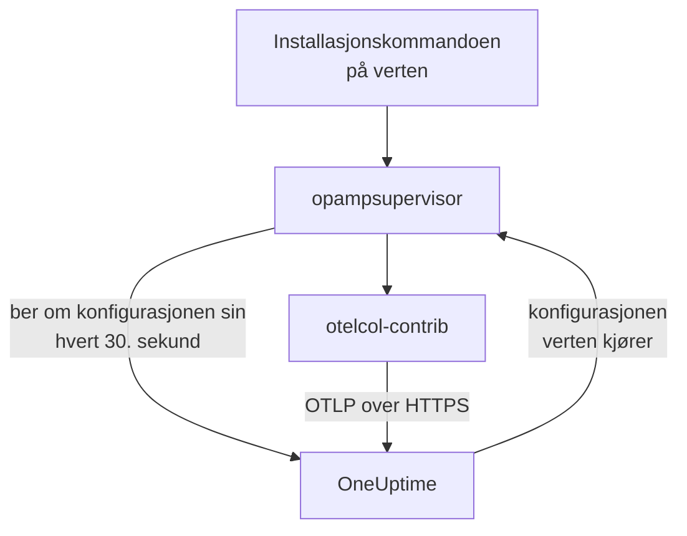

# Verter

Legg til en Linux-, Windows- eller macOS-maskin i OneUptime med én kommando. Kommandoen installerer OpenTelemetry Collector på verten, og OneUptime sender innsamleren konfigurasjonen og holder den oppdatert: Det finnes ingen `config.yaml` å skrive, kopiere til hver vert eller holde i takt. For å endre hva vertene dine samler inn, redigerer du en innsamlerkonfigurasjon én gang, og hver vert den gjelder for, får endringen innen et minutt.

:::cards
- [Legg til en vert](#legg-til-en-vert): Én kommando på Linux, Windows eller macOS.
- [Endre hva verter samler inn](#endre-hva-verter-samler-inn): Innsamlerkonfigurasjoner etter system og etikett, med hver versjon tatt vare på.
- [Sjekk innsamleren til en vert](#sjekk-innsamleren-til-en-vert): Konfigurasjonen den kjører, versjonen og hvorfor en konfigurasjon ikke startet.
- [Hva en konfigurasjon kan gjøre](#hva-en-konfigurasjon-kan-gjøre): Lese verten og bare sende til denne OneUptime.
:::

## Slik fungerer det

Kommandoen installerer to programmer fra utgivelsene til OpenTelemetry Collector, hver kontrollert mot SHA-256-summen utgivelsen publiserer: `otelcol-contrib`, innsamleren som leser verten, og `opampsupervisor`, som kjører innsamleren og holder den på konfigurasjonen OneUptime sender via OpAMP, OpenTelemetry Agent Management Protocol. Begge kjører som tjenesten `oneuptime-collector`.



Supervisoren ber OneUptime om vertens konfigurasjon omtrent hvert 30. sekund, med inntaksnøkkelen din, og rapporterer hvilken konfigurasjon verten kjører og om den startet. Verten registreres under **Verter** når supervisoren kobler til første gang, med maskinens navn, og sidene fylles ut etter hvert som målingene og loggene kommer.

Hver vert kjører én konfigurasjon, valgt i denne rekkefølgen:

| Verten kjører | Når |
| --- | --- |
| Konfigurasjonen som er valgt for den på siden **Innsamler** | Noen har valgt en. |
| Den første av **Innsamlerkonfigurasjoner** som gjelder for den | En konfigurasjon gjelder når den er for vertens system og, hvis den nevner etiketter, verten har en av dem. |
| OneUptimes standard for systemet | Ingen konfigurasjon gjelder. |

OneUptimes standard leser CPU, minne, disker, filsystemer, nettverk og prosesser på alle systemer; journalen og systemd-enheter på Linux, der verten har dem; hendelsesloggene System, Application og Security og Windows-tjenester på Windows; og installasjons- og Wi-Fi-loggene i `/var/log` på macOS. Den utelater filsystemene som er fulle med vilje, som snap-pakker og `/dev` på macOS, så de aldri får malen High Filesystem Usage til å fortsette å utløses. Den følger OneUptimes utgivelser, så en vert på standarden får OneUptimes forbedringer av den.

## Før du begynner

- En inntaksnøkkel. **Legg til vert** oppretter en for deg, eller velg en du har laget under **Prosjektinnstillinger → Telemetri og APM → Inntaksnøkler**.
- Administratorrettigheter på verten: `sudo` på Linux og macOS, PowerShell kjørt som administrator på Windows.
- Linux med systemd, Windows 10 eller Windows Server 2019 og nyere, eller macOS på Apple silicon eller Intel.
- Utgående HTTPS fra verten til OneUptime-URL-en din, direkte eller via en proxy.

## Legg til en vert

:::steps
### Åpne Legg til vert

Åpne **Produkter → Infrastruktur → Verter** og velg **Legg til vert**. Velg hva verten kjører: Linux, Windows eller macOS. Nodene i en Kubernetes-klynge overvåkes i stedet av [Kubernetes Agent](/docs/telemetry/kubernetes-agent).

### Velg en inntaksnøkkel

Velg en nøkkel, eller opprett en fra dialogen. Kommandoen nedenfor fyller den inn.

### Kjør kommandoen på verten

Kopier kommandoen fra dialogen og kjør den på verten. Det tar omtrent et minutt. Dette er de samme kommandoene, med OneUptime-URL-en og nøkkelen din i stedet for eksemplene:

:::tabs
@tab Linux
```bash
curl -fsSL https://oneuptime.com/docs/static/scripts/host-collector/install.sh | sudo sh -s -- --url https://oneuptime.com --key YOUR_INGESTION_KEY
```
@tab macOS
```bash
curl -fsSL https://oneuptime.com/docs/static/scripts/host-collector/install.sh | sudo sh -s -- --url https://oneuptime.com --key YOUR_INGESTION_KEY
```
@tab Windows
```powershell
[Net.ServicePointManager]::SecurityProtocol = [Net.ServicePointManager]::SecurityProtocol -bor [Net.SecurityProtocolType]::Tls12; & ([scriptblock]::Create((Invoke-RestMethod -Uri 'https://oneuptime.com/docs/static/scripts/host-collector/install.ps1'))) -Url 'https://oneuptime.com' -Key 'YOUR_INGESTION_KEY'
```
:::

Hver OneUptime leverer sine egne installasjonsprogrammer, så en selvdriftet OneUptime deler ut installasjonsprogrammet fra sin egen utgivelse: Erstatt `https://oneuptime.com` med URL-en din begge steder.

### Vent på verten

Det siste trinnet i dialogen viser når verten kobler til, med en lenke til den. I listen vises den som **Starter** til de første målingene kommer, vanligvis innen et minutt, og deretter som tilkoblet, med innsamleren **Kjører**. Vertens side **Topologi** tegner på ett kart hva som kjører på den, hva som kaller den og hva den kaller: se [Topologi](/docs/telemetry/topology#åpne-en-ressurs-sitt-eget-kart).
:::

## Merk verter

Legg til etiketter i kommandoen, så har verten dem fra den kobler til:

:::tabs
@tab Linux
```bash
curl -fsSL https://oneuptime.com/docs/static/scripts/host-collector/install.sh | sudo sh -s -- --url https://oneuptime.com --key YOUR_INGESTION_KEY --label env=production --label team=payments
```
@tab macOS
```bash
curl -fsSL https://oneuptime.com/docs/static/scripts/host-collector/install.sh | sudo sh -s -- --url https://oneuptime.com --key YOUR_INGESTION_KEY --label env=production --label team=payments
```
@tab Windows
```powershell
[Net.ServicePointManager]::SecurityProtocol = [Net.ServicePointManager]::SecurityProtocol -bor [Net.SecurityProtocolType]::Tls12; & ([scriptblock]::Create((Invoke-RestMethod -Uri 'https://oneuptime.com/docs/static/scripts/host-collector/install.ps1'))) -Url 'https://oneuptime.com' -Key 'YOUR_INGESTION_KEY' -Label 'env=production','team=payments'
```
:::

`env=production` blir etiketten `env:production`. Etiketter legges til og fjernes aldri: Kjør kommandoen igjen med en annen etikett, så har verten begge. Du kan også merke verter i listen **Verter** eller med **Etikettregler**. En innsamlerkonfigurasjon som nevner etiketter, gjelder bare for verter med en av dem, så den samme kommandoen med ulike etiketter gir hver gruppe verter sin egen konfigurasjon.

## Endre hva verter samler inn

:::steps
### Opprett en innsamlerkonfigurasjon

Åpne **Produkter → Infrastruktur → Verter → Innsamlerkonfigurasjoner** og velg **Opprett Innsamlerkonfigurasjon**. Gi den et navn, systemet til vertene den er for, og etikettene deres hvis den bare skal nå noen av dem. Konfigurasjonen starter som OneUptimes standard for det systemet.

### Rediger config.yaml-filen

Velg **Rediger konfigurasjon** på konfigurasjonens side, endre YAML-koden og lagre. OneUptime kontrollerer den først og avviser en konfigurasjon den ikke kan sende, med begrunnelse: se [Hva en konfigurasjon kan gjøre](#hva-en-konfigurasjon-kan-gjøre).

### Se den nå vertene

Hver lagrede endring er en ny versjon, og vertene den gjelder for, får den innen et minutt. Konfigurasjonens liste **Verter** viser hver vert, tilstanden til innsamleren og versjonen den kjører.
:::

En vert kjører den første konfigurasjonen i listen som gjelder for den: Dra radene under **Innsamlerkonfigurasjoner** for å endre rekkefølgen. Legg de smaleste konfigurasjonene først, for eksempel en for webservere med `env:production`, og de brede, for eksempel en for alle Linux-verter, etter dem. Kortet **OneUptime-standarder** under listen viser hva en vert kjører når ingen konfigurasjon gjelder.

### Versjoner og gjenoppretting

En konfigurasjons liste **Versjoner** tar vare på hver lagrede endring, nyeste først, med hvem som lagret den og når. Velg **Vis** for å lese en versjon og **Gjenopprett** for å sende den til vertene igjen: Den lagres som en ny versjon som sier hvilken den gjenopprettet, så listen alltid forteller hva hver vert fikk.

### Velg en konfigurasjon for én vert

Velg **Bytt konfigurasjon** på en verts side **Innsamler** og velg en konfigurasjon bare for denne verten. Konfigurasjoner for vertens system og for alle systemer tilbys. Velg Automatisk for å gi verten tilbake til listen. En vert der den valgte konfigurasjonen slettes, går av seg selv tilbake til listen.

### Når en konfigurasjon ikke starter

Supervisoren kontrollerer en ny konfigurasjon med innsamleren før den bytter til den, og går tilbake til den siste konfigurasjonen som fungerte når en ikke starter. Verten fortsetter å sende hele tiden. Siden **Innsamler** viser **Konfigurasjonen mislyktes** med innsamlerens begrunnelse, for eksempel en loggfil innsamleren ikke har lov til å lese, og OneUptime sender ikke den konfigurasjonen til verten igjen før den endres. Når du har rettet årsaken på verten, velger du **Prøv igjen** for å sende den en gang til.

## Hva en konfigurasjon kan gjøre

En konfigurasjon som OneUptime sender, kjører på hver vert den gjelder for, så OneUptime kontrollerer den hver gang den lagres, og avviser en som bryter en regel:

| Regel | Hvorfor |
| --- | --- |
| Bare receivers, processors, exporters, extensions og connectors som står på OneUptimes liste | Den leser verten og tjenestene på den. En komponent som kjører programmer eller leser legitimasjon for sky eller klynge, står ikke på listen. |
| Data forlater verten bare gjennom exporteren `otlp_http`, til `${env:ONEUPTIME_URL}/otlp` med headeren `x-oneuptime-token: ${env:ONEUPTIME_INGESTION_KEY}` | Hver vert sender til denne OneUptime, med nøkkelen den ble installert med. Ingen konfigurasjon inneholder en nøkkel. |
| `${env:NAME}` er den eneste `${...}` den kan bruke | En `${file:...}` eller `${https:...}` ville blitt lest på hver vert og kunne blitt sendt videre. |
| Ingen innstilling som kjører et program eller sender en fil den leser, for eksempel `journalctl_path` i journald | En konfigurasjon kan ikke nå lenger enn til å lese verten. |

En konfigurasjon kan likevel være en som en vert ikke kan kjøre, for eksempel en receiver for et annet system eller en loggfil som ikke finnes der. Innsamleren på hver vert kontrollerer det før den bytter, slik [Når en konfigurasjon ikke starter](#når-en-konfigurasjon-ikke-starter) beskriver.

## Sjekk innsamleren til en vert

Åpne verten og siden **Innsamler**. Den viser hvordan innsamleren har det, konfigurasjonen den kjører og **Hvorfor denne konfigurasjonen**, versjonen den kjører, **Siste rapport** og **Innsamlerutgivelse**. Under **På verten** står kommandoene for å sjekke den fra et skall på verten: om tjenesten kjører, loggen og en omstart.

:::tabs
@tab Linux
```bash
sudo systemctl status oneuptime-collector
sudo journalctl -u oneuptime-collector -n 50
sudo systemctl restart oneuptime-collector
```
@tab macOS
```bash
sudo launchctl print system/com.oneuptime.collector
sudo tail -n 50 /usr/local/oneuptime-collector/log/collector.log
sudo launchctl kickstart -k system/com.oneuptime.collector
```
@tab Windows
```powershell
Get-Service oneuptime-collector
Get-WinEvent -FilterHashtable @{ LogName = 'Application'; ProviderName = 'oneuptime-collector' } -MaxEvents 50 | Format-List TimeCreated, Message
Restart-Service oneuptime-collector
```
:::

På Linux kjører innsamleren som den uprivilegerte brukeren `oneuptime-collector`, i gruppene `systemd-journal` og `adm`, slik at den kan lese journalen og loggene i `/var/log`. På macOS kjører den som root, slik launchd-demoner gjør, og på Windows som LocalSystem, slik at den kan lese alle hendelseslogger og Windows-tjenester.

## Verter satt opp manuelt

En vert der du selv installerte innsamleren, med veiledningen [Host OpenTelemetry Collector](/docs/telemetry/host-otel-collector), fortsetter å rapportere som før, og OneUptime sender den ingen konfigurasjon. For å overlate den til OneUptime åpner du vertens side **Innsamler**: Kommandoen der legger til `--replace-existing`, som stopper og deaktiverer innsamleren som ble installert manuelt (tjenesten `otelcol-contrib`), slik at verten ikke rapporterer to ganger. Verten beholder navnet, historikken og etikettene sine.

## Installasjonsalternativer

Kjør kommandoen igjen for å endre noen av disse, eller for å gå over til en nyere utgivelse: Den erstatter det den installerte, og beholder verten slik den er i OneUptime.

| Linux og macOS | Windows | Hva det gjør |
| --- | --- | --- |
| `--url URL` | `-Url URL` | Hvor OneUptime er. |
| `--key KEY` | `-Key KEY` | En inntaksnøkkel for telemetri fra prosjektet ditt. |
| `--label KEY=VALUE` | `-Label KEY=VALUE` | Merker verten. Gjenta det for flere etiketter; på Windows lister du dem med komma. |
| `--env NAME=VALUE` | `-EnvVar NAME=VALUE` | Gir innsamleren en miljøvariabel, for konfigurasjoner som leser `${env:NAME}`. |
| `--version VERSION` | `-Version VERSION` | Innsamlerutgivelsen som installeres, 0.161.0 som standard. |
| `--download-url URL` | `-DownloadUrl URL` | Laster ned utgivelsene fra et speil med samme mappestruktur som GitHubs. |
| `--proxy URL` | `-Proxy URL` | Sender nedlastingene og all trafikken til innsamleren gjennom en HTTP-proxy. |
| `--replace-existing` | `-ReplaceExisting` | Stopper og deaktiverer en innsamler som ble installert manuelt. |
| `--uninstall` | `-Uninstall` | Fjerner innsamleren og alt kommandoen installerte. |

## Avinstaller

:::tabs
@tab Linux
```bash
curl -fsSL https://oneuptime.com/docs/static/scripts/host-collector/install.sh | sudo sh -s -- --uninstall
```
@tab macOS
```bash
curl -fsSL https://oneuptime.com/docs/static/scripts/host-collector/install.sh | sudo sh -s -- --uninstall
```
@tab Windows
```powershell
& ([scriptblock]::Create((Invoke-RestMethod -Uri 'https://oneuptime.com/docs/static/scripts/host-collector/install.ps1'))) -Uninstall
```
:::

Verten blir værende i OneUptime med historikken: Arkiver eller slett den i listen **Verter**.

## Feilsøking

:::details Kommandoen sier at OneUptime avviste nøkkelen
HTTP `401`: Nøkkelen er feil, har utløpt eller ble slettet. HTTP `422`: Den er deaktivert, er en nettlesernøkkel eller er låst til én tjeneste. Velg en aktivert servernøkkel i **Legg til vert** og kjør kommandoen igjen: Den erstatter nøkkelen på verten.
:::

:::details Verten dukker ikke opp
Sjekk at verten når OneUptime-URL-en din over HTTPS, og les deretter innsamlerens logg med kommandoen for systemet under [Sjekk innsamleren til en vert](#sjekk-innsamleren-til-en-vert).
:::

:::details Verten sier at konfigurasjonen mislyktes
Siden **Innsamler** viser hvorfor konfigurasjonen ikke startet. Verten fortsetter å kjøre den siste konfigurasjonen som fungerte, og får den mislykkede igjen når konfigurasjonen endres eller du velger **Prøv igjen**.
:::

:::details Verten viser «Rapporterer ikke»
OneUptime har ikke hørt fra vertens supervisor på mer enn 15 minutter. Sjekk at tjenesten `oneuptime-collector` kjører, og at verten fortsatt når OneUptime.
:::

## Neste steg

:::cards
- [Host OpenTelemetry Collector](/docs/telemetry/host-otel-collector): Installer innsamleren og skriv konfigurasjonen selv i stedet.
- [Vertsmonitor](/docs/monitor/host-monitor): Bli varslet om det vertene dine rapporterer.
- [Inntaksnøkler](/docs/telemetry/ingestion-keys): Opprett, avgrens og roter nøklene vertene sender med.
- [Kubernetes Agent](/docs/telemetry/kubernetes-agent): Overvåk nodene og arbeidsbelastningene i en klynge.
:::
