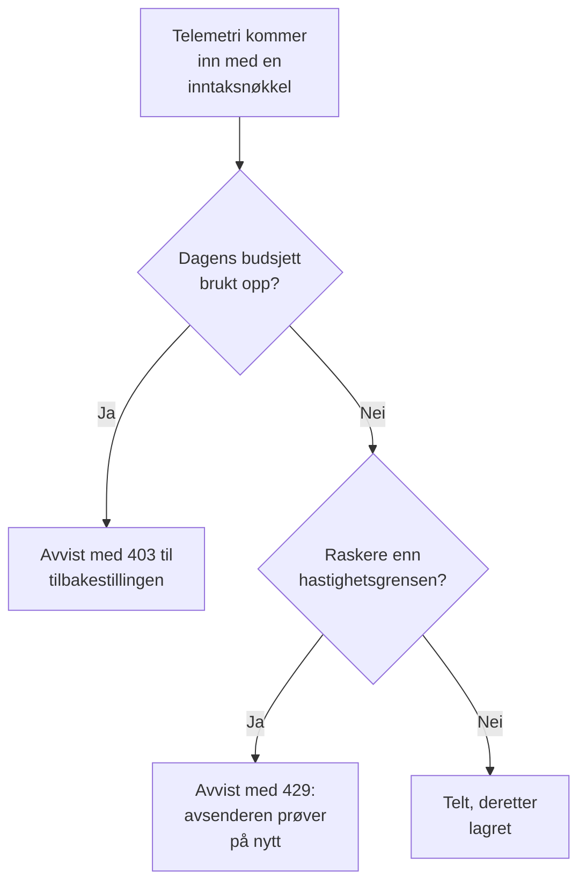

# Inntaksbudsjetter

Et inntaksbudsjett begrenser hvor mye telemetri et prosjekt sender på en dag, slik at én støyende tjeneste eller en løpsk loggløkke ikke kan fylle lagringen din. Instansadministratoren angir et daglig budsjett for hvert signal, for alle prosjekter eller for ett prosjekt, og alle som redigerer en inntaksnøkkel, kan gi nøkkelen et eget, mindre budsjett. Hvert budsjett kan også ha en hastighetsgrense per sekund.

:::cards
- [Slik fungerer budsjetter](#slik-fungerer-budsjetter): Tre nivåer, telt etter hvert som telemetrien kommer inn.
- [Angi standardbudsjettene for alle prosjekter](#angi-standardbudsjettene-for-alle-prosjekter): I innstillingene i Admin Dashboard.
- [Gi en inntaksnøkkel et eget budsjett](#gi-en-inntaksnøkkel-et-eget-budsjett): En andel av prosjektets budsjett.
- [Bli varslet om et budsjett](#bli-varslet-om-et-budsjett): Før det er brukt opp, og når det er det.
:::

## Slik fungerer budsjetter

Telemetri telles etter hvert som den kommer inn: mot prosjektets budsjett for signalet sitt, og mot inntaksnøkkelens når nøkkelen har et. Når et daglig budsjett er brukt opp, avvises det signalet til budsjettet tilbakestilles.



- **Tre nivåer.** Instansens standard gjelder for alle prosjekter. Instansadministratoren kan i stedet gi ett prosjekt et eget budsjett, eller ingen grense i det hele tatt. En nøkkels budsjett er bare en underinndeling av prosjektets: det kan være mindre, aldri større.
- **Fem signaler.** Logger, spor, målinger, profiler og sikkerhetshendelser har hvert sitt budsjett. Øktavspillinger har egne grenser: se [Øktavspilling](/docs/telemetry/session-replay).
- **Bytene telles dekomprimert.** En forespørsel teller størrelsen på bodyen sin når den er dekomprimert, så komprimering endrer ikke hva den teller. En GB er 1024³ byte, og en MB 1024² byte.
- **Det som kommer inn, telles, ikke det som lagres.** Telemetri som et [drop-filter](/docs/telemetry/drop-filters-and-scrub-rules) fjerner senere, telles likevel, så et budsjett kan vise mer enn siden [Telemetriforbruk](/docs/telemetry/usage), som teller det som ble lagret.
- **Den siste forespørselen lagres i sin helhet.** En forespørsel som kommer inn mens et budsjett fortsatt har plass, lagres fullt ut, så et oppbrukt budsjett kan vise litt over 100 %.
- **Ingenting begrenses før et budsjett er angitt.** Alle installasjoner starter uten budsjetter, og et prosjekt uten et budsjett telles ikke i det hele tatt.
- **Endringer når alle servere innen ett minutt.**
- **Telemetri godtas når den ikke kan telles.** Budsjettene telles i Valkey. Mens Valkey ikke kan nås, lagrer OneUptime telemetri uten å telle den i stedet for å avvise den, og budsjettsidene sier fra om det.

## Før du begynner

- **For instansens og et prosjekts budsjetter: Admin Dashboard.** På en selvhostet installasjon er det bare instansadministratoren som angir dem. Et prosjekts eiere og administratorer ser budsjettene, men kan ikke endre dem.
- **For en nøkkels eget budsjett: en rolle som redigerer inntaksnøkler.** Project Owner eller Project Admin, eller en egendefinert rolle med tillatelsen Edit Ingestion Key.
- **For å se budsjettene: en rolle som ser prosjektets forbruk.** Rollene som ser siden [Telemetriforbruk](/docs/telemetry/usage), ser budsjettene der.

## Angi standardbudsjettene for alle prosjekter

:::steps
### Åpne Inntaksbudsjetter

Gå til **Innstillinger → Telemetri → Inntaksbudsjetter** i Admin Dashboard. **Telemetri** starter sammenslått i sidemenyen: klikk på den for å åpne den.

### Angi de daglige budsjettene

Klikk på **Rediger daglige standardbudsjetter** på kortet **Daglige standardbudsjetter**, skriv inn et antall GB for hvert signal som skal begrenses, for eksempel **Logger (GB per dag)**, og klikk på **Lagre endringer**. La et signal stå tomt for ingen grense.

### Angi hastighetsgrensene, hvis du trenger dem

Klikk på **Rediger standardhastighetsgrenser** på kortet **Standardhastighetsgrenser**, og skriv inn et antall MB per sekund for et signal, for eksempel **Logger (MB per sekund)**. En hastighetsgrense hindrer at én topp bruker opp en dags budsjett på noen minutter.
:::

Kortet **Advarsel og tilbakestilling** inneholder advarselsterskelen og tidspunktet da budsjettdagen tilbakestilles: se [Advarselen og tilbakestillingen](#advarselen-og-tilbakestillingen).

## Angi budsjettene for ett prosjekt

:::steps
### Åpne prosjektet

Gå til **Prosjekter** i Admin Dashboard, klikk på prosjektet, og klikk på **Inntaksbudsjetter** i sidemenyen for det. Siden åpnes med det prosjektet har brukt av budsjettene sine i dag.

### Angi de daglige budsjettene for det

Klikk på **Rediger daglige budsjetter** på kortet **Daglige budsjetter for dette prosjektet**. Skriv inn et antall GB for et signal i stedet for instansstandarden, eller 0 for ingen grense i det hele tatt. La et signal stå tomt for å beholde instansstandarden.

### Angi hastighetsgrensene for det

Klikk på **Rediger hastighetsgrenser** på kortet **Hastighetsgrenser for dette prosjektet**, og angi dem på samme måte: et antall MB per sekund, 0 for ingen grense, eller tomt for instansstandarden.
:::

Prosjektets medlemmer ser disse budsjettene på siden [Telemetriforbruk](/docs/telemetry/usage), skrivebeskyttet.

## Gi en inntaksnøkkel et eget budsjett

En nøkkels budsjett er en andel av prosjektets: en avsender som oversvømmer sin egen nøkkel, stopper ved nøkkelens budsjett, mens prosjektets andre nøkler fortsetter å sende.

:::steps
### Åpne nøkkelen

Gå til **Prosjektinnstillinger → Telemetri og APM → Inntaksnøkler**, og klikk på nøkkelen. **Telemetri og APM** starter sammenslått i sidemenyen: klikk på den for å åpne den.

### Angi budsjettene for den

Klikk på **Rediger inntaksbudsjetter** på kortet **Inntaksbudsjetter**. Skriv inn et antall GB per dag for hvert signal som skal begrenses, i trinnet **Daglige budsjetter**, og et antall MB per sekund i trinnet **Hastighetsgrenser**. La et signal stå tomt hvis nøkkelen ikke skal ha et eget budsjett for det.

### Lagre budsjettene

Klikk på **Lagre endringer**. En nøkkels budsjett kan ikke være større enn prosjektets: OneUptime avviser det og sier hvor stort det kan være som mest.
:::

- **Begge budsjettene teller.** Telemetri som sendes med nøkkelen, teller mot nøkkelens budsjett og prosjektets, og det budsjettet som først er brukt opp, avviser den.
- **Et senket prosjektbudsjett holder også nøkkelen.** Når prosjektets budsjett senkes under en nøkkels, holdes nøkkelen til prosjektets.

## Hva avsendere ser

| Når | Over HTTP | Over OTLP/gRPC | Hva avsenderen gjør |
| --- | --- | --- | --- |
| Et daglig budsjett er brukt opp | `403` | `RESOURCE_EXHAUSTED` | Forkaster batchen: å prøve på nytt hjelper ikke før tilbakestillingen |
| En hastighetsgrense overskrides | `429` med `Retry-After` | `RESOURCE_EXHAUSTED` med en ventetid før nytt forsøk | Prøver batchen på nytt etter ventetiden |

Hver avvisning sier hvorfor. Over OTLP/HTTP er bodyen en `google.rpc.Status`, i protobuf eller JSON, slik forespørselen ble sendt, så avsenderens logg viser en årsak som:

```text
This project's daily logs ingestion budget of 10 GB is used up, so OneUptime is not storing logs from this project until the budget resets at 2026-11-10 00:00 UTC.
```

- **Andre HTTP-avsendere får JSON.** Fluent Bit, Fluentd, syslog og de andre HTTP-endepunktene får `error`, `message` og `resetsAt`, og fra en hastighetsgrense også `retryAfterSeconds`.
- **MQTT og strømmer fra skyleverandører kan ikke få beskjed.** Telemetri som kommer inn over MQTT eller fra en skyleverandørs strøm, forkastes når budsjettet er brukt opp. Ingen hastighetsgrense gjelder for den: den kunne ikke sendes på nytt.
- **Avvisninger telles.** Det et oppbrukt budsjett avviser eller forkaster, telles som forkastet, og hver forespørsel en hastighetsgrense avviser, som strupet: se [Se dagens forbruk og forkastede data](#se-dagens-forbruk-og-forkastede-data).

## Advarselen og tilbakestillingen

- **Advarselen.** Når et daglig budsjett passerer advarselsterskelen, 80 % med mindre instansadministratoren endrer den, får prosjektets eiere en e-post, og utforskerne viser et banner over dataene for det signalet. De får én e-post til når budsjettet er brukt opp. Hvert budsjett sender hver e-post høyst én gang om dagen.
- **Tilbakestillingen.** Hver budsjettdag begynner på nytt kl. 00:00 UTC, med mindre instansadministratoren endrer det. Kortet **Advarsel og tilbakestilling** angir **Advarselsterskel (%)**, fra 1 til 99, **Tilbakestillingstidspunkt**, som HH:MM, og **Tidssone for tilbakestilling**: klikk på **Rediger advarsel og tilbakestilling**.
- **Sommertid.** Tilbakestillingen følger klokken i tidssonen, så budsjettdagen da klokkene stilles om, er én time kortere eller lengre. Et tilbakestillingstidspunkt som klokkene hopper over, inntreffer like lenge etter hoppet.
- **En endret tilbakestilling starter en ny dag.** Når tilbakestillingstidspunktet eller tidssonen endres, starter en ny budsjettdag med en gang, der ingenting er telt ennå.

## Se dagens forbruk og forkastede data

Gå til **Prosjektinnstillinger → Telemetri og APM → Forbruk**. Mens et budsjett eller en hastighetsgrense er angitt for prosjektet, åpnes siden med kortet **Inntaksbudsjetter**, og nøklene med egne budsjetter står på kortet **Budsjetter for inntaksnøkler**:

| Kolonne | Hva den viser |
| --- | --- |
| **Signal** | Signalet raden gjelder. |
| **Brukt i dag** | Det som er telt siden budsjettdagen begynte, og andelen av budsjettet det utgjør. |
| **Daglig budsjett** | Budsjettet som gjelder, og hvor det ble angitt: **Instansstandard**, **Angitt for dette prosjektet** eller **Nøkkelens eget budsjett**. |
| **Hastighetsgrense** | Hastighetsgrensen som gjelder. |
| **Forkastet** | Det som ble avvist eller forkastet fordi budsjettet var brukt opp. |
| **Strupet** | Hvor mange forespørsler hastighetsgrensen avviste. |
| **Status** | **Innenfor budsjett**, **Advarsel nådd** eller **Oppbrukt**, **Ingen daglig budsjett** for et signal med bare en hastighetsgrense, og **Ukjent** mens tellingene ikke kan leses. |

- **På siden til en nøkkel** viser kortet **Dagens budsjettforbruk** hva nøkkelen har brukt av sine egne budsjetter.
- **I utforskerne** sier et banner over dataene for logger, spor, målinger, profiler og sikkerhetshendelser fra når budsjettet for det signalet har passert advarselen sin eller er brukt opp, med **Se budsjetter** for å åpne siden Forbruk.
- **I Admin Dashboard** viser siden **Inntaksbudsjetter** for et prosjekt de samme tallene.

## Bli varslet om et budsjett

Hvert 5. minutt skriver OneUptime dagens tall for hvert budsjett som metrikker for prosjektet, og en [metrikkmonitor](/docs/monitor/metrics-monitor) varsler om dem som om alle andre metrikker:

| Metrikk | Enhet | Hva den inneholder |
| --- | --- | --- |
| `oneuptime.telemetry.budget.used.bytes` | `By` | Bytene som er telt mot det daglige budsjettet siden budsjettdagen begynte. |
| `oneuptime.telemetry.budget.used.percent` | `%` | Det samme, som prosent av det daglige budsjettet. Ved 100 eller mer avvises signalet til tilbakestillingen. |
| `oneuptime.telemetry.budget.dropped.bytes` | `By` | Bytene som er avvist eller forkastet siden budsjettdagen begynte, fordi budsjettet var brukt opp. |
| `oneuptime.telemetry.budget.throttled.requests` | `{request}` | Forespørslene hastighetsgrensen har avvist siden budsjettdagen begynte. |

Hvert punkt har disse attributtene:

| Attributt | Verdi |
| --- | --- |
| `projectId` | ID-en til prosjektet. |
| `signal` | `logs`, `traces`, `metrics`, `profiles` eller `security-events`. |
| `scope` | `project`, eller `ingestion-key` for en nøkkels eget budsjett. |
| `ingestionKeyId` | ID-en til nøkkelen, for en nøkkels eget budsjett. |
| `ingestionKeyName` | Navnet på nøkkelen da punktet ble skrevet, for en nøkkels eget budsjett. |

For å bli varslet ved 90 % av prosjektets loggbudsjett oppretter du en metrikkmonitor på `oneuptime.telemetry.budget.used.percent`, filtrert på `signal` `logs` og `scope` `project`, som varsler når maksimum er over 90:

- **Aggreger med maksimum.** Hvert tall vokser bare i løpet av en budsjettdag.
- **Bruk et vindu på 15 minutter eller mer.** Et punkt skrives hvert 5. minutt, og et vindu uten punkter løser varselet.
- **Forvent hull, ikke nuller.** Ingenting skrives for et tall som er 0, eller mens tellingene ikke kan leses.
- **De koster ingenting.** Disse metrikkene telles ikke mot noe budsjett eller som telemetriforbruk, og de oppbevares like lenge som monitormetrikker: 30 dager, med mindre instansadministratoren endrer det. Metrikknavn som starter med `oneuptime.telemetry.budget.`, er reservert for dem: metrikker applikasjonene dine sender under et slikt navn, forkastes.

## Feilsøking

:::details En collector logger 403 for eksportene sine
Prosjektets eller nøkkelens daglige budsjett for det signalet er brukt opp, og collectoren forkaster det den ikke kan sende, til budsjettet tilbakestilles. Se **Brukt i dag** på siden Forbruk. Be instansadministratoren om å øke prosjektets budsjett, eller send mindre: et drop-filter hjelper ikke her, siden det fjerner telemetri etter at den er telt.
:::

:::details En collector logger 429 og prøver på nytt
Den sender raskere enn en hastighetsgrense tillater. Den prøver på nytt etter `Retry-After`-ventetiden, så ingenting går tapt med mindre køen dens blir full. Øk hastighetsgrensen, eller spre sendingen jevnere.
:::

:::details Brukt i dag er mer enn siden Telemetriforbruk viser
Et budsjett teller telemetri etter hvert som den kommer inn, dekomprimert, inkludert det drop-filtre fjerner senere. Siden Forbruk teller det som ble lagret, dagen etter.
:::

:::details Budsjettene sier at dagens tellinger ikke kunne leses
OneUptime kan ikke nå Valkey, der budsjettene telles. Til det kan det, lagres telemetri uten å bli telt, og ingen budsjetter håndheves.
:::

## Neste steg

:::cards
- [Telemetriforbruk](/docs/telemetry/usage): Se hva hvert prosjekt og hver tjeneste sender.
- [Drop-filtre og scrub-regler](/docs/telemetry/drop-filters-and-scrub-rules): Slutt å lagre telemetrien du ikke trenger.
- [Inntaksnøkler](/docs/telemetry/ingestion-keys): En nøkkel for hver avsender, slik at hver kan ha et budsjett.
- [Metrikk-overvåking](/docs/monitor/metrics-monitor): Bli varslet om budsjettmetrikkene.
:::
