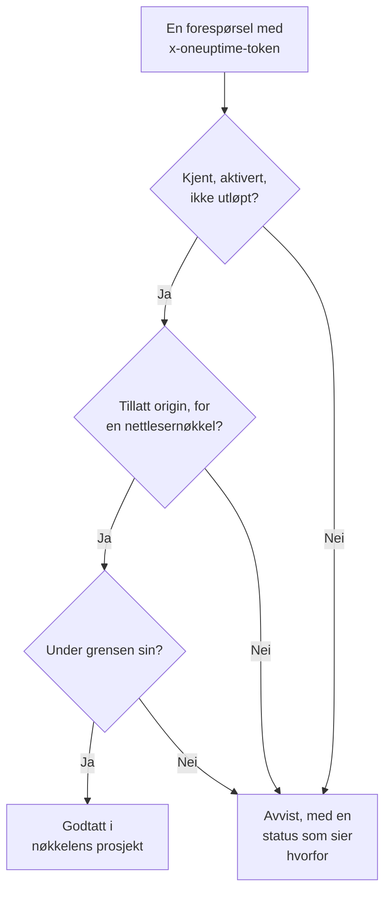

# Inntaksnøkler

En inntaksnøkkel kobler telemetrien din til prosjektet ditt. Applikasjoner, OpenTelemetry Collectors og agenter sender den med hver forespørsel, og OneUptime legger loggene, sporene og målingene deres i prosjektet nøkkelen tilhører. Denne siden viser hvordan du oppretter en nøkkel, hvilken type du skal velge, og hvordan du holder nøkler trygge.

:::cards
- [Opprett en inntaksnøkkel](#opprett-en-inntaksnøkkel): Et navn, en type og en hemmelighet å kopiere.
- [Server eller Browser](#server-eller-browser): Hvilken type nøkkel en avsender trenger.
- [Lås ned en nettlesernøkkel](#lås-ned-en-nettlesernøkkel): Origins, ett tjenestenavn og en grense.
- [Bytt ut, slå av eller slett en nøkkel](#bytt-ut-slå-av-eller-slett-en-nøkkel): Hva du gjør når en nøkkel lekker.
:::

## Slik kontrolleres en nøkkel

Hver forespørsel bærer nøkkelens hemmelighet, vanligvis i en `x-oneuptime-token`-header. OneUptime slår opp nøkkelen, kontrollerer at den fortsatt kan sende, og først da godtar den dataene i nøkkelens prosjekt.



- **Nøkkelen bestemmer prosjektet.** Du sender aldri en prosjekt-ID: data som sendes med en nøkkel, havner i prosjektet nøkkelen tilhører.
- **Endringer når alle servere innen ett minutt.** Å slå av en nøkkel, tilbakestille hemmeligheten eller endre origins, utløp eller grense trer i kraft innen omtrent ett minutt.
- **En servernøkkel er et passord.** Alle som har den, kan sende telemetri til prosjektet ditt. Oppbevar den blant serverens hemmeligheter, aldri i versjonskontroll eller på en nettside.

## Server eller Browser

Velg typen etter hvor nøkkelen skal ligge. Typen kan ikke endres etter at nøkkelen er opprettet.

| | **Server** | **Nettleser** |
| --- | --- | --- |
| For | Applikasjoner, collectors og agenter på maskiner du drifter | Nettsider, og React Native Session Replay |
| Sender | All slags telemetri, til alle endepunkter | Spor, logger, målinger og Session Replays |
| En hemmelighet | Ja: hold den på serverne dine | Nei: alle som ser siden, kan lese den |
| Origins | Kontrolleres ikke | Bare de oppførte origins godtas |
| Forespørsler per minutt | Ingen grense, med mindre du setter en | 6 000, med mindre du setter en annen grense |

Alle andre steder avviser OneUptime en nettlesernøkkel, for eksempel over gRPC og MQTT, for profiler, Syslog, Fluent Bit og Fluentd, og for opplasting av source maps. For å flytte en avsender til den andre typen oppretter du en nøkkel av den typen, bytter avsenderen over til den og sletter deretter den gamle nøkkelen.

## Før du begynner

- **En rolle som administrerer inntaksnøkler.** Project Owner eller Project Admin, eller en egendefinert rolle med tillatelsen Create Telemetry Ingestion Key. Telemetry-rollene omfatter ikke inntaksnøkler.
- **På OneUptime Cloud, en betalingsmåte.** Telemetri faktureres etter bruk, så et prosjekt på Free-abonnementet trenger en betalingsmåte før det kan opprette en nøkkel. Opprettelsesdialogen ender da med et trinn **Fakturering** som viser prisene.

## Opprett en inntaksnøkkel

:::steps
### Åpne inntaksnøkler

Gå til **Prosjektinnstillinger → Telemetri og APM → Inntaksnøkler**. **Telemetri og APM** starter sammenslått i sidemenyen: klikk på den for å åpne den. Listen viser for hver nøkkel kolonnene **Navn**, **Type**, **Last Used** og **Beskrivelse**.

### Gi nøkkelen et navn, og velg type

Klikk på **Opprett ingestion-nøkkel**. Dialogen starter med navnet **Servernøkkel** og typen **Server**. Velg **Nøkkeltype**, og gi nøkkelen nytt navn etter det som skal bruke den, for eksempel `checkout-collector`. En **Beskrivelse** ligger under **Avansert**.

### Legg til origins for en nettlesernøkkel

En **Nettleser**-nøkkel ber om sine **Tillatte opprinnelser** i neste trinn, **Nettleserinnstillinger**, med sitt **Festet tjenestenavn** under **Avansert**. Se [Lås ned en nettlesernøkkel](#lås-ned-en-nettlesernøkkel).

### Opprett nøkkelen, og kopier hemmeligheten

Klikk på **Opprett ingestion-nøkkel**. Nøkkelens egen side åpnes: kopier **Hemmelig nøkkel**, og gi den til avsenderne dine.
:::

Hvert produkts **Oppsettveiledning** starter med **Velg en ingestion-nøkkel**, som viser nøklene veiledningen kan bruke, og oppretter en på stedet. Kodesnuttene i veiledningen inneholder deretter den nøkkelen.

## Send telemetri med nøkkelen

Avsendere legger hemmeligheten i en `x-oneuptime-token`-header:

```text
x-oneuptime-token: YOUR_ONEUPTIME_INGESTION_KEY
```

- OpenTelemetry-SDK-er leser den fra `OTEL_EXPORTER_OTLP_HEADERS`. Se [OpenTelemetry-hurtigstarten](/docs/telemetry/open-telemetry#hurtigstart).
- Over OTLP/gRPC går den i `x-oneuptime-token`-metadataene.
- En MQTT-enhet sender den som passordet sitt. Se [IoT-enheter](/docs/telemetry/iot-devices).
- OneUptime leser også nøkkelen fra en `x-oneuptime-ingestion-key`- eller `x-oneuptime-service-token`-header, som enkelte eldre oppsett sender.

## Lås ned en nettlesernøkkel

En nettlesernøkkel ligger i siden din, der alle kan kopiere den. Disse innstillingene begrenser hva en kopi kan gjøre. Endre dem på nøkkelens side med **Rediger Telemetri Inntak Key**.

| Innstilling | Hva den gjør |
| --- | --- |
| **Tillatte opprinnelser** | De eneste origins nøkkelen godtas fra. En forespørsel fra en hvilken som helst annen origin, eller helt uten `Origin`-header, avvises. En nettlesernøkkel må beholde minst én. |
| **Festet tjenestenavn** | Legger alt nøkkelen sender over OTLP/HTTP, under denne ene tjenesten, uansett hvilket `service.name` avsenderen har satt. En kopi av nøkkelen kan da bare skrive til den tjenesten. |
| **Requests Per Minute Limit** | Det største antallet forespørsler nøkkelen godtas for hvert minutt, delt av alle besøkende. En nettlesernøkkel får 6 000 når du lar feltet stå tomt. |
| **Utløper** | Datoen nøkkelen avvises etter, slik at en publisert kopi slutter å virke. |

En origin er et skjema, en vert og en valgfri port: `https://app.example.com` dekker ikke `https://app.example.com:8443`. Én innledende `*.` dekker alle underdomener, men ikke selve domenet. React Native Session Replay sender en eksakt `app://`-identitet, som ikke tar noe jokertegn:

```json
[
  "https://app.example.com",
  "https://*.example.com",
  "app://com.example.mobile"
]
```

[Tjenestekatalogen](/docs/telemetry/services#slik-kommer-en-tjeneste-inn-i-katalogen) viser hvordan et fastlåst navn bestemmer tjenesten. Kubernetes-agentens Runner og AI-agent, og infrastrukturens AI-agenter, registrerer seg ikke med en fastlåst nøkkel: gi dem en servernøkkel uten fastlåst navn.

## Bytt ut, slå av eller slett en nøkkel

En nøkkels side viser **Status**, **Hemmelig nøkkel** bak **Click to reveal**, og **Last Used At**: siste gang OneUptime godtok data som ble sendt med den.

| For å | Gjør dette | Hva avsendere ser |
| --- | --- | --- |
| Stoppe en nøkkel med en gang, og kunne angre senere | Klikk på **Rediger Telemetri Inntak Key**, åpne **Tilgang og grenser**, og slå av **Aktivert**. Statusen viser **Disabled — telemetry refused**. | `422` til du slår den på igjen |
| Erstatte en lekket hemmelighet | Klikk på **Tilbakestill hemmelig nøkkel**, og bekreft. Nøkkelen beholder innstillingene sine og får en ny hemmelighet. | `401` til de sender den nye hemmeligheten |
| Stoppe en nøkkel for godt | Klikk på **Slett Telemetri Inntak Key** nederst på siden dens. | `401` |

For å bytte en hemmelighet uten å miste data oppretter du en ny nøkkel, flytter avsenderne dine over til den og sletter den gamle nøkkelen når **Last Used At** for den slutter å endre seg. **Last Used At** oppdateres hvert par minutter, ikke ved hver forespørsel.

## Feilsøking

En avvist forespørsel får en status og en setning som sier hvorfor.

| Svar | Hva det betyr |
| --- | --- |
| `401` med `Missing ingestion token` | Forespørselen har ingen nøkkel. Send den i `x-oneuptime-token`. |
| `401` med `Invalid ingestion token` | Ingen nøkkel har denne hemmeligheten: den er skrevet feil, tilbakestilt eller slettet. |
| `401` med `This telemetry ingestion key expired.` | Datoen i **Utløper** er passert. Sett en senere dato, eller bruk en annen nøkkel. |
| `402` med `Add a payment method` | På OneUptime Cloud er prosjektet på Free-abonnementet og har ingen betalingsmåte ennå. |
| `422` med `This telemetry ingestion key has been disabled.` | Noen har slått av **Aktivert**. |
| `422` med `A browser ingestion key cannot be used for` | En nettlesernøkkel nådde et endepunkt som bare tar servernøkler. |
| `422` med `did not send an Origin header` | En nettlesernøkkel ble sendt fra utenfor en nettleser. Bruk en servernøkkel der. |
| `422` med `is not allowed for this browser ingestion key` | Sidens origin står ikke i **Tillatte opprinnelser**. |
| `422` med `is pinned to a single service` | En nøkkel med et **Festet tjenestenavn** ble brukt til å registrere en agent. Bruk en servernøkkel uten fastlåst navn. |
| `429` med `Too many telemetry requests for this ingestion key` | Nøkkelen nådde sin **Requests Per Minute Limit**. Eksportører prøver igjen etter `Retry-After`-tiden. |

For de andre svarene en OTLP-eksportør kan få, se [Svar](/docs/telemetry/open-telemetry#svar).

:::details Det kommer fortsatt data et minutt etter at jeg slo av nøkkelen
Hver OneUptime-server husker det den vet om en nøkkel, i opptil ett minutt, så en endring når alle innen omtrent ett minutt. Forespørsler etter det avvises.
:::

:::details En nettlesernøkkel virker på den bærbare maskinen min, men ikke i produksjon
En origin omfatter skjema og port. `http://localhost:3000` og `https://app.example.com` er forskjellige origins: før opp hver origin siden serveres fra.
:::

:::details Last Used At sier fortsatt Aldri
Ingenting har sendt data med denne nøkkelen siden OneUptime begynte å registrere bruken av den. Kontroller at avsenderne dine har denne nøkkelens hemmelighet, og at forespørslene deres når OneUptime.
:::

## Neste steg

:::cards
- [OpenTelemetry](/docs/telemetry/open-telemetry): Send spor, målinger og logger med nøkkelen din.
- [Tjenestekatalog](/docs/telemetry/services): Se tjenestene telemetrien din legges under.
- [Dataoppbevaring](/docs/telemetry/data-retention): Bestem hvor lenge dataene oppbevares.
- [Drop-filtre og scrub-regler](/docs/telemetry/drop-filters-and-scrub-rules): Forkast eller masker data før de lagres.
:::
