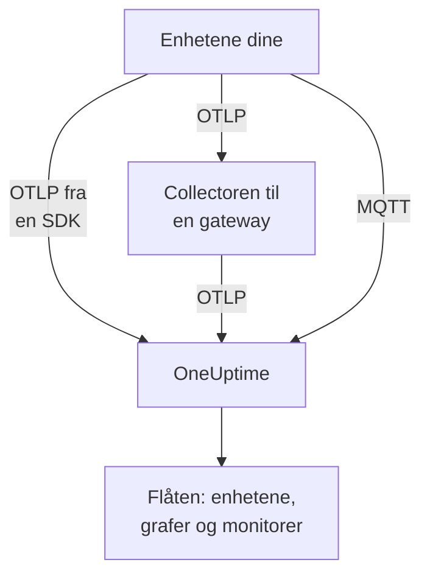

# IoT-enheter

OneUptime overvåker flåter av IoT-enheter — sensorer, gatewayer, kontrollere og edge-bokser — ut fra et lite sett `iot_*`-metrikker de sender. Den grupperer enhetene i flåter, fører et inventar over hver flåtes enheter og viser grafer for batteri, signal, temperatur, CPU, minne og tilgjengelighet. Det finnes ingen OneUptime-agent å installere på en enhet: enhetene sender standard OpenTelemetry, eller publiserer til MQTT-endepunktet til OneUptime. [IoT-enhetsmonitorer](/docs/monitor/iot-device-monitor) varsler på det de sender.

:::cards
- [Velg hvordan du sender](#velg-hvordan-du-sender): En OpenTelemetry SDK, en gateway-collector eller MQTT.
- [Sende metrikker via MQTT](#sende-metrikker-via-mqtt): Emner, legitimasjon per enhet og Last Will.
- [Metrikkonvensjoner](#metrikkonvensjoner): `iot_*`-navnene OneUptime viser grafer for og varsler på.
- [Feilsøking](#feilsøking): Manglende flåter, manglende enheter, uventede frakoblinger.
:::

## Slik fungerer det

Hver måling tilhører en flåte og en enhet. OneUptime oppretter flåten fra den første målingen, legger hver ny enhet til i flåtens inventar og oppdaterer deretter enhetens siste verdier ved hver måling. Målinger sendt over OpenTelemetry og over MQTT forsyner de samme flåtene, inventaret, grafene og monitorene.



## Slik modellerer OneUptime IoT

- **Flåte**: en gruppe enheter, for eksempel `building-a-sensors` eller `field-gateways`. Den kommer fra ressursattributtet `iot.fleet.name`, og vises i OneUptime som telemetritjenesten `iot/<fleet>`. Sett også `service.name=iot/<fleet>`, slik at logger og metrikker havner under den samme tjenesten.
- **Enhet**: én enhet i en flåte, navngitt av attributtet `device.id` på hvert datapunkt. Flåtens inventar er nøklet på `device.id`.

| Attributt | Settes på | Påkrevd | Beskrivelse |
| --- | --- | --- | --- |
| `iot.fleet.name` | Ressurs | Ja | Flåten enheten tilhører. Den blir OneUptime-tjenesten `iot/<fleet>`. |
| `device.id` | Hvert datapunkt | Ja | En stabil ID for enheten, unik i flåten. |
| `iot.device.kind` | Hvert datapunkt | Nei | Enhetsklassen, for eksempel `Device`, `Sensor` eller `Gateway`. Standard er `Device`. |
| `iot.device.type` | Hvert datapunkt | Nei | En finere type eller modell for å filtrere monitorer, for eksempel `temp-sensor`. |
| `iot.device.firmware` | Hvert datapunkt | Nei | Fastvareversjonen enheten rapporterer. |

Over MQTT setter emnet flåten og enheten for deg.

## Velg hvordan du sender

| Måte | Bruk den når | Trenger |
| --- | --- | --- |
| [OpenTelemetry SDK](#sende-metrikker-via-opentelemetry-sdk) | Enheten kjører en OpenTelemetry SDK og når OneUptime selv. | En inntaksnøkkel på enheten. |
| [OpenTelemetry Collector](#sende-metrikker-via-en-opentelemetry-collector) | Mange enheter rapporterer gjennom en gateway. | En gateway som kjører collectoren. |
| [MQTT](#sende-metrikker-via-mqtt) | Enheten snakker allerede MQTT, eller skal rapportere frakoblet i det øyeblikket den faller ut. | Enhver MQTT-klient som kobler til over WebSocket. |

## Før du begynner

- En inntaksnøkkel. Opprett en under **Prosjektinnstillinger → Telemetri og APM → Inntaksnøkler** og kopier verdien. Enhetene sender den som headeren `x-oneuptime-token`, eller som MQTT-passord.
- Nettverkstilgang fra enheten eller gatewayen til OneUptime-URL-en din.
- Et flåtenavn for hver gruppe enheter, og en stabil ID for hver enhet.

## Sende metrikker via OpenTelemetry SDK

:::steps
### Pek SDK-en mot OneUptime

Sett standard miljøvariabler for OpenTelemetry på enheten. Erstatt nøkkelen, flåtenavnet og enhets-ID-en med dine:

```bash
export OTEL_EXPORTER_OTLP_ENDPOINT=https://oneuptime.com/otlp
export OTEL_EXPORTER_OTLP_PROTOCOL=http/protobuf
export OTEL_EXPORTER_OTLP_HEADERS=x-oneuptime-token=YOUR_TELEMETRY_INGESTION_TOKEN
export OTEL_RESOURCE_ATTRIBUTES=iot.fleet.name=building-a-sensors,device.id=sensor-001,service.name=iot/building-a-sensors
```

Hold `iot.fleet.name` stabilt: å endre det registrerer en ny flåte.

### Registrer målinger som IoT-metrikker

Send hver måling som en metrikk med ett av de [konvensjonelle navnene](#metrikkonvensjoner), og gi hvert datapunkt et `device.id`-attributt:

| Metrikk | Verdi | Datapunktattributt |
| --- | --- | --- |
| `iot_device_up` | `1` | `device.id=sensor-001` |
| `iot_battery_percent` | `87` | `device.id=sensor-001` |
| `iot_temperature_celsius` | `21.5` | `device.id=sensor-001` |

Inventaret er nøklet på datapunktets `device.id`, ikke ressursens, så sett den på hver måling i tillegg til i `OTEL_RESOURCE_ATTRIBUTES`.
:::

Deretter: [sjekk at flåten vises](#sjekk-at-flåten-vises).

## Sende metrikker via en OpenTelemetry Collector

Når mange enheter rapporterer gjennom en gateway, kjør en OpenTelemetry Collector på gatewayen. Den mottar OTLP fra enhetene dine, stempler flåten på hver måling og videresender dem til OneUptime.

:::steps
### Lagre gatewayens konfigurasjon

Lagre dette som `config.yaml` på gatewayen:

```yaml title="config.yaml"
receivers:
  otlp:
    protocols:
      grpc:
        endpoint: 0.0.0.0:4317
      http:
        endpoint: 0.0.0.0:4318

processors:
  batch:
    send_batch_size: 512
    timeout: 5s
  resource:
    attributes:
      - key: iot.fleet.name
        value: field-gateways
        action: upsert
      - key: service.name
        value: iot/field-gateways
        action: upsert

exporters:
  otlphttp:
    endpoint: "https://oneuptime.com/otlp"
    headers:
      "x-oneuptime-token": "YOUR_TELEMETRY_INGESTION_TOKEN"

service:
  pipelines:
    metrics:
      receivers: [otlp]
      processors: [resource, batch]
      exporters: [otlphttp]
```

- `otlp` mottar fra enhetene dine over gRPC (`4317`) og HTTP (`4318`). Motta målinger på en hvilken som helst annen måte collectoren støtter (en MQTT-bro, fillogger), og send dem gjennom den samme pipelinen.
- `resource` stempler hver måling med flåten. Sett `iot.fleet.name`, og den tilsvarende `service.name=iot/<fleet>`, per gateway, slik at hver gateways enheter havner i flåten sin.
- Behold `device.id`, og eventuelt `iot.device.kind`, `iot.device.type` og `iot.device.firmware`, på hvert datapunkt, slik at OneUptime kan skille enhetene i flåten fra hverandre.
- `otlphttp` sender til OneUptime over HTTPS med inntaksnøkkelen. Både standard protobuf-koding og `encoding: json` godtas.

### Kjør collectoren på gatewayen

:::tabs
@tab Docker
Kjør den fra mappen som inneholder `config.yaml`:

```bash
docker run -d \
  --name otel-collector \
  --restart unless-stopped \
  -p 4317:4317 \
  -p 4318:4318 \
  -v $(pwd)/config.yaml:/etc/otelcol-contrib/config.yaml:ro \
  otel/opentelemetry-collector-contrib:0.161.0 \
  --config /etc/otelcol-contrib/config.yaml
```
@tab otelcol-contrib
Hvis gatewayen allerede har `otelcol-contrib`, pek den mot filen:

```bash
otelcol-contrib --config config.yaml
```
:::

Enhetene sender deretter OTLP til gatewayen, for eksempel med `OTEL_EXPORTER_OTLP_ENDPOINT=http://<gateway-host>:4318` i SDK-en til hver enhet.
:::

Deretter: [sjekk at flåten vises](#sjekk-at-flåten-vises).

## Sende metrikker via MQTT

OneUptime har sitt eget MQTT-endepunkt, så enheter som snakker MQTT, publiserer målinger direkte til det, uten SDK, collector eller bro. Det som kommer inn over MQTT, går gjennom den samme pipelinen som OTLP: flåter opprettes, inventaret oppdateres, og hver IoT-monitor og varslingsmal fungerer på samme måte.

### Endepunkter

| Transport | Adresse | Merknader |
| --- | --- | --- |
| MQTT over WebSocket | `wss://<your-host>/mqtt` | Fungerer i alle utrullinger, gjennom den vanlige HTTPS-porten. |
| MQTT over TCP | `<app-host>:1883` | Bare selvhostet, og internt i klyngen eller Compose-nettverket til du eksponerer den. Porten er `MQTT_INGEST_PORT`. |

### Autentisering

- **Med inntaksnøkkelen**: send den som MQTT-passord. Brukernavnet ignoreres; hvis klienten din bare har et felt for brukernavn, legg nøkkelen der. Dette passer en gateway som publiserer for mange enheter.
- **Med legitimasjon per enhet**: anbefales for enheter som kobler til direkte. Åpne flåtens side **Device Registry** og registrer enheten, med **Device ID** den bruker som `device.id`. Enhetens **MQTT Username** er brukernavnet, og **MQTT Password (Secret)** er passordet.

En enhets legitimasjon kan bare publisere under sine egne `oneuptime/<fleet>/<device>/`-emner. Du kan tilbakekalle én enhet uten å røre resten av flåten: slå av bryteren **Aktivert**, eller slett den, så kobles en tilkoblet enhet fra innen omtrent et minutt. En registrert enhet som blir stille, blir værende i inventaret som frakoblet, og varslingsmalen Device Offline utløses for den, selv om den dør uten Last Will.

OneUptime avviser feil legitimasjon ved CONNECT med returkode 4 (feil brukernavn eller passord), så en feilkonfigurert enhet feiler synlig. Nettlesernøkler avvises over MQTT.

### Emner og nyttelaster

Publiser under det faste prefikset `oneuptime/`. Flåte- og enhetssegmentene kan ikke inneholde `/`, `+` eller `#`, kan ikke begynne med `$`, og er høyst 100 tegn lange.

| Emne | Nyttelast |
| --- | --- |
| `oneuptime/<fleet>/<device>/telemetry` | Et JSON-objekt med målinger: `{"metrics":{"iot_temperature_celsius":21.5}}`, eller et flatt objekt der de numeriske feltene er metrikkene. |
| `oneuptime/<fleet>/<device>/metrics/<metricName>` | Én verdi: et bart tall (`23.4`) eller `{"value":23.4}`. |
| `oneuptime/<fleet>/<device>/status` | `online` eller `offline` (også `1` eller `0`, `true` eller `false`, `up` eller `down`). Det setter `iot_device_up`. |

En telemetrinyttelast kan også ha `"attributes"`, et kart med strenger som stemples på hvert datapunkt (bruk det for `iot.device.kind`, `iot.device.type`, `iot.device.firmware` eller dine egne etiketter), og `"timestamp"`, i ISO 8601 eller i Unix-sekunder eller -millisekunder. Begge er valgfrie: uten `timestamp` brukes tidspunktet OneUptime mottar målingen.

### Frakoblingsdeteksjon med Last Will

Registrer en MQTT Last Will på `oneuptime/<fleet>/<device>/status` med nyttelasten `offline`. Hvis enheten dør eller faller ut av nettverket, publiserer OneUptime `iot_device_up = 0` for den i det øyeblikket økten avsluttes, noe som utløser den innebygde varslingsmalen Device Offline og merker enheten som nede i inventaret, uten polling. Publiser `online` til det samme emnet etter tilkobling, slik at enheten vises som oppe igjen.

### Eksempler

:::tabs
@tab mosquitto_pub
Over rå TCP, på en selvhostet instans:

```bash
mosquitto_pub -h YOUR-ONEUPTIME-APP-HOST -p 1883 \
  -u oneuptime -P "YOUR_TELEMETRY_INGESTION_TOKEN" \
  -t "oneuptime/building-a-sensors/sensor-001/telemetry" \
  -m '{"metrics":{"iot_device_up":1,"iot_battery_percent":87,"iot_temperature_celsius":21.5},"attributes":{"iot.device.type":"temp-sensor","iot.device.firmware":"1.4.2"}}'
```
@tab Node.js
Med pakken `mqtt`, over WebSocket, mot oneuptime.com eller en hvilken som helst selvhostet instans:

```javascript
const mqtt = require("mqtt");

const client = mqtt.connect("wss://oneuptime.com/mqtt", {
  username: "oneuptime", // ignored — the token below is what authenticates
  password: "YOUR_TELEMETRY_INGESTION_TOKEN",
  will: {
    topic: "oneuptime/building-a-sensors/sensor-001/status",
    payload: "offline",
  },
});

client.on("connect", () => {
  client.publish("oneuptime/building-a-sensors/sensor-001/status", "online");
  setInterval(() => {
    client.publish(
      "oneuptime/building-a-sensors/sensor-001/telemetry",
      JSON.stringify({
        metrics: {
          iot_device_up: 1,
          iot_battery_percent: readBattery(),
          iot_temperature_celsius: readTemperature(),
        },
      }),
    );
  }, 60 * 1000);
});
```
@tab Python
Med `paho-mqtt`, over WebSocket:

```python
import json
import paho.mqtt.client as mqtt

client = mqtt.Client(transport="websockets")
client.username_pw_set("oneuptime", "YOUR_TELEMETRY_INGESTION_TOKEN")
client.tls_set()
client.will_set("oneuptime/building-a-sensors/sensor-001/status", "offline")
client.ws_set_options(path="/mqtt")
client.connect("oneuptime.com", 443)

client.publish("oneuptime/building-a-sensors/sensor-001/status", "online")
client.publish(
    "oneuptime/building-a-sensors/sensor-001/telemetry",
    json.dumps({"metrics": {"iot_device_up": 1, "iot_temperature_celsius": 21.5}}),
)
```
:::

### Grenser og levering

- Endepunktet tar bare imot målinger: abonnementer avvises (en SUBACK-feil), og meldinger med retain-flagg beholdes ikke.
- Inntaket er minst én gang. Bruk QoS 1 for å få OneUptime til å bekrefte hver publisering; en ny sending med QoS 1 eller 2 etter en tapt bekreftelse kan gi dupliserte datapunkter.
- En publisering over 128 KB, eller med mer enn 100 metrikker, droppes, og en pakke som oppgir mer enn det, lukker tilkoblingen.
- En publisering utenfor disse emnene, eller med en feilformatert nyttelast, godtas og droppes, fordi MQTT 3.1.1 ikke har feil per melding. OneUptime logger en advarsel med årsaken (`MQTT: dropped publish to …`).
- På WebSocket-endepunktet, hold MQTT-keepalive under 5 minutter. Ingressen lukker en WebSocket som er inaktiv i 300 sekunder, noe som utløser Last Will og et falskt Device Offline-varsel. Standardverdiene i klientbibliotekene (60 sekunder for `mqtt` og `paho-mqtt`) er greie, og TCP-endepunktet har ingen slik grense.

## Metrikkonvensjoner

OneUptime gjenkjenner disse `iot_*`-metrikknavnene. Send bare dem som gir mening for enheten din: de som mangler, vises ikke i grafer. Hvert datapunkt har enhetens `device.id` (over MQTT navngir emnet enheten).

| Metrikknavn | Betydning |
| --- | --- |
| `iot_device_up` | Tilgjengelighet: `1` er oppe og nåbar, `0` er nede. IoT Device-monitoren leser den. |
| `iot_device_info` | Bare identitet. Den har `device.id`, klassen, typen og fastvaren, slik at en enhet vises i inventaret før den rapporterer målinger. |
| `iot_battery_percent` | Batterilading, `0` til `100` (%). |
| `iot_signal_strength_dbm` | Trådløs signalstyrke i dBm, for eksempel RSSI for Wi-Fi, LoRa eller mobilnett. |
| `iot_temperature_celsius` | Temperaturen til enheten eller sensoren i °C. |
| `iot_cpu_usage_ratio` | CPU-bruk som et forhold fra `0` til `1`. OneUptime lagrer og viser det som en prosentandel. |
| `iot_memory_usage_bytes` | Minne i bruk, i byte. |
| `iot_memory_size_bytes` | Totalt minne på enheten, i byte. |
| `iot_uptime_seconds` | Sekunder siden enheten sist startet. |

## Sjekk at flåten vises

1. Sjekk at enheten, gatewayens collector eller MQTT-klienten sender uten feil: se etter eksportfeil og HTTP-svar `401` eller `422` i loggene, eller en tilkobling som avvises med returkode 4.
2. Åpne **Produkter → Infrastruktur → IoT → All Fleets**. Flåten vises som `iot/<fleet>` innen et minutt eller så etter de første målingene.
3. Åpne flåtens side **Devices**. Hver enhet du har sendt fra, skal være oppført med siste batteri, signal, temperatur, CPU, minne og status oppe eller nede.
4. Åpne flåtens side **Målinger** for å vise en hvilken som helst av `iot_*`-seriene i en graf.

## Selvhostet OneUptime

Pek endepunktet mot din egen instans:

```bash
export OTEL_EXPORTER_OTLP_ENDPOINT=https://your-oneuptime-host.example.com/otlp
```

Eller, i en collector:

```yaml
exporters:
  otlphttp:
    endpoint: https://your-oneuptime-host.example.com/otlp
    headers:
      "x-oneuptime-token": "YOUR_TELEMETRY_INGESTION_TOKEN"
```

For MQTT, koble til `wss://your-oneuptime-host.example.com/mqtt`, eller eksponer app-tjenestens rå MQTT-TCP-port (`MQTT_INGEST_PORT`, `1883` som standard) for enheter som ikke kan bruke WebSocket. Sett `MQTT_INGEST_ENABLED=false` på app-tjenesten for å slå av begge MQTT-lytterne. Hvis instansen bare bruker HTTP, bruk `http://` (og `ws://` for MQTT) og porten.

## Feilsøking

:::details Flåten vises ikke
1. Sjekk at `iot.fleet.name` er et ressursattributt (ikke en datapunktetikett) og at `service.name` er `iot/<fleet>`.
2. Sjekk at endepunktet er `https://oneuptime.com/otlp` (eller din selvhostede `…/otlp`) og at headeren `x-oneuptime-token` har en gyldig inntaksnøkkel.
3. Over MQTT, sjekk at emnet følger `oneuptime/<fleet>/<device>/…` nøyaktig: det er emnets flåtesegment som oppretter flåten.
:::

:::details Enheter mangler i inventaret
1. Gi hvert datapunkt en `device.id`-etikett: enhetene er nøklet på den. Over MQTT er det emnets enhetssegment.
2. For en enhet som ikke har rapportert målinger ennå, send `iot_device_info` (eller, over MQTT, en `status`-melding), slik at den vises i inventaret.
3. Hold `device.id`-verdiene stabile: en ID som endres, oppretter dupliserte enheter.
:::

:::details HTTP 401 eller 422 fra eksportøren
`401` betyr at inntaksnøkkelen mangler, er feil eller er utløpt; `422` betyr at den er deaktivert, eller er en nettlesernøkkel, som ikke kan sende enhetstelemetri. Opprett en ny under **Prosjektinnstillinger → Telemetri og APM → Inntaksnøkler** og oppdater headeren `x-oneuptime-token`.
:::

:::details MQTT-tilkoblingen avvises med "bad username or password"
OneUptime avviser feil legitimasjon ved CONNECT med returkode 4. Sjekk at passordet er en gyldig inntaksnøkkel som ikke er deaktivert eller utløpt, eller, for en registrert enhet, legitimasjonens secret med **MQTT Username** som brukernavn. Nettlesernøkler avvises over MQTT.
:::

:::details Enheter veksler til frakoblet mens de kjører
På WebSocket-endepunktet lukker ingressen en tilkobling som er inaktiv i 300 sekunder, noe som utløser Last Will og et falskt Device Offline-varsel. Hold MQTT-keepalive under 5 minutter: standardverdiene i klientbibliotekene på 60 sekunder er greie.
:::

:::details Målinger vises ikke i flåtens grafer
1. Bruk de nøyaktige `iot_*`-navnene fra [Metrikkonvensjoner](#metrikkonvensjoner): andre navn lagres som generiske metrikker og fyller ikke IoT-grafene.
2. Send `iot_cpu_usage_ratio` som et forhold fra `0` til `1`; OneUptime viser det som en prosentandel.
3. Regn med opptil et minutt før de første datapunktene vises etter at en enhet begynner å rapportere.
:::

## Neste trinn

:::cards
- [IoT-enhets-overvåking](/docs/monitor/iot-device-monitor): Varsle når en enhet går frakoblet, får lavt batteri eller blir overopphetet.
- [OpenTelemetry](/docs/telemetry/open-telemetry): Hvordan OneUptime tar imot OTLP fra en hvilken som helst SDK eller collector.
- [OpenTelemetry-collector på verten](/docs/telemetry/host-otel-collector): Overvåk selve en Linux-, macOS- eller Windows-gateway.
:::
