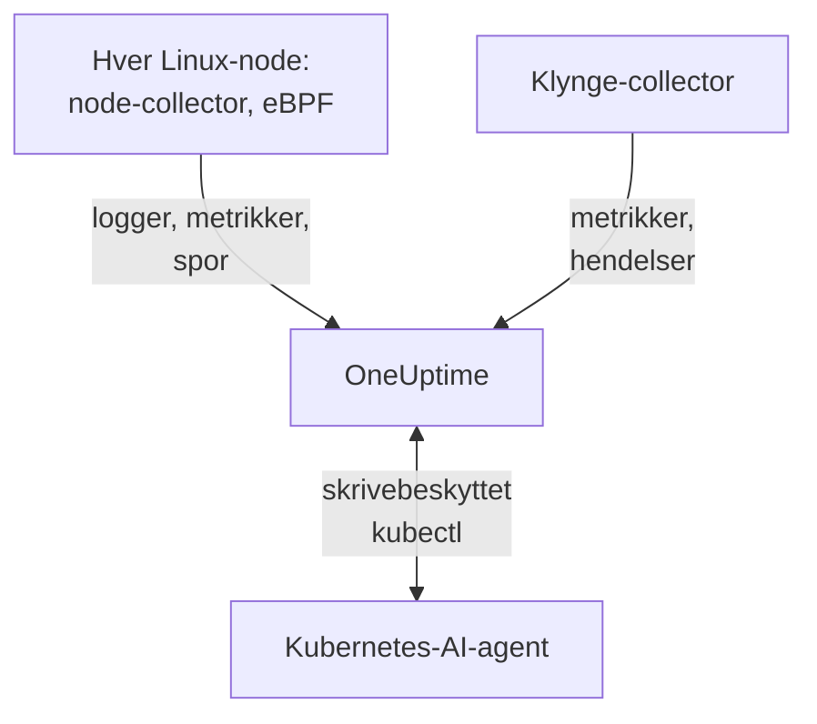

# Kubernetes-agent

OneUptime Kubernetes-agenten er et Helm-chart som samler inn klyngens metrikker, Kubernetes-hendelser og pod-logger og, med eBPF, sporene, forespørselsmetrikkene, tjenestegrafen og nettverksflytene til hver pod, uten kodeendringer og uten SDK-er. Den kjører også [Kubernetes-AI-agenten](#kubernetes-ai-agent), som lar OneUptime AI kjøre skrivebeskyttet `kubectl` mens den undersøker en hendelse eller et varsel. Én `helm install` setter den på plass; [Kubernetes-monitorer](/docs/monitor/kubernetes-monitor) varsler på det den sender.

:::cards
- [Installer agenten](#installer-agenten): Fire trinn med Helm.
- [Konfigurasjonsvalg](#konfigurasjonsvalg): Filtre, sampling, kontrollplan, service mesh, kostnader og etiketter.
- [Kubernetes-AI-agent](#kubernetes-ai-agent): Skrivebeskyttet `kubectl` for OneUptime AI, og rettelser når du tillater dem.
- [Send mindre](#redusere-mengden-data-som-samles-inn): Spakene, i rekkefølge etter effekt.
:::

## Slik fungerer det

Chartet kjører noen få arbeidsbelastninger i sitt eget navnerom. Hver av dem sender det den samler inn til OneUptime-URL-en din over OTLP, med inntaksnøkkelen du gir den, og klyngen registrerer seg under navnet du gir den i `clusterName`.



| Arbeidsbelastning | Type | Hva den gjør | Kjører |
| --- | --- | --- | --- |
| Klynge-collector | Deployment | Klyngemetrikker, Kubernetes-hendelser og spesifikasjonene til poder, noder og arbeidsbelastninger, fra Kubernetes-API-et. | Alltid |
| Node-collector | DaemonSet | Pod-logger fra `/var/log/pods`, kubelet- og cAdvisor-metrikker og nodens OS-metrikker. | Overalt unntatt EKS Fargate |
| eBPF-instrumentering (OBI) | DaemonSet | HTTP-, gRPC-, SQL- og Redis-spor og forespørselsmetrikker fra hver pod, og tjenestekartet. | Som standard, unntatt på GKE Autopilot og EKS Fargate |
| Kubernetes-AI-agent | Deployment | Skrivebeskyttet `kubectl` for OneUptime AI mens den undersøker en hendelse eller et varsel. | Som standard |
| Logg-tailer | Deployment | Pod-logger gjennom Kubernetes-API-et, der node-collectoren ikke kan lese dem. | Med forhåndsinnstillingene `gke-autopilot` og `eks-fargate` |
| Kostnadsmotor og poller | Deployments | Forbruk per navnerom, arbeidsbelastning og pod. | Med `cost.enabled=true` |

Alle agentimager er bare for Linux, så hver arbeidsbelastning er festet til Linux-noder.

## Før du begynner

- En Kubernetes-klynge som kjører v1.23 eller nyere, og `kubectl` konfigurert til å nå den.
- Helm 3. Oppgraderinger bruker `--reset-then-reuse-values`, som krever Helm 3.14 eller nyere.
- En inntaksnøkkel. Opprett en under **Prosjektinnstillinger → Telemetri og APM → Inntaksnøkler**. Agenten sender den som headeren `x-oneuptime-token`, så en prosjekt-API-nøkkel fungerer ikke her.
- Et navn på klyngen, unikt i prosjektet ditt og stabilt, for eksempel `prod-us-east-1`: klyngen vises i OneUptime under det.
- Utgående HTTPS fra klyngen til OneUptime-URL-en din.

## Installer agenten

:::steps
### Legg til Helm-repositoriet

```bash
helm repo add oneuptime https://helm-chart.oneuptime.com
helm repo update
```

### Installer chartet

Erstatt `YOUR_ONEUPTIME_URL`, `YOUR_ONEUPTIME_API_KEY` (inntaksnøkkelen) og klyngenavnet med verdiene dine, og velg fanen for plattformen din (se [Velg en forhåndsinnstilling](#velg-en-forhåndsinnstilling)).

:::tabs
@tab Standard
Selvadministrerte klynger, EKS on EC2, GKE Standard, AKS, minikube, kind og k3s:

```bash
helm install kubernetes-agent oneuptime/kubernetes-agent \
  --namespace oneuptime-agent \
  --create-namespace \
  --set oneuptime.url="YOUR_ONEUPTIME_URL" \
  --set oneuptime.apiKey="YOUR_ONEUPTIME_API_KEY" \
  --set clusterName="my-cluster" \
  --set aiAgent.enabled=true
```
@tab GKE Autopilot
```bash
helm install kubernetes-agent oneuptime/kubernetes-agent \
  --namespace oneuptime-agent \
  --create-namespace \
  --set oneuptime.url="YOUR_ONEUPTIME_URL" \
  --set oneuptime.apiKey="YOUR_ONEUPTIME_API_KEY" \
  --set clusterName="my-cluster" \
  --set aiAgent.enabled=true \
  --set preset=gke-autopilot
```
@tab EKS Fargate
```bash
helm install kubernetes-agent oneuptime/kubernetes-agent \
  --namespace oneuptime-agent \
  --create-namespace \
  --set oneuptime.url="YOUR_ONEUPTIME_URL" \
  --set oneuptime.apiKey="YOUR_ONEUPTIME_API_KEY" \
  --set clusterName="my-cluster" \
  --set aiAgent.enabled=true \
  --set preset=eks-fargate
```
:::

**AI-undersøkelser er på som standard.** `aiAgent.enabled=true` kjører [Kubernetes-AI-agenten](#kubernetes-ai-agent) ved siden av collectoren: når en hendelse eller et varsel oppstår på denne klyngen, undersøker OneUptime AI det med skrivebeskyttet `kubectl` (`get`, `describe`, `logs`, `events`, `top`) og endrer ingenting. Rettelser er av til du tillater dem. For å installere uten den, bruk `--set aiAgent.enabled=false` i stedet.

### Sjekk at podene kjører

```bash
kubectl get pods -n oneuptime-agent
```

Hver pod skal nå `Running` innen et minutt eller to:

:::tabs
@tab Standard
Klynge-collectoren, AI-agenten, og på hver node en node-collector og en eBPF-pod:

```text
NAME                                          READY   STATUS    RESTARTS   AGE
kubernetes-agent-xxxxxxxxxx-xxxxx             1/1     Running   0          1m
kubernetes-agent-ai-agent-xxxxxxxxxx-xxxxx    1/1     Running   0          1m
kubernetes-agent-ebpf-xxxxx                   1/1     Running   0          1m
kubernetes-agent-logs-xxxxx                   1/1     Running   0          1m
```
@tab GKE Autopilot
Node-collectoren kjører fortsatt og leser kubelet- og cAdvisor-metrikker uten `hostPath`, og en logg-tailer-Deployment leser pod-logger gjennom Kubernetes-API-et:

```text
NAME                                          READY   STATUS    RESTARTS   AGE
kubernetes-agent-xxxxxxxxxx-xxxxx             1/1     Running   0          1m
kubernetes-agent-ai-agent-xxxxxxxxxx-xxxxx    1/1     Running   0          1m
kubernetes-agent-logs-yyyyyyyyyy-yyyyy        1/1     Running   0          1m
kubernetes-agent-logs-xxxxx                   1/1     Running   0          1m
```
@tab EKS Fargate
Tre Deployments og ingen DaemonSet: Fargate gir hver pod en egen mikro-VM og planlegger aldri DaemonSets, så nodemetrikker er ikke tilgjengelige der:

```text
NAME                                          READY   STATUS    RESTARTS   AGE
kubernetes-agent-xxxxxxxxxx-xxxxx             1/1     Running   0          1m
kubernetes-agent-ai-agent-xxxxxxxxxx-xxxxx    1/1     Running   0          1m
kubernetes-agent-logs-yyyyyyyyyy-yyyyy        1/1     Running   0          1m
```
:::

### Finn klyngen i OneUptime

Åpne **Produkter → Infrastruktur → Kubernetes → Alle klynger**. Klyngen vises under sitt `clusterName` innen noen minutter, og nodene, podene og arbeidsbelastningene fylles ut. Kubernetes-AI-agenten vises som tilkoblet på klyngens side **Agent**, under **KI**.
:::

## Velg en forhåndsinnstilling

`preset` velger standardverdiene som fungerer på plattformen din: om pod-logger leses fra noden gjennom `hostPath` eller gjennom Kubernetes-API-et, og hvilke arbeidsbelastninger som kan kjøre privilegert.

| `preset` | Brukes for | Pod-logger | Nodemetrikker |
| --- | --- | --- | --- |
| `standard` (standard) | Selvadministrerte klynger, **EKS on EC2**, **GKE Standard**, **AKS**, minikube, kind, k3s | Node-collectoren leser `/var/log/pods` gjennom `hostPath` (lavest overhead) | Kubelet, cAdvisor og nodens OS-metrikker |
| `gke-autopilot` | **GKE Autopilot** | Logg-taileren leser dem gjennom Kubernetes-API-et (ingen `hostPath`, ingen vertstilgang) | Kubelet og cAdvisor, uten `hostPath` |
| `eks-fargate` | **EKS Fargate** | Logg-taileren leser dem gjennom Kubernetes-API-et (ingen `hostPath`, ingen vertstilgang) | Ingen: Fargate kjører ingen DaemonSets |

Hvis du er usikker, start med `standard`. Hvis installasjonen feiler med en Pod Security-feil som nevner `hostPath`, installer på nytt med `preset=gke-autopilot` (eller `eks-fargate` på Fargate). GKE Autopilot og EKS Fargate avviser også privilegerte poder, som eBPF og profileringen trenger, så de to forhåndsinnstillingene utelater begge.

## Hva som samles inn

| Kategori | Data |
| --- | --- |
| Nodemetrikker | CPU-, minne-, filsystem- og nettverksbruk |
| Podmetrikker | CPU, minne, nettverk og omstarter |
| Containermetrikker | CPU og minne per container |
| Klyngemetrikker | Nodetilstander, allokerbare ressurser, antall poder |
| Kubernetes-hendelser | Advarsler, feil og planleggingshendelser |
| Pod-logger | Stdout og stderr fra hver container (gjennom `hostPath` på standardklynger, gjennom Kubernetes-API-et på Autopilot og Fargate) |
| Applikasjonsspor (eBPF, på som standard) | HTTP-, gRPC-, SQL- og Redis-spenn fra hver pod, uten SDK eller kodeendringer |
| HTTP RED-metrikker (eBPF) | `http.server.request.duration`, og størrelsen på forespørsels- og svarkropper, per tjeneste |
| Tjenestegraf (eBPF) | Forespørselsrate, latens og feil fra kaller til mottaker, som tegner tjenestekartet |
| Nettverksflytmetrikker (eBPF) | Byte- og pakketellere for TCP og UDP fra pod til pod, med Kubernetes-metadata |
| TCP-statistikk (eBPF) | Tur-retur-tid, mislykkede tilkoblinger og retransmisjonstellere på nodenivå |
| Kostnader for arbeidsbelastninger (valgfritt, `cost.enabled=true`) | Forbruk per navnerom, arbeidsbelastning og pod, med ledig kapasitet og effektivitet, og timekostnader for noder og volumer: se [Kubernetes-kostnadsobserverbarhet](/docs/telemetry/kubernetes-cost) |

## Konfigurasjonsvalg

Hvert valg nedenfor er en Helm-verdi. Sett den ved installasjon, eller på en installert agent med `helm upgrade ... --reset-then-reuse-values --set <value>`.

### Filtrering etter navnerom

`namespaceFilters.rules` bruker navneromsmønstre på fire områder, hvert for seg:

| Område | Hvor det filtrerer | Hva det påvirker |
| --- | --- | --- |
| `podLogs` | I hostPath-receiveren filelog eller i API-logg-taileren | Bare stdout og stderr fra poder; Kubernetes-hendelser og revisjonslogger påvirkes ikke |
| `ebpfDiscovery` | I OBIs prosessoppdagelse | Både eBPF-spor og eBPF-metrikker fra samsvarende arbeidsbelastninger |
| `metrics` | I collectoren, etter at Kubernetes-metadata er lagt til | Metrikkserier med navnerom; node- og klyngeserier uten navnerom beholdes |
| `traces` | I collectoren, etter at Kubernetes-metadata er lagt til | Både eBPF-spenn og spenn applikasjoner sender over OTLP |

Et mønster samsvarer med hele navnet på navnerommet og kan bruke `*` (`team-*`). Hvis et område har en `include`-regel, beholdes bare samsvarende navnerom for det området, og `exclude`-regler vinner alltid. Standardregelen utelukker `kube-system` bare fra `podLogs` og `ebpfDiscovery`.

For å begrense pod-logger og eBPF-oppdagelse til noen navnerom:

```bash
helm install kubernetes-agent oneuptime/kubernetes-agent \
  --namespace oneuptime-agent \
  --create-namespace \
  --set oneuptime.url="YOUR_ONEUPTIME_URL" \
  --set oneuptime.apiKey="YOUR_ONEUPTIME_API_KEY" \
  --set clusterName="my-cluster" \
  --set-json 'namespaceFilters.rules=[{"action":"include","namespaces":["default","production","staging"],"scopes":["podLogs","ebpfDiscovery"]}]'
```

For å stoppe loggene fra et støyende navnerom og samtidig beholde eBPF-sporene, tjenestekartet og metrikkene, avgrens utelukkelsen til `podLogs`:

```bash
  --set-json 'namespaceFilters.rules=[{"action":"exclude","namespaces":["kube-system"],"scopes":["podLogs","ebpfDiscovery"]},{"action":"exclude","namespaces":["noisy-*"],"scopes":["podLogs"]}]'
```

Regler for `podLogs` og `ebpfDiscovery` filtrerer ved kilden: utelukkede loggfiler åpnes aldri, og utelukkede arbeidsbelastninger instrumenteres aldri. Regler for `metrics` og `traces` virker senere, i collectoren, etter at navnerommet er knyttet til dataene.

#### Filtrere metrikker og spor etter navnerom

Legg disse områdene til en regel for også å filtrere metrikker eller spenn med navnerom:

```bash
  --set-json 'namespaceFilters.rules=[{"action":"exclude","namespaces":["kube-system","noisy-*"],"scopes":["podLogs","ebpfDiscovery","metrics","traces"]}]'
```

> [!NOTE]
> Metrikker på node- og klyngenivå beholdes alltid. Et navnerom tilhører en pod, ikke en node, så serier som nodens CPU, nodens minne og filsystembruk har ingenting å samsvare med og droppes aldri: en regel avgrenset til `metrics` trimmer serier per pod uten å skjule en node som går i stykker.

Kubernetes-hendelser kan ikke filtreres etter navnerom i agenten: de kommer fra receiveren `k8sobjects` uten et `k8s.namespace.name`-attributt (navnerommet ligger inne i hendelsens innhold), så det er ingenting et filter kan samsvare med. Dropp dem i OneUptime i stedet, med **Logger → Innstillinger → Drop-filtre**.

### Filtrering etter loggalvorlighetsgrad

`filters.logs.minSeverity` dropper pod-loggposter under en alvorlighetsgrad, i agenten, før noe sendes:

```bash
  --set filters.logs.minSeverity=WARN
```

Den godtar `TRACE`, `DEBUG`, `INFO`, `WARN`, `ERROR` og `FATAL`. `WARN` beholder WARN, ERROR og FATAL og dropper INFO, DEBUG og TRACE; standardverdien (`""`) beholder alt. Den gjelder i begge loggmodusene (gjennom collectoren i `daemonset`-modus, inne i logg-taileren i `api`-modus), så en forhåndsinnstilling slår den aldri av bak ryggen din.

Container-kjøretider registrerer ingen alvorlighetsgrad, så agenten leser en fra selve loggteksten (`[ERROR]`, `WARN:`, `"level":"info"`, …). Hva som skjer med en linje uten gjenkjennelig nivå, avhenger av loggmodusen, fordi de to modusene vet forskjellige ting:

| Modus | En linje uten nivå | Hvorfor |
| --- | --- | --- |
| `daemonset` | `stderr` teller som ERROR (beholdes), `stdout` som INFO (droppes av en WARN-terskel) | Container-kjøretiden registrerer hvilken strøm hver linje kom fra. |
| `api` | Beholdes alltid | Kubernetes-API-et `pods/log` slår sammen stdout og stderr til én strøm uten markør per linje, så i stedet for å gjette beholder agenten linjen. |

Derfor dropper `api`-modus strengt mindre enn `daemonset`-modus, med vilje: en Python-traceback eller en `npm ERR!` har ikke noe alvorlighetsnøkkelord, og å slette den stille er nettopp feilen en terskel skal beskytte deg mot. I hybridmodus (`logs.windowsPods.enabled`) gjelder begge radene, etter nodens OS: Linux-poder følger `daemonset`, Windows-poder `api`.

Hendelser over flere linjer settes sammen igjen før filtreringen i begge modusene, så en Java-stakksporing vurderes etter den første linjen og beholdes eller droppes i sin helhet.

> [!IMPORTANT]
> Kubernetes-hendelser og ressursspesifikasjoner filtreres aldri av dette. De kommer fra Kubernetes-API-et uten egen alvorlighetsgrad, så en terskel ville slettet hele strømmen, inkludert advarslene `FailedScheduling`, `BackOff` og `OOMKilling` som du mest av alt vil ha. De er få og verdifulle, så agenten sender dem alltid; for å tynne dem ut, bruk **Logger → Innstillinger → Drop-filtre** i OneUptime.

### Inkludere eller utelukke metrikker etter navn

`filters.metrics` bestemmer hvilke metrikker som forlater klyngen, på tvers av alle receivere.

Dropp noen få støyende metrikker (en blokkeringsliste, vanligvis det du vil ha):

```bash
  --set-json 'filters.metrics.exclude=["k8s.volume.available","k8s.volume.capacity"]'
```

Send bare et fast sett (en tillatelsesliste: alt annet droppes):

```bash
  --set-json 'filters.metrics.include=["k8s.pod.cpu.utilization","k8s.pod.memory.usage"]'
```

Samsvar etter mønster i stedet for etter nøyaktig navn:

```bash
  --set filters.metrics.matchType=regexp \
  --set-json 'filters.metrics.exclude=["^container_network_"]'
```

| Nøkkel | Betydning |
| --- | --- |
| `filters.metrics.exclude` | Metrikknavn som skal droppes. Brukes etter `include`, så en utelukkelse vinner alltid. |
| `filters.metrics.include` | Når den ikke er tom, sendes bare disse metrikkene. |
| `filters.metrics.matchType` | `strict` (det nøyaktige navnet, standard) eller `regexp` (RE2, uforankret). |

- `regexp` er uforankret: `system.cpu` samsvarer også med `system.cpu.time`. Forankre det (`^system\.cpu$`) når du mener nøyaktig én metrikk.
- RE2 har ingen lookahead, så `^(?!container_)` kompilerer ikke. Si «alt unntatt» med `include`, ikke med et negativt mønster.
- `include` spenner over alle receivere samtidig. En tillatelsesliste som glemmer en metrikk, fjerner stille monitorene som bygger på den, så foretrekk `exclude` med mindre du vil ha et lukket sett.
- Bruk `--set-json` (eller en verdifil) for lister: en vanlig `--set` erstatter en liste i stedet for å legge til i den.

> [!WARNING]
> Test et mønster før du ruller det ut. Collectoren kompilerer mønstre når den starter, så et ugyldig mønster oppfører seg ikke stille feil: collectoren nekter å starte og krasjer i en løkke, og tar med seg loggene til den collectoren sammen med metrikkene. Helm kan ikke kompilere RE2, så `helm upgrade` godtar et dårlig mønster uten å klage.

### Sporsampling

Filtrene over fjerner en kategori telemetri: et navnerom, en alvorlighetsgrad, et metrikknavn. Sampling beholder hver kategori og tynner i stedet ut bestanden. Sett `sampling.traces.percentage` til andelen spor som skal beholdes:

```bash
helm upgrade kubernetes-agent oneuptime/kubernetes-agent \
  --namespace oneuptime-agent --reset-then-reuse-values \
  --set sampling.traces.percentage=10
```

Det beholder ett spor av ti og dropper de andre ni i agenten, før de forlater klyngen din.

- **Du får hele spor, ikke fragmenter.** Avgjørelsen er en hash av spor-ID-en, ikke et myntkast per spenn, så hvert spenn i et spor beholdes eller droppes sammen, og sporene som overlever, kan leses fra start til slutt.
- **De metrikkbaserte monitorene dine flytter seg ikke.** OBI beregner eBPF RED-metrikkene (forespørselsrate, feilrate, varighet) fra hver forespørsel, og de går gjennom metrikkpipelinen, som sampleren ikke er i. Ved 10 % får du en tiendedel av sporene og nøyaktig rate, feil og latens.
- **De spennbaserte monitorene dine gjør det.** Alt OneUptime teller fra selve spennene, skaleres ned med raten: se advarselen nedenfor.

| Nøkkel | Betydning |
| --- | --- |
| `sampling.traces.percentage` | Prosentandelen spor som skal beholdes, 0 til 100. Standard `100` (behold alt). |
| `sampling.traces.hashSeed` | Frøet til spor-ID-hashen. Standard `22`. |

- `0` beholder ingen spor i det hele tatt. Det er en rate, ikke en av-bryter: den sletter hvert spor mens eBPF-DaemonSet-et fortsetter å kjøre og koste deg penger. For ingen spor, bruk `ebpf.enabled=false`; for ingen spor, men RED-metrikkene og tjenestekartet, behold eBPF på og sett `0` med vilje.
- Den gjelder bare når `ebpf.enabled` er på: ellers finnes det ingen sporpipeline, og verdien gjør ingenting.
- Den sampler bare spor. Det finnes ingen `sampling.logs` eller `sampling.metrics`, med vilje: se merknaden nedenfor.
- Brøker krever `--set-json`, og de har et gulv. `--set sampling.traces.percentage=0.5` feiler, fordi Helm leser `0.5` som en streng: bruk `--set-json 'sampling.traces.percentage=0.5'` eller en verdifil. Under omtrent `0.0061` rundes raten ned til null og oppfører seg nøyaktig som `0`, uten feil; `0.01` (én av ti tusen) er den minste verdien som gjør det den sier.
- Flere klynger fungerer som standard. To agenter beholder det samme sporet bare hvis de er enige om både `hashSeed` og `percentage`, og begge har de samme standardverdiene overalt, så et spor som krysser to klynger, overlever i sin helhet. Endre `hashSeed` bare for å gjøre to samplingsnivåer uavhengige: med samme frø beholder en lavere rate en delmengde av sporene til den høyere raten.
- Pod-logger samples aldri, så med `ebpf.logToTraceCorrelation: true` har hver loggpost fortsatt en spor-ID mens bare den beholdte andelen av disse sporene finnes. Omtrent (100 − `percentage`) % av loggpostene lenker da til et spor som ikke finnes; å følge et spor til loggene påvirkes ikke.

> [!WARNING]
> Juster de spennbaserte monitorene dine når du setter dette. Sampling reduserer spennene som når OneUptime, så alt som teller dem, teller mindre: en **Spor**-monitor på `Span Count` og en **Unntak**-monitor på `Exception Count` ser omtrent `percentage` % av gårsdagens volum. En terskel justert på usamplet trafikk slutter stille å bli krysset: monitoren gir ingen feil, den blir bare taus. Del disse tersklene med den samme faktoren; raten gjelder hele klyngen, så ingen tjeneste kan unntas. Feilgruppering forringes verre enn lineært: et vanlig unntak vises fortsatt, men et sjeldent engangstilfelle forsvinner heller enn å vises en tiendedel så ofte.

> [!NOTE]
> Hvorfor det ikke finnes logg- eller metrikksampling: collectorens sampler kan ikke sample metrikker i det hele tatt. Den kan sample logger, men den henter tilfeldigheten fra spor-ID-en, som pod-logger ikke har, så hver loggpost ville hashet på samme måte, og en loggrate ville beholdt alt eller slettet alt, avhengig av frøet. I stedet for å tilby en innstilling som stille sletter loggene dine, tilbyr chartet ingen. Tynn ut logger med [Filtrering etter loggalvorlighetsgrad](#filtrering-etter-loggalvorlighetsgrad) og [Filtrering etter navnerom](#filtrering-etter-navnerom), som er presise om hva de fjerner.

### Slå av logginnsamling

Hvis du ikke trenger pod-logger:

```bash
helm install kubernetes-agent oneuptime/kubernetes-agent \
  --namespace oneuptime-agent \
  --create-namespace \
  --set oneuptime.url="YOUR_ONEUPTIME_URL" \
  --set oneuptime.apiKey="YOUR_ONEUPTIME_API_KEY" \
  --set clusterName="my-cluster" \
  --set logs.enabled=false
```

Metrikkene dine påvirkes ikke: node-collectoren fortsetter å kjøre for kubelet-, cAdvisor- og vertsmetrikker, og slutter bare å lese pod-logger. Loggbaserte varsler stopper, og ingenting annet.

### Tving en bestemt logginnsamlingsmodus

`logs.mode` overstyrer forhåndsinnstillingens valg, og vinner alltid over det:

- `logs.mode=daemonset`: hostPath-DaemonSet-et (lavest overhead; krever `hostPath`).
- `logs.mode=api`: logg-tailer-Deploymenten for Kubernetes-API-et (fungerer på alle klynger).
- `logs.mode=disabled`: ingen pod-logger.

Modusen avgjør bare hvor pod-logger kommer fra: nodemetrikker samles inn uansett, så `api` og `disabled` beholder kubelet-, cAdvisor- og vertsmetrikkene dine. Unntaket er plattformen: EKS Fargate kan ikke planlegge DaemonSets i det hele tatt, så den har ingen node-collector og ingen node-, pod- eller containermetrikker. GKE Autopilot kjører node-collectoren, men blokkerer `hostPath`, så den samler inn kubelet- og cAdvisor-metrikker uten `hostmetrics`-metrikkene (disk-I/O, inoder, NIC-feil) som leser vertens `/proc` og `/sys`.

På klynger med Windows-nodepooler dekker `daemonset`-modus bare Linux-nodene, fordi alle agentimager er bare for Linux. Legg til `--set logs.windowsPods.enabled=true` for å kjøre API-logg-taileren ved siden av, bare for podene på Windows-noder: Linux-poder beholder lokal filfølging på noden, og de to sender aldri den samme linjen to ganger. Dette krever et `kubernetes-log-tailer`-image som er minst like nytt som chartet: et eldre image ignorerer begrensningen og sender Linux-logger to ganger.

### Aktiver overvåking av kontrollplanet

Klyngens side **Kontrollplan** viser grafer for etcd, API-serveren, planleggeren og kontrollerbehandleren. Agenten scraper alle fire når `controlPlane.enabled` er `true`:

```bash
helm upgrade kubernetes-agent oneuptime/kubernetes-agent \
  --namespace oneuptime-agent \
  --reset-then-reuse-values \
  --set controlPlane.enabled=true
```

Hver komponent scrapes på adressene i sin egen liste: `controlPlane.etcd.endpoints`, `controlPlane.apiServer.endpoints`, `controlPlane.scheduler.endpoints` og `controlPlane.controllerManager.endpoints`. Scrapen kjører i agentens pod, som ikke har noe vertsnettverk, så standardverdiene (`https://localhost:<port>/metrics`) peker på selve poden: sett hver liste til en adresse poden kan nå. Inne i enhver klynge svarer API-serveren på `https://kubernetes.default.svc:443/metrics`:

```bash
helm upgrade kubernetes-agent oneuptime/kubernetes-agent \
  --namespace oneuptime-agent \
  --reset-then-reuse-values \
  --set controlPlane.enabled=true \
  --set "controlPlane.apiServer.endpoints={https://kubernetes.default.svc:443/metrics}"
```

`controlPlane.enabled` slår på alle fire scrapes samtidig. Der en komponent ikke kan nås på endepunktene sine (etcd, planleggeren og kontrollerbehandleren på en administrert klynge, eller på `localhost`-standardene), feiler scrapen ved hvert intervall: collectoren logger en scrape-feil og rapporterer målet som nede, og ingenting annet endres.

Agenten scraper bare over HTTPS, med tjenestekontoens token og uten klientsertifikat. Derfor:

- **etcd** trenger en HTTPS-metrikkadresse som ikke ber om et klientsertifikat. De vanlige metrikkportene til etcd er utenfor rekkevidde: vanlig HTTP på `2381` (kubeadms `--listen-metrics-urls`) scrapes som HTTPS og feiler, og `2379` krever klientsertifikater.
- **Planleggeren** (`10259`) og **kontrollerbehandleren** (`10257`) serverer HTTPS og godtar tokenet, men kubeadm binder dem til `127.0.0.1` på kontrollplannodene: de trenger en `--bind-address` som agentens pod kan nå.

Administrerte Kubernetes-tjenester (EKS, GKE, AKS) eksponerer ikke etcd, planleggeren eller kontrollerbehandleren, så de fanene forblir tomme der. Til en fanes metrikker kommer inn, viser siden **Kontrollplan** hva som skal settes i stedet for grafene, med kommandoen du kan kopiere.

### Aktiver CoreDNS-metrikker

Fanen **CoreDNS** på siden **Kontrollplan** viser grafer for DNS-spørringer, latens, hurtigbufferen og videresending. Innsamlingen er av som standard:

```bash
helm upgrade kubernetes-agent oneuptime/kubernetes-agent \
  --namespace oneuptime-agent \
  --reset-then-reuse-values \
  --set coreDns.enabled=true
```

Agenten scraper port `9153` på podene merket `k8s-app=kube-dns` i `kube-system`, som er slik CoreDNS kjører på kubeadm-klynger, EKS og AKS. Hvis din kjører et annet sted, sett også `coreDns.namespace`, `coreDns.service` (etiketten `k8s-app`) og `coreDns.port`. GKE kjører kube-dns (dnsmasq) eller Cloud DNS i stedet for CoreDNS, så fanen forblir tom der.

### Aktiver service mesh-metrikker

Klyngens side **Service Mesh** viser grafer for Istio og Linkerd. Agenten scraper ett mesh, det `serviceMesh.provider` navngir (`istio` eller `linkerd`):

```bash
helm upgrade kubernetes-agent oneuptime/kubernetes-agent \
  --namespace oneuptime-agent \
  --reset-then-reuse-values \
  --set serviceMesh.enabled=true \
  --set serviceMesh.provider=istio
```

For Istio leser den Envoy-statistikken til hver `istio-proxy`-sidevogn (port `15090`); for Linkerd, adminporten til hver `linkerd-proxy`. Ingen av meshenes kontrollplan scrapes: istiod (kortet **Pilot**) og Linkerds identity-, destination- og proxy-injector-komponenter (kortet **Kontrollplan**) serverer metrikkene sine på egne adminporter, så de kortene sier det i stedet for å vise grafer.

### Metrikker agenten ikke samler inn

Noen grafer viser metrikker agenten ikke har noen scrape for: **kube-proxy** på siden **Kontrollplan**; **Cilium** (med Hubble) på siden **Service Mesh**; og på fanene for Istio og Linkerd, meshenes egne kontrollplan (**istiod**, og Linkerds identity-, destination- og proxy-injector-komponenter). De fylles ut når disse metrikkene når OneUptime på en annen måte, for eksempel fra din egen [OpenTelemetry Collector](/docs/telemetry/open-telemetry) som scraper dem, med ressursattributtet `k8s.cluster.name` satt til klyngens navn (agentens `clusterName`). Klynger som kjører uten kube-proxy, har ingen kube-proxy-metrikker i det hele tatt.

### Aktiver kostnadsobserverbarhet

Se hva hvert navnerom, hver arbeidsbelastning og hver pod koster, med ledig kapasitet og hvor mye av hver request som brukes, på klyngens side **Costs**:

```bash
helm upgrade kubernetes-agent oneuptime/kubernetes-agent \
  --namespace oneuptime-agent \
  --reset-then-reuse-values \
  --set cost.enabled=true
```

Det alene er en komplett installasjon: chartet inkluderer opensource-motoren [OpenCost](https://opencost.io) (med den lille Prometheus den trenger) og priser nodene og volumene dine ut fra skyleverandørens offentlige listepriser, uten legitimasjon. Den legger til to små poder, og de første kostnadene vises etter den første avsluttede timen. Kjører du allerede Kubecost eller OpenCost? Legg til `--set cost.engine.url=<its service URL>` i stedet, så følger ingenting med. Lokale klynger kan sette en prisliste med `cost.opencost.customPricing`. Den fullstendige veiledningen, med lokal prising og feilsøking, er [Kubernetes-kostnadsobserverbarhet](/docs/telemetry/kubernetes-cost).

### Automatisk merking med prosjektetiketter

Hvert ressursattributt som begynner med `oneuptime.label.`, blir en prosjektetikett, knyttet til klyngen og til tjenestene og vertene denne agenten rapporterer: `oneuptime.label.<dimension>=<value>` er etiketten `<dimension>:<value>`. Send etiketter ved installasjon med `--set oneuptime.labels.<key>=<value>`:

```bash
helm install kubernetes-agent oneuptime/kubernetes-agent \
  --namespace oneuptime-agent \
  --create-namespace \
  --set oneuptime.url="YOUR_ONEUPTIME_URL" \
  --set oneuptime.apiKey="YOUR_ONEUPTIME_API_KEY" \
  --set clusterName="prod" \
  --set oneuptime.labels.team=payments \
  --set oneuptime.labels.env=production \
  --set oneuptime.labels.region=us-east-1
```

Eller hold dem i en verdifil:

```yaml title="values.yaml"
oneuptime:
  url: YOUR_ONEUPTIME_URL
  apiKey: YOUR_ONEUPTIME_API_KEY
  labels:
    team: payments
    env: production
    region: us-east-1
clusterName: prod
```

Etiketter sammenlignes uten skille mellom store og små bokstaver, så en eksisterende `Production`-etikett du opprettet manuelt, gjenbrukes i stedet for å dupliseres, og etiketter som er lagt til i OneUptime, fjernes aldri av agenten.

## Applikasjonsspor og HTTP-metrikker via eBPF (på som standard)

Chartet kjører et DaemonSet med [OpenTelemetry eBPF Instrumentation (OBI)](https://opentelemetry.io/docs/zero-code/obi/) på hver node. Det laster eBPF-programmer inn i kjernen og fanger opp HTTP- og HTTPS-, gRPC-, SQL- og Redis-trafikken til alle støttede kjøretider (Go, .NET, Java, Node.js, Python, Ruby, Rust), uten SDK og uten sidevogn. Sporene og forespørselsmetrikkene går deretter gjennom collectoren i klyngen til OneUptime.

Det krever Linux-kjerne 5.8 eller nyere med BTF (standard på Debian 11+, Ubuntu 20.10+, Fedora 34+, RHEL og Stream 9+), og DaemonSet-et kjører privilegert, fordi lasting av eBPF-programmer krever det.

### Slik ser eBPF-spor ut

eBPF ser nettverkskall, ikke koden din, så et spor bygges av forespørslene en tjeneste håndterer og kallene den gjør mens den håndterer dem:

- **En forespørsel og kallene dens utgjør ett spor.** Forespørselen inn til en tjeneste er rotspennet, med navnet `<METHOD> <route>`, og HTTP-, gRPC-, SQL- og Redis-kallene tjenesten gjør mens den håndterer den, er barna. (For Node.js avhenger dette av OBIs Node.js-agent, som chartet slår på med `ebpf.nodejs.enabled`.) Kall som samtidige forespørsler sender over én delt tilkobling, typisk for Redis-klienter, kan ikke alltid skilles fra hverandre, så noen av dem plasseres ikke i forespørselens spor.
- **Et kall til en tjeneste på en annen node starter et nytt spor**, med mindre noe bærer sporkonteksten over: en OpenTelemetry SDK, eller den valgfrie kontekstpropageringen som er beskrevet nedenfor. Når begge ender kjører på samme node, ser OBI begge og kobler dem selv.
- **Arbeid som ingen forespørsel startet, står alene.** En køarbeider som poller Redis, eller en cron-jobb, har ingen forespørsel som kallene kan tilhøre.
- **Databaseservere står vanligvis alene.** Databasenes trådprotokoller bærer ingen sporkontekst, så med mindre kalleren kjører på samme node, er spennet OBI registrerer inne i en databaseserver for hver kommando, et spor med ett spenn.

Disse frittstående databasekallene kommer som spor med ett spenn, oppkalt etter en bar kommando (`set`, `evalsha`, `SELECT`), og på en travel klynge kan de utgjøre det meste av det OBI fanger opp. Som standard dropper agenten dem før de forlater klyngen: en databaseservers eget spenn, som alltid dupliserer kallerens (`ebpf.dropDatabaseServerSpans=true`), og en applikasjons kall som ikke tilhører noe spor (`ebpf.dropUnlinkedDatabaseCalls=true`). En applikasjons databasekall inne i en forespørsels spor beholdes, spenn applikasjonene dine sender fra sine egne SDK-er, røres aldri, og databasemetrikkene teller fortsatt hver kommando.

Én avveining: OneUptime oppdager databaser, og tegner dem på tjenestekartet, ut fra databaseklientspenn. En database som bare bakgrunnsarbeid snakker med (en arbeiders kø, en cron-jobbs datavarehus), oppdages da ikke lenger fra spor, og vises på tjenestekartet som et eksternt endepunkt. Metrikkene påvirkes ikke. Sett `ebpf.dropUnlinkedDatabaseCalls=false` for å beholde de spennene.

Bakgrunnsarbeidets HTTP- og gRPC-kall (en arbeider som spør ClickHouse over HTTP, en kontroller som fornyer Kubernetes-leiekontrakten sin) kommer også som spor med ett spenn (`POST /`, `PUT /apis/*/...`). Sett `ebpf.dropUnlinkedClientCalls=true` for å droppe dem også, sammen med kall OBI ikke kunne plassere i forespørselens spor, som ser like ut; database-, meldings- og GenAI-kall (MCP inkludert) droppes aldri av den. Den er av som standard fordi den koster data: når den kalte tjenesten kjører på samme node, kobler OBI forespørselen den håndterte under kallet, så kallet er roten i det sporet, og å droppe det etterlater sporet uten rot. Med `ebpf.contextPropagation` på skjer det på alle noder, og også mot en tjeneste med egen OpenTelemetry SDK. Tjenestekartet leser også disse kallene: en avhengighet som bare bakgrunnsarbeid kaller, tegnes da bare fra OBIs tjenestegrafmetrikker, og en kant som også ses inne i forespørsler, teller bare de kallene. En tjenestes oversikt teller spennene dens, så en arbeider eller probe der de fleste spennene er slike kall, viser langt færre forespørsler, med feilrate og p95-latens over spennene som er igjen. OBIs klientforespørselsmetrikker teller fortsatt hvert kall.

På en selvhostet OneUptime, oppgrader serveren før agenten: eBPF-sporeren dette chartet kjører (OBI v0.14), navngir kalte tjenester og rapporterer meldingsmeglernes egne spenn på måter eldre OneUptime-servere ikke leser.

Navnene kommer fra trafikken. HTTP-spenn bruker appens rutemal når OBI kan lese den, og ellers et mønster laget av URL-en med ID-lignende segmenter erstattet med `*`; sett `ebpf.routes.patterns` for å navngi dem selv. OBI leser rutemalene i apper skrevet i Go (net/http, Gorilla mux, Gin), Java (Spring, JAX-RS), Node.js (Express, Fastify, Koa, NestJS, Next.js), Python (Django, FastAPI, Flask), Ruby (Rails), .NET (ASP.NET Core-attributtruter) og PHP (Symfony, Laravel, Slim). Navn på applikasjonsnivå, som `OrderService.charge`, finnes bare i koden og krever en OpenTelemetry SDK.

Hvis en app allerede eksporterer spor med en OpenTelemetry SDK, merker OBI det og slutter å sende eBPF-spor for den, så den ikke spores to ganger (`ebpf.excludeOtelInstrumentedServices=true`, OBIs standard). Sett den til `false` hvis den SDK-en rapporterer til et annet prosjekt og du vil ha eBPF-spor for appen i dette også.

### Slå av eBPF-autoinstrumentering

Slå av eBPF når:

- Du installerer på **GKE Autopilot** eller **EKS Fargate**: de plattformene avviser privilegerte poder, så `preset=gke-autopilot` og `preset=eks-fargate` utelater allerede eBPF for deg, og profileringen med den.
- Nodene kjører en kjerne eldre enn 5.8 uten BTF-tilbakeporteringer.
- Du allerede sender spor fra OpenTelemetry SDK-er i hver app og ikke vil ha eBPF-metrikkene heller. (For spor alene trenger du ikke det: OBI slutter å sende eBPF-spor for en app den ser eksportere sine egne, som over.)

```bash
helm install kubernetes-agent oneuptime/kubernetes-agent \
  --namespace oneuptime-agent \
  --create-namespace \
  --set oneuptime.url="YOUR_ONEUPTIME_URL" \
  --set oneuptime.apiKey="YOUR_ONEUPTIME_API_KEY" \
  --set clusterName="my-cluster" \
  --set ebpf.enabled=false
```

### Slå enkelte signalfamilier av og på

Alle er på som standard unntatt én. Slå av hvilken som helst med `--set ebpf.features.<name>=false`:

| `ebpf.features.*` | Standard | Hva den legger til |
| --- | --- | --- |
| `httpMetrics` | på | HTTP- og gRPC-RED-metrikker (forespørselsrate, latens, feil) per tjeneste |
| `spanMetrics` | på | Antall kall og varighet for spenn (`traces.span.metrics.*`) |
| `serviceGraph` | på | Kantmetrikker fra kaller til mottaker, som tegner tjenestekartet |
| `networkMetrics` | på | TCP- og UDP-flyttellere fra pod til pod |
| `networkInterZoneMetrics` | av | Varianten av nettverksmetrikkene mellom soner (dobler kardinaliteten deres) |
| `tcpStats` | på | TCP-tur-retur-tid, mislykkede tilkoblinger og retransmisjonstellere på nodenivå |

Propagering av sporkontekst mellom tjenester, der OBI injiserer en W3C-`traceparent` slik at en forespørsel som går fra pod A til pod B, vises som ett spor uten SDK noe sted, er av som standard. Velg den med `--set ebpf.contextPropagation=true`. Den krever ingen kjerne utover det resten av agenten krever, og ingen kjerneversjon gjør den virkningsløs.

Den er av fordi å injisere headeren betyr å skrive om trafikk som allerede er underveis: HTTP-forespørsler i klartekst utvides på stedet i kjernen, mens TLS og rå TCP får et TCP-alternativ lagt til fra en Traffic Control-krok. Hvis tilkoblingens bytebokføring ikke korrigeres nøyaktig, kommer strømmen ut av takt; det rapporterte symptomet er overføringer gjennom en L7-proxy som nginx som henger midt i kroppen når svaret passerer omtrent 64KB, mens små forespørsler fortsetter å fungere. Ikke utelukk dette ut fra kjernealder: under kjerne 5.17 faller OBI tilbake til programmer med avgrenset skanning og skriver om trafikk på samme måte. Spor, RED-metrikker og tjenestekartet avhenger ikke av den; for å koble sammen tjenester propagerer en OpenTelemetry SDK `traceparent` i brukerrommet, uten omskriving i kjernen, og er det tryggere valget.

## Kubernetes-AI-agent

Når en hendelse eller et varsel oppstår på denne klyngen, undersøker OneUptime AI det. **Kubernetes-AI-agenten** i chartet gir den en terminal: den kjører skrivebeskyttet `kubectl` slik en vakthavende ingeniør ville gjort (beskriver poden som feiler, leser hendelsene dens, følger loggene til containeren som krasjer, sjekker nodekapasiteten) og siterer hver kommando på hendelsessiden.

Agenten er **på som standard** og **skrivebeskyttet**: én liten Deployment (`kubernetes-agent-ai-agent`, pod-etiketten `component=ai-agent`, imaget `oneuptime/kubernetes-ai-agent`) der ServiceAccount-en bare kan lese. Den registrerer seg med den samme `oneuptime.apiKey` og `clusterName` som collectoren bruker, så det er ingenting å sette opp i dashbordet: klyngens side **AI-agent** (Kubernetes → klynge → KI → Agent) viser den som tilkoblet innen et minutt, og **Test tilkoblingen**, i menyen **⋯** ved siden av den statusen, kjører `kubectl version` og `kubectl auth can-i --list` gjennom den. Alt AI har gjort med den, står på klyngens side **AI-logger** (KI → Logger), og det som er verdt å vite om klyngen — problemene som stadig kommer tilbake og hvorfor, noden eller arbeidsbelastningen bak de fleste av dem, hva AI har rettet — på siden **AI Insights** (KI → Insights). Agenten leveres med en festet kubectl (v1.36.4). Den er ikke en Runner og vises aldri under Runbooks → Runners: OneUptime gir den aldri legitimasjon, kjører aldri runbooks på den, og den godtas aldri som kommando-Runner for en regel for automatisk utbedring.

På en agent som ble installert før AI-agenten fantes, oppdater chart-indeksen først, og oppgrader deretter (på en selvhostet OneUptime, oppgrader OneUptime først — se [Oppgradere agenten](#oppgradere-agenten)):

```bash
helm repo update
helm upgrade kubernetes-agent oneuptime/kubernetes-agent \
  --namespace oneuptime-agent --reset-then-reuse-values \
  --set aiAgent.enabled=true
```

Bruk utgivelsesnavnet og navnerommet du installerte agenten med, hvis de er annerledes (`helm list -A | grep kubernetes-agent` viser dem). Uten `helm repo update` kan Helm løse opp chartet du installerte fra, som ikke kjenner `aiAgent` og feiler med `Additional property aiAgent is not allowed`. Publiserte chart-versjoner følger OneUptime-versjonen, så hvis `helm show values oneuptime/kubernetes-agent | grep aiAgent` ikke skriver ut noe, er indeksen din fortsatt gammel. For å kjøre chartet uten AI-agenten, send `--set aiAgent.enabled=false`.

### Hva AI kan gjøre

Hva OneUptime AI kan gjøre på klyngen, settes i chartet, med to verdier, og klyngens AI-agentside viser dem under **Hva AI kan gjøre** uten mulighet til å endre dem der:

- `aiAgent.investigation` — `true`: AI kjører skrivebeskyttet `kubectl` mens den undersøker en hendelse eller et varsel på klyngen. `false`: den undersøker fortsatt, med dataene OneUptime allerede har.
- `aiAgent.fixes` — `off`, `ask-for-approval`, `automatic` eller `bypass-approval` (nedenfor). Hvert nivå unntatt `off` gir AI-agenten skrivetilgang; `off` gir ingen, og agenten avviser da selv hver skriving.

AI-agenten rapporterer begge til OneUptime, som bruker dem på klyngen og avviser en endring gjort hvor som helst ellers — AI-agentsiden, API-et eller Terraform. **Endre** på den siden viser kommandoen for valget du velger. Begge er usatt i `values.yaml`: en utgivelse som ikke setter noen av dem, lar agenten bruke standardverdiene sine (undersøkelse på, rettelser av), og OneUptime bruker dem bare på en klynge der ingen har valgt innstillingene på AI-agentsiden — innstillinger noen har valgt der, beholdes som de er, og siden viser hvordan du flytter dem til chartet.

### La AI rette det den finner

Rettelser er av til du slår dem på med `aiAgent.fixes` — et separat, valgfritt trinn som også gir AI-agenten skrivetilgang. Den anbefalte formen gir den bare i navnerommene AI kan rette, med nodeoperasjoner av:

```bash
helm repo update
helm upgrade kubernetes-agent oneuptime/kubernetes-agent \
  --namespace oneuptime-agent --reset-then-reuse-values \
  --set aiAgent.enabled=true \
  --set aiAgent.investigation=true \
  --set aiAgent.fixes=ask-for-approval \
  --set "aiAgent.remediation.namespaces={web,api}" \
  --set aiAgent.remediation.nodeOperations=false
```

Eller for hele klyngen:

```bash
helm repo update
helm upgrade kubernetes-agent oneuptime/kubernetes-agent \
  --namespace oneuptime-agent --reset-then-reuse-values \
  --set aiAgent.enabled=true \
  --set aiAgent.investigation=true \
  --set aiAgent.fixes=ask-for-approval \
  --set-json 'aiAgent.remediation.namespaces=[]'
```

Hvert navnerom du lister opp, må allerede finnes: chartet oppretter én RoleBinding i hvert og oppretter aldri et navnerom, så et som mangler, får hele oppgraderingen til å feile — også collectorens — med `namespaces "api" not found`. Opprett det først, eller ta det av listen, og ta et navnerom av listen før du sletter det. Utelates flagget fra en oppgradering, beholdes den lagrede listen; `--set-json 'aiAgent.remediation.namespaces=[]'` (Helm 3.10+) går tilbake til hele klyngen — ikke `={}`, som Helm leser som ett tomt navn. `--set aiAgent.remediation.namespaces=null` tilbakestiller ikke en lagret liste under `--reuse-values`: Helm beholder den lagrede listen. `aiAgent.remediation.nodeOperations=false` holder rettelser unna noder; sett den til `true` for å la AI cordone, uncordone, drenere og taint-merke noder.

`aiAgent.fixes` velger hvordan rettelser kjører; for å slå dem av igjen, oppgrader med `--set aiAgent.fixes=off`, som også fjerner skrivetilgangen:

- **ask-for-approval** — OneUptime AI setter sammen den nøyaktige `kubectl`-planen, og et menneske godkjenner den med ett klikk på hendelsen;
- **automatic** — trygge endringer kjører av seg selv; en mer risikabel endring gjør det aldri. Når runden bare fant mer risikable rettelser, avslutter den med å foreslå nøyaktig dem for godkjenning med ett klikk; når den også kjørte en trygg rettelse, foreslås den mer risikable bare hvis verifiseringen viser at den trygge rettelsen ikke gjenopprettet signalet (oppfølgingsrunden, som spør);
- **bypass-approval** — AI spør ikke: hver endring policyen tillater, kjører av seg selv, oppfølgingsrunder inkludert, bortsett fra at en runde spør når den timebaserte kretsbryteren utløses, når en annen ubemannet OneUptime AI-runde fortsatt endrer eller verifiserer den samme klyngen, eller når den følger en rettelse der tilbakerullingen ikke ble fullført.

Uansett modus krever en skriving i kube-system, kube-public eller kube-node-lease alltid et menneske, og det samme gjør en `drain`, en `taint` og en `patch` av en node (en drenering kaster ut poder i alle navnerom, også agentens egne, og det gjør også en `NoExecute`-taint, enten `kubectl taint` eller en node-`patch` setter den); en egendefinert ressurs vurderes etter navnerommet sitt, selv en som er navngitt som en innebygd type; og AI-agenten endrer aldri noe i sitt eget navnerom, utenfor `aiAgent.remediation.namespaces` eller på en node med `aiAgent.remediation.nodeOperations=false`. OneUptime leser det omfanget fra det AI-agenten rapporterer, og avviser en slik rettelse når den foreslås eller godkjennes, ikke bare i agenten. I begge ubemannede moduser foreslår en runde planen sin for godkjenning i stedet for å kjøre den når den timebaserte kretsbryteren utløses eller en annen ubemannet runde allerede holder klyngen. Se [AI SRE — Klyngetilgang](/docs/ai/ai-sre) for hva hver modus kan kjøre, og hva kommandopolicyen avviser direkte.

**Hva skrivetilgangen innebærer.** Patch/update på arbeidsbelastninger, poder og CronJobs, og create på Jobs, i et navnerom tilsvarer å kjøre et hvilket som helst image som en hvilken som helst ServiceAccount i det navnerommet og lese Secrets der — en pod-mal kan navngi et hvilket som helst image, en hvilken som helst ServiceAccount og et hvilket som helst Secret-volum. Chartets RBAC avgrenser derfor *hvor* AI-agenten kan skrive, ikke hva en skriving kan gjøre: kommandopolicyen avviser sikkerhetspatcher for pod-maler, patcher som erstatter pod-spesifikasjonen eller en hel `containers`-liste, `set serviceaccount`, `create … --image`, `expose --overrides` (som kan opprette en Job eller en hvilken som helst annen type objekt i stedet for en Service) og patch-kropper som ikke er JSON. Den avviser ikke `set image`, eller en patch av et image-felt: det er en mer risikabel endring — det nye imaget kjører som arbeidsbelastningens egen ServiceAccount, med dens Secrets — som et menneske godkjenner med mindre klyngen hopper over godkjenninger eller tillatelseslisten navngir kommandoen. Med `aiAgent.remediation.namespaces` tom er skriverollen bundet for hele klyngen, noe RBAC ikke kan holde unna kube-system, kube-public, kube-node-lease eller agentens eget navnerom; der er det policyen og AI-agenten som holder linjen. List opp navnerom, så binder chartet den bare i dem, og en skriving hvor som helst ellers avvises når den foreslås eller godkjennes, og igjen av AI-agenten.

### Verdier for AI-agenten

`aiAgent.remediation.*` og `aiAgent.extraEnv` er ikke satt i `values.yaml`, så en verdi lagret under den gamle `aiAccess`-nøkkelen fortsetter å gjelde til du setter dem (se [Oppgradere agenten](#oppgradere-agenten)). Standardverdiene tabellen oppgir for dem, gjelder bare når verken `aiAgent`-nøkkelen eller `aiAccess`-nøkkelen er satt. `aiAgent.investigation` og `aiAgent.fixes` er heller ikke satt, så AI-innstillinger valgt på en klynges AI-agentside blir værende til du setter en av dem.

| Verdi | Standard | Hva den gjør |
| --- | --- | --- |
| `aiAgent.enabled` | `true` | Kjør Kubernetes-AI-agenten med skrivebeskyttet RBAC (for hele klyngen). `false` fjerner den. |
| `aiAgent.investigation` | usatt (`true`) | Om OneUptime AI kjører skrivebeskyttet `kubectl` mens den undersøker. Klyngens AI-agentside viser den skrivebeskyttet. |
| `aiAgent.fixes` | usatt (`off`) | `off`, `ask-for-approval`, `automatic` eller `bypass-approval`. Hvert nivå unntatt `off` gir skriveverbene nedenfor. Klyngens AI-agentside viser den skrivebeskyttet. |
| `aiAgent.remediation.enabled` | `false` | Avløst av `aiAgent.fixes`, og leses bare mens den er usatt. Gir også skriveverbene OneUptime AIs rettelser bruker: patch/update på Deployments, StatefulSets, DaemonSets, ReplicaSets (og deres scale-underressurs), Jobs, CronJobs, Pods og HPA-er; create på Jobs og HPA-er; delete bare på Pods og Jobs. Den gir aldri Secrets, `exec`, `attach`, `port-forward`, CRD-er eller RBAC-skriving, så en endring av en hvilken som helst annen type — sletting av en Deployment, merking av en Service eller ConfigMap — feiler med `Forbidden` selv når den er godkjent. |
| `aiAgent.remediation.namespaces` | `[]` | Bind skriverollen bare i disse navnerommene, én RoleBinding i hvert; en skriving andre steder avvises når den foreslås eller godkjennes, og av AI-agenten. Hvert må allerede finnes, ellers feiler oppgraderingen. Tom binder den for hele klyngen; `--set-json 'aiAgent.remediation.namespaces=[]'` tilbakestiller en lagret liste (`--set aiAgent.remediation.namespaces=null` tilbakestiller ikke en lagret liste under `--reuse-values`). Agentens eget navnerom kan ikke listes. |
| `aiAgent.remediation.nodeOperations` | `true` | Med `remediation.enabled` gis også cordon/uncordon/taint (patch på noder) og drain (utkastelse av poder), for hele klyngen. Sett `false` for å holde rettelser unna noder: ingen node-RBAC, nodeoperasjoner avvises når de foreslås eller godkjennes, og AI-agenten avviser dem (`ONEUPTIME_KUBECTL_ALLOW_NODE_OPERATIONS=false`). |
| `aiAgent.image.repository` | `oneuptime/kubernetes-ai-agent` | Agentimaget. Pek det mot speilet ditt hvis nodene ikke kan hente fra Docker Hub. |
| `aiAgent.image.tag` | `release` | `release` følger hver OneUptime-utgivelse; fest en versjon for å holde den. |
| `aiAgent.image.pullPolicy` | `Always` for `release`, `IfNotPresent` for en festet tag | La den stå tom for den standarden, så en nodes hurtigbufrede agent aldri overlever en oppgradering. |
| `aiAgent.imagePullSecrets` | `[]` | Pull-secrets for et privat register eller speil, som `[{name: <secret>}]`. |
| `aiAgent.resources` | `50m` / `64Mi` i requests, `500m` / `256Mi` i limits | Agenten er inaktiv mellom kommandoer. |
| `aiAgent.extraEnv` | `[]` | Ekstra `EnvVar`-objekter for agentcontaineren — f.eks. `HTTPS_PROXY` / `NO_PROXY` bak en utgående proxy, som agenten respekterer. Navn chartet setter selv (som `ONEUPTIME_KUBECTL_ALLOW_WRITES`, `ONEUPTIME_KUBECTL_WRITE_NAMESPACES`, `ONEUPTIME_KUBECTL_ALLOW_NODE_OPERATIONS` eller `ONEUPTIME_KUBERNETES_CLUSTER_NAME`) får renderingen til å feile i stedet for å erstatte chartets verdi stille. |

### Hvis AI-agenten ikke kobler seg til

Hvis AI-agentsiden fortsatt sier at agenten ikke er tilkoblet etter et par minutter, les loggen dens:

```bash
kubectl logs -n oneuptime-agent -l component=ai-agent --tail=100
```

- **"This OneUptime server does not have the Kubernetes AI agent API"** — chartet er nyere enn OneUptime-serveren din. Oppgrader OneUptime, eller installer chart-versjonen som samsvarer med serveren din (`--version <your OneUptime version>`). Agenten prøver igjen hvert 5. minutt.
- **Et avslag som går over av seg selv** — en tidligere agentpod som fortsatt rapporterer inn (en pod som ble erstattet uten ren nedstenging), eller den gamle Runneren i klyngen som fortsatt stenger ned under en oppgradering. Agenten prøver igjen etter ventetiden serveren oppgir.
- **Et avslag som krever deg** — et tomt eller for langt `clusterName`, eller et prosjekt som har nådd grensen for AI-agenter; loggen sier hva som må endres. Hvis en agent aldri kobler seg til og loggen sier `Another Kubernetes AI agent for cluster "<name>" is online`, deler to installasjoner ett `clusterName` (AI-agentsiden advarer også om det): den som allerede er tilkoblet, beholder det så lenge den kjører, så gi hver klynge sitt eget `clusterName` eller fjern den ekstra utgivelsen. En inntaksnøkkel med **Pinned Service Name** kan ikke registrere agenten — gi chartet en nøkkel uten.

**Tilbakestill agenten**, i menyen **⋯** ved siden av agentens status på AI-agentsiden, får serveren til å glemme agentens nøkkel når du bekrefter (en prosjekteier, en prosjektadministrator eller **Edit Auto Remediation Rule** kan gjøre det); poden kobler seg til igjen av seg selv innen noen minutter. Agentens beredskap avhenger ikke av OneUptime, så en feilkonfigurert AI-agent får aldri `helm upgrade --wait` til å feile — bare en pod som ikke kan hente imaget sitt, gjør det.

## Oppgradere agenten

Når agenten er eldre enn OneUptime-en din, vises et varseltegn ved siden av **Agentversjon** i klyngens **Klyngedetaljer**. Velg det for å se denne kommandoen.

```bash
helm repo update
helm upgrade kubernetes-agent oneuptime/kubernetes-agent \
  --namespace oneuptime-agent \
  --reset-then-reuse-values
```

`--reset-then-reuse-values` (Helm 3.14+) beholder verdiene du har satt (forhåndsinnstilling, klyngenavn, filtre) og tar alle andre verdier fra det nye chartet; send eventuelle nye `--set`-overstyringer i tillegg. På Helm 3.13 eller eldre, oppgrader i stedet med verdiene du har satt:

```bash
helm repo update
helm get values kubernetes-agent --namespace oneuptime-agent -o yaml > values.yaml && \
  helm upgrade kubernetes-agent oneuptime/kubernetes-agent \
  --namespace oneuptime-agent -f values.yaml
```

Ikke bruk `--reuse-values`: den beholder også standardverdiene til chartet du oppgraderer fra, så standardverdiene til et nyere chart (blant dem eBPF-imaget) blir aldri brukt. Når en utgivelse kjører på standardverdiene til et eldre chart, slutter merknadene Helm skriver ut etter installasjonen eller oppgraderingen med en advarsel og kommandoen som retter det.

Hvis oppgraderingen feiler med `namespaces "<name>" not found`, lister `aiAgent.remediation.namespaces` (eller den eldre `aiAccess.remediation.namespaces`) et navnerom som ikke finnes (eller ikke lenger finnes): chartet legger en RoleBinding i hvert listede navnerom og oppretter aldri et. Opprett navnerommet, eller oppgrader med listen uten det navnerommet (`--set "aiAgent.remediation.namespaces={web}"`), eller med `--set-json 'aiAgent.remediation.namespaces=[]'` for å gå tilbake til bindingen for hele klyngen. `--set aiAgent.remediation.namespaces=null` tilbakestiller ikke en lagret liste under `--reuse-values`, så den feiler med den samme feilen.

> **eBPF-spennmetrikker har nye navn.** `ebpf.features.spanMetrics` sender nå `traces.span.metrics.calls` og `traces.span.metrics.duration` (sekunder) i stedet for `traces_spanmetrics_calls_total` og `traces_spanmetrics_latency`: de samme seriene, under navnene OBI beholder (den har utfaset de gamle). Et dashbord, en graf eller en metrikkmonitor på et gammelt navn mottar ingen nye data etter oppgraderingen, uten feil — flytt den til det nye navnet, og oppdater enhver `filters.metrics`-oppføring som navngir et gammelt.

### Oppgradere til Kubernetes-AI-agenten

Chartet kjører nå [Kubernetes-AI-agenten](#kubernetes-ai-agent) som standard. Den erstatter Runneren i klyngen (`component=ai-runner`) som `aiAccess.enabled=true` installerte i tidligere versjoner. Før du oppgraderer:

- **Selvhostet OneUptime: oppgrader OneUptime-serveren først.** AI-agenten trenger et API som eldre servere ikke har. Mot en slik server logger den "This OneUptime server does not have the Kubernetes AI agent API" og prøver igjen hvert 5. minutt — og oppgraderingen har allerede fjernet den gamle Runneren i klyngen, så OneUptime AI har ingen kubectl-tilgang før serveren er oppgradert. Hvis du ikke kan oppgradere serveren ennå, installer chart-versjonen som samsvarer med den (`--version <your OneUptime version>`).
- **Oppgraderingen legger til en pod som henter `docker.io/oneuptime/kubernetes-ai-agent`.** Hvis nodene dine henter gjennom et speil eller en tillatelsesliste for images, og du oppgraderer med `--wait` eller `--atomic`, med Terraform eller med Flux (begge venter som standard), speil imaget først og sett `aiAgent.image.repository` (og `aiAgent.imagePullSecrets` for et privat register) — eller send `--set aiAgent.enabled=false`. Ellers blir poden aldri klar, oppgraderingen får tidsavbrudd, og `--atomic` ruller tilbake hele utgivelsen, collectoren inkludert.

`aiAccess`-innstillingene dine overføres:

- Skrivetilgang (`aiAccess.enabled` med `aiAccess.remediation.enabled`), `aiAccess.remediation.namespaces`, `aiAccess.remediation.nodeOperations` og `aiAccess.extraEnv` fortsetter å gjelde til du setter den tilsvarende `aiAgent.*`-verdien, som alltid vinner. Trekk tilbake skrivetilgang med `--set aiAgent.fixes=off`, gå tilbake til hele klyngen med `--set-json 'aiAgent.remediation.namespaces=[]'`, og fjern en lagret proxyinnstilling med `--set-json 'aiAgent.extraEnv=[]'`.
- `aiAccess.enabled=false` slår ikke av AI-agenten; det gjør `--set aiAgent.enabled=false`.
- `aiAccess.image` og `aiAccess.resources` overføres ikke: AI-agenten er et annet image, med egne `aiAgent.image` og `aiAgent.resources`.
- I OneUptime beholder hver klynge AI-innstillingene sine, med to endringer som gjøres når serveren oppgraderes: en klynge der noen hadde koblet fra eller slettet Runneren (Runneren i klyngen eller en hvilken som helst annen), starter med **Undersøk med kubectl** og rettelser av (slå dem på igjen på AI-agentsiden), og **Automatisk** eller **Hopp over godkjenning** på en klynge der prosjektet aldri slo på **Enable AI Command Execution**, blir **Be om godkjenning** — den bryteren holdt tidligere disse rettelsene tilbake, og rettelser gjennom AI-agenten trenger den ikke lenger.

For å gå tilbake, bruk `helm rollback kubernetes-agent <revision> --namespace oneuptime-agent` (`helm history` lister revisjonene), ikke `helm upgrade --version <older version>`: skjemaet til et eldre chart avviser `aiAgent`-verdiene som er lagret på utgivelsen. Innen en uke etter oppgraderingen bringer tilbakerullingen Runneren i klyngen tilbake, og den kobler seg til igjen av seg selv når AI-agenten har stoppet. Etter det kan OneUptime ha fjernet den gamle Runneren (klyngens **Feed** sier når). Den tilbakerullede Runneren kobler seg da til, men brukes ikke før du binder den til klyngen igjen med API-et eller Terraform (klyngens **AI Access Runner**; en prosjekteier, en prosjektadministrator eller **Edit Auto Remediation Rule** kan gjøre det), eller du oppgraderer chartet igjen.

Kubernetes-AI-agenten har ingenting å gjøre med AI Agent, som ble pensjonert i OneUptime 12.

## Avinstallere agenten

```bash
helm uninstall kubernetes-agent --namespace oneuptime-agent
kubectl delete namespace oneuptime-agent
```

Klyngen blir værende i OneUptime med dataene den sendte, vist som frakoblet. Hvis du ikke lenger trenger den, slett den med **Slett klynge** i menyen.

## Redusere mengden data som samles inn

Rett ut av esken er agenten innstilt for dekning: den sender metrikker, pod-logger og eBPF-spor fra hele klyngen, så hvert dashbord og hver monitor fungerer fra første dag. På en stor eller travel klynge kan det være mer enn du trenger, som viser seg som mer inntak (og på OneUptime Cloud, høyere kostnad). Ingenting her er påkrevd, men hvis en klynge sender mer enn du vil, er dette innstillingene du bør endre, omtrent i rekkefølge etter effekt. Hver er en Helm-verdi: bruk den med `--set` på `helm upgrade --reset-then-reuse-values`, og angre den på samme måte.

### Hvor volumet kommer fra

| Signal | Største driver | Skru ned med |
| --- | --- | --- |
| Pod-logger | Hver linje fra hver container, i hele klyngen | `namespaceFilters`, `filters.logs.minSeverity`, `logs.enabled`, `logs.mode` |
| eBPF-spor og spennmetrikker | Ett spor per forespørsel fra hver instrumenterte prosess | `sampling.traces.percentage`, `ebpf.enabled`, `ebpf.features.*`, `ebpf.autoTargetExe`, `ebpf.excludeExePaths` |
| Metrikkdatapunkter | Hvor ofte agenten scraper, ganger podene og containerne | `collectionInterval`, `hostMetrics.collectionInterval`, `cadvisor.scrapeInterval` |
| Metrikkardinalitet | Antall distinkte serier (per container, per PVC, …) | `filters.metrics.exclude`, `namespaceFilters.rules` med `metrics`-området, `cadvisor.metricsAllowlist`, `kubeletstats.volumeMetrics` |
| Valgfrie ekstrafunksjoner | Profilering, revisjonslogger, kontrollplanet, metrikker mellom soner | Å la dem være av, slik de er som standard |

Det finnes tre måter å kutte volum på, og det er verdt å vite hvilken du bruker:

- **Ved receiveren**: dataene samles aldri inn. `namespaceFilters` på pod-logger, `cadvisor.metricsAllowlist`, et lengre `collectionInterval`. Det koster ingenting å kjøre og sparer CPU, utgående trafikk og inntak samtidig, så foretrekk det der det dekker behovet ditt.
- **Ved filterprosessoren**: dataene samles inn og droppes deretter før de sendes. `filters.logs.minSeverity`, `filters.metrics.*`, og `namespaceFilters.rules` avgrenset til `metrics` eller `traces`. Litt mer CPU i collectoren, men det fungerer på tvers av receivere og kan uttrykke det en receiver ikke kan.
- **Ved sampleren**: dataene samles inn, og deretter beholdes en representativ andel. `sampling.traces.percentage`. De to andre fjerner en hel kategori telemetri; sampling beholder hver kategori og tynner den ut, så det som overlever, er fortsatt komplett og representativt.

Alle tre er irreversible: det du dropper, når aldri OneUptime, og alle tre kan gjøre en monitor taus. De to første gjør en monitor taus ved å fjerne det den overvåker. Sampling er smalere: eBPF RED-metrikkene beregnes før sampleren, så metrikkmonitorer forblir nøyaktige, men monitorer som teller spenn (**Spor** på `Span Count`, **Unntak** på `Exception Count`), ser forholdsmessig færre og trenger justerte terskler. For å bestemme senere i stedet, dropp data i OneUptime (**Logger → Innstillinger → Drop-filtre**, **Målinger → Innstillinger → Pipelineregler**): det koster fortsatt utgående trafikk, men du endrer det uten en ny utrulling.

### Kutt pod-logger først

Containerlogger er nesten alltid den største andelen av inntaket: én post per linje, fra hver container i klyngen.

- Vil du bare ha logger fra noen navnerom? Bruk en include-regel for `podLogs`. Samsvaret skjer ved kilden, så filtrerte navnerom leses aldri, og eBPF-telemetri påvirkes ikke:

```bash
helm upgrade kubernetes-agent oneuptime/kubernetes-agent \
  --namespace oneuptime-agent --reset-then-reuse-values \
  --set-json 'namespaceFilters.rules=[{"action":"include","namespaces":["default","production"],"scopes":["podLogs"]}]'
```

- For å beholde hvert navnerom unntatt en familie av støyende navnerom, bruk en exclude-regel med `"namespaces":["noisy-*"]` og `"scopes":["podLogs"]`.
- Bryr du deg bare om advarsler og feil? `filters.logs.minSeverity` dropper resten i agenten. På en pratsom klynge er dette ofte det største enkeltkuttet, fordi INFO og DEBUG er det meste av det applikasjoner skriver (se [Filtrering etter loggalvorlighetsgrad](#filtrering-etter-loggalvorlighetsgrad) for hvordan alvorlighetsgrad leses):

```bash
helm upgrade kubernetes-agent oneuptime/kubernetes-agent \
  --namespace oneuptime-agent --reset-then-reuse-values \
  --set filters.logs.minSeverity=WARN
```

- Trenger du ikke pod-logger i OneUptime i det hele tatt? Slå dem av:

```bash
helm upgrade kubernetes-agent oneuptime/kubernetes-agent \
  --namespace oneuptime-agent --reset-then-reuse-values \
  --set logs.enabled=false
```

Dette stopper bare pod-logger. Node-, pod- og containermetrikker fortsetter å flyte, og monitorene som bygger på dem (OOM-kills, CPU-struping, lite PVC-diskplass), fortsetter å fungere: node-collectoren blir værende, den slutter bare å lese `/var/log/pods`. Det samme gjelder `logs.mode: api` og `logs.mode: disabled`.

### Trim eBPF-autoinstrumentering

eBPF gir deg spor, RED-metrikker, tjenestekartet og nettverksflytmetrikker uten kodeendringer, men det er også den nest største datakilden: ett spenn per forespørsel, og flere metrikkfamilier per tjeneste.

- Sender du allerede spor fra OpenTelemetry SDK-er, eller vil du ikke ha automatiske spor? Slå av eBPF:

```bash
helm upgrade kubernetes-agent oneuptime/kubernetes-agent \
  --namespace oneuptime-agent --reset-then-reuse-values \
  --set ebpf.enabled=false
```

- Behold sporene, og dropp de tunge metrikkfamiliene. [Tabellen over signalfamilier](#slå-enkelte-signalfamilier-av-og-på) lister hvert `ebpf.features.*`-flagg; nettverks- og spennmetrikkene er de største, og å slå dem av beholder spor, HTTP RED-metrikker og tjenestekartet:

```bash
helm upgrade kubernetes-agent oneuptime/kubernetes-agent \
  --namespace oneuptime-agent --reset-then-reuse-values \
  --set ebpf.features.networkMetrics=false \
  --set ebpf.features.tcpStats=false \
  --set ebpf.features.spanMetrics=false
```

- La `ebpf.features.networkInterZoneMetrics` være av, som er standard: den dobler nettverksflytseriene.
- Instrumenter bare kjøretidene du bryr deg om. Som standard kobler OBI seg til hver prosess den gjenkjenner (`ebpf.autoTargetExe: "*"`); begrens den, eller legg binærfiler til hopp-over-listen (`ebpf.excludeExePaths` i chartets verdier), for å kutte tjenestene og sporene agenten produserer. `--set` deler på komma, så escape kommaet mellom de to mønstrene:

```bash
helm upgrade kubernetes-agent oneuptime/kubernetes-agent \
  --namespace oneuptime-agent --reset-then-reuse-values \
  --set 'ebpf.autoTargetExe=*/python\,*/java'
```

### Scrape sjeldnere

Metrikkvolumet er proporsjonalt med hvor ofte agenten scraper. Å doble et intervall halverer omtrent datapunktene til den metrikken, med samme dekning og grovere oppløsning. Hvis 30 sekunders oppløsning er mer enn du trenger, er 60 eller 120 sekunder et stort, trygt kutt:

```bash
helm upgrade kubernetes-agent oneuptime/kubernetes-agent \
  --namespace oneuptime-agent --reset-then-reuse-values \
  --set collectionInterval=60s \
  --set hostMetrics.collectionInterval=60s \
  --set cadvisor.scrapeInterval=60s
```

- `collectionInterval` (standard `30s`) styrer node-, pod- og containermetrikkene (`kubeletstats`) og klyngetilstandsmetrikkene (`k8s_cluster`): det meste av metrikkvolumet.
- `hostMetrics.collectionInterval` og `cadvisor.scrapeInterval` dekker nodenes OS-metrikker og tellerne for struping og OOM.
- `resourceSpecs.interval` (standard `300s`) setter hvor ofte fullstendige ressursspesifikasjoner (etiketter, annotasjoner, status) leses: øk den hvis spesifikasjonsendringer ikke trenger å vises raskt.
- De valgfrie scraperne har sine egne: `kubeStateMetrics.scrapeInterval`, `serviceMesh.*.scrapeInterval`, `coreDns.scrapeInterval`, `csi.scrapeInterval`.

### Hold metrikkardinaliteten avgrenset

Kardinalitet, antall distinkte serier, betyr like mye som frekvens, fordi hver serie lagres og faktureres for seg.

- cAdvisor er tillatelseslistet med vilje. cAdvisor-receiveren (på som standard) kan sende hundrevis av metrikker; chartet videresender bare de få som monitorer bruker (`cadvisor.metricsAllowlist`). Hold listen kort: hver oppføring beholdes per container, så én metrikk til multipliseres med klyngens antall containere. kube-state-metrics er av som standard; hvis du slår den på (`kubeStateMetrics.enabled=true`), fungerer `kubeStateMetrics.metricsAllowlist` på samme måte.
- Volummetrikker per PVC (`kubeletstats.volumeMetrics.enabled`, på som standard) sender én serie per PVC per pod: greit for de fleste klynger, mye på tilstandsfulle arbeidsbelastninger (Kafka, databaser) med tusenvis av PVC-er. Slå dem av der hvis du ikke overvåker PVC-diskplass, med `--set kubeletstats.volumeMetrics.enabled=false`.
- Metningsmetrikker (`kubeletstats.utilizationMetrics.enabled`, på som standard) legger til 8 avledede familier av typen «% av request eller limit». De koster ingen ekstra scrape, men hvis du ikke bruker monitorene for CPU og minne mot limit, dropp dem med `--set kubeletstats.utilizationMetrics.enabled=false`.
- Dropp metrikker etter navn med `filters.metrics.exclude`, som spenner over alle receivere, for alt receivernes tillatelseslister ikke kan uttrykke (se [Inkludere eller utelukke metrikker etter navn](#inkludere-eller-utelukke-metrikker-etter-navn)):

```bash
helm upgrade kubernetes-agent oneuptime/kubernetes-agent \
  --namespace oneuptime-agent --reset-then-reuse-values \
  --set filters.metrics.matchType=regexp \
  --set-json 'filters.metrics.exclude=["^container_network_"]'
```

- Dropp alle metrikkene til et navnerom med en exclude-regel avgrenset til `metrics`. Serier per pod og per container filtreres, og node- og klyngeserier uten navnerom beholdes alltid:

```bash
helm upgrade kubernetes-agent oneuptime/kubernetes-agent \
  --namespace oneuptime-agent --reset-then-reuse-values \
  --set-json 'namespaceFilters.rules=[{"action":"exclude","namespaces":["noisy-*"],"scopes":["metrics"]}]'
```

### La de tunge valgfrie funksjonene være av

Disse er av som standard fordi de legger til belastning. Slå en på bare når du bruker det den gir deg, og av igjen hvis du bare prøvde den:

| Verdi | Legger til |
| --- | --- |
| `profiling.enabled` | Et DaemonSet for kontinuerlig CPU-profilering, tyngre enn eBPF-spor |
| `auditLogs.enabled` | Hver Kubernetes-API-forespørsel som en loggpost (høyt volum) |
| `controlPlane.enabled` | Metrikker for etcd, API-serveren, planleggeren og kontrollerbehandleren |
| `kubeStateMetrics.enabled` | Metrikker for CrashLoop, ImagePull og planleggingsårsaker (legger til en kube-state-metrics-Deployment og en scrape) |
| `ebpf.features.networkInterZoneMetrics` | Dobler nettverksflytseriene |
| `serviceMesh.enabled` / `csi.enabled` / `coreDns.enabled` | Flere Prometheus-scrapejobber |
| `cost.enabled` | Kostnader for arbeidsbelastninger (inkluderer OpenCost og en liten Prometheus; kostnadsrader per time og en scrape av metrikker med en stram tillatelsesliste; moderat inntak, to poder til) |

### Sample spor i stedet for å droppe dem

Hver innstilling over kjøper volum ved å gi opp noe: et navnerom du slutter å overvåke, en alvorlighetsgrad du slutter å beholde, en metrikkfamilie du slutter å samle inn. Sampling er unntaket, og på en travel klynge er det ofte det største kuttet for det minste tapet:

```bash
helm upgrade kubernetes-agent oneuptime/kubernetes-agent \
  --namespace oneuptime-agent --reset-then-reuse-values \
  --set sampling.traces.percentage=10
```

Det er et kutt på 90 % i sporvolum, og sporene du beholder, er hele, mens RED-metrikkene dine forblir nøyaktige. Det du gir opp, er stort sett eksempelspor: når en monitor utløses, har du en tiendedel så mange å åpne. På en klynge som håndterer tusenvis av identiske forespørsler i sekundet, er det vanligvis en god handel; på en rolig klynge er det ikke det, fordi du kanskje ikke har noe eksempel på den sjeldne forespørselen som gikk i stykker. Sjekk monitorene som teller spenn, først (se [Sporsampling](#sporsampling)), og foretrekk å slå av eBPF-funksjoner når du vil slutte å instrumentere noe helt.

### Et magert utgangspunkt

For å sende mindre mens hver monitor fortsatt fungerer, beholder denne profilen full metrikkdekning og kutter de to tingene som driver volumet, logglinjer og eBPF-spenn:

```yaml title="lean-values.yaml"
# lean-values.yaml
oneuptime:
  url: YOUR_ONEUPTIME_URL
  apiKey: YOUR_ONEUPTIME_API_KEY
clusterName: my-cluster

# Halve the metric data points. Coarser resolution, same coverage.
collectionInterval: 60s
hostMetrics:
  collectionInterval: 60s
cadvisor:
  scrapeInterval: 60s

# Keep pod logs, but only ship the ones worth alerting on. (Metrics do
# not depend on this — the node collector runs either way.)
logs:
  enabled: true
  mode: daemonset

filters:
  logs:
    minSeverity: WARN # drop INFO / DEBUG / TRACE at the agent

namespaceFilters:
  rules:
    - action: exclude
      namespaces: [kube-system]
      scopes: [podLogs, ebpfDiscovery]
    - action: exclude
      namespaces: [noisy-*]
      scopes: [podLogs]

ebpf:
  enabled: true
  features:
    networkMetrics: false # the heaviest eBPF families
    tcpStats: false
    spanMetrics: false
```

```bash
helm upgrade --install kubernetes-agent oneuptime/kubernetes-agent \
  --namespace oneuptime-agent --create-namespace \
  -f lean-values.yaml
```

Stram inn mer etter behov: øk `minSeverity` til `ERROR`, legg `metrics` til i områdene til en navneromsregel, eller sett `ebpf.enabled=false` hvis du allerede sender spor fra OpenTelemetry SDK-er.

> [!CAUTION]
> Pass på hva du kutter. Noen monitorer avhenger av bestemte signaler: å slå av `cadvisor` fjerner monitorene for OOM-kill og CPU-struping, å slå av `kubeletstats.volumeMetrics` fjerner monitoren for lite PVC-diskplass, og å slå av logger fjerner loggbaserte varsler. `sampling.traces.percentage` fjerner ingen monitor, men skalerer ned de spennbaserte (**Spor** på `Span Count`, **Unntak** på `Exception Count`), så juster tersklene deres. Trim signalene du ikke handler på, ikke dem en monitor overvåker.

### Mål effekten

Telemetribruk telles per dag, så sjekk trenden under **Prosjektinnstillinger → Brukshistorikk** over en dag eller to: den flytter seg ikke i det øyeblikket du tar i bruk en endring. Endre én innstilling om gangen (logger av, så intervallet opp, så eBPF trimmet), slik at du kan se hva hver av dem gjorde, i stedet for å skru ned alt på én gang og miste en monitor du stolte på.

## Feilsøking

Start med diagnoseskriptet. Det sjekker podenes helse, dekoder og validerer inntaksnøkkelen, sjekker at klyngen kan nå OneUptime og spør OneUptime om den godtar nøkkelen din, og skriver deretter ut én dom som navngir den mest sannsynlige årsaken:

```bash
curl -fsSL https://raw.githubusercontent.com/OneUptime/oneuptime/master/HelmChart/Public/kubernetes-agent/troubleshoot.sh \
  | bash -s -- -n oneuptime-agent
```

Det leser bare klyngens tilstand og kjører et par prober; det endrer ingenting. For den mest nøyaktige testen av utgående trafikk, installer først med `--set debug.enabled=true`: dette legger til en liten sidevogn med nettverksverktøy i agentens poder, så skriptet tester collectorens egen vei ut.

:::details Installasjonen feiler med "hostPath volumes are not allowed" eller en Pod Security-feil
Klyngen din avviser `hostPath`, slik GKE Autopilot og EKS Fargate gjør. Bytt til forhåndsinnstillingen for API-modus. Den utelater også eBPF og profileringen, som trenger privilegerte poder disse plattformene avviser:

```bash
helm repo update
helm upgrade kubernetes-agent oneuptime/kubernetes-agent \
  --namespace oneuptime-agent \
  --reset-then-reuse-values \
  --set preset=gke-autopilot   # or eks-fargate
```
:::

:::details Klyngen vises som frakoblet
En klynges tilkoblingsstatus følger telemetrien som kommer inn: hvis ingen data kommer inn på omtrent 15 minutter, vises klyngen som frakoblet. Derfor har «frakoblet» og «ingen metrikker» nesten alltid samme årsak: OneUptime godtar ikke agentens telemetri.

Den vanligste årsaken, særlig etter en ny installasjon, er en feil eller tilbakekalt inntaksnøkkel. OneUptime avviser en slik nøkkel: OTLP-endepunktene svarer HTTP `401` for en manglende, ukjent eller utløpt nøkkel og `422` for en deaktivert nøkkel eller en nettlesernøkkel. Ingen av dem prøves på nytt, så collectoren dropper hver batch og logger én `Exporting failed. Dropping data.`-feil per batch, mens podene forblir Running og Ready, noe som gjør linjen lett å overse.

1. Sjekk at agentens poder kjører: `kubectl get pods -n oneuptime-agent`
2. Sjekk loggene til metrikk-collectoren: `kubectl logs -n oneuptime-agent -l component=metrics-collector -c otel-collector` (en `Exporting failed`-linje som rapporterer `HTTP Status Code 401` eller `422`, betyr at nøkkelen ble avvist)
3. Spør OneUptime om nøkkelen din godtas (`200` er gyldig, `401` er ukjent eller tilbakekalt):

```bash
curl -i -H "x-oneuptime-token: <YOUR_API_KEY>" https://oneuptime.com/otlp/v1/validate
```

4. Hvis den svarer `401`, er nøkkelen i utgivelsen din feil eller tilbakekalt. Kopier en aktiv nøkkel fra **Prosjektinnstillinger → Telemetri og APM → Inntaksnøkler** og rull den ut:

```bash
helm upgrade kubernetes-agent oneuptime/kubernetes-agent \
  --namespace oneuptime-agent --reset-then-reuse-values \
  --set oneuptime.apiKey=<LIVE_KEY>
```

5. Sjekk at `oneuptime.url` er riktig og at klyngen kan nå den over nettverket.
6. Hvis du endret `clusterName` ved en ny installasjon, vises agenten som en ny klynge, og den gamle forblir frakoblet: det er forventet, den er utdatert.
:::

:::details Ingen metrikker vises
1. Utelukk først en avvist inntaksnøkkel: det er den vanligste årsaken, og vanskelig å se fra agentens side. Se *Klyngen vises som frakoblet* over, eller kjør diagnoseskriptet.
2. Sjekk at klyngens **Klyngenavn (clusterName)** samsvarer med `clusterName` du sendte. Det står på klyngens side **Innstillinger**, i **Klyngedetaljer**; for å rette det, velg **Rediger detaljer** og åpne **Flere felt**.
3. Sjekk RBAC-tillatelsene: `kubectl get clusterrolebinding | grep kubernetes-agent`
4. Se etter eksportfeil i collectorens logger.
:::

:::details Ingen pod-logger vises (API-modus)
1. Sjekk at logg-tailer-poden er Ready: `kubectl get pods -n oneuptime-agent -l component=log-collector`
2. Sjekk `/healthz`: logg-taileren svarer på port `13133` med antall aktive strømmer og den siste eksportfeilen.
3. Les loggene: `kubectl logs -n oneuptime-agent deployment/kubernetes-agent-logs`
4. På en svært stor klynge kan én replika være en flaskehals: del navnerommene på flere utgivelser med include-regler avgrenset til `podLogs` i `namespaceFilters.rules`.
:::

:::details eBPF-podene krasjer i en løkke eller starter ikke
Les loggene deres:

```bash
kubectl logs -n oneuptime-agent -l component=ebpf-instrument --tail=200
```

- **Kjernen er for gammel, eller har ingen BTF.** OBI krever Linux 5.8 eller nyere med BTF; kjør `uname -r` på en node. Hvis du ikke kan oppgradere, slå av eBPF med `--set ebpf.enabled=false`.
- **Privilegerte poder avvises.** På GKE Autopilot og EKS Fargate utelater forhåndsinnstillingene allerede eBPF; på andre låste klynger, slå av eBPF.
- **`debugfs` eller `tracefs` er ikke montert på verten.** Familien `tcpStats` kobler seg til tracepoints i kjernen som trenger dem. Chartet monterer begge gjennom `hostPath`; hvis vertene dine ikke har dem, slå av bare den familien med `--set ebpf.features.tcpStats=false`.
:::

:::details Ingen applikasjonsspor vises
1. Sjekk at eBPF-DaemonSet-et er sunt: `kubectl get pods -n oneuptime-agent -l component=ebpf-instrument`
2. Slå på OBIs sporutskrift for å sjekke at den fanger opp trafikk: `--set ebpf.printTraces=true --set ebpf.logLevel=debug`, og les deretter `kubectl logs -n oneuptime-agent -l component=ebpf-instrument --tail=200`.
3. Hvis OBI skriver ut spenn som dashbordet ikke viser, er problemet eksporten fra collectoren til OneUptime: les loggene til metrikk-collectoren.
:::

## Neste trinn

:::cards
- [Kubernetes-overvåking](/docs/monitor/kubernetes-monitor): Varsle på krasjløkker, OOM-kills, CPU-struping og fulle disker.
- [Kubernetes-kostnadsobserverbarhet](/docs/telemetry/kubernetes-cost): Se hva hver arbeidsbelastning koster, og hvilke requests som bør krympes.
- [Databaser](/docs/telemetry/databases): Databasearbeidsbelastninger i klyngen blir funnet og får egne sider.
- [OpenTelemetry-collector på verten](/docs/telemetry/host-otel-collector): Overvåk Linux-, macOS- og Windows-maskiner utenfor Kubernetes.
:::
