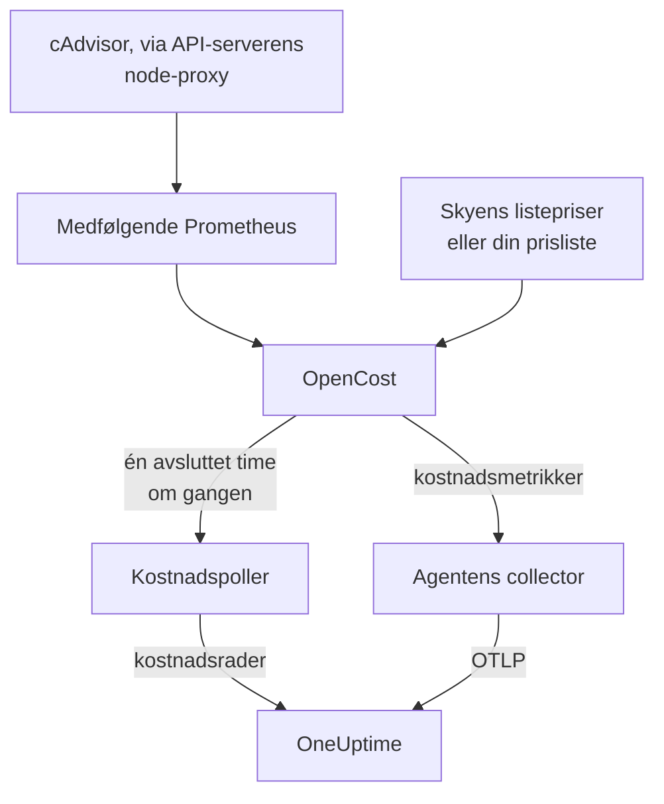

# Kubernetes-kostnadsobserverbarhet

Se hva hver Kubernetes-arbeidsbelastning koster — forbruk per navnerom, arbeidsbelastning og pod, ledig kapasitet og hvor mye av hver request som brukes — ved siden av metrikkene, loggene og sporene [Kubernetes-agenten](/docs/telemetry/kubernetes-agent) allerede samler inn. Én Helm-verdi slår det på, uten skylegitimasjon, og klyngens side **Costs** forteller deg deretter hvilke requests som bør krympes.

:::cards
- [Slå det på](#slå-på-kostnadsobserverbarhet): Én `helm upgrade`.
- [Bruk din egen motor](#kjører-du-allerede-kubecost-eller-opencost): Pek agenten mot Kubecost eller OpenCost.
- [Right-sizing](#right-sizing): Anbefalinger for requests, og hvordan de lages.
- [Feilsøking](#feilsøking): Tomme sider, manglende anbefalinger.
:::

## Slik fungerer det

Med `cost.enabled=true` kjører chartet fire ting ved siden av agenten:



1. **OpenCost**, kostnadsmotoren med åpen kildekode (Apache-2.0, CNCF; [cost-model](https://github.com/kubecost/cost-model) som også driver Kubecost). Den overvåker klyngen, priser nodene, volumene og lastbalansererne dine, og regner ut hva hver arbeidsbelastning koster.
2. **En liten Prometheus**, som OpenCost trenger for bruks- og prishistorikk. Den kjører én replika, beholder 7 dager med historikk og scraper nøyaktig to mål: cAdvisor gjennom API-serverens node-proxy, og OpenCost selv (som sender sine egne metrikker for ressurs-requests, så kube-state-metrics er ikke involvert). Den eksponeres aldri utenfor klyngen, og dataene forlater den aldri.
3. **Kostnadspolleren** (`cost.agent`). Én gang per avsluttet time leser den Allocation API-et til OpenCost og sender én kostnadsrad per arbeidsbelastning til OneUptime: CPU, minne, GPU, volumer, nettverk, lastbalanserere og ledig kapasitet, med effektivitet. Hver time sendes én gang; serveren hopper over en time den allerede har, så en omstart kan ikke telle forbruk to ganger.
4. **En scrape av kostnadsmetrikker** (`cost.metrics`). Agentens collector scraper kostnadsmetrikkene til OpenCost og sender dem sammen med resten av klyngens metrikker.

OpenCost priser noder ut fra skyleverandørens offentlige listepriser (AWS, Google Cloud, Azure), uten legitimasjon. Klynger uten listepris i skyen setter i stedet en [prisliste](#prising-for-lokale-klynger-og-bare-metal).

## Slå på kostnadsobserverbarhet

:::steps
### Oppgrader agenten med cost.enabled

```bash
helm upgrade kubernetes-agent oneuptime/kubernetes-agent \
  --namespace oneuptime-agent \
  --reset-then-reuse-values \
  --set cost.enabled=true
```

Det er en komplett installasjon: to små ekstra poder, OpenCost og dens Prometheus. Hvis du installerte agenten under et annet utgivelsesnavn eller navnerom, bruk ditt (`helm list -A | grep kubernetes-agent` viser dem).

### Vent på den første avsluttede timen

De første kostnadene vises etter at den første hele timen er avsluttet, og OpenCost trenger noen minutter etter oppstart for å prise sin første time.

### Åpne Costs-sidene

- **Produkter → Infrastruktur → Kubernetes → Costs** viser forbruket på tvers av alle klynger i prosjektet.
- På en klynge viser **Costs** forbrukstrenden, **Spend by Namespace** med fordelingen på CPU, minne og lagring, **Spend by Workload**, forbruk på ledig kapasitet, effektivitet og kortet **Right-Sizing**.
:::

Kostnadsmetrikkene (`node_total_hourly_cost`, `pv_hourly_cost` og resten) er vanlige metrikker: de finnes i metrikkutforskeren, på egendefinerte dashbord og i metrikkmonitorer. For et ferdig dashbord, gå til **Produkter → Dashbord**, velg **Opprett Dashbord** og velg **Kubernetes Cost Dashboard**: trender for nodenes timekostnad, enhetskostnader for CPU og minne, og forbruk på volumer og lastbalanserere.

## Kjører du allerede Kubecost eller OpenCost?

Pek agenten mot din egen motor i stedet, så følger ingenting med:

```bash
helm upgrade kubernetes-agent oneuptime/kubernetes-agent \
  --namespace oneuptime-agent \
  --reset-then-reuse-values \
  --set cost.enabled=true \
  --set cost.engine.url=http://kubecost-cost-analyzer.kubecost.svc.cluster.local:9090
```

| Motor | Vanlig tjeneste-URL |
| --- | --- |
| OpenCost | `http://opencost.opencost.svc.cluster.local:9003` |
| Kubecost | `http://kubecost-cost-analyzer.kubecost.svc.cluster.local:9090` |

Stien til Allocation API-et finnes av seg selv (`/model/allocation` for Kubecost, `/allocation/compute` eller `/allocation` for OpenCost). Sett `cost.engine.allocationPath` bare for en uvanlig installasjon. For minneanbefalinger, sett også `cost.engine.prometheusUrl` (se [Dataene bak](#dataene-bak)).

## Prising for lokale klynger og bare metal

Klynger der nodene ikke har noen offentlig listepris i skyen, kan sette en prisliste. OpenCost priser da hver ressurs ut fra disse tallene, alle i USD per ressurstime:

```yaml title="values.yaml"
cost:
  enabled: true
  opencost:
    customPricing:
      enabled: true
      cpuPerCoreHour: "0.031611"       # ~$23 per core-month
      ramPerGiBHour: "0.004237"        # ~$3 per GiB-month
      storagePerGBHour: "0.00005479452" # ~$0.04 per GB-month
      gpuPerHour: "0.95"
```

## Innstillinger som er verdt å kjenne

Alle er valgfrie; chartets `values.yaml` har den fullstendige listen:

```yaml title="values.yaml"
cost:
  agent:
    windowSeconds: 3600   # allocation window length (hourly = native)
    includeIdle: true     # ship the engine's __idle__ allocation
    currency: USD         # currency code shown in the UI (informational)
  prometheus:
    retention: 7d         # bundled TSDB history; right-sizing reads peaks back over days
    persistence:
      enabled: false      # set true for a small PVC; emptyDir otherwise
  metrics:
    enabled: true         # cost metrics for dashboards / Metric Explorer
    scrapeInterval: 60s
```

## Right-sizing

Kortet **Right-Sizing** på en klynges side **Costs** anbefaler en CPU- og en minne-request for hver container det har nok historikk for, rangert etter hvor mye hver endring sparer per måned.

En anbefaling er den observerte etterspørselen pluss 25 % margin, avrundet til en verdi du kan lime inn i et manifest (10m CPU, 16Mi minne):

- CPU dimensjoneres ut fra 95-persentilen av gjennomsnittlig bruk per time: høyt nok til å dekke reell last, lavt nok til at én topp ikke blåser opp requesten i en måned.
- Minne dimensjoneres ut fra toppen i working set, aldri et gjennomsnitt (se [Dataene bak](#dataene-bak)).

Requests anbefales; limits gjør det ikke. En request er det planleggeren reserverer og det regningen regnes ut fra, så det er tallet som flytter kostnaden. En limit er en avgjørelse om hvorvidt en container som oppfører seg dårlig, skal strupes eller drepes, og den avgjørelsen kan ikke bruksdata ta for deg.

Hver container sammenlignes med den nåværende requesten sin:

| Vurdering | Hva den betyr |
| --- | --- |
| Overprovisjonert | Den reserverer tydelig mer enn den bruker. Det er her besparelsene kommer fra. |
| Underprovisjonert | Den reserverer mindre enn den bruker, så den strupes eller risikerer en OOM-kill. Å rette det koster penger, og kortet viser det som en økning. |
| Ingen request satt | Det er ingenting å krympe, men planleggeren kan ikke plassere containeren trygt, og den er den første som kastes ut under press. |

En container innenfor 15 % av anbefalingen sin teller som riktig dimensjonert og utelates: ingen bør redigere et manifest for å barbere 3 % av en request.

To vern holder rådene ærlige. En arbeidsbelastning trenger minst 24 timer med kostnadsvinduer før den dimensjoneres i det hele tatt, fordi et vindu på fire timer kan fange en nattlig batchjobb i ro og råde til å krympe den til ingenting. Og besparelser fremskrives ut fra lengden på vinduet du ser på, ikke ut fra antall rader, så besparelsen til en Deployment multipliseres ikke med antall replikaer. Anslaget antar at forbruket skalerer med det motoren har allokert, som er `max(request, usage)`; for en overprovisjonert container er det requesten, så besparelsestallet er nøyaktig.

### Dataene bak

Ved siden av forbruket samler polleren inn det en anbefaling trenger: hver containers CPU- og minne-requests, limits og bruk.

Minne trenger én kilde til. Allocation API-et rapporterer bare et gjennomsnitt over hvert vindu, og et timesgjennomsnitt skjuler toppen som OOM-dreper en container, så å dimensjonere minne ut fra det ville vært farlig. Polleren leser i stedet hver containers minnetopp fra Prometheus, koblet på `(namespace, pod, container)`:

- Med den medfølgende motoren (standard) bruker den chartets egen Prometheus. Ingenting å sette.
- Med din egen motor (`cost.engine.url`), pek `cost.engine.prometheusUrl` mot en Prometheus som scraper cAdvisor, og sett `cost.engine.prometheusCadvisorJob` hvis scrapejobben ikke heter `kubernetes-nodes-cadvisor`.
- Uten Prometheus fungerer CPU-anbefalinger fortsatt, ut fra de lagrede timesgjennomsnittene, og minneanbefalinger utelates i stedet for å gjettes.

Et Prometheus-brudd stopper aldri innsamlingen av forbruk: toppene er et tillegg, og en time sendes uten dem. CPU bruker bevisst ikke Prometheus: en for stor CPU-request struper bare, der en for liten minne-request dreper, så timesgjennomsnittene er trygge for CPU, og å spørre etter CPU-raten til hver container i en hel klynge er tungt nok til å velte en liten Prometheus.

## Varsling på kostnader

Kostnadsmetrikkene er vanlige metrikker, så en [metrikkmonitor](/docs/monitor/metrics-monitor) kan varsle på dem som på alt annet: for eksempel når gjennomsnittlig `node_total_hourly_cost` stiger over et budsjett, eller når `pv_hourly_cost` dukker opp for en volumklasse som ikke skal finnes i en klynge.

## Datamodell og oppbevaring

Kostnadsrader lagres i ClickHouse, én per klynge, vindu, navnerom, kontroller, pod og container. De følger klyngens oppbevaring av telemetri: klyngens `retainTelemetryDataForDays`, eller prosjektets dataoppbevaring når den ikke er satt. Ledig og ikke-allokert kapasitet lagres som vanlige rader under navnerommene `__idle__` og `__unallocated__`, så de grupperes og filtreres som forbruk for arbeidsbelastninger.

## Feilsøking

:::details Costs-sidene er tomme
Les loggene til kostnadspolleren: `kubectl logs -n oneuptime-agent deploy/kubernetes-agent-cost`. (Deploymenten heter `<release>-kubernetes-agent-cost` når utgivelsesnavnet ikke inneholder `kubernetes-agent`; `kubectl get deploy -n oneuptime-agent` lister dem.) `HTTP 401` betyr at OneUptime avviste inntaksnøkkelen. `did not answer any known allocation path` betyr at motoren ikke er oppe ennå (den medfølgende OpenCost trenger noen minutter for å prise de første timene) eller at `cost.engine.url` er feil.
:::

:::details Den medfølgende OpenCost er ikke klar
Les loggene: `kubectl logs -n oneuptime-agent deploy/kubernetes-agent-opencost`. De sier hvilken skyleverandør den oppdaget og om prisdataene ble lastet.
:::

:::details OpenCost-loggen sier mkdir /var/configs: permission denied
Et eldre chart kjørte OpenCost uten en skrivbar konfigurasjonsmappe, så `Error downloading default pricing data` gjorde at Allocation API-et ikke kunne svare og polleren stoppet opp, mens poden forble `Running`, `/healthz` forble grønn og nodenes kostnadsmetrikker fortsatte å publiseres. Nåværende charts retter det: kjør `helm repo update`, og oppgrader deretter med `--reset-then-reuse-values`. Kostnadsrader vises ved neste poll.
:::

:::details Kubernetes Cost Dashboard viser ingen data
Malen leser de scrapede kostnadsmetrikkene: sjekk at `cost.metrics.enabled` er `true`.
:::

:::details Right-Sizing-kortet er tomt
Enten er tidsrommet kortere enn de 24 timene en anbefaling trenger (utvid det), eller så er hver container allerede innenfor 15 % av den anbefalte requesten, noe kortet sier.
:::

:::details Minneanbefalinger viser -, men CPU-anbefalingene fungerer
Ingen minnetopp nådde OneUptime, så minnet ble ikke dimensjonert i stedet for å gjettes ut fra et gjennomsnitt. Med din egen motor, sett `cost.engine.prometheusUrl`. Kortet sier hvor mange containere dette gjelder.
:::

:::details Tallene avviker fra motorens eget grensesnitt
OneUptime tar med motorens avstemmingsjusteringer i hver kostnadskomponent, og sender hele, avsluttede timer: forbruket for den nåværende timen vises etter at den er avsluttet.
:::

:::details Den medfølgende Prometheus startet på nytt
Med standardlagringen `emptyDir` mister en omstart noen timer med brukshistorikk, så kostnadene for de timene kan bli lavere. Sett `cost.prometheus.persistence.enabled=true` hvis det betyr noe for deg.
:::

## Neste trinn

:::cards
- [Kubernetes-agent](/docs/telemetry/kubernetes-agent): Installer agenten, og alt annet den samler inn.
- [Metrikk-overvåking](/docs/monitor/metrics-monitor): Varsle når forbruket krysser et budsjett.
- [Kubernetes-overvåking](/docs/monitor/kubernetes-monitor): Varsle også på klyngens helse.
:::
