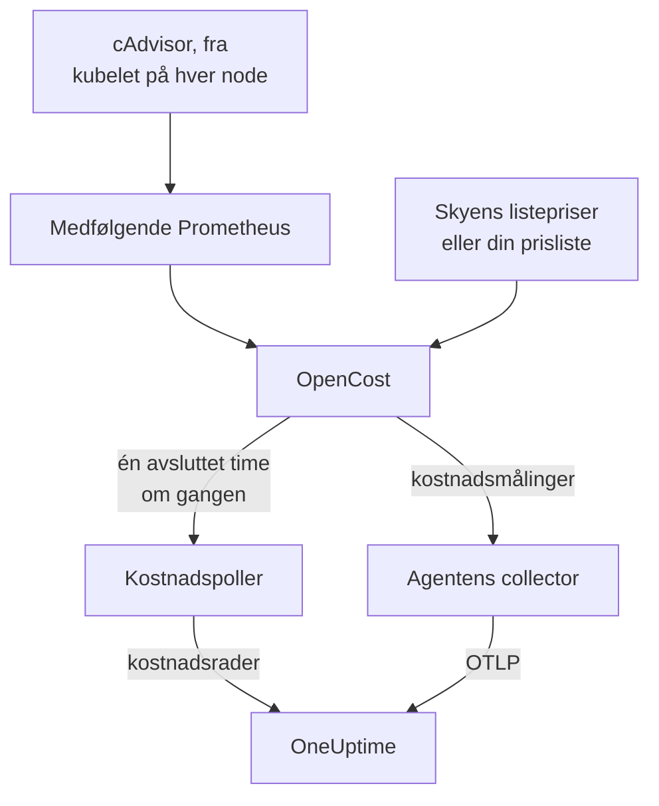

# Kubernetes-kostnadsobserverbarhet

Se hva hver Kubernetes-arbeidsbelastning koster — forbruk per navnerom, arbeidsbelastning og pod, ledig kapasitet og hvor mye av hver request som brukes — ved siden av målingene, loggene og sporene [Kubernetes-agenten](/docs/telemetry/kubernetes-agent) allerede samler inn. Det er slått på som standard, uten skylegitimasjon: klyngens oversikt viser hva den koster, siden **Kostnader** forteller deg hvilke requests som bør krympes, og kostnadsmålingene kan vises i grafer og varsles på som alle andre målinger.

:::cards
- [Slå det på](#slå-på-kostnadsobserverbarhet): På som standard; én `helm upgrade` der det ikke er det.
- [Varsling på kostnader](#varsling-på-kostnader): Kostnad per klynge, navnerom og arbeidsbelastning, som målinger.
- [Din egen motor](#kjører-du-allerede-kubecost-eller-opencost): Kubecost eller OpenCost som du allerede kjører, blir funnet og lest.
- [Right-sizing](#right-sizing): Anbefalinger for requests, og hvordan de lages.
- [Feilsøking](#feilsøking): Tomme sider, manglende anbefalinger.
:::

## Slik fungerer det

Med kostnadsovervåking slått på, slik den er som standard (`cost.enabled: auto`), kjører chartet fire ting ved siden av agenten:



1. **OpenCost**, kostnadsmotoren med åpen kildekode (Apache-2.0, CNCF; [cost-model](https://github.com/kubecost/cost-model) som også driver Kubecost). Den overvåker klyngen, priser nodene, volumene og lastbalansererne dine, og regner ut hva hver arbeidsbelastning koster.
2. **En liten Prometheus**, som OpenCost trenger for bruks- og prishistorikk. Den kjører én replika, beholder 7 dager med historikk og scraper nøyaktig to mål: cAdvisor i kubelet på hver node (gjennom API-serverens node-proxy med presetet `eks-fargate`, siden ingen pod når en kubelet der), der den bare beholder seriene OpenCost leser, og OpenCost selv (som sender sine egne målinger for ressurs-requests, så kube-state-metrics er ikke involvert). Den eksponeres aldri utenfor klyngen, og dataene forlater den aldri.
3. **Kostnadspolleren** (`cost.agent`). Én gang per avsluttet time leser den Allocation API-et til OpenCost og sender én kostnadsrad per arbeidsbelastning til OneUptime: CPU, minne, GPU, volumer, nettverk, lastbalanserere og ledig kapasitet, med effektivitet. Hver time sendes én gang; serveren hopper over en time den allerede har, så en omstart kan ikke telle forbruk to ganger. OneUptime skriver også [kostnadsmålingene](#varsling-på-kostnader) ut fra disse radene.
4. **En scrape av kostnadsmålinger** (`cost.metrics`). Agentens collector scraper prismålingene til OpenCost, altså hva hver node, hvert volum og hver lastbalanserer koster i timen, og sender dem sammen med resten av klyngens målinger.

OpenCost priser noder ut fra skyleverandørens offentlige listepriser (AWS, Google Cloud, Azure), uten legitimasjon. Andre steder bruker den standardprisene sine, som du kan erstatte med din egen [prisliste](#prising-for-lokale-klynger-og-bare-metal).

De tre podene har til sammen requests på omtrent 150m CPU og 450Mi minne. Kostnadsovervåking er av som standard med presetene `gke-autopilot` og `eks-fargate`: de plattformene fakturerer hver pod etter requestene dens, så kostnadspodene ville økt regningen de måler, og OpenCost priser noder, mens ingen av de to plattformene fakturerer per node.

## Slå på kostnadsobserverbarhet

En ny installasjon trenger ingenting: kostnadsovervåking er på som standard. Oppgrader en agent som ble installert før det var slik, eller slå det på med presetet `gke-autopilot` eller `eks-fargate`:

:::steps
### Oppgrader agenten

```bash
helm upgrade kubernetes-agent oneuptime/kubernetes-agent \
  --namespace oneuptime-agent \
  --reset-then-reuse-values \
  --set cost.enabled=true
```

Det er en komplett installasjon: tre små ekstra poder, OpenCost, dens Prometheus og kostnadsagenten. Hvis du installerte agenten under et annet utgivelsesnavn eller navnerom, bruk ditt (`helm list -A | grep kubernetes-agent` viser dem). For å slå av kostnadsovervåking setter du `--set cost.enabled=false` på samme måte.

### Vent på den første avsluttede timen

De første kostnadene vises etter at den første hele timen er avsluttet, og OpenCost trenger noen minutter etter oppstart for å prise sin første time.

### Åpne Costs-sidene

- **Produkter → Infrastruktur → Kubernetes → Kostnader** viser forbruket på tvers av alle klynger i prosjektet.
- På en klynge viser oversikten forbruket de siste 24 timene, en månedlig prognose, forbruk på ledig kapasitet, effektivitet og de dyreste navnerommene og arbeidsbelastningene.
- På en klynge viser **Kostnader** forbrukstrenden, **Spend by Namespace** med fordelingen på CPU, minne og lagring, **Spend by Workload**, forbruk på ledig kapasitet, effektivitet og kortet **Right-Sizing**.
:::

Kostnadsmålingene (`node_total_hourly_cost`, `pv_hourly_cost` og resten) er vanlige målinger: de finnes i målingsutforskeren, på egendefinerte dashbord og i målingsmonitorer. For et ferdig dashbord, gå til **Produkter → Dashbord**, velg **Opprett dashbord** og velg **Kubernetes Cost Dashboard**: trender for nodenes timekostnad, enhetskostnader for CPU og minne, og forbruk på volumer og lastbalanserere.

Under tallene viser oversikten og siden **Kostnader** hvor prisene kommer fra: en skyleverandørs listepriser, prislisten din eller standardprisene til OpenCost, uansett hvilken motor som priser klyngen, også Kubecost 3. En Kubecost som leser skyregningen din, avstemmer prisene sine mot regningen omtrent halvannet døgn etter hver time, så linjen sier da at tallene er listeprisene dens fra før avstemmingen. Effektivitet er ett og samme tall overalt, også i effektivitetsmålingen: hvor mye av den forespurte CPU-en og minnet som ble brukt, der hver containers time vektes etter hva CPU-en og minnet dens koster, slik at en billig jobb som ikke bruker noe, ikke kan trekke ned en godt utnyttet klynge, og ledig kapasitet telles ikke med.

## Kjører du allerede Kubecost eller OpenCost?

Kostnadsagenten finner motoren din og leser den i stedet for den medfølgende OpenCost, så klyngen prises slik du har satt den opp: med prislisten din, eller med skyregningen din som Kubecost er koblet til. Den leter når den starter, og deretter hver time, gjennom Kubernetes-API-et etter Services som motorenes egne charts oppretter i et hvilket som helst navnerom (`cost-analyzer` eller `frontend` fra Kubecost, chartet til OpenCost, og Servicen `opencost` som manifestet til OpenCost oppretter), med Kubecost først. Den hopper over en motor som ikke svarer, krever innlogging eller svarer for flere klynger, og leser da den medfølgende. Collectoren scraper deretter også prismålingene til motoren din for Kubernetes Cost Dashboard, slik at dashbordet og Costs-sidene viser de samme prisene, og right-sizing leser minnetoppene sine fra den Prometheus som motoren din leser.

Klyngens oversikt viser deretter navnet på motoren din og sier at den medfølgende OpenCost ikke trengs. Slutt å kjøre den:

```bash
helm upgrade kubernetes-agent oneuptime/kubernetes-agent \
  --namespace oneuptime-agent \
  --reset-then-reuse-values \
  --set cost.engine.url=auto
```

Med `cost.engine.url=auto` følger ingenting med, og agenten leser motoren din uansett hvor den kjører; er ingen motor installert, blir ingenting priset. Chartet kan ikke selv lete etter en motor: Helms funksjon `lookup` ser ingenting under `helm template`, Argo CD eller en tørrkjøring. For å beholde den medfølgende OpenCost ved siden av din egen motor, sett `cost.engine.preferExisting=false`; for å angi hvilken motor som skal leses, sett `cost.engine.url` til Servicen dens:

| Motor | Vanlig tjeneste-URL |
| --- | --- |
| OpenCost | `http://opencost.opencost.svc.cluster.local:9003` |
| Kubecost 2 | `http://kubecost-cost-analyzer.kubecost.svc.cluster.local:9090` |
| Kubecost 3 | `http://kubecost-frontend.kubecost.svc.cluster.local:9090` |

Stien til Allocation API-et finnes av seg selv (`/model/allocation` for Kubecost, `/allocation/compute` eller `/allocation` for OpenCost). Sett `cost.engine.allocationPath` bare for en uvanlig installasjon. Den Prometheus som motoren din leser, finnes også av seg selv, for minneanbefalinger, unntatt med Kubecost 3, som ikke leser noen: sett da `cost.engine.prometheusUrl` (se [Dataene bak](#dataene-bak)). Prismålingene finnes på samme måte, uansett hvilken av motorens Services du oppgir: agenten prøver dens `/metrics`, så den `/model/metrics` som en Kubecost 2-frontend eller brukergrensesnittet til OpenCost sender videre til motoren, så FinOps-agenten til Kubecost 3, og collectoren scraper den første adressen med prisserier. Sett `cost.metrics.endpoint` for å oppgi dem selv.

## Prising for lokale klynger og bare metal

Klynger der nodene ikke har noen offentlig listepris i skyen, kan sette en prisliste. Uten prisliste priser OpenCost dem etter standardprisene sine (lokale klynger, bare metal, kind, k3s), som kan ligge langt unna det maskinvaren din koster, og det sier klyngens oversikt og siden **Kostnader** også; på en sky den gjenkjenner, beholder en node listeprisen sin, og en prisliste priser bare det listen mangler. Med en prisliste priser OpenCost da hver ressurs ut fra disse tallene, alle i USD per ressurstime:

```yaml title="values.yaml"
cost:
  enabled: true
  opencost:
    customPricing:
      enabled: true
      cpuPerCoreHour: "0.031611"       # ~$23 per core-month
      ramPerGiBHour: "0.004237"        # ~$3 per GiB-month
      storagePerGBHour: "0.00005479452" # ~$0.04 per GB-month
      gpuPerHour: "0.95"
```

Dette er OpenCosts egne standardpriser: fyll inn dine egne tall, ellers sier siden **Kostnader** fortsatt at klyngen er priset etter standardprisene til OpenCost.

## Innstillinger som er verdt å kjenne

Alle er valgfrie; chartets `values.yaml` har den fullstendige listen:

```yaml title="values.yaml"
cost:
  enabled: auto           # on, except with the gke-autopilot and eks-fargate presets
  agent:
    windowSeconds: 3600   # allocation window length (hourly = native)
    includeIdle: true     # ship the engine's __idle__ allocation
    currency: USD         # currency code shown in the UI (informational)
  prometheus:
    retention: 7d         # bundled TSDB history; right-sizing reads peaks back over days
    persistence:
      enabled: false      # set true for a small PVC; emptyDir otherwise
  metrics:
    enabled: true         # cost metrics for dashboards / Metric Explorer
    scrapeInterval: 60s
```

## Right-sizing

Kortet **Right-Sizing** på en klynges side **Kostnader** anbefaler en CPU- og en minne-request for hver container det har nok historikk for, rangert etter hvor mye hver endring sparer per måned.

En anbefaling er den observerte etterspørselen pluss 25 % margin, avrundet til en verdi du kan lime inn i et manifest (10m CPU, 16Mi minne):

- CPU dimensjoneres ut fra 95-persentilen av gjennomsnittlig bruk per time: høyt nok til å dekke reell last, lavt nok til at én topp ikke blåser opp requesten i en måned.
- Minne dimensjoneres ut fra toppen i working set, aldri et gjennomsnitt (se [Dataene bak](#dataene-bak)).

Requests anbefales; limits gjør det ikke. En request er det planleggeren reserverer og det regningen regnes ut fra, så det er tallet som flytter kostnaden. En limit er en avgjørelse om hvorvidt en container som oppfører seg dårlig, skal strupes eller drepes, og den avgjørelsen kan ikke bruksdata ta for deg.

Hver container sammenlignes med den nåværende requesten sin:

| Vurdering | Hva den betyr |
| --- | --- |
| Overprovisjonert | Den reserverer tydelig mer enn den bruker. Det er her besparelsene kommer fra. |
| Underprovisjonert | Den reserverer mindre enn den bruker, så den strupes eller risikerer en OOM-kill. Å rette det koster penger, og kortet viser det som en økning. |
| Ingen request satt | Det er ingenting å krympe, men planleggeren kan ikke plassere containeren trygt, og den er den første som kastes ut under press. |

En container innenfor 15 % av anbefalingen sin teller som riktig dimensjonert og utelates: ingen bør redigere et manifest for å barbere 3 % av en request.

To vern holder rådene ærlige. En arbeidsbelastning trenger minst 24 timer med kostnadsvinduer før den dimensjoneres i det hele tatt, fordi et vindu på fire timer kan fange en nattlig batchjobb i ro og råde til å krympe den til ingenting. Og besparelser fremskrives ut fra lengden på vinduet du ser på, ikke ut fra antall rader, så besparelsen til en Deployment multipliseres ikke med antall replikaer. Anslaget antar at forbruket skalerer med det motoren har allokert, som er `max(request, usage)`; for en overprovisjonert container er det requesten, så besparelsestallet er nøyaktig.

### Dataene bak

Ved siden av forbruket samler polleren inn det en anbefaling trenger: hver containers CPU- og minne-requests, limits og bruk.

Minne trenger én kilde til. Allocation API-et rapporterer bare et gjennomsnitt over hvert vindu, og et timesgjennomsnitt skjuler toppen som OOM-dreper en container, så å dimensjonere minne ut fra det ville vært farlig. Polleren leser i stedet hver containers minnetopp fra Prometheus, koblet på `(namespace, pod, container)`:

- Med den medfølgende motoren (standard) bruker den chartets egen Prometheus. Ingenting å sette.
- Med din egen motor brukes den Prometheus som motoren leser, og som agenten finner av seg selv: `PROMETHEUS_SERVER_ENDPOINT` til OpenCost, eller den Prometheus som Kubecost 2 har med seg, så snart den svarer for denne klyngens cAdvisor-serier. Kubecost 3 leser ingen, så den medfølgende Prometheus trer inn så lenge chartet kjører den.
- Ellers, eller for å velge en selv, pek `cost.engine.prometheusUrl` mot en Prometheus som scraper cAdvisor, og sett `cost.engine.prometheusCadvisorJob` hvis den scraper cAdvisor under flere jobber og den som skal leses, ikke heter `kubernetes-nodes-cadvisor`. Uten Prometheus fungerer CPU-anbefalinger fortsatt, ut fra de lagrede timesgjennomsnittene, og minneanbefalinger utelates i stedet for å gjettes.

Et Prometheus-brudd stopper aldri innsamlingen av forbruk: toppene er et tillegg, og en time sendes uten dem. CPU bruker bevisst ikke Prometheus: en for stor CPU-request struper bare, der en for liten minne-request dreper, så timesgjennomsnittene er trygge for CPU, og å spørre etter CPU-raten til hver container i en hel klynge er tungt nok til å velte en liten Prometheus.

## Varsling på kostnader

OneUptime skriver fire målinger ut fra kostnadsradene for hver time, priset og navngitt etter hva de er, slik at kostnader kan vises i grafer, legges på et dashbord og varsles på i en [Kubernetes-monitor](/docs/monitor/kubernetes-monitor) eller en [målingsmonitor](/docs/monitor/metrics-monitor):

| Måling | Hva den er | Attributter |
| --- | --- | --- |
| `oneuptime.kubernetes.cost.total` | Hva klyngen kostet i hver time, ledig kapasitet inkludert | `k8s.cluster.name` |
| `oneuptime.kubernetes.cost.idle` | Den delen av det som ingen arbeidsbelastning brukte: ledig og ikke-allokert kapasitet | `k8s.cluster.name` |
| `oneuptime.kubernetes.cost.workload` | Hva hver arbeidsbelastning kostet i hver time; summert per navnerom, hva navnerommet kostet | `k8s.cluster.name`, `k8s.namespace.name` og arbeidsbelastningens navn under typen dens, for eksempel `k8s.deployment.name` |
| `oneuptime.kubernetes.cost.efficiency` | Hvor mye av den forespurte CPU-en og minnet hver arbeidsbelastning brukte, i prosent, vektet etter kostnad | Arbeidsbelastningens, som over |

Hvert punkt er én times kostnad, i agentens valuta (USD som standard), tidsstemplet ved starten av timen og skrevet omtrent en time etter at den slutter: summer punktene over et vindu av timer, så blir punktene for et døgn til sammen døgnets kostnad. De kommer fra det klyngen allerede har sendt, så de faktureres ikke som inntak av målinger, og de beholdes like lenge som klyngens andre målinger.

Kubernetes-monitoren har tre maler for dem: Cluster Daily Cost Over Budget, Namespace Daily Cost Over Budget og High Idle Spend, hver med et budsjett du setter selv. Prismålingene til OpenCost er også vanlige målinger: en målingsmonitor kan varsle når gjennomsnittlig `node_total_hourly_cost` stiger over et budsjett, eller når `pv_hourly_cost` dukker opp for en volumklasse som ikke skal finnes i en klynge.

## Datamodell og oppbevaring

Kostnadsrader lagres i ClickHouse, én per klynge, vindu, navnerom, kontroller, pod og container. De følger klyngens oppbevaring av telemetri: klyngens `retainTelemetryDataForDays`, eller prosjektets dataoppbevaring når den ikke er satt. Ledig og ikke-allokert kapasitet lagres som vanlige rader under navnerommene `__idle__` og `__unallocated__`, så de grupperes og filtreres som forbruk for arbeidsbelastninger.

## Feilsøking

:::details Costs-sidene er tomme
Med presetene `gke-autopilot` og `eks-fargate` er kostnadsovervåking av som standard: slå den på med `--set cost.enabled=true`. Ellers leser du loggene til kostnadspolleren: `kubectl logs -n oneuptime-agent deploy/kubernetes-agent-cost`. (Deploymenten heter `<release>-kubernetes-agent-cost` når utgivelsesnavnet ikke inneholder `kubernetes-agent`; `kubectl get deploy -n oneuptime-agent` lister dem.) `HTTP 401` betyr at OneUptime avviste inntaksnøkkelen. `did not answer any known allocation path` betyr at motoren ikke er oppe ennå (den medfølgende OpenCost trenger noen minutter for å prise de første timene) eller at `cost.engine.url` er feil.
:::

:::details Den medfølgende OpenCost er ikke klar
Les loggene: `kubectl logs -n oneuptime-agent deploy/kubernetes-agent-opencost`. De sier hvilken skyleverandør den oppdaget og om prisdataene ble lastet.
:::

:::details Oversikten sier at den medfølgende OpenCost ikke trengs
Klyngen kjører sin egen Kubecost eller OpenCost, og kostnadsagenten leser den, så OpenCost som fulgte med chartet, priser ingenting. Oppgrader med `--set cost.engine.url=auto` for å slutte å kjøre den og dens Prometheus, eller sett `cost.engine.preferExisting=false` for å lese den medfølgende motoren i stedet. Med Kubecost 3, som ikke leser noen Prometheus, kommer minneanbefalingene fra den medfølgende: angi en annen med `cost.engine.prometheusUrl` i samme oppgradering.
:::

:::details Kostnadsagenten leser ikke motoren din
Loggen til kostnadsagenten sier hvilken motor den leser, og hvorfor den hoppet over de andre: `kubectl logs -n oneuptime-agent deploy/kubernetes-agent-cost`. Den hopper over en motor som ikke svarer (for eksempel på grunn av en NetworkPolicy mellom navnerommene), krever innlogging eller svarer for flere klynger, slik en Kubecost som samler flere klynger i en føderasjon, gjør. Angi med `cost.engine.url` hvilken motor som skal leses.
:::

:::details OpenCost-loggen sier mkdir /var/configs: permission denied
Et eldre chart kjørte OpenCost uten en skrivbar konfigurasjonsmappe, så `Error downloading default pricing data` gjorde at Allocation API-et ikke kunne svare og polleren stoppet opp, mens poden forble `Running`, `/healthz` forble grønn og nodenes kostnadsmålinger fortsatte å publiseres. Nåværende charts retter det: kjør `helm repo update`, og oppgrader deretter med `--reset-then-reuse-values`. Kostnadsrader vises ved neste poll.
:::

:::details Kubernetes Cost Dashboard viser ingen data
Malen leser de scrapede kostnadsmålingene: sjekk at `cost.metrics.enabled` er `true`. Kostnadsagenten finner hvor motoren den leser, gjør dem tilgjengelige, den medfølgende eller din, og loggen dens sier hvor, eller hvilke adresser den prøvde: `kubectl logs -n oneuptime-agent deploy/kubernetes-agent-cost`. Sett `cost.metrics.endpoint` for å oppgi dem selv.
:::

:::details Right-Sizing-kortet er tomt
Enten er tidsrommet kortere enn de 24 timene en anbefaling trenger (utvid det), eller så er hver container allerede innenfor 15 % av den anbefalte requesten, noe kortet sier.
:::

:::details Minneanbefalinger viser -, men CPU-anbefalingene fungerer
Ingen minnetopp nådde OneUptime, så minnet ble ikke dimensjonert i stedet for å gjettes ut fra et gjennomsnitt. Med din egen motor sier loggen til kostnadsagenten hvilken Prometheus den leser, eller hvorfor den ikke fant noen: angi en med `cost.engine.prometheusUrl` (Kubecost 3 leser ingen). Kortet sier hvor mange containere dette gjelder.
:::

:::details Tallene avviker fra motorens eget grensesnitt
OneUptime sender hele, avsluttede timer, slik motoren priset dem da de var avsluttet, med avstemmingsjusteringene dens inkludert: forbruket for den nåværende timen vises etter at den er avsluttet. En Kubecost som leser skyregningen din, avstemmer hver time mot den omtrent halvannet døgn senere, og OneUptime beholder timen slik den først ble priset.
:::

:::details Den medfølgende Prometheus startet på nytt
Med standardlagringen `emptyDir` mister en omstart noen timer med brukshistorikk, så kostnadene for de timene kan bli lavere. Sett `cost.prometheus.persistence.enabled=true` hvis det betyr noe for deg.
:::

## Neste trinn

:::cards
- [Kubernetes-agent](/docs/telemetry/kubernetes-agent): Installer agenten, og alt annet den samler inn.
- [Målingsmonitor](/docs/monitor/metrics-monitor): Varsle når forbruket krysser et budsjett.
- [Kubernetes-monitor](/docs/monitor/kubernetes-monitor): Varsle også på klyngens helse.
:::
