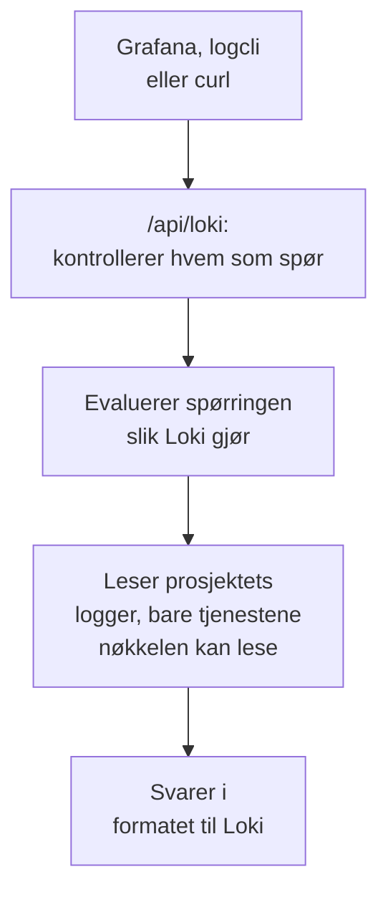

# Spør i logger med LogQL

LogQL er spørrespråket til Grafana Loki. OneUptime besvarer spørre-API-et til Loki over loggene i prosjektet ditt, slik at Loki-datakilden i Grafana, logcli eller hvilken som helst Loki-klient leser dem, og dashbordene og de lagrede spørringene du skrev for Loki, fortsetter å fungere.

:::cards
- [Koble til Grafana](#koble-til-grafana): Legg til OneUptime som Loki-datakilde.
- [Slik får logger etiketter](#slik-får-logger-etiketter): Hva en strømvelger finner.
- [Hva LogQL dekker](#hva-logql-dekker): Loggspørringer, parsere og målingsspørringer.
- [Grenser](#grenser): Hva en spørring kan lese, og hvor ofte.
:::

## Slik fungerer det

Grafana spør OneUptime slik det spør Loki. OneUptime kontrollerer at API-nøkkelen kan lese prosjektets logger, leser bare tjenestene den kan lese, og evaluerer spørringen slik Loki gjør.



## Før du begynner

- **Logger som kommer inn.** Send dem med [OpenTelemetry](/docs/telemetry/open-telemetry), eller fra Promtail, Grafana Alloy, Fluent Bit eller Vector gjennom [push-API-et til Loki](/docs/telemetry/compatible-endpoints).
- **En API-nøkkel for prosjektet som leser logger**, med rollen Prosjekteier, Prosjektadministrator, Prosjektmedlem, Leser, Telemetriadministrator, Telemetrimedlem eller Telemetrileser, eller tillatelsen Read Logs. En nøkkel som er begrenset til bestemte tjenester, leser bare loggene deres. Se [Opprett en API-nøkkel](/docs/api-reference/api-reference#opprett-en-api-nøkkel). På OneUptime Cloud krever API-nøkler abonnementet **Growth**.
- **Ikke en inntaksnøkkel.** En inntaksnøkkel sender telemetri og leser ingen, så Grafana kan ikke logge på med en.

## Koble til Grafana

:::steps
### Opprett en API-nøkkel

I OneUptime åpner du **Prosjektinnstillinger → Avansert → API-nøkler** og klikker på **Opprett API-nøkkel**. Gi nøkkelen en rolle som kan lese telemetri, eller tillatelsen Read Logs.

### Legg til en Loki-datakilde

I Grafana åpner du **Connections → Data sources → Add data source** og velger **Loki**.

### Angi URL-en

Sett **URL** til OneUptime-adressen din etterfulgt av `/api/loki`. På OneUptime Cloud er det `https://oneuptime.com/api/loki`.

### Send API-nøkkelen

Under **HTTP headers** legger du til headeren `Authorization` med verdien `Bearer`, etterfulgt av et mellomrom og API-nøkkelen din. Basic-autentisering fungerer også: et hvilket som helst brukernavn, med API-nøkkelen som passord.

### Lagre og test

Klikk på **Save & test**. Grafana kjører en spørring og sier at datakilden fungerer.
:::

Explore, loggvolumet over linjene, etikettleserne og dashbordene leser deretter OneUptime slik de leser Loki. logcli og alle andre Loki-klienter fungerer på samme måte. Med curl:

```bash title="Query OneUptime's Loki API"
curl -G -H "Authorization: Bearer $ONEUPTIME_API_KEY" \
  "https://oneuptime.com/api/loki/loki/api/v1/query_range" \
  --data-urlencode 'query={service_name="checkout"} |= "error"'
```

## Slik får logger etiketter

En strømvelger finner attributtene til en logg, navngitt slik Loki 3 navngir OpenTelemetry-logger:

| I OneUptime | I LogQL |
| --- | --- |
| Et ressursattributt `service.name` | Etiketten `service_name` |
| Et ressursattributt `k8s.pod.name` | Etiketten `k8s_pod_name` |
| Et attributt `http.method` | Etiketten `http_method` |
| En etikett en Loki-klient sendte, som `job` | Etiketten `job` |
| Alvorlighetsgraden til loggen | Etiketten `detected_level`: `trace`, `debug`, `info`, `warn`, `error`, `fatal` eller `unknown` |

- **Hvert attributt er en etikett.** En loggspørring svarer med én strøm per etikettsett, så logger med ulike attributter er ulike strømmer, slik Loki 3 svarer for logger med strukturerte metadata.
- **Loggens eget attributt kommer først** når ressursen har et med samme navn.
- **En velger nevner en verdi**, slik Loki krever: minst én matcher som en logg uten etiketten ikke oppfyller, som `{service_name="checkout"}` eller `{service_name=~"check.+"}`.

Noen spørringer å starte med:

```text title="LogQL"
# The checkout service's lines that say error
{service_name="checkout"} |= "error"

# Requests slower than 250ms, read from JSON lines
{service_name="checkout"} | json | duration > 250ms

# Error logs per second, by service
sum by (service_name) (rate({detected_level="error"} [5m]))
```

## Hva LogQL dekker

- **Loggspørringer**: strømvelgere med `=`, `!=`, `=~` og `!~`; linjefiltre `|=`, `!=`, `|~` og `!~`, med `or`; parserne `json` og `logfmt`; etikettfiltre på tekst, tall, varigheter og størrelser, med `and`, `or` og `__error__`; `line_format` med `{{.label}}`; `drop`, `keep` og `decolorize`.
- **Målingsspørringer**: `count_over_time`, `rate`, `bytes_over_time`, `bytes_rate` og `absent_over_time`; over en etikett tatt med `unwrap` (med `duration()` eller `bytes()`), `rate`, `sum_over_time`, `avg_over_time`, `min_over_time`, `max_over_time`, `first_over_time`, `last_over_time`, `stddev_over_time`, `stdvar_over_time` og `quantile_over_time`; og `offset`.
- **Rundt dem**: `sum`, `avg`, `min`, `max`, `count`, `stddev`, `stdvar`, `topk` og `bottomk`, med `by` eller `without`; aritmetikk, sammenligninger (med `bool`), `and`, `or` og `unless`, med `on`, `ignoring`, `group_left` og `group_right`; `sort`, `sort_desc`, `label_replace` og `vector()`.

Parserne `pattern`, `regexp` og `unpack`, `label_format`, `json` med navngitte felt, `ip()`-filtre og `line_format`-maler utover `{{.label}}` er ikke tilgjengelige ennå. En spørring som bruker en av dem, avvises med en melding som nevner den.

## API-et

API-et besvarer rutene i HTTP-API-et til Loki, med `GET` eller `POST`, under `/api/loki`:

| Rute | Hva den besvarer |
| --- | --- |
| `/loki/api/v1/query_range` | Linjene til en loggspørring fra `start` til `end`, eller en målingsspørring ved hvert `step`. |
| `/loki/api/v1/query` | En målingsspørring på ett tidspunkt (`time`, som standard nå). |
| `/loki/api/v1/labels` | Etikettnavn, for loggene `query` velger, eller for alle logger. |
| `/loki/api/v1/label/<name>/values` | Verdiene til én etikett. |
| `/loki/api/v1/series` | Etikettsettene til loggene `match[]` velger. |

Tider er nanosekunder siden 1970, Unix-sekunder eller RFC 3339, og et intervall er timen før `end` hvis ikke noe annet er sagt. En loggspørring svarer med `limit` linjer, 100 som standard, de nyeste først med mindre `direction=forward`. Svarene er i formatet til Loki, og feil er ren tekst, slik Loki skriver dem. `/loki/api/v1/status/buildinfo` svarer som en Loki 3-server.

## Grenser

Hver spørring er begrenset, slik at et dashbord med mange paneler ikke kan overbelaste OneUptime:

| Grense | Verdi |
| --- | --- |
| Linjer en loggspørring svarer med | 5 000 |
| Logger en loggspørring leser når filtre etter parserne forkaster noen | 20 000 |
| Logger en målingsspørring leser selv når ClickHouse ikke kan telle dem | 100 000 |
| Serier en målingsspørring svarer med | 500 |
| Punkter i én serie i en intervallspørring | 11 000 |
| Logger én lesing gir tilbake | 64 MB |
| Tid en lesing kan ta | 30 sekunder |
| Spørringer et prosjekt kan sende hvert minutt | 1 200 |

En målingsspørring der rørledningen bare er linjefiltre, som `sum(count_over_time({service_name="checkout"} |= "error" [5m]))`, telles der loggene ligger, så den leser ingen linjer i det hele tatt.

## Feilsøking

:::details Grafana sier at datakilden ikke fungerer
Kontroller at URL-en slutter på `/api/loki`, og at headeren `Authorization` inneholder `Bearer`, et mellomrom og API-nøkkelen. En inntaksnøkkel, eller en API-nøkkel uten en rolle som leser logger, avvises: gi nøkkelen en slik rolle under **Prosjektinnstillinger → Avansert → API-nøkler**.
:::

:::details "queries require at least one regexp or equality matcher that does not have an empty-compatible value"
Velgeren finner logger uten å nevne en verdi, som `{service_name=~".*"}`. Legg til en matcher som nevner en, som `{service_name="checkout"}`.
:::

:::details "This project sent more queries this minute than OneUptime answers."
Prosjektets dashbord og klienter sendte mer enn 1 200 spørringer til API-et dette minuttet. Panelene lastes igjen neste minutt; oppdater dashbord sjeldnere for å holde deg under grensen.
:::

## Neste steg

:::cards
- [Loggutforsker](/docs/telemetry/logs-explorer): Søk i og filtrer logger uten å skrive en spørring.
- [PromQL](/docs/telemetry/promql): Spør i målinger med PromQL, også fra Prometheus-datakilden i Grafana.
- [Logg-monitor](/docs/monitor/logs-monitor): Få varsel om loggvolum og -innhold.
:::
