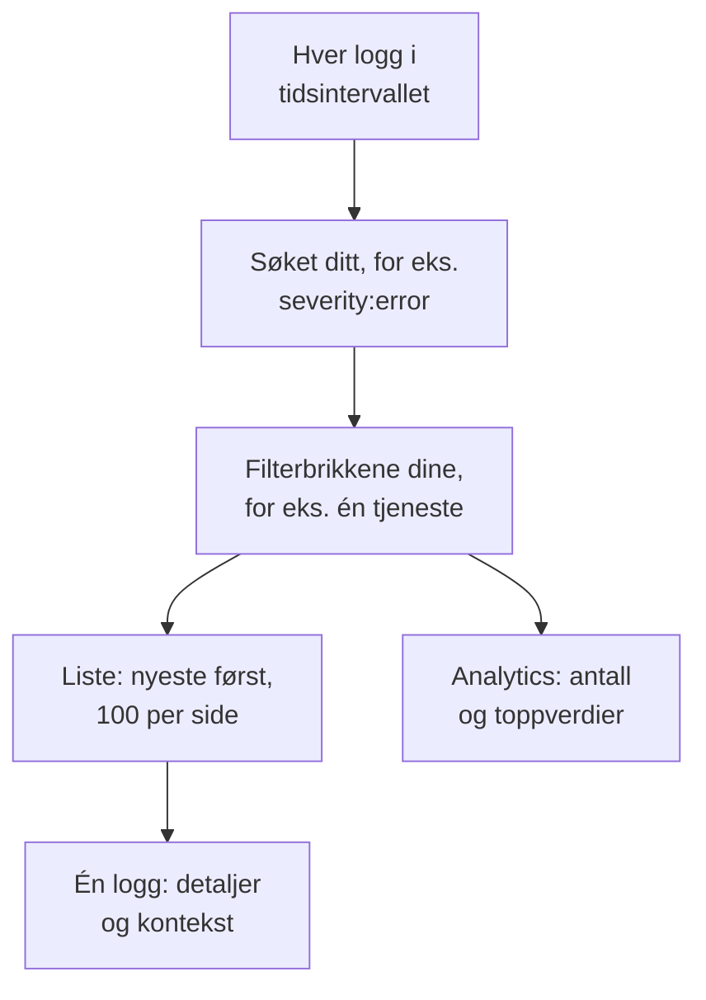

# Loggutforsker

Loggutforskeren er der du søker i og leser loggene som tjenestene, vertene og agentene dine sender til OneUptime. Snevre millioner av linjer ned til de få som betyr noe, følg nye etter hvert som de kommer, vis dem i diagrammer, og lagre visningene teamet ditt stadig vender tilbake til.

:::cards
- [Finn en logglinje](#finn-en-logglinje): Et tidsintervall, et søk og noen filtre.
- [Les en logg](#les-en-logg): Attributtene, sporet og linjene rundt den.
- [Følg logger direkte](#følg-logger-direkte): Nye linjer hvert 10. sekund.
- [Lagre en visning](#lagre-en-visning): Behold et søk, filtrene og kolonnene for alle.
- [Innsikt i logger](#innsikt-i-logger): De største feilene, alvorlighetsgrader og hvem som logger hva.
:::

## Slik snevrer utforskeren inn loggene dine

Alt på fanen **Viser** jobber med ett sett med logger: de i tidsintervallet som passer til søket ditt og til hver filterbrikke. Endrer du én av dem, endres listen, volumdiagrammet og tallene i sidepanelet sammen.

Utforskeren har fire faner:

| Fane | Hva den er til |
| --- | --- |
| **Viser** | Søk i, filtrer og les logger. Den åpner på siste time, nyeste først, 100 logger per side. |
| **Innsikt** | Hva tjenestene dine logget i et tidsintervall, og hva som gikk galt. |
| **Oppsettveiledning** | Hvordan du sender logger med OpenTelemetry, Fluent Bit eller Fluentd med en av [inntaksnøklene](/docs/telemetry/ingestion-keys) dine. |
| **Innstillinger** | Hva som skjer med logger når de kommer inn: **Pipelines**, **Drop-filtre**, **Scrub-regler** og **Opptaksregler**. |

## Før du begynner

- **Logger som kommer inn.** Send dem med [OpenTelemetry](/docs/telemetry/open-telemetry), [Fluent Bit](/docs/telemetry/fluentbit), [Fluentd](/docs/telemetry/fluentd) eller [Syslog](/docs/telemetry/syslog). Fanen **Oppsettveiledning** viser konfigurasjonen for språket eller collectoren din.
- **En rolle som kan lese telemetri.** Project Owner, Project Admin, Project Member, Viewer, Telemetry Admin, Telemetry Member eller Telemetry Viewer, eller en egendefinert rolle med tillatelsen Read Telemetry Service Log. Omfanget avgjør hvem sine logger du ser: se [Telemetri](/docs/permissions/index#telemetri).

## Finn en logglinje

:::steps
### Åpne Viser

Gå til **Produkter → Observerbarhet → Logger**. **Viser** viser loggene fra siste time, nyeste først, med **Tid**, **Tjeneste**, **Alvorlighetsgrad** og **Melding**.

### Velg tidsintervallet

Velg et intervall i tidsvelgeren, eller dra over volumdiagrammet over listen for å zoome inn på en topp. Dobbeltklikk på diagrammet for å zoome ut igjen. Se [Zoome inn på et tidsintervall](/docs/telemetry/charts-and-time-ranges).

### Søk

Skriv et søk i søkefeltet og trykk Enter, for eksempel `severity:error service:checkout timeout`. Løse ord søker i meldingen, og `@key:value` søker i et attributt. Se [Søkesyntaks](/docs/telemetry/search-syntax#logger).

### Snevre inn med filtre

Klikk på en verdi i sidepanelet **Filtre** for å legge den til som en brikke: en alvorlighetsgrad, en tjeneste, eller en vert, en klynge eller en annen ressurs som har sendt logger. Hver verdi viser hvor mange logger som har den. På en telefon trykker du på **Filtre** for å åpne sidepanelet.

### Åpne en logg

Klikk på en rad. Detaljene åpnes ved siden av listen.
:::

Søket ditt, brikkene dine og tidsintervallet lagres i sidens adresse, så en ny innlasting, et bokmerke eller en delt lenke åpner de samme loggene.

## Les en logg

Detaljpanelet har to faner:

| Fane | Hva den viser |
| --- | --- |
| **Detaljer** | **Loggtekst**, **Spor-ID**, **Span-ID** og **Session** når loggen har dem, og **Attributter**, som liste eller som JSON. |
| **Context** | Loggen blant naboene sine. **Nearby (service + time)** viser de fem linjene før og etter fra samme tjeneste, og **This trace** viser opptil 100 logger fra sporet. |

- Klikk på spor-ID-en for å åpne hele forespørselen i [Sporutforsker](/docs/telemetry/traces-explorer).
- Pek på et attributt og klikk på filterikonet for å søke etter den verdien, eller kopier den. Du kan kopiere alle attributtene samtidig som JSON.
- **This trace** vises bare for en logg som er skrevet inne i et spor.

## Følg logger direkte

Klikk på **Live** over listen. Utforskeren hopper til første side, sortert med de nyeste først, og ser etter nye logger hvert 10. sekund, slik at linjene dukker opp mens tjenestene dine skriver dem.

Direktemodus slår seg av selv når du endrer søket, et filter eller tidsintervallet, eller går til en annen side med resultater: den viser bare de nyeste loggene. Klikk på **Live** igjen for å fortsette.

## Velg kolonner og eksporter

- **Kolonner** velger hva listen viser. **Tid**, **Tjeneste**, **Alvorlighetsgrad** og **Melding** kommer først; legg til **Spor-ID**, **Span-ID** eller et hvilket som helst attributt, flytt kolonner opp og ned, eller gå tilbake til standarden med **Tilbakestill**.
- **Eksport** laster ned loggene på siden du ser på. **Export as CSV** skriver kolonnene du viser; **Export as JSON** skriver hvert felt i hver logg med alle attributtene.

## Lagre en visning

En lagret visning tar vare på et søk, filterbrikkene, tidsintervallet, kolonnene, sorteringen og sidestørrelsen under et navn.

:::steps
### Sett opp visningen

Søk, filtrer og velg kolonnene du vil beholde.

### Lagre den

Åpne **Saved Views** og klikk på **+ Save Current View**. Skriv inn et **Navn**, kryss av for **Angi som standard** hvis visningen skal åpnes hver gang noen åpner loggene, og klikk på **Lagre visning**.

### Bruk den

Velg visningen i **Saved Views** for å bruke den, og **Clear view** for å gå tilbake til siste time uten filtre. Pek på en visning i listen for å **Rediger** eller **Slett** den, eller, mens den er i bruk, for å **Oppdater** den med endringene dine.
:::

Lagrede visninger hører til prosjektet, så alle i det ser den samme listen. Et rullerende intervall som siste time fortsetter å rullere: visningen viser timen før du åpner den, ikke timen da du lagret den. Så lenge prosjektet ikke har en standardvisning, blir den neste lagrede visningen standard, og et prosjekt har én standard om gangen.

## Vis loggene dine i diagrammer

Bytt listen til **Analytics** for å telle logger i stedet for å lese dem. Velg en tidsserie, en toppliste eller en tabell; tell hver logg, eller de unike verdiene i ett felt; og grupper etter alvorlighetsgrad, tjeneste, spor, span eller et hvilket som helst attributt, deretter etter et felt til. En toppliste eller en tabell viser de øverste 5, 10, 25 eller 50 gruppene.

Klikk på **Liste** for å gå tilbake til selve linjene.

## Åpne tilhørende spor og målinger

Knappene **Spor** og **Målinger** ved siden av **Saved Views** åpner [Sporutforsker](/docs/telemetry/traces-explorer) eller [Metrikkutforsker](/docs/telemetry/metrics-explorer) for det samme tidsvinduet, med så mye av filtreringen din som den utforskeren kan bruke. Pek på en knapp for å se hva den ikke kan ta med.

## Innsikt i logger

Fanen **Innsikt** viser hva tjenestene dine logget i et tidsintervall, og hva som gikk galt. Begrens den til bestemte tjenester, verter eller klynger med nedtrekkslisten ved siden av tidsvelgeren.

| Panel | Hva det viser |
| --- | --- |
| Oversiktskort | **Totalt antall logger**, **Feil**, **Distinct errors** og **Reporting sources**. |
| **Severity distribution** | Hvordan loggene fordeler seg på alvorlighetsgrad. |
| **Top errors** | De ulike meldingene som er logget med alvorlighetsgraden Error eller Fatal, de vanligste først. |
| **Sources reporting logs** | Volumet og feilsignalet for hver tjeneste, vert eller annen kilde. |

Velg en av de største feilene for å se hva som skjedde rundt den: når den oppstod, hva forekomstene har felles, hvor den oppstår, sporene som bærer den og de nyeste linjene. **Open matching logs** åpner dem i **Viser**, og **Explain with AI** åpner [Spør AI](/docs/ai/ask-ai) med feilen og bevisene som en ledetekst du kan redigere.

## Hva som skjer med logger når de kommer inn

Fanen **Innstillinger** inneholder reglene OneUptime bruker på hver logg før den lagres. De virker på loggene som kommer inn etterpå, ikke på lagrede. Hvor lenge hver logg beholdes, avgjøres også når den kommer inn: se [Dataoppbevaring](/docs/telemetry/data-retention).

| Regel | Hva den gjør |
| --- | --- |
| **Drop-filtre** | Forkast logger du ikke vil beholde, eller behold bare et utvalg av dem. Se [Forkast poster eller ta utvalg](/docs/telemetry/drop-filters-and-scrub-rules#forkast-poster-eller-ta-utvalg). |
| **Scrub-regler** | Masker sensitive data, som e-postadresser og kortnumre. Se [Rens sensitive data](/docs/telemetry/drop-filters-and-scrub-rules#rens-sensitive-data). |
| **Pipelines** | Trekk felt ut av meldingen, rett alvorlighetsgraden, gi attributter nye navn. Se [Loggpipelines](/docs/telemetry/log-pipelines). |
| **Opptaksregler** | Gjør samsvarende logger om til målinger. Se [Opptaksregler for logger](/docs/telemetry/log-recording-rules). |

## Hurtigtaster

Trykk på `?` i Viser for å se dem.

| Tast | Hva den gjør |
| --- | --- |
| `j` / `k` | Gå til neste eller forrige logg. |
| Enter | Åpne eller lukk den valgte loggen. |
| Esc | Lukk detaljpanelet. |
| `/` | Hopp til søkefeltet. |
| ⌘ + Enter eller Ctrl + Enter | Bruk søket. |
| `?` | Vis eller skjul hurtigtastene. |

## Feilsøking

:::details Ingen logger vises
Utvid tidsintervallet først: Viser åpner på siste time. Er listen fortsatt tom, sammenligner du oppsettet ditt med **Oppsettveiledning** og kontrollerer at rollens omfang dekker tjenesten som sender loggene.
:::

:::details Søket sier at det gikk tom for tid
Et søk som varer lenger enn 45 sekunder, stoppes. Velg et kortere tidsintervall, eller legg til en eksakt verdi som en tjeneste, slik at OneUptime kan bruke indeksen sin. Se [Søkesyntaks](/docs/telemetry/search-syntax#greit-å-vite).
:::

:::details Live slår seg av hele tiden
Direktemodus følger bare de nyeste loggene, så en endring av søket, et filter, tidsintervallet eller siden slår den av. Klikk på **Live** igjen når filtrene dine er på plass.
:::

## Neste steg

:::cards
- [Søkesyntaks](/docs/telemetry/search-syntax): Hvert filter søkefeltet forstår.
- [Logg-overvåking](/docs/monitor/logs-monitor): Få varsel når loggene du søker etter, dukker opp.
- [Loggpipelines](/docs/telemetry/log-pipelines): Gjør deler av en logglinje om til attributter du kan filtrere på.
- [Sporutforsker](/docs/telemetry/traces-explorer): Følg forespørselen til en logg gjennom tjenestene dine.
:::
