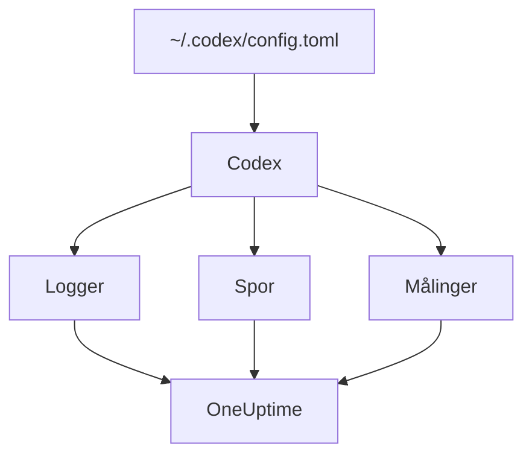

# OpenAI Codex

Codex CLI har tre innebygde OpenTelemetry-eksportører, én for logger, én for traces og én for målinger. Pek dem mot OneUptime i `~/.codex/config.toml`, så kommer hver Codex-tur inn med tokens og kostnad, uten wrapper eller proxy imellom.

:::cards
- [Konfigurer Codex](#konfigurer-codex): Én `[otel]`-blokk, med en fullstendig URL per signal.
- [Tilordne forbruk til en person](#tilordne-codex-forbruk-til-en-person): Codex nevner ingen på spans eller målinger, så det gjør du.
- [Tokens og kostnad](#tokens-og-kostnad): Hvilket signal OneUptime leser, og hva det viser.
- [Feilsøking](#feilsøking): Hva du sjekker når ingenting kommer inn.
:::

## Slik fungerer det

Hver eksportør sender ett signal til sin egen URL. Traces og logger er av til du konfigurerer dem; målinger er ikke det.



> [!WARNING]
> Codex sender målingene sine til OpenAI med mindre du endrer dette. I et release-bygg er `metrics_exporter` som standard `statsig`, som sender dem til `https://ab.chatgpt.com/otlp/v1/metrics`. Å sette `metrics_exporter` til en OTLP-eksportør, som nedenfor, eller til `none` stopper det. `[analytics]` med `enabled = false` stopper også Statsig-standarden, men lar en OTLP-eksportør for målinger som du har satt opp, fortsette å virke.

## Før du begynner

1. Opprett en inntaksnøkkel for telemetri under **Prosjektinnstillinger → Telemetri og APM → Inntaksnøkler**.
2. OTLP-endpointet ditt er `https://oneuptime.com/otlp`, eller `https://YOUR-ONEUPTIME-HOST/otlp` hvis du drifter OneUptime selv.
3. Hver eksport sender nøkkelen i headeren `x-oneuptime-token`.

## Konfigurer Codex

:::steps
### Legg til otel-blokken

Legg dette i `~/.codex/config.toml`. Det slår på alle tre signalene og erstatter samtidig Statsig-standarden:

```toml title="~/.codex/config.toml"
[otel]
environment = "prod"
log_user_prompt = false

[otel.exporter.otlp-http]
endpoint = "https://oneuptime.com/otlp/v1/logs"
protocol = "binary"
headers = { "x-oneuptime-token" = "YOUR_INGESTION_TOKEN" }

[otel.trace_exporter.otlp-http]
endpoint = "https://oneuptime.com/otlp/v1/traces"
protocol = "binary"
headers = { "x-oneuptime-token" = "YOUR_INGESTION_TOKEN" }

[otel.metrics_exporter.otlp-http]
endpoint = "https://oneuptime.com/otlp/v1/metrics"
protocol = "binary"
headers = { "x-oneuptime-token" = "YOUR_INGESTION_TOKEN" }

[otel.span_attributes]
"user.id" = "dev@example.com"
"user.email" = "dev@example.com"
"team" = "platform"
```

### Gi hver eksportør den fullstendige URL-en

Codex bruker hvert `endpoint` nøyaktig slik det står: det legger ikke til `/v1/logs`, `/v1/traces` eller `/v1/metrics` slik de fleste SDK-er gjør. Tre eksportører satt til bare `https://oneuptime.com/otlp` sender ingenting noe sted, uten feil.

### Kjør en tur

Start en interaktiv `codex`-økt, spør om noe lite, og la turen bli ferdig. Åpne deretter **Logger** i OneUptime: hendelsene fra Codex, som `codex.conversation_starts`, `codex.api_request` og `codex.turn_cost`, dukker opp der.
:::

> [!IMPORTANT]
> Codex ignorerer nøkler det ikke kjenner under `[otel]`, uten advarsel. Nøklene er i snake_case (`trace_exporter`, `metrics_exporter`, `span_attributes`), men eksportørnavnene og TLS-feltene er i kebab-case (`otlp-http`, `ca-certificate`). En `trace-exporter` slår av traces uten noen feil i det hele tatt.

## Konfigurasjonsnøkler

| Nøkkel | Standard | Hva den gjør |
| --- | --- | --- |
| `environment` | `"dev"` | Setter ressursattributtet `env` |
| `log_user_prompt` | `false` | Sender promptteksten på `codex.user_prompt`; ellers står det `[REDACTED]` |
| `log_agent_responses` | `false` | Sender agentens endelige svar til loggeksportøren |
| `exporter` | `none` | Loggeksportøren |
| `trace_exporter` | `none` | Trace-eksportøren |
| `metrics_exporter` | `statsig` | Eksportøren for målinger: sett den |
| `span_attributes` | — | Attributter som legges til på hvert eksportert span |
| `tracestate` | — | W3C-`tracestate`-medlemmer |
| `tool_result` | `{ max_bytes = 2048 }` | Hvor mye av et verktøys resultat en loggpost beholder, i UTF-8-byte |

En eksportør er `none`, `statsig`, `otlp-http` eller `otlp-grpc`. `otlp-http` tar `endpoint`, `headers`, `protocol` (`"binary"` eller `"json"`, som OneUptime godtar begge) og `tls` (`ca-certificate`, `client-certificate`, `client-private-key`); `otlp-grpc` tar det samme uten `protocol`.

## Tilordne Codex-forbruk til en person

Codex nevner utvikleren på bare ett sted:

- **Loggposter** bærer `user.account_id` og `user.email`.
- **Spans** gjør det ikke: Codex holder begge utenfor tracesene sine med vilje.
- **Målinger** gjør det heller ikke: de bærer `auth_mode`, `session_source`, `originator`, `service_name`, `model` og `app.version`, og ingen person.

OneUptime leser personer fra spans og fra datapunkter for målinger, aldri fra loggposter. Så sett identiteten selv på hvert span, i `[otel.span_attributes]`:

```toml title="~/.codex/config.toml"
[otel.span_attributes]
"user.id" = "dev@example.com"
"user.email" = "dev@example.com"
"team" = "platform"
"cost_center" = "eng-123"
```

`user.id` er nøkkelen OneUptime foretrekker, og `user.email` fyller e-postkolonnen. Codex har ingen ressursattributter, så sett teamnøklene (`team.id`, `team`, `cost_center`, `department`) her også. Denne blokken ligger i hver utviklers egen konfigurasjonsfil: lever den per utvikler, gjennom dotfilene dine eller en MDM-profil. Én delt fil med én identitet ville føre alles forbruk på én person.

## Tokens og kostnad

| Signal | Hva Codex sender | Hva OneUptime gjør med det |
| --- | --- | --- |
| Traces | `gen_ai.usage.input_tokens`, `gen_ai.usage.output_tokens` og cachetokens, men ingen modell | Teller tokens per person; kan ikke prise dem |
| Målinger | `codex.turn.token_usage` etter `token_type`, og `codex.turn.cost_microusd`, i milliondeler av en USD | Regner om kostnaden til USD; leser målingene bare der spans ikke rapporterer noe |
| Logger | `codex.turn_cost`, med `usage.estimated_usd` og personen | Lagrer den i utforskeren for **Logger**; knyttes ikke til forbruket |

Med konfigurasjonen ovenfor gir det dette på fanen **Forbruk**:

- Tokens kommer fra spans, per person, og `codex.turn.token_usage` legges ikke på toppen: de to legges aldri sammen ([hvorfor](/docs/telemetry/ai-llm-observability#spans-kommer-først-målinger-fyller-hullene)).
- Codex' spans nevner ingen modell, så OneUptime kan ikke prise dem, og kostnaden deres er 0. Kostnadstotalene tar da Codex' kostnad fra `codex.turn.cost_microusd`, regnet om til USD for deg.
- Tabellene **Ansatt**, **Team** og **Modell** viser radene fra spans: tokens per person, men ingen kostnad per person.
- Uten traces fyller målingene disse tabellene i stedet, bare med kostnad, alt under **Ikke tilordnet**, siden Codex' målinger ikke nevner noen.

Den mest presise kostnaden per tur, med personen på, er loggposten `codex.turn_cost`. OneUptime knytter ennå ikke loggposter til forbruket, men la loggeksportøren være på: historikken ligger der når det skjer.

## Codex i CI og som MCP-server

`codex`, `codex exec` og `codex mcp-server` bygger alle telemetrien sin fra den samme `[otel]`-blokken, med alle tre eksportørene. Kjøringer av `codex exec` bærer `originator` `codex_exec`, og `codex mcp-server` eksporterer som `codex_mcp_server`, så du kan skille kjøringer i CI og via MCP fra interaktive økter på de verdiene.

## Personvern

`log_user_prompt` og `log_agent_responses` er `false` som standard: la dem være av. Hendelsen `codex.user_prompt` kommer fortsatt inn, med prompten erstattet av `[REDACTED]`, så du beholder turen, tokens og kostnaden uten promptteksten. Personen (`user.email`, `user.account_id`) står på loggpostene uansett hva disse bryterne sier.

Hvis du slår på innhold for en undersøkelse, maskerer eller dropper traces' **Scrub-regler** og **Drop-filtre** under **Spor → Innstillinger** det før det lagres.

## Bruke OpenAI-API-et i stedet for Codex

OpenAIs plattform-API sender ingen OpenTelemetry av seg selv: hvert span kommer fra instrumentering av din egen klient. Tre instrumenteringer fungerer med OneUptime:

- **OpenTelemetry**: `opentelemetry-instrumentation-genai-openai` for Python, som erstatter `opentelemetry-instrumentation-openai-v2`. `OTEL_INSTRUMENTATION_GENAI_CAPTURE_MESSAGE_CONTENT` avgjør om meldinger registreres.
- **OpenLLMetry** (Traceloop): `opentelemetry-instrumentation-openai`.
- **OpenInference** (Arize): `openinference-instrumentation-openai`.

Pek hvilken som helst av dem mot OneUptime slik [AI- / LLM-observerbarhet](/docs/telemetry/ai-llm-observability) viser. Ingen av dem vet hvem den ansatte er: sett `user.id` selv.

**OpenAI Agents SDK** sender traces til OpenAIs eget endpoint, ikke via OTLP. Bygg bro med `opentelemetry-instrumentation-openai-agents-v2` eller `openinference-instrumentation-openai-agents`, som gir SDK-ets spans videre til en OTLP-eksportør.

## Feilsøking

:::details Ingenting kommer inn
Sjekk først de tre `endpoint`-verdiene: hver må slutte på `/v1/logs`, `/v1/traces` eller `/v1/metrics`. Sjekk deretter headeren `x-oneuptime-token`: OneUptime avviser en feil nøkkel.
:::

:::details Traces kommer aldri inn, men logger gjør det
Se etter en feilstavet nøkkel under `[otel]`: Codex ignorerer den i stillhet. `trace-exporter` i stedet for `trace_exporter` er den vanligste.
:::

:::details Codex' kostnad vises i totalene, men hver person viser $0
Det er forventet: Codex' spans bærer tokens, men ingen modell, så de kan ikke prises, og kostnadsmålingen nevner ingen. Se [Tokens og kostnad](#tokens-og-kostnad).
:::

:::details Alles forbruk vises under én person
Den samme identiteten i `[otel.span_attributes]` står på hver maskin. Gi hver utvikler sin egen.
:::

## Neste steg

:::cards
- [AI-kodeassistenter](/docs/telemetry/ai-coding-assistants): Slik tilordnes forbruk på tvers av alle kodeassistenter.
- [AI- / LLM-observerbarhet](/docs/telemetry/ai-llm-observability): Samtaler, varsler, kostnad og budsjetter for dine egne AI-kall.
- [AI-gatewayer](/docs/telemetry/ai-gateways): Én gateway som tracer og priser hvert modellkall.
:::
