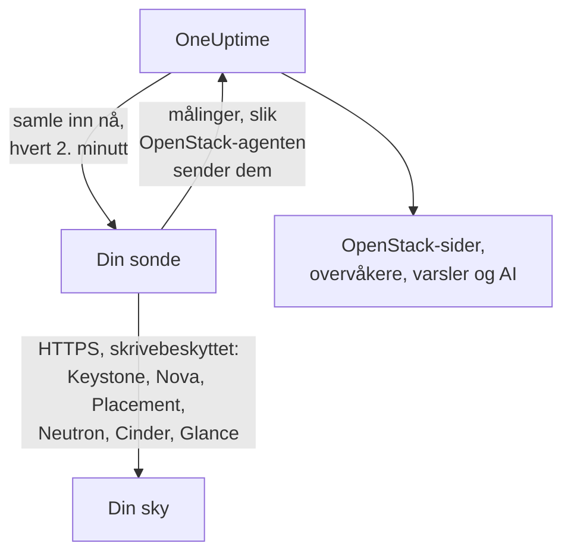

# OpenStack uten agent

Overvåk en OpenStack-sky uten å installere noe: skriv inn Keystones adresse og en applikasjonslegitimasjon i OneUptime, velg sonden som kan nå skyen, så samler sonden inn de samme dataene som [OpenStack-agenten](/docs/telemetry/openstack) ville gjort. Det er ingen agent å installere, oppgradere eller holde i gang, og ingen egen maskin å sette opp.

> [!IMPORTANT]
> En sonde snakker bare HTTPS med en sky. Legitimasjon eller token sendes aldri over vanlig HTTP, og DevStack og Kolla-Ansible tilbyr API-ene sine over vanlig HTTP som standard. For en slik sky må du slå på TLS for API-ene, eller bruke [OpenStack-agenten](/docs/telemetry/openstack), som kjører ved siden av den. Tilkoblingstesten sier fra når den finner en adresse med vanlig HTTP.

:::cards
- [Før du begynner](#før-du-begynner): En sonde som når API-ene, og en legitimasjon.
- [Koble til en sky](#koble-til-en-sky): Adressen, en legitimasjon, en test og et navn.
- [Feilsøking](#feilsøking): Hva hver melding betyr og hva som løser den.
:::

## Slik fungerer det



Hvert andre minutt leser sonden hver tjeneste i hver region du har valgt, og sender det den fant til OneUptime. Det kommer fram nøyaktig som fra OpenStack-agenten, så hver OpenStack-side, hver [OpenStack-overvåker](/docs/monitor/openstack-monitor) og hver varselmal leser det på samme måte.

Hver tjeneste leses for seg og samtidig med de andre. En Neutron som feiler eller henger, koster Neutrons serier, og Novas data kommer som vanlig, med ett forbehold Nova selv lager: den spør Neutron om hver instans den lister. Mens Neutron er nede, beholder derfor en sonde instansene den leste sist og spør bare om det som er endret. Hvis en instans er endret, eller sonden nettopp har startet, kan Nova heller ikke svare på den listen: Nova vises som feilende, de andre seriene kommer fortsatt, og hver instans blir stående på siden slik den sist var til Neutron er tilbake.

Heat, Magnum, Manila, Trove, Gnocchi, Designate, Swift og Barbican leses der Keystones katalog nevner dem. En sky som ikke kjører noen av dem, koster ingenting for dem, hører ikke noe om dem fra tilkoblingstesten og [viser ingen spor av dem](/docs/telemetry/openstack#heat-og-magnum).

På en sky der katalogen har Octavia, leser en sonde lastbalanserere, pooler, lyttere og amfora med ett listekall hver, deretter medlemmene i hver pool og trafikktellerne til hver lastbalanserer og lytter som er `ACTIVE`, ett kall hver. En sky med 3 lastbalanserere, 1 pool og 1 lytter koster 9 kall per innsamling; den virkelige DevStack-en testriggen tok opp, kostet nøyaktig det. Medlemmene til høyst 25 pooler og høyst 50 tellere leses i én innsamling, de lengst uleste først, og de andre viser det de sa sist de ble lest. Octavias tellere er kumulative, så en sonde beholder siste avlesning av hver og tegner differansen per sekund mellom to av dem: et diagram starter ved den andre innsamlingen, og en teller som går ned (en gjenoppbygd lytter) tegner ingenting for det intervallet. OVN-leverandøren rapporterer 0 for hver teller, som er en flat linje og ingen feil.

Amfora krever Octavias admin-regel for hver avlesning. En legitimasjon under admin ser sitt eget prosjekts lastbalanserere, pooler, lyttere og medlemmer, og sine egne tellere, men ingen amfora: siden Lastbalanserere sier fra om det, og ingenting advarer. Overvåkingsrollen på et prosjekt uten lastbalanserere ser ingen. `load-balancer_global_observer` nektes alt i denne utgaven.

Et stoppet Octavia-API er `up 0` for en sonde, noe agentens eksportør ikke kan si.

## Sonde eller agent?

| | En sonde (denne siden) | OpenStack-agenten |
|---|---|---|
| Hva du kjører | En sonde du allerede kjører, eller en ny | Agenten, på en egen maskin |
| Hvor legitimasjonen lagres | Kryptert i OneUptime, sendt bare til sonden | I agentens `clouds.yaml`-fil |
| Hva den må nå | Keystone og hver tjenestes API, over HTTPS | Keystone og hver tjenestes API |
| API-er på vanlig HTTP | Samles ikke inn: et token sendes aldri ukryptert | Samles inn |
| Største sky | Testet med [200 000 instanser](/docs/telemetry/openstack-very-large-clouds) mot en simulert sky, ikke en ekte, i opptil ti opplastinger på 48 MiB | Ennå ikke testet med noe: [skrapingen går tom for tid](/docs/telemetry/openstack-very-large-clouds#gjennom-agenten) lenge før det |
| Tjenestelogger og AI-agenten | Ikke inkludert | Inkludert |
| Det skyen hviler på: RabbitMQ, MariaDB, Memcached, HAProxy, OVN, libvirt | Ikke inkludert: en sonde leser skyens API-er | Inkludert, med målene navngitt |
| Hver instans' faktiske CPU, minne og disk, fra libvirt eller Ceilometer | Ikke inkludert | Inkludert, med eksportørene navngitt |
| Innlogginger til Keystone | Én i et tokens levetid, vanligvis en time | Én per skraping |
| En vanlig `reader` på ett prosjekt | Det prosjektets instanser, volumer og nettverk | Det prosjektets volumer og nettverk, og ingen instanser |

Begge sender de samme seriene, så sidene og overvåkerne fungerer med begge. En sonde sender også det bare en innebygd klient kan lese: en instans' adresser, oppgavetilstand og feilmelding, avbildet den startet fra, om en operatør tvang en Nova-tjeneste ned, hvilke nettverk en DHCP-agent betjener, hvilken pool som holder et volum, når en instans, et volum eller et bilde sist ble endret, og statusen til hver volum-snapshot og sikkerhetskopi. Cinder sier bare hvilken pool som holder et volum til en legitimasjon den behandler som admin. På en sky som kjører [Heat eller Magnum](/docs/telemetry/openstack#heat-og-magnum) sender den også hvorfor en stack eller en klynge feilet, hvilke instanser og volumer en stack eier, hver klynges prosjekt, mal og Kubernetes-versjon, og om hver av Heats motorer og Magnums conductorer er oppe.

Velg agenten for tjenestelogger, for AI-agenten, for det skyen hviler på og hver instans' faktiske bruk, for en sky der API-ene bare snakker vanlig HTTP, slik DevStack og Kolla-Ansible gjør som standard, eller for en sky så stor at den må [leses fra databasene sine](/docs/telemetry/openstack-very-large-clouds#databaseveien). Velg en sonde for alt annet: det er ingenting å installere, og den leser mer av det Nova og Cinder sier. [Svært store OpenStack-skyer](/docs/telemetry/openstack-very-large-clouds) sier hva hver av dem koster ved enhver størrelse.

Du kan bytte en sky fra den ene til den andre når som helst på siden **Innstillinger**.

## Før du begynner

- **En sonde som kan nå Keystone og hver tjenestes API over HTTPS.** Dette er vanligvis en [egendefinert sonde](/docs/probe/custom-probe) i skyens nettverk. Keystones katalog oppgir hvor hver tjeneste svarer, og sonden kobler til disse adressene, så hver må være tilgjengelig fra sonden, og hver må være HTTPS. På OneUptime Cloud får de delte sondene aldri en OpenStack-legitimasjon, så legg til en sonde av din egen. På en selvdrevet instans kan instansens egne sonder også samle inn.
- **En legitimasjon.** En applikasjonslegitimasjon er best, fordi den kan begrenses til lesing og kan utløpe. Et brukernavn og passord fungerer også, og kan gjøre alt kontoen kan.

OpenStack har ingen global skrivebeskyttet rolle, så hvor mye sonden ser, avhenger av legitimasjonen:

| Nivå | Hva det trenger | Hva sonden leser |
|---|---|---|
| Full visning | En applikasjonslegitimasjon på en konto med `admin` på et eget prosjekt, begrenset av tilgangsregler til lesing | Alt, unntatt Keystones brukere og grupper, som reglene bevisst utelater |
| Kun infrastruktur | Rollene `oneuptime_monitoring` og `reader` på et eget prosjekt som ikke inneholder noe og har null kvote, og policyfilene OpenStack-agenten leveres med | Hypervisorer, Novas tjenester, Neutrons agenter, adressepooler, Placement, prosjektlisten og hvert prosjekts instanser. Volumer, nettverk og rutere bare der rollen er tildelt. Ikke tilstanden til `cinder-volume` og `cinder-scheduler` eller lagringspooler: Cinders egen kode krever admin |
| Prosjektvisning | Vanlig `reader` på ett prosjekt | Det prosjektets instanser, volumer og nettverk, og ingen infrastruktur |

Tilkoblingstesten sier hvilket av disse en legitimasjon tilsvarer, og advarer når dens eget prosjekt inneholder ting: der Cinder har `enforce_new_defaults` av, som er standard, kan enhver rolle på et prosjekt opprette prosjektets volumer, `reader` inkludert.

> [!IMPORTANT]
> En applikasjonslegitimasjon begrenset av tilgangsregler nektes med en `401` av enhver tjeneste der `keystonemiddleware` ikke har `service_type` satt. Tilkoblingstesten sier fra om det for hver avlesning. Sett det i hver tjenestes konfigurasjon, og start den på nytt. [Opprett legitimasjonen](/docs/telemetry/openstack#opprett-legitimasjonen) har reglene, policyfilene og innstillingene for hver tjeneste, og [hva hvert nivå leser](/docs/telemetry/openstack#hva-hvert-nivå-leser) er det virkelige skyer svarte.

## Koble til en sky

:::steps
### Åpne skyene dine
Åpne **OpenStack → Alle skyer** i OneUptime og klikk **Koble til sky**.

### Skriv inn adressen og legitimasjonen
Skriv inn `auth_url` fra `clouds.yaml`- eller `openrc`-filen din, for eksempel `https://keystone.example.com:5000/v3`, og applikasjonslegitimasjonens ID og hemmelighet. Velg sonden som når skyen.

### Test tilkoblingen
Klikk **Test tilkoblingen**. Sonden logger inn, prøver hver avlesning en innsamling gjør i hver region, og logger ut. Den sier hvilke regioner katalogen oppgir, hva legitimasjonen kan lese, hva den nektes, hvilke sider som mangler data uten det, og linjen som åpner det. En mislykket avlesning stopper ikke testen.

### Stol på skyens sertifikat
En sky med sin egen sertifikatutsteder presenterer et sertifikat sonden ikke stoler på. Testen viser da sertifikatet og verten som presenterte det. Sjekk fingeravtrykket mot API-ets eget, og klikk deretter **Stol på dette sertifikatet**. En sky med en vert per tjeneste kan ha ett sertifikat per tjeneste, og du kan stole på opptil 32.

### Velg regioner og koble til
Velg regionene som skal leses, gi skyen et navn og klikk **Koble til sky**. Skyens side åpnes.
:::

Skyens **Oversikt** viser et **Datainnsamling**-kort. Det viser **Kontrollerer** til første innsamling, som starter innen et minutt, deretter **Samler inn**, og sidene fylles ut. Når noen tjenester ble lest og en annen ikke, sier det hvilken. Hvis ingen sonde kommer for skyen på 15 minutter, fordi den er frakoblet eller for gammel, vises **Samler ikke inn** og det sies fra om det, uansett hva siste innsamling fant.

**Datainnsamling**-kortet på skyens **Innstillinger**-side holder det du koblet den til med:


## Koble til en sky fra API-et eller Terraform

En skys tilkoblingsinnstillinger er vanlige felt i [OpenStack Cloud-ressursen](/reference/open-stack-cloud) i API-et, på `/api/openstack-cloud`, så en sky kan kobles til helt uten dashbord. Med Terraform er det `oneuptime_openstack_cloud`:

```hcl
resource "oneuptime_openstack_cloud" "prod_eu" {
  name                      = "prod-eu"
  collection_method         = "Probe"
  auth_url                  = "https://keystone.example.com:5000/v3"
  credential_kind           = "applicationCredential"
  application_credential_id = var.openstack_application_credential_id
  credential_secret         = var.openstack_application_credential_secret
  collection_probe_id       = oneuptime_probe.eu_west.id
  collection_regions        = jsonencode(["RegionOne"])

  # A cloud with its own certificate authority: the fingerprints it presents.
  trusted_certificate_fingerprints = jsonencode(["AB:CD:EF:..."])
}
```

For et brukernavn og passord setter du `credential_kind` til `password`, med `keystone_username`, `project_name` og, når de ikke er `Default`, `user_domain_name` og `project_domain_name`. `endpoint_interface`, `collection_interval_in_minutes` og `collection_options` er det skjemaet legger under **Flere felt**. Bare `name` er påkrevd, fordi en sky agenten sender ikke har noen av disse.

`credential_secret` er skrivebeskyttet i retning inn, så ingen lesing returnerer det, og Terraform holder det ute av planer og utdata. [Reglene for en lagret legitimasjon](#den-lagrede-legitimasjonen) gjelder også her: å endre adressen, sonden eller de betrodde sertifikatene krever hemmeligheten i samme forespørsel. Det sonden rapporterer, som `collection_status`, `collection_error` og `presented_certificate`, kan leses og ikke settes.

## Hva det koster skyen din

Overvåking må aldri være det som tar ned en sky, så en innsamling er skånsom av konstruksjon:

- **Én innlogging, beholdt.** Tokenet brukes til fem minutter før det utløper. En innlogging er det en Keystone i vanskeligheter minst har råd til.
- **Lister i sider.** Hver liste leses tusen rader om gangen, med `limit` og `marker`.
- **Instanser etter hva som er endret.** Mellom fulle avlesninger, hver halvtime, spør sonden Nova bare om det som er endret siden forrige avlesning, med `changes-since`.
- **En hypervisors inventar én gang.** Placement flytter en leverandørs generasjon hver gang de endres, noe ett listekall sier om dem alle, så de leses på nytt bare da.
- **En oppgitt last.** Det som er ett kall per ting, går i omganger over 2 000 per innsamling, og over 250 prosjekter for grenser. Det som ikke ble lest denne gangen, sendes som sist lest, så ingen serie får hull, og lasten slutter å vokse med skyen.
- **Bare feltene den leser.** Neutrons lister oppgir feltene sine, og sikkerhetsgrupper hentes med bare ID-ene.
- **Aldri stablet.** En innsamling som tar lengre tid enn intervallet, hoppes over og kjøres ikke ved siden av den neste.
- **Et tidsbudsjett.** En innsamling har ni tideler av intervallet sitt, og høyst ti minutter. Det som er lest innen da, sendes, og tjenesten som gikk tom for tid, sier fra om det.
- **Trekker seg tilbake.** Når sonden blir bedt om å vente med en `429` eller `Retry-After`, venter den. En tjeneste som svarer `429`, `503` eller ingenting i det hele tatt, får være i fred i ett minutt, så to, så fire, opptil en halv time, og seriene dens fortsetter å si at den er nede mens den venter.
- **Bremser ned.** Et svar som er tre ganger tregere enn tjenesten vanligvis svarer, og minst ett sekund, eller fem sekunder uansett hva som er vanlig, holder tilbake tjenestens neste forespørsel like lenge. **Datainnsamling**-kortet sier når det skjedde.
- **En nektet legitimasjon venter lengst.** Å gjenta en slik er det som låser en konto, så den venter fem minutter, så ti, opptil en time. En legitimasjon du rettet, prøves med en gang.

- **Mindre av en stor sky.** Over 5 000 instanser beholder en sky tall og delene sine, og ingen serie per instans eller per volum, med mindre du velger noe annet under **Faktisk bruk per instans** på **Innstillinger**-siden. Det som er endret, det du valgte å beholde og det et varsel overvåker, går fortsatt med hver innsamling. Resten går i omganger, og **Datainnsamling**-kortet sier hvor lang tid en omgang tar.

Ved hver innsamling, med standardinnstillingene, koster en region 7 kall til Nova, 7 til Neutron og 5 til Cinder, ett kall til Placement og to til per hypervisor, opptil 4 til for å spørre Placement [hvor mange av hver flavor som får plass](/docs/telemetry/openstack#kapasitet), og omtrent hvert femte minutt 5 til Keystone og 1 til Glance. En hypervisors inventar leses én gang, og på nytt bare når Placement sier at det er endret. En liste på mer enn tusen rader tar ett kall per tusen. Hver instans som er endret, tar ett kall til til Nova, for å lese hva den har vært gjennom, og høyst 25 leses i en innsamling: en rolig sky gjør ingen. På ML2/OVS tar Neutron ett kall til per ruter, for å spørre hvilke L3-agenter som har den, og hvert tiende minutt ett kall per DHCP-agent, høyst 20, for å spørre hvilke nettverk den betjener. En sky med flere DHCP-agenter går rundt dem i omganger, en sky over sammendragsstørrelsen utelater dette, og en treg Neutron blir ikke spurt i det hele tatt. En sky på OVN har ingen å spørre om. [Svært store OpenStack-skyer](/docs/telemetry/openstack-very-large-clouds#lasten-på-kontrollplanet-ditt) har hva det blir til i forespørsler per minutt, ved hver størrelse.

En sky som kjører Manila betaler, omtrent hvert femte minutt, 2 kall til den, en som kjører Trove betaler 1, Gnocchi 1 og Barbican 3. Designate tar 2, og ett til for hver sone som ikke er `ACTIVE`, høyst 50 per innsamling. Swift tar 1 for legitimasjonens eget prosjekt, og med `ResellerAdmin` ett til for hvert andre prosjekt, høyst 200 per innsamling. En sky som kjører Heat eller Magnum betaler, omtrent hvert femte minutt, 2 kall til Heat og 3 til Magnum. Ingen av listene sier alt: Magnums sier ikke hvem en klynge tilhører eller hvorfor den feilet, og Heats sier ikke hva en stack eier. Så sonden leser også en klynge eller en stack for seg når statusen har flyttet seg, høyst 25 av hver per innsamling. En sky med flere fortsetter å fylle ut over de neste innsamlingene, og en som står i ro, leses aldri to ganger.

Tre ting er av med mindre du slår dem på, under **Hva den leser utover standardene** i **Datainnsamling**-kortet på skyens **Innstillinger**-side, eller under **Flere felt** når du kobler den til, fordi hver koster skyen din mer:

| Alternativ | Hva du får | Hva det koster |
|---|---|---|
| Porter | Én serie per port, og hvor mange som ikke har noen adresse eller en lastbalanserer som er nede | Én sideinndelt liste per nettverk eller prosjekt du oppgir, eller av alle porter hvis du ikke oppgir noen. En uavgrenset liste over porter kan overbelaste Neutron på en stor sky |
| Prosjektgrenser | Kvoter og grenser per prosjekt | Fire kall per prosjekt, høyst 250 prosjekter per innsamling |
| Swifts lagringsservere | Om hver svarer, replikeringen og om alle har de samme ringene, der du oppgir hver servers `/recon`-port som `host:port`. Bare en sky som kjører Swift tilbyr dette, på **Innstillinger**-siden når første innsamling har lest Swift | 5 kall per server ved hver innsamling. Ingen legitimasjon går til dem |

## Sertifikater

Sonden hopper aldri over sertifikatverifisering. Hver tilkobling fullfører et fullt TLS-håndtrykk, og deretter:

- uten noe betrodd sertifikat må et API-ets sertifikat komme fra en utsteder sondens maskin stoler på, for adressen det svarer på;
- med betrodde sertifikater må et API presentere et av akkurat disse, identifisert ved SHA-256-fingeravtrykkene deres. Ingenting annet godtas, heller ikke et offentlig betrodd.

For å sjekke et fingeravtrykk kjører du dette fra sondens maskin:

```bash
openssl s_client -connect keystone.example.com:5000 </dev/null | openssl x509 -noout -fingerprint -sha256
```

Når et sertifikat fornyes, stopper innsamlingen med **API-ets sertifikat er endret** og det nye sertifikatet vises. Ingenting sendes før du stoler på det, på skyens **Oversikt**- eller **Innstillinger**-side.

## Den lagrede legitimasjonen

Hemmeligheten er kryptert og skrivebeskyttet i retning inn: ingen kan lese den tilbake, og API-et returnerer den aldri. Den sendes bare til sonden som samler inn skyen, som holder den i minnet.

En lagret legitimasjon sendes bare til adressen, via sonden og til sertifikatene den ble oppgitt for. Å endre adressen, sonden eller de betrodde sertifikatene ber om hemmeligheten på nytt, så ingen som kan redigere skyen, kan sende den et annet sted. Å stole på sertifikatet sonden fant på den lagrede adressen beholder den, og det gjør også å stole på færre.

Katalogen holdes til de samme reglene som adressen du skrev inn, fordi et token går dit den sier. Sonden kobler ikke til en loopback-, link-local- eller skymetadataadresse, enten katalogen oppgir den eller et vertsnavn løses til den, og den kobler til adressene den sjekket, ikke til det DNS sier et øyeblikk senere. Den følger ikke omdirigeringer.

## Bytt mellom agenten og en sonde

Åpne skyens **Innstillinger**-side. Dens **Datainnsamling**-kort tilbyr **Samle inn med en sonde** for en sky agenten sender, og **Bruk OpenStack-agenten** for en som en sonde samler inn. Å bytte til agenten glemmer den lagrede legitimasjonen.

> [!WARNING]
> Stopp OpenStack-agenten når den første sondeinnsamlingen lykkes. Mens begge kjører, kommer hver måling to ganger.

Over [5 000 instanser](/docs/telemetry/openstack-very-large-clouds#sammendragsmodus) kjenner en sondes første innsamling hele skyen og sender en andel av den, så en ny skys lister fylles ut i løpet av første syklus, og **Datainnsamling**-kortet sier når alt vil være der.

## Bare metal

På en sky der katalogen har Ironic leser en sonde nodene, og ber om hvert felt ved navn, så en nodes `driver_info` leses aldri i en innsamling. Den legger til det agentens eksportør ikke har: en nodes driver, dens conductor, dens feil og hvorfor den feilet. Ironic kan tømme `last_error` innen omtrent ett minutt, så en side beholder den siste en innsamling så, og sier når.

En sonde leser katalogen først, så den kan si at Ironics API er nede, noe agentens eksportør ikke kan. En sky uten Ironic blir ikke spurt om noe om det.

Ironic viser et prosjekt bare nodene det eier, og nekter det listen over conductorer. Etter Ironics standardpolicy leser bare en systemavgrenset legitimasjon disse, og en sondes legitimasjon kan ikke være systemavgrenset, fordi den leser Novas lister gjennom den samme. Så med mindre skyens policy gir rollen dens `baremetal:node:list_all` og `baremetal:conductor:get`, ser en sonde nodene prosjektet eier og ingen conductorer, og sidene sier det. [Bare metal](/docs/telemetry/openstack#bare-metal) har resten.

## Referanse

| Innstilling | Standard | Merknader |
|---|---|---|
| Samle inn hvert | 2 minutter | Fra 1 til 60 minutter. Samle inn en stor sky sjeldnere for å skåne den. Keystone og Glance leses omtrent hvert femte minutt, uansett hvor ofte resten leses. |
| Endepunktgrensesnitt | public | Hvilken av katalogens URL-er som brukes: public, internal eller admin. |
| Innsamlinger samtidig | 4 per sonde | En innsamling som er tregere enn intervallet, hoppes over og stables aldri. |
| Største opplasting | 48 MiB | En innsamling går inn i så mange som trengs, opptil ti. Over [5 000 instanser](/docs/telemetry/openstack-very-large-clouds#sammendragsmodus) går det som ikke er endret, i omganger. |
| Forespørsler til hver tjeneste | Én om gangen | Placements kall per leverandør går fire om gangen. |
| Venting på ett svar | 60 sekunder | Prøvd tre ganger til sammen når det er en `429` eller en serverfeil. |
| Tilkoblingstest | 90 sekunder å starte | En test ingen sonde plukker opp i tide, eller som kjører lenger enn 3 minutter, besvares som mislykket. Fem kan vente eller kjøre samtidig i et prosjekt. |

## Feilsøking

:::details API-ets sertifikat er ikke betrodd
Skyen presenterer et sertifikat fra sin egen utsteder. Sjekk fingeravtrykket som vises mot API-ets sertifikat, og klikk deretter **Stol på dette sertifikatet**.
:::

:::details API-ets sertifikat er endret
Sertifikatet ble fornyet, eller noen sitter midt i forbindelsen. Ingenting sendes før du stoler på det nye. Sjekk fingeravtrykket, og stol på det.
:::

:::details Auth-URL-en er ikke gyldig
Skriv inn Keystones adresse over HTTPS, for eksempel `https://keystone.example.com:5000/v3`. En adresse med vanlig HTTP nektes før noe sendes. For en sky der API-ene bare snakker vanlig HTTP, slå på TLS, eller bruk [OpenStack-agenten](/docs/telemetry/openstack).
:::

:::details Katalogen oppgir et endepunkt med vanlig HTTP
Et legitimasjonstoken sendes aldri ukryptert. Slå på TLS for det API-et, velg et annet endepunktgrensesnitt, eller bruk [OpenStack-agenten](/docs/telemetry/openstack) for denne skyen. Tilkoblingstesten feiler til hvert API den leser er på HTTPS. I en innsamling går bare tjenesten med det endepunktet uten: de andre leses som vanlig.
:::

:::details Keystone nektet legitimasjonen
ID-en, hemmeligheten eller passordet er feil, det er utløpt eller slettet, eller kontoen mistet rollen sin på prosjektet. Lag en ny og skriv den inn med **Rediger tilkobling** på skyens **Innstillinger**-side.
:::

:::details Kontoen har ingen rolle på det prosjektet
Et brukernavn og passord logget inn, men ikke på det prosjektet. Sjekk prosjektnavnet og begge domenene. En applikasjonslegitimasjon unngår dette: den er avgrenset når den lages.
:::

:::details Legitimasjonen kan ikke lese det overvåkingen trenger
Testen lister hver avlesning som ble nektet, hva som mangler uten den, og linjen som åpner den. En `401` på en legitimasjon med tilgangsregler betyr at de ikke oppgir den stien, eller at tjenestens `keystonemiddleware` ikke har `service_type` satt og ikke er startet på nytt.
:::

:::details Sonden får ikke svar fra skyen
Sondens nettverk kan ikke nå det API-et. Slipp det gjennom brannmuren, eller velg en sonde i skyens nettverk. Hver tjenestes adresse er sin egen: meldingen navngir den som ikke svarte.
:::

:::details Ingenting svarer på den porten
Sjekk adressen og porten. Keystone tilbyr vanligvis på 5000, eller på 443 bak en sti som `/identity`.
:::

:::details Den sikre tilkoblingen mislyktes
Adressen peker sannsynligvis på en port som ikke snakker HTTPS. Sjekk den. Hvis skyens API-er bare snakker vanlig HTTP, slå på TLS, eller bruk OpenStack-agenten.
:::

:::details OneUptime kobler ikke til denne adressen
Adressen, eller noe katalogen oppgir, er eller løses til en loopback-, link-local- eller skymetadataadresse. Bruk adressen API-et svarer på i nettverket ditt.
:::

:::details Denne adressen er ikke Keystone
Skriv inn Identity-endepunktet fra `clouds.yaml`- eller `openrc`-filen din: dens `auth_url`.
:::

:::details En region er ikke i katalogen
Velg blant regionene katalogen oppgir. Tilkoblingstesten lister dem.
:::

:::details Keystone feiler
Keystone svarte med en serverfeil. Sonden venter lenger mellom innloggingene til den er friskmeldt, og ingenting annet kan leses uten en innlogging. Sjekk Keystones tjeneste og databasen bak den.
:::

:::details En tjeneste er stoppet eller for opptatt til å svare
Den fortsatte å svare `429` eller en serverfeil, så sonden venter lenger mellom innsamlingene til den er friskmeldt. Sjekk at den kjører, og deretter lasten. Å samle inn sjeldnere hjelper en opptatt tjeneste.
:::

:::details Innsamlingen tok for lang tid
Skyen svarte for sakte for dette intervallet. Samle inn sjeldnere, eller sjekk lasten.
:::

:::details Sonden plukket ikke dette opp
Sonden er frakoblet, eller kjører en OneUptime-versjon eldre enn OpenStack-innsamling. Sjekk at den er tilkoblet på siden **Sonder**, og oppdater den. En skys kort sier dette også når en innsamling er 15 minutter forsinket, uansett hvordan siste innsamling gikk, og går tilbake av seg selv når sonden gjør det.
:::

:::details Denne skyen er for stor til å samle inn fra en sonde
Målingene er mer enn en innsamling kan sende, og denne skyen er satt til å beholde hver instans' serier. La den beholde tall i stedet, under **Faktisk bruk per instans** på **Innstillinger**-siden, eller bruk [OpenStack-agenten](/docs/telemetry/openstack). [Sammendragsmodus](/docs/telemetry/openstack-very-large-clouds#sammendragsmodus) sier hva det gir avkall på.
:::

## Neste steg

:::cards
- [OpenStack-overvåker](/docs/monitor/openstack-monitor): Varsle om tjenester, hypervisorer, instanser, nettverk og volumer.
- [Egendefinert sonde](/docs/probe/custom-probe): Kjør en sonde i skyens nettverk.
- [OpenStack-agent](/docs/telemetry/openstack): Samle inn en sky med agenten i stedet.
:::
