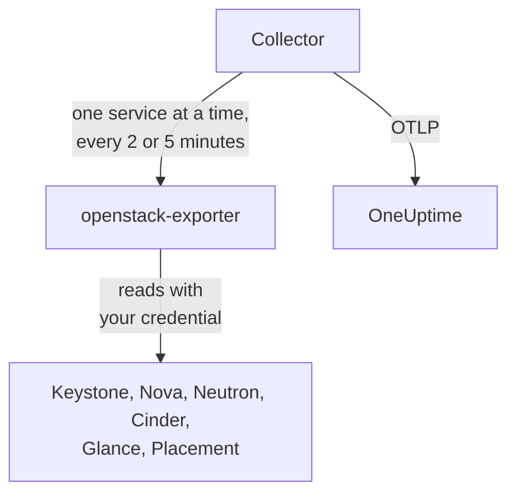

# OpenStack-agent

OneUptime sin OpenStack-agent overvåker en OpenStack-sky: tjenestene og agentene, hypervisorene, instansene, nettverkene, ruterne, volumene, lagringspoolene, bildene og prosjektene, i alle regioner. Den leser skyens API-er med en legitimasjon du velger, og sender det den finner til OneUptime, der skyen vises med regionene, hypervisorene og prosjektene sine. [OpenStack-monitorer](/docs/monitor/openstack-monitor) varsler om det som kommer inn, og en [probe](/docs/telemetry/openstack-agentless) kan samle inn data fra en sky uten at noe må installeres.

:::cards
- [Probe eller agent?](/docs/telemetry/openstack-agentless#sonde-eller-agent): Hvilken du bør velge for en sky som kan bruke begge.
- [Velg hvor mye den ser](#velg-hvor-mye-agenten-ser): OpenStack har ingen global skrivebeskyttet rolle, så det finnes tre nivåer.
- [Installer agenten](#installer-agenten): En legitimasjon, deretter installasjonsskriptet, Docker Compose eller helt uten Docker.
- [Hva den koster skyen din](#hva-den-koster-skyen-din): Hva hver innstilling leser, og hvordan du endrer den.
- [Kapasitet](#kapasitet): Hvor mange flere av hver flavor som får plass, og hvor mange dager det er til hver ressurs er full.
- [Forbruk](#forbruk): Hvem som bruker hva, hva det utgjør med dine priser eller slik CloudKitty vurderte det, og hva som kan frigjøres.
- [Statussider og varsling av prosjekter](#statussider-og-varsling-av-prosjekter): En side per region i ett steg, og varsling av bare de prosjektene en feil rammer.
- [Tjenestelogger](#tjenestelogger): Tolket, med en forespørsel fulgt på tvers av tjenester.
- [Livssyklushendelser](#livssyklushendelser): Instanshandlinger i feeden og på diagrammer, fra varsler eller en probe.
- [Hvem gjorde hva](#hvem-gjorde-hva): Revisjonsspor inn i sikkerhetshendelser.
- [Spor en forespørsel](#spor-forespørsler-gjennom-kontrollplanet): Én signert forespørsel, fulgt gjennom kontrollplanet.
- [Sjekk skyen utenfra](#sjekk-skyen-utenfra): Om noen faktisk kan starte en instans, fra en probe utenfor skyen.
- [Uten internett](#uten-internett): Agentens fire images, og hvordan du kopierer dem til et eget register.
- [Etter distribusjonsverktøy](/docs/telemetry/openstack-deployment-tools): Kolla-Ansible, OpenStack-Ansible, OpenStack-Helm, Atmosphere, Sunbeam, Red Hat og Mirantis.
- [Feilsøking](#feilsøking): Et diagnoseskript og de vanligste problemene.
:::

## Slik fungerer det

Agenten består av to låste oppstrømsprogrammer og konfigurasjonen deres, på én maskin: [openstack-exporter](https://github.com/openstack-exporter/openstack-exporter) leser skyens API-er og gjør dem om til `openstack_*`-serier, og en OpenTelemetry Collector ber den om én OpenStack-tjeneste om gangen, stempler hver serie med skyen og regionen den kom fra, og sender dem til OneUptime. Ingenting kjører på kontrollerne eller compute-nodene dine, med mindre du legger til den valgfrie [loggprofilen](#tjenestelogger), som leser loggene deres.



Skyen registrerer seg selv med de første dataene sine, under navnet agenten stempler på hver måling som `openstack.cloud.name`. Én agent overvåker én sky: én Keystone, med én region eller flere.

## Før du begynner

- Docker Engine 20.10 eller nyere med Docker Compose v2-pluginen, eller, for å kjøre uten Docker, en Linux-maskin (x86_64 eller arm64) med systemd 235 eller nyere, glibc 2.34 eller nyere (RHEL 9, Ubuntu 22.04, Debian 12) og root.
- En rute fra den maskinen til Keystone og til hver tjenestes offentlige endepunkt.
- Kommandolinjeverktøyet `openstack`, som en bruker som kan opprette legitimasjonen nedenfor.
- En inntaksnøkkel. Opprett en under **Prosjektinnstillinger → Telemetri og APM → Inntaksnøkler** og kopier verdien.
- Utgående HTTPS fra den maskinen til OneUptime-URL-en din.

### Hvor du bør kjøre agenten

Kjør agenten utenfor skyen den overvåker: en liten VM på separat maskinvare, en administrasjonsvert, en annen sky. En agent inne i en sky som har sviktet, blir stille sammen med den, og stille ser ut som en frisk sky som har sluttet å rapportere.

## Velg hvor mye agenten ser

OpenStack har ingen global skrivebeskyttet rolle, og det er det vanskeligste med å overvåke det:

- `reader` er avgrenset til et prosjekt overalt unntatt i Keystone og Ironic.
- Hypervisorer, tjenester, agenter, pooler og Placement krever admin som standard.
- En policy-overstyring kan ikke åpne lister over alle prosjekter i Neutron eller Cinder, som avgrenser dem etter admin-kontekst i sin egen kode.
- Cinders tjenester og lagringspooler svarer alle andre enn en admin med `403`, fra Cinders egen kode, etter at policyen allerede er godkjent. Ingen overstyring åpner dem heller.
- Neutron og Cinder svarer en vanlig reader med `200` og bare readerens eget prosjekt. Det ser ut som det virket, og det gjorde det ikke.
- Der Cinder har `enforce_new_defaults` av, som er Cinders egen standard, kan en hvilken som helst rolle på et prosjekt opprette volumer i det prosjektet, også `reader` og `oneuptime_monitoring`. På Epoxy, Flamingo og Gazpacho opprettet både en vanlig reader og rollen på et ekte prosjekt et volum (`202`). På Hibiscus ble begge avvist (`403`), fordi DevStack bare slår på `enforce_new_defaults` der. En skrivebeskyttet rolle på et ekte prosjekt er ikke skrivebeskyttet.

Så det finnes tre nivåer, og hvert koster noe. Begynn med det første hvis du kan.

| Nivå | Hva det krever | Hva det ser | Hva som uteblir |
| --- | --- | --- | --- |
| **1. Full visning** | En applikasjonslegitimasjon på en konto med `admin` på et eget prosjekt, begrenset av tilgangsregler til lesing, med `service_type` satt på hver tjeneste | Hver lesing agenten gjør, og tilstanden til `cinder-volume` og `cinder-scheduler` samt lagringspooler, som bare dette nivået ser | Keystones brukere og grupper, med vilje. Den kan ikke skrive: hver skriving ble besvart med `401` |
| **2. Bare infrastruktur** | Rollene `oneuptime_monitoring` og `reader` på et eget prosjekt som ikke inneholder noe og har null kvote, og policy-overstyringene agenten leveres med | Alle Keystones prosjekter, domener, tjenester og endepunkter, hele Nova inkludert alle prosjekters servere, hele Placement, og Neutrons agenter og IP-tilgjengeligheter | Neutrons nettverk, subnett, rutere, flytende IP-er og porter, og Cinders volumer og øyeblikksbilder, er bare det egne prosjektets, så på et tomt prosjekt bare de delte og eksterne. Ingen tilstand for `cinder-volume` eller `cinder-scheduler`, og ingen lagringspooler. Den kan ikke skrive: hver skriving ble besvart med `403`, eller `409` og `413` fra kvoten |
| **3. Prosjektvisning** | Vanlig `reader` på et ekte prosjekt, for et team som overvåker sin egen del av en sky noen andre driver | Prosjektets volumer, nettverk og rutere, fra Cinder og Neutron | All infrastruktur: ingen hypervisorer, tjenester, agenter, pooler eller kapasitet. Gjennom agenten heller ingen instanser, fordi exporterens lesing av alle prosjekter avvises. Og i mange skyer kan `reader` skrive der |

Malene **Block Storage Service Down**, **Storage Pool Warning** og **Storage Pool Critical** krever nivå 1. **Compute Service Down**, **Network Agent Down** og malene for Placement og hypervisor krever nivå 1 eller 2, og ingenting på nivå 3 leser en instans.

### Hva hvert nivå leser

Dette er hva fem ekte skyer svarte, på Epoxy, Flamingo, Gazpacho (OVN og OVS) og Hibiscus. Hver celle er skrevet ut fra disse opptakene.

| Lesing | Nivå 1: Full visning | Nivå 2: Bare infrastruktur | Nivå 3: Prosjektvisning |
| --- | --- | --- | --- |
| Keystone: prosjekter | alle | alle | avvist |
| Keystone: domener | alle | alle | avvist |
| Keystone: regioner | alle | det alle ser | det alle ser |
| Keystone: tjenester | alle | alle | avvist |
| Keystone: endepunkter | alle | alle | avvist |
| Nova: servere, alle prosjekter | alle | alle | avvist |
| Nova: tjenester | alle | alle | avvist |
| Nova: hypervisorer | alle | alle | avvist |
| Nova: aggregater | alle | alle | avvist |
| Nova: tilgjengelighetssoner, detaljer | alle | alle | avvist |
| Nova: flavors | alle | det alle ser | det alle ser |
| Nova: bruk per prosjekt | alle | alle | avvist |
| Placement: ressursleverandører | alle | alle | avvist |
| Neutron: agenter | alle | alle | ingenting |
| Neutron: nettverk | alle | bare eget prosjekt | bare eget prosjekt |
| Neutron: subnett | alle | bare eget prosjekt | bare eget prosjekt |
| Neutron: rutere | alle | bare eget prosjekt | bare eget prosjekt |
| Neutron: flytende IP-er | alle | bare eget prosjekt | bare eget prosjekt |
| Neutron: IP-tilgjengeligheter | alle | alle | ingenting |
| Neutron: sikkerhetsgrupper | alle | 409, forventet | bare eget prosjekt |
| Neutron: porter | alle | bare eget prosjekt | bare eget prosjekt |
| Neutron: kvoter | alle | avvist | avvist |
| Cinder: volumer, alle prosjekter | alle | bare eget prosjekt | bare eget prosjekt |
| Cinder: tjenester | alle | avvist | avvist |
| Cinder: pooler | alle | avvist | avvist |
| Cinder: øyeblikksbilder, alle prosjekter | alle | bare eget prosjekt | bare eget prosjekt |
| Cinder: sikkerhetskopier, alle prosjekter | alle | ingen registrert | ingen registrert |
| Cinder: volumtyper | alle | det alle ser | det alle ser |
| Glance: bilder | alle | det alle ser | det alle ser |

- **alle**: de samme radene en admin så.
- **bare eget prosjekt**: det prosjektets rader, og alt som er delt eller eksternt. På et prosjekt som ikke inneholder noe, er det bare de delte og eksterne.
- **avvist**: en `401` eller en `403`.
- **det alle ser**: hver legitimasjon så hver rad, i skyer som bare har offentlige flavors, volumtyper og bilder. En privat i et annet prosjekt krever nivå 1.
- **ingenting**: en `200` uten rader, på et prosjekt som også har nettverk. Det ser ut som det virket, og det gjorde det ikke.
- **ingen registrert**: en `200` uten rader der en admin heller ikke så noen, så det var ingenting å skille på.
- **409, forventet**: Neutron prøver å opprette prosjektets standard sikkerhetsgruppe når den lister dem, og null kvote tillater det ikke, så den svarer `409 Quota exceeded`. Det er harmløst og ingenting du må fikse.

Octavia, Ironic, Heat, Magnum, Manila, Designate, Barbican, Swift, Trove og Gnocchi er ikke med her fordi de skyene ikke kjører dem. [Diagnoseskriptet](#feilsøking) spør dem også, der en sky har dem, og det leser hver sti med din ekte legitimasjon og forteller hva den legitimasjonen kan se.

Hva agentens exporter fikk med hver, i serier per tjeneste. Antallene følger det en sky inneholder når den blir spurt, så sammenlign dem med hverandre og ikke med dine egne:

| Exporter-tjeneste | Admin | Nivå 1: Full visning | Nivå 2: Bare infrastruktur | Nivå 3: Prosjektvisning |
| --- | --- | --- | --- | --- |
| identity | 14 | 13 | 13 | 4 |
| compute | 33 | 33 | 33 | 15 |
| placement | 25 | 25 | 25 | 1 |
| network | 36 til 40 | 36 til 40 | 24 til 26 | 14 |
| volume | 33 | 33 til 41 | 23 | 29 til 37 |
| image | 4 | 4 | 4 | 4 |

## Installer agenten

Hver OneUptime serverer agentens installasjonsskript og filer for sin egen utgave: kommandoene nedenfor laster dem ned fra `https://oneuptime.com`, så på en selvhostet OneUptime bytter du ut det med din egen URL. Installasjonsskriptet lagres først som `install.sh`, slik at du kan lese det før du kjører det.

:::steps
### Opprett legitimasjonen

Velg nivået du har valgt. Hvert nivå lager en applikasjonslegitimasjon, som skriver ut en `id` og en `secret`: hemmeligheten vises bare én gang. Gi den en utløpsdato og bruk aldri `--unrestricted`, som ville latt den lage flere legitimasjoner.

:::tabs
@tab Level 1: Full view
Som admin oppretter du et prosjekt og en konto for agenten:

```bash
openstack project create --domain default oneuptime-monitoring
openstack user create --domain default --password-prompt oneuptime-monitoring
openstack role add --project oneuptime-monitoring --user oneuptime-monitoring admin
```

Deretter, innlogget som den kontoen på det prosjektet, oppretter du legitimasjonen. Reglene er de nøyaktige `GET`-stiene agenten bruker, tilpasset skyen din:

```bash
curl -fsSLO https://oneuptime.com/install/openstack-agent/access/application-credential-access-rules.json
curl -fsSLO https://oneuptime.com/install/openstack-agent/access/access-rules-for-cloud.py
openstack catalog list -f json | python3 access-rules-for-cloud.py \
  application-credential-access-rules.json > access-rules-for-this-cloud.json
openstack application credential create oneuptime-agent \
  --role admin \
  --access-rules "$(cat access-rules-for-this-cloud.json)" \
  --expiration 2027-11-01T00:00:00
```

En tilgangsregel matches mot stien tjenesten ser. En tjeneste bak et stiprefiks, som `https://cloud.example/compute/v2.1`, ser `/compute/v2.1/servers`, og avviser den medfølgende regelen for `/v2.1/servers` med en `401`. `access-rules-for-cloud.py` legger til hver regel på nytt under tjenestens prefiks, lest fra katalogen din.

To av exporterens lesinger tar regler som er lette å overse for hånd. Den leser Octavias rot før noe annet, og bak Apache ser en tjeneste den som `/load-balancer//`, med to skråstreker. Når den avvises, svarer exporteren med en tom `200`, så skyen ser ut som om den ikke kjører Octavia. Og den lister Swifts konto med en avsluttende skråstrek, som `/v1/*` ikke matcher. Når den avvises, viser `openstack_object_store_up` `0`. De tilpassede reglene har begge. En legitimasjons regler kan ikke endres, så hvis din ble laget fra en eldre kopi av dem, lag en ny.

Tilgangsregler krever også at `service_type` er satt for keystonemiddleware på hver tjeneste, og en omstart av den tjenesten. Uten den avviser tjenesten legitimasjonen med en `401`:

```ini title="nova.conf"
[keystone_authtoken]
service_type = compute
```

| Konfigurasjonsfil | `service_type` |
| --- | --- |
| `nova.conf` | `compute` |
| `neutron.conf` | `network` |
| `cinder.conf` | `block-storage`. Reglene har også `volume` og `volumev3`, for en Cinder som er konfigurert slik |
| `glance-api.conf` | `image` |
| `placement.conf` | `placement` |
| `octavia.conf` | `load-balancer` |
| `ironic.conf` | `baremetal` |
| `heat.conf` | `orchestration` |
| `magnum.conf` | `container-infra` |
| `manila.conf` | `sharev2`. Reglene har også `shared-file-system`, for en Manila som er konfigurert slik |
| `designate.conf` | `dns` |
| `barbican.conf` | `key-manager` |
| `trove.conf` | `database` |
| `gnocchi.conf` | `metric` |
| `cloudkitty.conf` | `rating` |
| `proxy-server.conf`, under `[filter:authtoken]` | `object-store`, og `include_service_catalog = True` ved siden av. keystonemiddleware sjekker reglene mot tokenets katalog, så med `False`, som DevStack setter, svarer Swift legitimasjonen med `500` |

Bare tjenestene skyen din kjører trenger en linje.

På tjenestene en sky kanskje ikke kjører, avviker det hvert nivå fikk i ekte skyer fra tabellene ovenfor på fire måter:

- **Ironic** svarer et prosjekts legitimasjon, også en admins, med bare nodene det prosjektet eier, og avviser conductorene sine. Bare systemomfang leser alle noder og conductorene, og agentens legitimasjon ligger på et prosjekt. For å lese en node med den, gjør du prosjektet til eier: `openstack baremetal node set --owner`.
- **Swift** lister legitimasjonens eget prosjekts containere, og ingen andre. Et annet prosjekts konto svarer `403` med mindre legitimasjonen har `ResellerAdmin`.
- **Barbican** svarer en legitimasjon bare om dens eget prosjekt, og avviser en vanlig reader. OneUptime leser ingen hemmeligheter.
- **Gnocchi** lar en hvilken som helst rolle på et prosjekt opprette en måling, så i en sky som kjører den kan nivå 2 og nivå 3 skrive der.

Keystone trenger ingenting. Med reglene tilpasset, `service_type` satt og API-ene startet på nytt, ble hver lesing besvart med `200` og hver skriving med `401`, på hver utgave vi har registrert. Exporteren får det en admin får, bortsett fra Keystones brukere og grupper, med vilje. Det gjelder også tjenestene en sky kanskje ikke kjører: registrert på DevStack fikk nivå 1 de samme seriene som en admins legitimasjon fra hver tjeneste exporteren leser, og hver skriving ble besvart med `401`.

Hvis du ikke vil gjøre den endringen, lag den samme legitimasjonen uten `--access-rules`: en vanlig admin-applikasjonslegitimasjon. Den fungerer, og den kan skrive, så diagnoseskriptet merker den som det.
@tab Level 2: Infrastructure only
Som admin oppretter du rollen, et prosjekt som ikke inneholder noe og har null kvote, og en konto:

```bash
openstack role create oneuptime_monitoring
openstack project create --domain default --description "OneUptime monitoring: holds nothing" oneuptime-monitoring
openstack quota set --instances 0 --cores 0 --ram 0 --key-pairs 0 oneuptime-monitoring
openstack quota set --volumes 0 --gigabytes 0 --snapshots 0 --backups 0 --backup-gigabytes 0 oneuptime-monitoring
openstack quota set --networks 0 --subnets 0 --ports 0 --routers 0 --floating-ips 0 --secgroups 0 --secgroup-rules 0 oneuptime-monitoring
openstack user create --domain default --password-prompt oneuptime-monitoring
openstack role add --project oneuptime-monitoring --user oneuptime-monitoring oneuptime_monitoring
openstack role add --project oneuptime-monitoring --user oneuptime-monitoring reader
```

Prosjektet inneholder ingenting og har null kvote med vilje. Der Cinder har `enforce_new_defaults` av, kan en hvilken som helst rolle på et prosjekt opprette det prosjektets volumer. Med ingenting å røre og ingen kvote å lage noe med, er det ingenting den kan skrive: på hver utgave vi har registrert, ble hver skriving besvart med `403`, eller `409` og `413` fra kvoten.

Last ned policy-overstyringene, og flett inn hver fil, på hver kontroller, i filen som er angitt av `[oslo_policy] policy_file` i den tjenestens konfigurasjon (`nova.conf`, `neutron.conf` og så videre). Det er `/etc/nova/policy.yaml`, og så videre, med mindre distribusjonen din sier noe annet: DevStack sier `policy.json`. Hver regel beholder tjenestens standard og legger til rollen, og oslo.policy merker en endret fil av seg selv, så ingen omstart trengs.

```bash
curl -fsSLO https://oneuptime.com/install/openstack-agent/access/policy/nova.yaml
curl -fsSLO https://oneuptime.com/install/openstack-agent/access/policy/neutron.yaml
curl -fsSLO https://oneuptime.com/install/openstack-agent/access/policy/keystone.yaml
curl -fsSLO https://oneuptime.com/install/openstack-agent/access/policy/placement.yaml
```

Det finnes ingen fil for Cinder. Dens `os-services` og `scheduler-stats/get_pools` svarer rollen med `403 User does not have admin privileges`, på alle fem skyene vi har registrert. Det kommer fra Cinders egen kode som krever en admin-kontekst, etter at policyen allerede er godkjent, så ingen overstyring kan åpne dem.

**For å ta overstyringene bort igjen, tøm filen (`{}`) og slett den aldri.** På Flamingo (2025.2) og Epoxy (2025.1) feiler oslo.policy på hver sjekk så snart en policyfil den har lest er borte, så den tjenesten feiler hver forespørsel. Når tjenesten er Keystone, slutter den å validere tokens og hele skyen svarer `503`. Hvis det allerede har skjedd, start tjenesten på nytt.

Deretter, innlogget som den kontoen på det prosjektet, oppretter du legitimasjonen:

```bash
openstack application credential create oneuptime-agent --expiration 2027-11-01T00:00:00
```

Å legge rollen på et ekte prosjekt for å se volumene og ruterne dets lar også kontoen skrive der, i en sky der Cinder har `enforce_new_defaults` av. Diagnoseskriptet advarer når legitimasjonens prosjekt inneholder ting.
@tab Level 3: Project view
Gi en konto den vanlige `reader`-rollen på prosjektet, og deretter, innlogget som den kontoen på det prosjektet, oppretter du legitimasjonen:

```bash
openstack role add --project my-team --user my-monitoring-account reader
openstack application credential create oneuptime-agent --expiration 2027-11-01T00:00:00
```

Agenten ser det prosjektets rader fra Cinder og Neutron og ingen infrastruktur. Tre ting du bør vite før du velger dette:

- **Gjennom agenten vises ingen instanser i det hele tatt.** Exporteren ber Nova om alle prosjekters servere, Nova avviser en vanlig reader, og den lesingen feiler som helhet. Bare en OneUptime-probe, som samler inn uten denne agenten, kan liste ett prosjekts instanser.
- **Den kan kanskje skrive.** I en sky der Cinder har `enforce_new_defaults` av, kan vanlig `reader` også opprette volumer i prosjektet sitt. På Epoxy, Flamingo og Gazpacho gjorde den det (`202`), og på Hibiscus ble det avvist (`403`), fordi DevStack bare slår på `enforce_new_defaults` der. Cinders egen standard er av.
- **Placement leses som om den ikke svarer.** Hvert kall den gjør avvises, og exporteren rapporterer det på samme måte som en stoppet Placement: `openstack_placement_up 0`, på alle fem skyene vi har registrert. Sidene kan se det, ut fra hva annet som er stengt for denne legitimasjonen, og sier fra om det. Malen [Placement API Down](/docs/monitor/openstack-monitor#ferdige-varselmaler) kan ikke det, så utelat den på dette nivået.
:::

### Installer og start agenten

:::tabs
@tab install.sh
Last ned installasjonsskriptet og kjør det på maskinen som skal være vert for agenten:

```bash
curl -fsSL https://oneuptime.com/install/openstack-agent -o install.sh
bash install.sh
```

Skriptet spør etter OneUptime-URL-en din, inntaksnøkkelen, et stabilt navn på skyen, Keystones auth-URL, regionnavnene, applikasjonslegitimasjonen (et brukernavn og passord hvis du sier nei til den) og en privat CA-fil hvis skyen har sin egen sertifiseringsinstans. Ingenting hemmelig blir ekkoet eller havner på en kommandolinje. Det sjekker legitimasjonen mot Keystone før det skriver eller starter noe, installerer til `/opt/oneuptime-openstack-agent`, eller til `oneuptime-openstack-agent` i hjemmemappen din hvis du ikke har rettigheter på `/opt` (det trenger bare `docker`-gruppen), skriver `.env` og `clouds.yaml` med modus `0600`, og starter agenten med Docker Compose. Hvert svar fungerer også som en miljøvariabel, og når skriptet kjøres på nytt gjenbruker det dem i stedet for å spørre igjen, og det er slik du [oppgraderer agenten](#oppgradere-agenten).
@tab Docker Compose
Last ned `docker-compose.yml` og `otel-collector-config.yaml` fra din OneUptime til en ny mappe:

```bash
mkdir oneuptime-openstack-agent && cd oneuptime-openstack-agent
curl -fsSLO https://oneuptime.com/install/openstack-agent/docker-compose.yml
curl -fsSLO https://oneuptime.com/install/openstack-agent/otel-collector-config.yaml
```

Lag en `clouds.yaml` ved siden av dem, med én oppføring per region, **oppkalt etter regionen**, fordi exporterens serier ikke sier hvilken region de kommer fra, og collectoren stempler oppføringens navn på dem som `openstack.region.name`:

```yaml title="clouds.yaml"
clouds:
  RegionOne:
    region_name: RegionOne
    identity_api_version: 3
    auth_type: v3applicationcredential
    auth:
      auth_url: https://keystone.example.com:5000/v3
      application_credential_id: your-credential-id
      application_credential_secret: your-credential-secret
```

Deretter en `.env`-fil:

```bash title=".env"
ONEUPTIME_URL=YOUR_ONEUPTIME_URL
ONEUPTIME_TELEMETRY_INGESTION_KEY=YOUR_TELEMETRY_INGESTION_TOKEN
OPENSTACK_CLOUD_NAME=my-cloud
OPENSTACK_EXPORTER_CLOUDS=[RegionOne,RegionTwo]
COMPOSE_PROFILES=openstack-exporter,openstack-ai-agent
```

`OPENSTACK_EXPORTER_CLOUDS` lister hver region, i hakeparenteser, og `COMPOSE_PROFILES` starter den medfølgende exporteren og [KI-agenten](#ai-agent). Begge filene inneholder hemmeligheter. Exporteren kjører som uid 65532, og må være den eneste kontoen som kan lese `clouds.yaml`. Start agenten:

```bash
chmod 600 .env
sudo chown 65532:65532 clouds.yaml
sudo chmod 600 clouds.yaml
docker compose up -d
```
@tab Without Docker
På Linux (x86_64 eller arm64) med systemd 235 eller nyere og glibc 2.34 eller nyere kjører installasjonsskriptet oppstrømsutgavene av de samme to programmene som systemd-tjenester. RHEL 8 og beslektede systemer har en eldre glibc, som exporterens utgave ikke kan kjøre på: skriptet sier fra om det og endrer ingenting, så bruk Docker der.

```bash
curl -fsSL https://oneuptime.com/install/openstack-agent -o install.sh
sudo bash install.sh --without-docker
```

De samme spørsmålene, den samme sjekken mot Keystone og de samme filene. Hvert utgavearkiv holdes mot en sha256 som er festet i `install.sh`, og en nedlasting som ikke stemmer stopper installasjonen før noe endres. Collectoren kjører som en engangsbruker uten rettigheter som aldri ser OpenStack-legitimasjonen, og exporteren som systembrukeren `oneuptime-openstack`, den eneste kontoen som kan lese `clouds.yaml`, og den lytter bare på `127.0.0.1:9180`.

Kjør én agent per sky: når du går bort fra en Docker-installasjon, kjør `docker compose down` først, ellers kommer hver måling to ganger.
:::

Kjører du allerede openstack-exporter med `--multi-cloud`? Pek agenten mot den, så starter den medfølgende aldri: `OPENSTACK_EXPORTER_ADDRESS=10.0.0.5:9180 bash install.sh`, eller utelat `COMPOSE_PROFILES` fra `.env` og sett `OPENSTACK_EXPORTER_ADDRESS` der. Dens `clouds.yaml` trenger en oppføring oppkalt etter hver region, og den bør slå av det den medfølgende slår av: se [Hva den koster skyen din](#hva-den-koster-skyen-din). Bruk en adresse agentens container kan nå: `localhost` er containeren selv.

Kolla-Ansibles exporter kjører uten `--multi-cloud`, så den har ingen `/probe`, og den er festet til en utgave som sier mindre. [Bruk exporteren du allerede kjører](/docs/telemetry/openstack-deployment-tools#bruk-eksportøren-du-allerede-kjører) forklarer hvordan du leser den, og nøyaktig hva sidene går glipp av. [OpenStack etter distribusjonsverktøy](/docs/telemetry/openstack-deployment-tools) har resten av hvert verktøys trinn.

### Sjekk at agenten kjører

```bash
cd /opt/oneuptime-openstack-agent    # or the folder the script said it installed to
docker compose ps
docker logs oneuptime-openstack-agent
```

`docker compose ps` lister collectoren (`oneuptime-openstack-agent`), den medfølgende exporteren (`oneuptime-openstack-exporter`) og [KI-agenten](#ai-agent) (`oneuptime-openstack-ai-agent`). Collectorens logger skal vise denne linjen når den har startet:

```text
Everything is ready. Begin running and processing data.
```

Uten Docker kan du spørre `systemctl status oneuptime-openstack-agent oneuptime-openstack-exporter` og `journalctl -u oneuptime-openstack-agent`.

### Finn skyen i OneUptime

Åpne **Produkter → Infrastruktur → OpenStack**. Skyen vises under sin `OPENSTACK_CLOUD_NAME` etter den første innsamlingen, i løpet av noen få minutter. Compute, network, volume og Placement leses hvert 2. minutt, identity og images hvert 5.
:::

Skyens **Oversikt** forteller om dataene når OneUptime, hva som krever oppmerksomhet først, og hvordan hver tjeneste har det:


**Hypervisorer** viser hva Nova og Placement har lovet på hver compute-vert:


**Instanser** lister hver instans med statusen i Novas egne ord, prosjektet, flavoren og hypervisoren:


## Miljøvariabler

Installasjonsskriptet skriver disse til `/opt/oneuptime-openstack-agent/.env`; en Docker Compose-installasjon leser dem fra `.env` ved siden av `docker-compose.yml`. Etter at du har endret en, kjør `docker compose up -d` i den mappen, eller `sudo systemctl restart oneuptime-openstack-agent` uten Docker. Bare `clouds.yaml` inneholder legitimasjonen.

| Variabel | Påkrevd | Beskrivelse |
| --- | --- | --- |
| `ONEUPTIME_URL` | Ja | Din OneUptime-URL, for eksempel `https://oneuptime.com` eller din selvhostede instans. |
| `ONEUPTIME_TELEMETRY_INGESTION_KEY` | Ja | Inntaksnøkkelen fra **Prosjektinnstillinger → Telemetri og APM → Inntaksnøkler**. |
| `OPENSTACK_CLOUD_NAME` | Ja | Skyens navn i OneUptime, stemplet på hver måling som ressursattributtet `openstack.cloud.name`. Hold det stabilt: å endre det registrerer en ny sky. Standard er `openstack`. |
| `OPENSTACK_AUTH_URL` | Medfølgende exporter | Et svar til installasjonsskriptet: Keystones auth-URL. `/v3` legges til hvis den mangler. |
| `OPENSTACK_EXPORTER_CLOUDS` | Ja | Regionene, i hakeparenteser, for eksempel `[RegionOne,RegionTwo]`, hver navnet på en `clouds.yaml`-oppføring. Standard er `[RegionOne]`. |
| `OPENSTACK_EXPORTER_ADDRESS` | Nei | `host:port`, uten skjema, til din egen exporter. Utelat den for den medfølgende. |
| `OPENSTACK_CA_FILE` | Nei | En PEM-fil med sertifiseringsinstansen til en sky som har sin egen. Installasjonsskriptet beholder en kopi som `ca.pem` ved siden av `clouds.yaml`. |
| `OPENSTACK_EXPORTER_USER` | Nei | `uid:gid` som exporterens container kjører som, som må eie `clouds.yaml`. Standard er `65532:65532`. |
| `COMPOSE_PROFILES` | Medfølgende exporter | `openstack-exporter` starter den medfølgende exporteren, og `openstack-ai-agent` [KI-agenten](#ai-agent). |
| `OPENSTACK_LIBVIRT_EXPORTER_TARGETS` | Nei | Compute-nodene som [faktisk bruk](#faktisk-bruk) leses fra gjennom `prometheus-libvirt-exporter`, i hakeparenteser, for eksempel `[compute-01:9177,compute-02:9177]`. Standard er ingen. |
| `OPENSTACK_CEILOMETER_EXPORTER_TARGETS` | Nei | Det samme gjennom Ceilometers egen exporter, for eksempel `[compute-01:9101]`. Standard er ingen. |
| `OPENSTACK_SINGLE_CLOUD_EXPORTER_TARGETS` | Nei | En exporter som allerede kjører uten `--multi-cloud`, for eksempel Kolla-Ansibles: `[10.0.0.254:9198]`. Se [Bruk exporteren du allerede kjører](/docs/telemetry/openstack-deployment-tools#bruk-eksportøren-du-allerede-kjører). |
| `OPENSTACK_RABBITMQ_TARGETS` | Nei | RabbitMQs Prometheus-plugin på hver node, for [hva skyen står på](#hva-skyen-står-på): `[10.0.0.11:15692,10.0.0.12:15692]`. Standard er ingen. |
| `OPENSTACK_MARIADB_TARGETS` | Nei | mysqld_exporter ved siden av hver MariaDB-node, vanligvis på `9104`. Standard er ingen. |
| `OPENSTACK_MEMCACHED_TARGETS` | Nei | memcached_exporter ved siden av hver Memcached, vanligvis på `9150`. Standard er ingen. |
| `OPENSTACK_HAPROXY_TARGETS` | Nei | HAProxys egen Prometheus-exporter. Standard er ingen. |
| `OPENSTACK_NETWORK_EXPORTER_TARGETS` | Nei | openstack-network-exporter på hver node, for OVN og Open vSwitch, vanligvis på `1981`. Standard er ingen. |
| `OPENSTACK_LIBVIRT_HEALTH_TARGETS` | Nei | prometheus-libvirt-exporter på hver compute-node, vanligvis på `9177`, for om libvirt svarer og ingenting per instans. Standard er ingen. |
| `OPENSTACK_CONTROL_PLANE_REGION` | Nei | Regionen til et mål ovenfor som ikke oppgir sin egen. Et mål kan det: `RegionTwo@10.1.0.11:15692`. Standard er den første regionen. |
| `OPENSTACK_AGENT_SERVICES` | Nei | Hvilke tjenester denne agenten leser, for [deling av en sky mellom agenter](/docs/telemetry/openstack-very-large-clouds#dele-en-sky-mellom-innsamlere), for eksempel `compute\|placement`. Standard er alle. |
| `OPENSTACK_AGENT_MEMORY_LIMIT_MIB` | Nei | Hva collectoren kan holde i minnet. Innhentingen fra en veldig stor sky tar mer enn standarden på `512`. |
| `OPENSTACK_DATABASE_EXPORTER_TARGETS` | Nei | `openstack_database_exporter`, for [databasestien](/docs/telemetry/openstack-very-large-clouds#databaseveien): `[openstack-database-exporter:9180]`. Standard er ingen. De andre innstillingene for den stien er listet der. |

Installasjonsskriptet leser også legitimasjonen fra miljøet, for å hoppe over spørsmålene: `OPENSTACK_APPLICATION_CREDENTIAL_ID` og `OPENSTACK_APPLICATION_CREDENTIAL_SECRET`, eller `OPENSTACK_USERNAME`, `OPENSTACK_PASSWORD`, `OPENSTACK_PROJECT_NAME`, `OPENSTACK_USER_DOMAIN_NAME` og `OPENSTACK_PROJECT_DOMAIN_NAME`. De har egne navn i stedet for `OS_*`-navnene en openrc-fil setter, så en admins innleste openrc aldri blir agentens legitimasjon uten at noen blir spurt. En applikasjonslegitimasjon er bedre enn brukernavn og passord: den kan begrenses til lesing og kan utløpe.

## Hva skyen står på

De fleste OpenStack-avbrudd begynner under det: en RabbitMQ som er borte, Galera uten kvorum, en OVN-database uten leder. Agenten kan lese exporterne disse allerede har, hvert minutt, og den er av til du navngir dem. Ingenting her skriver til noen av dem, og bare noen få serier fra hver beholdes.

Navngi hver i agentens `.env`, hvert medlem av en klynge, og kjør deretter `docker compose up -d`:

```bash
OPENSTACK_RABBITMQ_TARGETS=[10.0.0.11:15692,10.0.0.12:15692,10.0.0.13:15692]
OPENSTACK_MARIADB_TARGETS=[10.0.0.11:9104,10.0.0.12:9104,10.0.0.13:9104]
OPENSTACK_MEMCACHED_TARGETS=[10.0.0.11:9150,10.0.0.12:9150]
OPENSTACK_HAPROXY_TARGETS=[10.0.0.11:9101,10.0.0.12:9101]
OPENSTACK_NETWORK_EXPORTER_TARGETS=[10.0.0.21:1981,10.0.0.22:1981,RegionTwo@10.1.0.21:1981]
OPENSTACK_LIBVIRT_HEALTH_TARGETS=[10.0.0.21:9177,10.0.0.22:9177]
OPENSTACK_CONTROL_PLANE_REGION=RegionOne
```

Et mål kan oppgi hvilken region det er i, slik det siste i den listen gjør. Et som ikke gjør det, er i `OPENSTACK_CONTROL_PLANE_REGION`. På Kolla-Ansible, hvis Prometheus allerede kjenner dem alle, skriver `control-plane-targets.py` ut disse linjene for deg, og [OpenStack etter distribusjonsverktøy](/docs/telemetry/openstack-deployment-tools) sier hvor hver exporter finnes på de andre.

Hva hver av dem leser, og hva agenten trenger av den:

| Innstilling | Leser | Slå på med |
| --- | --- | --- |
| `OPENSTACK_RABBITMQ_TARGETS` | RabbitMQs egen plugin, `/metrics` og hver kø fra `/metrics/detailed` | `rabbitmq-plugins enable rabbitmq_prometheus` på hver node |
| `OPENSTACK_MARIADB_TARGETS` | mysqld_exporter ved siden av hver node. Standardene rapporterer allerede Galera | Ingenting utover exporteren |
| `OPENSTACK_MEMCACHED_TARGETS` | memcached_exporter ved siden av hver Memcached | Ingenting utover exporteren |
| `OPENSTACK_HAPROXY_TARGETS` | HAProxys egen exporter | `http-request use-service prometheus-exporter` på en egen `frontend` |
| `OPENSTACK_NETWORK_EXPORTER_TARGETS` | openstack-network-exporter på hver maskin med Open vSwitch eller OVNs databaser | Standardcollectorene. En maskin rapporterer det den kjører |
| `OPENSTACK_LIBVIRT_HEALTH_TARGETS` | prometheus-libvirt-exporter på hver compute-node, og bare om libvirt svarer | Ingenting utover exporteren |

Deretter har skyens **Kontrollplan**-kort én linje for hver, og en side per avhengighet med én linje per maskin. **Ikke overvåket** på det kortet betyr at du ikke har navngitt den: den vises aldri som frisk. Problemer der havner i skyens **Krever oppmerksomhet**. Skyens **Anbefalinger**-side tilbyr [varselmalene](/docs/monitor/openstack-monitor#hva-skyen-hviler-på), og `troubleshoot.sh` sjekker at hvert mål svarer og er det du sa det er.

For mer av en RabbitMQ eller en database enn en skys helse trenger, leser produktene [Køer](/docs/telemetry/queues) og [Databaser](/docs/telemetry/databases) dem gjennom egne agenter, som gir mer data enn dette og på egne premisser. Kontrollplansidene lenker til dem. Å installere dem er separat, fordi disse produktene leser de agentenes serier og ikke disse.

To ting du bør vite om openstack-network-exporter 0.3.0, versjonen disse ble registrert med:

- **Den kobler til Open vSwitchs database én gang.** Etter at Open vSwitch starter på nytt, forblir `ovs_build_info`, bridgene, grensesnittene og alle ovn-controllers serier borte til exporteren også starter på nytt, mens Open vSwitchs egne serier kommer rett tilbake. **Exporter Lost Open vSwitch's Database** sier fra når det har skjedd.
- **Den leser én OVN-databases klyngestatus på en maskin.** Det er Southbound der en maskin har begge socketene, slik Kolla-Ansibles har. Så Northbounds leder vises bare der en maskin ikke har noen Southbound å lese.

## Hva agenten samler inn

Collectoren lager én innhentingsjobb per OpenStack-tjeneste, gjennom exporterens `/probe?cloud=<region>&include_services=<service>`, så en Nova som feiler gjør bare Novas serier borte:

| Innhentingsjobb | Hver | Tidsavbrudd | Serier |
| --- | --- | --- | --- |
| `oneuptime-openstack-compute` | 2 minutter | 110 s | `openstack_nova_agent_state`, `openstack_nova_running_vms`, `openstack_nova_vcpus_used`, `openstack_nova_memory_used_bytes`, `openstack_nova_local_storage_used_bytes`, `openstack_nova_total_vms`, `openstack_nova_server_status`, `openstack_nova_flavors`, `openstack_nova_availability_zones` |
| `oneuptime-openstack-network` | 2 minutter | 110 s | `openstack_neutron_agent_state`, `openstack_neutron_networks`, `openstack_neutron_subnets`, `openstack_neutron_routers`, `openstack_neutron_router`, `openstack_neutron_l3_agent_of_router`, `openstack_neutron_floating_ips`, `openstack_neutron_security_groups`, `openstack_neutron_network_ip_availabilities_total`, `openstack_neutron_network_ip_availabilities_used` |
| `oneuptime-openstack-volume` | 2 minutter | 110 s | `openstack_cinder_agent_state`, `openstack_cinder_volumes`, `openstack_cinder_volume_gb`, `openstack_cinder_snapshots`, `openstack_cinder_pool_capacity_free_gb`, `openstack_cinder_pool_capacity_total_gb` |
| `oneuptime-openstack-placement` | 2 minutter | 110 s | `openstack_placement_resource_total`, `openstack_placement_resource_usage`, `openstack_placement_resource_allocation_ratio`, `openstack_placement_resource_reserved` |
| `oneuptime-openstack-identity` | 5 minutter | 120 s | `openstack_identity_projects`, `openstack_identity_project_info`, `openstack_identity_domains`, `openstack_identity_regions` |
| `oneuptime-openstack-image` | 5 minutter | 120 s | `openstack_glance_images`, `openstack_glance_image_bytes`, `openstack_glance_image_created_at` |
| `oneuptime-openstack-load-balancer` | 5 minutter | 120 s | `openstack_loadbalancer_total_loadbalancers`, `openstack_loadbalancer_loadbalancer_status`, `openstack_loadbalancer_total_amphorae`, `openstack_loadbalancer_amphora_status`, `openstack_loadbalancer_total_pools`, `openstack_loadbalancer_pool_status` |
| `oneuptime-openstack-baremetal` | 5 minutter | 120 s | `openstack_ironic_node`, `openstack_ironic_node_updated_at`, `openstack_ironic_node_provision_updated_at` |
| `oneuptime-openstack-orchestration` | 5 minutter | 120 s | `openstack_heat_stack_status`, `openstack_heat_stack_status_counter` |
| `oneuptime-openstack-container-infra` | 5 minutter | 120 s | `openstack_container_infra_total_clusters`, `openstack_container_infra_cluster_masters`, `openstack_container_infra_cluster_nodes`, `openstack_container_infra_cluster_status` |
| `oneuptime-openstack-sharev2` | 5 minutter | 120 s | `openstack_sharev2_shares_counter`, `openstack_sharev2_share_gb`, `openstack_sharev2_share_status`, `openstack_sharev2_share_status_counter` |
| `oneuptime-openstack-dns` | 5 minutter | 120 s | `openstack_designate_zones`, `openstack_designate_zone_status`, `openstack_designate_recordsets`, `openstack_designate_recordsets_status` |
| `oneuptime-openstack-object-store` | 5 minutter | 120 s | `openstack_object_store_objects`, `openstack_object_store_bytes` |
| `oneuptime-openstack-database` | 5 minutter | 120 s | `openstack_trove_total_instances`, `openstack_trove_instance_status`, `openstack_trove_instance_volume_size_gb`, `openstack_trove_instance_volume_used_gb` |
| `oneuptime-openstack-gnocchi` | 5 minutter | 120 s | `openstack_gnocchi_status_metricd_processors`, `openstack_gnocchi_status_metric_having_measures_to_process`, `openstack_gnocchi_status_measures_to_process` |

De ni siste er tjenester en sky kanskje ikke kjører. Når exporteren blir spurt om en som ikke står i katalogen, logger den inn på Keystone, logger én linje (`No suitable endpoint could be found in the service catalog`) og svarer med ingenting, og den skyen viser ikke spor av tjenesten. Det er én innlogging hvert 5. minutt per tjeneste og region, og det er derfor alle disse er på 5 minutter. For å spørre bare om tjenestene du kjører, sett `OPENSTACK_AGENT_SERVICES`, for eksempel `identity|compute|placement|network|volume|image`.

Hver tjeneste rapporterer også `openstack_<service>_up`, for eksempel `openstack_nova_up`. [OpenStack-monitoren](/docs/monitor/openstack-monitor#innsamlede-metrikker) lister hver serie med hva den betyr. Hver serie har:

| Attributt | Hva det sier |
| --- | --- |
| `openstack.cloud.name` | Skyens navn, et ressursattributt |
| `oneuptime.agent.version` | Versjonen av agentens filer, et ressursattributt: collectorversjonen de fester, med siste tall hevet hver gang de endres på den collectoren |
| `openstack.region.name` | Regionen, fra navnet på `clouds.yaml`-oppføringen, på hvert datapunkt |
| `openstack_service` | Jobbens OpenStack-tjeneste (`compute`, `network`, ...), på hvert datapunkt |

Monitorfiltre matcher på likhet, så behold prosessoren `transform/openstack-identity` hvis du tilpasser konfigurasjonen, og de to slettingene av `service.name` og `service.instance.id` i prosessoren `resource`: uten slettingene registrerer dataene en fantomtjeneste i stedet for å nå skyen.

## Hva den koster skyen din

Overvåking må aldri være det som tar ned en sky, så standardene er skånsomme. Hver innhenting logger inn på Keystone på nytt og gjør ekte API-kall. [Veldig store OpenStack-skyer](/docs/telemetry/openstack-very-large-clouds) forteller hva det utgjør, i forespørsler i minuttet og gigabyte i døgnet, ved hver størrelse.

| Innstilling | Standard | Å slå den på eller endre den gir deg | Hva den koster |
| --- | --- | --- | --- |
| Prosjektkvoter | Av | Hvor mye av hver kvote et prosjekt har brukt, på siden dets og under **Krever oppmerksomhet**, og varselet Project Quota Nearly Reached | Fire API-kall per prosjekt, per region, én gang i timen (Nova ett, Cinder to, Neutron ett), fra en egen exporter |
| Trege målinger | Av | Novas egne kvotelister og bruk per server | Ett kall per prosjekt per innhenting, så det vokser med antall prosjekter |
| Serier per port | Av | `openstack_neutron_port`, `openstack_neutron_ports`, `openstack_neutron_ports_no_ips`, `openstack_neutron_ports_lb_not_active` | En uavgrenset liste over hver port. I en stor sky [kan det mette Neutron og forårsake kaskadefeil](https://github.com/openstack-exporter/openstack-exporter/issues/540), så la den stå av med mindre du vet at antallet porter er lite |
| Tjenester en sky kanskje ikke kjører | På | Lastbalansere, bare metal, stacks, klynger, delinger, DNS, objektlagring, databaser og Gnocchi, der skyen har dem | En sky uten en av dem betaler én innlogging hvert 5. minutt. Designate koster ett kall per sone per innhenting, så det vokser med antall soner |
| Innhentingsintervaller | 2 og 5 minutter | Ferskere data, eller mindre belastning | Dobbelt så ofte er dobbelt så mange API-kall. Hold hver `scrape_timeout` under sin `scrape_interval`, så en treg innhenting aldri stabler seg oppå den før |

**Prosjektkvoter:** kjør `install.sh` på nytt med `OPENSTACK_COLLECT_QUOTAS=true`. På en Docker Compose-installasjon legger du `openstack-quotas` til `COMPOSE_PROFILES` i `.env`, og setter `OPENSTACK_QUOTA_CLOUDS` til det `OPENSTACK_EXPORTER_CLOUDS` sier. Begge starter en andre exporter, `openstack-quota-exporter`, som ikke leser noe annet, og collectoren spør den én gang i timen etter `openstack_nova_limits_*`, `openstack_neutron_quota_*`, `openstack_cinder_limits_*` og `openstack_cinder_volume_type_quota_gigabytes`. De endrer seg sakte, og en exporter leser det samme uansett hvilken jobb som spør, så å lese dem sjeldnere krever en egen exporter. Din egen exporter har ikke noe slikt: agenten leser det den sier, ved hver innhenting.

**Trege målinger:** slett linjen `--disable-metric` for det du vil ha, fra exporterens `command` i `docker-compose.yml`, eller fra `ExecStart` i `oneuptime-openstack-exporter.service` uten Docker. Kostnaden er ett kall per prosjekt per innhenting.

| Slett | For å samle inn |
| --- | --- |
| `--disable-metric=nova-quota_cores` | `openstack_nova_quota_*` |
| `--disable-metric=nova-server_local_gb` | `openstack_nova_server_local_gb`, bruk per server. Denne er én enkelt bruksrapport som går gjennom hver server i stedet for ett kall per prosjekt, og den er likevel treg i en stor sky |

De tre linjene som holder prosjektkvoter utenfor denne exporteren (`--disable-metric=nova-limits_vcpus_max`, `--disable-metric=neutron-quota_network`, `--disable-metric=cinder-limits_volume_max_gb`) blir stående. Å slette dem leser dem også hvert annet minutt.

Hvert flagg navngir serien som leser resten av raden, og derfor slår én linje dem alle av. Bruk ikke exporterens eget `--disable-slow-metrics` i stedet: det tar også `openstack_glance_image_*`, bildelisten Bilder-siden leser med ett kall. Neutrons kvoteliste er bare en admins på alle nivåer unntatt nivå 1, så `openstack_neutron_quota_*` krever det nivået.

**Serier per port:** slett de fire linjene `--disable-metric=neutron-port*`, på samme sted.

**Intervaller:** endre `scrape_interval` og `scrape_timeout` under en jobb i `otel-collector-config.yaml`.

Kjør deretter `docker compose up -d --force-recreate`, eller `sudo systemctl daemon-reload` og start begge tjenestene på nytt uten Docker. En oppgradering erstatter disse filene og beholder din kopi som `<file>.bak.<timestamp>`, så gjør endringen din på nytt etterpå.

Tre linjer til blir stående, fordi du ikke kommer til å savne dem. `--disable-metric=neutron-subnets_total` utelater mange serier som sier det adressepoolene allerede sier (`openstack_neutron_subnets_total`, `openstack_neutron_subnets_used`, `openstack_neutron_subnets_free`). `--disable-metric=nova-security_groups` utelater en lesing av en rute Nova ikke lenger har, som bare ville fylt exporterens logg. `--disable-metric=gnocchi-total_metrics` utelater en lesing av hver måling i Gnocchi, side for side, for ett enkelt tall (`openstack_gnocchi_total_metrics`): en Gnocchi kan inneholde millioner.

For å lese interne endepunkter i stedet for offentlige, legg til `--endpoint-type=internal` på samme sted.

Tre åpne oppstrømssaker former alt dette, og prosjektet har også [bedt om vedlikeholdere](https://github.com/openstack-exporter/openstack-exporter/issues/443):

- [Sak 660](https://github.com/openstack-exporter/openstack-exporter/issues/660): én tjeneste som feiler tømmer en hel innhenting. Derfor er det én innhentingsjobb per tjeneste. Ikke slå dem sammen.
- [Sak 540](https://github.com/openstack-exporter/openstack-exporter/issues/540): en uavgrenset portliste kan mette Neutron. Derfor er seriene per port av, og diagnoseskriptet ber om én liten side med porter.
- [Sak 244](https://github.com/openstack-exporter/openstack-exporter/issues/244): innhentinger går ut på tid i større skyer. Derfor er intervallene minutter i stedet for sekunder, hver med et tidsavbrudd under seg. Hvis `openstack_*_up` mangler for én tjeneste i en stor sky, øk den jobbens intervall og tidsavbrudd før noe annet.

## Bare metal

Hvis skyen din kjører Ironic, får den en **Bare metal**-seksjon med hver node Ironic viser legitimasjonen: hvor den er i Ironics tilstandsmaskin, strømmen, om noen har satt den i vedlikehold og hvorfor, ressursklassen og når Ironic sist så den bevege seg. En sky uten Ironic har ingen slik seksjon, ingen varsler om det og ingen linje på noen side.

En node er ikke en hypervisor, selv om både Nova og Placement lister den som en under UUID-en sin, så den telles ikke som et sted å kjøre en virtuell maskin. Hvor mange noder av hver ressursklasse som kunne ta en instans, står på Bare metal-siden, for nodene Ironic viser denne legitimasjonen, og på [Kapasitet](#kapasitet)-siden, for hver node Placement har.

Hva som trenger noen, på de samme linjene som [varselmalene](/docs/monitor/openstack-monitor#ferdige-varselmaler):

| Leser | Betyr |
| --- | --- |
| En feilet tilstand, for eksempel `clean failed` eller `deploy failed`, eller `error` | Den forblir feilet til noen griper inn: Ironic prøver ingen av disse på nytt, og setter ikke alltid noden i vedlikehold |
| Den samme gjennomgangstilstanden, for eksempel `wait call-back`, i 2 timer | Ironic gir opp ventingen etter 30 minutter som standard, så noe annet holder den. En lang diskutsletting kan ærlig talt ta så lang tid: siden leser Ironics egen tid, som en utsletting holder i gang med heartbeats, og et varsel leser bare ordet |
| I vedlikehold i 7 dager | Planlagt frem til da, som en tjeneste noen har deaktivert, så ingenting sier at den trenger oppmerksomhet før det |
| `active` med strømmen av | Det som kjører på den har stoppet. Hvis eieren stoppet instansen på den, sier nodens side at det er planlagt. Et varsel leser én serie og kan ikke vite det |

### Hva den ikke kan se

Hver av disse ble registrert på en ekte DevStack, og hver side sier fra om det der det betyr noe:

- **Ironic viser et prosjekt bare nodene det eier.** Placement svarer alle, så der den har en node Ironic ikke listet, sier siden at listen ikke er hele skyens. Etter Ironics standardpolicy leser bare en legitimasjon med systemomfang hver node, eller en hvis rolle har `baremetal:node:list_all`.
- **Exporteren har ikke med hvorfor en node feilet.** Den har en vedlikeholdsårsak og ingen `last_error`, og Ironic kan uansett tømme `last_error` i løpet av omtrent et minutt, mens noden fortsatt er feilet: det gjorde den for en feilet clean, og lot en feilet deploys stå. Så se med en gang med `openstack baremetal node show <node> -c last_error`, eller i conductorens logg. En [probe](/docs/telemetry/openstack-agentless) leser `last_error` og beholder den siste den så.
- **Exporteren har ingen conductorer.** Bare en probe leser dem, og Ironic avviser et prosjekts legitimasjon listen med mindre policyen sier noe annet (`baremetal:conductor:get`).
- **En stoppet Ironic leses likt som ingen Ironic.** Spurt om en som er stoppet, svarer exporteren en tom 200, slik den gjør for en sky som aldri har hatt den. Så en side sier bare at den ikke har hørt fra Ironic, og at nodene er slik de sist ble lest. Den sier aldri nede. To uker etter at resten av skyen sist rapporterte uten den, forsvinner disse radene, og de kommer tilbake hvis den gjør det.

## Kapasitet

«Får vi plass til dette?» er spørsmålet en OpenStack-operatør oftest får, og Novas ledige tall svarer ikke på det: allokeringsforhold, reservasjoner og fragmentering betyr alle noe, så en sky kan ha tusenvis av vCPU-er ledig og ikke plass til én stor instans. En skys **Kapasitet**-side sier hvor mange flere av hver flavor som får plass, og hva som er knapt, det som går tom først øverst. Den leser én oppsummering, regnet ut hvert annet minutt, så det den laster vokser ikke med antallet verter. **Eksporter CSV** på flavortabellen laster ned alt på siden.

Alt på den er allokering: det som er lovet, ikke det som er opptatt. En ledig instans holder alt av det.

**Hva kapasitet er.** For hver ressursleverandør og ressursklasse er kapasiteten `(total - reserved) x allocation_ratio`, og allokert er det Placement har lovet. Det summeres per sone, aggregat, region og sky. En vert hvis `nova-compute` er nede beholder sine siste tall, og en deaktivert tar ikke imot noe mer, så ingen av dem teller som plass. Det de holder er fortsatt der, og en prognose teller det med.

**Bare metal.** En node tar én instans hel, så en sky med Ironic får en egen tabell, etter ressursklasse: hvor mange noder, hvor mange som kunne ta en instans, hvor mange som er i bruk, og hvor mange som holdes tilbake fordi Novas Ironic-driver ikke kan bruke dem akkurat nå. Dette er Placements egne tall, så de gjelder hele skyen selv der Ironic viser et prosjekt bare det det eier, og de er ikke med i vCPU-ene og minnet ovenfor. En probe leser hvilken klasse en flavor ber om og teller den mot disse. Agentens exporter sier det ikke, så på agenten teller en bare metal-flavor som sine vCPU-er, sitt minne og sin disk, på verter.

**Hvor mange flere som får plass.** Hver flavor telles vert for vert, fordi en instans trenger alt den ber om på én vert. Ved siden av tallet står hva det ville vært hvis alt ledig lå på én vert, og det er slik en full sky skilles fra en fragmentert. En flavor ingen vert kunne rommet selv tom, sier **For stor for hver vert**, og ingenting varsler noen gang om den. Tallene gjelder en instans startet fra et image: en startet fra et volum ber ikke om noen rotdisk.

Siden sier hvor hvert tall kom fra:

| | Gjennom en probe | Gjennom agenten |
| --- | --- | --- |
| **Talt fra** | `GET /allocation_candidates`, som er det Novas scheduler spør om, slik [StackHPCs os-capacity](https://github.com/stackhpc/os-capacity) gjør. Inventarer fylles inn til det blir flavorens tur | Placement-seriene exporteren allerede sender: `openstack_placement_resource_{total,reserved,allocation_ratio,usage}` |
| **Ser traits og nestede leverandører** | Ja. En flavors extra specs etterspørres også, så `trait:` og `resources:` telles | Nei: exporterens flavorserie har ingen extra specs, så en flavor som trenger en trait teller hver vert, og siden sier fra om det |
| **En verts `max_unit`** | Placements egen | Antatt å være vertens total, som er det Nova setter |

En probe spør forsiktig, fordi dette er den ene lesingen som gir Placement arbeid. Den spør om én flavorform om gangen, så flavors som ber om det samme er ett spørsmål, og høyst 4 per innsamling, i omganger, uansett hvor mange flavors det er. Så en sky med 40 flavors samlet inn hvert 2. minutt koster 2 kall i minuttet og går en runde på 20 minutter. Hvert svar er begrenset til 1 000 verter, som er Novas egen `max_placement_results`: én oppstarts verdi av arbeid. Et tall fra et så langt svar er et gulv, og siden sier **Minst**. Den spør om ingenting ved første innsamling, ingenting når Placement har vært treg i den innsamlingen, og ingenting på en time etter at en legitimasjon er avvist, fordi tallet fra inventarene er der uansett. En applikasjonslegitimasjon eller rollen `oneuptime_monitoring` trenger at `/allocation_candidates` er tillatt: den står i `access/application-credential-access-rules.json` og `access/policy/placement.yaml`.

**Ved siden av det vertene faktisk bruker.** Der [faktisk bruk](#faktisk-bruk) når OneUptime, setter siden forholdet du har satt ved siden av det vertene faktisk bruker på toppen over et døgn, og forholdet der de ville nådd 90 %-linjen som **Hypervisor CPU Saturated** og **Hypervisor Memory Pressure** trekker. Det er en rett linje fra ett døgn med én arbeidsmengde, så den sier hvor langt et forhold kunne flyttes, ikke at du bør flytte det. Den sier ingenting før over halvparten av en sones verter rapporterer.

**Når ting fylles opp.** Hver sones ressursklasser, hvert eksterne nettverks IPv4-adresser og hver lagringspool har en prognose: en rett linje gjennom det som ble allokert den siste uken, mot det som finnes i dag. En ny sky sier **Ikke nok historikk** til den har et døgn av den.

**Om en sone kan miste en vert.** Det som er allokert i sonen, også på en tapt vert, mot hva de andre vertene kunne lovet med den største borte, slik VMwares Host failure spør om en klynge. Den sammenligner mengder i stedet for hvor hver instans ville havnet, så en sone som består har plass til en evakuering, ikke et løfte om at hver instans finner en vert: flavortabellen viser hva som er fragmentert. En sone med én vert har ingenting å si, og det har heller ikke en med en vert noen har deaktivert, fordi det er planlagt arbeid.

**Allokeringer ingen instans forklarer.** Når Placement holder mer på en vert enn instansenes flavors summerer seg til, i over en halv time, navngir siden verten. Det er vanligvis en [foreldreløs allokering](https://docs.openstack.org/nova/latest/admin/troubleshooting/orphaned-allocations.html), igjen etter en sletting eller en flytting som feilet halvveis, og den spiser kapasitet i det stille. Den sammenligner vCPU-er og minne, fordi en instans startet fra et volum ikke holder noe av flavorens disk. Den sier ingenting om en vert med noe som flytter på den, eller en instans av en flavor skyen ikke lenger lister. For å se hva de er, og for å fjerne dem når du har sjekket at hver virkelig ikke tilhører noen instans eller migrering:

```bash
nova-manage placement audit --verbose
nova-manage placement audit --verbose --delete
```

**Varsler.** **Flavor Can No Longer Be Placed**, **Capacity Forecast Under 14 Days** og **Reserved Headroom Gone** leser serier OneUptime skriver fra den samme oppsummeringen. De står i [monitorens maler](/docs/monitor/openstack-monitor#ferdige-varselmaler) og på skyens **Anbefalinger**-side.

**Hva det koster.** Ingenting på agenten. En probe legger til kallene ovenfor. OneUptime skriver omtrent 2 serier for hver sones ressursklasse, eksterne nettverk og lagringspool, og én for hver flavor folk kan be om, hvert annet minutt, fakturert som enhver annen måling.

## Forbruk

Private skyer koster fortsatt penger, og den som driver en blir spurt om hvem som bruker hva og hva som kan frigjøres. En skys **Forbruk**-side svarer på begge, og fungerer helt uten oppsett. Den viser bruk og anslag å planlegge med. OneUptime fakturerer ingen, og ingenting her er et beløp en leietaker skylder.

**Denne måneden mot forrige** står øverst, deretter hvem som vokser, så hvert prosjekt, det største først, med **Eksporter CSV**. Domenene, og hva som ble brukt på hvilken flavor og volumtype, ligger under. Et prosjekts egen side har måneden linje for linje og månedene før den.

### Slik regnes bruken ut

Hvert 15. minutt leser en worker hva hvert prosjekt har i skyens inventar, og legger det til for tiden siden forrige lesing: vCPU-timer og minnetimer etter flavor, volum-GB-timer etter type, flytende IP-timer, og lagring av images og øyeblikksbilder. Ingen serie per instans leses eller skrives, så det koster ingenting i målingslageret eller telemetriregningen, og det fungerer likt på en sky i [oppsummeringsmodus](/docs/telemetry/openstack-very-large-clouds#sammendragsmodus).

Hva det betyr for tallene:

- **En endring av størrelse flytter timer fra én flavor til den andre**, og en sletting stopper dem. En endring telles fra den første lesingen som viser den, så hver kan være feil med opptil 15 minutter. En instans som levde kortere enn det, blir kanskje aldri sett.
- **En del teller til inventaret slipper den,** som er opptil 15 minutter etter at den forsvant. I en stor sky som leses i omganger tar en endring like lang tid som det tar før det blir dens tur.
- **En instans holder flavoren sin fra den plasseres til den slettes.** En som er slått av teller fortsatt, på en egen linje, fordi Nova holder vCPU-ene og minnet dens reservert på verten. En som aldri kom til en vert teller ikke, og det gjør heller ikke en som er lagt på hylla bort fra verten.
- **Et volum eller øyeblikksbilde med feil, eller som fortsatt lages, teller ikke,** fordi det ikke har noe lagringsplass bak seg totalt sett.
- **Timer OneUptime ikke leste, gjettes det ikke på.** Et opphold på over en time teller sin siste time, og siden sier hvor mange timer som ikke ble talt.
- **Agentens exporter rapporterer hvor mange øyeblikksbilder det er, ikke hvilke,** så lagring av øyeblikksbilder telles bare på en sky som er [koblet til uten agent](/docs/telemetry/openstack-agentless).

### Priser

Prisene er dine og er valgfrie. Uten dem viser siden bruk. Under **Priser** setter du en valuta og en pris per time for en vCPU, en GB minne, en GB volum, en flytende IP, en GB image og en GB øyeblikksbilde. **Avansert** har en pris per instanstime etter flavor, som da er hele prisen for den flavoren, en pris etter volumtype, og en bryter for å utelate avslåtte instanser. En måned er omtrent 730 timer.

En pris på null betyr ingen pris, ikke en gratis sky. Det som ikke har noen pris, sies å ikke ha noen, og et prosjekt som brukte noe uten pris telles på siden, så en sum av det som har pris aldri utgis for å være alt. Dagens priser gjelder hele hver periode som vises, også forrige måneds, så en prisendring ikke ser ut som at et prosjekts bruk flytter seg. En pris som endres nå vises innen 15 minutter.

### CloudKitty

Hvis skyen kjører [CloudKitty](https://github.com/openstack/cloudkitty), erstatter det den vurderte utregningen, prosjekt for prosjekt, og siden sier hvilken den brukte. En probe spør én gang i timen, for denne måneden og forrige, og den spør `GET /v2/summary`, eller `GET /v1/report/summary` på en CloudKitty som er for gammel for den. Det er høyst to forespørsler per 1 000 prosjekter i timen, pluss en forespørsel om versjonen hver gang den leses.

- **Bare en [probe](/docs/telemetry/openstack-agentless) kan lese den.** Agentens exporter har ingen serie for CloudKitty, så en sky koblet til gjennom en agent regner ut, og sier fra om det.
- **Det den ser er det legitimasjonen kan se.** CloudKittys egen policy viser en admins legitimasjon hvert prosjekt, med tilgangsregler eller uten, og alt mindre bare dens eget. Prosjektene den ikke vurderer, fortsetter å regnes ut fra prisene dine.
- **En CloudKitty per region summeres.** Hver leses i sin egen tid, og et prosjekts tall er det de vurderte til sammen. Én CloudKitty katalogen lister for flere regioner spørres én gang.
- **Tallene dens er den eneste delen av dette som er telemetri.** De når OneUptime som `openstack_cloudkitty_rated`, ett datapunkt per prosjekt og måned, én gang i timen: 20 000 i timen ved 10 000 prosjekter, som er nesten ingenting ved siden av resten av en sky i den størrelsen.
- **Den oppgir ikke valuta.** En sats vises i prislistens valuta hvis du har satt en, og som et tall alene hvis ikke.
- **Hvis den slutter å svare,** blir det hvert prosjekt var vurdert til stående der det var, og siden sier når den sist ble lest. **Rating API Down** varsler om det.
- **En ekte CloudKitty har svart på dette,** på `stable/2026.1`, med InfluxDB bak, som vurderte det Ceilometer skrev til Gnocchi. Det er det eneste oppsettet den er lest på. Uten noen regel slått på vurderer den hvert prosjekt til `0`, og uten noe vurdert ennå svarer den uten rader. Uansett fortsetter disse prosjektene å regnes ut fra prisene dine.

### Budsjetter

Et budsjett sier hva et prosjekt, eller en hel sky, kan komme på i en måned, i valutaen til prisene dine. Som med [budsjettene til en tilkoblet sky](/docs/telemetry/cloud-costs) utløser det et varsel første gang i en måned anslaget passerer hver andel av det (80 % og 100 % med mindre du sier noe annet), og ett når det som holdes nå ville passert det før måneden er over. En ny måned starter fra ingenting, og forrige måneds varsler løses. Et budsjett varsler bare: det stopper ingenting. Uten priser eller CloudKitty er det ingenting å sammenligne med, så det er stille og raden dens sier at det ikke er sjekket.

### Hva som kan frigjøres

Skyens **Anbefalinger**-side lister hva som er blitt stående ubrukt, hva hver ville frigjort, og kommandoen som lister det, én gang i timen. OneUptime fjerner aldri noe, og hver av disse er et spørsmål til den som eier det.

| Hva | Når det navngis | Hva det frigjør | Kommandoen som lister dem |
|---|---|---|---|
| Hypervisorer som kunne tømmes | 20 % eller mindre av vCPU-ene og minnet er allokert, alt på den får plass på de andre vertene i sonen og aggregatene, og sonen kunne fortsatt miste en vert etterpå | Hele verten | `openstack hypervisor list --long` |
| Instanser som har vært slått av lenge | Slått av i 30 dager | Deres vCPU-er, minne og lokale disk | `openstack server list --all-projects --status SHUTOFF --long` |
| Volumer som ikke er koblet til noe | Tilgjengelig i 30 dager, ikke koblet til noe, og ikke et av Cinders egne `image-<id>`-volumer, som kommandoen også lister | Deres lagring | `openstack volume list --all-projects --status available --long` |
| Gamle volumøyeblikksbilder | Laget for 90 dager siden. Bare probe | Deres lagring | `openstack volume snapshot list --all-projects --long` |
| Images ingenting ble startet fra | Private eller delte, 30 dager gamle, ikke beskyttet, og ingen instans eller volum kom fra dem. Bare probe | Deres lagring | `openstack image list --long` |
| Flytende IP-er ingenting bruker | Ikke tilknyttet i 7 dager | En adresse | `openstack floating ip list --status DOWN --long` |

Ingenting som er i bruk blir noen gang navngitt. Hvor lenge noe har vært slik kommer fra skyens egen klokke der en probe rapporterer en. Gjennom en agent er det hvor lenge OneUptime har sett det slik, så den dagen du kobler til en sky er ingenting gammelt ennå. En regel som ikke kan være sikker, sier det i stedet for å gjette: agenten kan ikke si hvilket image en instans ble startet fra, så et image i bruk ville sett ubrukt ut, og den kan ikke liste øyeblikksbilder, så disse to reglene venter på en probe. En vert navngis etter hva som er allokert i stedet for hvor travel den er, den navngis aldri i en sone med en vert som er tapt eller deaktivert, og verter tas tomste først slik at alt som navngis kan gjøres. Den kan ikke se traits eller noe annet en instans trenger av en vert.

### Ved hver størrelse

En lesing koster det samme uansett hvor ofte instanser endres, og det den koster vokser med det som er navngitt her. Disse er testet på Postgres, med setningene talt nøyaktig og tiden for den største størrelsen holdt innenfor et budsjett.

| Hypervisorer | Instanser | Prosjekter | Setninger per lesing | Rader beholdt | Hva siden leser |
|---|---|---|---|---|---|
| 10 | 100 | 10 | 13 | 750 | Én rad for skyen, én side med prosjekter |
| 500 | 20 000 | 1 000 | 14 | 75 000 | Én rad for skyen, én side med prosjekter |
| 5 000 | 200 000 | 10 000 | 37 | 750 000 | Én rad for skyen, én side med prosjekter |

Når en sky har en forrige måned, leser en lesing den også, én setning per 2 000 prosjekter. Timereglene leser fem lister på høyst 5 000 rader, og går gjennom hver instans sin rad én gang for å se hva som er i bruk.

Ved den største størrelsen leses det hvert prosjekt har på under 5 sekunder, en hel lesing tar under 30, og raden siden leser holder seg under 2 MB. Rader som beholdes er én per prosjekt for hver av 13 måneder, og én per prosjekt for hver av de siste 62 dagene. De avhenger ikke av hvor mange instanser det er, og ingenting av det teller som telemetri.

## Faktisk bruk

Nova og Placement sier hva som er lovet på en hypervisor, ikke hva som er travelt: en ledig instans holder alle sine vCPU-er. Så ingenting i OneUptime kaller de tallene bruk. For å se hva som faktisk er travelt, pek agenten mot det av disse skyen din allerede kjører. OpenTelemetry Collector har ingen egen libvirt-receiver.

| Kilde | Hvor den kjører | Slå den på |
| --- | --- | --- |
| [`prometheus-libvirt-exporter`](https://github.com/inovex/prometheus-libvirt-exporter) | Port 9177 på hver compute-node. Kolla-Ansible kjører den når Prometheus og KVM er på. | Sett `OPENSTACK_LIBVIRT_EXPORTER_TARGETS=[compute-01:9177,compute-02:9177]` |
| Ceilometers egen exporter, fra 2025.1 | Port 9101 på hver compute-node, ved siden av pollingagenten. | I `ceilometer.conf`, under `[polling]`, sett `enable_prometheus_exporter = true`, `prometheus_listen_addresses` til en adresse agenten kan nå, og `batch_size` høyere enn det høyeste antallet instanser på én node. Sett deretter `OPENSTACK_CEILOMETER_EXPORTER_TARGETS=[compute-01:9101]` |

Etter å ha endret en av dem, kjør `docker compose up -d`. Hver exporter taler for én compute-node, så navngi hver node du vil ha lest.

Ceilometer sier bare det `polling.yaml` ber om, og filen den leveres med utelater noe av dette. Legg til disse målerne i den for å få hele bildet:

| Måler | Uten den |
| --- | --- |
| `vcpus` | En instans sin CPU måles mot det flavoren sier i stedet. Epoxy har ingen slik måler. |
| `memory.resident` | Ingenting sier hva instansene holder på hypervisoren sin, så ingen **Hypervisor Memory Pressure** |
| `disk.device.read.latency`, `disk.device.write.latency` | Ingen disklatens, så ingen **Instance Disk Latency High** |

OneUptime gjør begge om til ett sett serier etter hvert som de kommer inn, ved siden av originalene: `openstack.instance.*` for hver instans, etter UUID-en, og `openstack.hypervisor.instances.*` for det en hypervisors instanser summerer seg til. [OpenStack-monitoren](/docs/monitor/openstack-monitor#innsamlede-metrikker) lister dem. Så sider og varsler betyr det samme uansett hvilken kilde en sky har:

| Hva den leser | libvirt | Ceilometer |
| --- | --- | --- |
| CPU i bruk | Hvor mye CPU-tid som gikk, over tiden mellom to lesinger | Det samme, fra et kumulativt tall i nanosekunder |
| CPU som venter, det gjesten kaller steal | `libvirt_domain_vcpu_delay_seconds_total` | `ceilometer_cpu_delay`, når en utgave har den. Ingen utgitt Ceilometer har den ennå, fra Epoxy til Hibiscus, så disse viser ingen lesing |
| Minne i bruk | Det gjestens balloon-driver sier: tilgjengelig minus brukbart | `ceilometer_memory_usage`, som er den samme summen. Uten en balloon-driver har ingen av dem dette, og det utelates i stedet for å gjettes |
| Minne på hypervisoren | `libvirt_domain_memory_stats_rss_bytes` | `ceilometer_memory_resident`. Det rommer mer enn flavorens størrelse, fordi QEMU selv er med |
| Disk og nettverk | Rater per disk og grensesnitt, og latens som tiden forespørslene tok over hvor mange det var | Det samme |

Ceilometers lesinger endrer seg bare én gang per pollingsyklus, fem minutter som standard, uansett hvor ofte de leses. En rate regnes ut mellom øyeblikkene en lesing endret seg, så den ikke viser 0, 0, og så fem ganger sannheten, og en lesing som ikke endret seg legger ikke til noen data. Den første verdien som sees sier ingenting om når den ble pollet, så den første raten tar to pollinger. Når en polling har flyttet noe om en instans, viser det den lot stå 0, og en lesing på en instans der ingenting beveger seg viser 0 etter 11 minutter. En teller som går bakover har startet på nytt, etter at en instans startet på nytt eller flyttet, og teller fra null. `libvirt_domain_info_memory_usage_bytes` leses ikke som bruk: det er størrelsen på ballongen, som på en ledig instans er flavorens minne.

En avslått instans har ingen lesing fra noen av kildene: libvirt rapporterer en CPU-tid på 0 og Ceilometer sier ingenting, og ingen av delene er en instans som ikke gjør noe. En config drive er en CD-ROM, som libvirts exporter utelater og Ceilometer ikke gjør, så med Ceilometer viser en instans som har en én disk til, vanligvis `hda`, som ikke leser noe.

En instans sin side viser CPU, minne, disk og nettverk ved siden av flavorens størrelse, med diagrammene under **Forbruk**. En hypervisors side viser hva instansene dens bruker, målt mot det den har før noe allokeringsforhold, og navngir de travleste ved siden av hva hver ble gitt, med diagrammene under **Målinger**. Forbi en linje sier den hvilke instanser som er ansvarlige, og hvilke som blir tvunget til å vente. Uten en kilde sier hver side det, og hva som må legges til. Der OneUptimes [vertsagent](/docs/telemetry/hosts) kjører på en hypervisor, leser siden dens maskins egen CPU, minne, disk og nettverk derfra, som inkluderer vertens egne prosesser, så den kan være over linjen mens instansene ikke er det.

Agentens feilsøkingsskript leser hver exporter du navnga, sier hvor mange instanser den kjenner og hvilke målere Ceilometer ikke poller, og hva hver av dem koster deg.

Fire [varselmaler](/docs/monitor/openstack-monitor#ferdige-varselmaler) leser disse: **Hypervisor CPU Saturated**, **Hypervisor Memory Pressure**, **Instance CPU Saturated** og **Instance Disk Latency High**. Uten en kilde er de stille.

### Hva det koster

Serier per instans multipliserer seg raskt, så å beholde dem er et valg, under skyens **Innstillinger**, i **Faktisk bruk per instans**:

| Valg | Hva det beholder |
| --- | --- |
| Automatisk, standarden | Hver instans mens skyen har 500 eller færre, og ingen utover det |
| Hver instans | Hver instans, i enhver størrelse |
| Bare prosjektene og aggregatene jeg velger | Instansene i de prosjektene, og de på hypervisorene i de aggregatene |
| Ingen | Ingen instans sine serier |

En instans som ikke beholdes mister også sine opprinnelige serier, så valget stopper hele kostnaden, og den teller fortsatt med i totalene til hypervisoren sin, som er fem serier per hypervisor uansett hva du velger. Agentens innhentingsjobber beholder bare det OneUptime leser av hver exporter. Forbi 5 000 instanser avgjør det samme valget også hvem som beholder en [serie av statusen sin](/docs/telemetry/openstack-very-large-clouds#sammendragsmodus).

Hva én instans koster, med to vCPU-er, én disk og ett nettverksgrensesnitt:

| Kilde | Serier per instans | Rader per time | Rader per måned, 100 instanser | Rader per måned, 1 000 instanser |
| --- | --- | --- | --- | --- |
| `prometheus-libvirt-exporter`, lest hvert minutt | 30 | 1,800 | 131,400,000 | 1,314,000,000 |
| Ceilometers exporter, lest hvert minutt og pollet hvert 5. | 24 | 864 | 63,072,000 | 630,720,000 |

Hver ekstra disk legger til 12 serier for begge, og hvert ekstra grensesnitt 4. Hver ekstra vCPU legger til 1 fra libvirt. Agentens collector holder disse i minnet på vei ut, så en stor sky kan trenge mer enn standarden på 512 MiB. Veiledningens kalkulator, under **OpenStack → Dokumentasjon**, setter en pris på disse for en sky i din størrelse.

## Prosjekter og domener

En sky har mange leietakere, så OneUptime holder rede på hvem alt tilhører.

- **Prosjekter** lister hvert prosjekt med domenet, det det kjører, det som krever oppmerksomhet i det, og hendelsene og varslene som er åpne på delene dets. Et prosjekts side sier det samme i sin helhet, og navngir enhver vert som er nede under det.
- **Domener** sier hvor mange prosjekter hvert domene har.
- **Hver liste over det et prosjekt eier** kan snevres inn til ett prosjekt, og til ett domene i en sky med mer enn ett. Begge går etter ID, så å gi et prosjekt eller et domene nytt navn ødelegger ingenting.

### Send et prosjekts varsler til teamet dets

På et prosjekts side legger du til en regel under **Hvem som får beskjed om dette** eller **Etiketter på det som åpnes om dette**. **Domener** har de samme to for et helt domene. Fra da av får hvert varsel og hver hendelse som når det prosjektet eller domenet disse eierne eller etikettene.

En regel her er en **Eierregel for OpenStack-sky** eller **Etikettregel for OpenStack-sky** med prosjektets eller domenets ID på seg, så den vises også under skyens innstillinger **Eierregler** eller **Etikettregler**, der du kan skrive en for hånd under **Ett prosjekt eller domene**. En regel med en av ID-ene legger ikke til noe på selve skyen. Betingelser på skyen gjelder fortsatt, og en regel laget fra **Domener** navngir skyen sin, fordi hver sky har et domene som heter `default`. Hvis du gir den skyen nytt navn, oppdater regelens navnebetingelse.

Et varsel eller en hendelse på en del av skyen når hvert prosjekt som har noe på den delen, uansett hvor mange det er. Bare en monitor kan si hva den når, så en slik regel når ikke en hendelse noen erklærer for hånd. Etiketter settes på idet varselet åpnes, og eiere rett etter.

Regler skrevet tidligere som et par av varsel- og hendelsesregler, som matcher ``OpenStack project `<id>` `` or ``OpenStack domain `<id>` `` i beskrivelsen, fortsetter å virke og er listet her også. En beskrivelse navngir høyst 50 av prosjektene den når, så et slikt par stopper der. Fjern det og legg til regelen på nytt for å fjerne den grensen.

### Kvoter

Med kvoter på viser et prosjekts side hvor mye av hver det har brukt: instanser, kjerner, RAM, gigabyte med volumer, nettverk, porter og flytende IP-er. Et prosjekt på 90 % av en, eller over, vises under **Krever oppmerksomhet**. En grense på -1 betyr ingen grense, så det er aldri på noe. De leses én gang i timen. En lesing som er mer enn tre timer gammel vises, men vurderes ikke lenger, fordi kvotene kan ha blitt slått av.

De er av som standard på grunn av hva de koster: se [Hva den koster skyen din](#hva-den-koster-skyen-din). OpenStacks kvote på hvor mange volumer et prosjekt kan ha vises ikke, fordi exporteren bare leser gigabyteene.

### Etiketter fra Nova-metadata

For å se en Nova-metadatanøkkel som en etikett, legg til `--nova.metadata-extra-labels=team` i exporterens kommando, med flere nøkler etter komma. Et prosjekts side viser verdiene instansene dets har.

## Topologi og skaderadius

En skys **Topologi**-side tegner den region for region: tilgjengelighetssoner, hypervisorer og instansene på dem, lagringspooler og volumer, nettverk, rutere og flytende IP-er, og API-ene og tjenestene. Hver del farges etter de samme reglene som **Krever oppmerksomhet**, så en hypervisor hvis `nova-compute` har stoppet er rød, med instansene sine under seg.

Forbi 5 000 deler leser kartet hva som har feilet og hva det tar med seg i stedet for alt, åpner på vertene som feilet og sier hva det utelot. **Krever oppmerksomhet** snevrer det inn til alt resten. [Infrastruktur](/docs/telemetry/topology) tegner skyen ved siden av vertene og klyngene dine.

Med `nova-compute` stoppet på en vert blir verten rød med instansene sine under seg, og siden teller den åpne hendelsen og det åpne varselet:


En dels skaderadius er det den tar med seg, etter antall og etter prosjekt:

| Når dette feiler | Rammer det |
| --- | --- |
| En hypervisor, eller dens `nova-compute` | Instansene dens |
| En lagringspool | Volumene dens, og instansene de er koblet til |
| En L3-agent | Ruterne ingen annen agent kan overta, og deres flytende IP-er |
| En regions API | Alt det API-et betjener i regionen, i hvert prosjekt |

En dels side viser den. Et varsel eller en hendelse på delen sier den i beskrivelsen, for eksempel «3 instanser i 2 prosjekter», med navnene deres.

Exporteren sier ikke hvilket nettverk en instans er på, eller hvilken pool som holder et volum, så ingen av delene tegnes for en sky agenten samler inn. Kartet sier fra om det, og en lagringspools skaderadius sier at den ikke kan vite det i stedet for å svare ingen. En [probe](/docs/telemetry/openstack-agentless) sier begge deler. Kartet knytter da et volum til poolen sin, når Cinder behandler legitimasjonen som admin, og en pools skaderadius teller volumene og instansene de er koblet til. Det knytter også en instans til hvert nettverk den har en adresse på. Nova navngir disse nettverkene bare med navn, og Neutron tillater to med samme navn, så kartet leter etter ett i instansens prosjekt, deretter ett delt med det, så et hvilket som helst med det navnet, og tegner ingen forbindelse når to er like sannsynlige. Det som fortsatt er ukjent, blir stående i kartets merknad.

## Statussider og varsling av prosjekter

Mange skyer drives for andre. Når en vert feiler, vil de varsle nøyaktig de prosjektene den rammer, og publisere hvordan hver region har det. Alt her er bygget av det OneUptime allerede har, og alt det lager kan fortsatt redigeres der det alltid kan. Åpne en skys **Statussider**-side for å begynne.

### En statusside i ett steg

**Opprett statusside** viser først hva den vil opprette, monitor for monitor, og oppretter ingenting før du sier fra. Hver region er en gruppe, og hver tjeneste regionen kjører er en rad: Compute, Networking, Block Storage, Images, Identity og Load Balancing, hver støttet av monitorene som sier om den fungerer. En tjeneste skyen din ikke kjører har ingen rad.

En monitor som allerede overvåker en rad brukes som den er, så én feil åpner fortsatt én hendelse. I en sky med flere regioner kan ikke en monitor du laget for hele skyen være én regions rad, fordi en feil et annet sted ville gjort den rød. Den raden får en egen monitor, som bare sier hvordan raden leses, og din fortsetter å åpne hendelsen.

Siden er privat til du sier noe annet. Det er en vanlig statusside: gruppene, radene og hvem som kan lese den ligger alle på dens egne sider.

**Opprett mål** lager ett mål per rad, i [tjenestenivåmål](/docs/slo/introduction): 99,9 % av de siste 30 dagene, fra oppetiden til monitorene dens og, der en [sjekk utenfra](#sjekk-skyen-utenfra) er på, den sjekkens monitor også. Kjør det igjen, og det lar de det allerede har laget være i fred.

### Hvem en hendelse navngir

En hendelse på en del av skyen tar sin [skaderadius](#topologi-og-skaderadius) og legger, gjennom [eierregler på et prosjekt](#send-et-prosjekts-varsler-til-teamet-dets), til teamene som eier de berørte prosjektene. En hypervisor som har feilet sier «42 instanser i 7 prosjekter», og navngir dem.

Alt det står under linjen **I denne skyen** i hendelsens beskrivelse, og er bare noensinne for teamet ditt. En statusside og abonnentene dens leser beskrivelsen ned til den linjen, så én kundes navn aldri når en annens side.

### Varsling av et prosjekt

Et **prosjektvarsel** er én e-postadresse eller webhook som får høre det når en del som berører det prosjektet har en hendelse eller planlagt vedlikehold. Legg til ett på skyens **Statussider**-side eller på et prosjekts egen side.

Et varsel starter av. Å slå det på skjer alltid fra forhåndsvisningen, som viser hvem det varsler, prosjektet det gjelder og hva en feil ville sagt. Endre adressen, og det er av igjen, fordi det ikke lenger er den du så.

Det som fortelles gjelder bare det prosjektet: hva det har på delen, med våre ord. Et varsel sier aldri en verts navn, som OpenStack selv holder skjult for et prosjekt, og sier aldri noe om et annet prosjekt. Hvert ord fra skyen din behandles som tekst, så et prosjekt med et rart navn gjør ingenting i en e-postklient eller for det som leser en webhook, og en e-post laster ingenting utenfra.

| Rad | Hvem som får beskjed |
| --- | --- |
| Tre prosjekter på en vert, ett slått på | Det ene, med det det har der |
| Et prosjekt med varsler av | Ingen, og hendelsens feed sier det |
| En del som når 500 prosjekter | Hvert som er slått på, utover de 50 en hendelses beskrivelse navngir |
| En instans uten prosjekt | Ingen. Den teller i totalen, og forhåndsvisningen sier det |
| Et prosjekt som ble slettet, med en instans igjen | Ingen, uansett hvordan varselet er satt |
| En andre hendelse på en del det allerede er varslet om | Ingen, før begge er over. Da får det beskjed én gang om at det er over |
| Et varsel som ble slått av i minuttet før det gikk ut | Ingen, og **Hva som ble sendt** sier hvorfor |
| En vert noen deaktiverte, uten vedlikeholdshendelse | Ingen. Den varsler teamet ditt, og det et prosjekt kjører der fortsetter |

Hvert varsel går ut høyst én gang. Hvis en worker stopper midt i sendingen, sendes ikke det varselet på nytt, og **Hva som ble sendt** sier at det kan ha gått eller ikke. En webhook er en POST med JSON og en `id` som ikke endres, og bare et svar som sier at den ikke ble tatt imot (`429` eller en `5xx`) forsøkes på nytt.

### Et prosjekts egen private side

**Opprett privat side**, på et prosjekts side, lager en privat statusside for folkene som bruker det prosjektet: en rad for hver tjeneste det bruker, i hver region det er i. En rad blir rød bare når en feil når det prosjektet, og en kunngjøring sier hva som skjedde, med de samme ordene et varsel bruker.

Ingen kan lese den før du legger dem til under **Private brukere**, og en økt på ett prosjekts side leser ingen andres. Siden lister bare monitorer av sin egen, som ingen hendelse noen gang ligger på, så ingenting om et annet prosjekt kan leses gjennom den, verken på siden eller gjennom API-et.

### Planlagt arbeid på en vert eller en sone

**Planlegg vedlikehold**, på en hypervisors eller tilgjengelighetssones side, lager en vedlikeholdshendelse på akkurat den. Den viser først hvem den ville varslet. Når den er laget, navngir feeden dens prosjektene den rammer, og de som ba om å høre om de prosjektene får beskjed. Mens den er på, er det den verten eller vertene i den sonen sier stille, også på en statussides rad, og hver annen del fortsetter å varsle.

En hendelse knyttet til skyen uten verter eller soner navngitt gjelder hele skyen.

`openstack compute service set --disable` er forventet under en hendelse på den verten, og hypervisorens side sier det. Utenfor en har ingen sagt hvorfor, så malen **Compute Service Disabled** varsler om det. Legg til den monitoren hvis en vert deaktivert for hånd er noe du vil høre om. Den varsler deg og forteller ingen prosjekter, fordi det et prosjekt allerede kjører der fortsetter. En `nova-compute` som deaktiverte seg selv fordi libvirt gikk, er én feil og én hendelse: **libvirt Service Down** sier det, og denne er stille mens den er åpen.

## Koblet sammen med resten av OneUptime

En hendelse blir sjelden værende i OpenStack. En pod er treg fordi nodens instans ligger på en full hypervisor hvis volumer ligger på en forringet Ceph-pool. Hver av disse rapporterer til OneUptime på egen hånd, og dette er koblingene.

Ingen kobling gjøres på gjetning. Et navn som matcher to deler kobler til ingen av dem, uansett hvilken ende du leser det fra: en vert som heter `compute-01` ved siden av to hypervisorer som heter `compute-01.east.example` og `compute-01.west.example` er på ingen av dem, og en hypervisor to verter kunne vært har ingen vert. Den samme UUID-en i to skyer, for eksempel en gjenopprettet kopi, kobler til ingen av dem, med mindre en av dem er arkivert.

| Hva | Kobles til | Hvordan |
| --- | --- | --- |
| En [vert](/docs/telemetry/hosts) som kjører OneUptimes agent på en compute-node | Hypervisoren dens | Etter navn, der nøyaktig én vert og én hypervisor matcher. Et kort navn matcher et fullt, og to fulle navn i ulike domener er to maskiner |
| En vert inne i en gjest | Instansen dens | Dens `host.id` er instansens UUID, som collectorens `nova`-ressursdetektor rapporterer. Sett den først, så den vinner over `system`: `detectors: [nova, system, env]`. La `host.name` være opp til `system` med `nova: { resource_attributes: { host.name: { enabled: false } } }`, ellers endres vertens navn til instansens |
| En Kubernetes-node | Instansen dens | Dens `spec.providerID`, `openstack:///<uuid>` eller `openstack://<region>/<uuid>`, som `openstack-cloud-controller-manager` setter |
| En tjeneste | Instansen eller hypervisoren den kjører på | Verten telemetrien dens navngir, eller Kubernetes-noden podene dens er på |
| En Cinder-lagringspool | Ceph-klyngen dens | Se nedenfor |

Hver side lenker til den neste: en vert, en Kubernetes-node og en tjeneste sier hvor de kjører, en instans sier hva den også er, og [Infrastruktur](/docs/telemetry/topology) tegner en koblet verts tjenester under instansen deres. En verts kobling gjøres én gang og lades være i fred. Den sjekkes hvert femte minutt til den kan gjøres, og skrives aldri over. Når mer enn én sky kunne vært den, velg én under **OpenStack-sky** på vertens Innstillinger-side.

RabbitMQ- og MariaDB-sidene under **Hva den står på** fører til [Køer](/docs/telemetry/queues) og [Databaser](/docs/telemetry/databases), som går dypere når deres egen agent leser dem.

Når en hypervisor feiler, går skaderadiusen dens videre forbi skyen, og et varsels beskrivelse og OneUptime KI leser det samme svaret: instansene dens, selve maskinen, vertene og Kubernetes-nodene instansene dens er, klyngene de er i, og tjenestene på de vertene og nodene. En undersøkelse som starter ved en treg tjeneste kan gå ned til hypervisoren sin.

### En lagringspool og Ceph

Det hver kilde sier om en pool avgjør hvordan den kobles:

| Kilde | Hva den sier | Hva som skjer |
| --- | --- | --- |
| En [probe](/docs/telemetry/openstack-agentless) på nivået Full visning | Cinders RBD-driver navngir Ceph-klyngens fsid og pool i `location_info` | Den kobles av seg selv, når én [Ceph-klynge](/docs/telemetry/ceph) her rapporterer den fsid-en. En Ceph-klynge rapporterer den bare med `ceph.cluster.fsid` satt i agentens konfigurasjon |
| Agentens exporter | Poolens navn, backendens navn og leverandøren, som står som `Open Source` for både LVM og RBD | Ingenting sier at den er på Ceph. En Ceph-pool med samme navn i nøyaktig én klynge foreslås, for at noen skal bekrefte én gang på poolens side, med mindre en annen Cinder-pool har det navnet også. Uten en slik treff kan de velge en klynge, eller si at den ikke er på Ceph |

Når den er koblet, sier poolens side hvordan klyngen dens leses, og `HEALTH_WARN` eller `HEALTH_ERR` vises i skyens **Krever oppmerksomhet**. Et forslag ingen bekreftet utløser ingenting. Et svar noen ga kan endres på poolens side. Bare legitimasjonen med Full visning kan se pooler i det hele tatt: se [Velg hvor mye agenten ser](#velg-hvor-mye-agenten-ser).

## Heat og Magnum

Hvis skyen din kjører Heat eller Magnum, vises de av seg selv: det er ingenting å slå på. En sky som ikke kjører noen av dem viser ikke spor av dem, uten menyoppføring, uten kort på **Tjenester** og uten varsel å velge. Det som sier det er skyens eget svar, aldri en innstilling: agenten spør om hver ved hver innsamling, og en tjeneste Keystones katalog ikke navngir svarer med ingenting.

En sky med Heat får **Stacks** under **Orkestrering**, og en med Magnum får **Kubernetes-klynger**. Hver lister hver stack eller klynge med statusen i tjenestens eget ord, og hver har en side. En stack eller klynge i en feilet tilstand havner i **Krever oppmerksomhet** med navn, og det gjør også en som fortsatt pågår etter to timer, som er dobbelt så mye som noen av tjenestene gir en av seg selv. Magnum bygger en klynge med en Heat-stack, så en feilet klynge og dens feilede stack leses som én linje, etter klyngens navn, og hver side lenker til den andre.

### Hva hver måte å samle inn på ser

Exporteren sier mindre om disse tjenestene enn en lesing av API-ene deres gjør, og ingen av tjenestene viser noen andre enn en admin hele skyen. Så hver side sier hva skyens collector ikke kan se.

| Hva | Agent, Full visning | Probe, Full visning | Alt mindre |
| --- | --- | --- | --- |
| Hvert prosjekts stacks og statusen deres | Ja | Ja | Høyst eget prosjekts, uten prosjekt på dem, og ingen feil sier det |
| Hvem en stack tilhører | Ja | Ja | Nei |
| Hvorfor en stack feilet | Nei. Kjør `openstack stack failures list` | Ja | Nei |
| Hvert prosjekts Kubernetes-klynger og statusen deres | Ja | Ja | Ingen fra andre prosjekter, og ingen feil sier det |
| Hvem en klynge tilhører | Fra Heat-stacken | Fra Magnum | Nei |
| Hvorfor en klynge feilet, malen og Kubernetes-versjonen | Nei. Kjør `openstack coe cluster show` | Ja | Nei |
| Heats engines og Magnums conductorer på **Tjenester** | Nei | Ja | Nei |
| Hvilke instanser og volumer en stack eier | Nei | Ja | Høyst eget prosjekts |

To feil leses annerledes, og begge er det en ekte sky gjør:

- **En stoppet `heat-engine`** leses som **Orchestration API Down**, på begge collectorene. Heats API ber en engine om listene sine, så når ingen er igjen kan det ikke svare på dem, etter et minutts venting på et RPC-tidsavbrudd. En stack en engine lot stå pågående kan bli stående pågående etter at engine kommer tilbake, og leses som **Stack Stuck In Progress** når to timer har gått.
- **En stoppet `magnum-conductor`** vises ingen steder på en sky agenten samler inn, fordi Magnums API fortsetter å svare uten en og exporteren ikke leser conductorer. Klyngene bare slutter å bevege seg. En probe med en legitimasjon med Full visning leser dem, som er den eneste måten å se dette på, eller kjør `openstack coe service list`.

Hvilke instanser og volumer en stack eier ligger i en lesing til av den stacken, som agentens exporter ikke gjør. På en sky en probe samler inn, lister en stacks side dem, og en instans eller et volums side og varsler navngir stacken. En legitimasjon med Full visning får svar om hvert prosjekts stacks. Alt mindre får et annet prosjekts avvist, og en stacks side sier fra når ingenting har lest den. På en sky agenten samler inn, kjør `openstack stack resource list`.

### En klynge med Kubernetes-agenten på

Installer [Kubernetes-agenten](/docs/telemetry/kubernetes-agent) på en klynge Magnum bygget, så kobles de to begge veier, uten noe å sette: Magnum-klyngens side navngir Kubernetes-klyngen, og Kubernetes-klyngens side navngir Magnum-klyngen og skyen den er i. Hver nodes side sier allerede hvilken instans og hypervisor den er.

Det som gjør det til en kobling er at nodenes `spec.providerID` navngir instanser, og at navnene på disse instansene er det Magnums Heat-driver gir serverne i den klyngens stack: `<stack>-master-0`, `<stack>-node-0`. Så det krever tre ting, og uten noen av dem er det ingen kobling og ingen feil:

- OpenStack-skyleverandøren på klyngen, som er det som setter `spec.providerID`, og som Magnum slår på som standard.
- En legitimasjon som kan lese Heat, fordi stackens navn kommer derfra.
- En klynge bygget med Heat-driveren. En driver som ikke bygger noen Heat-stack har ingenting å koble på.

En kobling er aldri en gjetning. En agent installert to ganger under to navn, eller én klynge med servere fra to Magnum-klynger, kobles til ingen av dem. En maskin du koblet til klyngen for hånd, eller en nodegruppe med en egen stack, sier ingenting i noen retning.

En server i en Magnum-klynge navngir klyngen sin på sin egen side og i ethvert varsel om den, og en hypervisors **Hva den tar med seg** navngir hver Magnum-klynge med en server på den.

Hvis en tjeneste forlater Keystones katalog, forsvinner radene dens omtrent 15 minutter etter at exporteren begynner å svare med ingenting om den, forutsatt at resten av skyen fortsatt svarer. En feilet innsamling, eller en Keystone ingen kan logge inn på, tar ingenting bort. En hendelse en monitor hadde åpen på den blir åpen til noen løser den, fordi stillhet aldri lukker en hendelse.

## Manila

Hvis skyen din kjører Manila, får en sky **Delinger** under **Lagring** av seg selv, og en som ikke gjør det viser ikke spor av det. Hver deling har statusen i Manilas eget ord, hva den har plass til, protokollen og hvem den tilhører, og en egen side. En deling i en feiltilstand havner i **Krever oppmerksomhet** med navn, og det gjør også en som fortsatt er på vei etter en time: Manila har ingen egen tidsavbrudd for en treg backend, så en som hang leses likt som en som er treg til da. En deling som migreres eller sikkerhetskopieres lades være i fred, fordi de varer så lenge dataene tar å kopiere.

| Hva | Agent, Full visning | Probe, Full visning | Alt mindre |
| --- | --- | --- | --- |
| Hvert prosjekts delinger og statusen deres | Ja | Ja | Høyst eget prosjekts, og overvåkingsrollen ingen, og ingen feil sier det |
| Hvilken backend som holder en deling, og om tilgangsreglene gjelder | Nei. Kjør `openstack share show` | Ja | Nei |
| Hvorfor en deling feilet | Nei. Kjør `openstack share message list` | Nei. Kjør det samme | Nei |
| Hvor mye av en deling som er brukt | Nei: bare backenden vet det | Nei | Nei |
| `manila-share`, `manila-scheduler` og `manila-data` på **Tjenester** | Nei. Kjør `openstack share service list` | Ja | Nei |

Manilas API fortsetter å svare uten de andre tjenestene sine, så på en sky agenten samler inn vises en stoppet `manila-share` ingen steder: delingene bare slutter å endre seg, og **Share Stuck** er det som til slutt sier fra. En probe med en legitimasjon med Full visning leser dem, og **Manila Service Down** sier det da. Manila sier `stopped` for en tjeneste som stengte ned rent, og `down` bare for en som døde, når heartbeaten dens er blitt gammel.

En sky uten Manila koster ingenting for det: exporteren svarer med ingenting, og det gir ingen rad. Hvis Manila forlater Keystones katalog, forsvinner radene omtrent 15 minutter etter at det begynner, slik [Heats og Magnums](#heat-og-magnum) gjør.

## Octavia

Hvis skyen din kjører Octavia, får en sky **Lastbalansere** under **Nettverk** av seg selv, og en som ikke gjør det viser ikke spor av det. Hver lastbalanserer har provisjoneringsstatusen og driftsstatusen i Octavias egne ord, leverandøren (`amphora` eller `ovn`), den virtuelle IP-en og hvem den tilhører. Pooler og amphorae har egne sider, og en amphora kobles til instansen den kjører i.

En lastbalanserer i `ERROR`, en som sitter fast i `PENDING_UPDATE` eller `PENDING_CREATE` i en time, en pool der hvert medlem feiler helsesjekken, en amphora i `ERROR`, et aktiv-standby-par med to masters, og en amphora hvis sertifikat har under 14 dager igjen havner alle i **Krever oppmerksomhet** med navn. En amphoras sertifikat varer nøyaktig 30 dager fra dagen den bygges (registrert), og Octavias housekeeping fornyer ett med 14 dager igjen som standard, så en linje på 30 dager ville utløst for hver amphora hele livet.

| Hva | Agent, Full visning | Alt mindre |
| --- | --- | --- |
| Hvert prosjekts lastbalansere og pooler, med begge statuser | Ja | Høyst eget prosjekts, og overvåkingsrollen ingen |
| Amphorae, rollen deres, instansen deres og sertifikatet deres | Ja | Nei: Octavia lar bare en admin liste dem |
| Lyttere og medlemmer | Nei: exporteren har ingen serier for dem. En [probe](/docs/telemetry/openstack-agentless) leser dem | En probe: eget prosjekts |
| Trafikk: tilkoblinger, byte, forespørselsfeil | Nei: exporteren har ingen `stats_*`-serier, og Octavias API er det eneste stedet som sier det. En probe leser det og tegner raten mellom to lesinger | En probe: eget prosjekts |
| Octavias egne workere på **Tjenester** | Nei: ingenting agenten leser lister dem | Nei |

En pool der alle medlemmene feiler helsesjekken er `ERROR` i driftsstatus mens den og lastbalansereren dens forblir `ACTIVE` i provisjonering, registrert, så en side som bare leste provisjonering ville ikke vist noe galt. En lastbalanserer i provisjonering `ERROR` leses som driftsstatus `OFFLINE`. OVN-leverandøren rapporterer 0 for hver trafikkteller, som ikke er en feil.

Et stoppet Octavia-API gir exporteren et tomt svar i stedet for `openstack_loadbalancer_up 0`, det samme som en sky uten Octavia. Så på en sky agenten samler inn forblir malen Load Balancers API Down stille, og sidene sier når det sist ble hørt fra Octavia. Hvis Octavia forlater Keystones katalog, forsvinner radene etter mye lengre tid enn Heats, fordi et tomt svar ikke kan skille en tjeneste som forlot fra en som stoppet.

## Designate

En sky som kjører Designate får **DNS-soner** under **Nettverk** av seg selv, og en som ikke gjør det viser ikke spor av det. Hver sone har statusen i Designates eget ord, hvor mange recordsets den har og hvem den tilhører, og en egen side, som lister alle recordsets i den som ikke er `ACTIVE`. Bare de har rader: en sone kan ha et hvilket som helst antall recordsets, og spørsmålet er hvilke av dem som gikk galt. Én forsvinner fra listen når den leses `ACTIVE` igjen, ved inventarets neste gjennomgang.

En sone i `ERROR` havner i **Krever oppmerksomhet** med navn, og det gjør også en som er `PENDING` etter en halv time. Designates worker gir opp av seg selv lenge før det, så det som blir `PENDING` har ingenting som jobber på seg. En sones egne `SOA` og `NS` leses som `ERROR` sammen med den, så det sies én gang, av sonen.

| Hva | Agent, Full visning | Probe, Full visning | Alt mindre |
| --- | --- | --- | --- |
| Hvert prosjekts soner og statusen deres | Ja | Ja | Ingenting: se nedenfor |
| Recordsets som ikke er `ACTIVE` | Ja | Ja, for opptil 50 soner per innsamling | Nei |
| Hvor mange recordsets hver sone har | Ja | Bare for en sone som ikke er `ACTIVE` | Nei |
| Hvorfor en sone feilet | Nei: sjekk loggen til `designate-worker` | Nei | Nei |
| Designates tjenester | Nei. Kjør `openstack dns service list` | Ja | Nei |

To ting leses annerledes enn hver annen tjeneste her, begge registrert:

- **Et stoppet Designate-API sier ingenting i det hele tatt.** Exporteren leser versjonene først, får ikke svar, og svarer en tom `200`, nøyaktig som for en sky uten Designate. Så ingenting fra exporteren kan skille de to, og OneUptime påstår ikke at det kan. En sky som hadde Designate leses som at den har gått stille etter 20 minutter, på **Tjenester** og i **Krever oppmerksomhet**. Radene går etter to uker av det, og kommer tilbake hvis den gjør det. Ingen varsel kan si dette på en sky agenten samler inn. En probe leser Keystones katalog selv, så **DNS API Down** kan.
- **`openstack_designate_up` som leses 0 betyr en avvisning.** Exporteren ber om hvert prosjekts soner, som bare en admin kan. Så en legitimasjon som aldri har lest dem får beskjed om det, i stedet for at Designate er nede, og får ikke tilbud om Designates varsler.

En stoppet `designate-worker` lar Designates API svare og sin egen liste lese `UP` en stund, fordi det går etter en heartbeat. Endringer godtas og utføres ikke, og **DNS Zone Stuck Pending** er det som sier fra.

## Trove

En sky som kjører Trove får **Databaser** av seg selv, og en som ikke gjør det viser ikke spor av det. Hver database har statusen i Troves eget ord, hva den kjører, volumet sitt og hvem den tilhører, og en egen side. En i en feiltilstand havner i **Krever oppmerksomhet** med navn, og det gjør også en som fortsatt er på vei etter en time, eller en over 85 % av volumet sitt.

| Hva | Agent, Full visning | Probe, Full visning | Alt mindre |
| --- | --- | --- | --- |
| Hvert prosjekts databaser og statusen deres | Ja | Ja | Ingenting i det hele tatt: se nedenfor |
| Hvor fullt volumet til en kjørende database er | Ja | Ja | Nei |
| Hvorfor en database feilet, og hva den holdt på med | Nei. Kjør `openstack database instance show` | Ja | Nei |
| `trove-taskmanager` og `trove-conductor` | Nei: Trove har ingen liste over dem | Nei | Nei |

Exporteren leser Troves mgmt-API, som bare en admin kan. Trove avviser alt mindre, og exporteren leser en avvisning akkurat som den leser at Trove er stoppet: `openstack_trove_up` leses 0 og ingenting annet sies. Så en legitimasjon som aldri har lest Trove får beskjed om det, i stedet for at Trove er nede, og får ikke tilbud om Troves varsler. En probe leser den samme listen og skiller de to: Trove svarte, så API-et leses som oppe, og tilkoblingstesten sier at det ble avvist. Når den har lest Trove, leses en 0 som nede, som også er hvordan en legitimasjon som siden har mistet tilgangen leses.

En stoppet `trove-taskmanager` vises ingen steder, fordi Troves lister svarer uten den og den har ingen liste over workere: det den jobbet med slutter bare å bevege seg, og **Database Instance Stuck** er det som sier fra. Trove gir opp en gjest av seg selv lenge før den timen.

Ingenting er registrert om at en database nådde `ACTIVE`, fordi Nova avviste gjesten i hver testkjøring, så hvordan fullt et volum leses er bare sjekket på oppdiktede tall. En instans som ikke kjører leses 0 brukt, og det leses som ingenting i stedet for som tomt.

## Gnocchi

En sky som kjører Gnocchi får API-et sitt på **Tjenester** av seg selv, og en som ikke gjør det viser ikke spor av det. Gnocchi har ingen deler noen åpner én og én, så det den sier står på det API-ets egen side: hvor mange målinger og metrikker som venter, og hvor mange prosessorer den har.

Ingen prosessorer havner i **Krever oppmerksomhet**, og det gjør også en bakkelogg forbi 10 000 målinger. Gnocchis API fortsetter å svare og ta imot målinger med `gnocchi-metricd` stoppet, registrert, så prosessorene er det eneste stedet som viser det. Ingenting går tapt så lenge det varer, men ingenting nyere kan leses.

| Hva | Agent, Full visning | Probe, Full visning | Alt mindre |
| --- | --- | --- | --- |
| Om API-et svarer | Ja | Ja | Ingenting: se nedenfor |
| Hvor mange målinger og metrikker som venter, og hvor mange prosessorer den har | Ja | Ja | Nei |

Exporteren leser Gnocchis status, som bare en admin kan. Gnocchi avviser alt mindre, og exporteren leser en avvisning akkurat som den leser at Gnocchi er stoppet: `openstack_gnocchi_up` leses 0. Så en legitimasjon som aldri har lest Gnocchi får beskjed om det, i stedet for at Gnocchi er nede, og får ikke tilbud om varslene. En probe skiller de to: Gnocchi svarte, så API-et leses oppe, og tilkoblingstesten sier at det ble avvist.

**Gnocchi Backlog Growing** leser en linje gjennom de to siste timene. En travel skys bakkelogg leses aldri 0, så en stor som synker er greit, og en som ikke synker er det den sier. Testskyene våre kom aldri lenger enn en bakkelogg på 10 målinger, så linjen er bare sjekket på oppdiktede tall.

## Swift

En sky som kjører Swift får **Objektlagring** under **Lagring** av seg selv, og en som ikke gjør det viser ikke spor av det. Den lister containerne i legitimasjonens eget prosjekt, hvor mye hver rommer og hvor mange objekter, og hver har en egen side.

| Hva | Agent, Full visning | Probe, Full visning | Probe, med `ResellerAdmin` | Alt mindre |
| --- | --- | --- | --- | --- |
| Denne legitimasjonens eget prosjekts containere, og hvor mye hver rommer | Ja, uten prosjekt | Ja | Ja | Ingenting: se nedenfor |
| Om proxyen svarer | Ja | Ja | Ja | Nei |
| Et annet prosjekts containere | Nei | Nei | Ja, opptil 200 prosjekter per innsamling | Nei |
| En stoppet objekt-, container- eller kontoserver | Nei | Nei | Nei | Nei |

Swift holder hvert prosjekts konto unna alle andre prosjekters legitimasjoner, registrert, så uten `ResellerAdmin` er denne listen aldri hele skyens. Exporteren ber uansett bare om sin egen konto. En probe hvis legitimasjon har den rollen leser hvert prosjekts i tur og orden, én lesing per konto, og sier hvem hver container tilhører.

En legitimasjon Swift avviser leser `openstack_object_store_up` 0, akkurat som en stoppet proxy gjør. Så en legitimasjon som aldri har lest Swift får beskjed om det, i stedet for at Swift er nede, og får ikke tilbud om varslene. En probe skiller de to: Swift svarte, så API-et leses oppe, og tilkoblingstesten sier at det ble avvist. En applikasjonslegitimasjon med tilgangsregler trenger også `include_service_catalog = True` i `proxy-server.conf`.

En stoppet objektserver endrer ingenting exporteren sier, registrert: Swifts lister kommer fra konto- og containerserverne, og proxyen fortsetter å svare. Bare det hver lagringsserver sier gjennom sin egen `/recon` sier det, og den står ikke i Keystones katalog.

Så en probe leser den der du navngir dem: under **Hva den leser utover standardene** i kortet **Datainnsamling**, list hver lagringsservers `/recon`-port som `host:port`. Det tar 5 kall per server ved hver innsamling, og ingen legitimasjon går til dem. Du får da **Swift Storage Server Not Answering**, **Swift Rings Differ** og **Swift Replication Stale**, og hva de summerer seg til på Swifts egen side. Et opptak hadde bare én server å lese, så ringer som er ulike er bare sjekket på oppdiktede tall. Det samme gjelder replikering som har gått i stå, som på en testsky er ferdig hvert par minutter.

**Object Container Growth Forecast** leser en linje gjennom den siste uken for hver container, og ser en uke frem. Swift sier ingenting her om hvor mye plass en sky har, så linjen på 1 TiB er en det er verdt å høre om, ikke en noe går i stykker ved. Endre den så den passer skyen din. Ingen testsky rommer en ukes vekst, så den er bare sjekket på oppdiktede tall.

## Barbican

Exporteren har ingen leser for Barbican: å be den om `key-manager` gir en `400`, registrert. Så en sky agenten samler inn viser ikke spor av den, enten den kjører den eller ikke, og bare en [probe](/docs/telemetry/openstack-agentless) sier noe.

En probe leser Barbican der Keystones katalog navngir den, og setter den på **Tjenester**: om API-et svarer, og hvor mange hemmeligheter, bestillinger og containere denne legitimasjonens eget prosjekt har. Barbican svarer om ett prosjekt om gangen, også en admin, så de er aldri skyens. OneUptime leser ingen hemmeligheter: en liste sier bare at en finnes, og den ber om den ene raden det tar for å få totalen.

Barbican avviser en vanlig reader, og det leses som det det er: API-et svarte, så det leses som oppe, og tallene sier ingenting.

## Tjenestelogger

Agenten ovenfor leser en skys API-er utenfra. Hvorfor en instans ikke ble bygget ligger et annet sted: i `nova-api`, `nova-conductor`, `nova-scheduler`, `nova-compute`, Neutron og Cinder, på flere maskiner. En valgfri loggprofil sender de linjene til OneUptime, tolket, med en stakksporing som én post. I motsetning til agenten kjører den på skyens egne kontrollere og compute-noder, og den bare leser.

:::cards
- [Installer loggprofilen](#installer-loggprofilen): Én kommando per maskin, eller en chart-verdi.
- [Følg en forespørsel](#følg-en-forespørsel): Fra en instans sin side til schedulerlinjen dens på to klikk.
- [Logvarsler](#logvarsler): Feilene hver operatør kjenner på ordene deres.
- [Hva den beholder og koster](#hva-den-beholder-og-koster): Filtrene den starter med, og hva de sparer.
- [Hemmeligheter](#hemmeligheter-i-logger): Hva som aldri lagres, og hvordan det gjøres.
:::

### Installer loggprofilen

Hvor en skys tjenester logger avhenger av hva som distribuerte den:

| Distribuert med | Hvor tjenestene logger | Hva du skal kjøre |
| --- | --- | --- |
| Kolla-Ansible | Filer i `/var/log/kolla`, i Docker-volumet `kolla_logs` | `install-logs.sh files` på hver node. En container som kan lese disse filene og ingenting annet |
| OpenStack-Ansible | Journalen, containernes sendt videre til verten | `install-logs.sh journald` på hver vert. En systemd-tjeneste i gruppen `systemd-journal` |
| DevStack | Journalen, under `devstack@*`-enheter | `install-logs.sh journald` |
| OpenStack-Helm, Atmosphere, Red Hats distribusjon | Pods | [Kubernetes-agenten](/docs/telemetry/kubernetes-agent), med chart-verdiene nedenfor |

```bash
curl -fsSLO https://oneuptime.com/install/openstack-agent/install-logs.sh
sudo bash install-logs.sh
```

Uten argument ser skriptet på maskinen, og spør hvis det ikke kan avgjøre det. Det spør etter OneUptime-URL-en din, inntaksnøkkelen, skyens navn, som må være navnet skyen har i OneUptime, og regionen denne maskinen betjener. Hvert svar fungerer også som en miljøvariabel, så en kjøring over en hel flåte spør ikke om noe: `ONEUPTIME_URL`, `ONEUPTIME_TELEMETRY_INGESTION_KEY`, `OPENSTACK_CLOUD_NAME`, `OPENSTACK_REGION_NAME`, `OPENSTACK_NODE_NAME` og `OPENSTACK_LOGS_PROFILE`. Å kjøre det igjen er oppgraderingen, og beholder hvert svar.

| Variabel | Hva den er til for |
| --- | --- |
| `OPENSTACK_REGION_NAME` | Regionen denne maskinen betjener, som skyens Logger-side snevrer inn etter. Standard er `RegionOne`. En maskin satt opp før dette oppgir ingen region, så loggene dens vises bare under **Alle regioner** til du kjører skriptet igjen |
| `OPENSTACK_NODE_NAME` | Denne maskinens navn, som en hypervisors og en tjenestes sider leser logger etter. Standard er maskinens eget |
| `OPENSTACK_LOGS_DIRECTORY` | Hvor Kolla-Ansibles logger er, hvis ikke i det vanlige Docker-volumet |
| `OPENSTACK_LOGS_TIMEZONE` | Sonen oslo.log skriver tidene sine i. Standard er `UTC` |
| `OPENSTACK_LOGS_UNITS` | Journalens enheter som skal leses, i hakeparenteser. Standard er hver OpenStack-tjenestes |

Filprofilen leser OpenStacks tjenester etter navn, så RabbitMQ, MariaDB, HAProxy og libvirt i samme mappe lades i fred. En collector som startes på nytt senere fortsetter fra linjen den hadde nådd.

På en klynge navngir du skyen i Kubernetes-agentens verdier, med navnerommene tjenestene kjører i. Pods i de navnerommene får da stakksporingene sine slått sammen, og loggene deres havner under skyen i tillegg til klyngen. Dette krever agentens DaemonSet-loggmodus: loggleseren de begrensede forhåndsinnstillingene bruker leser den ikke.

```yaml title="values.yaml"
logs:
  openStack:
    cloudName: my-cloud
    namespaces:
      - openstack
```

### Følg en forespørsel

Hver linje OneUptime leser har nivå, tjeneste, maskin, forespørsel, bruker, prosjekt og instans som attributter, uansett hvordan tjenesten ble konfigurert: oslo.logs standardformat, DevStacks journalformat, `use_json` og `use_journal` leses alle som det samme. Så:

- En instans sin **Logger**-fane viser det som navngir UUID-en dens, med forespørslene disse linjene hører til først, de feilede øverst. En hypervisors viser det som kom fra den maskinen, og en tjenestes sin egen.
- Hver linje som har en forespørsels-ID sier **Følg forespørsel**, som åpner den forespørselen på skyens Logger-side: hver linje med ID-en eller den globale ID-en, på tvers av hver tjeneste, i tidsrekkefølge.

Tjenestene slås sammen når den som kaller dem sender en global forespørsels-ID. Nova sender en til Neutron, Cinder og Glance, og noe du skrev gjør kanskje ikke det. Så siden sier hvilke tjenester som ble med, og navngir de som skrev andre forespørslers linjer i de samme øyeblikkene, som OneUptime ikke kan vite om tok del eller ikke.

### Logvarsler

Skyens **Anbefalinger**-side tilbyr disse ved siden av de andre [varselmalene](/docs/monitor/openstack-monitor#hva-tjenestene-sier):

| Varsel | Utløses av |
| --- | --- |
| **No Valid Host** | `No valid host was found` |
| **RabbitMQ Connection Lost** | `AMQP server on <host> is unreachable`, eller `MessagingTimeout` |
| **Database Connection Lost** | `DBConnectionError`, eller MySQLs `Lost connection` og `Can't connect` |
| **Too Many Errors from a Service** | Én tjeneste på én maskin som skriver mange `ERROR`-linjer |
| **Token Validation Failing** | En tjeneste som sier `Authorization failed for token`, eller Keystone `not a recognized Fernet token`: slik ser en kontroller ut hvis Fernet-nøkler er ulike de andres |

### Hva den beholder og koster

En sky skriver svært mye ingen leser. Første gang et prosjekts OpenStack-logger kommer inn, får det disse som [dropp-filtre](/docs/telemetry/drop-filters-and-scrub-rules), der de kan telles, endres eller slås av. Slått av forblir de av, og det gjør også ett du sletter mens ett av de andre er igjen. Slett alle tre, og de neste loggene bringer alle tre tilbake, så slå av det du ikke vil ha.

| Filter | Hva det dropper | Hva det sparer | Hva det koster deg |
| --- | --- | --- | --- |
| **OpenStack: DEBUG lines** | Hver `DEBUG`-linje. Det er der en skys hemmeligheter har lekket | Med `debug = True`, det meste en sky skriver: 85 til 87 % av linjene og 70 til 76 % av bytene på testskyene våre, på tvers av tre utgaver. Ingenting med `debug = False` | Detaljene du slår på `debug` for å lese. Slå denne av mens du feilsøker en tjeneste |
| **OpenStack: health checks** | En lastbalanserer som ber hvert API om `/` eller `/healthcheck`: en linje hvert par sekunder, per API, per kontroller | Ved én sjekk hvert 2. sekund, 43 200 linjer i døgnet for hvert API på hver kontroller. Med de 220 til 490 bytene disse linjene var på testskyene våre er det 10 til 21 MB i døgnet. Dette er regnestykke ut fra størrelsen på en linje: testskyene våre har ingen lastbalanserer | Ingenting en person leser. Den samme linjen fra en person ser lik ut |
| **OpenStack: routine notifications** | `metrics.update`, og hver `*.exists` og `*.usage`. Se [Livssyklushendelser](#livssyklushendelser) | Ikke målt: opptakene våre er for korte til å romme mange. Det vokser med antall instanser | Ingenting som sier at noe endret seg. Slå denne av for å beholde hvert varsel |

Disse filtrene matcher bare det OneUptime leste fra en skys logger, så ingenting annet i et prosjekt røres.

### Hemmeligheter i logger

OpenStacks debug-logger har lekket tokens og passord, og et Fernet-token i en logg er en innlogging. Før en skys linje lagres, uansett hvilke regler et prosjekt har satt, tar OneUptime ut Fernet-, JWS- og PKI-tokens etter formen deres, verdien av alt som er navngitt som en hemmelighet (`password`, `token`, `X-Auth-Token`, `adminPass` og lignende), passordet i en URL som en `transport_url`, og private nøkler. En linje som er for lang til å beholdes hel kuttes først, og en hemmelighet kuttet falt inni går også. Ingenting slår dette av. Fire [skrubberegler](/docs/telemetry/drop-filters-and-scrub-rules) dekker de samme formene i et prosjekts andre logger, for eksempel en pods uten sky navngitt. De kan du endre selv.

oslo.log maskerer mye selv, men ikke alt: testskyenes Cinder skrev `connection_info` i klartekst, CHAP-passord inkludert. OneUptime tar ut det også, selv om alle som kan lese tjenestens egen logg fortsatt kan lese det der.

## Livssyklushendelser

«Hva endret seg like før dette?» er det første spørsmålet i enhver hendelse, og OpenStack sier det gjennom varslene sine: instanser migrert, en hypervisor deaktivert, et volum frakoblet. De går til en meldingsbuss ingen leser, og å koble en konsument til en RabbitMQ i produksjon er en risiko operatører med rette avslår. Så OneUptime ber ikke om noen konsument. oslo.messagings `log`-driver skriver hvert varsel som JSON, med passord maskert, til tjenestens egen logg, og [loggprofilen](#installer-loggprofilen) bærer det.

Hver av dem blir:

- En linje i delens **Feed**, og i skyens.
- En markør på delens diagrammer, og en mistenkt når OneUptime KI undersøker en hendelse på den.
- Det faktiske tidspunktet en dels tilstand endret seg, i stedet for når neste innsamling la merke til det.
- For det som feilet, varslene **Instance Action Failed** og **Scheduling Failed**, hver med årsaken den gir.

### Slå på varsler

Hver tjeneste tar den samme innstillingen, og Nova en til, fordi den som standard er `unversioned`:

```ini title="nova.conf"
[oslo_messaging_notifications]
driver = log

[notifications]
notification_format = versioned
```

Sett `driver = log` i `neutron.conf`, `cinder.conf` og `glance-api.conf` også. Hver tjeneste trenger en omstart for å lese det, og hva det krever avhenger av hva som distribuerte den:

| Distribuert med | Hvor det settes | Hva som starter den på nytt |
| --- | --- | --- |
| Kolla-Ansible | `/etc/kolla/config/global.conf` for hver tjeneste, og `/etc/kolla/config/nova.conf` for Novas egen | `kolla-ansible reconfigure -i <inventory> -t nova,neutron,cinder,glance` |
| OpenStack-Ansible | `nova_nova_conf_overrides`, `neutron_neutron_conf_overrides`, `cinder_cinder_conf_overrides` og `glance_glance_api_conf_overrides` i `user_variables.yml` | `openstack-ansible openstack.osa.nova`, og det samme for hver tjeneste. En eldre utgave kaller playbookene sine `os-nova-install.yml` |
| OpenStack-Helm | `conf.nova.oslo_messaging_notifications.driver` og `conf.nova.notifications.notification_format` i chartets verdier, og det samme for hver tjenestes chart | `helm upgrade`, som starter podene hvis konfigurasjon endret seg på nytt |
| Red Hats distribusjon | `customServiceConfig` for hver tjeneste i ressursen `OpenStackControlPlane`. Dette er fra Red Hats dokumentasjon: vi har ikke kjørt det | Operatorene, når ressursen endres |
| DevStack | Hver tjenestes fil i `/etc`. `iniset` gjør det | `sudo systemctl restart "devstack@n-*" "devstack@q-*" "devstack@c-*" "devstack@g-*"` |

En sky som sender disse til Ceilometer også kan navngi to: `driver` kan settes mer enn én gang. Hvis den Ceilometer leser Novas eldre form, bruk `notification_format = both`. OneUptime leser den versjonerte av hvert par, så ingenting vises to ganger.

La `notify_on_state_change` stå som den er. Den legger bare til `instance.update`-linjer, som er [trinn på veien](#hva-som-beholdes), og Novas andre hendelser sier allerede når en dels tilstand endret seg.

### Uten varsler

En sky hvis konfigurasjon ikke er din å endre kan fortsatt ha feilede handlinger. En [probe](/docs/telemetry/openstack-agentless) leser `os-instance-actions` for instansene som endret seg siden den sist så, og sier hver ting som varselet Nova ville sendt, med årsaken Nova gir. Det koster ett kall per instans som endret seg, noen få per innsamling på det meste, og en rolig sky ingen i det hele tatt. Den blir stille så snart skyens egne varsler kommer inn, så ingenting sies to ganger.

Nova beholder disse bare per instans, og uten en post som endret seg tar ingenting dem opp. En feilet volumtilkobling kan la instansen stå som den var, så en probe kan ikke se den. Varsler kan.

Nova kan også avskrive en bygging uten noe på handlingen: på testskyene våre lot en bygging som feilet på compute-verten handlingen se fin ut og la årsaken i instansens fault. Så den nyeste handlingen til en instans i `ERROR` teller som feilet, med den faulten som årsak.

### Hva som beholdes

Tre nivåer av hendelser, slik [dropp-filteret](#hva-den-beholder-og-koster) leser dem:

| Nivå | Hva | Hvor det havner |
| --- | --- | --- |
| Rutine | `metrics.update`, `*.exists` og `*.usage`, som sier at ingenting skjedde | Droppet, én innstilling unna å beholdes. Beholdt er de logger og går ingen andre steder |
| Spor | Trinn på veien: `*.start`, en port oppdatert mens en instans starter, `instance.update` | Logger, å følge en forespørsel etter |
| Endring | Noe skjedde | Logger, feeden, diagrammarkører og OneUptime KI |

## Hvem gjorde hva

Sikkerhetsteam må vite hvem som endret hva i en sky: rolletildelinger, mislykkede innlogginger og admin-handlinger. OpenStack kan skrive alt dette, og det går samme vei som alt ovenfor: til loggene, uten buss. OneUptime leser det som en kilde til [sikkerhetshendelser](/docs/telemetry/security-events).

Uansett hva du slår på, leser OneUptime det så snart **Finn sikkerhetshendelser i loggene dine** er på, under **Sikkerhetshendelser → Tilkoblinger**. [Hvert verktøys veiledning](/docs/telemetry/openstack-deployment-tools) sier hvor disse innstillingene settes på det.

### Slå på Keystones revisjonsspor

```ini title="keystone.conf"
[DEFAULT]
notification_format = cadf
notification_opt_out = identity.authenticate.pending

[oslo_messaging_notifications]
driver = log
```

Navngi `notification_opt_out` selv. Keystones dokumentasjon sier at hver innlogging utelates som standard. På Epoxy, Flamingo og Hibiscus sender dens egen standard mislykkede innlogginger og utelater de som lyktes: 24 feil innlogginger sendte 24 varsler, enten brukeren fantes eller ikke, og vellykkede innlogginger sendte ingen. Å navngi `pending` alene sender en linje for hver innlogging, mislykket eller ikke. **OpenStack admin credential used from a new address** leser de som lyktes. For å sende bare mislykkede innlogginger, legg til `identity.authenticate.success`, og den deteksjonen leser da det revisjonsfilteret så.

### Slå på revisjonsfilteret

Keystones varsler dekker identitet. For hvem som gjorde hva gjennom Nova, Neutron, Cinder og Glance, registrerer keystonemiddlewares revisjonsfilter hvert kall. Det settes i tjenestens paste-fil, med en map-fil fra pyCADF, i `etc/pycadf` under Python-miljøet tjenesten kjører i:

```ini title="api-paste.ini"
[filter:audit]
paste.filter_factory = keystonemiddleware.audit:filter_factory
audit_map_file = /path/to/venv/etc/pycadf/nova_api_audit_map.conf
```

```ini title="nova.conf"
[audit_middleware_notifications]
driver = log
```

I hver pipeline kommer `audit` rett etter `authtoken` og kontekstfilteret som følger det. Ikke på slutten: Neutrons `extensions`-filter svarer på rutere og sikkerhetsgrupper, og et filter etter det ser dem aldri.

Filteret skriver to linjer for hvert kall, og de fleste kall er lesinger. En lesing sier ingenting med mindre den ble avvist, så OneUptime beholder det som endret noe, og det som ble avvist, som er slik noen som prøver seg på en sky ser ut. `ignore_req_list = GET, HEAD` i filterets seksjon utelater lesinger fra loggene også, og avviste lesinger sammen med dem.

### Hva som når sikkerhetshendelser

| Hva | Hvem, hva og på hva |
| --- | --- |
| En innlogging, mislykket eller ikke | Hvem, fra hvilken adresse, mot Keystone |
| En rolle gitt eller tatt bort | Hvem, hvilken rolle, til hvem, på hvilket prosjekt eller domene |
| En endring i Keystones poster | Hvem, hvilken endring, og hvilket prosjekt, hvilken bruker eller applikasjonslegitimasjon |
| Et kall gjennom revisjonsfilteret | Hvem, hvilken handling, på hvilken del, og om den ble avvist |
| En sikkerhetsgruppe åpnet mot hele verden | Hvem, hvilken gruppe, hvilket prosjekt, og den sensitive porten den åpnet |
| Et image gjort offentlig | Hvem, hvilket image, og hvem det tilhørte |

Keystone sender ingenting for en rolle gitt på systemet, så ingenting her ser en. Når en bruker blir med i en gruppe, sier den bare at gruppen endret seg, og ikke hvem som ble med. En innlogging for en bruker som ikke finnes navngir det som ble skrevet, som noen kan ha skrevet et passord feil inn i. For å holde det ute, legg til en [skrubberegel](/docs/telemetry/drop-filters-and-scrub-rules) for `user_name` i de linjene.

Et prosjekt og en del navngis fra skyens inventar der OneUptime kjenner dem, så en sak leses som `project payments` og `instance web-1` og ikke med ID-ene deres. En dels prosjekt er det raden dens sier, uansett hvilket prosjekt tokenet som rørte den var for. Keystones brukere er ikke i inventaret, fordi tilgangen agenten ber om utelater dem med vilje. En bruker navngis når en av skyens hendelser har sagt navnet deres, og med ID til da. En rolle navngis med ID, fordi ingen hendelse sier navnet.

Skyens side sier hva Sikkerhetshendelser fant om den, en sak navngir skyen, og hver dels side har **Hvem endret dette**: hvem som gjorde hva rundt øyeblikket tilstanden dens sist endret seg. Den leser revisjonssporet, og et varsels egen aktør uten ett, og den er ikke der når ingen av dem sier noe.

Disse seks [deteksjonene](/docs/telemetry/security-events) kommer fra regelbiblioteket:

| Deteksjon | Hva den sier |
| --- | --- |
| **OpenStack failed logins burst** | Ti eller flere mislykkede innlogginger fra én adresse på fem minutter |
| **OpenStack role granted on a protected project** | En rolle gitt på `admin` eller `service`. Legg til dine egne prosjekter i regelens liste. Den leser et prosjekts navn, så den trenger skyens inventar |
| **OpenStack admin credential used from a new address** | Kontoen `admin` brukt fra en adresse den ikke har brukt på tretti dager: en innlogging, en endring eller et kall gjennom revisjonsfilteret. Bak en lastbalanserer som ikke sender videre klientens adresse er hver adresse lastbalansererens |
| **OpenStack application credential created** | En ble laget. Keystones varsel leses likt for en som er ubegrenset, så denne utløses for hver og sier det. `openstack application credential show` sier hvilken det var |
| **OpenStack security group opened to the world** | `0.0.0.0/0`, `::/0` eller ingen adresse i det hele tatt, innkommende, på en sensitiv port eller hver port |
| **OpenStack public image published** | Et image sett offentlig for første gang på tretti dager. En endring av ett som allerede er kjent forblir stille, fordi Glance sier hva et image er og ikke hva det var. Så ett gjort privat og offentlig igjen innen de tretti dagene sies ikke to ganger |

### Hva som aldri lagres

En CADF-hendelse kan rumme det som ikke bør beholdes: initiatorens legitimasjon rommer en del av et token, vedlegget til et ugyldig passord rommer en del av hashen, og en API-forespørsel kan rumme hva som helst. OneUptime holder en liste over navngitte felt, og ingenting annet av en hendelse, så det en ny utgave legger til holdes ute til noen leser det og legger det til. En forespørselssti beholder ingen spørrestreng. Forespørsels- og svarkropper holdes utenfor: revisjonsfilteret skriver dem ikke, og de ville ikke blitt beholdt om det gjorde det. Revisjonsposter beholder [Sikkerhetshendelsers](/docs/telemetry/security-events) egen oppbevaring, og en linje går gjennom et prosjekts logg-skrubberegler før den leses.

## Spor forespørsler gjennom kontrollplanet

«Hvorfor tar det fire minutter å starte en instans?» krysser Nova, Neutron, Keystone og Glance, og logger viser bare delene. Et spor viser hvor tiden gikk. OpenStacks måte å lage ett på er [OSProfiler](https://docs.openstack.org/osprofiler/latest/), og OneUptime viser det den sender i [Spor](/docs/telemetry/traces-explorer), koblet til skyens deler og til loggene dens. På 2026.2 finnes også [OpenStacks egen sporing](#openstacks-egen-sporing), som ikke trenger noe signert.

Vær tydelig på hva du slår på:

- **Det er av til du ber om det, og det er per forespørsel.** En span finnes bare for en forespørsel [signert med en HMAC-nøkkel](https://docs.openstack.org/osprofiler/latest/user/integration.html) tjenestene dine har. Uten noe signert sendes ingenting, så dette er aldri en alltid-på-feed.
- **Dens [OTLP-driver](https://github.com/openstack/osprofiler/blob/master/osprofiler/drivers/otlp.py) er merket eksperimentell** av OpenStack, så prøv det først på en sky som tåler det.
- **Den kan bare poste vanlig HTTP**, og derfor tar en collector på hver maskin imot spansene og sender dem videre til OneUptime over TLS.
- **Den trenger `opentelemetry-sdk` og `opentelemetry-exporter-otlp` i hver tjeneste**, som ingen distribusjonsverktøys images har.

> [!WARNING]
> Hold deg under versjon 1.44 av OpenTelemetrys SDK. Den versjonen henger en tjeneste når den starter en underprosess ([feilen deres](https://github.com/open-telemetry/opentelemetry-python/issues/5789)). På vår 2026.2-testsky, hvis pinner navngir 1.44.0, gjorde den at Neutrons API aldri svarte, og cinder-volume sluttet å virke. Kommandoene her ber om mindre enn 1.44, og det holdt på den samme skyen: med 1.43.0 kom hver tjeneste tilbake med driveren på, og Neutron er i sporet. 2026.2s constraints-fil navngir 1.44.0, så den avviser dem: la den stå utenfor denne ene installasjonen.

:::cards
- [Hva et spor viser](#hva-et-spor-viser): Hva som spores, og hva som ikke gjør det, på en standardsky.
- [Slå på spor](#slå-på-spor): Collectoren, bibliotekene og konfigurasjonen.
- [Spor en forespørsel](#spor-en-forespørsel): Kommandoen for skyen din, og hvor sporet er.
- [Hva sporing koster](#hva-sporing-koster): Hva som ble talt, og hva ingen har målt.
- [OpenStacks egen sporing](#openstacks-egen-sporing): Hver API-forespørsel uten at noe er signert, på 2026.2.
:::

### Hva et spor viser

Alt her ble lest av det driveren faktisk sendte for en signert oppstart på DevStack, på OpenStack 2025.2 og 2026.2, ikke fra dokumentasjonen. Én forespørsel er ett spor, uansett hvilke tjenester den krysser, og dens Trace ID er den klienten skriver ut. Hver tjeneste navngis slik du kjenner den, og kobles til siden sin. Et spor er også knyttet til det forespørslene navngav: en oppstart til instansen den laget, imaget og nettverket.

| Tjeneste | På en standardsky | Hva du kan gjøre |
| --- | --- | --- |
| `nova-api`, `nova-compute`, `neutron-server`, `keystone`, `glance-api`, `cinder-api`, `cinder-scheduler` | I sporet | |
| Placement | Sender ingenting. Den har en egen konfigurasjon uten `[profiler_otlp]`, så driveren stopper idet den starter, med `no such option profiler_otlp` i loggen | [Én linje](#placement-én-linje) i koden dens. Med `trace_requests` på viser `nova-compute` sine egne kall til Placement uten den |
| `nova-conductor`, `nova-scheduler` | På 2025.2 sender de ingenting mens de kjører mer enn én worker: de lager driveren og forker så på eventlet, og ingenting en forket worker laget kom frem. På 2026.2 kjører de på tråder og er i sporet | På 2025.2, [én worker hver](#novas-conductor-og-scheduler-én-worker-hver) |
| `cinder-volume` | Sender ingenting: den kjører alltid hver backend i en forket worker, også på 2026.2 | Ingenting å sette |
| Neutrons RPC-server | Sender ingenting. Den sier aldri at den startet OSProfiler, og Neutrons API gjør det | Ingenting å sette |

Så på en standard 2025.2-sky kommer en span en av disse kalte med en forelder som aldri kommer. `nova-compute`s `build_and_run_instance` kalles av `nova-conductor`, så alt `nova-compute` gjorde for en oppstart ligger under en span hvis forelder mangler. Sporet er ellers helt, det sier **Ikke i dette sporet** over fossefallet, og disse tjenestenes linjer er fortsatt i [loggene for den forespørselen](#fra-et-spor-til-loggene).

På 2026.2 kan et spor også rumme det som ikke er forespørselens, og mangle det som er det. Novas workere der beholder en signert forespørsels kontekst på trådene sine, så `nova-compute`s del av å koble til et volum kom under oppstarten før den, mer enn et minutt etter den oppstarten, og ikke under tilkoblingen. En feilet oppstarts conductor-spans gjorde det samme. Les et spors tider i tillegg til tjenestene.

### Slå på spor

Åpne skyens **Spor**-side. Den har disse trinnene for det verktøyet som distribuerte skyen din, med stiene og variablene dets. Ingen av de verktøyenes veiledninger er fulgt på en ekte distribusjon av det verktøyet: det som er kjørt er den samme konfigurasjonen på DevStack, og hver veiledning sier det.

:::steps
#### Kjør collectoren på hver maskin

På hver kontroller og compute-node hvis tjenester du vil ha sporet. Den lytter bare på denne maskinen, fjerner det et kall ble gitt, sier hvilken sky og maskin en span er fra, og sender resten videre over TLS.

```bash
curl -fsSLO https://oneuptime.com/install/openstack-agent/install-traces.sh
sudo -E bash install-traces.sh
```

#### Gi hver tjeneste bibliotekene

I miljøet hver tjeneste kjører fra. Uten dem sier en tjeneste det i loggen sin og fortsetter, uten sporing. På 2026.2, la constraints-filen stå utenfor denne ene installasjonen, fordi den navngir 1.44.0.

```bash
pip install 'opentelemetry-sdk<1.44' 'opentelemetry-exporter-otlp<1.44'
```

#### Slå på OSProfiler

Lag én nøkkel med `openssl rand -hex 32`, og gi hver tjeneste den samme nøkkelen. Den som har den kan få en hvilken som helst forespørsel sporet, så behandle den som et passord. La `hmac_keys` stå usatt, så bruker OSProfiler den bokstavelige verdien `SECRET_KEY`. Legg dette til i `nova.conf`, `neutron.conf`, `cinder.conf`, `glance-api.conf` og `keystone.conf`, og start dem på nytt.

```ini
[profiler]
enabled = True
hmac_keys = <your key>
connection_string = otlp://127.0.0.1:4318
trace_sqlalchemy = False
```

#### Sjekk at hver tjeneste startet det

Hver tjenestes egen logg skal ha denne linjen når den starter, og ingen `Could not initialize driver`:

```text
osprofiler is enabled with connection string: otlp://127.0.0.1:4318
```
:::

### Placement, én linje

Uten dette når en signert forespørsel fortsatt Placement og virker, og Placements egen del av den er ikke i sporet. Med det krysser en oppstart Placement, `allocation_candidates` og instansens allokeringer inkludert: dette ble kjørt på 2025.2 og på 2026.2. Det er en endring i OpenStacks kode på maskinene dine, så den er din å beholde på tvers av oppgraderinger. Kjør den med Python i Placements miljø, legg til den samme `[profiler]`-seksjonen i `placement.conf`, og start den på nytt:

```bash
sed -i '/profiler\.set_defaults(config)/a\        config.register_opts(profiler._OTLP_OPTS, group="profiler_otlp")' "$(python3 -c 'import placement.wsgi as module; print(module.__file__)')"
```

### Novas conductor og scheduler, én worker hver

På 2026.2 kjører disse på tråder, og sender spans som de er, så dette er for 2025.2. Med én worker hver kjører de i prosessen som lagde driveren. Det ble kjørt på 2025.2: med Placements linje også hadde en oppstarts spor ingen span som manglet forelder, fra `nova-api` gjennom begge til `nova-compute`, og en feilet planlegging vistes som en feilet span, `No valid host was found`. Én worker er også all kapasiteten hver av de prosessene da har, så dette er for en testsky, eller en rolig time med å undersøke noe, og ikke for en travel sky å kjøre på.

```ini title="nova.conf"
[conductor]
workers = 1

[scheduler]
workers = 1
```

OpenStack-Helms Nova-chart setter begge til 1 allerede og skalerer med pods.

### Spor en forespørsel


**Spor en forespørsel**, på skyens **Spor**-side, har kommandoene for denne skyen. De ber om nøkkelen din uten å ekko den, som holder den ute av skallets historikk og maskinens prosessliste:

```bash
read -rs OS_PROFILE && export OS_PROFILE
openstack server list
openstack server create --wait --flavor <flavor> --image <image> --network <network> oneuptime-trace-test
openstack server delete --wait oneuptime-trace-test
unset OS_PROFILE
```

`openstack --os-profile <key> server create ...` gjør det samme, med nøkkelen i historikken din. Hver kommando skriver ut `Trace ID: ...`, enten noe ble sporet eller ikke, så lim den inn på siden for å åpne det sporet. Gi det noen sekunder, fordi spans sendes i grupper. På 2025.2 kan et API sine spans vente på den workerens neste forespørsel: 15 sekunder etter en signert `server list` hadde `nova-api`s ikke kommet på testskyen vår, og de kom med den neste forespørselen.

En signert `server list` krysser `nova-api`, `keystone`, `neutron-server` og `glance-api`. En signert oppstart legger til `nova-compute`, knyttet til instansen den laget. Hvis de er der, virker det.

| Hva du ser | Hva det betyr |
| --- | --- |
| Ingen `Trace ID`-linje | Klienten har ikke OSProfiler, og ignorerer nøkkelen din uten det. `pip install osprofiler` der du kjører `openstack` |
| En `Trace ID`, og ingen spor | En feil nøkkel er ikke en feil: forespørselen blir bare ikke sporet. Sjekk nøkkelen, at tjenesten ble startet på nytt, loggen dens, og at collectoren svarer på `curl -i -X POST http://127.0.0.1:4318/v1/traces` |
| En span uten forelder | Den ble kalt av en tjeneste som ikke sender noe. Se [Hva et spor viser](#hva-et-spor-viser) |
| En tjeneste henger eller svarer ikke etter en omstart | `pip list \| grep opentelemetry-sdk` der den kjører. Versjon 1.44 henger den så snart den kjører en kommando. Installer under den, eller ta `[profiler]` bort fra den tjenesten. `py-spy dump --pid <worker>` viser den fast i `TracerProvider._handle_fork`. Hvis den allerede hadde hengt seg, start på nytt igjen etter å ha installert under den: på testskyen vår svarte fortsatt ikke den første omstarten, fordi Novas API ventet på Neutrons hengte workere, og den neste gjorde det. Det som hang kan også bli igjen etter en omstart, så drep det som er igjen |

Sporene dine ligger på skyens **Spor**-side, en instans', et volums og et nettverks ligger på dens **Spor**-fane, og en tjenestes og et API-s på deres. En instans en forespørsel laget finnes etter forespørslene som navngav den: en oppstarts egen `POST` kan ikke navngi den, men det som følger gjør det.

### Kontrollplanet

Skyens **Spor**-side tegner kontrollplanet fra de nyeste sporene dine: hvilken tjeneste som kalte hvilken, hvor ofte og hvor lang tid det tok. Det er det de forespørslene krysset og ikke mer, så en tjeneste ingen sporet forespørsel nådde er ikke på den, og et kall fra en tjeneste som ikke sender noe tegnes ikke.

### Fra et spor til loggene

Ingen span har en forespørsels-ID, og ingen loggelinje har et spors, fordi OSProfiler og oslo.log ikke kjenner hverandre. Med [loggprofilen](#tjenestelogger) på finner kortet over et spor forespørslene dets etter det de to har til felles, og sier hvor sikker hver er:

| Den sier | Som betyr |
| --- | --- |
| Linjene navngir en instans dette sporet rørte | Like godt som en ID: på en ekte oppstart gir dette forespørsels-ID-en Novas egne instanshandlinger gir |
| Et API logget det samme kallet i samme øyeblikk | Sikkert, med mindre noen andre gjorde det samme kallet i det øyeblikket |
| Bare de samme tjenestene i samme øyeblikk | På en rolig sky er det forespørselen, og på en travel er det kanskje ikke det |

Hver åpner [den forespørselen](#følg-en-forespørsel), på tvers av hver tjeneste, som inkluderer de som ikke sender spans.

### Hva sporing koster

Med OSProfiler alene ingenting før en forespørsel signeres. Med OSProfiler på og ingenting signert koster en forespørsel én mislykket sjekk av en header. OpenStack [oppgir ikke noe tall](https://docs.openstack.org/osprofiler/latest/user/integration.html) for hva en signert koster, og det gjør ikke vi heller, fordi ingen har målt det. En signert forespørsel gjør mer arbeid i hver tjeneste den krysser, sender hver span over HTTP fra hver av dem, og bærer nøkkelen din over meldingsbussen i konteksten sin. Signer det du undersøker, ikke trafikk.

Det som er talt er hva en signert oppstart sender, på én maskins DevStack:

| Innstillinger | På 2025.2: spans, og hva collectoren sender videre | På 2026.2: spans, og hva collectoren sender videre |
| --- | --- | --- |
| Standardene ovenfor | Omtrent 100, 50 KB | Omtrent 180, 80 KB |
| `trace_requests = True` | Omtrent 150, 90 KB | Omtrent 320, 170 KB |
| `trace_sqlalchemy = True` | Omtrent 900, 1 MB | Omtrent 1 000, 1 MB |

På 2026.2 sender `nova-conductor` også, og senere arbeid havner i sporet, så av de 180 hadde omtrent 130 kommet 15 sekunder etter oppstarten.

Med collectoren stoppet virket en signert oppstart fortsatt og spansene gikk tapt, så sporing kom ikke i veien for forespørselen.

På 2026.2 snurret `cinder-volume`, som fortsatt kjører på eventlet, av og til en hel kjerne etter en omstart, mest med OSProfilers driver på og én gang med den av. En ny omstart løste det. Vi vet ikke hvorfor, så se der først hvis en maskin går varm.

### Hva en span rommer

OSProfilers driver kopierer det et sporet kall ble gitt inn i spanen sin, skrevet ut slik Python ville skrevet det: en instans sitt admin-passord og brukerdata, og et volums tilkoblingsinfo. Collectoren fjerner `args`, `kwargs`, `result` og `db.params` før de forlater maskinen, og OneUptime fjerner dem ved ankomst for en span som kom på en annen måte. Ingenting slår det av. En setning fra `trace_sqlalchemy` beholdes med plassholderne sine, og verdiene beholdes ikke.

Nøkkelen din er i ingen av dem. Den reiser mellom en tjenestes egne deler, i konteksten til hver melding på meldingsbussen din, så lenge en signert forespørsel varer.

### Spor etter en tidsplan

Med OSProfiler alene finnes et spor bare når en forespørsel signeres, så ingenting her sporer en sky av seg selv. [Livssykluskontrollen](#livssykluskontrollen) signerer sine egne skrivinger når den får nøkkelen, hvert trinn i et eget spor, så en treg oppstart den ser har et spor. Nøkkelen er det eneste stedet OneUptime har en: kryptert, bare skrivbar, og for den kontrollen alene.

### OpenStacks egen sporing

På 2026.2 sporer oslo.messaging 18.3.1 og oslo.middleware 8.2.0 hver API-forespørsel uten at noe er signert. Tidligere utgaver har dem ikke. Behold [trinnene ovenfor](#slå-på-spor): OSProfilers driver gir hver tjeneste en tracer å sende gjennom, og uten den feiler oslo.messaging på hvert kall med `has no attribute 'trace_exporter'`.

Legg dette til i hver tjenestes konfig, ved siden av `[profiler]`:

```ini
[oslo_messaging_tracing]
tracing_enabled = True
```

Legg dette til i `nova.conf`, `neutron.conf`, `cinder.conf` og `glance-api.conf`, med `service_name` satt til det API-ets eget navn og `otlp_endpoint` til collectoren som `connection_string` navngir:

```ini
[oslo_middleware_tracing]
enabled = True
otlp_endpoint = http://127.0.0.1:4318
service_name = nova-api
```

Legg dette filteret til i hvert av disse API-enes paste-fil, og `otel_tracing` til hver pipeline, rett før `osprofiler`. Start dem deretter på nytt:

```ini
[filter:otel_tracing]
paste.filter_factory = oslo_middleware:TracingMiddleware.factory
```

Et spor følger nå en forespørsel over RPC: en oppstart er ett spor fra `nova-api` gjennom `nova-conductor` og `nova-scheduler` til `nova-compute`, og spansene holder forespørsels-ID-en loggene har, så [loggene](#fra-et-spor-til-loggene) trenger ingen gjetting. Det krysser ikke et HTTP-kall, så Nova som spør Neutron er et eget spor. `keystone` og Placement har ingen pipeline å legge filteret til i, `cinder-volume` sender heller ikke noe her, og **Spor**-siden sier hvilken av de to en sky sender.

For å føre et spor over HTTP-kall legger du til én linje i keystoneauth der hver tjeneste kjører. Det er en endring i OpenStacks kode på maskinene dine, så den er din å ta med deg gjennom oppgraderinger:

```bash
sed -i '/headers\.update(osprofiler_web\.get_trace_id_headers())/a\        if "opentelemetry.propagate" in sys.modules: sys.modules["opentelemetry.propagate"].inject(headers)' "$(python3 -c 'import keystoneauth1.session as module; print(module.__file__)')"
```

En oppstarts spor krysser da også Neutron og Glance, for det `nova-api` spør dem om. `nova-compute` bygger en instans på en egen tråd, som starter nye spor under samme forespørsels-ID, så det den spør Neutron om holdes utenfor oppstartens spor.

Hva det kostet på én maskins DevStack, med én compute-node og én leser. Det er ingen travel sky, og tre API-er svarte ikke tregere så langt vi kunne skille det fra støy:

| Lest 40 ganger, eller målt | Av | På |
| --- | --- | --- |
| `GET /servers`, halvparten besvart innen | 48 ms | 32 ms |
| `GET /v2.0/networks`, halvparten besvart innen | 16 ms | 18 ms |
| `GET /v2/images`, halvparten besvart innen | 5 ms | 8 ms |
| CPU over to rolige minutter, alle tjenester sammen | 3,0 s | 3,9 s |

En oppstart lager omtrent 220 spans, og collectoren sender videre omtrent 110 av dem, omtrent 75 KB. Et tomt minutt lager omtrent 33, og det sender videre omtrent 2, fordi det forkaster `nova-compute` som ber conductoren sin lese eller lagre et objekt med mindre det feilet. Det er de fleste av en oppstarts RPC-spans og nesten alle i en ledig sky. Ta `filter/nova-object-calls` ut av collectorens pipeline for å beholde dem.

Dette ble kjørt på DevStack på 2026.2, fra en ekte oppstart til en kjørende OneUptime, og ingen andre steder.

## Sjekk skyen utenfra

Hver tjeneste kan rapportere frisk mens ingen kan starte en instans, så den sannferdigste testen er å gjøre det brukerne gjør, derfra de er. En probe gjør det utenfor skyen, fordi en sjekk inne i en sky som har sviktet ikke sier noe. Kjør disse på [en egen probe](/docs/probe/custom-probe), et sted som når skyens offentlige endepunkter slik brukerne dine gjør. På OneUptime Cloud får delte prober aldri OpenStack-legitimasjon.

Begge ligger på skyens **Sjekker**-side. [OpenStack-monitorens maler](/docs/monitor/openstack-monitor#sjekker-utenfra) gjør det de finner om til hendelser.

### API-sjekker

Hvert minutt som standard, og skrivebeskyttet. Keystone utsteder et token, hver tjeneste i katalogen svarer på en autentisert lesing av én rad, og hvert endepunkts sertifikat leses for når det utløper. Det katalogen navngir er det som spørres, så det er ingen liste å vedlikeholde.

En sky en probe allerede samler inn trenger ett klikk: **Slå på API-kontroller** bruker den samme proben, adressen og legitimasjonen. En sky agenten samler inn har ingen av dem på en probe, så den ber om dem. Enhver legitimasjon som kan logge inn duger, fordi en tjeneste som avviser den fortsatt har svart.

Det koster én innlogging og én liten lesing per tjeneste per region, hvert minutt, uten nye forsøk. En legitimasjon Keystone avviser spørres igjen senere i stedet for hvert minutt, fordi å gjenta en er det som låser en konto.

### Livssykluskontrollen

Hvert 30. minutt som standard, og bare hvis du velger det. I et prosjekt den har for seg selv, med en egen legitimasjon, oppretter den en server, venter på `ACTIVE`, kobler eventuelt til en flytende IP og pinger den, oppretter og kobler eventuelt til et volum, og sletter så alt. Hvert trinns varighet er en serie, og en feilet kjøring navngir trinnet og feilen Nova eller Cinder ga.

:::warning
Denne kontrollen skriver til skyen din. Alt nedenfor er det som holder det til ett prosjekt, og det sjekkes før hver kjøring.
:::

Opprett prosjektet, med plass til tre kjøringer samtidig, fordi det en kjøring som døde etterlot teller mot kvoten til janitoren fjerner det:

```bash
openstack project create --domain default --description "OneUptime lifecycle check" oneuptime-checks
openstack quota set --instances 3 --cores 3 --ram 2048 --volumes 3 --gigabytes 3 \
  --floating-ips 3 --secgroups 6 --secgroup-rules 20 --ports 8 oneuptime-checks
openstack user create --domain default --password-prompt oneuptime-check
openstack role add --project oneuptime-checks --user oneuptime-check member
```

Gi prosjektet et nettverk å starte på, som den brukeren på det prosjektet. Ruteren er bare for delen med flytende IP:

```bash
openstack network create oneuptime-check-net
openstack subnet create --network oneuptime-check-net --subnet-range 192.168.250.0/24 oneuptime-check-subnet
openstack router create oneuptime-check-router
openstack router set --external-gateway public oneuptime-check-router
openstack router add subnet oneuptime-check-router oneuptime-check-subnet
```

Lag deretter legitimasjonen dens, fortsatt som den brukeren:

```bash
openstack application credential create --role member oneuptime-check
```

På **Sjekker**-siden velger du **Slå på livssykluskontrollen**, navngir prosjektet og limer inn legitimasjonens ID og hemmelighet. La flavor, image og nettverk stå tomme, så velger hver kjøring dem: det lille testimaget hvis det finnes ett, den minste flavoren det passer på, og prosjektets ene nettverk. Hvis den ikke kan avgjøre hva du mener, sier den det i stedet for å gjette.

#### Hva den oppretter

Alt har et navn på nøyaktig denne formen, i kontrollens prosjekt, og ingenting annet opprettes noensinne:

```text
oneuptime-check-<key>-<when>-<random>-<part>
```

`<key>` er tolv hex-tegn av en hash av denne kontrollen, så to kontroller som deler et prosjekt aldri rører hverandres. `<when>` er når kjøringen startet, i UTC. `<part>` sier hva det er:

| Del | Hva det er | Når |
| --- | --- | --- |
| `server` | Én server, av den minste flavoren det passer på | Hver kjøring |
| `sg` | Én sikkerhetsgruppe, som slipper ICMP inn fra hvor som helst | Med delen for flytende IP |
| `fip` | Én flytende IP. En flytende IP har ikke noe navn, så dette er beskrivelsen dens | Med delen for flytende IP |
| `volume` | Ett volum, 1 GiB med mindre du sier noe annet | Med delen for volum |

Nova lager også serverens port, og sletter den sammen med serveren.

#### Hva den kan røre

Den sletter det en kjøring nettopp laget, og det janitoren finner. Janitoren sletter noe bare hvis alt dette gjelder, og ingenting som bare ser likt ut gjør det:

- Navnet er nøyaktig formen ovenfor, for denne kontrollens nøkkel, og for hva det er: `oneuptime-check-web`, en kopi kalt `...-server-old` eller et volum med en servers navn lades alle i fred.
- Den navngir ikke noe annet prosjekt.
- Den er eldre enn to intervaller, både etter hva navnet sier og hva tjenesten sier. En kjøring som fortsatt pågår er yngre enn ett.
- For et volum er det ikke koblet til noe denne kontrollen ikke laget.

Hver kjøring starter med janitoren, så det et krasj etterlot er borte innen to intervaller og en kjøring. Til da hopper en kjøring over seg selv hvis noe navngitt for kontrollen er yngre enn en kjøring kan ta, fordi en kjøring kanskje fortsatt pågår, og en kjøring starter aldri mens en annen pågår.

#### Hva den nekter

Før hver kjøring, og igjen før hver skriving, nekter den å gå videre med en legitimasjon som kunne nådd lenger enn prosjektet den ble gitt. En avvist kjøring skriver ingenting, og siden sier hvorfor.

- Tokenet er ikke avgrenset til et prosjekt, eller er avgrenset til et annet. Etter første kjøring festes prosjektets ID, så et nytt prosjekt med samme navn avvises også.
- En av rollene har `admin` eller `service` i navnet, eller Keystone kaller dette admin-prosjektet sitt.
- Det er en applikasjonslegitimasjon opprettet med `--unrestricted`, som kunne laget flere legitimasjoner.
- Den kan lese det bare en admin kan: hvert prosjekt, hver hypervisor eller hver nettverksagent. En rolle kan hete hva som helst, så dette spørres i tillegg til navnene.

En applikasjonslegitimasjon er bedre enn et passord her, fordi den ikke kan avgrenses til noe annet prosjekt.

#### Spor en treg oppstart

Lagre [OSProfiler](#spor-forespørsler-gjennom-kontrollplanet)-nøkkelen din på **Sjekker**-siden, så signeres hvert trinns skrivinger, hvert trinn med et eget spor, så en treg oppstart har et spor som rommer oppstarten og ingenting annet. Ventingen signeres ikke, fordi en signert forespørsel gjør mer arbeid i hver tjeneste den krysser. Nøkkelen er kryptert og bare skrivbar, som legitimasjonen: den går til denne proben og inn i hver signatur, og kommer tilbake fra ingensteds.

#### Slå den av

Slå kontrollen av, så starter ingen flere kjøringer. Til ingenting navngitt for den er igjen, kjører proben janitoren alene, og derfor beholdes legitimasjonen så lenge. Deretter glemmer OneUptime legitimasjonen og nøkkelen, og du kan slette prosjektet. Å slette skyen i OneUptime glemmer dem med en gang og rydder ingenting opp, så slå kontrollen av først og vent til siden slutter å si at den rydder opp. Hvis legitimasjonen er borte først, finn det som er igjen etter navn:

```bash
openstack server list --name '^oneuptime-check-'
openstack volume list --name 'oneuptime-check-'
```

## AI-agent

Agentens `docker-compose.yml` kjører også **OpenStack KI-agent**, `oneuptime-openstack-ai-agent` (image `oneuptime/resource-ai-agent:release`). Mens OneUptime KI undersøker en hendelse eller et varsel på denne skyen, kjører den skrivebeskyttede `openstack`-kommandoer gjennom den — `openstack compute service list --host compute-01`, `openstack server list --all-projects --limit 50 --host compute-01`, `openstack server event list ID`, `openstack network agent list`, `openstack volume service list` — og viser til det den kjørte. Det finnes ingen `openstack`-binærfil i agenten og ikke noe skall: hver kommando blir ett `GET` til tjenesten som svarer på den, med agentens egen legitimasjon. Agenten registrerer seg med den samme `OPENSTACK_CLOUD_NAME` collectoren rapporterer, så den betjener denne skyen.

- **KI-undersøkelser er på som standard.** Når agenten har koblet til, undersøker OneUptime KI hendelser og varsler på denne skyen med den, og skyens **Oversikt** viser agentens status. For å stoppe det, sett `ONEUPTIME_AI_INVESTIGATION=false` der agenten kjører. **KI → AI-agent** har agentens status, **Test tilkoblingen**, **Tilbakestill agenten** og installasjonsinstruksjonene, **KI → Innsikt** hva den har gjort, og **KI → Logger** kommandoene den kjørte.
- **Den leser, til du sier noe annet.** Rettelser er av til du velger dem to ganger, og bruker en egen legitimasjon: se [Rettelser](#rettelser). Keystones brukere, legitimasjoner og rolletildelinger, konsoller, det en gjest skrev ut og Barbicans hemmeligheter er forbudt for den, både å lese og å endre.
- **Legitimasjonen er den harde grensen.** Den bruker legitimasjonen i `clouds.yaml` som exporteren leser, så den ser det nivået du valgte i [Velg hvor mye agenten ser](#velg-hvor-mye-agenten-ser) lar den se. Hvis du laget den legitimasjonen med tilgangsregler, lag en ny fra de gjeldende [reglene](https://oneuptime.com/install/openstack-agent/access/application-credential-access-rules.json): de fikk noen `GET`-stier til for agenten (en instans' handlinger, ett nettverk, subnett, ruter, flytende IP, port eller image), og de gamle virker fortsatt for alt annet. For å bruke en egen legitimasjon, sett `ONEUPTIME_AI_OPENSTACK_APPLICATION_CREDENTIAL_ID`, `ONEUPTIME_AI_OPENSTACK_APPLICATION_CREDENTIAL_SECRET` og `OPENSTACK_AUTH_URL`, og `OPENSTACK_AI_CLOUDS_FILE=/dev/null` hvis det ikke er noen `clouds.yaml` ved siden av agenten, som med din egen exporter.
- **Hemmeligheter holdes ute.** En instans' `user_data`, admin-passordet, et images `direct_url` og et volums `provider_auth`, og de generiske hemmelighetene hver KI-agent maskerer, fjernes fra utdataene før de når modellen eller en logg.
- `install.sh` starter den med exporteren den følger med (Compose-profilen `openstack-ai-agent`). Med din egen exporter er det ingen `clouds.yaml` ved siden av den, så den trenger en egen legitimasjon og starter når du legger den profilen til i `COMPOSE_PROFILES` i `.env`. `install.sh --without-docker` kjører den ikke: bruk Docker-installasjonen hvis du vil at OneUptime KI skal lese denne skyen.
- Den kjører som eieren av `clouds.yaml` uten capabilities og med et skrivebeskyttet rotfilsystem. Slett tjenesten `oneuptime-openstack-ai-agent` fra `docker-compose.yml` hvis du ikke bruker OneUptime KI. En ny kjøring av `install.sh` setter den tilbake og beholder den redigerte filen din som `docker-compose.yml.bak.<timestamp>`, så slett den igjen etter en [oppgradering](#oppgradere-agenten).

Hva den kan kjøre og hvordan du feilsøker den: [Infrastruktur-KI-agenter](/docs/ai/infrastructure-ai-agents#openstack-skyer). OneUptime KIs undersøkelser leser også denne skyens Krever oppmerksomhet, skaderadius, tjenestelogger og livssyklushendelser, der du har slått dem på.

### Rettelser

OneUptime KI kan gjøre ti endringer på en sky, og bare ti. Den sletter aldri noe, og rører aldri Keystone, kvoter eller sikkerhetsgrupper.

| Nivå | Endringen |
| --- | --- |
| Trygg | `openstack server start SERVER-ID`, `openstack server reboot --soft SERVER-ID`, `openstack compute service set --enable HOST nova-compute`, `openstack network agent set --enable AGENT-ID` |
| Mer risikabel | `openstack server reboot --hard SERVER-ID`, `openstack server migrate SERVER-ID [--host HOST]`, `openstack server migrate live SERVER-ID [--host HOST]`, `openstack compute service set --disable --disable-reason "REASON" HOST nova-compute`, `openstack network agent set --disable AGENT-ID` |
| Spør alltid en person | `openstack server evacuate SERVER-ID... [--host HOST]`, i hver modus, uansett hva tillatelseslisten sier. Antallet instanser en evakuering kan røre uten å spørre er null: Nova tar bare imot en når verten er nede, så hver evakuering som kan kjøre gjelder en død hypervisor |
| Avslått, uansett hvem som godkjenner | Alt som sletter (`server delete`, `volume delete`, `project delete`...), alt i Keystone, kvoter, sikkerhetsgrupper, `--state` og `--down`, og hver kommando som ikke står i denne tabellen |

Hver endring har én skrivemåte, i den rekkefølgen: en annen rekkefølge på flaggene, en forkortelse eller et flagg den ekte klienten også tar avvises. Så det en person godkjenner, det en oppføring i tillatelseslisten navngir og det som kjører er de samme ordene. En kald `server migrate` lar instansen stå i `VERIFY_RESIZE` til en person bekrefter den, noe OneUptime KI aldri gjør.

**Rettelser er av til du velger dem to ganger.** På agenten, `ONEUPTIME_AI_ALLOW_WRITES=true` og en legitimasjon for endringer. På skyen, **Hva AI kan gjøre** annet enn Av, eller `ONEUPTIME_AI_FIXES` på agenten. En første tilkobling lar dem stå av, i motsetning til de andre typene ressurser.

**Før en person godkjenner en endring** leser agenten hva den rører, og kortet sier hvor mange instanser og prosjekter, og hvilke. Et evakueringskort sier også hvilken tilstand verten er i, og hva annet den holder som planen ikke navngir. En evakuering agenten ikke kan lese i sin helhet foreslås ikke. Hver rettelse er en endringshendelse i feeden til hver del den rørte, og i skyens, med hvem som godkjente den.

**Hvor en endring kan lande.** Begge innstillingene tar `project:ID`, `host:NAME` og `instance:ID`, atskilt med komma, og hver kan ha en `*`. Et prosjekt og en instans går etter ID-ene sine, fordi et navn kan gjenbrukes: en oppføring som navngir en på noen annen måte holder agenten skrivebeskyttet til den er rettet.

- `ONEUPTIME_AI_PROTECTED_TARGETS` er det som aldri røres. Den vinner over alle andre innstillinger, også et skrivemål som navngir det samme og en persons godkjenning. Sett instansen denne agenten kjører på her, hvis den kjører på denne skyen.
- `ONEUPTIME_AI_WRITE_TARGETS` begrenser hvor endringer kan lande. En flytting som ikke navngir noen `--host` avvises når en vert er oppført i en av dem: scheduleren kunne plassert den hvor som helst.

Agenten leser hvilket prosjekt og hvilken vert en instans er i rett før den endrer den, med lesegodkjenningen sin. Det den ikke kan lese, endrer den ikke.

#### Legitimasjonen for endringer

Endringer bruker en egen legitimasjon, og aldri den agenten leser med: agenten nekter å kjøre med den samme begge steder.

Nova overleverer bare et annet prosjekts instans til en admin-kontekst, i sin egen kode etter at policyen er godkjent, så ingen smalere rolle kan starte en instans på nytt i andres prosjekt. Så denne legitimasjonens rolle er `admin`, og det som begrenser den er alt rundt den rollen:

1. **Egen konto, på et tomt prosjekt uten kvote.** Det er ingenting å røre der, og ingen kvote å lage noe med.

   ```bash
   openstack role create oneuptime_remediation
   openstack project create --domain default --description "OneUptime fixes: holds nothing" oneuptime-remediation
   openstack quota set --instances 0 --cores 0 --ram 0 --key-pairs 0 oneuptime-remediation
   openstack quota set --volumes 0 --gigabytes 0 --snapshots 0 --backups 0 --backup-gigabytes 0 oneuptime-remediation
   openstack quota set --networks 0 --subnets 0 --ports 0 --routers 0 --floating-ips 0 --secgroups 0 --secgroup-rules 0 oneuptime-remediation
   openstack user create --domain default --password-prompt oneuptime-remediation
   openstack role add --project oneuptime-remediation --user oneuptime-remediation admin
   openstack role add --project oneuptime-remediation --user oneuptime-remediation oneuptime_remediation
   ```

2. **Tilgangsregler: fire stier, og ingenting annet.** Innlogget som den kontoen på det prosjektet, tilpasset skyen din:

   ```bash
   curl -fsSLO https://oneuptime.com/install/openstack-agent/access/write-application-credential-access-rules.json
   curl -fsSLO https://oneuptime.com/install/openstack-agent/access/access-rules-for-cloud.py
   openstack catalog list -f json | python3 access-rules-for-cloud.py \
     write-application-credential-access-rules.json > write-access-rules-for-this-cloud.json
   openstack application credential create oneuptime-agent-fixes \
     --role admin --role oneuptime_remediation \
     --access-rules "$(cat write-access-rules-for-this-cloud.json)" \
     --expiration 2027-11-01T00:00:00
   ```

   Tilgangsregler krever at `service_type` er satt for keystonemiddleware på Nova (`compute`) og Neutron (`network`), og en omstart av hver.

3. **En policyfil, for det tilgangsregler ikke kan se.** `POST /servers/{id}/action` er én sti for en start og en tvunget sletting. `https://oneuptime.com/install/openstack-agent/access/policy/write-nova.yaml` tar fra rollen `oneuptime_remediation` hver handling på den stien agenten aldri gjør, og lar alle andres standarder stå som de er. En stjålet legitimasjon starter, starter på nytt, flytter og evakuerer da, og ingenting annet.

Legg deretter ID-en og hemmeligheten i agentens `.env`, og kjør `docker compose up -d`:

```bash
ONEUPTIME_AI_ALLOW_WRITES=true
ONEUPTIME_AI_OPENSTACK_WRITE_APPLICATION_CREDENTIAL_ID=...
ONEUPTIME_AI_OPENSTACK_WRITE_APPLICATION_CREDENTIAL_SECRET=...
```

Hvor hver måte å distribuere en sky på holder disse to innstillingene. Bare den første raden er kjørt, på en ekte DevStack, der denne legitimasjonen slo på en ekte `nova-compute` igjen og Nova tok imot evakueringen av en død verts instanser, og alt annet den prøvde ble avvist: lesinger og andre tjenester med en 401, og andre handlinger på en server med en 403. Resten sier det hvert verktøys egen dokumentasjon sier, og er ikke fulgt på en ekte distribusjon:

| Distribusjon | `service_type` | Policyfilen |
| --- | --- | --- |
| For hånd, pakker eller DevStack | `[keystone_authtoken] service_type` i `/etc/nova/nova.conf` og `/etc/neutron/neutron.conf`, deretter start API-ene deres på nytt | Flett inn i `/etc/nova/policy.yaml` |
| Kolla-Ansible | Den samme seksjonen i `/etc/kolla/config/nova.conf` og `/etc/kolla/config/neutron.conf`, deretter `kolla-ansible reconfigure -t nova,neutron` | `/etc/kolla/config/nova/policy.yaml`, med samme `reconfigure` |
| OpenStack-Ansible | `nova_nova_conf_overrides` og `neutron_neutron_conf_overrides` i `user_variables.yml`, deretter kjør hver tjenestes playbook | `nova_policy_overrides` i `user_variables.yml` |
| OpenStack-Helm | `conf.nova.keystone_authtoken.service_type` og `conf.neutron.keystone_authtoken.service_type` i hvert charts verdier, deretter `helm upgrade` | `conf.policy` i Novas verdier |
| Atmosphere | De samme verdiene, gjennom `openstack_helm_nova_values` og `openstack_helm_neutron_values` | `conf.policy`, gjennom `openstack_helm_nova_values` |
| Canonical Sunbeam | Tilbys ikke av charmene, så tilgangsregler gjør det heller ikke: dette er den vanlige legitimasjonen nedenfor | Tilbys ikke av charmene |
| Red Hat OpenStack on OpenShift | `customServiceConfig` i Novas og Neutrons API-maler i `OpenStackControlPlane` | `defaultConfigOverwrite` i Novas API-mal, som `policy.yaml` |
| Mirantis MOSK | `services`-verdier for Nova og Neutron i `OpenStackDeployment` | `features.policies` i `OpenStackDeployment` |

En sky der du ikke gjør noen av disse endringene kan fortsatt bruke en applikasjonslegitimasjon på den kontoen uten `--access-rules`. Den virker, og den kan gjøre alt en admin kan, med ingenting annet enn agentens egen policy mellom den og det. Husk det når du bestemmer hvem som kan lese agentens `.env`.

### Kjøreblader for de vanlige feilene

Skyens **AI-agent**-side tilbyr en kjørebok for hver av disse, som du kan legge til og gjøre til teamets egen: hva du skal sjekke, med lesingen å sjekke det med, og hvilken rettelse den kan ende i og hvilket nivå den rettelsen er. Hver er en rekke manuelle trinn, som en person kan krysse av. Ingenting i en kjører av seg selv, fordi en endring av skyen går gjennom en rettelse og policyen dens.

| Feil | Rettelsen den kan ende i |
| --- | --- |
| Compute-tjeneste nede | Trygg: slå den på. Mer risikabel: slå den av. Spør alltid en person: evakuer det den holdt |
| Instans som sitter fast | Trygg: start den, eller start den mykt på nytt. Mer risikabel: start den hardt på nytt, eller flytt den |
| Volum som sitter fast | For hånd: ingenting her endrer et volum, og å tilbakestille tilstanden er for en person som har lest loggene |
| Ruter uten agent | Trygg: slå agenten på. Mer risikabel: slå den av |
| RabbitMQ-partisjon | For hånd, på maskinene: RabbitMQ ligger under OpenStack, og ingen kommando OneUptime KI har når den |
| Galera mistet kvorum | For hånd, på maskinene, fra noden med høyest `wsrep_last_committed` |

### Rettelser fra en arbeidsflyt

En arbeidsflyt kan starte fra et OpenStack-varsel og foreslå en rettelse: trinnet **Propose an OpenStack fix** tar varselet eller hendelsen, og kommandoen. Det går gjennom den samme policyen, det samme skriveomfanget og den samme lesingen av hva en endring rører som en rettelse OneUptime KI foreslår, det trenger ingen KI-modell, og en person godkjenner det på varselet. En arbeidsflyt kan ikke gjøre endringen selv eller godkjenne det den foreslår, uansett hva skyens rettelsesmodus er. Malen **Propose taking a failing OpenStack compute service out of scheduling** er et sted å begynne.

## Kjør som en systemd-tjeneste

For å starte agenten sammen med maskinen og starte den på nytt når den feiler, installer systemd-enheten dens. Den antar at agenten ligger i `/opt/oneuptime-openstack-agent`, der installasjonsskriptet legger den. En installasjon uten Docker er allerede en systemd-tjeneste.

```bash
sudo curl -fsSL https://oneuptime.com/install/openstack-agent/systemd/oneuptime-openstack-agent.service -o /etc/systemd/system/oneuptime-openstack-agent.service
sudo systemctl daemon-reload
sudo systemctl enable --now oneuptime-openstack-agent
```

## Oppgradere agenten

Agenten rapporterer versjonen av filene sine som sin **Agentversjon**: collectorversjonen de fester, med siste tall hevet hver gang filene endres på den collectoren. Når den er eldre enn versjonen denne OneUptime-utgaven fester, vises et varselskilt ved siden av den. Velg det for å se disse kommandoene.

Collector-imaget er festet i `docker-compose.yml` og konfigurasjonen er en fil ved siden av, så å hente alene flytter ikke agenten fremover. Kjør `install.sh` igjen, med `sudo` hvis du installerte uten Docker: det gjenbruker hver verdi i din eksisterende `.env` og legitimasjonen i `clouds.yaml` (ingenting spørres om igjen), sjekker legitimasjonen mot Keystone, oppdaterer agentens filer (en fil du har redigert beholdes som `<file>.bak.<timestamp>`), henter imagene og gjenskaper agenten slik at collectoren leser sin nye konfigurasjon.

```bash
curl -fsSL https://oneuptime.com/install/openstack-agent -o install.sh
bash install.sh
```

Installerte du den med Docker Compose i stedet? I agentens mappe, last ned begge filene på nytt (og gjør på nytt eventuelle endringer du gjorde i dem), hent deretter imagene og gjenskap agenten:

```bash
curl -fsSLO https://oneuptime.com/install/openstack-agent/docker-compose.yml
curl -fsSLO https://oneuptime.com/install/openstack-agent/otel-collector-config.yaml
docker compose pull
docker compose up -d --force-recreate
```

For å endre hva som står i `clouds.yaml`, flytt filen til side og kjør skriptet igjen, som bare spør etter legitimasjonen. Eller eksporter det som endres, for eksempel `OPENSTACK_EXPORTER_CLOUDS=RegionOne,RegionTwo` for å legge til en region. Den gamle filen beholdes som `clouds.yaml.bak.<timestamp>`, like privat som den var. Den inneholder den gamle legitimasjonen, så slett den når agenten rapporterer med den nye. For å bytte ut en legitimasjon, lag den andre før du sletter den første, slik at agenten aldri er uten en.

## Avinstallere agenten

```bash
cd /opt/oneuptime-openstack-agent
docker compose down
cd /
sudo rm -r /opt/oneuptime-openstack-agent
```

Hvis den ble installert i hjemmemappen din, bruk `~/oneuptime-openstack-agent` i de kommandoene, uten `sudo`. Hvis du [kjører den som en systemd-tjeneste](#kjør-som-en-systemd-tjeneste), ta enheten bort først:

```bash
sudo systemctl disable --now oneuptime-openstack-agent
sudo rm -f /etc/systemd/system/oneuptime-openstack-agent.service
sudo systemctl daemon-reload
```

Uten Docker:

```bash
sudo systemctl disable --now oneuptime-openstack-agent oneuptime-openstack-exporter
sudo rm -f /etc/systemd/system/oneuptime-openstack-agent.service /etc/systemd/system/oneuptime-openstack-exporter.service
sudo systemctl daemon-reload
sudo rm -r /opt/oneuptime-openstack-agent
sudo userdel oneuptime-openstack
```

Slett deretter legitimasjonen: `openstack application credential delete oneuptime-agent`. Hvis du brukte policy-overstyringene, ta dem ut av hver tjenestes fil, eller tøm filen (`{}`). Slett aldri filen.

## Uten internett

En agent bak et luftgap trenger to ting utenfra: installasjonsskriptet og filene dets, som din egen OneUptime serverer, og imagene `docker-compose.yml` kjører, som du kopierer til et register på din side. Agenten sender bare til din OneUptime-URL og leser skyen din.

Imagene er festet i `docker-compose.yml`, så det du speiler er nøyaktig det agenten kjører:

| Image | Hvor det kommer fra | Hva det er til |
| --- | --- | --- |
| `otel/opentelemetry-collector-contrib:0.161.0` | Docker Hub | Collectoren. Alltid, og profilene for [logger](#tjenestelogger) og [spor](#spor-forespørsler-gjennom-kontrollplanet) kjører den samme |
| `ghcr.io/openstack-exporter/openstack-exporter:2.0.0-alpha@sha256:2a864f41db28a1656a5034e8a17831fb37986e8856fd3f5361586a05f928950a` | GitHub Container Registry | Den medfølgende exporteren, og den som leser prosjektkvoter. Ikke nødvendig hvis du [kjører din egen exporter](#installer-og-start-agenten) |
| `oneuptime/resource-ai-agent:release` | Docker Hub | [KI-agenten](#ai-agent). Ikke nødvendig hvis du tar tjenesten dens ut av `docker-compose.yml`. Taggen `release` flytter seg med hver OneUptime-utgave, så kopier den igjen når du oppgraderer |
| `ghcr.io/vexxhost/openstack-database-exporter:v1.2.0@sha256:cae2c794f14f84f697d802a60b866ce69a99ebcffade7dd5e6e0e46f44457508` | GitHub Container Registry | Bare [databasestien](/docs/telemetry/openstack-very-large-clouds#databaseveien) |

De to som navngir en digest kopieres etter digest, så et speil som beholder digesten har de samme bytene. På en maskin som når internett og registeret ditt beholder `crane copy` den (`skopeo copy --all --preserve-digests` gjør det også). Eller lagre dem til en fil med `docker save`, bær den over, og `docker load` den på agentens maskin.

```bash
crane copy otel/opentelemetry-collector-contrib:0.161.0 registry.example.com/otel/opentelemetry-collector-contrib:0.161.0
crane copy ghcr.io/openstack-exporter/openstack-exporter:2.0.0-alpha@sha256:2a864f41db28a1656a5034e8a17831fb37986e8856fd3f5361586a05f928950a registry.example.com/openstack-exporter/openstack-exporter:2.0.0-alpha
crane copy oneuptime/resource-ai-agent:release registry.example.com/oneuptime/resource-ai-agent:release
```

Kjør deretter, på agentens maskin, [installasjonsskriptet](#installer-og-start-agenten) som vanlig, fra din egen OneUptime. Det prøver å hente imagene, sier fra når det ikke kan, og starter med de maskinen har. Med et register, endre hver `image:` i `docker-compose.yml` til din kopi og kjør `docker compose up -d`. `install.sh` erstatter `docker-compose.yml` hver gang det kjøres og beholder din redigerte som `docker-compose.yml.bak.<timestamp>`, så gjør redigeringen på nytt etter en [oppgradering](#oppgradere-agenten).

Ikke bruk `--without-docker` bak et gap. Det laster ned collectorens og exporterens utgavearkiver fra GitHub, uten mulighet til å laste ned fra et speil i stedet.

OneUptimes egne images krysser gapet på en annen måte: [Installasjon uten internett](/docs/installation/air-gapped) dekker plattformens, og ikke agentens. Agentens images er ikke i den pakken.

## Feilsøking

:::details Kjør diagnoseskriptet først
Agenten leveres med et skript, [`troubleshoot.sh`](https://oneuptime.com/install/openstack-agent/troubleshoot.sh), som sjekker hele kjeden på nettverksstien agenten bruker: containerne eller tjenestene, `clouds.yaml`, exporteren, DNS, TLS, Keystone, hver tjeneste i katalogen, skynavnet, og om OneUptime godtar inntaksnøkkelen. OneUptime avviser en dårlig nøkkel med `401` (`422` for en deaktivert nøkkel eller en nettlesernøkkel), og collectoren dropper hver avviste batch med en enkelt `Exporting failed`-loggelinje som er lett å overse.

```bash
curl -fsSL https://oneuptime.com/install/openstack-agent/troubleshoot.sh -o troubleshoot.sh
sudo bash troubleshoot.sh    # add -d <dir> if you installed outside /opt/oneuptime-openstack-agent
```

Det leser hver sti agenten trenger med den ekte legitimasjonen, en liten side om gangen, og rapporterer hver som **reads everything**, **may be own project only**, **refused** eller **not deployed**, med hvilke sider og varsler som går glipp av den og hva du skal gjøre. Deretter sier det hvilket nivå svarene summerer seg til, advarer når legitimasjonens eget prosjekt inneholder ting, og avslutter med en konklusjon som navngir den mest sannsynlige årsaken.
:::

:::details Ingen sky vises i OneUptime
1. Les collectorens logger: `docker logs oneuptime-openstack-agent`, eller `journalctl -u oneuptime-openstack-agent` uten Docker. En `401` ved eksport betyr en dårlig inntaksnøkkel; connection refused betyr en feil `ONEUPTIME_URL`.
2. Sjekk at exporteren svarer. Den medfølgende exporteren publiserer ikke porten sin på verten, så spør fra innsiden av nettverket dens: `docker run --rm --network container:oneuptime-openstack-exporter curlimages/curl -s "http://localhost:9180/probe?cloud=RegionOne&include_services=identity" | head` skal skrive ut `openstack_identity_*`-linjer.
3. Gi det ett innhentingsintervall: 2 minutter for compute, 5 for identity.
:::

:::details Exporteren starter stadig på nytt, eller sier at den ikke kan lese konfigurasjonen sin
Exporteren må være eieren av `clouds.yaml`. Imaget dens kjører som uid 65532. Kjørt som root gir `install.sh` filen til den brukeren; kjørt som noen andre kjører det i stedet exporteren som den brukeren, og sier det i `OPENSTACK_EXPORTER_USER`. Kjør `install.sh` på nytt for å rette det, eller `sudo chown 65532:65532 clouds.yaml` når variabelen er usatt.
:::

:::details x509- eller TLS-feil fra Keystone
Exporterens image stoler på offentlige sertifiseringsinstanser, ikke maskinens egne. Gi den skyens egen: `OPENSTACK_CA_FILE=/path/to/ca.pem bash install.sh`.
:::

:::details Hver lesing svarer 401 med en tilgangsregel-legitimasjon
En tjeneste bak et stiprefiks avviser de medfølgende reglene: tilpass dem til skyen din med `access-rules-for-cloud.py`. Hver tjeneste trenger også `service_type` satt for keystonemiddleware, og en omstart. Begge står under [Opprett legitimasjonen](#installer-agenten), på nivå 1.
:::

:::details Hypervisorer eller tjenester er tomme
En legitimasjon på nivå 3 kan ikke lese dem, og det kan heller ikke en rolle uten policy-overstyringene. Bruk nivå 1, eller nivå 2 med policyfilene flettet inn i filen `[oslo_policy] policy_file` navngir. En fil tjenesten ikke leser endrer ingenting: diagnoseskriptet sier hvilke lesinger som ble avvist.
:::

:::details Cinders tjenester eller lagringspooler er tomme
Bare nivå 1 ser tilstanden til `cinder-volume` og `cinder-scheduler` og lagringspooler. Cinders egen kode svarer alt annet med `403 User does not have admin privileges`, etter at policyen allerede er godkjent, så ingen overstyring åpner dem.
:::

:::details Sikkerhetsgrupper svarer 409 Quota exceeded
Det er forventet på nivå 2, og harmløst. Neutron prøver å opprette et prosjekts standard sikkerhetsgruppe når den lister dem, og et prosjekt med null kvote kan ikke ha en. Det er ingenting å fikse.
:::

:::details Volumer og rutere viser bare ett prosjekt
Neutron og Cinder svarer alle andre enn en admin med en `200` og bare eget prosjekt, som ser ut som det virket. Å se hvert prosjekt krever nivå 1. En rolle på et ekte prosjekt viser det prosjektet, og lar i mange skyer kontoen skrive der.
:::

:::details Ingen instanser på nivå 3
Exporteren ber Nova om alle prosjekters servere, Nova avviser en vanlig reader, og den lesingen feiler som helhet. Bruk nivå 1 eller 2, eller en [probe](/docs/telemetry/openstack-agentless), som kan liste ett prosjekts instanser.
:::

:::details Én tjenestes data mangler
Det er designet som virker: de andre fortsetter å rapportere. Diagnoseskriptet sier om tjenesten svarer. Les deretter exporterens logg: `docker logs oneuptime-openstack-exporter`, eller `journalctl -u oneuptime-openstack-exporter` uten Docker. En tilgangsregel-legitimasjon laget fra en eldre kopi av reglene gjør dette på Swift, og på Octavia bak en sti, selv om skriptets egne lesinger går gjennom: lag en ny.
:::

:::details Hver OpenStack-tjeneste feiler etter at en policyfil ble tatt bort
På Flamingo og Epoxy feiler oslo.policy på hver sjekk så snart en policyfil den har lest er borte, og når tjenesten er Keystone svarer hele skyen `503`. Start tjenesten på nytt. For å ta overstyringer bort, tøm filen (`{}`) og slett den aldri.
:::

:::details En skys tjenestelogger kommer ikke frem
Les collectorens logg: `docker logs oneuptime-openstack-logs` for filprofilen, eller `journalctl -u oneuptime-openstack-logs` for journalens. En `401` betyr en dårlig inntaksnøkkel. Hvis linjer kommer inn under ingen sky, er `OPENSTACK_CLOUD_NAME` ikke navnet skyen har i OneUptime: kjør `install-logs.sh` på nytt med riktig navn.
:::

:::details Linjer kommer inn uten nivå, forespørsel eller tjeneste
OneUptime leser oslo.logs egne formater. En sky som endret `logging_context_format_string` eller `logging_default_format_string` skriver noe annet, og de linjene beholdes som de er, uten at noe leses fra dem. Sett formatet tilbake, eller slå på `use_json`, som leses likt uansett hva formatet sier.
:::

:::details Feeden forblir tom
Hver tjeneste trenger `driver = log` og en omstart, og Nova `notification_format = versioned` i tillegg: se [Slå på varsler](#slå-på-varsler). For å sjekke en tjeneste, grep loggen dens etter `oslo.messaging.notification`. Hvis det ikke er noe, se på `default_log_levels`: et nivå over `INFO` for `oslo.messaging` demper de fleste av dem. En sky hvis konfigurasjon ikke er din å endre kan bruke en [probe](#uten-varsler).
:::

## Neste steg

:::cards
- [OpenStack-monitor](/docs/monitor/openstack-monitor): Varsle om tjenester, hypervisorer, instanser, nettverk og lagringspooler.
- [OpenStack uten agent](/docs/telemetry/openstack-agentless): Samle inn fra en sky med en probe, uten noe å installere.
- [Vert-OpenTelemetry Collector](/docs/telemetry/host-otel-collector): Utsikten på OS-nivå over hver kontroller og hypervisor.
:::
