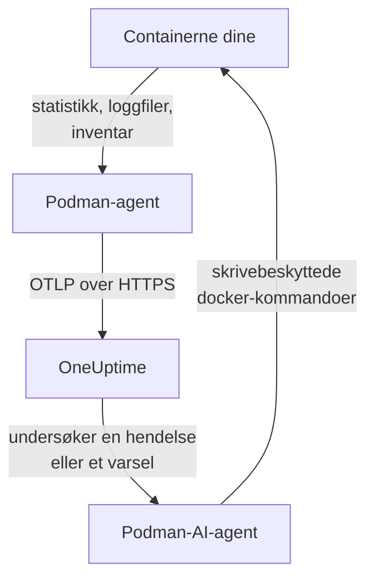

# Podman-agent

OneUptime Podman-agenten er én container du kjører på en Podman-vert. Den leser statistikken og loggfilene til hver container på verten og sender dem til OneUptime, der verten vises med containerne, metrikkene og loggene sine. En andre container, Podman-AI-agenten, lar OneUptime AI undersøke verten. [Podman-monitorer](/docs/monitor/podman-monitor) varsler på det agenten sender.

:::cards
- [Installer agenten](#installer-agenten): To containere, med `podman run` eller Podman Compose.
- [Hva agenten samler inn](#hva-agenten-samler-inn): Metrikker, logger og et inventar over hver container.
- [Containerlogger trenger k8s-file](#containerlogger-trenger-loggdriveren-k8s-file): Podman logger til journald med mindre du bytter.
- [Feilsøking](#feilsøking): Omstartsløkker, manglende metrikker, manglende logger.
:::

## Slik fungerer det

Agenten er en OpenTelemetry Collector med OneUptimes konfigurasjon innebygd. Gjennom den Docker-kompatible API-socketen til Podman leser den statistikken til hver container hvert 30. sekund og lister hver container, hvert image, hvert nettverk og hvert volum hvert 5. minutt. Den følger containernes loggfiler og sender alt til OneUptime-URL-en din over OTLP, med inntaksnøkkelen du gir den.



Verten registrerer seg med de første dataene sine, under navnet du gir den i `PODMAN_HOST_NAME`. AI-agenten er valgfri: utelat den, og collectoren fungerer på samme måte.

## Før du begynner

- Podman 4.0 eller nyere, og root-tilgang på verten.
- API-socketen til Podman på `/run/podman/podman.sock`. Slå den på med `sudo systemctl enable --now podman.socket`.
- En inntaksnøkkel. Opprett en under **Prosjektinnstillinger → Telemetri og APM → Inntaksnøkler** og kopier verdien.
- Utgående HTTPS fra verten til OneUptime-URL-en din.
- For containerlogger: containere som bruker loggdriveren `k8s-file`. Rootful Podman logger til `journald` som standard, som agenten ikke kan lese. Se [Containerlogger trenger loggdriveren k8s-file](#containerlogger-trenger-loggdriveren-k8s-file).

## Installer agenten

:::steps
### Start agenten

Erstatt `YOUR_ONEUPTIME_URL` med OneUptime-URL-en din, `YOUR_TELEMETRY_INGESTION_TOKEN` med inntaksnøkkelen og `my-podman-host` med et navn på denne verten, for eksempel `prod-podman-01`. Navnet er slik verten vises i OneUptime, så hold det stabilt: et nytt navn registrerer en ny vert.

:::tabs
@tab Podman CLI
```bash
podman run -d \
  --name oneuptime-podman-agent \
  --user 0:0 \
  --restart unless-stopped \
  -v /run/podman/podman.sock:/run/podman/podman.sock:ro \
  -v /var/lib/containers/storage:/var/lib/containers/storage:ro \
  -e ONEUPTIME_URL="YOUR_ONEUPTIME_URL" \
  -e ONEUPTIME_SERVICE_TOKEN="YOUR_TELEMETRY_INGESTION_TOKEN" \
  -e PODMAN_HOST_NAME="my-podman-host" \
  oneuptime/podman-agent:release
```

Start deretter [AI-agenten](#ai-agent) ved siden av, med de samme verdiene. **AI-undersøkelser er på som standard**: mens OneUptime AI undersøker en hendelse eller et varsel på denne verten, kjører den skrivebeskyttede `docker`-kommandoer gjennom AI-agenten, mot det Docker-kompatible API-et til Podman, og endrer ingenting med mindre du tillater rettelser. For å installere uten AI-undersøkelser, hopp over denne kommandoen.

```bash
podman run -d \
  --name oneuptime-podman-ai-agent \
  --user 0:0 \
  --restart unless-stopped \
  --read-only --tmpfs /tmp \
  -v /run/podman/podman.sock:/run/podman/podman.sock:ro \
  -e ONEUPTIME_URL="YOUR_ONEUPTIME_URL" \
  -e ONEUPTIME_SERVICE_TOKEN="YOUR_TELEMETRY_INGESTION_TOKEN" \
  -e ONEUPTIME_AI_AGENT_RESOURCE_TYPE=podman \
  -e PODMAN_HOST_NAME="my-podman-host" \
  oneuptime/resource-ai-agent:release
```
@tab Podman Compose
Lagre dette som `docker-compose.yml` i en mappe på verten. Den andre tjenesten er [AI-agenten](#ai-agent): utelat den for å kjøre collectoren uten AI-undersøkelser.

```yaml title="docker-compose.yml"
services:
  oneuptime-podman-agent:
    image: oneuptime/podman-agent:release
    container_name: oneuptime-podman-agent
    user: "0:0"
    restart: unless-stopped
    volumes:
      - /run/podman/podman.sock:/run/podman/podman.sock:ro
      - /var/lib/containers/storage:/var/lib/containers/storage:ro
    environment:
      - ONEUPTIME_URL=YOUR_ONEUPTIME_URL
      - ONEUPTIME_SERVICE_TOKEN=YOUR_TELEMETRY_INGESTION_TOKEN
      - PODMAN_HOST_NAME=my-podman-host
    logging:
      driver: json-file
      options:
        max-size: "10m"
        max-file: "3"
  oneuptime-podman-ai-agent:
    image: oneuptime/resource-ai-agent:release
    container_name: oneuptime-podman-ai-agent
    user: "0:0"
    restart: unless-stopped
    read_only: true
    tmpfs:
      - /tmp
    volumes:
      - /run/podman/podman.sock:/run/podman/podman.sock:ro
    environment:
      - ONEUPTIME_URL=YOUR_ONEUPTIME_URL
      - ONEUPTIME_SERVICE_TOKEN=YOUR_TELEMETRY_INGESTION_TOKEN
      - ONEUPTIME_AI_AGENT_RESOURCE_TYPE=podman
      - PODMAN_HOST_NAME=my-podman-host
```

Start den i den mappen:

```bash
podman compose up -d
```
:::

### Sjekk at agenten kjører

```bash
podman ps --filter name=oneuptime-podman-agent
podman logs -f oneuptime-podman-agent
```

Loggene skal vise denne linjen når collectoren har startet:

```text
Everything is ready. Begin running and processing data.
```

### Finn verten i OneUptime

Åpne **Produkter → Infrastruktur → Podman → Alle verter**. Verten vises under sitt `PODMAN_HOST_NAME` innen et minutt eller så, med containerne, metrikkene og loggene sine. AI-agenten vises som tilkoblet på vertens side **AI-agent**, og nederst på **Oversikt**.
:::

## Miljøvariabler

| Variabel | Påkrevd | Beskrivelse |
| --- | --- | --- |
| `ONEUPTIME_URL` | Ja | OneUptime-URL-en din, for eksempel `https://oneuptime.com` eller den selvhostede instansen din. Bruk `http://` og porten hvis instansen bare bruker HTTP. |
| `ONEUPTIME_SERVICE_TOKEN` | Ja | Inntaksnøkkelen fra **Prosjektinnstillinger → Telemetri og APM → Inntaksnøkler**. |
| `PODMAN_HOST_NAME` | Nei | Vertens navn i OneUptime. Standard er `podman-host`, så gi hver vert sitt eget. |
| `DOCKER_API_VERSION` | Nei | Docker API-versjonen agenten snakker med Podman-socketen. Standard er `1.44`. Senk den hvis socketen rapporterer et eldre maksimum, eller sett en tom verdi for å forhandle den (se [Feilsøking](#feilsøking)). |

For å endre en verdi, fjern agenten og kjør kommandoen på nytt (Podman CLI), eller rediger `docker-compose.yml` og kjør `podman compose up -d` (Podman Compose).

## Hva agenten samler inn

| Data | Hva det er |
| --- | --- |
| Containermetrikker | CPU (bruk, prosentandel, struping), minne (bruk, grense, prosentandel), nettverks- og blokk-I/O, oppetid, omstarter og antall prosesser, per container, hvert 30. sekund. |
| Containerlogger | Stdout og stderr fra hver container, fra filen `ctr.log` som loggdriveren `k8s-file` skriver. |
| Inventar | Hver container i hver tilstand, og hvert image, nettverk og volum, hvert 5. minutt. |

Metrikkene og loggene til hver container lagres under en tjeneste oppkalt etter containeren. Hver logglinje får en alvorlighetsgrad fra nivået den nevner, som `[ERROR]`, `level=warn` eller `{"level":"info"}`; en linje som ikke nevner noe, får strømmens: stderr er `ERROR`, stdout er `INFO`. Linjer som begynner med mellomrom eller en lukkende parentes, slås sammen med linjen før, så en stakksporing kommer inn som én post. Agentens egne logger utelates.

[Podman-overvåking](/docs/monitor/podman-monitor#innsamlede-metrikker) lister hver metrikk og hva den betyr.

## Containerlogger trenger loggdriveren k8s-file

Agenten følger `/var/lib/containers/storage/overlay-containers/*/userdata/ctr.log`, filene loggdriveren `k8s-file` i Podman skriver (`json-file` er den samme driveren i Podman). Standarddriveren for rootful Podman er `journald`, som ikke etterlater noen fil å lese, og det gjør heller ikke en ekstern driver som `syslog`. Metrikkene til en slik container kommer fortsatt inn; loggene gjør det ikke.

Sjekk loggdriveren til en container, og standarden i Podman:

```bash
podman inspect <container> --format '{{.HostConfig.LogConfig.Type}}'
podman info --format '{{.Host.LogDriver}}'
```

Kjør en container med `k8s-file`, eller bytt en Compose-tjeneste til den:

```bash
podman run --log-driver k8s-file --log-opt max-size=100m ... <image>
```

```yaml
services:
  my-app:
    image: my-app:latest
    logging:
      driver: "k8s-file"
      options:
        max-size: "100m"
```

Eller gjør den til standard for hver container som opprettes etterpå, i `containers.conf` (`/etc/containers/containers.conf` rootful, `~/.config/containers/containers.conf` rootless):

```toml title="containers.conf"
[containers]
log_driver = "k8s-file"
log_size_max = 104857600
```

Opprett deretter containerne på nytt. En container beholder loggdriveren den ble opprettet med, så det er ikke nok å starte den på nytt.

## Oppgradere agenten

Når agenten er eldre enn OneUptime-en din, vises et varseltegn ved siden av **Agentversjon** på vertens **Oversikt**. Velg det for å se disse kommandoene.

:::tabs
@tab Podman CLI
```bash
podman pull oneuptime/podman-agent:release
podman pull oneuptime/resource-ai-agent:release
podman rm -f oneuptime-podman-agent oneuptime-podman-ai-agent
```

Kjør deretter begge `podman run`-kommandoene fra [Start agenten](#start-agenten) på nytt.
@tab Podman Compose
```bash
podman compose pull
podman compose up -d
```
:::

Taggen `release` peker alltid på den nyeste utgivelsen. For å feste en versjon, bruk `oneuptime/podman-agent:<version>`, for eksempel `oneuptime/podman-agent:10.0.31`. Det samme imaget finnes i GitHub Container Registry som `ghcr.io/oneuptime/podman-agent:release`.

## Avinstallere agenten

:::tabs
@tab Podman CLI
```bash
podman rm -f oneuptime-podman-agent
podman rm -f oneuptime-podman-ai-agent
```
@tab Podman Compose
```bash
podman compose down
```
:::

Verten blir værende i OneUptime med dataene den sendte. Hvis du ikke lenger trenger den, slett den med **Slett vert** i menyen.

## AI-agent

Kommandoene og Compose-filen over, Podman-agentens `install.sh` og `docker-compose.yml` i [PodmanAgent-mappen](https://github.com/OneUptime/oneuptime/tree/master/agents/PodmanAgent) kjører alle **Podman-AI-agenten**: en andre container, `oneuptime-podman-ai-agent` (image `oneuptime/resource-ai-agent:release`), som kjører de skrivebeskyttede kommandoene OneUptime AI ber om mens den undersøker en hendelse eller et varsel på denne verten — gjennom det Docker-kompatible API-et til Podman, med `docker`-CLI-en: `docker ps -a`, `docker logs --tail 200 web`, `docker container inspect web` — og, bare hvis du tillater det, utfører rettelser som å starte en navngitt container på nytt. Den leser de samme `ONEUPTIME_URL`, `ONEUPTIME_SERVICE_TOKEN` og `PODMAN_HOST_NAME` som collectoren, så den betjener nøyaktig denne verten, og den vises på vertens side **AI-agent** i OneUptime.

- **AI-undersøkelser er på som standard.** Så snart agenten kobler seg til, undersøker OneUptime AI hendelser og varsler på denne verten med den, og vertens **Oversikt** viser agentens status. For å stoppe, sett `ONEUPTIME_AI_INVESTIGATION=false` der agenten kjører (**Endre** under **Hva AI kan gjøre** på AI-agentsiden viser hvordan), eller utelat agenten.
- Den er skrivebeskyttet med mindre du starter den med `ONEUPTIME_AI_ALLOW_WRITES=true`; `ONEUPTIME_AI_WRITE_TARGETS` (for eksempel `web-*,api-*`) begrenser hvilke containere en rettelse kan røre. Start den også med `ONEUPTIME_AI_FIXES` for å si hvordan rettelser kjører — `ask-for-approval` (en person godkjenner hver av dem), `automatic` eller `bypass-approval` — og AI-agentsiden viser det skrivebeskyttet ([Hva AI kan gjøre, satt av agenten](/docs/ai/infrastructure-ai-agents#what-ai-may-do-set-by-the-agent)).
- Den trenger den samme socketen som collectoren og kjører som root med den montert, fordi socketen eies av root — og for rootful Podman er den som kan bruke socketen, root på denne verten, `:ro` eller ikke. Agentens kommandopolicy er grensen: den kjører aldri `exec`, `run`, `rm` eller `prune`, og endrer aldri seg selv, collectoren eller noe i `ONEUPTIME_AI_PROTECTED_TARGETS` (glob-mønstre for containernavn).
- `install.sh --no-ai-agent` utelater den; `podman rm -f oneuptime-podman-ai-agent` fjerner den. Oppgrader den som collectoren: `podman pull oneuptime/resource-ai-agent:release`, fjern den og start den igjen.

Hva den kan kjøre, hvordan rettelser fungerer og hvordan du feilsøker den: [Infrastructure AI Agents](/docs/ai/infrastructure-ai-agents#docker-and-podman-hosts).

## Feilsøking

:::details Agenten starter på nytt med "client version is too new"
Agentens logger viser:

```text
Error: cannot start pipelines: failed to start "docker_stats" receiver:
Error response from daemon: client version 1.44 is too new.
Maximum supported API version is 1.41
```

En Docker-API-server som håndhever en maksimal klientversjon, avviser en nyere, så receiveren starter aldri og collectoren avslutter sammen med den. Sjekk API-versjonen Podman-socketen rapporterer:

```bash
curl -s -o /dev/null -D - --unix-socket /run/podman/podman.sock http://localhost/_ping | grep -i '^api-version'
```

Legg deretter til `-e DOCKER_API_VERSION=1.41` (eller verdien du fikk) i `podman run`, eller sett `DOCKER_API_VERSION` i Compose. Nyere servere betjener fortsatt eldre API-versjoner, så innstillingen forblir gyldig etter en oppgradering.

Vil du heller ikke slå opp tallet? Sett `DOCKER_API_VERSION` til den tomme strengen. Agenten forhandler da versjonen med socketen (én `HEAD /_ping`, deretter maksimumet socketen rapporterer) i stedet for å feste en:

```bash
podman run -d ... -e DOCKER_API_VERSION= ...
```
:::

:::details Tilgang nektet til Podman-socketen, eller ingen socket
Agenten må kjøre som root for å lese `/run/podman/podman.sock`. Sjekk at `--user 0:0` står i `podman run`-kommandoen din, eller `user: "0:0"` i Compose, og at socketen er på: `sudo systemctl enable --now podman.socket`. Rootless Podman har socketen sin på `/run/user/<uid>/podman/podman.sock` i stedet (`systemctl --user enable --now podman.socket`): monter den stien i stedet for `/run/podman/podman.sock`.
:::

:::details Verten vises som frakoblet
1. Sjekk at agenten kjører: `podman ps --filter name=oneuptime-podman-agent`
2. Se etter feil i loggene: `podman logs oneuptime-podman-agent 2>&1 | grep -i error`
3. Sjekk `ONEUPTIME_URL` og `ONEUPTIME_SERVICE_TOKEN`: nøkkelen må være en gyldig inntaksnøkkel som ikke er deaktivert.
4. Sjekk at verten kan nå OneUptime-URL-en din over nettverket.
:::

:::details Ingen metrikker vises
1. Sjekk at Podman-socketen er montert i agenten. Imaget har ikke noe skall, så se fra en engangscontainer som deler monteringene: `podman run --rm --volumes-from oneuptime-podman-agent alpine:3.19 ls -la /run/podman/podman.sock`
2. Se etter eksportfeil i loggene: `podman logs oneuptime-podman-agent 2>&1 | tail -100`
3. Sjekk at inntaksnøkkelen er gyldig og ikke har utløpt.
:::

:::details Metrikker kommer inn, men ingen containerlogger
Containerne dine bruker mest sannsynlig `journald`, standardloggdriveren i Podman. Sjekk hvilke filer agenten overvåker, og hvilken driver en container bruker:

```bash
podman logs oneuptime-podman-agent 2>&1 | grep -E "Started watching file|no files match"
podman inspect <container> --format '{{.HostConfig.LogConfig.Type}}'
```

Hvis agenten rapporterer `no files match the configured criteria`, bytt containerne til `k8s-file` og opprett dem på nytt, slik [Containerlogger trenger loggdriveren k8s-file](#containerlogger-trenger-loggdriveren-k8s-file) viser.
:::

:::details Loggene havner på en annen vert, eller verten heter podman-host
Vertens navn kommer fra `PODMAN_HOST_NAME`. En agent som startes uten den, rapporterer `podman-host`, så hver vert som er satt opp slik, ser ut som den samme; endre navnet senere, og OneUptime registrerer en ny vert, som da har de nye dataene. Sett `PODMAN_HOST_NAME` til et eget navn på hver vert, og opprett agenten på nytt. For å sjekke navnet agenten rapporterer:

```bash
podman inspect oneuptime-podman-agent --format '{{range .Config.Env}}{{println .}}{{end}}' | grep PODMAN_HOST_NAME
```
:::

## Neste trinn

:::cards
- [Podman-overvåking](/docs/monitor/podman-monitor): Varsle på CPU, minne og omstarter for containere.
- [Databaser](/docs/telemetry/databases): Databasecontainere på verten blir funnet og får egne sider.
- [Kubernetes-agent](/docs/telemetry/kubernetes-agent): Overvåk en Kubernetes-klynge i stedet.
- [OpenTelemetry-collector på verten](/docs/telemetry/host-otel-collector): Overvåk selve maskinen: CPU, disker, prosesser og logger.
:::
