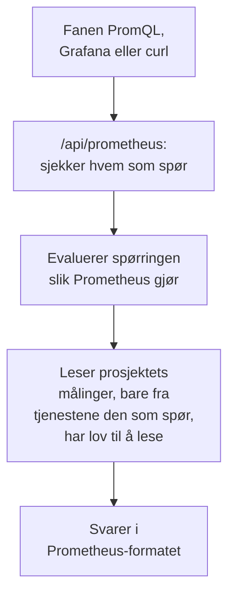

# Spør etter målinger med PromQL

PromQL er spørrespråket til Prometheus, og det språket de fleste som lager diagrammer av målinger, allerede kan. OneUptime leser målingene i prosjektet ditt med det: i fanen **PromQL** under Målinger, og gjennom et Prometheus-kompatibelt API som Grafana, eller ethvert verktøy med en Prometheus-datakilde, kan peke på.

:::cards
- [Skriv en spørring](#skriv-en-spørring): Kjør PromQL på siden Målinger, og se en graf eller en tabell.
- [Slik navngis målinger](#slik-navngis-målinger): Slik leses navn og attributter fra OpenTelemetry i PromQL.
- [Koble til Grafana](#koble-til-grafana): Legg til OneUptime som en Prometheus-datakilde.
- [Grenser](#grenser): Hva en spørring kan lese, og hvor lenge.
:::

## Slik fungerer det

Fanen PromQL og Grafana bruker det samme API-et. OneUptime sjekker at den som spør, har lov til å lese prosjektets målinger, leser bare tjenestene den har lov til å lese, og evaluerer spørringen slik Prometheus gjør.



## Før du begynner

- **Målinger som kommer inn.** Send dem med [OpenTelemetry](/docs/telemetry/open-telemetry), eller fra en agent som [OpenTelemetry-collectoren for verter](/docs/telemetry/host-otel-collector).
- **En rolle som kan lese målinger.** Project Owner, Project Admin, Project Member, Viewer, Telemetry Admin, Telemetry Member eller Telemetry Viewer, eller en egendefinert rolle med tillatelsen Read Metrics. En rolle som er begrenset til bestemte tjenester, leser bare målingene deres.
- **For Grafana eller et skript: en API-nøkkel for prosjektet** med en av disse rollene eller tillatelsen Read Metrics. Se [Opprett en API-nøkkel](/docs/api-reference/api-reference#opprett-en-api-nøkkel). På OneUptime Cloud krever API-nøkler abonnementet **Growth**.

## Skriv en spørring

:::steps
### Åpne PromQL

Åpne **Målinger** og klikk på fanen **PromQL**.

### Skriv spørringen

Skriv den i redigeringsverktøyet, velg et eksempel under **Eksempler**, eller start fra **Legg til et målingsnavn**, som viser målingene i prosjektet ditt med navnene PromQL gir dem.

### Kjør den

Klikk på **Kjør spørring**, eller trykk Ctrl+Enter (⌘+Enter på en Mac). **Graf** tegner spørringen over tidsintervallet; **Tabell** viser verdien til hver serie ved slutten av det.
:::

Noen spørringer å starte med:

```text title="PromQL"
# Requests per second, by service
sum by (job) (rate(http_requests_total[5m]))

# The 95th percentile of a latency histogram
histogram_quantile(0.95, sum by (le) (rate(http_server_request_duration_bucket[5m])))

# The five hosts using the most memory
topk(5, system_memory_usage)
```

Redigeringsverktøyet viser hva som gikk galt med en spørring som ikke kan kjøres, og hvor: for `rate(http_requests_total)` sier det for eksempel at funksjonen trenger et intervall som `[5m]`.

## Slik navngis målinger

OneUptime lagrer målinger på OpenTelemetry-måten. PromQL leser dem med navnene som Prometheus' egen OpenTelemetry-støtte gir dem, så en spørring skrevet for Prometheus fungerer her:

| I OneUptime | I PromQL |
| --- | --- |
| En gauge `system.cpu.utilization` | `system_cpu_utilization` |
| En teller `http.requests` | `http_requests`, eller `http_requests_total` |
| Et histogram `http.server.request.duration` | `http_server_request_duration_bucket` (med `le`), `_count` og `_sum` |
| En summary `rpc.latency` | `rpc_latency` (med `quantile`), `_count` og `_sum` |
| Et attributt `http.route` | Etiketten `http_route` |
| Et ressursattributt `service.name` | Etiketten `resource_service_name`, og `job` |
| Et ressursattributt `service.instance.id` | Etiketten `resource_service_instance_id`, og `instance` |

- **Punktum og bindestreker blir understreker** i målings- og etikettnavn. For å angi en måling eller en etikett nøyaktig slik den er lagret, setter du navnet i anførselstegn, slik Prometheus 3 gjør: `{"http.server.request.duration", "http.route"="/checkout"}`.
- **Delta-tellere summeres** fra starten av spørringens tidsintervall, så `rate()` og `increase()` leser dem som en hvilken som helst annen teller.
- **Eksponentielle histogrammer** har `_count` og `_sum`, men ingen bøtter.

## Koble til Grafana

:::steps
### Opprett en API-nøkkel

I OneUptime åpner du **Prosjektinnstillinger → Avansert → API-nøkler** og klikker på **Opprett API-nøkkel**. Gi nøkkelen en rolle som kan lese telemetri, eller tillatelsen Read Metrics.

### Legg til en Prometheus-datakilde

I Grafana åpner du **Connections → Data sources → Add data source** og velger **Prometheus**.

### Angi server-URL-en

Sett **Prometheus server URL** til OneUptime-adressen din etterfulgt av `/api/prometheus`. På OneUptime Cloud er det `https://oneuptime.com/api/prometheus`. Fanen **PromQL** viser adressen til din egen server, med en kopieringsknapp.

### Send API-nøkkelen

Under **HTTP headers** legger du til headeren `Authorization` med verdien `Bearer`, etterfulgt av et mellomrom og API-nøkkelen din. Basic-autentisering fungerer også: et hvilket som helst brukernavn, med API-nøkkelen som passord.

### Lagre og test

Klikk på **Save & test**. Grafana kjører en spørring og sier at datakilden fungerer.
:::

Alle andre Prometheus-klienter fungerer på samme måte. Med curl:

```bash title="Query OneUptime's Prometheus API"
curl -H "Authorization: Bearer $ONEUPTIME_API_KEY" \
  "https://oneuptime.com/api/prometheus/api/v1/query?query=up"
```

## API-et

API-et svarer på rutene i Prometheus' HTTP-API, med `GET` eller `POST`, under `/api/prometheus`:

| Rute | Hva den svarer på |
| --- | --- |
| `/api/v1/query` | En spørring på ett tidspunkt (`time`, som standard nå). |
| `/api/v1/query_range` | En spørring ved hvert `step` fra `start` til `end`. |
| `/api/v1/series` | Seriene som `match[]` velger. |
| `/api/v1/labels` | Etikettnavn, for seriene `match[]` velger, eller for alle målinger. |
| `/api/v1/label/<name>/values` | Verdiene til én etikett. `__name__` lister opp målingsnavnene. |
| `/api/v1/metadata` | Typen, hjelpeteksten og enheten til hver måling. |

Tidspunkter er Unix-sekunder eller RFC 3339, varigheter er sekunder eller en varighet som `15s`, og svarene er i Prometheus-formatet. `/api/v1/status/buildinfo` svarer som en Prometheus 3-server; regler og varsler er tomme, fordi OneUptime varsler med [monitorer](/docs/monitor/metrics-monitor).

## Hva PromQL dekker

- **Selektorer** med alle typer etikettfiltre (`=`, `!=`, `=~`, `!~`), intervaller, `offset`, `@` (med `start()` og `end()`) og underspørringer.
- **Operatorer**: aritmetikk, sammenligninger (med `bool`), `and`, `or`, `unless`, og vektormatching med `on`, `ignoring`, `group_left` og `group_right`.
- **Aggregeringer**: `sum`, `avg`, `min`, `max`, `count`, `group`, `stddev`, `stdvar`, `topk`, `bottomk`, `quantile` og `count_values`, med `by` eller `without`.
- **Funksjoner**: `rate`, `irate`, `increase`, `delta`, `idelta`, `deriv`, `predict_linear`, `histogram_quantile`, alle `*_over_time`-funksjoner, `changes`, `resets`, `absent`, `label_replace`, `label_join`, `sort`, `clamp`, `round`, matematikk- og datofunksjonene, og flere.

Prometheus' funksjoner for native histogrammer, som `histogram_count()`, er ikke tilgjengelige: OneUptime lagrer histogrammer med bøtter, som `histogram_quantile()` og seriene `_count` og `_sum` leser.

## Grenser

Hver spørring er avgrenset, slik at et dashbord med mange paneler ikke kan overbelaste OneUptime:

| Grense | Verdi |
| --- | --- |
| Punkter i én serie i en intervallspørring | 11 000 |
| Verdier én spørring kan lese og holde | 5 000 000 |
| Målepunkter én selektor kan lese | 1 000 000 |
| Tid en lesing kan ta | 30 sekunder |
| Tid evalueringen kan ta | 30 sekunder |
| Hvor langt tilbake en selektor ser etter den siste verdien i en serie | 5 minutter |
| Steget til en underspørring når spørringen utelater det | 1 minutt |

## Feilsøking

:::details Grafana sier at datakilden ikke fungerer
Sjekk at URL-en slutter på `/api/prometheus`, og at headeren `Authorization` inneholder `Bearer`, et mellomrom og API-nøkkelen. En nøkkel uten en rolle som kan lese målinger, blir avvist: gi den en under **Prosjektinnstillinger → Avansert → API-nøkler**.
:::

:::details En måling fra utforskeren gir ingen treff
PromQL-navnet har understreker der det lagrede navnet har punktum, og et histogram leses gjennom `_bucket`, `_count` eller `_sum`. **Legg til et målingsnavn** i fanen PromQL viser hvert navn slik PromQL skriver det.
:::

:::details "The query reads more than 1,000,000 metric points"
Spørringen ber om mer enn en lesing kan romme. Legg til etikettfiltre, forkort tidsintervallet, eller bruk et større steg.
:::

## Neste steg

:::cards
- [Metrikkutforsker](/docs/telemetry/metrics-explorer): Vis målinger i diagrammer uten å skrive en spørring.
- [Metrikk-overvåking](/docs/monitor/metrics-monitor): Få varsel når en måling krysser en grense.
- [Eksterne datakilder](/docs/dashboards/data-sources): Vis en ekstern Prometheus på dashbordene dine.
:::
