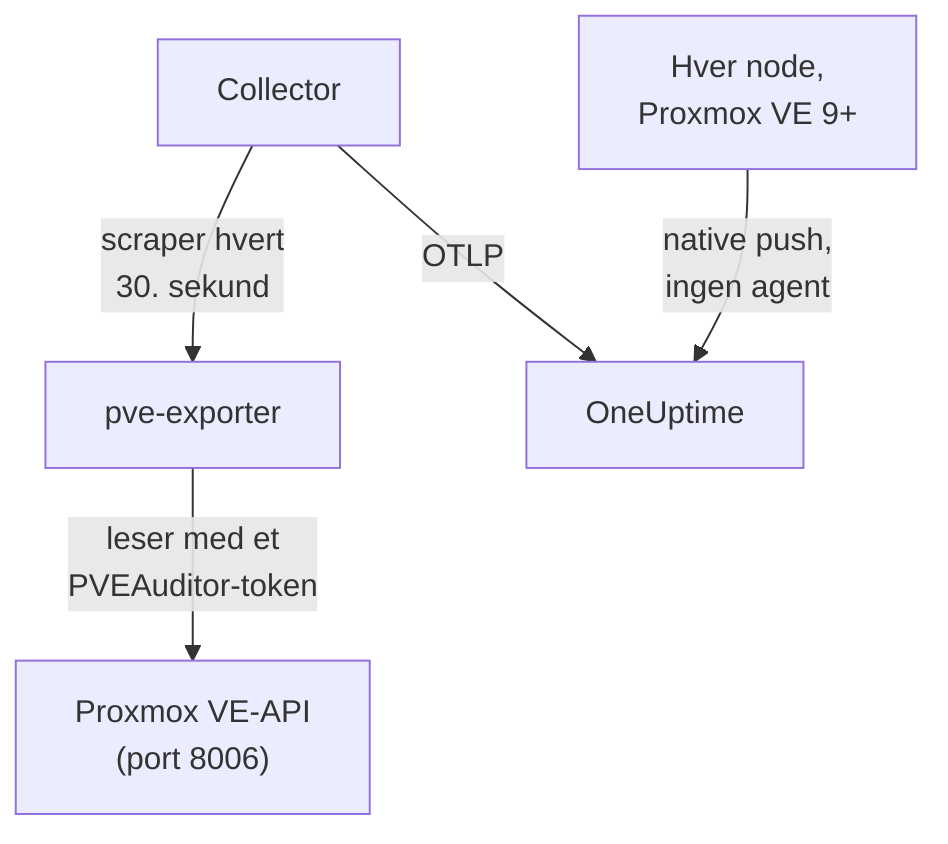

# Proxmox-agent

OneUptime Proxmox-agenten overvåker en Proxmox VE-klynge: nodene, QEMU-VM-ene, LXC-containerne, lagringen, HA-tilstanden, sikkerhetskopidekningen og replikeringen. Den leser klyngen gjennom Proxmox VE-API-et med et skrivebeskyttet token og sender det den finner til OneUptime, der klyngen vises med nodene, gjestene og lagringen sin. På Proxmox VE 9 og nyere kan nodene også sende sine egne metrikker selv, uten å installere noe. [Proxmox-monitorer](/docs/monitor/proxmox-monitor) varsler på det som kommer inn.

:::cards
- [Velg hvordan du kobler til](#velg-hvordan-du-kobler-til): Agenten, eller den innebygde pushen i Proxmox VE 9.
- [Installer agenten](#installer-agenten): Et API-token, deretter installasjonsskriptet eller Docker Compose.
- [Native push](#alternativ-uten-installasjon-native-opentelemetry-push-i-proxmox-ve-9): Proxmox VE 9 sender metrikkene sine selv.
- [Feilsøking](#feilsøking): Et diagnoseskript, og de vanlige problemene.
:::

## Slik fungerer det

Agenten er et sett containere du kjører med Docker Compose på én maskin: [prometheus-pve-exporter](https://github.com/prometheus-pve/prometheus-pve-exporter) leser Proxmox VE-API-et på port 8006, en OpenTelemetry Collector scraper eksportøren hvert 30. sekund og stempler hver metrikk med klyngens navn, og Proxmox-AI-agenten lar OneUptime AI lese klyngen mens den undersøker. Den innebygde pushen i Proxmox VE 9 sender i stedet metrikkene til hver node rett til OneUptime.



Klyngen registrerer seg med de første dataene sine, under navnet agenten stempler på hver metrikk som `proxmox.cluster.name`.

## Velg hvordan du kobler til

| | Agenten | Native push |
| --- | --- | --- |
| Proxmox VE | Enhver støttet versjon | 9.0 eller nyere |
| Å installere | Docker Compose på én maskin | Ingenting: en metrikkserver i Proxmox-webgrensesnittet |
| Noder, gjester og lagring | Ja | Ja |
| HA-tilstand, start ved oppstart, sikkerhetskopidekning og replikering | Ja | Nei |
| Proxmox-AI-agent | Ja | Nei |

Malene **HA Resource in Error State**, **Guest Down**, **Guest Not Backed Up** og **Replication Failing** trenger agenten. Bruk det ene eller det andre for en klynge: å kjøre begge rapporterer hver ressurs to ganger.

## Før du begynner

- Docker Engine 20.10 eller nyere med Docker Compose v2-pluginen, på en maskin som kan nå Proxmox VE-API-et på port 8006.
- Et root-skall på en hvilken som helst Proxmox VE-node, eller Proxmox-webgrensesnittet, for å opprette et API-token.
- En inntaksnøkkel. Opprett en under **Prosjektinnstillinger → Telemetri og APM → Inntaksnøkler** og kopier verdien.
- Utgående HTTPS fra den maskinen til OneUptime-URL-en din.

### Hvor du kjører agenten

Agenten spør Proxmox VE-API-et over nettverket, så den trenger ikke å ligge på en klyngenode, og det bør den heller ikke: kjør den på en maskin som overlever en nodefeil (en liten overvåkings-VM på separat maskinvare, en administrasjonsvert), eller pek `PVE_HOST` mot en virtuell IP eller et round-robin-DNS-navn i stedet for adressen til én node. Hvis agentens API-mål er noden som nettopp døde, dør overvåkingen din med den. Det ene unntaket er den valgfrie journald-loggpipelinen, som må kjøre på en Proxmox VE-node (se [Send Proxmox-tjenestelogger](#valgfritt-send-proxmox-tjenestelogger)).

## Installer agenten

:::steps
### Opprett et skrivebeskyttet API-token

Agenten leser klyngen med et API-token som har rollen **PVEAuditor**, som kan lese og ingenting annet.

:::tabs
@tab Shell
Som root på en hvilken som helst Proxmox VE-node:

```bash
pveum user add monitoring@pam
pveum acl modify / --roles PVEAuditor --users monitoring@pam
pveum user token add monitoring@pam oneuptime --privsep 1
pveum acl modify / --roles PVEAuditor --tokens 'monitoring@pam!oneuptime'
```

Den første kommandoen feiler bare, uskadelig, hvis `monitoring@pam` allerede finnes: API-tokener har sin egen secret, så brukeren trenger verken passord eller systemkonto. `pveum user token add` skriver ut tokenets secret én gang; token-ID-en er `monitoring@pam!oneuptime`.
@tab Proxmox web UI
1. Gå til *Datacenter → Permissions → API Tokens* og klikk **Add**.
2. Velg (eller opprett) en bruker, gi tokenet en ID som `oneuptime`, og la **Privilege Separation** være avkrysset.
3. Kopier token-ID-en (`user@realm!tokenname`) og secreten: secreten vises bare én gang.
4. Under *Datacenter → Permissions*, legg til rollen **PVEAuditor** på stien `/` to ganger: én gang som **API Token Permission** for tokenet, og én gang som **User Permission** for brukeren.
:::

Rollen legges på brukeren i tillegg til tokenet, fordi et token med privilegieseparasjon bare får tillatelsene brukeren også har. Den må ligge på rotstien `/`, fordi eksportøren leser hvert node-, gjeste- og lagringsobjekt: en smalere sti skjuler resten av klyngen og feiler med `401`/`403 Permission check failed (/, Sys.Audit)`.

### Installer og start agenten

:::tabs
@tab install.sh
Last ned installasjonsskriptet og kjør det på maskinen som skal være vert for agenten:

```bash
curl -sSL https://raw.githubusercontent.com/OneUptime/oneuptime/master/agents/ProxmoxAgent/install.sh -o install.sh
bash install.sh
```

Skriptet spør etter OneUptime-URL-en din, inntaksnøkkelen, et navn på klyngen, Proxmox VE-API-verten, om den medfølgende eksportøren skal kjøres, og token-ID-en og secreten — og om [AI-agenten](#ai-agent) kan utføre rettelser, og i så fall etter et eget token for det og gjestene den aldri må endre. Det installerer til `/opt/oneuptime-proxmox-agent`, skriver en `.env`-fil med `0600` og starter agenten med Docker Compose. Kjører du skriptet igjen, gjenbruker det alt i den `.env`-filen i stedet for å spørre på nytt, og det er slik du [oppgraderer agenten](#oppgradere-agenten).
@tab Docker Compose
Last ned `docker-compose.yml` og `otel-collector-config.yaml` fra [ProxmoxAgent-mappen](https://github.com/OneUptime/oneuptime/tree/master/agents/ProxmoxAgent) til en ny mappe:

```bash
mkdir oneuptime-proxmox-agent && cd oneuptime-proxmox-agent
curl -fsSLO https://raw.githubusercontent.com/OneUptime/oneuptime/master/agents/ProxmoxAgent/docker-compose.yml
curl -fsSLO https://raw.githubusercontent.com/OneUptime/oneuptime/master/agents/ProxmoxAgent/otel-collector-config.yaml
```

Opprett en `.env`-fil ved siden av dem. Den inneholder tokenets secret, så hold den privat med `chmod 600 .env`:

```bash title=".env"
ONEUPTIME_URL=YOUR_ONEUPTIME_URL
ONEUPTIME_TELEMETRY_INGESTION_KEY=YOUR_TELEMETRY_INGESTION_TOKEN
PROXMOX_CLUSTER_NAME=my-proxmox-cluster
PVE_HOST=192.168.1.10
PVE_API_TOKEN_ID=monitoring@pam!oneuptime
PVE_API_TOKEN_SECRET=your-token-secret
COMPOSE_PROFILES=pve-exporter
```

`COMPOSE_PROFILES=pve-exporter` starter også den medfølgende eksportøren. Start agenten:

```bash
docker compose up -d
```
:::

Kjører du allerede prometheus-pve-exporter? Svar **n** når skriptet spør om den medfølgende skal kjøres, eller fjern `COMPOSE_PROFILES` fra `.env`, og pek agenten mot din (`host:port`, uten skjema, en adresse agentens container kan nå: `localhost` er selve containeren). Behold `PVE_API_TOKEN_ID` og `PVE_API_TOKEN_SECRET` hvis du bruker [AI-agenten](#ai-agent), som kaller API-et med det tokenet:

```bash
PVE_EXPORTER_URL=your-exporter-host:9221
```

### Sjekk at agenten kjører

```bash
docker compose ps
docker logs -f oneuptime-proxmox-agent
```

`docker compose ps` lister collectoren (`oneuptime-proxmox-agent`), den medfølgende eksportøren (`oneuptime-pve-exporter`, med mindre du bruker din egen) og AI-agenten (`oneuptime-proxmox-ai-agent`). Collectorens logger skal vise denne linjen når den har startet:

```text
Everything is ready. Begin running and processing data.
```

### Finn klyngen i OneUptime

Åpne **Produkter → Infrastruktur → Proxmox → Alle klynger**. Klyngen vises under sitt `PROXMOX_CLUSTER_NAME` omtrent et minutt etter den første scrapen, med nodene, gjestene og lagringen sin.
:::

## Miljøvariabler

Installasjonsskriptet skriver disse til `/opt/oneuptime-proxmox-agent/.env`; en Docker Compose-installasjon leser dem fra `.env` ved siden av `docker-compose.yml`. Etter at du har endret en, kjør `docker compose up -d` i den mappen.

| Variabel | Påkrevd | Beskrivelse |
| --- | --- | --- |
| `ONEUPTIME_URL` | Ja | OneUptime-URL-en din, for eksempel `https://oneuptime.com` eller den selvhostede instansen din. Bruk `http://` og porten hvis instansen bare bruker HTTP. |
| `ONEUPTIME_TELEMETRY_INGESTION_KEY` | Ja | Inntaksnøkkelen fra **Prosjektinnstillinger → Telemetri og APM → Inntaksnøkler**. |
| `PROXMOX_CLUSTER_NAME` | Ja | Klyngens navn i OneUptime, stemplet på hver metrikk som ressursattributtet `proxmox.cluster.name`. Hold det stabilt: å endre det senere registrerer en ny klynge. Standard er `proxmox-cluster`. |
| `PVE_HOST` | Ja | Proxmox VE-API-verten (en hvilken som helst node i klyngen) som eksportøren og AI-agenten spør, for eksempel `192.168.1.10`. |
| `PVE_EXPORTER_URL` | Nei | Adressen (`host:port`, uten skjema) til prometheus-pve-exporter. Standard er den medfølgende eksportøren, `pve-exporter:9221`. |
| `PVE_API_TOKEN_ID` | Medfølgende eksportør eller AI-agent | Den fullstendige ID-en til Proxmox-API-tokenet, for eksempel `monitoring@pam!oneuptime`. AI-agenten leser API-et med den med mindre den har et eget token (`ONEUPTIME_AI_PVE_API_TOKEN_ID` / `ONEUPTIME_AI_PVE_API_TOKEN_SECRET`). |
| `PVE_API_TOKEN_SECRET` | Medfølgende eksportør eller AI-agent | Secreten til Proxmox-API-tokenet. |
| `PVE_VERIFY_SSL` | Nei | Verifiser TLS-sertifikatet til Proxmox-API-et (eksportøren og AI-agenten). Standard er `false`, fordi Proxmox leveres med selvsignerte sertifikater. |
| `COMPOSE_PROFILES` | Nei | Sett til `pve-exporter` for å starte den medfølgende eksportørcontaineren. |

## Hva agenten samler inn

Collectoren scraper eksportøren hvert 30. sekund med både klynge- og nodecollectorene på, noe som også dekker eksportørens collectorer `backup-info` (klyngenivå) og `replication` (nodenivå), som er på som standard. Hver serie har en `id`-etikett som navngir ressursen: `node/<name>`, `qemu/<vmid>`, `lxc/<vmid>` eller `storage/<node>/<storage>`.

| Kategori | Metrikker |
| --- | --- |
| Tilgjengelighet | `pve_up`, `pve_uptime_seconds` |
| Node | `pve_node_info`, `pve_cpu_usage_ratio`, `pve_cpu_usage_limit`, `pve_memory_usage_bytes`, `pve_memory_size_bytes` |
| Gjest (VM eller LXC) | `pve_guest_info`, og CPU-, minne- og nettverksserier på ID-ene `qemu/*` og `lxc/*` (`pve_network_receive_bytes`, `pve_network_transmit_bytes`) |
| Lagring | `pve_disk_usage_bytes`, `pve_disk_size_bytes`, `pve_storage_info` |
| HA | `pve_ha_state` |
| Sikkerhetskopidekning | `pve_not_backed_up_total` (gjestene ingen sikkerhetskopijobb dekker; én serie på klyngenivå, uten `id`-etikett) og `pve_not_backed_up_info` (én serie per udekket gjest, med sin `id`). Dekket betyr at minst én jobb velger gjesten: om sikkerhetskopier har kjørt nylig eller lyktes, eksponeres ikke av eksportøren. |
| Replikering | `pve_replication_failed_syncs`, `pve_replication_duration_seconds`, `pve_replication_last_sync_timestamp_seconds`, `pve_replication_last_try_timestamp_seconds`, `pve_replication_next_sync_timestamp_seconds`, `pve_replication_info`, per lagringsreplikeringsjobb. `id`-etiketten deres er jobb-ID-en (for eksempel `100-0`), ikke en ressurs. |

Monitorkriterier og attributtfiltre samsvarer på likhet, ikke på et prefiks, så collectorens prosessor `transform/pve-identity` deler også `id` i tre attributter. De innebygde Proxmox-varslingsmalene filtrerer på dem, så behold prosessoren hvis du tilpasser konfigurasjonen:

| Attributt | Verdier | For `qemu/100` |
| --- | --- | --- |
| `pve.scope` | `node`, `guest`, `storage`, `cluster` (`qemu` og `lxc` er begge `guest`) | `guest` |
| `pve.type` | `node`, `qemu`, `lxc`, `storage` | `qemu` |
| `pve.id` | Alt etter den første `/` i `id` (`pve1`, `100`, `pve1/local`) | `100` |

Den opprinnelige `id`-etiketten beholdes som den er.

## Valgfritt — Send Proxmox-tjenestelogger

Som standard sender agenten bare metrikker, så klyngens side **Logger** forblir tom. Proxmox VE-tjenestene logger til systemd-journalen under åtte enheter: `pveproxy`, `pvedaemon`, `pve-firewall`, `pve-ha-crm`, `pve-ha-lrm`, `pvescheduler`, `pvestatd` og `qmeventd`. Den medfølgende `otel-collector-config.yaml` har en utkommentert `journald`-receiver for nøyaktig disse enhetene, koblet til en utkommentert `logs`-pipeline som stempler `proxmox.cluster.name`, slik at loggene havner på klyngen din.

:::steps
### Kjør agenten på en node

Journalen er per vert, så en ekstern agent kan ikke lese den. Dette er det ene oppsettet som går imot [Hvor du kjører agenten](#hvor-du-kjører-agenten): for å holde metrikkagenten utenfor klyngen, kjør i stedet en ekstra collector bare for logger på noden (kopier konfigurasjonen, og slett deretter receiveren `prometheus` og pipelinen `metrics`).

### Slå på receiveren

Fjern kommentaren foran receiveren `journald` og pipelinen `logs` i `otel-collector-config.yaml`, og foran journalvolumene i `docker-compose.yml`, slik at containeren kan lese vertens journal:

```yaml
- /var/log/journal:/var/log/journal:ro
- /etc/machine-id:/etc/machine-id:ro
```

### Bytt collector-imaget

Standardimaget `otel/opentelemetry-collector-contrib` er bygget `FROM scratch`: det har ingen `journalctl`, som journald-receiveren kjører, og kjører som en bruker som ikke kan lese journalen. Bygg denne innpakningen og pek `image:` i `docker-compose.yml` mot den:

```dockerfile title="Dockerfile"
FROM otel/opentelemetry-collector-contrib:0.161.0 AS otelcol
FROM debian:stable-slim
RUN apt-get update \
    && apt-get install -y --no-install-recommends systemd \
    && rm -rf /var/lib/apt/lists/*
COPY --from=otelcol /otelcol-contrib /otelcol-contrib
ENTRYPOINT ["/otelcol-contrib"]
CMD ["--config", "/etc/otelcol-contrib/config.yaml"]
```

Pakken `systemd` er der bare for `journalctl`, og dette imaget kjører som root, som er det som kan lese journalen. Eller dropp Docker for loggene og kjør `.deb`-filen fra `otelcol-contrib`-utgivelsen på selve noden, der `journalctl` allerede finnes.
:::

Hver node sender bare sin egen journal: for tjenestelogger fra hver node, kjør collectoren for bare logger på hver node.

### Reserveløsning uten eget image: filelog på /var/log/syslog

For å beholde standardimaget, følg syslog i stedet. Installer rsyslog på noden (`apt install rsyslog`; Debian 12 og Proxmox VE 8 og nyere leveres ikke lenger med det), monter mappen `/var/log` i containeren (`- /var/log:/var/log:ro`; mappen, ikke filen, slik at loggrotasjon ikke låser en foreldet fil), og bruk en `filelog`-receiver i stedet for journald-receiveren:

```yaml
receivers:
  filelog:
    include:
      - /var/log/syslog
    start_at: end
```

Du mister filteret per enhet (syslog inneholder alt, ikke bare de åtte tjenestene), og brukeren i standardimaget må kunne lese filen. Koble den inn i den samme utkommenterte `logs`-pipelinen (`receivers: [filelog]`).

## Alternativ uten installasjon: native OpenTelemetry-push i Proxmox VE 9+

Proxmox VE 9.0 og nyere leveres med en OpenTelemetry-metrikkserver som pusher node-, gjeste- og lagringsmetrikker til et hvilket som helst OTLP/HTTP-endepunkt, uten agent eller eksportør å installere. I Proxmox-webgrensesnittet, gå til *Datacenter → Metric Server → Add → OpenTelemetry* og fyll inn:

| Felt | Verdi |
| --- | --- |
| Server | OneUptime-verten din, for eksempel `oneuptime.com`, eller din selvhostede vert |
| Port | `443` |
| Protocol | `https` |
| Path | `/otlp/v1/metrics` |
| Headers | `{"x-oneuptime-token": "YOUR_TELEMETRY_INGESTION_TOKEN"}` |

Legg den til én gang: hver node i klyngen pusher sine egne metrikker. OneUptime gjenkjenner pushen og oversetter den til de samme `pve_*`-seriene agenten sender, så:

- klyngen registrerer seg under navnet på Proxmox-klyngen din (en frittstående node under nodenavnet sitt), og en `proxmox.cluster.name` du setter under *Resource Attributes*, brukes i stedet;
- sidene for noder, gjester og lagring, oversiktsgrafene, metrikkatalogen og varslingsmalene for CPU, minne og lagring fungerer som med agenten;
- de opprinnelige seriene `proxmox_node_*`, `proxmox_vm_*` og `proxmox_storage_*` blir værende i [Metrics Explorer](/docs/monitor/metrics-monitor) for alt annet Proxmox VE rapporterer (load average, swap, pressure stall, trafikk per NIC).

### Når en node slutter å rapportere

Hver node pusher bare sin egen status, så en node som går ned, kan ikke si det selv. Nodene som fortsatt lever, rapporterer det for den:

- Omtrent 2 minutter etter den siste rapporten vises noden som **Frakoblet** på nodesiden. **Sist sett** på nodens egen side beholder tidspunktet for dens egen siste rapport.
- Etter omtrent 5 minutter utløses **Node Offline** for den. **Cluster Quorum at Risk** teller den også som frakoblet; fordi den malen trenger et fullt 5-minutters vindu med rapporter, utløses den omtrent 7–9 minutter etter at noden ble stille.
- Med neste rapport er den **Online** igjen, og varselet gjenopprettes.

Frakoblet betyr her at noden sluttet å rapportere, ikke nødvendigvis at den er nede. En node som er oppe, men der `pvestatd` henger eller er drept, der klyngefilsystemet (`pmxcfs`) er nede, eller der nettverket til OneUptime er brutt, rapporteres på samme måte.

Det dette ikke kan dekke:

- En frittstående vert, eller en hel klynge som blir stille på én gang: det er ingen igjen til å rapportere det, så ingen varsler per node utløses. Klyngen blir i stedet **Frakoblet**, som når agenten stopper.
- En node som har vært stille i mer enn 7 dager, rapporteres ikke lenger: varselet løses, og den forsvinner fra nodesiden. En selvhostet OneUptime endrer de 7 dagene med `PVE_SILENT_NODE_RETENTION_HOURS`.
- En node du tar ut av klyngen, ser lik ut som en død node. Bruk **Remove Node** på siden dens: den forsvinner, og varselet løses. Ellers forblir den Frakoblet i opptil 7 dager.
- Nodens gjester og lagring: bare selve noden beholdes som Frakoblet. VM-ene, containerne og lagringen forsvinner fra sidene sine omtrent 15 minutter etter den siste rapporten, og gjester som HA starter på nytt på en annen node, kommer tilbake under den noden.

Etter et inntaksbrudd i OneUptime rapporteres en node som nylig ble stille, først når en av de andre har pushet igjen i 2 minutter, så selve bruddet varsler aldri for hver node. En node som allerede var Frakoblet, forblir Frakoblet gjennom et kort brudd og beholder varselet sitt; etter et brudd på mer enn 5 minutter rapporteres den igjen når de andre har pushet i 2 minutter.

I [Metrics Explorer](/docs/monitor/metrics-monitor) er disse rapportene `pve_up` = 0-punktene merket `oneuptime.proxmox.inferred` = `not-reporting`, så du alltid kan skille dem fra det en node sa om seg selv.

### Hva native push ikke kan gjøre

Native push sender bare det hver node vet om seg selv, så en del av det agenten samler inn, har ingen native motpart:

| Trenger agenten | Hvorfor |
| --- | --- |
| HA-tilstand | Pushes ikke: malen **HA Resource in Error State** trenger agenten. |
| Flagg for start ved oppstart | Pushes ikke: **Guest Down**, som bare varsler for gjester satt til å starte ved oppstart, trenger agenten. |
| Sikkerhetskopidekning og replikering | Pushes ikke: **Guest Not Backed Up** og **Replication Failing** trenger agenten. |

Hvis du trenger disse, kjør agenten i stedet, og fjern metrikkserveren: å kjøre begge rapporterer hver ressurs to ganger.

## Kjør som en systemd-tjeneste

For å starte agenten sammen med maskinen og starte den på nytt når den feiler, installer systemd-enheten dens. Den forutsetter at agenten ligger i `/opt/oneuptime-proxmox-agent`, der installasjonsskriptet legger den:

```bash
sudo cp systemd/oneuptime-proxmox-agent.service /etc/systemd/system/
sudo systemctl daemon-reload
sudo systemctl enable --now oneuptime-proxmox-agent
```

## Oppgradere agenten

Agenten rapporterer collector-versjonen filene dens fester, som sin **Agentversjon**. Når den er eldre enn versjonen denne OneUptime-utgivelsen fester, vises et varseltegn ved siden av den på klyngens **Oversikt**. Velg det for å se disse kommandoene. En agent som ble installert før filene rapporterte en versjon, viser ingen før den er oppgradert på denne måten.

Collector-imaget er festet i `docker-compose.yml`, og konfigurasjonen er en fil ved siden av, så å hente nye images alene flytter ikke agenten fremover. Kjør `install.sh` igjen: det gjenbruker hver verdi i den eksisterende `.env`-filen din (ingenting spørres om igjen), fornyer `docker-compose.yml` og `otel-collector-config.yaml` (en fil du har redigert, beholdes som `<file>.bak.<timestamp>`), henter imagene og oppretter agenten på nytt, slik at collectoren leser den nye konfigurasjonen.

```bash
curl -sSL https://raw.githubusercontent.com/OneUptime/oneuptime/master/agents/ProxmoxAgent/install.sh -o install.sh
bash install.sh
```

Installerte du den med Docker Compose i stedet? I agentens mappe, last ned begge filene på nytt (og gjør eventuelle endringer du hadde gjort i dem, på nytt), hent deretter imagene og opprett agenten på nytt:

```bash
curl -fsSLO https://raw.githubusercontent.com/OneUptime/oneuptime/master/agents/ProxmoxAgent/docker-compose.yml
curl -fsSLO https://raw.githubusercontent.com/OneUptime/oneuptime/master/agents/ProxmoxAgent/otel-collector-config.yaml
docker compose pull
docker compose up -d --force-recreate
```

## Avinstallere agenten

```bash
cd /opt/oneuptime-proxmox-agent
docker compose down
```

Slett deretter API-tokenet under *Datacenter → Permissions → API Tokens* hvis du ikke lenger trenger det.

## AI-agent

Agentens `docker-compose.yml` kjører også **Proxmox-AI-agenten**, `oneuptime-proxmox-ai-agent` (image `oneuptime/resource-ai-agent:release`). Mens OneUptime AI undersøker en hendelse eller et varsel på denne klyngen, kjører den skrivebeskyttede `pvesh`-kommandoer gjennom den — `pvesh get /cluster/status`, `pvesh get /nodes/pve1/qemu/101/status/current`, `pvesh get /nodes/pve1/tasks --errors 1 --limit 20` — og, bare hvis du tillater det, utfører rettelser som å starte en gjest eller starte den på nytt. Det finnes ingen `pvesh`-binærfil i den: hver kommando blir nøyaktig ett kall til Proxmox VE-API-et på `PVE_HOST`, med et token fra den samme `.env`-filen. Den registrerer seg som klyngen med navnet `PROXMOX_CLUSTER_NAME`, som collectoren, og vises på klyngens side **AI-agent** i OneUptime.

- **AI-undersøkelser er på som standard.** Så snart agenten kobler seg til, undersøker OneUptime AI hendelser og varsler på denne klyngen med den, og klyngens **Oversikt** viser agentens status. For å stoppe, sett `ONEUPTIME_AI_INVESTIGATION=false` der agenten kjører (**Endre** under **Hva AI kan gjøre** på AI-agentsiden viser hvordan), eller utelat agenten.
- API-tokenet er den harde grensen. Undersøkelser bruker collectorens PVEAuditor-token (`PVE_API_TOKEN_ID` / `PVE_API_TOKEN_SECRET`), som kan lese og ingenting annet; hvis du kjører din egen eksportør og ikke har noe token i `.env`, legg til et. Rettelser trenger AI-agentens eget token som kan slå gjester av og på (`VM.PowerMgmt`, for eksempel rollen `PVEVMUser` på `/vms` eller på én pool), satt som `ONEUPTIME_AI_PVE_API_TOKEN_ID` / `ONEUPTIME_AI_PVE_API_TOKEN_SECRET`.
- Den er skrivebeskyttet med mindre du setter `ONEUPTIME_AI_ALLOW_WRITES=true`; `ONEUPTIME_AI_WRITE_TARGETS` (VMID-er som `100,101`, og `<node>/<service>` for nodetjenester) begrenser hva en rettelse kan røre. Hvis agenten kjører i en gjest i denne klyngen, legg den gjestens VMID i `ONEUPTIME_AI_PROTECTED_TARGETS`. `ONEUPTIME_AI_FIXES` i den samme `.env`-filen sier hvordan rettelser kjører — `ask-for-approval` (en person godkjenner hver av dem), `automatic` eller `bypass-approval` — og AI-agentsiden viser det skrivebeskyttet ([Hva AI kan gjøre, satt av agenten](/docs/ai/infrastructure-ai-agents#what-ai-may-do-set-by-the-agent)).
- Som eksportøren verifiserer den ikke det selvsignerte sertifikatet til API-et med mindre du setter `PVE_VERIFY_SSL=true` eller peker `PVE_CA_FILE` mot klyngens CA (`/etc/pve/pve-root-ca.pem`, montert i containeren).
- Den kjører som UID 1000 uten capabilities og med et skrivebeskyttet rotfilsystem, og leser aldri `/access`, åpner aldri en konsoll og endrer aldri konfigurasjon. Slett tjenesten `oneuptime-proxmox-ai-agent` fra `docker-compose.yml` hvis du ikke bruker OneUptime AI.

Hva den kan kjøre, hvordan rettelser fungerer og hvordan du feilsøker den: [Infrastructure AI Agents](/docs/ai/infrastructure-ai-agents#proxmox-clusters). Agentens README har de nøyaktige `pveum`-kommandoene for et token for rettelser.

## Feilsøking

:::details Kjør diagnoseskriptet først
Agenten leveres med et skript, [`troubleshoot.sh`](https://github.com/OneUptime/oneuptime/blob/master/agents/ProxmoxAgent/troubleshoot.sh), som sjekker hele kjeden: container-kjøretiden, eksportørens scrape, klyngenavnet som er stemplet på hver metrikk, tokenets form, collectorens egne metrikker, og om OneUptime godtar inntaksnøkkelen. Den siste sjekken betyr mest. OneUptime avviser en dårlig nøkkel med `401` (`422` for en deaktivert nøkkel eller en nettlesernøkkel), og collectoren behandler begge som permanente: den dropper batchen og logger én `Exporting failed`-feil, som er lett å overse mens containeren forblir sunn. Skriptet spør `GET <url>/otlp/v1/validate` innenfra agentens nettverk for et direkte `200` (gyldig) eller `401` (ugyldig), og faller tilbake til `POST /fluentd/v1/logs` på eldre servere.

```bash
curl -sSL https://raw.githubusercontent.com/OneUptime/oneuptime/master/agents/ProxmoxAgent/troubleshoot.sh -o troubleshoot.sh
bash troubleshoot.sh    # add -d <dir> if you installed outside /opt/oneuptime-proxmox-agent
```

Det avslutter med en dom som navngir den mest sannsynlige årsaken.
:::

:::details Ingen klynge vises i OneUptime
1. Les collectorens logger: `docker logs oneuptime-proxmox-agent`. En `401` ved eksport betyr en dårlig inntaksnøkkel; en avvist tilkobling betyr en feil `ONEUPTIME_URL`.
2. Sjekk at eksportøren svarer. Den medfølgende eksportøren publiserer ikke porten sin på verten, så spør innenfra nettverket dens: `docker run --rm --network container:oneuptime-pve-exporter curlimages/curl -s "http://localhost:9221/pve?target=YOUR_PVE_HOST" | head` skal skrive ut `pve_*`-linjer. For din egen eksportør, spør `host:9221` direkte.
3. Sjekk at `PROXMOX_CLUSTER_NAME` er satt: klyngen finnes ut fra ressursattributtet `proxmox.cluster.name`.
:::

:::details Eksportøren returnerer 401- eller 595-feil
API-tokenet er feil eller mangler tillatelser. Sjekk formatet på token-ID-en (`user@realm!tokenname`), secreten, og at rollen **PVEAuditor** ligger på stien `/` for tokenet og for brukeren. Eksportørens egne logger viser svaret fra API-et: `docker logs oneuptime-pve-exporter`.
:::

:::details Bare nodemetrikker, ingen gjestemetrikker
Gjesteserier (ID-ene `qemu/*` og `lxc/*`) kommer fra eksportørens klyngecollector, som den medfølgende konfigurasjonen slår på med scrape-parameteren `cluster=1`. Hvis du har tilpasset `otel-collector-config.yaml`, legg parameteren `cluster: ["1"]` tilbake.
:::

:::details Metrikkene havner under feil klynge
OneUptime registrerer en Proxmox-klynge etter sitt `proxmox.cluster.name`, som agenten tar fra `PROXMOX_CLUSTER_NAME`. Å endre det etter de første dataene oppretter en ny klynge i stedet for å gi den første nytt navn.
:::

:::details Med native push vises en node som Frakoblet
Den sluttet å rapportere: en node som er nede, en `pvestatd` som henger, en stoppet `pmxcfs` eller et brutt nettverk til OneUptime ser like ut. Neste rapport bringer den tilbake. Hvis du tok noden ut av klyngen, bruk **Remove Node** på siden dens; ellers forblir den Frakoblet i opptil 7 dager. Se [Når en node slutter å rapportere](#når-en-node-slutter-å-rapportere).
:::

:::details Med native push utløses aldri Guest Down-, HA- eller sikkerhetskopivarsler
Native push sender ikke HA-tilstand, start ved oppstart, sikkerhetskopidekning eller replikering. [Installer agenten](#installer-agenten) for dem, og fjern metrikkserveren: å kjøre begge rapporterer hver ressurs to ganger.
:::

## Neste trinn

:::cards
- [Proxmox-overvåking](/docs/monitor/proxmox-monitor): Varsle på noder, gjester, lagring, HA, sikkerhetskopier og replikering.
- [Ceph-agent](/docs/telemetry/ceph): Overvåk Ceph-lagringen under Proxmox-klyngen din.
- [Infrastructure AI Agents](/docs/ai/infrastructure-ai-agents): Hva Proxmox-AI-agenten kan kjøre, og hvordan rettelser fungerer.
- [OpenTelemetry-collector på verten](/docs/telemetry/host-otel-collector): Visningen på OS-nivå av hver node.
:::
