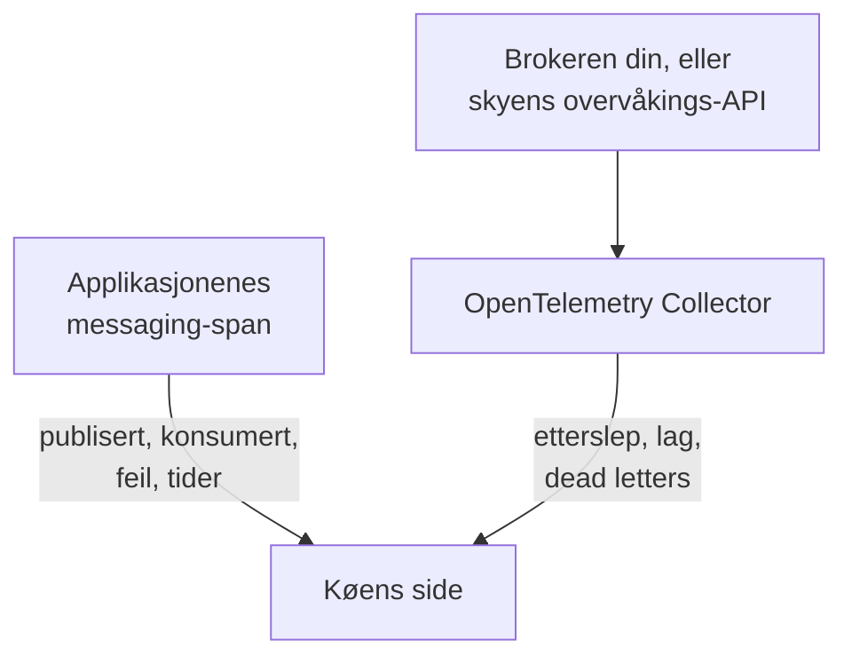

# Køer

**Queues** gir hver meldingskø, hvert topic og hvert abonnement som applikasjonene dine bruker, en egen side: hvilke tjenester som publiserer til den og hvilke som konsumerer fra den, hvor mange meldinger som går gjennom, hvor mange som feiler og hvor lang tid behandlingen tar, sporene og metrikkene og, så snart brokerens egne metrikker når OneUptime, etterslepet, consumer-lag, dead letters og struping. Køer har etiketter, eiere, etikett- og eierregler og arkivering, som alle andre ressurser. Åpne dem under **Produkter → Ressurser → Køer**.

:::cards
- [Instrumentere applikasjoner](#instrumentere-applikasjoner): Messaging-spanene som OpenTelemetry-instrumenteringen din allerede sender.
- [Helsemetrikker for brokeren](#helsemetrikker-for-brokeren): Etterslep, lag og dead letters fra brokeren din, system for system.
- [Varsling](#varsling): Ferdige maler, og forsinkede eller talte metrikker.
- [Feilsøking](#feilsøking): En kø som ikke ble opprettet, eller en brokerhelse som forblir tom.
:::

## Slik fungerer det

Det fungerer likt for alle brokere (Apache Kafka, RabbitMQ, Apache ActiveMQ og andre JMS-brokere, Amazon SQS og SNS, Google Cloud Pub/Sub, Azure Service Bus, Event Hubs og Event Grid, Apache Pulsar, Apache RocketMQ, NATS og BullMQ; se [Støttede meldingssystemer](#støttede-meldingssystemer)) og for enhver annen broker som spanene dine navngir i `messaging.system`. De fleste køer dukker opp av seg selv, fra to kilder:

| Kilde | Hva den trenger fra deg | Hva den legger til på køens side |
| --- | --- | --- |
| **Applikasjonsspor** | Instrumenterte applikasjoner (OpenTelemetry); se [Instrumentere applikasjoner](#instrumentere-applikasjoner) | Publiserte og konsumerte meldinger, feil og behandlingstid, tjenestene på hver side og selve sporene |
| **Brokermetrikker** (en OpenTelemetry Collector) | Collector-receiveren eller skrapingen for brokeren din; se [Helsemetrikker for brokeren](#helsemetrikker-for-brokeren) | **Brokerhelse**: etterslep, consumer-lag, dead letters, alderen på den eldste meldingen, struping og brokerens egne meldingsrater |



Spor forteller OneUptime at en kø finnes og hvordan applikasjoner bruker den, men ikke hvor full den er. Det kommer fra selve brokeren eller fra skyleverandørens overvåkings-API, eller, for [BullMQ](#bullmq), som holder jobbene sine i Redis og ikke har noen broker å spørre, fra en gauge som applikasjonen rapporterer.

Du kan også legge til en kø manuelt: **Queues → Opprett Queue**, med meldingssystemet og navnet på destinasjonen og, for Azure Service Bus og Event Hubs, namespacet. Skjemaet spør om disse i første trinn, **Meldingssystem**, deretter om et valgfritt navn og en beskrivelse, med etiketter under **Flere felt** (**Køinformasjon**). La namespacet stå tomt bare for en kø som applikasjonene dine når via en emulator eller et egendefinert domenenavn: spanene deres navngir ikke noe namespace, og metrikkene fra Azure Monitor når aldri en slik kø (se [Begrensninger](#begrensninger)).

## Kom i gang

:::steps
### Send sporene fra applikasjonene dine

Instrumenter applikasjonene som publiserer og konsumerer, og send sporene deres til OneUptime (se [Instrumentere applikasjoner](#instrumentere-applikasjoner)). Ingenting OneUptime-spesifikt trengs: messaging-spanene som instrumenteringen din allerede lager, navngir køene.

### Send metrikkene fra brokeren din

Finn meldingssystemet ditt under [Helsemetrikker for brokeren](#helsemetrikker-for-brokeren), og kjør collector-konfigurasjonen for det med inntaksnøkkelen din. Fanen **Dokumentasjon** på hver kø har konfigurasjonen for den køen, klar til å kopieres.

### Åpne køen

Åpne **Produkter → Ressurser → Køer**. Oppdagelsen kjører hvert 10. minutt: en kø dukker opp så snart minst 3 av spanene dens har kommet inn innen 15 minutter, eller en brokermetrikk har navngitt den.
:::

## Støttede meldingssystemer

OneUptime kjenner meldingssystemene nedenfor ved navn. Den normaliserer det instrumenteringer legger i `messaging.system`, til verdien i den andre kolonnen (den kjente OpenTelemetry-verdien der det finnes en) uten hensyn til store og små bokstaver, så `AmazonSQS`, `aws.sqs` og `aws_sqs` er ett system. `nats` og `bullmq` er ikke kjente OpenTelemetry-verdier: `nats` er det NATS-instrumenteringen i Java-agenten rapporterer, og `bullmq` er verdien du setter for BullMQ (se [BullMQ](#bullmq)).

Et system som OneUptime ikke kjenner, fungerer likevel: en velformet verdi (`ibmmq`, `solace`, `mqtt`: små bokstaver, sifre, `.`, `_` og `-`, opptil 64 tegn) beholdes slik den kom, så køene til den brokeren oppdages og vises under det navnet; bare brokerens egne metrikker trenger et system fra denne tabellen. `spring_integration` ignoreres: kanalene i Spring Integration er metodekall i én prosess, ikke en broker.

**Brokermetrikker** sier hvor helsemetrikkene til et system kommer fra: en collector-contrib-receiver, et Prometheus-endepunkt (`:port/path`, skrapet med collectorens `prometheus`-receiver), skyleverandørens overvåkings-API eller et program utenfor collectoren som sender dem over OTLP. Hvert system lenker nedenfor til oppsettet sitt, og fanen **Dokumentasjon** på hver kø gjør det om til en konfigurasjon for den køen.

| System | `messaging.system` | Godtas også | Brokermetrikker |
| --- | --- | --- | --- |
| [Amazon SNS](#amazon-sns) | `aws.sns` | `aws_sns`, `amazonsns`, `sns` | receiver `aws_cloudwatch` eller `awsfirehose` (skyovervåking) |
| [Amazon SQS](#amazon-sqs) | `aws_sqs` | `aws.sqs`, `amazonsqs`, `sqs` | receiver `aws_cloudwatch` eller `awsfirehose` (skyovervåking) |
| [Apache ActiveMQ](#apache-activemq) | `activemq` | `artemis`, `activemq_artemis` | OpenTelemetry JMX Scraper (sender via OTLP) |
| [Apache Kafka](#apache-kafka) | `kafka` | — | receiver `kafka_metrics` |
| [Apache Pulsar](#apache-pulsar) | `pulsar` | `apache_pulsar` | Prometheus (Pulsar-broker), `:8080/metrics/` |
| [Apache RocketMQ](#apache-rocketmq) | `rocketmq` | — | Prometheus (RocketMQ-broker), `:5557/metrics` |
| [Azure Event Grid](#azure-event-grid) | `eventgrid` | `azure_eventgrid`, `azure.eventgrid`, `microsoft.eventgrid` | receiver `azure_monitor` (skyovervåking) |
| [Azure Event Hubs](#azure-event-hubs) | `eventhubs` | `azure_eventhubs`, `azure.eventhubs`, `microsoft.eventhub` | receiver `azure_monitor` (skyovervåking) |
| [Azure Service Bus](#azure-service-bus) | `servicebus` | `azure_servicebus`, `azure.servicebus`, `microsoft.servicebus` | receiver `azure_monitor` (skyovervåking) |
| [BullMQ](#bullmq) | `bullmq` | — | Ingenting innebygd |
| [Google Cloud Pub/Sub](#google-cloud-pubsub) | `gcp_pubsub` | `gcp.pubsub`, `pubsub`, `google_pubsub` | receiver `googlecloudmonitoring` (skyovervåking) |
| [JMS](#jms) | `jms` | — | Ingenting innebygd |
| [NATS](#nats) | `nats` | `jetstream` | Prometheus (prometheus-nats-exporter), `:7777/metrics` |
| [RabbitMQ](#rabbitmq) | `rabbitmq` | — | receiver `rabbitmq` |

En kø er én destinasjon i ett system. For **Azure Service Bus** og **Azure Event Hubs** er namespacet også en del av den, siden to namespaces hver kan inneholde en kø som heter `orders`. **JMS** og **Apache ActiveMQ** deler køene sine: Java-applikasjoner når ActiveMQ gjennom JMS-API-et, der spanene sier `jms` uansett broker, mens brokerens egne metrikker bare kan si `activemq`, så begge havner på én kø (se [Hva som gjør to observasjoner til én kø](#hva-som-gjør-to-observasjoner-til-én-kø)).

## Hvordan køer oppdages

Hver kø registrerer om det var spor, brokermetrikker eller en person som opprettet den. Alt som senere navngir den samme køen, legges til den i stedet for å opprette en ny (se [Hva som gjør to observasjoner til én kø](#hva-som-gjør-to-observasjoner-til-én-kø)).

### Fra applikasjonsspor

Hvert 10. minutt oppsummerer OneUptime spanene som applikasjonene dine har sendt de siste 15 minuttene, og som bærer en av nøklene `messaging.system`, `messaging.destination.name`, `messaging.destination`, `message_bus.destination`, `az.namespace`, `azure.resource_provider.namespace`, `aws.sqs.queue.url`, `aws.queue_url` eller `aws.sns.topic.arn`. Alle span unntatt et SERVER-span teller: PRODUCER-, CONSUMER-, CLIENT- og INTERNAL-span, og span som **Spennstype-omkartlegger** i en sporpipeline har gitt en annen type (som Unspecified) eller ingen; et SERVER-span navngir aldri en kø.

En brokers egne span er også SERVER-span. eBPF-traceren i [Kubernetes-agenten](/docs/telemetry/kubernetes-agent#slik-ser-ebpf-spor-ut) registrerer siden til en Kafka-, MQTT- eller NATS-broker i hver utveksling (en melding den mottar, en melding den leverer) og sender de fleste av dem som PRODUCER eller CONSUMER; OneUptime lagrer dem som SERVER, så en broker står ikke blant produsentene eller konsumentene av topicene den frakter. En MQTT-broker som sender en melding videre til en abonnent, skriver den samme PUBLISH som en klient, og traceren rapporterer begge likt, så for MQTT- og NATS-publiseringer går OneUptime etter porten i den andre enden av tilkoblingen: fra port 32768 og oppover (der operativsystemer velger porten til en klient som kobler til; standardområdet i Linux starter der; Windows og macOS bruker 49152–65535) er det en abonnents, og spanet er brokerens. En applikasjon som publiserer til en MQTT- eller NATS-broker som selv lytter på en port fra 32768 og oppover, for eksempel en tilfeldig publisert Docker-port, står derfor ikke som produsent av topicene sine, og et topic som bare slike applikasjoner bruker, blir kanskje ikke oppdaget fra tracerens span i det hele tatt. En abonnent som kobler til en broker fra en port under 32768 (et innsnevret portområde, eller en port som en NAT har skrevet om), har fortsatt brokeren oppført som produsent av topicene som leveres til den.

Alle messaging-attributter i OpenTelemetry er fortsatt merket som under utvikling, så applikasjoner i ett prosjekt rapporterer de samme tingene under opptil fem generasjoner av navn. OneUptime leser dem alle, de nyeste først, og tolker aldri spannavn, der formatet endret seg i de semantiske konvensjonene 1.27, og som leverandører velger fritt:

- **Systemet**: `messaging.system`, normalisert som under [Støttede meldingssystemer](#støttede-meldingssystemer). Uten den nøkkelen `az.namespace` eller `azure.resource_provider.namespace` fra Azure-SDK-ene (`Microsoft.ServiceBus`, `Microsoft.EventHub`), den eldre nøkkelen `component` fra Azure-SDK-et, et span fra AWS-SDK-et (`rpc.system` = `aws-api`) som kaller SQS eller SNS (SNS-spanene fra Java-agenten bærer ikke `messaging.system`), eller en nøkkel med en SQS-kø-URL eller et SNS-topic-ARN.
- **Destinasjonen**: den første av nøklene `messaging.destination.template`, `messaging.destination.name`, `messaging.source.template`, `messaging.source.name`, `messaging.destination` og `message_bus.destination` som spanet bærer. Et span uten noen av dem faller tilbake på systemets egne nøkler: SQS-kø-URL-en (`aws.sqs.queue.url`, `aws.queue_url`, eller en kø-URL i `messaging.url`, `server.address` eller `net.peer.name`), SNS-topic-ARN-et (`aws.sns.topic.arn`) og, for RabbitMQ, routing-nøkkelen (`messaging.rabbitmq.destination.routing_key` eller `messaging.rabbitmq.routing_key`), som er navnet på køen når en melding går gjennom standard-exchangen.
- **Retningen**: først `messaging.operation.type`, så spantypen (PRODUCER publiserer, CONSUMER konsumerer), så den eldre `messaging.operation`, så `messaging.operation.name` og, for SQS og SNS, AWS-SDK-operasjonen i `rpc.method` (`SendMessage`, `ReceiveMessage`, …). Typen går foran de eldre nøklene fordi noen instrumenteringer fylte dem ut feil: confluent-kafka for Python skrev `receive` på produsentspanene sine.

En kø **opprettes** fra spor så snart spanene dens i 15-minuttersvinduet som en kjøring ser på, utgjør minst 3 (`MESSAGE_QUEUE_MIN_SPANS`), så et engangsskript ikke oppretter en, og bare så lenge prosjektet er under [budsjettet for automatisk oppretting](#budsjettet-for-automatisk-oppretting). Span som ikke oppretter en kø, teller likevel for en som finnes.

Hvert messaging-span merkes også med køen sin når det tas inn, så fanen **Spor** for køen viser hvert span som navngir den, også span som ble sendt før køen ble opprettet.

### Fra brokermetrikker

En brokermetrikk fra listene under [Helsemetrikker for brokeren](#helsemetrikker-for-brokeren) navngir køen sin i brokerens egen attributt (Kafkas `topic`, RabbitMQs `rabbitmq.queue.name`, Azure Monitors dimensjon `EntityName`, CloudWatchs `QueueName`), og OneUptime knytter den til den køen når den tas inn. Brokermetrikker bærer ikke `messaging.system`: hver av dem gjenkjennes på navnet (`kafka.consumer_group.lag_sum`) og, der to systemer deler et navn (Azure Monitor navngir metrikkene til Service Bus og Event Hubs likt), på ressurstypen som datapunktet bærer.

Neste oppdagelseskjøring oppretter køen hvis den ikke finnes ennå: én brokermetrikk er nok, innenfor [budsjettet for automatisk oppretting](#budsjettet-for-automatisk-oppretting). Så en kø som ingen instrumentert applikasjon berører, dukker likevel opp så snart brokeren rapporterer den.

Skyovervåkings-API-er (CloudWatch, Azure Monitor og Cloud Monitoring) publiserer hvert tall minutter etter tidspunktet det måler, og det lagres under det tidspunktet. Derfor leser hver kjøring metrikkene deres fra den siste timen i stedet for fra de siste 15 minuttene som den leser span og andre metrikker fra: et datapunkt som kommer for sent, observerer likevel køen sin, eller oppretter den.

### Fra metrikker fra meldingsklienter

Instrumenterte klienter kan også rapportere metrikker: OpenTelemetrys metrikker for meldingsklienter `messaging.client.sent.messages`, `messaging.client.consumed.messages`, `messaging.client.operation.duration` og `messaging.process.duration`, de eldre navnene deres `messaging.publish.duration`, `messaging.receive.duration`, `messaging.publish.messages`, `messaging.receive.messages`, `messaging.process.messages` og `messaging.client.published.messages`, og metrikkene til Azure SDK for Java `messaging.servicebus.messages.sent`, `messaging.servicebus.receiver.lag`, `messaging.servicebus.settlement.request.duration` og `messaging.servicebus.settlement.sequence_number`. Hvert datapunkt navngir systemet og destinasjonen sin slik et span gjør (Service Bus-metrikkene fra Azure SDK navngir ikke noe system, så navnet deres står for det), og knyttes til den køen når det tas inn, så det vises på fanen **Målinger** for køen. Det samme gjelder alle egne metrikker som bærer `messaging.system` og `messaging.destination.name` på hvert datapunkt (ikke på ressursen, der de ikke leses), som en gauge for kødybden (se [BullMQ](#bullmq)).

Metrikker fra meldingsklienter oppretter aldri en kø: det gjør spor, brokermetrikker eller en person. En klientmetrikk som navngir en eksisterende kø, holder **Sist sett** for den oppdatert, slik spanene dens gjør. En egen metrikk gjør ingen av delene: den vises bare på fanen **Målinger** for køen.

### Hva som gjør to observasjoner til én kø

Identiteten til en kø er **systemet** og **destinasjonen**, sammenlignet uten hensyn til store og små bokstaver: `Orders` og `orders` er én kø, vist under navnet slik det først ble sett. For Azure Service Bus og Event Hubs inneholder identiteten også **namespacet**:

- på et span den første DNS-etiketten i verten som SDK-et koblet til, fra `server.address`, `net.peer.name`, `peer.address` eller `network.peer.address` i den rekkefølgen, når den verten er en namespace-vert: `<namespace>.servicebus.windows.net`, eller `.servicebus.usgovcloudapi.net`, `.servicebus.chinacloudapi.cn` eller `.servicebus.cloudapi.de` i en suveren sky. Event Hubs deler domenet til Service Bus;
- på en Azure Monitor-metrikk `name` for namespacet den rapporterer om.

Ingenting annet er en del av den, så ingenting av dette deler noen gang en kø: brokerens adresse (Kafka-klienter rapporterer sjelden en, og et Azure-namespace svarer på mange), consumergruppen eller abonnementet (konsumentene av et topic er ikke egne køer), partisjonen og en dead-letter-underkø. Av disse beholder en kø bare brokerens adresse, til visning.

**JMS og ActiveMQ er én familie.** Hvert JMS-span sier `jms` uansett hvilken broker som står bak, og brokerens egne metrikker ([OpenTelemetry JMX Scraper](#apache-activemq)) kan bare si `activemq`, så OneUptime identifiserer en ActiveMQ-kø ved JMS-familien dens: spanene og brokermetrikkene for `orders` havner på én kø. Den vises som JMS til brokerens metrikker kommer, og som Apache ActiveMQ fra da av, aldri omvendt. En kø du oppretter manuelt som Apache ActiveMQ, er den samme køen.

### Hvordan destinasjonsnavn leses

Instrumenteringer navngir én kø på mange måter, og OneUptime reduserer det de rapporterer, til køens eget navn:

| System | Rapportert som | Kø |
| --- | --- | --- |
| Amazon SQS | `https://sqs.us-east-1.amazonaws.com/123456789012/orders`, en kø-URL (`otelaws` for Go legger den i `server.address`) | `orders` |
| Amazon SNS | `arn:aws:sns:us-east-1:123456789012:order-events`, et topic-ARN | `order-events` |
| Google Cloud Pub/Sub | `projects/shop/topics/orders`, et ressursnavn | `orders` |
| Azure Service Bus | `orders/Subscriptions/billing`, entitetsbanen til abonnementet `billing` på topicet | `orders` |
| Azure Service Bus | `orders/$DeadLetterQueue`, entitetsbanen til køens dead-letter-underkø | `orders` |
| Azure Event Hubs | `telemetry/ConsumerGroups/$Default/Partitions/3`, entitetsbanen til en mottaker, for consumergruppen `$Default` | `telemetry` |
| Apache Pulsar | `orders-partition-3`, en partisjon av et topic med kort navn | `persistent://public/default/orders` |
| Apache Pulsar | `acme/shop/orders`, et topic uten domenet sitt | `persistent://acme/shop/orders` |
| JMS | `queue://orders`, med prefikset for destinasjonstypen | `orders` |
| RabbitMQ | `shop:new-order:orders`, exchange, routing-nøkkel og kø på en konsument (semantiske konvensjoner 1.30 og nyere) | `orders` |
| RabbitMQ | `amq.default`, standard-exchangen, med routing-nøkkelen `orders` | `orders` |
| RabbitMQ | `,orders`, aio-pikas `{exchange},{routing key}` gjennom standard-exchangen | `orders` |
| RabbitMQ | `shop,new-order`, aio-pikas `{exchange},{routing key}` | `shop` |

En Pulsar-partisjon slås sammen med topicet sitt, og et navn uten domene fullføres slik Pulsar selv fullfører det (et kort navn i namespacet `public/default`), så navnene fra Java-agenten møter brokernes fullt kvalifiserte metrikketiketter. Et RabbitMQ-span navngir vanligvis exchangen en melding gikk gjennom, både på den publiserende og den konsumerende siden; standard-exchangen (`amq.default`, `<default>` eller et tomt navn) står for routing-nøkkelen sin, som er køens navn. De semantiske konvensjonene 1.30 setter sammen exchange, routing-nøkkel og kø med `:` (Java-agentens opt-in-navn), og OneUptime tar køen fra en konsuments sammensatte navn og exchangen fra en publisherers. aio-pika setter sammen exchange og routing-nøkkel med et komma på den publiserende siden, og OneUptime deler det på samme måte.

### Hva som ignoreres

OneUptime heller mot ingen kø: et navn som lages per forespørsel eller per konsument, ville ellers opprette en kø som ingen eier, for hver melding. Disse blir aldri køer:

- **SERVER-span**, og span der `messaging.system` er `spring_integration`.
- **Destinasjoner merket som midlertidige eller anonyme**: `messaging.destination.temporary`, `messaging.destination.anonymous`, `messaging.source.temporary` eller `messaging.source.anonymous` satt til `true`. Den eldre `messaging.temp_destination` er ikke til å stole på: Python-instrumenteringene pika og aio-pika setter den ved hver publisering.
- **Plassholdere som instrumenteringer rapporterer i stedet for et navn**: `(temporary)`, `(anonymous)`, `<generated>`, `unknown` (en Kafka-batch på tvers av flere topics), `aws:sqs` (Lambda-SQS-hendelsene fra Java-agenten), `-NamespaceOnlyMetric-` fra Azure Monitor og en verdi som OneUptimes egen datavask har erstattet helt (`[REDACTED]`).
- **Genererte destinasjoner og svardestinasjoner**: servernavngitte køer i RabbitMQ i stil med `amq.gen-JzTY20BRgKO-HjmUJj0wLg`, Springs køer `spring.gen-…` og Spring Cloud Streams køer `<destination>.anonymous.<id>` for konsumenter uten gruppe, og direct reply-to (`amq.rabbitmq.reply-to…`); midlertidige JMS-destinasjoner (`temp-queue://…`, `temp-topic://…`) og TIBCOs `$TMP$…`; advisory-topicene i ActiveMQ (`ActiveMQ.Advisory.…`); NATS-innbokser (`_INBOX.…`) og bekreftelsessubjects i JetStream (`$JS.ACK.…`); systemtopicene i Pulsar (`__change_events`, `__transaction_…` og alt under et segment `/__`); og en destinasjon som ikke er noe annet enn en UUID.
- **SNS-tekstmeldinger og mobil push**: et telefonnummer (`+15555550123`, eller `phone_number:**` fra botocore) eller et ARN for et plattformendepunkt (`arn:aws:sns:us-east-1:123456789012:endpoint/GCM/shop-app/1234`) er en enhet, ikke et topic.
- **Navn som ikke kan være én kø**: en liste over destinasjoner fra en batch (`["orders","payments"]`), et navn med et kontrolltegn og et navn på mer enn 255 tegn.

**UUID-er gjøres om til maler.** Hver UUID i en destinasjon erstattes med `{uuid}`, så navn per forespørsel som `reply-7f1c2a9e-4b1d-4c3e-9f1a-2b3c4d5e6f70` blir én kø, `reply-{uuid}`, i stedet for én kø hver.

### Budsjettet for automatisk oppretting

Spor og brokermetrikker oppretter bare køer selv så lenge prosjektet har færre enn 500 aktive, ikke-arkiverte oppdagede køer (`MESSAGE_QUEUE_AUTO_CREATE_BUDGET`, se [Justering for selvhosting](#justering-for-selvhosting)). Køer du oppretter manuelt, teller aldri og blokkeres aldri; arkiverte køer teller ikke, så [automatisk arkivering](#livssyklus-og-arkivering) frigjør budsjett; og køer som allerede finnes, fortsetter å bli matchet og oppdatert.

### Livssyklus og arkivering

- **Sist sett** er når oppdagelsen sist så køen, i spor, metrikker fra meldingsklienter eller brokermetrikker.
- **Arkiver for å avvise.** Å slette en oppdaget kø fjerner den bare til den blir sett igjen: neste observasjon bringer den tilbake som en ny kø. For å avvise en for godt **arkiverer** du den. En arkivert kø beholder identiteten sin, så alt som navngir den, forblir knyttet til den arkiverte køen i stedet for å opprette en ny.
- **Automatisk arkivering.** En oppdaget kø som ikke er sett på 7 dager (`MESSAGE_QUEUE_AUTO_ARCHIVE_DAYS`), arkiveres automatisk, med mindre en person har gitt den nytt navn, beskrevet den, gitt den etiketter eller gitt den eiere. Etiketter og eiere som etikett- eller eierregler har knyttet til av seg selv, teller ikke.
- **Gjenoppretting.** En automatisk arkivert kø gjenopprettes automatisk når den blir sett igjen. Køer du har opprettet manuelt, og køer som en person har arkivert, arkiveres eller gjenopprettes aldri av oppdagelsen. En kø som en person gjenoppretter, forblir gjenopprettet i 30 dager (eller arkivvinduet, hvis det er lengre) selv om ingenting ser den; fra neste observasjon gjelder 7-dagersregelen igjen.

## Instrumentere applikasjoner

Køer kommer fra messaging-spanene som OpenTelemetry-instrumenteringen din allerede lager; ingenting OneUptime-spesifikt trengs. Send sporene til OneUptime slik det er beskrevet under [OpenTelemetry](/docs/telemetry/open-telemetry), og sjekk deretter listen for språket ditt.

:::tabs
@tab Java
OpenTelemetrys Java-agent sporer Kafka-, RabbitMQ-, JMS- (ActiveMQ, Artemis, IBM MQ og alle andre JMS-brokere), Amazon SQS- og SNS-, Pulsar-, RocketMQ- og NATS-klienter uten kodeendringer. OneUptime leser både attributtnavnene den sender som standard, og de nyere den sender med `OTEL_SEMCONV_STABILITY_OPT_IN=messaging` (agent 2.31.0 og nyere). JMS-span sier `jms` uansett hvilken broker som står bak dem (se [JMS](#jms)).

- **Azure Service Bus og Event Hubs**: Azure SDK for Java sporer seg selv, og Java-agenten kobler den sporingen til OpenTelemetry.
- **Google Cloud Pub/Sub**: klienten sporer seg selv så snart builderne `Publisher` og `Subscriber` får en OpenTelemetry-instans og sporingsbryteren: `setOpenTelemetry(GlobalOpenTelemetry.get())` og `setEnableOpenTelemetryTracing(true)`. Ett av kallene alene sporer ingenting.
@tab .NET
- **Azure Service Bus og Event Hubs** (`Azure.Messaging.ServiceBus`, `Azure.Messaging.EventHubs`): OpenTelemetry-spanene deres er eksperimentelle i Azure SDK. Slå dem på med miljøvariabelen `AZURE_EXPERIMENTAL_ENABLE_ACTIVITY_SOURCE=true` (eller bryteren `Azure.Experimental.EnableActivitySource` nedenfor), og abonner på kildene `Azure.*`.
- **RabbitMQ.Client** 7 sporer seg selv: abonner på `RabbitMQ.Client.*`.
- **MassTransit** sporer seg selv: abonner på `MassTransit` (se [Begrensninger](#begrensninger) for hva spanene dens utelater).
- **Confluent.Kafka**: pakken `OpenTelemetry.Instrumentation.ConfluentKafka`.
- **Amazon SQS og SNS**: pakken `OpenTelemetry.Instrumentation.AWS`, med `.AddAWSInstrumentation(opt => opt.SemanticConventionVersion = SemanticConventionVersion.Latest)`. Standardsettet av attributter (`V1_28_0`) navngir en SQS-kø bare ved URL-en (`aws.queue_url`, som OneUptime leser) og et SNS-topic ikke i det hele tatt.

```csharp
// Before any Azure client is created; or set AZURE_EXPERIMENTAL_ENABLE_ACTIVITY_SOURCE=true.
AppContext.SetSwitch("Azure.Experimental.EnableActivitySource", true);

builder.Services.AddOpenTelemetry()
    .WithTracing(tracing => tracing
        .AddSource("Azure.*")
        .AddSource("RabbitMQ.Client.*")
        .AddSource("MassTransit")
        .AddOtlpExporter());
```
@tab Node.js
- `@opentelemetry/auto-instrumentations-node` sporer `amqplib` (RabbitMQ), `kafkajs` og AWS SDK (SQS og SNS).
- **Azure Service Bus og Event Hubs**: registrer `createAzureSdkInstrumentation()` fra `@azure/opentelemetry-instrumentation-azure-sdk`.
- **Google Cloud Pub/Sub**: `new PubSub({ enableOpenTelemetryTracing: true })`.
- **BullMQ**: se [BullMQ](#bullmq); den egne telemetrien trenger to attributter lagt til.
@tab Python
- Kafka: `opentelemetry-instrumentation-kafka-python`, `opentelemetry-instrumentation-confluent-kafka` eller `opentelemetry-instrumentation-aiokafka`. RabbitMQ: `opentelemetry-instrumentation-pika` eller `opentelemetry-instrumentation-aio-pika`. SQS og SNS: `opentelemetry-instrumentation-botocore`, eller `opentelemetry-instrumentation-boto3sqs` for SQS. `opentelemetry-bootstrap -a install` velger dem som de installerte bibliotekene dine trenger.
- **Azure Service Bus og Event Hubs**: installer `azure-core-tracing-opentelemetry` og sett `settings.tracing_implementation = "opentelemetry"` (fra `azure.core.settings`).
- **Google Cloud Pub/Sub**: `PublisherOptions(enable_open_telemetry_tracing=True)` og `SubscriberOptions(enable_open_telemetry_tracing=True)`.
- Spanene fra Celery bærer ikke `messaging.system` og navngir ingen broker, så de oppretter ikke køer.
@tab Go
- **Amazon SQS og SNS**: `otelaws` (`go.opentelemetry.io/contrib/instrumentation/github.com/aws/aws-sdk-go-v2/otelaws`), lagt til med `otelaws.AppendMiddlewares(&cfg.APIOptions)`. SQS-spanene dens bærer kø-URL-en i `server.address`, som OneUptime leser som køen.
- **Google Cloud Pub/Sub**: `pubsub.ClientConfig{EnableOpenTelemetryTracing: true}`.
- **Kafka** med `segmentio/kafka-go`: OpenTelemetrys automatiske instrumentering for Go (`go.opentelemetry.io/auto`, eBPF, på Linux) sporer produsentene og konsumentene uten kodeendringer.
- OpenTelemetrys Go-contrib-biblioteker har ingen instrumentering for Kafka, RabbitMQ eller NATS. For andre klienter bruker du klientbibliotekets egen OpenTelemetry-støtte, eller setter `messaging.system`, `messaging.destination.name` og spantypen på spanene rundt sendingene og handlerne dine.
:::

## Helsemetrikker for brokeren

En broker vet det ingen applikasjon kan se: hvor mange meldinger som venter, hvor langt hver consumergruppe ligger etter, hva som havnet i en dead-letter-kø. Hver seksjon nedenfor har collector-konfigurasjonen for ett system: en komplett OpenTelemetry Collector-konfigurasjon som slutter med OTLP-eksportøren som sender til OneUptime. Legg en telemetri-inntaksnøkkel (**Prosjektinnstillinger → Telemetri og APM → Inntaksnøkler**) i `x-oneuptime-token`, erstatt `https://oneuptime.com` med din egen vert hvis du selvhoster, og kjør den med `otel/opentelemetry-collector-contrib` 0.161.0 eller nyere (hver konfigurasjon her er validert mot 0.161.0). Nyere collectorer logger at `otlphttp` er foreldet til fordel for `otlp_http`; begge navnene er den samme eksportøren. For å samle inn flere systemer slår du sammen receiverne deres i én collector.

Seksjonen **Brokerhelse** for hver kø viser metrikkene som er oppført for systemet (en gauge som verdien sin, et antall per periode summert per intervall, en teller som rate per sekund), og kombinerer en køs serier slik hver metrikk krever (de klare og ubekreftede meldingene i en RabbitMQ-kø legges sammen; consumergruppen som ligger lengst etter, er lag-en). Alt collectoren sender, finnes også i utforskeren **Målinger**. Så lenge ingen oppført metrikk har kommet inn for en kø, viser seksjonen hvor metrikkene til det systemet kommer fra, med en lenke til seksjonen for det her.

### Amazon SNS

Les CloudWatch-metrikkene til topicene med collectorens `aws_cloudwatch`-receiver, eller strøm dem gjennom en CloudWatch Metric Stream og Amazon Data Firehose til dens `awsfirehose`-receiver.

`aws_cloudwatch`-receiveren spør CloudWatchs API `GetMetricData`, ett namespace per receiver, så SNS får sin egen instans ved siden av instansen for [Amazon SQS](#amazon-sqs). Den bruker standardlegitimasjonen til AWS SDK (miljø, delt profil eller instansrolle), som trenger `cloudwatch:ListMetrics` og `cloudwatch:GetMetricData`:

```yaml
receivers:
  aws_cloudwatch/sns:
    region: us-east-1
    metrics:
      collection_interval: 5m
      period: 1m
      delay: 10m
      discovery:
        filters:
          namespace: AWS/SNS
        limit: 500

processors:
  batch: {}

exporters:
  otlphttp:
    endpoint: https://oneuptime.com/otlp
    headers:
      x-oneuptime-token: YOUR_TELEMETRY_INGESTION_TOKEN

service:
  pipelines:
    metrics:
      receivers: [aws_cloudwatch/sns]
      processors: [batch]
      exporters: [otlphttp]
```

La `stats` stå usatt, som for [Amazon SQS](#amazon-sqs). En Metric Stream bærer SNS og SQS sammen: legg til `AWS/SNS` i strømmens namespaces i oppsettet for [Amazon SQS](#amazon-sqs).

Et topic navngis likt fra begge sider: spanene rapporterer ARN-et eller navnet, og OneUptime beholder navnet etter den siste `:` i ARN-et.

| Metrikk | Vises som | Type |
| --- | --- | --- |
| `amazonaws.com/aws/sns/numberofmessagespublished` (JSON-strøm: `numberofmessagespublished`) | Messages published | Antall per periode |
| `amazonaws.com/aws/sns/numberofnotificationsdelivered` (JSON-strøm: `numberofnotificationsdelivered`) | Notifications delivered | Antall per periode |
| `amazonaws.com/aws/sns/numberofnotificationsfailed` (JSON-strøm: `numberofnotificationsfailed`) | Notifications failed | Antall per periode |
| `amazonaws.com/aws/sns/numberofnotificationsredriventodlq` (JSON-strøm: `numberofnotificationsredriventodlq`) | Redriven to dead-letter queue | Antall per periode |

### Amazon SQS

Les CloudWatch-metrikkene til køene med collectorens `aws_cloudwatch`-receiver, eller strøm dem gjennom en CloudWatch Metric Stream og Amazon Data Firehose til dens `awsfirehose`-receiver.

**Spørring mot CloudWatch** trenger ingenting på AWS-siden utenom legitimasjon. Receiveren bruker standardlegitimasjonen til AWS SDK (miljø, delt profil eller instansrolle), som trenger `cloudwatch:ListMetrics` og `cloudwatch:GetMetricData`:

```yaml
receivers:
  aws_cloudwatch/sqs:
    region: us-east-1
    metrics:
      collection_interval: 5m
      period: 1m
      delay: 10m
      discovery:
        filters:
          namespace: AWS/SQS
        # Metrics per scrape: about nine per queue. Must be set.
        limit: 500

processors:
  batch: {}

exporters:
  otlphttp:
    endpoint: https://oneuptime.com/otlp
    headers:
      x-oneuptime-token: YOUR_TELEMETRY_INGESTION_TOKEN

service:
  pipelines:
    metrics:
      receivers: [aws_cloudwatch/sqs]
      processors: [batch]
      exporters: [otlphttp]
```

- **La `stats` stå usatt.** Uten den kommer hver metrikk som ett sammendrag per periode, og det er det OneUptime leser; med den blir hver statistikk en egen serie, og grafene blander dem.
- `discovery.limit` må være satt, og begrenser metrikkene som leses per skraping: rundt ni per kø. Hver av dem koster fire delspørringer mot `GetMetricData` per skraping, som AWS fakturerer.
- `delay` venter på at CloudWatch publiserer en periode (det tar noen minutter), så med denne konfigurasjonen kommer brokermetrikkene for en kø 11 til 17 minutter for sent: en monitor over dem trenger et lengre vindu (se **Forsinkede metrikker** under [Varsling](#varsling)).
- Én receiver leser én region og ett namespace: legg til en instans per region.

**Strømming** sender metrikkene etter hvert som CloudWatch publiserer dem. Opprett en CloudWatch Metric Stream for namespacene `AWS/SQS` (og `AWS/SNS`) med utdataformatet **OpenTelemetry 1.0**, som leverer til en Amazon Data Firehose-strøm der destinasjonen er et HTTP-endepunkt: collectoren din, med en tilgangsnøkkel. Firehose leverer bare til `https://` på port 443, så collectoren trenger et sertifikat og en offentlig port 443 (for eksempel bak en lastbalanserer):

```yaml
extensions:
  awscloudwatchmetricstreams_encoding:
    format: opentelemetry1.0

receivers:
  awsfirehose:
    # Firehose delivers to HTTPS on port 443 only: expose this port as 443,
    # for example behind a load balancer.
    endpoint: 0.0.0.0:4433
    encoding: awscloudwatchmetricstreams_encoding
    access_key: ${env:FIREHOSE_ACCESS_KEY}
    tls:
      cert_file: /etc/otelcol/tls/server.crt
      key_file: /etc/otelcol/tls/server.key

processors:
  batch: {}

exporters:
  otlphttp:
    endpoint: https://oneuptime.com/otlp
    headers:
      x-oneuptime-token: YOUR_TELEMETRY_INGESTION_TOKEN

service:
  extensions: [awscloudwatchmetricstreams_encoding]
  pipelines:
    metrics:
      receivers: [awsfirehose]
      processors: [batch]
      exporters: [otlphttp]
```

En strøm i utdataformatet **JSON** (`format: json`) fungerer også: den sender hver metrikk under det rene navnet, og OneUptime skiller SQS-metrikkene fra SNS-metrikkene på `service.name` som strømmen setter (`SQS`, `SNS`).

En dead-letter-kø er en vanlig SQS-kø med egne metrikker, så den er en egen kø i OneUptime. Køer navngis bare ved navnet, ikke ved kontoen eller regionen (se [Begrensninger](#begrensninger)).

| Metrikk | Vises som | Type |
| --- | --- | --- |
| `amazonaws.com/aws/sqs/approximatenumberofmessagesvisible` (JSON-strøm: `approximatenumberofmessagesvisible`) | Messages visible | Gauge |
| `amazonaws.com/aws/sqs/approximateageofoldestmessage` (JSON-strøm: `approximateageofoldestmessage`) | Oldest message age | Gauge |
| `amazonaws.com/aws/sqs/approximatenumberofmessagesnotvisible` (JSON-strøm: `approximatenumberofmessagesnotvisible`) | Messages in flight | Gauge |
| `amazonaws.com/aws/sqs/numberofmessagessent` (JSON-strøm: `numberofmessagessent`) | Messages sent | Antall per periode |
| `amazonaws.com/aws/sqs/numberofmessagesreceived` (JSON-strøm: `numberofmessagesreceived`) | Messages received | Antall per periode |
| `amazonaws.com/aws/sqs/numberofmessagesdeleted` (JSON-strøm: `numberofmessagesdeleted`) | Messages deleted | Antall per periode |

### Apache ActiveMQ

Collectoren har ingen JMX-receiver, så kjør OpenTelemetry JMX Scraper med `OTEL_JMX_TARGET_SYSTEM=activemq` ved siden av en ActiveMQ Classic-broker; den sender brokerens destinasjonsmetrikker over OTLP.

1. La brokeren godta JMX-tilkoblinger. Med imaget `apache/activemq-classic` eller skriptet `bin/activemq` setter du `ACTIVEMQ_SUNJMX_START` før du starter den. Dette eksemplet slår av autentisering: hold porten på et privat nettverk, eller slå på `jmxremote.authenticate` med en passordfil og gi scraperen `OTEL_JMX_USERNAME` og `OTEL_JMX_PASSWORD`.

```bash
ACTIVEMQ_SUNJMX_START="-Dcom.sun.management.jmxremote.port=1099 -Dcom.sun.management.jmxremote.rmi.port=1099 -Dcom.sun.management.jmxremote.authenticate=false -Dcom.sun.management.jmxremote.ssl=false -Djava.rmi.server.hostname=activemq"
```

2. Kjør scraperen der den når den porten, med en Java-runtime. Den sender rett til OneUptime; for å sende den gjennom din egen collector i stedet peker du `OTEL_EXPORTER_OTLP_ENDPOINT` mot collectorens OTLP-receiver.

```bash
curl -fsSLo opentelemetry-jmx-scraper.jar https://github.com/open-telemetry/opentelemetry-java-contrib/releases/latest/download/opentelemetry-jmx-scraper.jar

export OTEL_JMX_SERVICE_URL=service:jmx:rmi:///jndi/rmi://activemq:1099/jmxrmi
export OTEL_JMX_TARGET_SYSTEM=activemq
export OTEL_JMX_TARGET_SOURCE=instrumentation
export OTEL_METRIC_EXPORT_INTERVAL=30000
export OTEL_SERVICE_NAME=activemq-prod
export OTEL_EXPORTER_OTLP_PROTOCOL=http/protobuf
export OTEL_EXPORTER_OTLP_ENDPOINT=https://oneuptime.com/otlp
export OTEL_EXPORTER_OTLP_HEADERS=x-oneuptime-token=YOUR_TELEMETRY_INGESTION_TOKEN
java -jar opentelemetry-jmx-scraper.jar
```

`OTEL_JMX_TARGET_SOURCE=instrumentation` beholder metrikknavnene som scraperen har brukt siden 1.53.0-alpha (`activemq.message.queue.size`, med destinasjonen i `messaging.destination.name`). OneUptime leser også navnene fra eldre scrapere og fra `OTEL_JMX_TARGET_SOURCE=legacy` (`activemq.message.current`, med destinasjonen i `destination`).

Brokerens metrikker slutter seg til køen som spanene fra JMS-klientene dens opprettet, og fra da av vises køen som Apache ActiveMQ (se [Hva som gjør to observasjoner til én kø](#hva-som-gjør-to-observasjoner-til-én-kø)). Scraperen rapporterer hver destinasjon: OneUptime ignorerer advisory-topicene, mens dead-letter-køer (`ActiveMQ.DLQ`, eller `DLQ.<destination>` med en individuell dead-letter-strategi) er egne køer. ActiveMQ Artemis har andre MBeans, som disse reglene ikke leser: Artemis-køer kommer fortsatt fra JMS-spanene sine, uten brokerhelse.

| Metrikk | Vises som | Type |
| --- | --- | --- |
| `activemq.message.queue.size` | Queue size | Gauge |
| `activemq.message.current` | Queue size (legacy names) | Gauge |
| `activemq.message.enqueued` | Enqueued | Teller, vist per sekund |
| `activemq.message.dequeued` | Dequeued | Teller, vist per sekund |
| `activemq.message.expired` | Expired | Teller, vist per sekund |
| `activemq.consumer.count` | Consumers | Gauge |
| `activemq.message.enqueue.average_duration` | Average time in queue | Gauge |
| `activemq.message.wait_time.avg` | Average time in queue (legacy names) | Gauge |

### Apache Kafka

Collectorens `kafka_metrics`-receiver leser lag for consumergrupper og partisjonsoffsets fra brokerne; slå på scraperne `topics` og `consumers`.

```yaml
receivers:
  kafka_metrics:
    brokers: ["kafka-1:9092", "kafka-2:9092"]
    # topics: each partition's log-end offset; consumers: each group's
    # committed offsets and lag. brokers: the broker count.
    scrapers: [brokers, topics, consumers]
    collection_interval: 30s
    # auth:
    #   sasl:
    #     mechanism: SCRAM-SHA-512
    #     username: ${env:KAFKA_USERNAME}
    #     password: ${env:KAFKA_PASSWORD}
    # tls:
    #   ca_file: /etc/kafka/ca.pem

processors:
  batch: {}

exporters:
  otlphttp:
    endpoint: https://oneuptime.com/otlp
    headers:
      x-oneuptime-token: YOUR_TELEMETRY_INGESTION_TOKEN

service:
  pipelines:
    metrics:
      receivers: [kafka_metrics]
      processors: [batch]
      exporters: [otlphttp]
```

For en klynge med SASL eller TLS fjerner du kommentaren fra `auth` og `tls`. Receiveren navngir hvert topic i `topic`, og det er slik metrikkene finner køen til topicet. Den rapporterer lag og committede offsets for en consumergruppe bare på topics der gruppen har committet et offset, og hopper over topics der navnet starter med `_`, Kafkas interne (`topic_match` er som standard `^[^_].*$`).

| Metrikk | Vises som | Type |
| --- | --- | --- |
| `kafka.consumer_group.lag_sum` | Consumer lag | Gauge |
| `kafka.consumer_group.lag` | Partition lag | Gauge |
| `kafka.consumer_group.offset_sum` | Consumed | Teller, vist per sekund |
| `kafka.partition.current_offset` | Produced | Teller, vist per sekund |

### Apache Pulsar

Hver broker leverer topic- og abonnementsmetrikkene sine på porten til webtjenesten sin; skrap hver broker, for en broker rapporterer bare topicene den eier for øyeblikket.

```yaml
receivers:
  prometheus:
    config:
      scrape_configs:
        - job_name: pulsar-broker
          scrape_interval: 30s
          metrics_path: /metrics/
          # Every broker: each one reports only the topics it owns.
          static_configs:
            - targets: ["pulsar-broker-0:8080", "pulsar-broker-1:8080"]
          # Keeps the families the queue page charts; remove it to keep all.
          metric_relabel_configs:
            - source_labels: [__name__]
              regex: "pulsar_(msg_backlog|subscription_back_log|storage_backlog_age_seconds|in_messages_total|out_messages_total)"
              action: keep

processors:
  batch: {}

exporters:
  otlphttp:
    endpoint: https://oneuptime.com/otlp
    headers:
      x-oneuptime-token: YOUR_TELEMETRY_INGESTION_TOKEN

service:
  pipelines:
    metrics:
      receivers: [prometheus]
      processors: [batch]
      exporters: [otlphttp]
```

- Topic- og abonnementsserier trenger `exposeTopicLevelMetricsInPrometheus=true` i `broker.conf`, som er standard.
- Pulsar merker hver serie med det fulle navnet på topicet (`persistent://public/default/orders`), og seriene til en partisjon med partisjonens (`persistent://public/default/orders-partition-3`): partisjoner legges sammen i topicet sitt.
- Etterslepet telles i oppføringer, og Pulsar teller en batch med meldinger som én oppføring.
- Pulsar gjentar `pulsar_out_messages_total` per konsument når `exposeConsumerLevelMetricsInPrometheus=true`; de seriene per konsument holdes utenfor grafene, så ingen melding telles to ganger.
- `pulsar_storage_backlog_age_seconds` viser `-1` så lenge brokeren ikke kan si det.
- De innebygde OpenTelemetry-metrikkene i Pulsar 3.3 og nyere (eksperimentelle, av som standard) bruker andre navn, som ikke vises i grafer.

| Metrikk | Vises som | Type |
| --- | --- | --- |
| `pulsar_msg_backlog` | Backlog | Gauge |
| `pulsar_subscription_back_log` | Subscription backlog | Gauge |
| `pulsar_storage_backlog_age_seconds` | Backlog age | Gauge |
| `pulsar_in_messages_total` | Messages in | Teller, vist per sekund |
| `pulsar_out_messages_total` | Messages out | Teller, vist per sekund |

### Apache RocketMQ

Sett `metricsExporterType=PROM` i brokerens `broker.conf` slik at brokeren leverer lag- og gjennomstrømningsmetrikkene sine.

```text
metricsExporterType=PROM
metricsPromExporterPort=5557
metricsPromExporterHost=0.0.0.0
```

Skrap deretter hver broker:

```yaml
receivers:
  prometheus:
    config:
      scrape_configs:
        - job_name: rocketmq-broker
          scrape_interval: 30s
          metrics_path: /metrics
          static_configs:
            - targets: ["rocketmq-broker-a:5557", "rocketmq-broker-b:5557"]

processors:
  batch: {}

exporters:
  otlphttp:
    endpoint: https://oneuptime.com/otlp
    headers:
      x-oneuptime-token: YOUR_TELEMETRY_INGESTION_TOKEN

service:
  pipelines:
    metrics:
      receivers: [prometheus]
      processors: [batch]
      exporters: [otlphttp]
```

Dette er den innebygde eksportøren i RocketMQ 5. RocketMQ 4 har ingen; den separate `rocketmq-exporter` som den bruker, rapporterer andre metrikknavn, som ikke vises i grafer. Dead-letter-topicet til en consumergruppe (`%DLQ%<group>`) er en egen kø.

| Metrikk | Vises som | Type |
| --- | --- | --- |
| `rocketmq_consumer_lag_messages` | Consumer lag | Gauge |
| `rocketmq_consumer_ready_messages` | Ready messages | Gauge |
| `rocketmq_send_to_dlq_messages_total` | Sent to dead-letter queue | Teller, vist per sekund |
| `rocketmq_messages_in_total` | Messages in | Teller, vist per sekund |

### Azure Event Grid

Azure Monitor har leverings- og dead-letter-metrikkene til topicene, som collectorens `azure_monitor`-receiver leser; de vises ennå ikke på en køside, så utforsk dem under Metrikker.

Receiveren logger på gjennom utvidelsen `azure_auth`. Gi tjenestekontohaveren rollen **Monitoring Reader** på abonnementet:

```yaml
extensions:
  azure_auth:
    service_principal:
      tenant_id: ${env:AZURE_TENANT_ID}
      client_id: ${env:AZURE_CLIENT_ID}
      client_secret: ${env:AZURE_CLIENT_SECRET}

receivers:
  azure_monitor/eventgrid:
    subscription_ids: ["${env:AZURE_SUBSCRIPTION_ID}"]
    auth:
      authenticator: azure_auth
    collection_interval: 60s
    services:
      - Microsoft.EventGrid/topics
      - Microsoft.EventGrid/systemTopics
      - Microsoft.EventGrid/domains
    maximum_number_of_records_per_resource: 1000

processors:
  batch: {}

exporters:
  otlphttp:
    endpoint: https://oneuptime.com/otlp
    headers:
      x-oneuptime-token: YOUR_TELEMETRY_INGESTION_TOKEN

service:
  extensions: [azure_auth]
  pipelines:
    metrics:
      receivers: [azure_monitor/eventgrid]
      processors: [batch]
      exporters: [otlphttp]
```

OneUptime viser ikke metrikkene fra Event Grid på siden til en kø: Azure Monitor rapporterer dem per Event Grid-ressurs og hendelsesabonnement, ikke i en form som navngir en av køene dine. De kommer inn i utforskeren **Målinger**: `azure_publishsuccesscount_total`, `azure_deliverysuccesscount_total`, `azure_deadletteredcount_total` og resten. For Event Grid-namespaces legger du til `Microsoft.EventGrid/namespaces` i `services`.

### Azure Event Hubs

Les namespacets metrikker fra Azure Monitor med collectorens `azure_monitor`-receiver, som deler dem opp per event hub etter dimensjonen EntityName.

Receiveren logger på gjennom utvidelsen `azure_auth`. Gi tjenestekontohaveren rollen **Monitoring Reader** på abonnementet:

```yaml
extensions:
  azure_auth:
    service_principal:
      tenant_id: ${env:AZURE_TENANT_ID}
      client_id: ${env:AZURE_CLIENT_ID}
      client_secret: ${env:AZURE_CLIENT_SECRET}

receivers:
  azure_monitor/eventhubs:
    subscription_ids: ["${env:AZURE_SUBSCRIPTION_ID}"]
    auth:
      authenticator: azure_auth
    collection_interval: 60s
    services: [Microsoft.EventHub/namespaces]
    maximum_number_of_records_per_resource: 1000
    metrics:
      "Microsoft.EventHub/namespaces":
        IncomingMessages: [Total]
        OutgoingMessages: [Total]
        ServerErrors: [Total]
        UserErrors: [Total]
        QuotaExceededErrors: [Total]
        ThrottledRequests: [Total]

processors:
  batch: {}

exporters:
  otlphttp:
    endpoint: https://oneuptime.com/otlp
    headers:
      x-oneuptime-token: YOUR_TELEMETRY_INGESTION_TOKEN

service:
  extensions: [azure_auth]
  pipelines:
    metrics:
      receivers: [azure_monitor/eventhubs]
      processors: [batch]
      exporters: [otlphttp]
```

Metrikkene finner event huben sin via namespacet (`name`) og event huben (`EntityName`); namespacet som spanene rapporterer som `<namespace>.servicebus.windows.net`. `maximum_number_of_records_per_resource` er hvor mange serier Azure returnerer per metrikk og namespace, 10 med mindre du øker det: hold det over antallet event hubs du har, ellers rapporteres ikke resten. La `use_batch_api` være av, slik den er som standard: batch-API-et har feilet for Event Hubs-namespaces siden collector 0.155.0.

Azure Monitor har ingen metrikk for consumer-lag for Event Hubs: `ConsumerLag` finnes bare i applikasjonsmetrikkloggene til nivåene Premium og Dedicated, som denne receiveren ikke leser.

| Metrikk | Vises som | Type |
| --- | --- | --- |
| `azure_incomingmessages_total` | Incoming messages | Antall per periode |
| `azure_outgoingmessages_total` | Outgoing messages | Antall per periode |
| `azure_servererrors_total` | Server errors | Antall per periode |
| `azure_usererrors_total` | User errors | Antall per periode |
| `azure_quotaexceedederrors_total` | Quota exceeded errors | Antall per periode |
| `azure_throttledrequests_total` | Throttled requests | Antall per periode |

### Azure Service Bus

Les namespacets metrikker fra Azure Monitor med collectorens `azure_monitor`-receiver, som deler dem opp per kø og topic etter dimensjonen EntityName.

Receiveren logger på gjennom utvidelsen `azure_auth`. Gi tjenestekontohaveren rollen **Monitoring Reader** på abonnementet:

```yaml
extensions:
  azure_auth:
    service_principal:
      tenant_id: ${env:AZURE_TENANT_ID}
      client_id: ${env:AZURE_CLIENT_ID}
      client_secret: ${env:AZURE_CLIENT_SECRET}

receivers:
  azure_monitor/servicebus:
    subscription_ids: ["${env:AZURE_SUBSCRIPTION_ID}"]
    auth:
      authenticator: azure_auth
    collection_interval: 60s
    services: [Microsoft.ServiceBus/namespaces]
    # Series Azure returns per metric and namespace (default 10): keep it
    # above your number of queues and topics.
    maximum_number_of_records_per_resource: 1000
    metrics:
      "Microsoft.ServiceBus/namespaces":
        ActiveMessages: [Average]
        DeadletteredMessages: [Average]
        IncomingMessages: [Total]
        OutgoingMessages: [Total]
        CompleteMessage: [Total]
        AbandonMessage: [Total]
        ServerErrors: [Total]
        UserErrors: [Total]
        ThrottledRequests: [Total]

processors:
  batch: {}

exporters:
  otlphttp:
    endpoint: https://oneuptime.com/otlp
    headers:
      x-oneuptime-token: YOUR_TELEMETRY_INGESTION_TOKEN

service:
  extensions: [azure_auth]
  pipelines:
    metrics:
      receivers: [azure_monitor/servicebus]
      processors: [batch]
      exporters: [otlphttp]
```

- Metrikkene finner køen eller topicet sitt via namespacet (`name`) og entiteten (`EntityName`); SDK-enes span navngir det samme namespacet som `<namespace>.servicebus.windows.net`. Et span på `orders/Subscriptions/billing` eller `orders/$DeadLetterQueue` hører til `orders`, som metrikkene.
- `maximum_number_of_records_per_resource` er hvor mange serier Azure returnerer per metrikk og namespace, 10 med mindre du øker det: hold det over antallet køer og topics du har (feilmetrikkene deler i tillegg opp hver entitet etter resultat), ellers rapporteres ikke resten.
- Azure Monitor deler ikke opp etter topicabonnement: tellingene for et topic dekker alle abonnementene.
- Listen `metrics` samler inn nøyaktig det køsiden viser, hver med den ene aggregeringen den viser; legg til en metrikk (`ScheduledMessages`, `Size`, …) for å samle inn den også.
- Receiveren lister namespacene dine én gang om dagen, så et nytt namespace kan bruke opptil 24 timer på å dukke opp.

| Metrikk | Vises som | Type |
| --- | --- | --- |
| `azure_activemessages_average` | Active messages | Gauge |
| `azure_deadletteredmessages_average` | Dead-lettered messages | Gauge |
| `azure_incomingmessages_total` | Incoming messages | Antall per periode |
| `azure_outgoingmessages_total` | Outgoing messages | Antall per periode |
| `azure_completemessage_total` | Completed messages | Antall per periode |
| `azure_abandonmessage_total` | Abandoned messages | Antall per periode |
| `azure_servererrors_total` | Server errors | Antall per periode |
| `azure_usererrors_total` | User errors | Antall per periode |
| `azure_throttledrequests_total` | Throttled requests | Antall per periode |

### BullMQ

BullMQ holder jobbene sine i Redis og har ingen broker å skrape; rapporter kødybden fra applikasjonen som en metrikk som bærer `messaging.system` og `messaging.destination.name`, slik OneUptimes egne workers gjør med `queue.size`.

BullMQs egen telemetri (innstillingen `telemetry`, som pakken `bullmq-otel` implementerer) navngir køen i `bullmq.queue.name` og setter ikke `messaging.system`, så alene oppretter den ingen kø. En `transform`-prosessor i collectoren som applikasjonene dine sender til, legger til de to nøklene som OneUptime leser, på spanene som legger til og behandler jobber og på BullMQs egne metrikker:

```yaml
receivers:
  otlp:
    protocols:
      grpc:
        endpoint: 0.0.0.0:4317
      http:
        endpoint: 0.0.0.0:4318

processors:
  # BullMQ names the queue in bullmq.queue.name and sets no
  # messaging.system: copy it into the keys OneUptime reads, on the spans
  # that publish (add) and process jobs, and on BullMQ's own metrics.
  transform/bullmq:
    error_mode: ignore
    trace_statements:
      - set(span.attributes["messaging.system"], "bullmq") where span.attributes["bullmq.queue.name"] != nil and span.attributes["messaging.system"] == nil and (span.kind == SPAN_KIND_PRODUCER or span.kind == SPAN_KIND_CONSUMER)
      - set(span.attributes["messaging.destination.name"], span.attributes["bullmq.queue.name"]) where span.attributes["messaging.system"] == "bullmq" and span.attributes["messaging.destination.name"] == nil
    metric_statements:
      - set(datapoint.attributes["messaging.system"], "bullmq") where datapoint.attributes["bullmq.queue.name"] != nil and datapoint.attributes["messaging.system"] == nil
      - set(datapoint.attributes["messaging.destination.name"], datapoint.attributes["bullmq.queue.name"]) where datapoint.attributes["messaging.system"] == "bullmq" and datapoint.attributes["messaging.destination.name"] == nil
  batch: {}

exporters:
  otlphttp:
    endpoint: https://oneuptime.com/otlp
    headers:
      x-oneuptime-token: YOUR_TELEMETRY_INGESTION_TOKEN

service:
  pipelines:
    traces:
      receivers: [otlp]
      processors: [transform/bullmq, batch]
      exporters: [otlphttp]
    metrics:
      receivers: [otlp]
      processors: [transform/bullmq, batch]
      exporters: [otlphttp]
```

Bare PRODUCER-spanene som legger til jobber og CONSUMER-spanene som behandler dem, merkes: BullMQs interne span (hente neste jobb, forlenge låser) navngir også køen, men er ikke meldinger. For kødybden observerer du jobbtellingene i applikasjonen; en gauge som selv bærer de to nøklene, trenger ingen transformasjon:

```ts
import { metrics } from "@opentelemetry/api";
import { Queue } from "bullmq";

const queue = new Queue("orders", { connection: { host: "redis" } });

metrics
  .getMeter("bullmq-queues")
  .createObservableGauge("queue.size", { unit: "{job}" })
  .addCallback(async (result) => {
    const counts = await queue.getJobCounts("waiting", "active", "delayed", "failed");
    for (const [state, count] of Object.entries(counts)) {
      result.observe(count, {
        "messaging.system": "bullmq",
        "messaging.destination.name": queue.name,
        state,
      });
    }
  });
```

Den vises på fanen **Målinger** for køen. OneUptime har ingen egne BullMQ-metrikker å vise under **Brokerhelse**.

### Google Cloud Pub/Sub

Les metrikkene til topicene og abonnementene fra Cloud Monitoring med collectorens `googlecloudmonitoring`-receiver, og list opp hver metrikktype under `metrics_list`.

Receiveren logger på med Application Default Credentials (`GOOGLE_APPLICATION_CREDENTIALS`, eller tjenestekontoen collectoren kjører som), som trenger rollen **Monitoring Viewer** på prosjektet:

```yaml
receivers:
  googlecloudmonitoring:
    project_id: my-gcp-project
    collection_interval: 2m
    # Only the metric types listed here are read.
    metrics_list:
      - metric_name: pubsub.googleapis.com/subscription/num_undelivered_messages
      - metric_name: pubsub.googleapis.com/subscription/oldest_unacked_message_age
      - metric_name: pubsub.googleapis.com/subscription/dead_letter_message_count
      - metric_name: pubsub.googleapis.com/subscription/ack_message_count
      - metric_name: pubsub.googleapis.com/topic/send_request_count

processors:
  batch: {}

exporters:
  otlphttp:
    endpoint: https://oneuptime.com/otlp
    headers:
      x-oneuptime-token: YOUR_TELEMETRY_INGESTION_TOKEN

service:
  pipelines:
    metrics:
      receivers: [googlecloudmonitoring]
      processors: [batch]
      exporters: [otlphttp]
```

- En metrikktype som mangler i `metrics_list`, leses aldri, og listen leses når collectoren starter: start den på nytt etter en endring.
- `collection_interval` er minst ett minutt. Cloud Monitoring publiserer metrikkene til Pub/Sub to til fire minutter for sent.
- Abonnementsmetrikker knyttes til abonnementets kø (`subscription_id`), topicmetrikker til topicets (`topic_id`); det er også slik spanene fra klientbibliotekene navngir dem (se [Begrensninger](#begrensninger)).

| Metrikk | Vises som | Type |
| --- | --- | --- |
| `pubsub.googleapis.com/subscription/num_undelivered_messages` | Undelivered messages | Gauge |
| `pubsub.googleapis.com/subscription/oldest_unacked_message_age` | Oldest unacked message age | Gauge |
| `pubsub.googleapis.com/subscription/dead_letter_message_count` | Dead-lettered messages | Antall per periode |
| `pubsub.googleapis.com/subscription/ack_message_count` | Acknowledged messages | Antall per periode |
| `pubsub.googleapis.com/topic/send_request_count` | Publish requests | Antall per periode |

### JMS

JMS er et API, og spanene navngir ikke brokeren bak; når brokeren er Apache ActiveMQ, kjører du OpenTelemetry JMX Scraper mot den, så metrikkene slutter seg til den samme køen, som da vises som en ActiveMQ-kø, mens andre JMS-brokere som IBM MQ ikke har noen ferdig vei for metrikker.

Køer for JMS-applikasjoner dukker opp fra spanene deres, uansett broker: se [Apache ActiveMQ](#apache-activemq) for scraperen. For alle andre brokere sender du metrikkene med `messaging.system` satt til `jms` og `messaging.destination.name` satt til køens navn på hvert datapunkt: da knyttes de til den samme køen som spanene og vises på fanen **Målinger** for den.

### NATS

Kjør prometheus-nats-exporter med `-jsz=all` mot serverens overvåkingsport. JetStream-metrikkene gjelder per strøm og konsument, ikke per subject, så de knyttes ikke til køer på subject-nivå.

Slå på serverens overvåkingsport med `-m 8222` (eller `http_port: 8222` i konfigurasjonen), og kjør deretter eksportøren:

```bash
prometheus-nats-exporter -varz -jsz=all http://nats:8222
```

Og skrap den:

```yaml
receivers:
  prometheus:
    config:
      scrape_configs:
        - job_name: nats
          scrape_interval: 30s
          metrics_path: /metrics
          static_configs:
            - targets: ["nats-exporter:7777"]

processors:
  batch: {}

exporters:
  otlphttp:
    endpoint: https://oneuptime.com/otlp
    headers:
      x-oneuptime-token: YOUR_TELEMETRY_INGESTION_TOKEN

service:
  pipelines:
    metrics:
      receivers: [prometheus]
      processors: [batch]
      exporters: [otlphttp]
```

NATS-køer er subjects (`orders.created`), navngitt av spanene fra Java-agenten, og strømmene og konsumentene i JetStream passer ikke på ett subject, så OneUptime viser ingen av dem på siden til en kø. De kommer inn i utforskeren **Målinger**: `jetstream_consumer_num_pending`, `jetstream_consumer_num_ack_pending`, `jetstream_stream_total_messages` og resten.

### RabbitMQ

Collectorens `rabbitmq`-receiver leser dybden, konsumentene og meldingsratene til hver kø fra HTTP-API-et i administrasjonspluginen, som en bruker med taggen `monitoring` og tilgang til hver virtuelle vert.

Aktiver administrasjonspluginen og opprett den brukeren. Taggen `monitoring` alene viser den ingen kø: administrasjons-API-et viser bare en bruker køene i de virtuelle vertene den har tilgang til, så gi den tilgang til hver virtuelle vert som skal overvåkes. Tomme mønstre gir den tilgangen uten noen rett til å konfigurere, publisere eller konsumere:

```bash
rabbitmq-plugins enable rabbitmq_management
rabbitmqctl add_user otel 'a-strong-password'
rabbitmqctl set_user_tags otel monitoring
# Once per virtual host to monitor; "/" is the default one.
rabbitmqctl set_permissions -p / otel "" "" ""
```

```yaml
receivers:
  rabbitmq:
    endpoint: http://rabbitmq:15672
    username: ${env:RABBITMQ_USERNAME}
    password: ${env:RABBITMQ_PASSWORD}
    collection_interval: 30s

processors:
  batch: {}

exporters:
  otlphttp:
    endpoint: https://oneuptime.com/otlp
    headers:
      x-oneuptime-token: YOUR_TELEMETRY_INGESTION_TOKEN

service:
  pipelines:
    metrics:
      receivers: [rabbitmq]
      processors: [batch]
      exporters: [otlphttp]
```

- Receiveren rapporterer hver kø under RabbitMQ-navnet. Spanene fra de fleste instrumenteringer navngir i stedet exchangen, både hos publisherere og konsumenter, så de havner på en egen kø i OneUptime. Span navngir selve køen for meldinger som sendes gjennom standard-exchangen, og hos konsumenter som Java-agenten sporer med `OTEL_SEMCONV_STABILITY_OPT_IN=messaging` (se [Begrensninger](#begrensninger)).
- Uten tilgang til en virtuell vert ser receiveren ingen av køene dens: den sender ingenting for dem og logger ingen feil.
- Tellerne for publisert, levert, bekreftet og forkastet vises først når køen har hatt den aktiviteten: inntil da sender receiveren ingenting, ikke engang 0.

| Metrikk | Vises som | Type |
| --- | --- | --- |
| `rabbitmq.message.current` | Queue depth | Gauge |
| `rabbitmq.message.published` | Published | Teller, vist per sekund |
| `rabbitmq.message.delivered` | Delivered | Teller, vist per sekund |
| `rabbitmq.message.acknowledged` | Acknowledged | Teller, vist per sekund |
| `rabbitmq.message.dropped` | Dropped | Teller, vist per sekund |
| `rabbitmq.consumer.count` | Consumers | Gauge |

## Varsling

Køer overvåkes med **Målinger**-monitorer over brokermetrikkene sine (se [Metrikk-overvåking](/docs/monitor/metrics-monitor)).

**Fra køens side.** Hver gauge og hvert antall per periode under **Brokerhelse** har **Create monitor**: den åpner en ny metrikkmonitor over den metrikken, filtrert på nøyaktig de attributtverdiene som navngir denne køen i den, med en startterskel der metrikken måler noe med en åpenbar dårlig retning: etterslep, dead letters, consumer-lag, alderen på den eldste meldingen, struping eller feil. Fire av dem starter uten terskel, fordi en fast terskel på dem villeder: partisjons-lag i Kafka (`kafka.consumer_group.lag`), som lag-en til consumergruppen allerede dekker; gjennomsnittlig tid i køen i ActiveMQ (`activemq.message.enqueue.average_duration`, `activemq.message.wait_time.avg`), et gjennomsnitt siden brokeren startet som forblir høyt lenge etter en stans; og alderen på etterslepet i Pulsar (`pulsar_storage_backlog_age_seconds`), som viser `-1` så lenge brokeren ikke kan si det. Tellere får ingen monitor: grafen deres viser en rate, og en monitor har ingen ratefunksjon.

**Tellere.** Tellerne til RabbitMQ, Apache ActiveMQ og Apache RocketMQ når collectoren som kumulative summer, som en `cumulative_to_delta`-prosessor (`cumulativetodelta` i eldre collectorer) gjør om til deltaer som en monitor kan varsle på. Konverter en kopi under et eget navn, aldri selve telleren: køsiden leser hver av disse tellerne som en løpende total og viser hvor raskt den vokser, så en teller som er gjort om til deltaer, viser tull under **Brokerhelse** og på fanen **Målinger**: jevn trafikk vises som 0 meldinger per sekund. Offsetene i Apache Kafka (`kafka.consumer_group.offset_sum`, `kafka.partition.current_offset`) og `pulsar_in_messages_total` og `pulsar_out_messages_total` i Apache Pulsar kommer som gauges, som `cumulative_to_delta` lar være: varsle i stedet på gaugene for lag og etterslep i de systemene.

Konfigurasjonen for [RabbitMQ](#rabbitmq) med en kopi av `rabbitmq.message.published` å varsle på:

```yaml
receivers:
  rabbitmq:
    endpoint: http://rabbitmq:15672
    username: ${env:RABBITMQ_USERNAME}
    password: ${env:RABBITMQ_PASSWORD}
    collection_interval: 30s

processors:
  # A copy of each counter to alert on, under a name of its own: the queue
  # page keeps charting the original.
  transform/alerting:
    error_mode: ignore
    metric_statements:
      - copy_metric(name="rabbitmq.message.published.delta") where metric.name == "rabbitmq.message.published"
  # Turns only the copies into deltas. `drop` keeps back each copy's first
  # point after a start, which would otherwise be the counter's whole total.
  cumulative_to_delta/alerting:
    initial_value: drop
    include:
      metrics:
        - rabbitmq.message.published.delta
      match_type: strict
  batch: {}

exporters:
  otlphttp:
    endpoint: https://oneuptime.com/otlp
    headers:
      x-oneuptime-token: YOUR_TELEMETRY_INGESTION_TOKEN

service:
  pipelines:
    metrics:
      receivers: [rabbitmq]
      processors: [transform/alerting, cumulative_to_delta/alerting, batch]
      exporters: [otlphttp]
```

Hvert punkt i `rabbitmq.message.published.delta` er antallet meldinger publisert siden forrige skraping, så en metrikkmonitor på den, filtrert på `resource.rabbitmq.queue.name` og summert over vinduet sitt, teller det som ble publisert i det vinduet: under 1 over 15 minutter betyr at ingen publiserer. Etter hver start av collectoren har prosessoren ingen tidligere verdi å trekke det første punktet til en kø fra, og som standard sender den det punktet som det er: hele den løpende totalen til telleren, som om hver melding køen noen gang har hatt, ble publisert i én skraping. `initial_value: drop` holder det punktet tilbake, så kopien for en kø starter med den andre skrapingen som rapporterer telleren dens. Kopier en annen teller på samme måte, med én `copy_metric`-setning og én `include`-oppføring for hver. JMX Scraper for ActiveMQ må da sende gjennom en slik collector, til en `otlp`-receiver i stedet for `rabbitmq`; tellerne til RocketMQ tar de samme to prosessorene i pipelinen for `prometheus`-receiveren sin.

**Manuelt** filtrerer du på attributtet som navngir køen i den metrikken; det er det samme for hver kø i et system:

| Varsle når | Metrikk | Filter | Aggregering |
| --- | --- | --- | --- |
| En consumergruppe i Kafka henger etter | `kafka.consumer_group.lag_sum` | `topic` = `orders` | Max |
| Den eldste meldingen i en SQS-kø blir gammel | `amazonaws.com/aws/sqs/approximateageofoldestmessage` | `Dimensions.QueueName` = `orders` | Max |
| Meldinger når en dead-letter-kø i Service Bus | `azure_deadletteredmessages_average` | `name` = `shop-prod`, `metadata_entityname` = `orders` | Max |
| Etterslepet til et Pub/Sub-abonnement vokser | `pubsub.googleapis.com/subscription/num_undelivered_messages` | `resource.subscription_id` = `orders-billing` | Max |
| Ingen konsumerer en RabbitMQ-kø | `rabbitmq.consumer.count` | `resource.rabbitmq.queue.name` = `orders` | Min |

For å overvåke hver kø i et system med én monitor grupperer du etter det attributtet i stedet for å filtrere på det: hver kø varsler da for seg (se [Varsling per serie](/docs/monitor/metrics-monitor#varsler-per-serie-group-by)). Dybden til en RabbitMQ-kø (`rabbitmq.message.current`) kommer som to serier, `state` = `ready` og `state` = `unacknowledged`. Monitoren som **Create monitor** bygger, legger dem sammen slik køsiden gjør: én spørring per tilstand, `a_ready` og `a_unacknowledged`, og formelen `a_ready + a_unacknowledged`, der startterskelen gjelder for aliaset `a`. En monitor som bygges manuelt, bør gjøre det samme, med kriteriene på formelen.

**Forsinkede metrikker.** Skyovervåkings-API-er publiserer tallene sine minutter i etterkant: det nyeste punktet fra `aws_cloudwatch`-receiveren er 11 til 17 minutter gammelt med konfigurasjonen på denne siden, og opptil 25 med receiverens standard `period` på fem minutter; punktet fra `googlecloudmonitoring`-receiveren er opptil 9. En monitor over metrikker fra SQS, SNS eller Pub/Sub trenger derfor et lengre vindu enn det, ellers ser den ingen data og utløses aldri; **Create monitor** starter disse monitorene med 30 og 15 minutter.

## Begrensninger

- **Destinasjoner med samme navn i to klynger eller kontoer er én kø.** Et Kafka-topic, en RabbitMQ-kø eller en SQS-kø identifiseres bare ved navnet: span navngir sjelden klyngen sin (Java-agenten, kafkajs og .NET-klienten til Confluent rapporterer ingen brokeradresse), så en klynge i identiteten ville i stedet dele opp hvert topic etter instrumentering. To klynger med et topic som heter `orders`, eller to AWS-kontoer eller -regioner med en kø som heter `orders`, deler én kø i et prosjekt. Azure Service Bus og Event Hubs er unntaket: namespacet deres er en del av identiteten.
- **Kafka-klienter på Event Hubs er Kafka.** En Kafka-klient som er koblet til Kafka-endepunktet til Event Hubs, rapporterer `kafka`, så topicet er en Kafka-kø, adskilt fra event hubens egen Azure Event Hubs-kø og Azure Monitor-metrikkene for den.
- **Service Bus-span uten namespace-vert identifiseres for seg.** Namespacet kommer fra verten som SDK-et koblet til. Span som sendes til Service Bus-emulatoren eller gjennom et egendefinert domenenavn, navngir ikke noe namespace, så køen deres er en annen enn køen som metrikkene fra Azure Monitor knyttes til.
- **RabbitMQ-span navngir vanligvis exchanges; brokerens metrikker navngir køer.** De fleste instrumenteringer (Java-agenten som standard, amqplib for Node.js, pika og aio-pika for Python, RabbitMQ.Client for .NET) navngir exchangen en melding gikk gjennom, både på den publiserende og den konsumerende siden. Spanene deres havner på en kø oppkalt etter exchangen, og metrikkene fra `rabbitmq`-receiveren på selve køen. De to møtes for meldinger som sendes gjennom standard-exchangen, der routing-nøkkelen er køens navn, og for konsumenter som Java-agenten 2.31.0 eller nyere sporer med `OTEL_SEMCONV_STABILITY_OPT_IN=messaging`, der spanene navngir exchange, routing-nøkkel og kø (`shop:new-order:orders`), som OneUptime henter køen fra. MassTransit navngir én exchange per meldingstype (`Namespace:Type`), som beholdes hel, og mottaksspanene dens setter ikke `messaging.system`, så de oppretter ingen kø og vises ikke som konsumentene dens.
- **Pub/Sub-publisherere navngir topics; abonnenter navngir abonnementer.** Hvert klientbibliotek fra Google rapporterer topicet på den publiserende siden og abonnementet på den konsumerende siden, så et topic og hvert av abonnementene er separate køer: publiseringsspan og topicmetrikker på den ene, konsumspan og abonnementsmetrikker på de andre.
- **Seriene per konsument i Pulsar holdes utenfor grafene**, så meldinger som leveres til et abonnement, ikke telles to ganger.
- **Azure Storage Queues har ingen metrikker per kø.** Azure Monitor rapporterer bare meldingsantallet for en hel lagringskonto, én gang i timen, så de har ingen brokerhelse.
- **Retry- og systemtopicene i RocketMQ filtreres ikke bort fra brokermetrikkene.** Serier som RocketMQ merker med `is_retry` eller `is_system`, teller som alle andre.

## Justering for selvhosting

Selvhostede installasjoner kan justere oppdagelsen med disse miljøvariablene på OneUptime-appen:

| Variabel | Standard | Hva den styrer |
| --- | --- | --- |
| `MESSAGE_QUEUE_MIN_SPANS` | `3` | Span som en destinasjon trenger innenfor 15-minuttersvinduet som hver 10-minutterskjøring ser på, før spor oppretter en kø for den |
| `MESSAGE_QUEUE_AUTO_CREATE_BUDGET` | `500` | Aktive, ikke-arkiverte oppdagede køer et prosjekt kan ha før spor og brokermetrikker slutter å opprette nye. Bare køer som er opprettet manuelt, er unntatt; `0` slår av automatisk oppretting |
| `MESSAGE_QUEUE_AUTO_ARCHIVE_DAYS` | `7` | Dager uten observasjon før en urørt oppdaget kø arkiveres (minst 1) |

## Feilsøking

### En kø som applikasjonene mine bruker, ble ikke opprettet

- Spanene navngir ikke noe meldingssystem som OneUptime kan kjenne igjen: spanene fra Celery, BullMQs egen telemetri (se [BullMQ](#bullmq)) eller en hjemmelaget klient. Legg til `messaging.system` og `messaging.destination.name`, og gi spanene typen PRODUCER eller CONSUMER.
- Navnet er et av dem OneUptime ignorerer (se [Hva som ignoreres](#hva-som-ignoreres)), eller bare SERVER-span navngir den.
- Færre enn 3 av spanene kom inn de siste 15 minuttene, eller prosjektet har nådd [budsjettet for automatisk oppretting](#budsjettet-for-automatisk-oppretting).

Når spanene faktisk navngir den, oppretter du den manuelt med samme system og destinasjon (**Queues → Opprett Queue**): fanen **Spor** fylles fra spanene som allerede er lagret.

### Brokerhelsen forblir tom

- Sjekk collectorens logg. OneUptime avviser en feil inntaksnøkkel med `401` (`422` for en deaktivert nøkkel eller en nettlesernøkkel), og collectoren logger `Exporting failed` for hver batch den forkaster.
- Metrikken navngir køen annerledes enn spanene. RabbitMQ-span navngir vanligvis exchangen, mens brokerens metrikker beskriver køer; et Pub/Sub-topic har topicmetrikkene og abonnementene sine abonnementsmetrikkene; span fra Service Bus og Event Hubs uten namespace-vert ligger på en annen kø enn metrikkene fra Azure Monitor (se [Begrensninger](#begrensninger)).
- Receiveren rapporterer den ikke. Kafka rapporterer lag for en consumergruppe først etter at gruppen har committet et offset; RabbitMQ rapporterer bare køene i virtuelle verter som brukeren har tilgang til, og logger ingen feil for resten (se [RabbitMQ](#rabbitmq)); tellerne i RabbitMQ dukker opp ved første aktivitet; Azure Monitor returnerer 10 køer per metrikk og namespace med mindre `maximum_number_of_records_per_resource` økes; Cloud Monitoring leser bare typene i `metrics_list`.
- Den er forsinket. `aws_cloudwatch` venter `delay` (10 minutter) på at CloudWatch publiserer, så punktene kommer 11 til 17 minutter for sent, og metrikkene fra Pub/Sub kommer minutter for sent.
- Systemet har ingen metrikker i grafer: Azure Event Grid, NATS, andre JMS-brokere enn ActiveMQ og BullMQ (se seksjonene deres). Metrikkene deres finnes i utforskeren **Målinger**.

### To køer for én destinasjon

- To systemer navngir den: en Kafka-klient på Kafka-endepunktet til Event Hubs rapporterer `kafka`, Event Hubs-SDK-et `eventhubs`.
- En observasjon fra Service Bus eller Event Hubs har ikke noe namespace: emulatoren eller et egendefinert domene.
- RabbitMQ-span navngir vanligvis exchangen, og brokerens metrikker køen: to køer i OneUptime, med mindre exchangen og køen har samme navn (se [Begrensninger](#begrensninger)).

Arkiver den du ikke vil ha: en arkivert kø forblir arkivert, og det som navngir den, oppretter ikke lenger en ny.

### En ny kø for hver forespørsel

En destinasjon som navngis per forespørsel eller per konsument, og som OneUptime ikke kjenner igjen (et numerisk suffiks, en hash), gir én kø per navn. UUID-er slås allerede sammen (se [Hva som ignoreres](#hva-som-ignoreres)). Merk slike destinasjoner med `messaging.destination.temporary=true` i instrumenteringen din, eller gi dem et stabilt navn, og arkiver deretter køene som allerede er opprettet.

## Neste trinn

:::cards
- [Metrikk-overvåking](/docs/monitor/metrics-monitor): Varsle på etterslepet, lag-en eller dead letters for en kø.
- [OpenTelemetry](/docs/telemetry/open-telemetry): Send sporene fra applikasjonene dine, slik at køene deres dukker opp.
- [Serverløse funksjoner](/docs/telemetry/serverless-functions#azure-functions): Azure Functions som utløses av Service Bus eller Event Hubs.
:::
