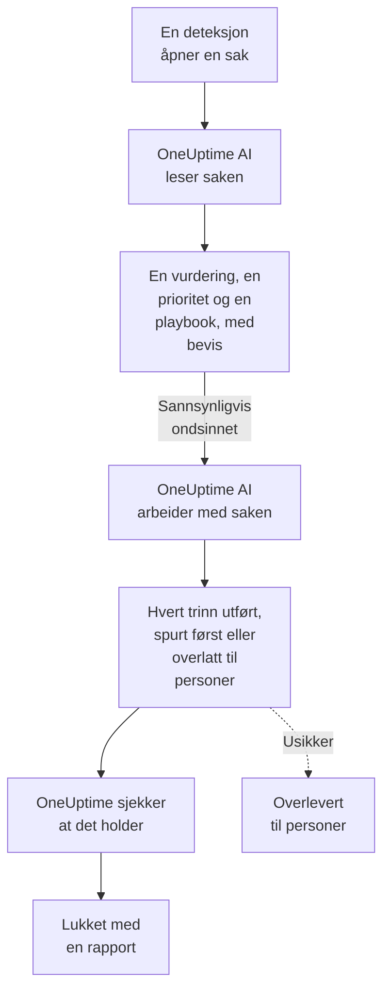

# OneUptime AI i sikkerhet

OneUptime AI leser hver sikkerhetssak slik en analytiker ville gjort: sakens deteksjoner, hendelser, entiteter og trusseletterretning, og vertene og personene rundt den. Den sier hva som skjedde og om det ser ekte ut, foreslår en prioritet og en playbook, og viser til bevisene bak hver påstand. Når du tillater det, arbeider den deretter med saken fra start til slutt: den overtar saken, begrenser trusselen, sjekker at det den gjorde holder, får koden rettet og lukker saken med en rapport. Den utfører hver type trinn på egen hånd, spør en person først eller overlater det til en person, slik du stiller det inn, og den utfører hvert trinn gjennom den samme playbook-motoren som personer bruker, slik at hvert trinn står på sakens tidslinje som OneUptime AI sitt og kan angres. Den skriver også utkast til deteksjonsregler ut fra én setning, og svarer i Ask AI på spørsmålene dine om sikkerhetsdataene dine.

:::cards
- [Vurder en sak](#vurder-en-sak): Hva OneUptime AI leser, hva den konkluderer, og hva den aldri gjør.
- [Vurder nye saker automatisk](#vurder-nye-saker-automatisk): Hver sak en deteksjon åpner, vurdert så snart den åpnes.
- [Arbeid med en sak fra start til slutt](#arbeid-med-en-sak-fra-start-til-slutt): Begrens, sjekk, rett og lukk, med en person som godkjenner det du velger.
- [Hva OneUptime AI får gjøre på en sak](#hva-oneuptime-ai-får-gjøre-på-en-sak): Av, Spør først eller På egen hånd, for hver type trinn.
- [Når den overleverer en sak til personer](#når-den-overleverer-en-sak-til-personer): Hvorfor den stopper, og hvem som får vite det.
- [La OneUptime AI reagere først](#la-oneuptime-ai-reagere-først): Varsle folk bare når OneUptime AI trenger dem.
- [Kjør en playbook etter en vurdering](#kjør-en-playbook-etter-en-vurdering): Reager på en sak som leses som Sannsynligvis ondsinnet.
- [Skriv et utkast til en deteksjonsregel](#skriv-et-utkast-til-en-deteksjonsregel): Beskriv hva som skal fanges, og les Sigma-regelen.
- [Ask AI på sikkerhetssidene](#ask-ai-på-sikkerhetssidene): Spørsmål om saker og hendelser, med vanlige ord.
:::

## Slik fungerer det

En vurdering leser bare. Når OneUptime AI arbeider med en sak, handler den innenfor det du tillater, og overleverer saken til personer så snart den er usikker. Begge deler kjører på prosjektets egen KI: **Aktiver AI**, prosjektets LLM-leverandør, AI-kredittene og de daglige KI-grensene.

## Før du begynner

- **Aktiver AI** slått på, under **Prosjektinnstillinger → KI → AI-funksjoner**. Er den slått av, viser sikkerhet ingenting fra OneUptime AI, og ingenting kjører.
- En LLM-leverandør som OneUptime AI kan bruke, under **Prosjektinnstillinger → KI → LLM-leverandører**. OneUptime Cloud har en.
- En rolle som kan arbeide med sikkerhetssaker, for å starte en vurdering: Prosjekteier, Prosjektadministrator, Sikkerhetsadministrator eller Sikkerhetsmedlem. Sikkerhetsleser leser alle vurderinger, men kan ikke starte noen. Se [Roller](/docs/permissions/reference#roller).

## Vurder en sak

Åpne en sak: kortet **OneUptime AI** står øverst på siden.

| Kortet sier | Hva det betyr |
| --- | --- |
| **Ikke vurdert ennå** | Ingen vurdering har kjørt. **Vurder med KI** starter en. |
| **Vurderer denne saken** | OneUptime AI leser saken. Hver sjekk vises mens den kjører. |
| En vurdering som **Sannsynligvis ondsinnet** | Vurderingen er ferdig. **Vurder på nytt** leser saken på nytt. |
| **Vurderingen ble ikke fullført** | Kjøringen stoppet. **Prøv igjen** starter en ny. |

En Sikkerhetsleser ser det samme kortet: **Vurder med KI** og **Prøv igjen** forblir nedtonet ved siden av en linje som sier hvem som kan starte en vurdering, og **Vurder på nytt** og **Angi prioritet** tilbys ikke.

En vurdering leser:

- saken: tittel, prioritet, status, entiteter og ATT&CK-tilordning;
- deteksjonene, den nyeste først, med en eksempelhendelse for hver;
- sikkerhetshendelsene og trusseletterretningen om sakens brukere, verter og adresser;
- risikoen for sakens brukere, verter og adresser, og hva som bidro til den denne uken;
- vertene i OneUptime som sakens verter og adresser samsvarer med, og hvem som eier dem;
- hendelsen saken har erklært, notatene, de beskyttede entitetene og playbookene som er slått på.

Den kan også lese resten av OneUptime slik undersøkelsen av en hendelse gjør: logger, traces, målinger, verter og de skrivebeskyttede verktøyene på prosjektets MCP-servere.

Alle som kan se saken, leser vurderingen av den, så en vurdering leser bare det alle kan lese. Et team, en egendefinert rolle eller en API-nøkkel som bare leser en type post etter eier eller etikett, teller bare når API-nøkkelen, eller noen på teamet, kan lese sikkerhetssaker eller revisjonsloggen. En type post som ingen av dem leser bare etter eier eller etikett, leses i sin helhet; der noen gjør det, holdes en vert, klynge, tjeneste eller annen post som en eier eller en etikett skiller ut, utenfor, og den blir aldri nevnt eller talt med. Hvem som kan lese sikkerhetssaker, avgjøres hver gang en vurdering kjører, så en vurdering som ble skrevet før noen fikk den tilgangen, kan nevne poster som er skilt ut fra dem. Saken leses alltid, og det gjør også hendelsen den har erklært, med mindre den hendelsen er privat. Private hendelser og varsler leses aldri.

### Hva den konkluderer

| Vurdering | Betyr | Foreslår å lukke som |
| --- | --- | --- |
| Sannsynligvis ondsinnet | Bevisene peker på ondsinnet eller uautorisert aktivitet | True Positive |
| Sannsynligvis ufarlig | Aktiviteten ser ekte, men forventet ut, som en administrativ oppgave eller en skanning teamet ditt kjører | Benign Positive |
| Sannsynligvis falsk positiv | Deteksjonen ser ut til å ha mistolket normal aktivitet | False Positive |
| Uavklart | Det var ikke nok bevis til å avgjøre det, og en person må se på det | Ingenting |

Vurderingen er OneUptime AI sin, aldri sakens konklusjon: **Lukk sak** starter på konklusjonen den foreslår, og en person velger. Under vurderingen viser kortet:

- **Foreslått prioritet**, med **Angi prioritet** når saken har en annen prioritet.
- **Foreslått playbook**, med **Kjør playbook**, som kjører den på dine vegne, med hver godkjenning den trenger. Mens den playbooken allerede kjører på saken, står statusen til kjøringen, for eksempel **Venter på godkjenning**, i stedet for **Kjør playbook**: kjøringen ligger under sakens **Playbooks**, og en ny ville be om den samme godkjenningen igjen.
- Rapporten: hva som skjedde, hvor sikker vurderingen er og hva som bør gjøres videre, hver påstand fulgt av en henvisning som C1.
- **Kontrollerte bevis**: hver spørring vurderingen kjørte. En henvisning åpner spørringen sin, og når du folder ut en, kjører den på nytt med dine tillatelser, over tidsrommet vurderingen leste.
- **Spør om denne saken**, som åpner Ask AI på saken.

Hver liste over saker viser vurderingen ved siden av tittelen på hver sak, og filtrerer på den med **KI-vurdering**.

### Hva den aldri gjør

En vurdering endrer ingenting på saken: verken status, prioritet, ansvarlig, konklusjon eller notater. Den kjører ingen playbook og demmer ikke inn noen. En playbook den foreslår, kjører når en person kjører den, eller via utløseren nedenfor. Å handle på saken er OneUptime AI som arbeider med den, og det er en egen innstilling: se [Arbeid med en sak fra start til slutt](#arbeid-med-en-sak-fra-start-til-slutt).

### Tekst skrevet for å styre en KI

Hendelser, varsler og verdier for entiteter kommer utenfra prosjektet, og en angriper kan skrive dem. OneUptime AI leser alle som data, aldri som instruksjoner. Når noe av sakens data leser som instruksjoner til en KI, sier kortet det først, en vurdering Sannsynligvis ufarlig eller Sannsynligvis falsk positiv blir Uavklart, den vurderingen starter ingen playbook, og OneUptime AI arbeider ikke med saken: den overleverer den til personer.

## Vurder nye saker automatisk

Åpne **Produkter → Sikkerhetshendelser → KI → Innstillinger** og slå på **Vurder nye saker**: da blir hver sak en deteksjon åpner, vurdert så snart den åpnes. Bryteren lagrer så snart du slår den om. Prosjekteier og Prosjektadministrator kan endre den.

Nye prosjekter starter med den slått på; et prosjekt som ble opprettet før, har den slått av til noen slår den på. En sak som er åpnet for hånd, og saken fra testangrepet i **Send et testangrep**, blir vurdert når noen klikker på **Vurder med KI**.

## Arbeid med en sak fra start til slutt

Slå på **Arbeid med saker fra start til slutt** på samme side: da overtar OneUptime AI hver sak som vurderingen leser som Sannsynligvis ondsinnet, og arbeider med den innenfor det du tillater under **Hva OneUptime AI får gjøre på en sak**. Nye prosjekter starter med den slått på; et prosjekt som ble opprettet før, har den slått av til noen slår den på. Prosjekteier og Prosjektadministrator kan endre den.

Mens den er slått på, kan en person også starte den på én sak: **Reager med KI**, på sakens kort **OneUptime AI**, arbeider med en sak som vurderingen fra OneUptime AI leste som Sannsynligvis ondsinnet, Sannsynligvis ufarlig eller Sannsynligvis falsk positiv. Den tilbys ikke på en sak der vurderingen var Uavklart, der dataene leser som instruksjoner til en KI, eller som har din høyeste prioritet: de sakene er en persons. Det krever en rolle som kan arbeide med sikkerhetssaker.

### Hva den gjør

OneUptime AI arbeider seg gjennom sakens **Responsplan**, det mest presserende først: **Bekreft at det er ekte**, **Begrens det**, **Rett det som gjorde det mulig** og **Lukk saken**. Hvert trinn blir utført, spurt om hos en person først eller overlatt til en person, slik raden i **Hva OneUptime AI får gjøre på en sak** for den typen sier.

| Trinn | Hva OneUptime AI gjør |
| --- | --- |
| Overta saken | Overtar den og hever prioriteten til den vurderingen foreslo. Den senker aldri en prioritet, og en sak den hever til din høyeste prioritet, går til personer |
| Utelukk en falsk positiv | Merker det som utført bare når OneUptimes egne fakta ikke etterlater tvil: adressen er ikke en av dine, og ingen har logget på fra den. Ellers overlater den trinnet til en person |
| Blokker adressen | Blokkerer den i 24 timer via [blokkeringslisten](/docs/telemetry/security-cases#blokkeringsliste) din og venter så på OneUptimes sjekk av at blokkeringen holder. Hvis ingenting håndhever blokkeringslisten din, overlater den trinnet til en person |
| Suspender brukeren, begrens verten | Kjører trinnet i en av playbookene dine som gjør det, via identitetsleverandøren din eller EDR. Uten en slik playbook overlater den trinnet til en person |
| Erklær en hendelse | Spør alltid først: en hendelse varsler personer |
| Flytt saken til Begrenset | Når OneUptime har verifisert hvert trinn som begrenser trusselen |
| Rett ruten et angrep nådde | Lar «Fiks med AI» åpne en pull-forespørsel. En person slår den sammen. Den lukker saken når OneUptime verifiserer rettingen i produksjon, spør en person når rettingen bare ser utført ut, og fortsetter å arbeide med saken så lenge rettingen ikke holder |
| Slå på MFA, gå gjennom kontoens endringer | Overlatt til en person: ingen produkter forteller OneUptime om de holder |
| Lukk saken | Når alle andre trinn er utført og sakens deteksjon har vært stille i 24 timer, som True Positive, med en [avslutningsrapport](#avslutningsrapporten) |

Et trinn som sakens deteksjonsregel selv legger til, og alt OneUptime ikke har noen måte å gjøre på, for eksempel å blokkere et domene i DNS-filteret ditt, overlates til en person, med begrunnelse.

Hvert trinn OneUptime AI utfører, går gjennom playbook-motoren, som en kjøring av ett trinn på sakens side **Playbooks** med **OneUptime AI** som utløser. Dermed venter det på godkjenning, lar beskyttede entiteter være i fred, vises på sakens tidslinje, lagres i revisjonsloggen og kan angres, på samme måte som et trinn hvem som helst kjører, og tidslinjen sier at det var OneUptime AI sitt. Et trinn den spør om, venter på en persons godkjenning, på saken, på sakens side **Playbooks** eller med ett trykk i Slack eller Microsoft Teams.

### Loggen på saken

Under vurderingen sier kortet **OneUptime AI** hvordan OneUptime AI arbeider med saken, under **Arbeidet med saken**:

| Kortet sier | Hva det betyr |
| --- | --- |
| **OneUptime AI arbeider ikke med denne saken** | **Reager med KI** overtar den. |
| **Arbeider med denne saken** | OneUptime AI arbeider seg gjennom planen. **Overta** stopper den, og saken er din. |
| **Venter på en person** | Den har bedt noen om å godkjenne et trinn, og fortsetter så snart noen svarer. |
| **Overlevert til personer** | Den stoppet, og sier hvorfor. |
| **Saken er lukket** | Den lukket saken, eller en person gjorde det. Dens **Avslutningsrapport** står over trinnene. |

Under den står hvert trinn den utførte, spurte om eller overlot, det nyeste først, hvert med begrunnelse: **Utført på egen hånd: innstillingene dine tillater det.**, **Innstillingene dine lar dette vente på en persons godkjenning.**, **OneUptime har ingen måte å utføre dette trinnet på, så en person gjør det.** Et trinn den spurte om, har **Godkjenn** og **Avslå**; et trinn den utførte, lenker til kjøringen, der det kan angres. Et trinn OneUptime sjekker, sier hva sjekken fant, og et trinn den har utført før på saker fra samme regel, sier hvor ofte det holdt: «Det holdt i 14 av 15 lignende saker.»

### En sak den leser som ufarlig eller falsk positiv

**Reager med KI** på en sak som vurderingen leste som Sannsynligvis ufarlig eller Sannsynligvis falsk positiv, lukker den som Benign Positive eller False Positive, slik **Lukk saken** tillater. Når den er lukket, opphever OneUptime AI blokkeringene saken laget, slik **Lukk saken** også tillater, og tilbyr sakens regel et unntak for verdien som utløste den. Unntaket venter alltid på en person: **Godkjenn** legger det til, på dine vegne.

## Hva OneUptime AI får gjøre på en sak

Under **Hva OneUptime AI får gjøre på en sak**, på **Produkter → Sikkerhetshendelser → KI → Innstillinger**, har hver type trinn sin egen rad, som lagres så snart du velger:

- **Av**: OneUptime AI overlater dette til en person og sier det på saken.
- **Spør først**: den spør en person, med bevisene, og utfører trinnet så snart noen godkjenner.
- **På egen hånd**: den gjør det uten å spørre og sier det på sakens tidslinje.

| Rad | Dekker | Nye prosjekter starter på |
| --- | --- | --- |
| **Arbeid med saken** | Å overta saken, heve prioriteten, merke trinn som utført med bevisene deres, flytte den til Begrenset | På egen hånd |
| **Blokker adresser** | Å blokkere sakens adresse ved kanten i 24 timer | Spør først |
| **Begrens kontoer** | Å suspendere sakens bruker eller avslutte brukerens økter | Spør først |
| **Begrens verter** | Å begrense eller isolere sakens vert | Spør først |
| **Rett koden** | Å la «Fiks med AI» åpne en pull-forespørsel for ruten et angrep nådde | På egen hånd |
| **Lukk saken** | Å lukke saken med avslutningsrapporten, og oppheve sakens blokkeringer når den er lukket som ufarlig | Spør først |

Innstillingene gjelder mens **Arbeid med saker fra start til slutt** er slått på, og kortet sier det mens den er slått av. Prosjekteier og Prosjektadministrator kan endre dem.

Å sette **Blokker adresser**, **Begrens kontoer** eller **Begrens verter** til **På egen hånd** krever myndigheten til en Sikkerhetsadministrator, som Prosjekteiere og Prosjektadministratorer også har, og OneUptime lagrer hvem som gjorde det og når, slik det gjør for et playbook-trinn der godkjenningen er slått av. **Blokker adresser** spør først: **Bekreft og slå på** er en Sikkerhetsadministrators bekreftelse, og raden sier deretter når den ble gitt. Til en Sikkerhetsadministrator bekrefter det, spør OneUptime AI før den blokkerer.

Uansett hva radene sier, gjør OneUptime AI følgende:

- handler aldri på en beskyttet bruker, vert eller adresse: den overleverer saken til personer;
- utfører høyst 10 handlinger på egen hånd i timen, på tvers av alle sakene dine, og overleverer deretter neste sak til personer;
- blokkerer i høyst 24 timer;
- slår aldri sammen kode: en person slår sammen hver pull-forespørsel;
- spør alltid før den erklærer en hendelse eller legger til et regelunntak;
- arbeider med en sak én kjøring om gangen, og en server som starter på nytt, mister aldri en kjøring som handler.

## Når den overleverer en sak til personer

OneUptime AI trekker seg aldri stille tilbake. Den overleverer saken til personer, og sier hvorfor på kortet og tidslinjen, når:

- noe av sakens data leser som instruksjoner til en KI;
- saken har din høyeste prioritet;
- det neste trinn handler på, er beskyttet;
- den har handlet på egen hånd så ofte som den får i løpet av en time;
- KI er slått av for prosjektet eller for sikkerhetssaker, det ikke finnes noen LLM-leverandør, eller prosjektet er tomt for AI-kreditter eller har nådd sin daglige KI-grense;
- vurderingen ikke kunne avgjøre om saken er ekte;
- et trinn den utførte, ikke holder, et trinn den startet, ikke ble fullført, eller en person avslo eller angret et trinn den utførte;
- den ikke kan avgjøre hva den skal gjøre videre, eller alt som gjenstår på saken, må gjøres av en person.

Personene på saken får vite det med en gang, eller, når ingen er på saken, personene som varsles om saker med den prioriteten: **OneUptime AI overleverte en sikkerhetssak til personer**, under **Brukerinnstillinger → Varslingsinnstillinger**. En varslingsregel for arbeidsområdet for sikkerhetssaker legger det ut i sin Slack- eller Microsoft Teams-kanal under **Overlevert til personer av OneUptime AI**. **Overta** overleverer saken uten å varsle noen, siden personen som trykket på den, har saken.

**Reager med KI** ber OneUptime AI om å arbeide med saken igjen, fra der saken står.

En sak som holdes tilbake mens OneUptime AI reagerer først, når fram til folk én gang, med varslingen om den nye saken og grunnen til at OneUptime AI stoppet: se [La OneUptime AI reagere først](#la-oneuptime-ai-reagere-først).

## La OneUptime AI reagere først

Under **La OneUptime AI reagere først**, på **Produkter → Sikkerhetshendelser → KI → Innstillinger**, slår du på **Reager først**: da venter en ny sak som en deteksjon åpner med en prioritet under den du velger, på OneUptime AI før noen varsles. Den tilbys mens **Vurder nye saker** og **Arbeid med saker fra start til slutt** er slått på. Den starter slått av og lagres så snart du endrer den. Prosjekteier og Prosjektadministrator kan endre den.

- **For saker under**: prioriteten en sak må ligge under for å bli holdt tilbake. Den er High til du velger en annen.
- **Varsle folk likevel etter**: hvor lenge en sak høyst holdes tilbake, 5, 10, 15, 20 eller 30 minutter. Den starter på 10 minutter.

Mens en sak holdes tilbake, venter varslingen om den nye saken, og det samme gjør trinnene **Tilkall vakten** i playbookene som starter på den av seg selv. Saken viser **OneUptime AI er i gang** sammen med når folk varsles, og **Tilkall nå** varsler dem med en gang. En playbook-kjøring der tilkallingen venter, står som **Venter på OneUptime AI**.

Tilbakeholdelsen slutter så snart én av disse tingene skjer:

| Når | Da |
| --- | --- |
| OneUptime AI begrenser saken, og OneUptime sjekker hvert trinn som begrenser den, eller saken lukkes | Ingen varsles. Kanalene som legger ut nye saker, får én oppsummering av hva OneUptime AI gjorde, og tilkallingstrinnene som ventet, hoppes over |
| OneUptime AI trenger en person: den ber noen om å godkjenne et trinn, overleverer saken til personer eller kan ikke begynne å arbeide med den | Alle som saken ble holdt tilbake fra, varsles med en gang, med begrunnelsen og det OneUptime AI allerede har gjort, og tilkallingstrinnene som ventet, tilkaller |
| Vurderingen leser ikke saken som Sannsynligvis ondsinnet, saken merkes som Begrenset før OneUptime kunne sjekke hvert trinn, eller tilbakeholdelsestiden går ut | Alle varsles med en gang, med begrunnelse |
| Noen trykker på **Tilkall nå**, saken stiger til prioriteten du valgte, eller **Reager først** eller **Arbeid med saker fra start til slutt** slås av | Alle varsles med en gang |
| En person tar saken: med **Overta**, ved å tildele den eller ved å flytte den videre | Personen har saken. Ingen andre varsles, kanalene får høre om den nye saken, og tilkallingstrinnene som ventet, hoppes over |

En sak holdes aldri tilbake, og folk varsles som vanlig, når:

- den har din høyeste prioritet, eller prioriteten du valgte eller en høyere;
- 3 andre saker ble åpnet i de 5 minuttene før den, noe som ser ut som et aktivt angrep: sakene som holdes tilbake da, går også til personer;
- noe av dataene dens leser som instruksjoner til en KI;
- den gjelder en adresse, bruker eller vert fra en sak OneUptime AI har løst de siste 24 timene, siden det den gjorde, ikke holdt;
- OneUptime AI ikke kan vurdere eller arbeide med den, for eksempel når prosjektet er tomt for AI-kreditter;
- en person åpnet den, eller den er testangrepets sak.

Sakens tidslinje sier hvorfor den ikke ble holdt tilbake, unntatt for en sak med prioriteten du valgte eller en høyere, en sak en person åpnet, og testangrepets sak. Varslingene for et responsmål holdes aldri tilbake.

Til du setter blokkering av adresser og begrensning av kontoer og verter til **På egen hånd** under **Hva OneUptime AI får gjøre på en sak**, spør OneUptime AI først, og en sak når fram til folk så snart den spør. Med **Blokker adresser** på **På egen hånd**, bekreftet av en Sikkerhetsadministrator, kan den begrense en skanner uten at noen varsles.

### Den ukentlige e-posten

Hver mandag får Prosjekteiere og Sikkerhetsadministratorer som kan lese sikkerhetssaker, én e-post om hva OneUptime AI gjorde på prosjektets sikkerhetssaker uken før: sakene den reagerte først på og hvordan de endte; hvor raskt sakene den arbeidet med, ble begrenset; adressene den blokkerte og blokkeringene som ble opphevet igjen; trinnene den ba folk om å godkjenne og hvor raskt de svarte; og trinnene folk angret. Den inneholder bare tall, og en lenke til **Produkter → Sikkerhetshendelser → Oversikt**. En uke der OneUptime AI ikke gjorde noe, sendes ingen e-post.

## Avslutningsrapporten

Når OneUptime AI lukker en sak, eller ber en person om å gjøre det, skriver den en avslutningsrapport ut fra det saken inneholder, ikke ut fra vurderingens ord: hva som skjedde, konsekvensene, hva som ble gjort, hva som ble rettet og hva man bør følge med på. Rapporten er sakens avslutningsnotat, den står på tidslinjen, og kortet viser den under **Avslutningsrapport**. Med **Lukk saken** på **Spør først** venter saken på at en person godkjenner lukkingen, med rapporten til å lese først.

## Slik måles den

**Produkter → Sikkerhetshendelser → Oversikt** viser hvordan OneUptime AI har arbeidet med sakene de siste 30 dagene, så snart den har arbeidet med eller spurt om en: **Løst av OneUptime AI**, av sakene den arbeidet med; **Tid til begrensning med KI** og **Tid til lukking med KI**, hver ved siden av tiden uten den; og **Forespurte godkjenninger**, hvor raskt personer svarte og hvor mange av trinnene dens personer angret.

## Kjør en playbook etter en vurdering

En playbook med **Utløser** satt til **Vurdert som sannsynligvis ondsinnet** kjører én gang på en sak, når en vurdering leser saken som Sannsynligvis ondsinnet. **For saker med minst**, **Bare for deteksjoner fra** og **Bare for disse deteksjonsreglene** avgrenser den som for enhver utløser, og inndemmingstrinnene venter som alltid på godkjenning. Den kjører ikke:

- etter en vurdering som fant tekst skrevet for å styre en KI;
- en gang til på samme sak, uansett hvor ofte saken blir vurdert;
- på testangrepets sak, med mindre hvert trinn i playbooken holder seg innenfor OneUptime.

En ny playbook får bare tilbud om denne utløseren mens prosjektets KI er slått på.

## Skriv et utkast til en deteksjonsregel

Klikk på siden **Deteksjonsregler**, under feltet **Sigma-regel (YAML)**, på **Utkast med KI**, og si hva regelen skal fange, for eksempel ti mislykkede pålogginger fra én IP-adresse innen fem minutter. **Skriv regel** setter en Sigma-regel inn i feltet, kontrollert på samme måte som en lagret regel. Les den, endre den ved behov, og lagre den som vanlig: ingenting blir lagret før du gjør det. Står det allerede en regel i feltet, heter knappen **Skriv på nytt med KI**, og utkastet erstatter den regelen.

Et utkast krever en rolle som kan opprette deteksjonsregler.

## Ask AI på sikkerhetssidene

**Spør AI** vet hvilken sikkerhetsside du er på. På en sak leser den saken først og tilbyr spørsmål som **Er det ekte?**. På de andre sidene under sikkerhetshendelser søker et spørsmål med vanlige ord i sikkerhetshendelsene dine. Den kan også sjekke verdier mot trusseletterretningen din, se hvor aktiv en bruker, en vert eller en adresse har vært, og vise playbookene en sak kan gå til.

Ask AI kan legge til et notat på en sak og kjøre en playbook på den, på dine vegne, og spør før hver handling. En playbook den kjører, venter på godkjenning som alle andre.

Når en sak erklærer en hendelse, leser også hendelsens KI-undersøkelse saken: hva som ble oppdaget, om hvem, og OneUptime AI sin vurdering av den.

## Kostnader og grenser

En vurdering er arbeid for OneUptime AI, som undersøkelsen av en hendelse. På OneUptime Cloud betales den med prosjektets AI-kreditter, og den teller med i prosjektets egne daglige KI-grenser (**Daglige grenser**, under **Prosjektinnstillinger → KI → AI-funksjoner**). De daglige grensene for hendelser og varsler gjelder ikke. En sak har én vurdering om gangen, og AI-loggene (**Prosjektinnstillinger → KI → AI-logger**) viser kallene.

Når prosjektet er tomt for AI-kreditter eller har nådd en daglig KI-grense, blir nye saker ikke vurdert: kortet sier hvorfor, og **Vurder med KI** virker igjen så snart det er lagt til kreditter, eller grensen nullstilles. Når OneUptime AI arbeider med en sak, leser den sakens egen plan og egne sjekker i stedet for å spørre LLM-en, og den stopper ved de samme grensene: den overleverer saken til personer og sier hvorfor.

## Feilsøking

:::details En ny sak ble ikke vurdert
Sjekk at **Aktiver AI** er slått på, og **Vurder nye saker** under **Produkter → Sikkerhetshendelser → KI → Innstillinger**. En sak som er åpnet for hånd, og testangrepets sak blir bare vurdert når noen ber om det. Åpne saken: når noe hindrer en vurdering, sier kortet hva, og hvor det kan rettes.
:::

:::details OneUptime AI arbeidet ikke med en sak
Sjekk at **Arbeid med saker fra start til slutt** er slått på under **Produkter → Sikkerhetshendelser → KI → Innstillinger**. Den tar bare opp en sak på egen hånd når vurderingen leser den som Sannsynligvis ondsinnet. Åpne saken: under **Arbeidet med saken** sier kortet hvorfor den ikke arbeider med den, og **Reager med KI** ber den om å gjøre det.
:::

:::details Den spør før den blokkerer, selv om Blokker adresser er På egen hånd
**På egen hånd** for **Blokker adresser** gjelder først når en Sikkerhetsadministrator har bekreftet det: raden sier når, eller at ingen har gjort det ennå. En adresse som er beskyttet, eller en av dine egne, blir aldri blokkert: OneUptime AI overleverer saken til personer. Så lenge ingenting håndhever blokkeringslisten din, overlater den trinnet til en person.
:::

:::details Kortet sier at prosjektet er tomt for AI-kreditter, eller har nådd sin daglige KI-grense
En Prosjekteier eller noen med Manage Billing kan legge til kreditter under **Prosjektinnstillinger → KI → AI-kreditter**, eller heve eller fjerne grensen under **Prosjektinnstillinger → KI → AI-funksjoner**. Klikk deretter på **Vurder med KI** på saken.
:::

:::details Kortet sier at tekst i saken leser som instruksjoner til en KI
Noe av sakens data, som en hendelsesmelding eller et brukernavn, ble skrevet for å styre en KI. OneUptime AI leste det som data og overlot avgjørelsen til deg: les deteksjonene og bevisene selv før du lukker saken.
:::

:::details Folk ble varslet mens OneUptime AI reagerte først
Sakens tidslinje sier hvorfor tilbakeholdelsen sluttet: OneUptime AI ba noen om å godkjenne et trinn, overleverte saken til personer eller ble ikke ferdig innen **Varsle folk likevel etter**, eller noen trykket på **Tilkall nå**. Et trinn som spør først, når fram til folk så snart OneUptime AI spør: se **Hva OneUptime AI får gjøre på en sak**.
:::

:::details En ny sak ble ikke holdt tilbake
Sjekk at **Reager først** er slått på, og at saken ligger under prioriteten som er valgt i **For saker under**. En sak med din høyeste prioritet, en sak en person åpnet, og testangrepets sak holdes aldri tilbake. I alle andre tilfeller sier sakens tidslinje hvorfor.
:::

:::details En playbook med KI-utløseren kjørte ikke
Sjekk at playbooken er slått på, at vurderingen leste saken som Sannsynligvis ondsinnet, og at innstillingene **For saker med minst**, **Bare for deteksjoner fra** og **Bare for disse deteksjonsreglene** passer saken. Den kjører én gang per sak, og ikke etter en vurdering som fant tekst skrevet for å styre en KI.
:::

## Neste steg

:::cards
- [Sikkerhetssaker og playbooks](/docs/telemetry/security-cases): Arbeid med saker, lukk dem med en konklusjon, og bygg playbooks.
- [AI SRE](/docs/ai/ai-sre): Hvordan OneUptime AI undersøker hendelser og varsler, og grensene.
- [Spør AI](/docs/ai/ask-ai): Still spørsmål om prosjektet ditt med vanlige ord.
- [LLM-leverandører](/docs/ai/llm-provider): Velg modellen OneUptime AI bruker.
:::
