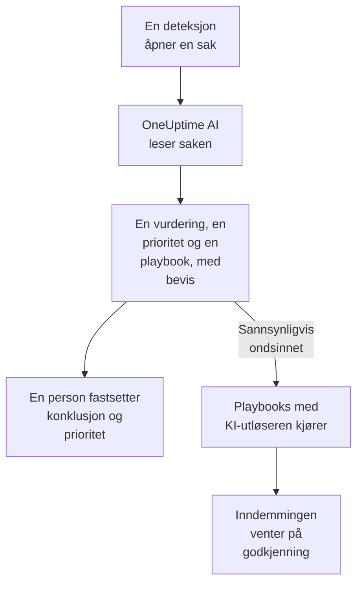

# OneUptime AI i sikkerhet

OneUptime AI leser hver sikkerhetssak slik en analytiker ville gjort: sakens deteksjoner, hendelser, entiteter og trusseletterretning, og vertene og personene rundt den. Den sier hva som skjedde og om det ser ekte ut, foreslår en prioritet og en playbook, og viser til bevisene bak hver påstand. Den endrer ingenting på egen hånd: en person fastsetter konklusjonen og prioriteten, og kjører playbooken. Den skriver også utkast til deteksjonsregler ut fra én setning, og svarer i Ask AI på spørsmålene dine om sikkerhetsdataene dine.

:::cards
- [Vurder en sak](#vurder-en-sak): Hva OneUptime AI leser, hva den konkluderer, og hva den aldri gjør.
- [Vurder nye saker automatisk](#vurder-nye-saker-automatisk): Hver sak en deteksjon åpner, vurdert så snart den åpnes.
- [Kjør en playbook etter en vurdering](#kjør-en-playbook-etter-en-vurdering): Reager på en sak som leses som Sannsynligvis ondsinnet.
- [Skriv et utkast til en deteksjonsregel](#skriv-et-utkast-til-en-deteksjonsregel): Beskriv hva som skal fanges, og les Sigma-regelen.
- [Ask AI på sikkerhetssidene](#ask-ai-på-sikkerhetssidene): Spørsmål om saker og hendelser, med vanlige ord.
:::

## Slik fungerer det

En vurdering leser bare. Den kjører på prosjektets egen KI: **Aktiver AI**, prosjektets LLM-leverandør, AI-kredittene og de daglige KI-grensene.

## Før du begynner

- **Aktiver AI** slått på, under **Prosjektinnstillinger → KI → AI Features**. Er den slått av, viser sikkerhet ingenting fra OneUptime AI, og ingenting kjører.
- En LLM-leverandør som OneUptime AI kan bruke, under **Prosjektinnstillinger → KI → LLM-leverandører**. OneUptime Cloud har en.
- En rolle som kan arbeide med sikkerhetssaker, for å starte en vurdering: Project Owner, Project Admin, Security Admin eller Security Member. Security Viewer leser alle vurderinger, men kan ikke starte noen. Se [Roller](/docs/permissions/reference#roller).

## Vurder en sak

Åpne en sak: kortet **OneUptime AI** står øverst på siden.

| Kortet sier | Hva det betyr |
| --- | --- |
| **Ikke vurdert ennå** | Ingen vurdering har kjørt. **Vurder med KI** starter en. |
| **Vurderer denne saken** | OneUptime AI leser saken. Hver sjekk vises mens den kjører. |
| En vurdering som **Sannsynligvis ondsinnet** | Vurderingen er ferdig. **Vurder på nytt** leser saken på nytt. |
| **Vurderingen ble ikke fullført** | Kjøringen stoppet. **Prøv igjen** starter en ny. |

En vurdering leser:

- saken: tittel, prioritet, status, entiteter og ATT&CK-tilordning;
- deteksjonene, den nyeste først, med en eksempelhendelse for hver;
- sikkerhetshendelsene og trusseletterretningen om sakens brukere, verter og adresser;
- risikoen for sakens brukere, verter og adresser, og hva som bidro til den denne uken;
- vertene i OneUptime som sakens verter og adresser samsvarer med, og hvem som eier dem;
- hendelsen saken har erklært, notatene, de beskyttede entitetene og playbookene som er slått på.

Den kan også lese resten av OneUptime slik undersøkelsen av en hendelse gjør: logger, traces, metrikker, verter og de skrivebeskyttede verktøyene på prosjektets MCP-servere.

### Hva den konkluderer

| Vurdering | Betyr | Foreslår å lukke som |
| --- | --- | --- |
| Sannsynligvis ondsinnet | Bevisene peker på ondsinnet eller uautorisert aktivitet | True Positive |
| Sannsynligvis ufarlig | Aktiviteten ser ekte, men forventet ut, som en administrativ oppgave eller en skanning teamet ditt kjører | Benign Positive |
| Sannsynligvis falsk positiv | Deteksjonen ser ut til å ha mistolket normal aktivitet | False Positive |
| Uavklart | Det var ikke nok bevis til å avgjøre det, og en person må se på det | Ingenting |

Vurderingen er OneUptime AI sin, aldri sakens konklusjon: **Lukk sak** starter på konklusjonen den foreslår, og en person velger. Under vurderingen viser kortet:

- **Foreslått prioritet**, med **Angi prioritet** når saken har en annen prioritet.
- **Foreslått playbook**, med **Kjør playbook**, som kjører den på dine vegne, med hver godkjenning den trenger.
- Rapporten: hva som skjedde, hvor sikker vurderingen er og hva som bør gjøres videre, hver påstand fulgt av en henvisning som C1.
- **Evidence checked**: hver spørring vurderingen kjørte. En henvisning åpner spørringen sin, og når du folder ut en, kjører den på nytt med dine tillatelser, over tidsrommet vurderingen leste.
- **Spør om denne saken**, som åpner Ask AI på saken.

Hver liste over saker viser vurderingen ved siden av tittelen på hver sak, og filtrerer på den med **KI-vurdering**.

### Hva den aldri gjør

En vurdering endrer ingenting på saken: verken status, prioritet, ansvarlig, konklusjon eller notater. Den kjører ingen playbook og demmer ikke inn noen. En playbook den foreslår, kjører når en person kjører den, eller via utløseren nedenfor.

### Tekst skrevet for å styre en KI

Hendelser, varsler og verdier for entiteter kommer utenfra prosjektet, og en angriper kan skrive dem. OneUptime AI leser alle som data, aldri som instruksjoner. Når noe av sakens data leser som instruksjoner til en KI, sier kortet det først, en vurdering Sannsynligvis ufarlig eller Sannsynligvis falsk positiv blir Uavklart, og den vurderingen starter ingen playbook.

## Vurder nye saker automatisk

Åpne **Produkter → Security Events → KI → Innstillinger** og slå på **Vurder nye saker**: da blir hver sak en deteksjon åpner, vurdert så snart den åpnes. Bryteren lagrer så snart du slår den om. Project Owner og Project Admin kan endre den.

Nye prosjekter starter med den slått på; et prosjekt som ble opprettet før, har den slått av til noen slår den på. En sak som er åpnet for hånd, og saken fra testangrepet i **Send et testangrep**, blir vurdert når noen klikker på **Vurder med KI**.

## Kjør en playbook etter en vurdering

En playbook med **Utløser** satt til **Vurdert som sannsynligvis ondsinnet** kjører én gang på en sak, når en vurdering leser saken som Sannsynligvis ondsinnet. **For saker med minst**, **Bare for deteksjoner fra** og **Bare for disse deteksjonsreglene** avgrenser den som for enhver utløser, og inndemmingstrinnene venter som alltid på godkjenning. Den kjører ikke:

- etter en vurdering som fant tekst skrevet for å styre en KI;
- en gang til på samme sak, uansett hvor ofte saken blir vurdert;
- på testangrepets sak, med mindre hvert trinn i playbooken holder seg innenfor OneUptime.

En ny playbook får bare tilbud om denne utløseren mens prosjektets KI er slått på.

## Skriv et utkast til en deteksjonsregel

Klikk på siden **Deteksjonsregler**, under feltet **Sigma-regel (YAML)**, på **Utkast med KI**, og si hva regelen skal fange, for eksempel ti mislykkede pålogginger fra én IP-adresse innen fem minutter. **Skriv regel** setter en Sigma-regel inn i feltet, kontrollert på samme måte som en lagret regel. Les den, endre den ved behov, og lagre den som vanlig: ingenting blir lagret før du gjør det. Står det allerede en regel i feltet, heter knappen **Skriv på nytt med KI**, og utkastet erstatter den regelen.

Et utkast krever en rolle som kan opprette deteksjonsregler.

## Ask AI på sikkerhetssidene

**Ask AI** vet hvilken sikkerhetsside du er på. På en sak leser den saken først og tilbyr spørsmål som **Er det ekte?**. På de andre sidene under sikkerhetshendelser søker et spørsmål med vanlige ord i sikkerhetshendelsene dine. Den kan også sjekke verdier mot trusseletterretningen din, se hvor aktiv en bruker, en vert eller en adresse har vært, og vise playbookene en sak kan gå til.

Ask AI kan legge til et notat på en sak og kjøre en playbook på den, på dine vegne, og spør før hver handling. En playbook den kjører, venter på godkjenning som alle andre.

Når en sak erklærer en hendelse, leser også hendelsens KI-undersøkelse saken: hva som ble oppdaget, om hvem, og OneUptime AI sin vurdering av den.

## Kostnader og grenser

En vurdering er arbeid for OneUptime AI, som undersøkelsen av en hendelse. På OneUptime Cloud betales den med prosjektets AI-kreditter, og den teller med i prosjektets egne daglige KI-grenser (**Daglige grenser**, under **Prosjektinnstillinger → KI → AI Features**). De daglige grensene for hendelser og varsler gjelder ikke. En sak har én vurdering om gangen, og AI-loggene (**Prosjektinnstillinger → KI → AI-logger**) viser kallene.

Når prosjektet er tomt for AI-kreditter eller har nådd en daglig KI-grense, blir nye saker ikke vurdert: kortet sier hvorfor, og **Vurder med KI** virker igjen så snart det er lagt til kreditter, eller grensen nullstilles.

## Feilsøking

:::details En ny sak ble ikke vurdert
Sjekk at **Aktiver AI** er slått på, og **Vurder nye saker** under **Produkter → Security Events → KI → Innstillinger**. En sak som er åpnet for hånd, og testangrepets sak blir bare vurdert når noen ber om det. Åpne saken: når noe hindrer en vurdering, sier kortet hva, og hvor det kan rettes.
:::

:::details Kortet sier at prosjektet er tomt for AI-kreditter, eller har nådd sin daglige KI-grense
En prosjekteier eller noen med Manage Billing kan legge til kreditter under **Prosjektinnstillinger → KI → AI-kreditter**, eller heve eller fjerne grensen under **Prosjektinnstillinger → KI → AI Features**. Klikk deretter på **Vurder med KI** på saken.
:::

:::details Kortet sier at tekst i saken leser som instruksjoner til en KI
Noe av sakens data, som en hendelsesmelding eller et brukernavn, ble skrevet for å styre en KI. OneUptime AI leste det som data og overlot avgjørelsen til deg: les deteksjonene og bevisene selv før du lukker saken.
:::

:::details En playbook med KI-utløseren kjørte ikke
Sjekk at playbooken er slått på, at vurderingen leste saken som Sannsynligvis ondsinnet, og at innstillingene **For saker med minst**, **Bare for deteksjoner fra** og **Bare for disse deteksjonsreglene** passer saken. Den kjører én gang per sak, og ikke etter en vurdering som fant tekst skrevet for å styre en KI.
:::

## Neste steg

:::cards
- [Sikkerhetssaker og playbooks](/docs/telemetry/security-cases): Arbeid med saker, lukk dem med en konklusjon, og bygg playbooks.
- [AI SRE](/docs/ai/ai-sre): Hvordan OneUptime AI undersøker hendelser og varsler, og grensene.
- [Spør AI](/docs/ai/ask-ai): Still spørsmål om prosjektet ditt med vanlige ord.
- [LLM-leverandører](/docs/ai/llm-provider): Velg modellen OneUptime AI bruker.
:::
