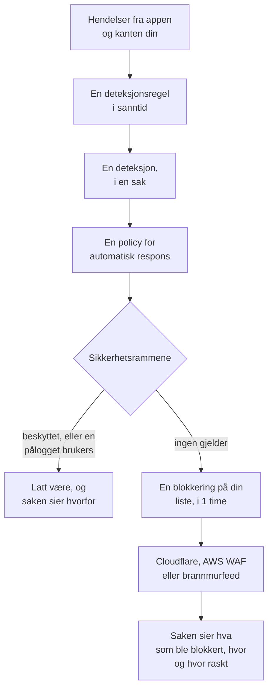

# Automatisk respons

Policyer for automatisk respons utfordrer eller blokkerer en angripende adresse idet deteksjonen skjer, før noen har vurdert saken: skannere som undersøker appen din, og boter som prøver passord etter passord, blir avvist noen få minutter etter sin første forespørsel. Hvert prosjekt har tre ferdige policyer, hver slått av til du slår den på, og hver starter med en ukes prøveperiode som bare registrerer hva den ville ha gjort. Sikkerhetsrammer gjør en policy trygg å la være på: den rører aldri dine egne adresser eller en som de påloggede brukerne dine bruker, og den stopper og varsler en person når et angrep er større enn den bør håndtere alene.

:::cards
- [Slå på en policy](#slå-på-en-policy): Først en ukes prøveperiode, så ett klikk.
- [Sikkerhetsrammene](#sikkerhetsrammene): Hva en policy aldri gjør, og når den stopper.
- [Tid til blokkering](#tid-til-blokkering): Hvor raskt hver policy blokkerer, på kortet sitt og i saken.
- [Din egen policy](#din-egen-policy): Reager på teknikkene, reglene eller trusselsinformasjonen du velger.
:::

## Slik fungerer det

En policy reagerer på en deteksjon idet den registreres i saken sin, noen sekunder etter at regelen utløses. Blokkeringen havner på [blokkeringslisten](/docs/telemetry/security-cases#blokkeringsliste) din slik playbook-steget **Blokker adressen** gjør, med policyens navn som oppretter: destinasjonene som håndhever blokkeringslisten din, holder den, den vises på sakens tidslinje og i revisjonsloggen, og den utløper av seg selv. Den trenger ingen godkjenning: den som slo på policyen, godkjente blokkeringene.

## Før du begynner

- En destinasjon som håndhever blokkeringslisten din: Cloudflare, AWS WAF, eller en brannmur eller proxy som leser en [blokkeringslistefeed](/docs/telemetry/blocklist-feeds). Så lenge ingenting håndhever den, sier siden det, og blokkeringene til en policy gjelder ingen steder.
- Hendelsene som reglene til en policy leser: tilgangsloggene eller sporene til appen din, eller hendelsene fra kanten din, som brannmurhendelsene til Cloudflare, og påloggingene dine. Se [Sikkerhetshendelser](/docs/telemetry/security-events).
- En rolle som kan slå på en policy: Sikkerhetsadministrator, Prosjektadministrator eller Prosjekteier. Sikkerhetsmedlem og Sikkerhetsleser ser policyene og hva de har gjort. Se [Roller](/docs/permissions/reference#roller).

## De ferdige policyene

| Policy | Reagerer på | Gjør | Første blokkering |
| --- | --- | --- | --- |
| **Skannere** | Nettskanninger og utnyttelsesforsøk (ATT&CK T1595, T1190): forsøk på SQL-injeksjon, path traversal og Log4Shell, og mange treff på administrerte Cloudflare-regler fra én adresse, så lenge alle forespørslene fra adressen ble avvist | Utfordring | 1 time |
| **Passordgjetting** | Brute force og passordspraying (ATT&CK T1110): mislykkede pålogginger fra én adresse, og mislykkede pålogginger etterfulgt av en vellykket fra samme adresse | Blokker | 1 time |
| **Kjente ondsinnede adresser** | Enhver deteksjon om en adresse som [trusselsinformasjonen](/docs/telemetry/threat-intelligence) din lister opp | Blokker | 24 timer |

Mennesker består en utfordring, skript og boter gjør det ikke. Skannere utfordrer bare en adresse så lenge ingen av forespørslene dens har nådd appen din: en adresse der forespørsler kom gjennom, er en sak for en person.

Når du slår på Skannere eller Passordgjetting, i prøveperioden eller helt, kjører reglene fra **Regelbibliotek** som policyen reagerer på, i sanntid, og reglene prosjektet ditt mangler, legges til: en sanntidsregel utløses sekunder etter at hendelsene kommer, mens en planlagt regel leser minutter etter. En regel som noen har slått av, forblir av. Et prosjekt kjører høyst 50 regler i sanntid: utover det blir en regel værende på tidsplanen sin, og kortet til policyen viser **Etter en tidsplan** ved siden av.

## Slå på en policy

:::steps
### Åpne Automatisk respons

Åpne **Produkter → Sikkerhetshendelser → Playbooks → Automatisk respons**. Hver policy har sitt kort: hva den gjør, et merke som sier **Av**, **Prøveperiode**, **Prøveperiode fullført** eller **På**, og bryteren sin.

### Start prøveperioden

Slå om bryteren til policyen. I 7 dager registrerer den hva den ville ha gjort, og rører ingen trafikk: saken sier "Trial run: the Scanners policy would have challenged 35.205.11.131 for 1 hour." Kortet teller adressene så langt, og hva sikkerhetsrammene lot være.

### Slå den på

Når uken er over, sier kortet hva policyen ville ha gjort, for eksempel "På 7 dager ville den ha utfordret 1 283 adresser. Ingen hadde påloggede brukere, og ingen var dine. Slå den på?", og sikkerhetsansvarlige får det samme på e-post. Klikk på **Slå på**: fra da av reagerer policyen.
:::

For å slå på en policy uten uken med prøveperiode åpner du **Flere innstillinger** på kortet og klikker på **Slå på uten prøveperiode**. Sikkerhetsrammene gjelder fortsatt. Slå om bryteren igjen for å slå av en policy; slått på igjen etter en hel uke med prøveperiode reagerer den med en gang.

## Sikkerhetsrammene

- **Aldri dine egne eller beskyttede adresser.** Oppføringene i **Beskyttede entiteter**, og alt OneUptime beskytter av seg selv: vertene, skyressursene og sondene dine, områdene som ikke er på internett, og kanten foran appen din. Se [Blokkeringsliste](/docs/telemetry/security-cases#blokkeringsliste).
- **Aldri en adresse som en pålogget bruker har brukt de siste 30 dagene.** Nettverket til et kontor, proxyen til en kunde eller hjemmet til en person: OneUptime ser etter adressen i påloggingene hos identitetsleverandøren din og i forespørslene appen din besvarte for en pålogget bruker, de med en bruker-ID i sporene eller loggene. En adresse den ikke kan sjekke, fordi de hendelsene ikke kunne leses eller fordi scrub-reglene dine skjuler adresser på en måte den ikke kan sammenligne, overlates til en person.
- **Lengre blokkeringer for en adresse som kommer tilbake.** Den første blokkeringen varer 1 time, så 24 timer, så 7 dager for en adresse som blokkeres igjen innen 30 dager. Kjente ondsinnede adresser starter på 24 timer.
- **Høyst 50 automatiske blokkeringer i timen.** Utover det slutter policyene dine å blokkere og varsler sikkerhetsansvarlige: et så stort angrep trenger en person. Siden sier det så lenge det varer.
- **Angre ved tvil.** Når en pålogget bruker blir sett fra en adresse som en policy blokkerte, opphever policyen blokkeringen og gir sikkerhetsansvarlige beskjed.

Sikkerhetsansvarlige er Sikkerhetsadministratorene i prosjektet ditt, eller Prosjekteierne når det ikke har noen. Hver adresse som en sikkerhetsramme lot være, står i saken sin med årsaken.

## Der en destinasjon ikke kan utfordre

Cloudflare og AWS WAF utfordrer. En brannmur som leser en blokkeringslistefeed, kan ikke det, så der er en policys utfordring en blokkering like lenge, og kortet til policyen og saken sier det, for eksempel "FortiGate feed cannot challenge, so it blocks the address there for the same time." En utfordring du lager selv, blir aldri gjort om til en blokkering.

## Tid til blokkering

Tid til blokkering går fra adressens første forespørsel, den tidligste hendelsen i deteksjonen, til blokkeringen virker ved kanten din. Kortet til hver policy viser 50. og 95. persentil dag for dag over de siste 30 dagene. En sak som en automatisk respons blokkerte, sier det under **Tid til begrensning** på **Oversikt**, for eksempel "Blokkert automatisk 41s etter den første forespørselen", og tidslinjen sier hva som ble blokkert, hvor og hvor raskt: "OneUptime challenged 35.205.11.131 at Cloudflare for 1 hour (Scanners policy), 41 seconds after its first request." Adressens steg i sakens **Responsplan** er utført, med **Opphev** ved siden av.

## Din egen policy

Klikk på **Opprett policy** under de ferdige policyene. En egen policy trenger et **Navn** og det den reagerer på:

| Felt | Hva det gjør |
| --- | --- |
| **ATT&CK-teknikker** | Teknikkene en deteksjon må ha, atskilt med komma, som `T1110, T1190`. En teknikk dekker underteknikkene sine. |
| **Handling** | Under **Flere felt**: **Blokker** eller **Utfordring**. |
| **Første blokkering varer** | Under **Flere felt**: 1 time, 24 timer eller 7 dager. En adresse som kommer tilbake, blokkeres lenger. |
| **Deteksjonsregler** | Under **Flere felt**: eller en deteksjon fra én av disse reglene. |
| **Bare adresser som trusselsinformasjonen din lister opp** | Under **Flere felt**: reagerer bare på adresser som trusselsinformasjonen din lister opp. Alene reagerer den på enhver deteksjon om en slik. |
| **Bare så lenge alle forespørsler ble avvist** | Under **Flere felt**: reagerer bare så lenge ingen av adressens forespørsler har nådd appen din. |

En egen policy starter avslått, kjører en ukes prøveperiode som en ferdig og har de samme sikkerhetsrammene. **Rediger policy** og **Slett policy** står på kortet; sletter du den, blir blokkeringene værende på blokkeringslisten til de utløper.

## Feilsøking

:::details En policy er på, men blokkerte ikke en adresse
Se på tidslinjen til saken: en policy som lot en adresse være, sier hvorfor, for eksempel at en pålogget bruker hadde brukt den. Sjekk at en destinasjon håndhever blokkeringslisten din, og at reglene til policyen viser **Sanntid** på kortet.
:::

:::details Siden sier at timens automatiske blokkeringer er brukt opp
Policyene dine laget 50 automatiske blokkeringer den siste timen og varslet sikkerhetsansvarlige. De fortsetter igjen etter hvert som timens blokkeringer blir eldre. Se på sakene fra angrepet, og blokker et område fra **Blokkeringsliste** hvis det kommer fra ett nettverk.
:::

## Neste trinn

:::cards
- [Sikkerhetssaker og playbooks](/docs/telemetry/security-cases): Behandle sakene policyene dine reagerer på, og blokker for hånd.
- [Blokkeringslistefeeder](/docs/telemetry/blocklist-feeds): Håndhev blokkeringslisten din på en brannmur eller proxy.
- [Trusselsinformasjon](/docs/telemetry/threat-intelligence): Feedene som Kjente ondsinnede adresser reagerer på.
:::
