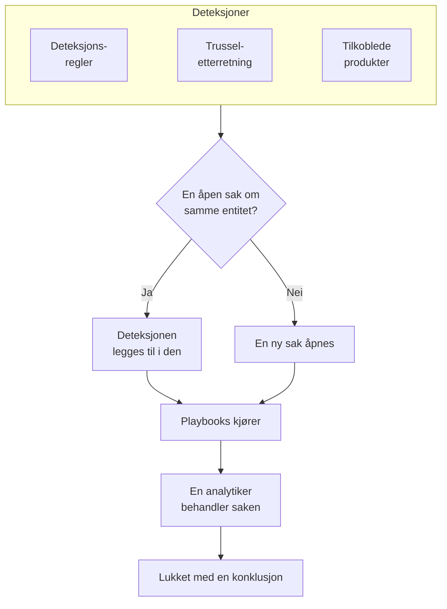

# Sikkerhetssaker og playbooks (SOAR)

Sikkerhetshendelser gjør det deteksjonsreglene, trusseletterretningen og de tilkoblede sikkerhetsproduktene dine finner, om til saker: én sak for hver ting som er verdt å undersøke, med alle deteksjoner om samme bruker, vert eller adresse samlet i den. Analytikere behandler sakene i en kø, og playbooks reagerer på dem, av seg selv eller med et klikk.

:::cards
- [Hvor saker kommer fra](#hvor-saker-kommer-fra): Deteksjonsregler, trusseletterretning, tilkoblede produkter, entitetsrisiko og personer.
- [Behandle en sak](#behandle-en-sak): Tildel den, undersøk entitetene, og lukk den med en konklusjon.
- [Saksprioriteter og saksstatuser](#saksprioriteter-og-saksstatuser): Gi dem nytt navn, ny farge og ny rekkefølge, og legg til dine egne.
- [Responsmål](#responsmål): Hvor raskt en sak med hver prioritet må tas og begrenses.
- [Varslinger](#varslinger): Hvem som får beskjed om en ny sak, en tildeling, et responsmål, en oppgave og et steg som venter på godkjenning.
- [Playbooks](#playbooks): Steg som kjører på en sak, med godkjenning der det betyr noe.
- [Oversikten](#oversikten): Det som trenger noen nå, og hvor raskt saker blir håndtert.
:::

## Slik fungerer det

Åpne **Produkter → Sikkerhetshendelser → Sikkerhetssaker → Åpne saker** for køen. **Tildelt meg**, **Ikke tildelt**, **Lukkede saker** og **Alle saker** er egne sider ved siden av, og hver viser sakene navnet sier.

## Før du begynner

Saker og playbooks følger de tre Security-rollene. Prosjekteier og Prosjektadministrator kan gjøre alt.

| Rolle | Hva den kan gjøre |
| --- | --- |
| Sikkerhetsadministrator | Alt, også å slette saker, fjerne bevis og sette opp playbooks |
| Sikkerhetsmedlem | Åpne, tildele, endre og lukke saker, skrive notater, jobbe med oppgaver, legge til bevis, kjøre playbooks og godkjenne eller avvise stegene deres |
| Sikkerhetsleser | Lese saker, deteksjoner, notater, oppgaver, bevis, playbooks og kjøringene deres |

Hver av disse rettighetene kan også gis for seg, fra å opprette en sak til å godkjenne stegene i en playbook; se [Tillatelsesreferanse](/docs/permissions/reference).

## Hvor saker kommer fra

| Kilde | Åpner en sak når | Slås av med |
| --- | --- | --- |
| Deteksjonsregler | En regel treffer | **Åpne en sak ved treff**, i regelens steg **Ved treff** |
| Trusseletterretning | En hendelse nevner en kjent indikator | **Åpne en sak ved treff**, i feedens steg **Ved treff** |
| Tilkoblede produkter | Et varsel fra selve produktet importeres på eller over tilkoblingens terskel | **Åpne saker fra** satt til **Aldri**, i tilkoblingens steg **Henting** |
| Sikkerhetsprodukter i loggene dine | En trussel som en brannmur, et IDS eller et endepunktprodukt skriver i loggene dine, ligger på eller over terskelen for Loggene dine | **Åpne saker fra** satt til **Aldri**, på **Loggene dine** |
| Entitetsrisiko | Risikoen til en bruker, vert eller adresse når prosjektets terskel | **Risikosaker** under **Innstillinger → Risikovurdering** |
| Personer | Noen åpner en fra **Sikkerhetssaker**, eller med **Åpne sak** i panelet til en hendelse | Ingen |

Alle kilder åpner saker som standard, unntatt entitetsrisiko i prosjekter som ble opprettet før det fantes: slå først på **Risikosaker** der ([Entitetsrisiko](/docs/telemetry/security-entity-risk)). En tilkobling åpner saker for **Høy og høyere** med mindre du velger et annet nivå; varslene under det nivået importeres fortsatt som hendelser. **Loggene dine** gjør det samme for truslene i loggene dine.

### Slik grupperes deteksjoner

En deteksjon gjelder en entitet: verdien regelen grupperer etter, for eksempel IP-adressen i en brute force-regel, eller indikatoren som et treff fra trusseletterretning nevner. En deteksjon uten entitet står alene.

- Når en åpen sak allerede gjelder den entiteten, legges deteksjonen til i den. Sakens entiteter og ATT&CK-tilordning vokser, og prioriteten heves til deteksjonens, men senkes aldri.
- Når ingen åpen sak gjør det, åpnes en ny sak, oppkalt etter deteksjonen, med deteksjonens prioritet.
- En deteksjon som slår til igjen, teller opp på sin egen rad i stedet for å legge til en ny.

Prioriteten til en sak kommer fra deteksjonens alvorlighetsgrad, som prosjektets innebygde prioritet for det nivået, uansett hva du har kalt den:

| Alvorlighetsgrad | Prioritet |
| --- | --- |
| Critical eller Fatal | Kritisk |
| High | High |
| Medium, Unknown eller Other | Medium |
| Low | Low |
| Informational | Til orientering |

## Behandle en sak

Sakene i et nytt prosjekt går gjennom fire statuser, som du kan gi nye navn og legge til flere av (se [Saksprioriteter og saksstatuser](#saksprioriteter-og-saksstatuser)). En sak kan hoppe over en, for eksempel en false positive som lukkes rett fra Ny, og den kan åpnes på nytt.

| Status | Betyr |
| --- | --- |
| Ny | Ingen har sett på den ennå |
| Undersøker | Noen holder på å finne ut hva som skjedde |
| Contained | Trusselen kan ikke lenger gjøre skade; oppryddingen gjenstår |
| Lukket | Ferdig, med en konklusjon om hva det var |

En sak har sin egen sidemeny, slik en hendelse har, og hver del av saken er en egen side:

| Seksjon i sidemenyen | Sider |
| --- | --- |
| **Oversikt** | **Oversikt**, **Tidslinje** |
| **Undersøkelse** | **Forløp**, **Deteksjoner**, **Entiteter**, **Tilkoblede signaler**, **Bevis**, **Oppgaver**, **Playbooks** |
| **Notater** | **Private notater** |
| **Avansert** | **Egendefinerte felt**, **Revisjonslogger**, **Slett sak**, skjult til du klikker på **Avansert** |

Hver side beholder sakens topptekst øverst: nummer, prioritet, status og tittel, **Tildel til meg**, **Kjør playbook**, **Erklær hendelse** og **Lukk sak**, og i menyen ⋯ ved siden av **Angi prioritet**, **Tildel til en annen**, **Endre status**, **Rediger sak** og **Slett sak**. Slik kan saken behandles fra hvilken som helst av sidene, og en lenke til saken åpner fortsatt **Oversikt**. Når sakens prioritet har responsmål, viser toppen også når det neste har frist ([Responsmål](#responsmål)).

- **Oversikt**: sakens beskrivelse, etiketter og statussteg, hvem som har den og hva som åpnet den, og tallene: hvor mange deteksjoner den har, hvor lenge den har vært åpen, og hvor lang tid det tok å bekrefte og inndemme den. Under **Tid til bekreftelse** og **Tid til begrensning** står det hvordan saken ligger an mot responsmålene sine.
- **Hvorfor denne saken ble åpnet**, på **Oversikt**: deteksjonen som åpnet saken, og hvordan regelen dens slår til (terskelen, hva den grupperer etter og vinduet den teller i), hvor mange hendelser den traff, hvor de kom fra og i hvilket tidsrom, hva regelen ser etter, og hvor langt forespørslene kom. Under **Treff** står selve hendelsene, de eldste først: hver med det regelen ser etter uthevet, hvor langt forespørselen dens kom, logglinjen eller produktet den kom fra, og **Spor**, **Logger** og **Unntak** ett klikk unna; logglinjen den kom fra, åpnes i loggutforskeren ved akkurat den linjen. Klikk på en hendelse for å se hele hendelsen, med logglinjen den ble lest fra. **Oppbevar i denne saken**, på raden dens eller i panelet dens, oppbevarer hendelsen på sakens side **Bevis** og nevner deteksjonen som traff den; en hendelse saken allerede oppbevarer, sier det og åpner den der. Når en deteksjon slår til, oppbevarer den opptil 25 av hendelsene den traff, og viser dem, også etter at oppbevaringstiden deres er ute; rollen din ser dem fra kildene den kan lese. En regel som slår til for mange grupper samtidig, også en korrelasjonsregel, oppbevarer hendelser for hver av dem: høyst 1 000 til sammen, så hver oppbevarer minst 10, og opptil 25 når den slår til igjen. For en eldre deteksjon som ennå ikke oppbevarte hendelser, er treffene til en regel det dens egen betingelse traff, for deteksjonens gruppe, i vinduene den slo til i; et treff fra trusseletterretning viser hendelsene som inneholder indikatoren dets, og et varsel fra et tilkoblet produkt hendelsen det ble sendt som. **Se videre** åpner alt om adressen eller brukeren deteksjonen gjelder, hendelsene og logglinjene som nevner den, loggene til tjenestene logglinjene dens kom fra, og sporene til forespørslene dens, hver innenfor deteksjonens vindu, samt sakens **Forløp** og **Tilkoblede signaler**. Sakens andre deteksjoner ligger sammenslått under **Også på denne saken**.
- **Responsplan**, på **Oversikt**: hva du bør gjøre med saken nå, det mest presserende først, under **Bekreft at det er ekte**, **Begrens det**, **Rett det som gjorde det mulig** og **Lukk saken**. Hvert steg gjelder denne saken: adressene, brukerne og vertene dens, hvor langt forespørslene dens kom, hva regelen dens sier at den også kan slå til på, ATT&CK-taktikkene og -teknikkene deteksjonene dens er tilordnet, og playbookene prosjektet har. En deteksjonsregels egne steg, skrevet under **Responstrinn** i skjemaet dens, kommer først i den delen av planen de hører inn under, og reglene i regelbiblioteket kommer med egne steg. Et steg OneUptime kan utføre, har sin egen knapp: **Tildel til meg**, **Legg til unntak** med regelen og adressen allerede fylt ut, **Kjør playbook** for playbooken som suspenderer kontoen eller begrenser verten, eller den OneUptime AI foreslår, **Erklær hendelse**, **Merk som begrenset** og **Lukk sak**. Steget til en offentlig adresse blokkerer den med ett klikk, **Blokker i 24 timer**, så snart et mål håndhever blokkeringslisten din (se [Blokker en adresse fra en sak](#blokker-en-adresse-fra-en-sak)). Et steg OneUptime ikke kan utføre, for eksempel å blokkere et domene i DNS-filteret ditt, viser **Utenfor OneUptime**, med verdien ett klikk fra utklippstavlen. Der en tilkobling blokkerer på hver maskin (se [Blokkeringsliste](#blokkeringsliste)), er det også ett klikk å blokkere sakens domene, fil eller command-and-control-server: **Blokker i 7 dager**, eller **Blokker fil** i 30 dager, setter det på blokkeringslisten, og trinnet er utført så snart Microsoft Defender eller CrowdStrike Falcon håndhever blokkeringen. Kryss et steg av når det er utført: det tas vare på som en av sakens **Oppgaver**, utført, med hvem som gjorde det og når. Steg som saken selv avgjør, krysses av automatisk: den er tildelt, en hendelse er erklært, en playbook har kjørt, den er begrenset eller lukket. Når alle steg som begrenser trusselen, er utført, tilbyr planen **Merk som begrenset**, som registrerer sakens tid til begrensning. Når OneUptime AI har vurdert saken, står vurderingen dens øverst i planen, og stegene den foreslår, ligger sammenslått under planens egne. OneUptime kontrollerer selv de fleste trinnene og viser ved hvert trinn hva det fant: se [Slik kontrollerer OneUptime et trinn](#slik-kontrollerer-oneuptime-et-trinn).
- **OneUptime AI**, på **Oversikt**: hva OneUptime AI fikk ut av saken, prioriteten og playbooken den foreslår, og bevisene bak. Se [OneUptime AI i sikkerhet](/docs/telemetry/security-ai).
- **Påvirkning**, på **Oversikt**: hva saken setter i fare: om OneUptime har sett postene dens bli nådd fra internett, hvem som eier dem, hva som sist ble endret på dem, og data i fare – datalagrene med sensitive data som saken nevner, eller som brukerne og rollene dens kan nå (se [Integrasjoner for Datasikkerhet](/docs/data-security/integrations#security-operations)). Fold den ut for å se hva hver post kaller og hva som kaller den, monitorene og statussidene som følger med på den, og maskinene sakens adresser snakket med.
- **MITRE ATT&CK**, på **Oversikt**: taktikkene og teknikkene deteksjonene i saken er tilordnet, hver med en lenke til sin side på attack.mitre.org.
- **Tidslinje**: alt som skjedde med saken, med hvem som gjorde det.
- **Forløp**: hva som skjedde, i rekkefølge, på tvers av OneUptime: hver deteksjon og sikkerhetshendelsene bak den, hvor langt forespørslene kom, unntakene de utløste, endringene på postene saken nevner, hendelsene og varslene som oppsto på dem, og hva teamet gjorde. En skanners mange forsøk er én linje, og hver linje åpner det den nevner, for eksempel forespørselens trace eller unntaket.
- **Deteksjoner**: det som slo til og åpnet saken eller ble lagt til i den, hvor ofte, og den siste hendelsen som traff.
- **Entiteter**: brukerne, vertene og adressene saken gjelder, med aktiviteten deres på tvers av alle sikkerhetshendelsene dine de siste 7 dagene. Hver av dem åpnes i **Korreler**.
- **Tilkoblede signaler**: vertene, klyngene, tjenestene og medlemmene saken nevner, slik OneUptime kjenner dem, og hva som skjedde på hver av dem rundt deteksjonene: loggene, sporene og målingene deres, hva som er åpent på dem, og hva som endret seg. Se [Tilkoblede signaler](/docs/telemetry/security-connected-signals).
- **Bevis**: filene, lenkene og sikkerhetshendelsene som oppbevares på saken, hver med hvem som la den til og når. Med **Legg til fil** laster du opp en fil på opptil 10 MB, og SHA-256 for det som ble lastet opp, registreres, så den som laster den ned senere kan kontrollere at det er det som ble oppbevart; med **Legg til lenke** viser du til bevis som oppbevares et annet sted. Bare en Sikkerhetsadministrator kan fjerne bevis, og sakens **Tidslinje** viser hva som ble lagt til og fjernet. En sikkerhetshendelse oppbevares her slik den var, med **Legg til i sak** under **Hendelser** eller på siden til en [hunt](/docs/telemetry/security-events#hunts), eller med **Oppbevar i denne saken** på en hendelse en deteksjon traff, og **Vis hendelse** åpner den. Steget **Preserve the evidence** i et playbook oppbevarer også her hendelsene bak sakens deteksjoner.
- **Oppgaver**: hva som må gjøres i saken, hvem som gjør det, og om det er gjort. Legg til en oppgave som én linje, gi den til noen, og kryss den av når den er utført. Den som får oppgaven, får beskjed, med mindre vedkommende tok den selv, og menyen viser ved siden av **Oppgaver** hvor mange oppgaver som er åpne. Steget **Legg til oppgaver** i et playbook legger også til oppgaver og hopper over dem saken allerede har.
- **Playbooks**: hva hver playbook gjorde på saken, steg for steg, og stegene som venter på godkjenning. Mens kjøringer venter, viser menyen hvor mange ved siden av **Playbooks**.
- **Private notater**: hva teamet skrev om saken. Redigeringens meny **Maler** setter inn en av prosjektets notatmaler i et notat.
- **Egendefinerte felt**: prosjektets egne felt, fylt ut for denne saken, og **Rediger felt** for å endre dem. Så snart prosjektet har et felt, viser **Oversikt** dem også, i sitt siste kort. Se [Egendefinerte felt, notatmaler og nummerering](#egendefinerte-felt-notatmaler-og-nummerering).
- **Revisjonslogger**: hver endring i saken, og hvem som gjorde den. Se [Revisjonslogger](/docs/configuration/audit-logs).
- **Slett sak**: sletter saken for godt, med deteksjonene, notatene, tidslinjen og playbook-kjøringene. For å beholde den som dokumentasjon, lukk den heller med en konklusjon.

### Slik kontrollerer OneUptime et trinn

En hake sier at noen har utført et trinn. OneUptime kontrollerer også selv trinnene i en saks **Responsplan** opp mot det som faktisk skjedde: hvert minutt mens saken er åpen, og med en gang når et trinn krysses av, en oppgave endres eller en playbook begrenser noe. Ved hvert trinn det har kontrollert, viser planen hva det fant:

| Ved trinnet | Betyr |
| --- | --- |
| **Kontrollert av OneUptime** | OneUptime så trinnet utført, og det holder. Ingen trenger å krysse det av |
| **Ser utført ut** | Det OneUptime ser, passer med et utført trinn, men beviser det ikke. **Bekreft** krysser det av som ditt |
| **Ikke utført ennå** | OneUptime ser at trinnet fortsatt gjenstår |
| **OneUptime kan ikke si det** | OneUptime har ingenting å kontrollere trinnet mot, og sier hvorfor, med **Slik lar du OneUptime kontrollere dette** |
| **Holder ikke lenger** | Trinnet var utført og virker ikke lenger, for eksempel når en blokkert adresse slipper gjennom igjen |
| **Ikke nødvendig så langt** | Ingenting har skjedd som krever trinnet |

**Hvordan vi vet det**, ved det OneUptime fant, åpner resten: hva annet det så, en lenke til sporene eller produktet det leste, og når det kontrollerte. Planens fremdrift teller trinnene OneUptime har kontrollert selv, som i «4 av 9 utført, 3 kontrollert av OneUptime».

| Trinn | Hva OneUptime leser |
| --- | --- |
| Blokker adressen | Om et mål holder en blokkering av adressen på [blokkeringslisten](#blokkeringsliste) din og har lest den tilbake, og om forespørsler fra adressen fortsatt når appen din, i sporene og tilgangsloggene dens. En blokkering et mål holder, er kontrollert; en blokkering ingenting håndhever, er det ikke. En adresse som blir stille uten en blokkering, ser utført ut: den kan ha blitt blokkert, eller kan rett og slett ha sluttet |
| Kontroller at ingenting annet slapp gjennom | Hvordan hver forespørsel fra adressen har endt siden sakens første deteksjon. Når appen din avviste alle, er trinnet kontrollert |
| Suspender kontoen | Kontoen i Okta, Microsoft Entra ID eller Google Workspace: suspendert, eller deaktivert med øktene avsluttet etter at saken ble åpnet |
| Ta verten av nettverket | Verten i CrowdStrike Falcon eller Microsoft Defender for Endpoint: begrenset eller isolert |
| Blokker domenet, filen eller serveren på hver maskin | Blokkeringen på blokkeringslisten: utført så lenge Microsoft Defender eller CrowdStrike Falcon håndhever den, ikke utført så lenge den er på vei eller avvist, som trinnet sier |
| Erklær en hendelse | Om en forespørsel kom forbi kontrollene i appen din, eller en monitor for tjenestene den nådde gikk ned, mens saken var åpen. Inntil da er trinnet ikke nødvendig så langt |
| Utelukk en falsk positiv | Ingenting: bare du kan utelukke den. Trinnet viser hva OneUptime vet om adressen: om en av postene dine har den, feedene med trusselsinformasjon som oppfører den, og de innloggede brukerne som har brukt den de siste 30 dagene |
| Rett ruten angrepet gikk etter | Angrepsforespørslene til ruten, i sporene og loggene til appen din, før og etter at en endring ble rullet ut til tjenesten bak den: en pull request som steget **Fix the code with AI** i et playbook åpnet, eller en hvilken som helst utrulling eller ny versjon av tjenesten. Når nok forespørsler fra det samme angrepet er blitt avvist siden, eller holdt unna databasen der de før nådde den, er trinnet kontrollert. Uten angrep siden sier det at det ikke har vært noen forsøk siden rettelsen, og ser utført ut |
| Tilbakestill passordet | Kontoen i Okta eller Microsoft Entra ID: passordet er endret, og øktene er avsluttet, etter at saken ble åpnet. Google Workspace sier ikke når et passord ble endret, så OneUptime kan ikke si det |
| Sørg for at kontoene bruker MFA | Hver konto angrepet gikk etter, i Okta, Microsoft Entra ID eller Google Workspace: en aktiv faktor, en MFA-metode eller 2-trinnsbekreftelse. Med MFA på alle ser trinnet utført ut: ingen produkter sier om kontoer sperres etter mislykkede pålogginger, så det bekrefter du selv |

- Et trinn som er utført utenfor OneUptime, teller også. Blokker adressen i din egen brannmur, og OneUptime ser at forespørslene stopper; suspender kontoen i Okta, og OneUptime leser det tilbake.
- Du kan fortsatt krysse av et trinn selv, også et som OneUptime ikke ser utført. Et trinn OneUptime har kontrollert, trenger ingen hake.
- Når et utført trinn ikke lenger holder, sier planen det øverst, sakens **Tidslinje** sier hva OneUptime så, og de som er på saken, får beskjed: se [Varslinger](#varslinger).
- OneUptime kan ikke se forespørslene fra en adresse når appen din ikke sender det spor eller logger, når sporene ikke sier hvilken adresse hver forespørsel kom fra, eller når de bærer adressene til Cloudflare eller en lastbalanserer foran appen din i stedet for de besøkendes. Sett klientens adresse (`client.address`) på serverspennene i appen din: fra `CF-Connecting-IP` bak Cloudflare, fra `X-Forwarded-For` bak en lastbalanserer.
- OneUptime leser kontoer og verter gjennom prosjektets tilkoblinger til produktene som har dem, de samme som [Svar gjennom OneUptime](#svar-gjennom-oneuptime) bruker. Uten noen kan det ikke si det.
- Et produkt som ikke svarer, eller en lesing som mislykkes, teller aldri som et trinn som ikke er utført: trinnet sier at OneUptime ikke kunne kontrollere det akkurat nå, og OneUptime prøver igjen om noen minutter.
- En rettelse av en rute kontrolleres først når selve angrepet blir avvist: en utrulling alene er ikke en rettelse. OneUptime venter på så mange avviste angrep siden rettelsen ble rullet ut at minst ett nesten helt sikkert (95 %) ville ha kommet gjennom med takten de kom gjennom i før, hvis ingenting hadde endret seg, og aldri færre enn 3. Trinnet sier hvor mange det venter på, og overvåker ruten i 7 dager etter at rettelsen er rullet ut, som i «Overvåker /api/search frem til 27. november». Når nesten ingen kom gjennom før, kan ikke angrepene vise at en rettelse virket, og trinnet blir stående på **Ser utført ut** så du kan bekrefte det.
- OneUptime ser at en rettelse rulles ut når det ser tjenestens utrullinger: send dem til OneUptime, eller rapporter `service.version` i telemetrien til appen din (se [Utrullinger og endringer](/docs/telemetry/change-events)). En pull request som **Fix the code with AI** åpnet, oppbevares på saken, og utrullingen av den kobles til commiten dens. Forespørsler som ble stoppet ved kanten, for eksempel av Cloudflare, nådde aldri appen din, så de sier ingenting om rettelsen.
- For å lese MFA for en konto i Microsoft Entra ID trengs programtillatelsen UserAuthenticationMethod.Read.All, i tillegg til dem [Inndemming](#inndemming) lister opp.

**Merk saker som begrenset når de er verifisert**, under **Produkter → Sikkerhetshendelser → Innstillinger → Saksstatuser**, flytter en sak til Begrenset så snart hvert trinn som begrenser den, er **Kontrollert av OneUptime** eller **Ikke nødvendig så langt**. Tiden til begrensning registreres, og sakens **Tidslinje** sier at OneUptime har verifisert hvert trinn som begrenser trusselen. Et trinn som bare ser utført ut, eller en hake, flytter aldri en sak av seg selv. Innstillingen er slått på i alle prosjekter, og en Prosjekteier eller Prosjektadministrator kan slå den av: da blir en sak der den er, til noen markerer den som Begrenset.

Alle som kan se en sak, ser hva OneUptime fant. Ingen redigerer det: den som er uenig, krysser av trinnet selv, og det krever en rolle som kan jobbe med sakens oppgaver.

### Blokker en adresse fra en sak

En offentlig adresse saken gjelder, har et eget steg i **Responsplan**. Så lenge et mål håndhever blokkeringslisten din, for eksempel Cloudflare, [AWS WAF](/docs/telemetry/cloud-aws-waf-blocklist) eller en brannmur som leser en liste, nevner steget målet, som i «Blokker 35.205.11.131 hos Cloudflare.» **Blokker i 24 timer** blokkerer adressen der, og menyen ved siden av har **Utfordre i stedet**, **Blokker i 7 dager** og **Blokker til den oppheves**, som bare en Sikkerhetsadministrator, en Prosjektadministrator eller en Prosjekteier kan velge. Mennesker består en utfordring, skript og API-klienter gjør det ikke. På sakens side **Entiteter** gjør **Blokker…** ved en adresse det samme, og spør hvor lenge.

- En blokkering går gjennom playbook-motoren, slik en playbooks blokkering gjør: den lagres på sakens side **Playbooks**, på **Tidslinje** og i revisjonsloggen. Den venter på godkjenning fra noen andre, med mindre du er Sikkerhetsadministrator, Prosjektadministrator eller Prosjekteier.
- Den avvises med en begrunnelse for en adresse sakens forespørsler bare oppga, for en av dine egne eller en beskyttet adresse, og for en som en blokkering allerede dekker.
- Så snart et mål holder blokkeringen, er steget utført og viser hvor, siden når, av hvem og til når, med **Opphev**. Så lenge ingen mål holder den, sier steget det og er ikke utført.
- Så lenge ingenting håndhever blokkeringslisten din, viser steget hvordan du kobler til Cloudflare, AWS WAF eller en brannmur, og **Slik blokkerer du den** viser adressen i Cloudflare-dashbordet, AWS CLI, nginx og nftables.
- Når en sak lukkes som **Falsk positiv** eller **Ufarlig positiv**, tilbys det å oppheve blokkeringene den har laget, avkrysset og med navnet på hver.

### Behandle saker fra køen

Du trenger ikke åpne en sak for å behandle den. I køens lister har menyen ⋯ på raden til en sak **Tildel til meg**, **Tildel til en annen**, **Endre status** og **Endre prioritet**. For å behandle flere saker samtidig merker du dem og bruker de samme handlingene under **Massehandlinger**: De viser hvilke saker som ble endret, hvilke som ble latt være, og hvorfor.

- For å gi en sak til noen andre bruker du **Tildel til en annen** og velger én person eller et team. En sak som hører til et team, venter under **Ikke tildelt** til noen på teamet tar den.
- En status som lukker en sak, ber om en konklusjon og et avslutningsnotat, slik **Lukk sak** gjør.
- En lukket sak tildeles ikke noen. For å jobbe med den igjen gjenåpner du den med **Endre status**.

### Lukk en sak

**Lukk sak** ber om en konklusjon og et valgfritt avslutningsnotat:

| Konklusjon | Betyr |
| --- | --- |
| True Positive | Ondsinnet eller uautorisert aktivitet fant faktisk sted |
| Benign Positive | Aktiviteten var ekte, men forventet, for eksempel en penetrasjonstest eller en administrasjonsoppgave |
| False Positive | Deteksjonen var feil: regelen eller dataene tolket normal aktivitet feil |
| Undetermined | Det fantes ikke nok informasjon til å avgjøre det |

Konklusjonene telles på oversikten. En regel der sakene stadig lukkes som False Positive, er en regel som bør justeres.

Mens oppgaver i saken fortsatt er åpne, sier dialogen **Lukk sak** hvor mange.

En sak som er åpnet fra Google SecOps-varsler, lukker dem også i Google SecOps, med konklusjonen og avslutningsnotatet, når tilkoblingen har **Lukk varsler når saken deres lukkes** slått på: se [Google SecOps](/docs/integrations/google-secops#lukk-varsler-når-saken-deres-lukkes).

### Erklær en hendelse

**Erklær hendelse** åpner en OneUptime-hendelse (incident) for saken, med alvorlighetsgraden du velger, og kobler de to sammen begge veier: beskrivelsen av hendelsen nevner saken, og toppen av saken lenker til hendelsen. Vaktordningen, statussider og postmortem tar over derfra. Det krever en rolle som både kan behandle saker og opprette hendelser (incidents).

## Saksprioriteter og saksstatuser

Hvert prosjekt har sine egne saksprioriteter og saksstatuser, under **Produkter → Sikkerhetshendelser → Innstillinger → Saksprioriteter** og **Saksstatuser**. Gi dem nye navn og farger, dra dem i en annen rekkefølge, og legg til dine egne, for eksempel en status «Triage» eller en prioritet «Nødsituasjon» over **Kritisk**. Et nytt navn vises overalt med én gang: i køen, på sakssidene og oversikten, i varslinger, i Slack, Microsoft Teams og Mattermost og i playbook-meldinger.

Noen er innebygde, fordi OneUptime leser hva de betyr. De kan få nytt navn og ny farge, men ikke slettes eller arkiveres, og de beholder rekkefølgen sin:

| Innebygd | Hva OneUptime gjør med den |
| --- | --- |
| Den nye statusen | Nye saker starter i den |
| Den kvitterte statusen | Når en sak når den, registreres det når saken ble kvittert, og **Gjenåpne** flytter en lukket sak tilbake til den |
| Den begrensede statusen | Når en sak når den, registreres det når saken ble begrenset |
| Den lukkede statusen | **Lukk sak** flytter en sak dit, med en konklusjon |
| Prioritetene Kritisk, High, Medium, Low og Til orientering | En deteksjon åpner saken sin med prioriteten for alvorlighetsgraden sin, og en sak som noen åpner, starter på Medium |

- Hvor en status står, avgjør hva en sak i den teller som, slik kolonnen **Teller som** viser: fra den kvitterte statusen og ned som kvittert, fra den begrensede statusen og ned som begrenset, fra den lukkede statusen og ned som lukket. En status du legger til, havner rett over den lukkede statusen, og når du flytter en sak til en status som lukker den, blir du først bedt om en konklusjon.
- Plassen til en prioritet sier hvor mye den haster, den som haster mest først: **For saker med minst**, valgene for varslinger og reglene for Slack, Microsoft Teams og Mattermost leser denne rekkefølgen. En prioritet du legger til, havner sist, og kolonnen **Deteksjonens alvorlighetsgrad** viser hvilke deteksjoner som åpner sakene sine med hver innebygde prioritet.

For å slutte å bruke en egen status eller prioritet bruker du **Arkiver** i raden dens. Ingen kan velge den igjen, og API-et, Terraform og MCP avviser den, men sakene som har den, beholder den, og du kan fortsatt filtrere på den. Arkiverte verdier står i den sammenslåtte delen **Arkiverte saksstatuser** eller **Arkiverte saksprioriteter** under tabellen, der **Fjern fra arkivet** henter en tilbake. **Slett** avvises så lenge saker har verdien eller en playbook kjører fra prioriteten.

## Responsmål

Et responsmål er hvor raskt en sak må behandles: **Bekreft innen**, hvor lenge en ny sak kan vente på at noen tar den, og **Begrens innen**, hvor lang tid det kan ta før den er begrenset eller lukket. Hver saksprioritet har sine egne, under **Produkter → Sikkerhetshendelser → Innstillinger → Responsmål**: med **Rediger** på raden til en prioritet setter du de to målene, i minutter, timer eller dager, opptil ett år, og et tomt mål betyr ingen mål. Prioritetene i et nytt prosjekt starter med disse:

| Prioritet | Bekreft innen | Begrens innen |
| --- | --- | --- |
| Kritisk | 15 minutter | 4 timer |
| High | 1 time | 1 dag |
| Medium | 12 timer | 3 dager |
| Low | 1 dag | 7 dager |
| Til orientering | Ingen mål | Ingen mål |

Et prosjekt som ble opprettet før responsmål, har ingen før noen setter dem.

- En saks frister settes når den åpnes, ut fra målene til prioriteten. Et mål som endres senere, gjelder sakene som åpnes etterpå.
- En sak er bekreftet så snart noen tar den: en person tildeles, eller den flyttes til en status som teller som bekreftet. Den er begrenset så snart den når en status som teller som begrenset, eller lukkes.
- Når en saks prioritet endres, forblir et mål den har nådd eller overskredet som det var. En høyere prioritet trekker en frist nærmere: det nye målet telles fra endringen, med mindre den gamle fristen kommer først. En lavere prioritet skyver den senere, aldri tidligere: det nye målet telles fra da saken ble åpnet. En prioritet uten mål beholder fristen til en hevet sak og fjerner fristen til en senket.
- En lukket sak som åpnes igjen før den noen gang ble begrenset, får en ny frist for begrensning, regnet fra gjenåpningen.
- I den siste femtedelen av et mål er saken i ferd med å overskride det: de som er på saken, får beskjed, og får beskjed igjen når målet er overskredet. Se [Varslinger](#varslinger).

Her vises målene:

- Toppen av saken nevner det neste målet og hvor mye tid som er igjen, eller hvor lenge det er overskredet: grått mens det er tid, ravgult i den siste femtedelen, rødt når det er overskredet.
- På sakens **Oversikt**, under **Tid til bekreftelse** og **Tid til begrensning**: hvordan saken ligger an mot hvert mål, eller hvor langt over det saken gikk.
- I køens lister: linjen under hver saks prioritet, og en kolonne **Frist** som du kan slå på og sortere etter. Mens kolonnen er slått på, vises ikke linjen under prioriteten. Listene viser dem bare når en av prosjektets prioriteter har et mål.

## Egendefinerte felt, notatmaler og nummerering

Tre innstillinger til gjør sakene til prosjektets egne, under **Produkter → Sikkerhetshendelser → Innstillinger**:

- **Egendefinerte felt**: feltene teamet ditt fyller ut i hver sak, for eksempel forretningsenheten den gjelder eller referansen i et annet verktøy. Et felt rommer tekst, et tall, en dato, et ja eller nei, et valg fra en liste eller en fil. Sakens side **Egendefinerte felt**, under **Avansert**, viser hvert felt med sakens verdi, og **Rediger felt** endrer dem. I køens lister er hvert felt en kolonne du kan slå på under **Kolonner**.
- **Notatmaler**: ferdig tekst til notatene teamet ditt skriver sak etter sak, for eksempel en sjekkliste for inndemming eller en overlevering til neste vakt. På en saks **Private notater** setter redigeringens meny **Maler** inn en i notatet, som du kan redigere før det publiseres, og **Administrer maler** åpner listen.
- **Nummerering**: teksten foran saksnumrene, `CASE-` i `CASE-42` med mindre du velger din egen, og nummeret den neste saken får. Bytter du fra et annet verktøy? Start etter det siste saksnummeret der, så et nummer aldri betyr to saker. Et nytt prefiks eller en ny start gjelder bare nye saker, og en start må være høyere enn det høyeste nummeret som er brukt så langt.

En Sikkerhetsadministrator administrerer de egendefinerte feltene og notatmalene, og et Sikkerhetsmedlem fyller ut feltene i en sak; på OneUptime Cloud krever de Growth-abonnementet eller høyere. Nummereringen settes av en Prosjekteier eller Prosjektadministrator, slik som for hendelser og varsler.

## Varslinger

OneUptime gir folk beskjed om seks ting på en sak. Ingen trenger å sette opp noe: et prosjekt som bare har klikket på **Slå på anbefalt**, får høre om sakene sine med prioritet High og Kritisk via e-post og push.

| Varsling | Hvem som får beskjed | Som standard |
| --- | --- | --- |
| Ny sikkerhetssak | Alle som kan se prosjektets saker, når en sak åpnes eller stiger, på prioriteten de har valgt eller høyere | E-post og push, for saker med High og Kritisk |
| Sikkerhetssak tildelt meg | Personen saken er tildelt, og medlemmene av teamet den er tildelt | E-post og push |
| Playbook-trinn venter på min godkjenning | Personene på saken som kan godkjenne steget: personen den er tildelt, og medlemmene av teamet dens. Kan ingen av dem godkjenne, alle i prosjektet som kan | E-post og push |
| Responsmål for sikkerhetssak | De som er på saken: personen den er tildelt, og medlemmene av teamet dens. Er ingen på den, de som får beskjed om nye saker med prioriteten dens | E-post og push |
| Oppgave i sikkerhetssak tildelt meg | Personen som får en oppgave i saken, med mindre vedkommende tok den selv | E-post og push |
| Trinn i sikkerhetssak holder ikke lenger | De som er på saken, når et trinn OneUptime så utført, ikke lenger holder: personen den er tildelt, og medlemmene av teamet dens. Er ingen på den, de som får beskjed om nye saker med prioriteten dens | E-post og push |

- Bare personer som kan se saken, får beskjed om den: Prosjekteiere, Prosjektadministratorer og rollene Sikkerhetsadministrator, Sikkerhetsmedlem og Sikkerhetsleser. En rolle som er begrenset til noen etiketter, får bare beskjed om sakene med de etikettene.
- Ingen får beskjed om det de selv gjorde: den som åpner en sak manuelt, tildeler den eller starter en kjøring, blir ikke varslet om det.
- Hver person får høre om en sak én gang. En sak som åpnes på Medium og senere stiger til Kritisk, når ved stigningen fram til dem som valgte High eller Kritisk, og ikke på nytt til dem som valgte Medium, for de fikk høre om den da den ble åpnet.
- Testangrepet fra **Send et testangrep** åpner en sak som ikke varsler noen.
- En sak med Kritisk og et steg som venter på godkjenning, sendes med en gang og holdes aldri tilbake i en [e-postoppsummering](/docs/emails/notification-rollup). Det samme gjelder et responsmål som er i ferd med å overskrides, eller er overskredet, og et trinn som ikke lenger holder.
- Sakens **Tidslinje** viser hvem som fikk beskjed, og når.

### Velg hva du får beskjed om

Hver person velger selv, under **Brukerinnstillinger → Varslingsinnstillinger → Sikkerhet**: kanalene for hver varsling (e-post, SMS, anrop, push, Telegram, Slack, Microsoft Teams, Mattermost eller webhook), og under **Ny sikkerhetssak** prioriteten som varsler dem:

| Valg | Varsler om saker med |
| --- | --- |
| Bare Kritisk | Kritisk |
| Høy og høyere | Kritisk og High (standard) |
| Middels og høyere | Kritisk, High og Medium |
| Lav og høyere | Alle prioriteter unntatt Til orientering |
| Alle saker | Alle prioriteter |

Valgene følger prosjektets saksprioriteter, under sine egne navn: dette er valgene i et nytt prosjekt.

Det sendes ikke WhatsApp-meldinger for sikkerhetssaker. En push-varsling åpner saken i OneUptime On-Call-appen (1.7.0 eller nyere), der du kan godkjenne eller avvise et playbook-steg som venter, ta saken og lukke den. Lenken i det åpner saken i nettleseren. En push-varsling om et steg som venter på godkjenningen din, åpner selve godkjenningen, med bevisene; har noen bestemt seg siden, sier saken hvem, når og hvordan steget gikk.

Et steg som venter på godkjenningen din, når deg i Slack eller Microsoft Teams som en melding du kan godkjenne fra, og e-posten om det sier hva steget vil gjøre og hvorfor: se [Godkjenn fra Slack og Microsoft Teams](#godkjenn-fra-slack-og-microsoft-teams).

### Legg ut i Slack-, Microsoft Teams- og Mattermost-kanaler

For å legge ut i en kanal legger du til en regel under **Produkter → Sikkerhetshendelser → Arbeidsområde → Slack** (eller **Microsoft Teams** eller **Mattermost**). Er ingen av dem koblet til, er seksjonens eneste oppføring **Koble til et arbeidsområde**. En regel angir kanalene den legger ut i (og i Microsoft Teams chattene) og, om du vil, sakene den gjelder for:

| Betingelse | Treffer på |
| --- | --- |
| Prioritet for sikkerhetssak | En av prosjektets saksprioriteter, for eksempel Kritisk eller High |
| Tittel på sikkerhetssak, Beskrivelse av sikkerhetssak | Tekst som tittelen eller beskrivelsen av saken inneholder, starter med eller slutter med |
| Status for sikkerhetssak | En av prosjektets saksstatuser, for eksempel Ny eller Lukket |
| Kilde for sikkerhetssak | Detection Rule, Threat Intel, Connected Product, Entitetsrisiko, Datasikkerhet eller Manual |
| Etiketter for sikkerhetssak | Etikettene på saken |

Alle varslinger unntatt en oppgaves legges ut i kanalene til hver regel saken treffer i det øyeblikket. En regel der **Prioritet for sikkerhetssak** inneholder en av **Kritisk** og **Høy**, legger ut saker med High og Kritisk når de åpnes, og en sak med Medium når den stiger til High. En sikkerhetssak får aldri en egen kanal.

Steget **Oppdateringer** i en regel velger hvilke av disse meldingene den publiserer: **Nye saker og økte prioriteter**, **Tildelinger**, **Ventende godkjenninger** og **Responsmål**, én avkrysningsboks hver under **Velg oppdateringer**. **Bare viktige oppdateringer** publiserer alle unntatt tildelingene, for en kanal som bare skal høre det noen må gjøre noe med. En regel lagret før steget, og en ny regel, publiserer alle meldinger.

## Playbooks

En playbook er en liste med steg som kjører på en sak. Opprett en under **Produkter → Sikkerhetshendelser → Playbooks**, fra en mal eller fra bunnen av, og legg til stegene på siden dens. Et prosjekt uten playbooks ser malene i stedet for en tom liste; når det finnes playbooks, åpner **Opprett fra mal** ved listen dem, med **Lagt til** ved dem prosjektet allerede har.

### Når en playbook kjører

| Kjøringer | Når |
| --- | --- |
| Case Opened | Én gang, når en sak åpnes |
| Detection Added | Hver gang en ny deteksjon legges til i en åpen sak |
| Vurdert som sannsynligvis ondsinnet | Én gang, når OneUptime AI sin vurdering leser saken som Sannsynligvis ondsinnet |
| Manual | Bare når noen kjører den fra en sak |

Enhver aktivert playbook kan også kjøres manuelt, med **Kjør playbook** på en sak. En playbook som kjører av seg selv, kan snevres inn:

- **For saker med minst**: bare saker med denne prioriteten eller høyere.
- **Bare for deteksjoner fra**: bare når deteksjonen bak saken kom fra denne kilden.
- **Bare for disse deteksjonsreglene**: bare når den kom fra en av disse reglene.

En deaktivert playbook kjører verken av seg selv eller manuelt.

### Steg

| Kategori | Steg | Hva det gjør |
| --- | --- | --- |
| Case | Assign the case | Gir saken til en person, et team eller begge |
| Case | Set the priority | Hever eller senker prioriteten til saken |
| Case | Set the status | Flytter saken til en annen av prosjektets statuser, med konklusjonen du velger når den statusen lukker den |
| Case | Add a note | Skriver et notat på saken, for eksempel kontekst for analytikeren |
| Case | Add labels | Merker saken med etiketter |
| Case | Add tasks | Legger til oppgaver i sakens sjekkliste, for en person eller for den som jobber med saken |
| Investigate | Check entities against threat intel | Slår opp hver entitet i trusseletterretningen din, og kan heve prioriteten ved et treff |
| Investigate | Look up entity activity | Teller sikkerhetshendelsene til hver entitet over et nylig tidsvindu, og noterer det på saken |
| Investigate | Preserve the evidence | Tar vare på hendelsene bak sakens deteksjoner og øktopptakene av forespørslene dens, og noterer sporene og unntakene deres på saken |
| Notify | Email people | Sender brukere og team en oppsummering av saken på e-post, med en lenke til den |
| Notify | Notify data store owners | Sender eierne av hvert datalager saken gjelder en e-post, med en lenke til saken |
| Notify | Post to Slack | Legger ut en oppsummering av saken i en Slack-kanal |
| Notify | Post to Microsoft Teams | Legger ut en oppsummering av saken i en Microsoft Teams-kanal |
| Notify | Post a status page announcement | Legger ut en kunngjøring du har skrevet, på statussidene du velger |
| Escalate | Page on-call | Kjører en vaktpolicy |
| Escalate | Declare an incident | Åpner en OneUptime-hendelse (incident) som er koblet til saken |
| Contain | Suspend the user in Okta | Suspenderer brukeren saken gjelder, i Okta |
| Contain | End the user's Okta sessions | Logger brukeren saken gjelder, ut av Okta og tilbakekaller tokenene deres |
| Contain | Contain the host in CrowdStrike | Isolerer verten saken gjelder, fra nettverket med CrowdStrike Falcon |
| Contain | Isolate the device in Microsoft Defender | Isolerer verten saken gjelder, med Microsoft Defender for Endpoint |
| Contain | Disable the user in Microsoft Entra ID | Deaktiverer i Microsoft Entra ID kontoen til brukeren saken gjelder |
| Contain | Sign the user out of Microsoft Entra ID | Logger brukeren saken gjelder ut av Microsoft Entra ID overalt og tilbakekaller oppdateringstokenene |
| Contain | Suspend the user in Google Workspace | Suspenderer i Google Workspace brukeren saken gjelder |
| Contain | Sign the user out of Google Workspace | Logger brukeren saken gjelder ut av Google Workspace i alle nettlesere og på alle enheter |
| Contain | Unsuspend the user in Okta | Opphever suspenderingen av brukeren saken gjelder, i Okta |
| Contain | Lift containment in CrowdStrike | Opphever nettverksisoleringen i CrowdStrike Falcon for verten saken gjelder |
| Contain | Release the device in Microsoft Defender | Frigir verten saken gjelder, fra isoleringen i Microsoft Defender for Endpoint |
| Contain | Enable the user in Microsoft Entra ID | Aktiverer igjen i Microsoft Entra ID kontoen til brukeren saken gjelder |
| Contain | Unsuspend the user in Google Workspace | Opphever i Google Workspace suspensjonen av brukeren saken gjelder |
| Contain | Blokker offentlig tilgang til datalagre | Blokkerer offentlig tilgang til hver bucket eller lagringskonto saken gjelder, gjennom skytilkoblingen |
| Contain | Tilbakekall deling av datalager | Stopper delingen utenfor kontoene dine av øyeblikksbildene til hver database saken gjelder, gjennom skytilkoblingen |
| Contain | Blokker adressen | Blokkerer eller utfordrer adressen saken gjelder, hos hvert mål som håndhever blokkeringslisten din |
| Contain | Opphev blokkeringen av adressen | Opphever blokkeringen av adressen saken gjelder |
| Automate | Send a webhook | Sender saken som JSON til en URL |
| Automate | Run a workflow | Starter en OneUptime-arbeidsflyt med saken som input |
| Automate | Run a runbook | Starter en av OneUptime-runbookene dine med saken som input |
| Automate | Fix the code with AI | Ber OneUptime AI om en pull request som retter unntakene sakens forespørsler utløste |
| Flow control | Stopp kjøringen | Avslutter kjøringen der som fullført: stegene etter det kjører ikke |

En playbook har høyst 25 steg. De kjører i rekkefølge, hvert steg når det forrige er ferdig. Hvert steg kan også:

- **Krever godkjenning**: stoppe kjøringen før steget til noen godkjenner det på saken. De ni stegene som stenger noen ute, stopper alltid kjøringen, med mindre en Sikkerhetsadministrator slår det av. **Run a runbook**, **Post a status page announcement** og de to stegene for datalagre starter med godkjenning slått på, fordi de kjører kommandoer på systemene deres, snakker til kundene deres eller endrer innstillingene i en sky; den som legger til steget, kan slå det av.
- **Kjør dette trinnet**: **Alltid**, eller bare etter resultater av steg før det, for eksempel at **Sjekk entiteter mot trusselsinformasjon** finner en kjent ondsinnet entitet; se [Forgrein etter resultatet av et steg](#forgrein-etter-resultatet-av-et-steg).
- **Fortsett hvis det mislykkes**: kjøre neste steg selv om dette feiler. Er det av, stopper et mislykket steg kjøringen. Den ligger under **Flere felt**, sammen med **Kjør dette trinnet**.

### Forgrein etter resultatet av et steg

**Kjør dette trinnet** lar et steg vente på hvordan et steg før det endte. Hvert steg før det tilbyr resultatene sine:

| Et steg før det | Resultatene |
| --- | --- |
| Sjekk entiteter mot trusselsinformasjon | Fant en kjent ondsinnet entitet, eller fant ikke noe kjent ondsinnet |
| Slå opp entitetsaktivitet | Fant aktivitet, eller fant ingen aktivitet |
| Ethvert annet steg | Lyktes, og mislyktes når det har **Fortsett hvis det mislykkes** slått på |

To steg som venter på motsatte resultater av det samme steget, er et hvis og et ellers: suspender en bruker bare når trusselsinformasjonen kjenner vedkommende, og legg ellers til en oppgave om å bekrefte påloggingen med vedkommende. Når steget det ventes på, ender på en annen måte, hoppes det ventende steget over, og kjøringen sier under det hvorfor; det samme gjelder et steg som venter på et steg som ble hoppet over. Kortet til et steg viser hva det venter på, og et steg som et annet venter på, kan ikke flyttes under det eller slettes før det andre kjører på en annen måte. Malen **Eskaler kjente ondsinnede indikatorer** hever prioriteten og statusen til en sak bare ved treff i trusselsinformasjon, og et steg som ble lagret med den gamle bryteren for trusselsinformasjon, beholder den som **Bare hvis en tidligere sjekk mot trusselsinformasjon fant en kjent ondsinnet entitet**.

Et steg kan vente på opptil fem resultater: Velg hvert av dem i **Kjør dette trinnet**, og **Kjør når** spør hvordan de leses, **Når alle har skjedd** eller **Når ett av dem har skjedd**. Suspender en bruker bare når trusselsinformasjonen kjenner vedkommende og aktiviteten deres ble funnet, eller tilkall vakten når ett av de to oppslagene fant noe. Et steg som venter på alle resultatene sine, kan ikke vente på to resultater av samme steg, for eksempel funnet og ingenting funnet, siden ingen kjøring har begge.

### Stopp kjøringen

**Stopp kjøringen**, under **Flytkontroll**, avslutter kjøringen der den er, som fullført: Stegene etter det hoppes over, og hvert av dem forteller hvor kjøringen stoppet, og kjøringen lykkes. Med **Kjør dette trinnet** stopper det bare etter et resultat: stopp når trusselsinformasjonen ikke fant noe kjent ondsinnet, og la ellers begrensningsstegene under det kjøre. Det du skriver i **Grunn til stopp**, nevnes på sakens tidslinje når kjøringen stopper der. Det har ingenting å godkjenne og mislykkes aldri, så det har verken **Krever godkjenning** eller **Fortsett hvis det mislykkes**, og ingen steg kan vente på det. Et som alltid kjører, avslutter hver kjøring og kan derfor bare være det siste steget.

### Send en webhook

**Send en webhook** sender saken som JSON til stegets **Webhook-URL**, signert så mottakeren kan kontrollere at den kom fra OneUptime. En mottaker med et sertifikat den har signert selv, eller som din egen CA har signert, avvises til steget stoler på den: ingenting sendes, og steget mislykkes og sier hva du må endre. Under **Flere felt** limer du inn sertifikatet som signerte det, i **CA-sertifikat**: CA-ens, eller mottakerens eget når det er selvsignert. Steget kontrollerer da mottakerens sertifikat mot det, vertsnavn og gyldighetsdatoer inkludert, så en server som bare utgir seg for å være mottakeren, fortsatt avvises. Slå på **Tillat selvsignerte sertifikater** bare når du ikke kan lime inn et: steget kontrollerer da ikke noe sertifikat i det hele tatt, så alle på nettverksstien kan lese saken og endre svaret. Begge er av som standard, og begge gjelder bare forespørselen til dette steget, aldri et annet steg, en annen forespørsel fra OneUptime eller tilkoblingen til en utgående proxy. En mottaker med et slikt sertifikat står som regel i ditt eget nettverk, og en playbook når det bare hvis en administrator av en selvhostet installasjon tillater private nettverksadresser for webhooks: se [Webhooks og arbeidsflyter](/docs/self-hosted/private-network-access#webhooks-og-arbeidsflyter).

### Svar gjennom OneUptime

Fire steg handler gjennom resten av OneUptime i stedet for gjennom et tilkoblet produkt:

- **Run a runbook** starter en av [runbookene](/docs/runbooks/index) dine med saken som input, som et Bash-steg leser som miljøvariabler (se [Kall webhooken](/docs/runbooks/triggers#kall-webhooken)). `ONEUPTIME_INPUT_IP`, `ONEUPTIME_INPUT_USER` og `ONEUPTIME_INPUT_HOST` er adressen, brukeren og verten saken handler om, valgt etter samme regel som for et Contain-steg, og tomme når den ikke handler om noen. `ONEUPTIME_INPUT_IPS`, `ONEUPTIME_INPUT_USERS` og `ONEUPTIME_INPUT_HOSTS` lister som JSON alle saken nevner, og `ONEUPTIME_INPUT_CASE_NUMBER`, `ONEUPTIME_INPUT_CASE_TITLE` og `ONEUPTIME_INPUT_CASE_URL` sier hvilken sak det er. En beskyttet bruker eller vert er aldri blant dem. Kjøringen av runbooken viser at den ble startet av **Security playbook** for saken.
- **Preserve the evidence** oppbevarer den nyeste hendelsen for hver av sakens deteksjoner, opptil 100, slik den er nå, på sakens side **Bevis**, tar vare på øktopptakene av forespørslene bak saken utover oppbevaringstiden og skriver et notat på saken som lenker til sporet for hver forespørsel, hvert opptak og hvert unntak. Logger og spor kan ikke oppbevares lenger enn prosjektet oppbevarer telemetri, så eksporter det du trenger før det.
- **Post a status page announcement** legger ut det du skrev, slik du skrev det, på statussidene du velger. Ingenting fra saken legges til. Abonnentene deres varsles bare når **Varsle abonnenter** er slått på.
- **Fix the code with AI** ber OneUptime AI om en pull request som retter hvert unntak sakens forespørsler utløste, opptil tre. Steget krever at OneUptime AI er slått på, et repository med koden koblet til via GitHub-appen og en runner. Uten dem hoppes steget over og sier hva som mangler. Hver pull request oppbevares på saken, og Responsplanens rettelsestrinn leser om den ble rullet ut og avviste angrepet: se [Slik kontrollerer OneUptime et trinn](#slik-kontrollerer-oneuptime-et-trinn).

### Inndemming

Contain-stegene handler gjennom en tilkobling som trenger mer enn lesetilgang: en [tilkobling for sikkerhetshendelser](/docs/telemetry/security-events#koble-til-et-sikkerhetsprodukt) til produktet, eller datalagerets [skytilkobling](/docs/telemetry/cloud-accounts):

| Steg | Tilkobling | Trenger |
| --- | --- | --- |
| Suspend the user in Okta, End the user's Okta sessions, Unsuspend the user in Okta | Okta System Log | Et API-token som har lov til å administrere brukere |
| Contain the host in CrowdStrike, Lift containment in CrowdStrike | CrowdStrike Falcon | En API-klient med skrivetilgang til scopet Hosts |
| Isolate the device in Microsoft Defender, Release the device in Microsoft Defender | Microsoft Defender XDR | En app med tillatelsen Machine.Isolate |
| Disable the user in Microsoft Entra ID, Sign the user out of Microsoft Entra ID, Enable the user in Microsoft Entra ID | Microsoft Entra ID | En app med programtillatelsene User.Read.All, User.EnableDisableAccount.All og User.RevokeSessions.All |
| Suspend the user in Google Workspace, Sign the user out of Google Workspace, Unsuspend the user in Google Workspace | Google Workspace | Domeneomfattende delegering med omfangene admin.directory.user og admin.directory.user.security, for en administrator som administrerer brukeren |
| Blokker offentlig tilgang til datalagre, Tilbakekall deling av datalager | Skytilkoblingen til datalageret | **Datasikkerhetsrespons** slått på, og oppsettkommandoen kjørt på nytt |

Et steg for brukere eller verter handler bare på brukerne eller vertene saken gjelder, aldri på alle som den nevner:

- Verdien en deteksjon i saken er gruppert etter, for eksempel kontoen en regel for umulige reiser grupperer etter, eller verten som et varsel fra et tilkoblet produkt nevner.
- En bruker eller vert i saken som trusseletterretningen din kjenner som en indikator.

En sak som er gruppert etter en adresse, for eksempel et brute force-angrep mot VPN-en din, gjelder ingen av delene: Contain-stegene i den hoppes over, og den forsøkte kontoen og den rammede gatewayen får være i fred. Et steg handler på høyst 10 brukere eller verter. Det finner hver av dem i produktet etter navn, og skriver på kjøringen hva det gjorde med hver enkelt: utført, allerede utført, ikke funnet, avvist eller beskyttet. Microsoft Entra ID finner en bruker etter påloggingsnavn eller e-postadresse, og endrer en administrators konto bare for en app som også har rollen Privileged Authentication Administrator; Google Workspace finner brukeren etter primæradresse eller alias.

**Blokker adressen** og **Opphev blokkeringen av adressen** virker gjennom [blokkeringslisten](#blokkeringsliste) din, som målene dens håndhever, så de trenger ingen egen tilkobling. De virker på sakens offentlige adresser som en deteksjon grupperte den etter, eller som trusselsinformasjonen din kjenner, høyst 10, aldri på en som forespørslene bare oppga. En av dine egne adresser, for eksempel en verts eller en lastbalanserers, er beskyttet og blir latt være, med beskjed om hva den er. En playbooks blokkering utløper: etter 24 timer, med mindre steget sier 1 time, 7 dager eller 30 dager. En blokkering ingenting håndhever, får steget til å mislykkes: «Not enforced anywhere: connect Cloudflare, AWS WAF or a firewall.»

De to stegene for datalagre handler på datalagrene saken gjelder, høyst 10: datalagrene til datasikkerhetsproblemene den tok inn, og alle som en deteksjon grupperte den etter. De lar et datalager merket **Offentlig med vilje** være i fred, endrer hvordan et datalager deles, men aldri dataene i det, og skriver på kjøringen hva de gjorde med hvert datalager (se [Lukk en eksponering](/docs/data-security/integrations#lukk-en-eksponering)).

#### Beskyttede entiteter

**Beskyttede entiteter**, under **Playbooks** i menyen, viser brukerne, vertene, IP-adressene, domenene og filene som ingen playbook demmer inn og blokkeringslisten aldri blokkerer, for eksempel nødtilgangskontoer, domenekontrollere, VPN-gatewayer, kontoradresser, domenene dine og byggene dine. En verdi treffer uten forskjell på store og små bokstaver, og `*` står for en hvilken som helst rekke tegn: `svc-*` beskytter alle tjenestekontoer. En adresseoppføring er en adresse eller et område, for eksempel `203.0.113.0/24`, som beskytter hver adresse i det. En domeneoppføring, for eksempel `status.acme.com`, blokkeres aldri, og heller ikke et domene over den, siden blokkeringen av det også ville blokkert den; skriv `*.` foran et domene, for eksempel `*.acme.com`, for også å beskytte hvert navn under det. En filhash-oppføring, MD5, SHA-1 eller SHA-256, beskytter den filen: Før opp hashene til programvaren du leverer. Et steg melder en beskyttet bruker eller vert som beskyttet og lar den være i fred. Sikkerhetsadministratorer vedlikeholder listen.

#### Godkjenning

De ni stegene som stenger noen ute, venter på godkjenning. Bare en Sikkerhetsadministrator kan slå av **Krever godkjenning** for ett av dem, og OneUptime registrerer hvem som gjorde det. Godkjenningen viser under **Handle på** brukerne eller vertene steget ville handlet på, alle avkrysset: fjern krysset for dem det skal la være i fred. Beskyttede brukere og verter tilbys ikke. Den som startet en kjøring, kan ikke godkjenne stegene i den: det gjør noen andre, men vedkommende kan fortsatt avvise det.

#### Godkjenn fra Slack og Microsoft Teams

Et steg som venter på godkjenning, er en melding med **Godkjenn**, **Avvis** og **Åpne sak**; når det handler på mer enn én bruker eller vert, kan du også godkjenne bare noen av dem. Den sendes til kanalene og chattene for hver regel for sikkerhetssaker der **Oppdateringer** poster **Ventende godkjenninger**, og til hver godkjenner som har valgt Slack eller Microsoft Teams for **Playbook-trinn venter på min godkjenning**, på språket på kontoen deres. Den sier hva steget vil gjøre og gjennom hvilken tilkobling, hver bruker eller vert det handler på og hvorfor, de beskyttede det lar være, hvem eller hva som spurte, bevisene bak saken (hvor langt forespørslene bak den kom, hva threat intel vet, at ingenting det handler på er beskyttet) og om det kan angres. E-posten som ber om godkjenningen, sier det samme; knappen i den åpner godkjenningen på saken og bestemmer aldri noe, siden e-postskannere følger lenker.

- Godkjenner du bare noen, vises brukerne eller vertene steget ville handle på, alle avkrysset: fjern krysset for dem det skal la være. Minst én blir igjen, ellers avviser du steget i stedet.
- Et trykk på en knapp bestemmer som deg, gjennom Slack- eller Microsoft Teams-kontoen du har koblet til OneUptime. Er du ikke koblet til ennå, blir du bedt om å koble til og så trykke igjen. Du trenger en rolle som kan kjøre playbooks, og å kunne se saken; den som startet kjøringen, kan ikke godkjenne den, men kan avvise den. Et avslag sier hvorfor: i Slack er det bare du som ser det.
- OneUptime sjekker at hvert trykk kom fra Slack eller Microsoft Teams, og bestemmer én gang: et trykk som gjentas, sendes på nytt eller er på en melding om et annet steg, bestemmer ingenting, og et trykk etter at noen har bestemt seg, sier hvem og når.
- Når noen bestemmer seg, i Slack, i Microsoft Teams, på saken eller i appen, sier hver kopi av meldingen hvem som godkjente eller avviste den og når, deretter hvordan steget gikk og hva som skjedde med hver bruker eller vert, uten andre knapper enn **Åpne sak**. Avgjørelsen lagres på tidslinjen til saken, med at den kom fra Slack eller Microsoft Teams, og i revisjonsloggen til prosjektet.

Mattermost får godkjenningen som tekst, uten knapper.

#### Angre

Angrestegene handler på brukerne eller vertene saken gjelder, akkurat som stegene de angrer. Når kjøringen har stoppet, har en inndemmet bruker eller vert også en egen knapp på steget sitt: **Opphev suspensjon**, **Opphev begrensning**, **Frigi**, **Aktiver** eller **Opphev**. En utlogging kan ikke angres. Alt som angres, lagres på tidslinjen til saken og i revisjonsloggen til prosjektet. I OneUptime On-Call-appen viser saken hva playbookene dens har inndemmet, og hver av dem kan angres derfra.

### Blokkeringsliste

**Blokkeringsliste**, under **Playbooks** i menyen, viser det prosjektet ditt blokkerer, på en fane for hver type, **Adresser**, **Domener og URL-er** og **Filer**: hvorfor, til når, saken og hvem eller hva som la det til. **Blokker adresse** blokkerer en adresse eller et område i 24 timer, med mindre du velger 1 time, 7 dager eller 30 dager. Bare en Sikkerhetsadministrator, en Prosjektadministrator eller en Prosjekteier kan beholde en blokkering til noen opphever den, eller blokkere et område som er bredere enn et /24 (et /48 for IPv6), og ingen blokkerer et område som er bredere enn et /8 (et /16 for IPv6). **Opphev** avslutter en blokkering, på én rad eller flere samtidig, og **Forleng** flytter slutten.

**Blokker domene eller URL** og **Blokker fil** blokkerer på hver maskin, gjennom en [Microsoft Defender](/docs/integrations/microsoft-defender-xdr)- eller [CrowdStrike Falcon](/docs/integrations/crowdstrike-falcon)-tilkobling med blokkering slått på: et domene med hvert navn under det, en URL, eller en fil etter MD5-, SHA-1- eller SHA-256-hashen dens, som også settes i karantene med mindre du slår av **Sett i karantene**. Et domene eller en URL blokkeres i 7 dager og en fil i 30, med mindre du velger noe annet. **Blokker også på hver maskin**, i **Blokker adresse**, blokkerer en adresse i kanten og på hver maskin, for en command-and-control-server som maskinene dine kontakter. En blokkering som ingenting av det du har koblet til, kan håndheve, avvises med beskjed om hva som må slås på.

Prosjektets egne adresser blokkeres aldri: oppføringene i **Beskyttede entiteter**, vertene dine, Kubernetes-noder, skyressurser, nettverksenheter og -endepunkter, adressenavnene og sondene dine, sondene til OneUptime Cloud, områdene som ikke er på internett, og edge-nettverket foran appen din. En blokkering som ville truffet en av dem, avvises med beskjed om hva adressen er, og **Beskyttede entiteter** viser dem under **Automatisk beskyttet**. Prosjektets egne domener blokkeres heller aldri: OneUptimes, Microsoft Defenders og CrowdStrike Falcons, vertene monitorene dine sjekker, domenene til statussidene dine, de bekreftede domenene dine og DNS-navnene og sonene til skyressursene dine, og heller ikke hashen til en tom fil. En blokkering av et av dem avvises på samme måte. Når OneUptime ikke kan avgjøre om en adresse, et domene eller en fil er beskyttet, blokkerer den det ikke.

**Håndhevet hos** viser hvert sted en blokkering håndheves, og om den holder der. En brannmur eller en proxy håndhever den ved å lese en [blokkeringslistefeed](/docs/telemetry/blocklist-feeds), en hemmelig URL den henter med noen minutters mellomrom. AWS WAF håndhever den i web-ACL-ene du velger, når du slår det på for en AWS-skytilkobling: [Blokker adresser i AWS WAF](/docs/telemetry/cloud-aws-waf-blocklist). Azure WAF og Cloud Armor håndhever den i policyene du velger, når du slår det på for en Azure- eller Google Cloud-tilkobling: [Blokker adresser i Azure WAF](/docs/telemetry/cloud-azure-waf-blocklist) og [Blokker adresser i Cloud Armor](/docs/telemetry/cloud-armor-blocklist). Så lenge ingenting håndhever blokkeringslisten, sier siden det, og en blokkering registreres, men blokkerer ingenting. Hver blokkering, oppheving og utløp lagres i revisjonsloggen til prosjektet, og på tidslinjen til saken når den har en sak. En blokkering av en saks adresse står også i **Responsplan**, der **Opphev** avslutter den, og **Blokker adresse** på en rad i **Kampanjer** blokkerer adressen til den kampanjen.

### Meldinger

Et notat, en e-post, et Slack-innlegg og et Teams-innlegg kan bruke verdiene til saken:

| Plassholder | Blir til |
| --- | --- |
| `{{case.number}}` | Saksnummeret, for eksempel CASE-42 |
| `{{case.title}}` | Tittelen på saken |
| `{{case.priority}}` | Prioriteten til saken, slik prosjektet ditt kaller den, for eksempel High |
| `{{case.status}}` | Statusen til saken, slik prosjektet ditt kaller den, for eksempel Investigating |
| `{{case.assignee}}` | Hvem saken er tildelt |
| `{{case.url}}` | En lenke til saken i OneUptime |
| `{{case.entities}}` | Brukerne, vertene og adressene saken gjelder |
| `{{case.detections}}` | Hvor mange deteksjoner saken har |

En e-post eller et innlegg uten egen melding sender en oppsummering av saken.

### Kjøringer og godkjenninger

Hver kjøring vises på saken sin og under **Produkter → Sikkerhetshendelser → Playbooks → Playbook-kjøringer**, steg for steg:

| Kjøringsstatus | Betyr |
| --- | --- |
| Queued | Venter på en worker |
| Kjører | Kjører stegene sine |
| Waiting for Approval | Holdt tilbake før et steg som krever godkjenning |
| Vellykket | Alle steg kjørte eller ble hoppet over, eller et steg **Stopp kjøringen** avsluttet den |
| Mislyktes | Et steg feilet, og kjøringen stoppet |
| Avbrutt | Noen avbrøt den eller avviste et steg |

Et steg som venter på godkjenning, viser **Godkjenn** og **Avvis** på kjøringen, med en valgfri kommentar. Å godkjenne fører kjøringen videre fra det steget; å avvise avslutter den. Beslutningen, hvem som tok den, og kommentaren deres lagres på steget, på tidslinjen til saken og i revisjonsloggen til prosjektet. Siden **Godkjenninger**, under **Playbooks** i menyen, viser kjøringene som venter på en beslutning, og teller dem; **Playbook-kjøringer** viser hver kjøring. På **Playbook-kjøringer**, på siden til en playbook og under **Playbooks** i en sak er hver kjøring én linje som sier hvor langt den kom, eller hvilket steg den stoppet ved; **Vis trinn** åpner stegene. En kjøring som venter på godkjenning, åpnes av seg selv, og det samme gjør den nyeste kjøringen i en sak.

En kjøring som slutter å høre fra workeren sin, for eksempel etter en omstart, plukkes opp igjen: en kjøring i kø settes i kø på nytt etter 2 minutter, og en kjøring som ikke har sagt noe på 30 minutter, markeres som mislykket.

## Oversikten

**Produkter → Sikkerhetshendelser → Oversikt** er der produktet åpner:

- De åpne sakene som er tildelt deg, de åpne sakene ingen har tatt, og playbook-stegene som venter på godkjenning; hvert tall åpner siden som viser dem.
- **Gjennomsnittlig tid til kvittering**, **Gjennomsnittlig tid til begrensning** og **Gjennomsnittlig tid til lukking**, over sakene som er åpnet de siste 30 dagene: fra en sak åpnes til noen tar den (tildeler en person eller flytter den til en status som teller som kvittert), til en status som teller som begrenset, og til en som teller som lukket. En sak som fortsatt venter, telles ikke med i et gjennomsnitt.
- Sakene som er åpnet hver dag i 30 dager, etter prioritet, og deteksjonene som er utløst hver dag i 14 dager, etter kilde.
- De åpne sakene etter prioritet og etter status, de mest risikable entitetene etter risikoscore, deteksjonene som slo til oftest, ATT&CK-taktikkene bak sakene og konklusjonene fra de siste 30 dagene.

Over dem viser en stripe hvordan sikkerhet er satt opp: kildene, deteksjonene, sakene og playbookene, hver med tallene sine. Et prosjekt som ennå ikke har satt det opp, ser **Slå på anbefalt** og **Send et testangrep** der; se [Kom i gang med sikkerhet](/docs/telemetry/security-getting-started). Når ingenting trenger noen, sier siden **Alt er rolig**, og diagrammene vises så snart det er noe å vise.

## Finn trusler

- **Entitetsrisiko** rangerer brukerne, vertene og adressene etter risikoscore, de mest risikable først, og **Mest risikable entiteter** på oversikten viser toppen av den samme listen. Velg en entitet for å se hvorfor den er risikabel. Under listen slår **Slå opp en entitet** opp hvilken som helst verdi på tvers av 30 dager med hendelser, også et domene eller en fil-hash, og åpner den i **Korreler**.
- **Regelbibliotek** har ferdige deteksjonsregler for trusler mot identitet, endepunkter, sky, nettverk, web og Kubernetes. Hver av dem er en Sigma-regel skrevet for feltene som alle tilkoblede kilder normaliseres til. Raden dens viser hva den finner, MITRE ATT&CK-taktikkene og -teknikkene den er merket med, hendelsene den leser og om noen har kommet inn de siste 7 dagene (**Mottas** eller **Mottas ikke**), og alvorlighetsgraden. Avgrens listen etter kategori, etter dataene reglene leser og etter om du har lagt dem til, eller søk i den etter navn, ATT&CK-teknikk eller alvorlighetsgrad; adressen til siden tar vare på filtrene. Velg en regel for å se detaljene: hvordan du begynner å sende hendelsene den leser, hvordan den kjører, og Sigma-regelen. **Legg til** oppretter den som din egen deteksjonsregel, slått på og med saker i stedet for varsler; endre den under **Deteksjonsregler** som alle andre. Reglene merket **Anbefalt** finner trusler i data OneUptime allerede har, og én knapp legger til dem du ikke har ennå.
- **ATT&CK-dekning** viser taktikkene i MITRE ATT&CK, hver med hvor mange av teknikkene dens de aktiverte reglene dine dekker, og hvor mange flere **Regelbibliotek** har regler for. Åpne en taktikk for teknikkene dens, eller bytt til **Matrise** for hele matrisen. Velg en teknikk for å se reglene fra biblioteket som dekker den, og åpne **Regelbibliotek** på dem.

## Automatiser

- **Arbeidsflyter**: en sak eller et notat kan starte en arbeidsflyt når den opprettes, oppdateres eller slettes. Et steg **Kjør en arbeidsflyt** starter en arbeidsflyt som har en webhook som utløser.
- **API**: saker, notater, oppgaver, bevis, deteksjoner, playbooks, kjøringer, beskyttede entiteter, blokkeringer og saksprioriteter og saksstatuser har det samme REST-API-et som resten av OneUptime, under `/security-case`, `/security-case-note`, `/security-case-task`, `/security-case-evidence`, `/security-detection`, `/security-playbook`, `/security-playbook-run`, `/security-protected-entity`, `/security-block`, `/security-case-priority` og `/security-case-status`. Se [API-referanse](/docs/api-reference/api-reference).
- AI-agenter: MCP-serveren har verktøy for saker, notater, oppgaver, bevis, deteksjoner, playbooks og saksprioriteter og saksstatuser. Se [MCP-server](/docs/ai/mcp-server).
- Terraform: ressursene `oneuptime_security_case_priority` og `oneuptime_security_case_status` holder prioritetene og statusene til et prosjekt som kode.

## Feilsøking

:::details En regel treffer, men ingen sak åpnes
Sjekk **Åpne en sak ved treff** i regelens steg **Ved treff**. En deteksjon om en entitet som allerede har en åpen sak, legges til i den saken i stedet for å åpne en ny: se etter den under **Deteksjoner** på den åpne saken.
:::

:::details Ingen fikk beskjed om en sak
Se på **Tidslinje** for saken, som viser hvem som ble varslet. En varsling om **Ny sikkerhetssak** går til personene som har valgt en prioritet saken når, så en sak med Medium varsler ingen som har beholdt standarden, **Høy og høyere**. Sjekk at personene som burde få beskjed, kan se sikkerhetssaker (en Security-rolle, Prosjekteier eller Prosjektadministrator), og at varslingen er slått på for dem under **Brukerinnstillinger → Varslingsinnstillinger → Sikkerhet**.
:::

:::details En sak viser ingen frist
Prioriteten har ikke noe responsmål, eller fikk det først etter at saken ble åpnet: en saks frister settes når den åpnes. Saken fra testangrepet har ingen. Se [Responsmål](#responsmål).
:::

:::details Et trinn sier «OneUptime kan ikke si det»
Trinnet sier hvorfor, rett ved siden av. Oftest sender appen din ikke OneUptime spor eller logger, sporene bærer ikke klientens adresse, eller prosjektet har ingen tilkobling til produktet som har kontoen eller verten. Se [Slik kontrollerer OneUptime et trinn](#slik-kontrollerer-oneuptime-et-trinn).
:::

:::details En playbook kjørte ikke
Sjekk at den er aktivert, at innstillingen **Utløser** passer (Case Opened kjører én gang, når en sak åpnes), og at saken oppfyller innstillingene **For saker med minst**, **Bare for deteksjoner fra** og **Bare for disse deteksjonsreglene**. En sak som er åpnet manuelt, har ingen deteksjon, så en playbook som er begrenset til en kilde eller til regler, kjører ikke på den.
:::

:::details Et Contain-steg mislyktes
Åpne kjøringen på saken: steget forteller for hver bruker eller vert om produktet avviste den, ikke fant den eller ikke kunne nås. Sjekk at legitimasjonen til tilkoblingen har lov til å gjøre endringen, og bruk **Test tilkoblingen** i raden dens.
:::

:::details Et Contain-steg ble hoppet over
Saken gjelder ingen bruker eller vert, bare en adresse for eksempel, eller alle brukerne eller vertene den gjelder, er beskyttet. Åpne kjøringen på saken: steget forteller hvilken av de to det er.
:::

:::details Et steg som bare kjører etter et annet, ble hoppet over
Steget det venter på, endte på en annen måte eller ble selv hoppet over: Det fant for eksempel ikke noe kjent ondsinnet der steget venter på en kjent ondsinnet entitet. Åpne kjøringen på saken: Steget som ble hoppet over, forteller hvilket steg det ventet på, og hvilket resultat. For å endre det redigerer du steget og åpner **Flere felt**.
:::

:::details En kjøring sluttet før de siste stegene
Et steg **Stopp kjøringen** kjørte: Resultatet det venter på, kom, eller det kjører alltid. Åpne kjøringen på saken: Stegene etter det forteller hvor kjøringen stoppet, og stoppsteget forteller hvorfor hvis du ga det en grunn. For å endre når det stopper, redigerer du steget og åpner **Flere felt**.
:::

:::details En status eller prioritet kan ikke slettes eller arkiveres
En innebygd kan få nytt navn og ny farge, men aldri slettes eller arkiveres: **Arkiver** for den er låst, med begrunnelsen. En egen kan ikke slettes så lenge saker har den eller en playbook kjører fra den: flytt sakene til en annen først, eller arkiver den.
:::

## Neste steg

:::cards
- [Sikkerhetshendelser](/docs/telemetry/security-events): Send hendelser, skriv deteksjonsregler og koble til sikkerhetsprodukter.
- [Trusseletterretning](/docs/telemetry/threat-intelligence): Sammenlign hendelsene dine med STIX/TAXII-feeder.
- [OneUptime AI i sikkerhet](/docs/telemetry/security-ai): Vurder saker, skriv utkast til deteksjonsregler, og spør om sikkerhet med KI.
- [Tillatelsesreferanse](/docs/permissions/reference): Security-rollene, og hva hver av dem kan gjøre.
:::
