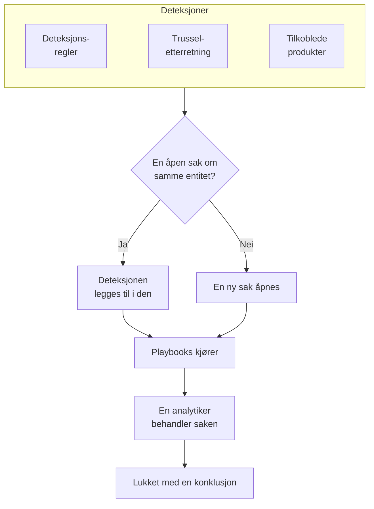

# Sikkerhetssaker og playbooks (SOAR)

Security Events gjør det deteksjonsreglene, trusseletterretningen og de tilkoblede sikkerhetsproduktene dine finner, om til saker: én sak for hver ting som er verdt å undersøke, med alle deteksjoner om samme bruker, vert eller adresse samlet i den. Analytikere behandler sakene i en kø, og playbooks reagerer på dem, av seg selv eller med et klikk.

:::cards
- [Hvor saker kommer fra](#hvor-saker-kommer-fra): Deteksjonsregler, trusseletterretning, tilkoblede produkter, entitetsrisiko og personer.
- [Behandle en sak](#behandle-en-sak): Tildel den, undersøk entitetene, og lukk den med en konklusjon.
- [Saksprioriteter og saksstatuser](#saksprioriteter-og-saksstatuser): Gi dem nytt navn, ny farge og ny rekkefølge, og legg til dine egne.
- [Varslinger](#varslinger): Hvem som får beskjed om en ny sak, en tildeling og et steg som venter på godkjenning.
- [Playbooks](#playbooks): Steg som kjører på en sak, med godkjenning der det betyr noe.
- [Oversikten](#oversikten): Det som trenger noen nå, og hvor raskt saker blir håndtert.
:::

## Slik fungerer det

Åpne **Produkter → Security Events → Sikkerhetssaker → Åpne saker** for køen. **Tildelt meg**, **Ikke tildelt**, **Lukkede saker** og **Alle saker** er egne sider ved siden av, og hver viser sakene navnet sier.

## Før du begynner

Saker og playbooks følger de tre Security-rollene. Project Owner og Project Admin kan gjøre alt.

| Rolle | Hva den kan gjøre |
| --- | --- |
| Security Admin | Alt, også å slette saker og sette opp playbooks |
| Security Member | Åpne, tildele, endre og lukke saker, skrive notater, kjøre playbooks og godkjenne eller avvise stegene deres |
| Security Viewer | Lese saker, deteksjoner, notater, playbooks og kjøringene deres |

Hver av disse rettighetene kan også gis for seg, fra å opprette en sak til å godkjenne stegene i en playbook; se [Tillatelsesreferanse](/docs/permissions/reference).

## Hvor saker kommer fra

| Kilde | Åpner en sak når | Slås av med |
| --- | --- | --- |
| Deteksjonsregler | En regel treffer | **Åpne en sak ved treff**, i regelens steg **Ved treff** |
| Trusseletterretning | En hendelse nevner en kjent indikator | **Åpne en sak ved treff**, i feedens steg **Ved treff** |
| Tilkoblede produkter | Et varsel fra selve produktet importeres på eller over tilkoblingens terskel | **Open Cases From** satt til **Aldri**, i tilkoblingens steg **Henting** |
| Entitetsrisiko | Risikoen til en bruker, vert eller adresse når prosjektets terskel | **Risikosaker** under **Innstillinger → Risikovurdering** |
| Personer | Noen åpner en fra **Sikkerhetssaker**, eller med **Åpne sak** i panelet til en hendelse | Ingen |

Alle kilder åpner saker som standard, unntatt entitetsrisiko i prosjekter som ble opprettet før det fantes: slå først på **Risikosaker** der ([Entitetsrisiko](/docs/telemetry/security-entity-risk)). En tilkobling åpner saker for **Høy og høyere** med mindre du velger et annet nivå; varslene under det nivået importeres fortsatt som hendelser.

### Slik grupperes deteksjoner

En deteksjon gjelder en entitet: verdien regelen grupperer etter, for eksempel IP-adressen i en brute force-regel, eller indikatoren som et treff fra trusseletterretning nevner. En deteksjon uten entitet står alene.

- Når en åpen sak allerede gjelder den entiteten, legges deteksjonen til i den. Sakens entiteter og ATT&CK-tilordning vokser, og prioriteten heves til deteksjonens, men senkes aldri.
- Når ingen åpen sak gjør det, åpnes en ny sak, oppkalt etter deteksjonen, med deteksjonens prioritet.
- En deteksjon som slår til igjen, teller opp på sin egen rad i stedet for å legge til en ny.

Prioriteten til en sak kommer fra deteksjonens alvorlighetsgrad, som prosjektets innebygde prioritet for det nivået, uansett hva du har kalt den:

| Alvorlighetsgrad | Prioritet |
| --- | --- |
| Critical eller Fatal | Kritisk |
| High | High |
| Medium, Unknown eller Other | Medium |
| Low | Low |
| Informational | Til orientering |

## Behandle en sak

Sakene i et nytt prosjekt går gjennom fire statuser, som du kan gi nye navn og legge til flere av (se [Saksprioriteter og saksstatuser](#saksprioriteter-og-saksstatuser)). En sak kan hoppe over en, for eksempel en false positive som lukkes rett fra Ny, og den kan åpnes på nytt.

| Status | Betyr |
| --- | --- |
| Ny | Ingen har sett på den ennå |
| Undersøker | Noen holder på å finne ut hva som skjedde |
| Contained | Trusselen kan ikke lenger gjøre skade; oppryddingen gjenstår |
| Lukket | Ferdig, med en konklusjon om hva det var |

En sak har sin egen sidemeny, slik en hendelse har, og hver del av saken er en egen side:

| Seksjon i sidemenyen | Sider |
| --- | --- |
| **Oversikt** | **Oversikt**, **Tidslinje** |
| **Undersøkelse** | **Forløp**, **Deteksjoner**, **Entiteter**, **Tilkoblede signaler**, **Playbooks** |
| **Notater** | **Private notater** |
| **Avansert** | **Revisjonslogger**, **Slett sak**, skjult til du klikker på **Avansert** |

Hver side beholder sakens topptekst øverst: nummer, prioritet, status og tittel, **Tildel til meg**, **Kjør playbook**, **Erklær hendelse** og **Lukk sak**, og i menyen ⋯ ved siden av **Angi prioritet**, **Tildel til en annen**, **Endre status**, **Rediger sak** og **Slett sak**. Slik kan saken behandles fra hvilken som helst av sidene, og en lenke til saken åpner fortsatt **Oversikt**.

- **Oversikt**: sakens beskrivelse, etiketter og statussteg, hvem som har den og hva som åpnet den, og tallene: hvor mange deteksjoner den har, hvor lenge den har vært åpen, og hvor lang tid det tok å bekrefte og inndemme den.
- **OneUptime AI**, på **Oversikt**: hva OneUptime AI fikk ut av saken, prioriteten og playbooken den foreslår, og bevisene bak. Se [OneUptime AI i sikkerhet](/docs/telemetry/security-ai).
- **Påvirkning**, på **Oversikt**: hva saken setter i fare: om OneUptime har sett postene dens bli nådd fra internett, hvem som eier dem, og hva som sist ble endret på dem. Fold den ut for å se hva hver post kaller og hva som kaller den, monitorene og statussidene som følger med på den, og maskinene sakens adresser snakket med.
- **MITRE ATT&CK**, på **Oversikt**: taktikkene og teknikkene deteksjonene i saken er tilordnet, hver med en lenke til sin side på attack.mitre.org.
- **Tidslinje**: alt som skjedde med saken, med hvem som gjorde det.
- **Forløp**: hva som skjedde, i rekkefølge, på tvers av OneUptime: hver deteksjon og sikkerhetshendelsene bak den, hvor langt forespørslene kom, unntakene de utløste, endringene på postene saken nevner, hendelsene og varslene som oppsto på dem, og hva teamet gjorde. En skanners mange forsøk er én linje, og hver linje åpner det den nevner, for eksempel forespørselens trace eller unntaket.
- **Deteksjoner**: det som slo til og åpnet saken eller ble lagt til i den, hvor ofte, og den siste hendelsen som traff.
- **Entiteter**: brukerne, vertene og adressene saken gjelder, med aktiviteten deres på tvers av alle sikkerhetshendelsene dine de siste 7 dagene. Hver av dem åpnes i **Korreler**.
- **Tilkoblede signaler**: vertene, klyngene, tjenestene og medlemmene saken nevner, slik OneUptime kjenner dem, og hva som skjedde på hver av dem rundt deteksjonene: loggene, sporene og målingene deres, hva som er åpent på dem, og hva som endret seg. Se [Tilkoblede signaler](/docs/telemetry/security-connected-signals).
- **Playbooks**: hva hver playbook gjorde på saken, steg for steg, og stegene som venter på godkjenning. Mens kjøringer venter, viser menyen hvor mange ved siden av **Playbooks**.
- **Private notater**: hva teamet skrev om saken.
- **Revisjonslogger**: hver endring i saken, og hvem som gjorde den. Se [Revisjonslogger](/docs/configuration/audit-logs).
- **Slett sak**: sletter saken for godt, med deteksjonene, notatene, tidslinjen og playbook-kjøringene. For å beholde den som dokumentasjon, lukk den heller med en konklusjon.

### Behandle saker fra køen

Du trenger ikke åpne en sak for å behandle den. I køens lister har menyen ⋯ på raden til en sak **Tildel til meg**, **Tildel til en annen**, **Endre status** og **Endre prioritet**. For å behandle flere saker samtidig merker du dem og bruker de samme handlingene under **Massehandlinger**: De viser hvilke saker som ble endret, hvilke som ble latt være, og hvorfor.

- For å gi en sak til noen andre bruker du **Tildel til en annen** og velger én person eller et team. En sak som hører til et team, venter under **Ikke tildelt** til noen på teamet tar den.
- En status som lukker en sak, ber om en konklusjon og et avslutningsnotat, slik **Lukk sak** gjør.
- En lukket sak tildeles ikke noen. For å jobbe med den igjen gjenåpner du den med **Endre status**.

### Lukk en sak

**Lukk sak** ber om en konklusjon og et valgfritt avslutningsnotat:

| Konklusjon | Betyr |
| --- | --- |
| True Positive | Ondsinnet eller uautorisert aktivitet fant faktisk sted |
| Benign Positive | Aktiviteten var ekte, men forventet, for eksempel en penetrasjonstest eller en administrasjonsoppgave |
| False Positive | Deteksjonen var feil: regelen eller dataene tolket normal aktivitet feil |
| Undetermined | Det fantes ikke nok informasjon til å avgjøre det |

Konklusjonene telles på oversikten. En regel der sakene stadig lukkes som False Positive, er en regel som bør justeres.

En sak som er åpnet fra Google SecOps-varsler, lukker dem også i Google SecOps, med konklusjonen og avslutningsnotatet, når tilkoblingen har **Lukk varsler når saken deres lukkes** slått på: se [Google SecOps](/docs/integrations/google-secops#lukk-varsler-når-saken-deres-lukkes).

### Erklær en hendelse

**Erklær hendelse** åpner en OneUptime-hendelse (incident) for saken, med alvorlighetsgraden du velger, og kobler de to sammen begge veier: beskrivelsen av hendelsen nevner saken, og toppen av saken lenker til hendelsen. Vaktordningen, statussider og postmortem tar over derfra. Det krever en rolle som både kan behandle saker og opprette hendelser (incidents).

## Saksprioriteter og saksstatuser

Hvert prosjekt har sine egne saksprioriteter og saksstatuser, under **Produkter → Security Events → Innstillinger → Saksprioriteter** og **Saksstatuser**. Gi dem nye navn og farger, dra dem i en annen rekkefølge, og legg til dine egne, for eksempel en status «Triage» eller en prioritet «Nødsituasjon» over **Kritisk**. Et nytt navn vises overalt med én gang: i køen, på sakssidene og oversikten, i varslinger, i Slack og Microsoft Teams og i playbook-meldinger.

Noen er innebygde, fordi OneUptime leser hva de betyr. De kan få nytt navn og ny farge, men ikke slettes eller arkiveres, og de beholder rekkefølgen sin:

| Innebygd | Hva OneUptime gjør med den |
| --- | --- |
| Den nye statusen | Nye saker starter i den |
| Den kvitterte statusen | Når en sak når den, registreres det når saken ble kvittert, og **Gjenåpne** flytter en lukket sak tilbake til den |
| Den begrensede statusen | Når en sak når den, registreres det når saken ble begrenset |
| Den lukkede statusen | **Lukk sak** flytter en sak dit, med en konklusjon |
| Prioritetene Kritisk, High, Medium, Low og Til orientering | En deteksjon åpner saken sin med prioriteten for alvorlighetsgraden sin, og en sak som noen åpner, starter på Medium |

- Hvor en status står, avgjør hva en sak i den teller som, slik kolonnen **Teller som** viser: fra den kvitterte statusen og ned som kvittert, fra den begrensede statusen og ned som begrenset, fra den lukkede statusen og ned som lukket. En status du legger til, havner rett over den lukkede statusen, og når du flytter en sak til en status som lukker den, blir du først bedt om en konklusjon.
- Plassen til en prioritet sier hvor mye den haster, den som haster mest først: **For saker med minst**, valgene for varslinger og reglene for Slack og Microsoft Teams leser denne rekkefølgen. En prioritet du legger til, havner sist, og kolonnen **Deteksjonens alvorlighetsgrad** viser hvilke deteksjoner som åpner sakene sine med hver innebygde prioritet.

For å slutte å bruke en egen status eller prioritet bruker du **Arkiver** i raden dens. Ingen kan velge den igjen, og API-et, Terraform og MCP avviser den, men sakene som har den, beholder den, og du kan fortsatt filtrere på den. Arkiverte verdier står i den sammenslåtte delen **Arkiverte saksstatuser** eller **Arkiverte saksprioriteter** under tabellen, der **Fjern fra arkiv** henter en tilbake. **Slett** avvises så lenge saker har verdien eller en playbook kjører fra prioriteten.

## Varslinger

OneUptime gir folk beskjed om tre ting på en sak. Ingen trenger å sette opp noe: et prosjekt som bare har klikket på **Slå på anbefalt**, får høre om sakene sine med prioritet High og Kritisk via e-post og push.

| Varsling | Hvem som får beskjed | Som standard |
| --- | --- | --- |
| Ny sikkerhetssak | Alle som kan se prosjektets saker, når en sak åpnes eller stiger, på prioriteten de har valgt eller høyere | E-post og push, for saker med High og Kritisk |
| Sikkerhetssak tildelt meg | Personen saken er tildelt, og medlemmene av teamet den er tildelt | E-post og push |
| Playbook-trinn venter på min godkjenning | Personene på saken som kan godkjenne steget: personen den er tildelt, og medlemmene av teamet dens. Kan ingen av dem godkjenne, alle i prosjektet som kan | E-post og push |

- Bare personer som kan se saken, får beskjed om den: Project Owners, Project Admins og rollene Security Admin, Security Member og Security Viewer. En rolle som er begrenset til noen etiketter, får bare beskjed om sakene med de etikettene.
- Ingen får beskjed om det de selv gjorde: den som åpner en sak manuelt, tildeler den eller starter en kjøring, blir ikke varslet om det.
- Hver person får høre om en sak én gang. En sak som åpnes på Medium og senere stiger til Kritisk, når ved stigningen fram til dem som valgte High eller Kritisk, og ikke på nytt til dem som valgte Medium, for de fikk høre om den da den ble åpnet.
- Testangrepet fra **Send et testangrep** åpner en sak som ikke varsler noen.
- En sak med Kritisk og et steg som venter på godkjenning, sendes med en gang og holdes aldri tilbake i en [e-postoppsummering](/docs/emails/notification-rollup).
- Sakens **Tidslinje** viser hvem som fikk beskjed, og når.

### Velg hva du får beskjed om

Hver person velger selv, under **Brukerinnstillinger → Varselinnstillinger → Sikkerhet**: kanalene for hver varsling (e-post, SMS, anrop, push, Telegram, Slack, Microsoft Teams eller webhook), og under **Ny sikkerhetssak** prioriteten som varsler dem:

| Valg | Varsler om saker med |
| --- | --- |
| Bare Kritisk | Kritisk |
| Høy og høyere | Kritisk og High (standard) |
| Middels og høyere | Kritisk, High og Medium |
| Lav og høyere | Alle prioriteter unntatt Til orientering |
| Alle saker | Alle prioriteter |

Valgene følger prosjektets saksprioriteter, under sine egne navn: dette er valgene i et nytt prosjekt.

Det sendes ikke WhatsApp-meldinger for sikkerhetssaker. Et push-varsel åpner saken i OneUptime On-Call-appen (1.7.0 eller nyere), der du kan godkjenne eller avvise et playbook-steg som venter, ta saken og lukke den. Lenken i det åpner saken i nettleseren.

### Legg ut i Slack- og Microsoft Teams-kanaler

For å legge ut i en kanal legger du til en regel under **Produkter → Security Events → Arbeidsområde → Slack** (eller **Microsoft Teams**). Er ingen av dem koblet til, er seksjonens eneste oppføring **Koble til Slack eller Teams**. En regel angir kanalene den legger ut i (og i Microsoft Teams chattene) og, om du vil, sakene den gjelder for:

| Betingelse | Treffer på |
| --- | --- |
| Prioritet for sikkerhetssak | En av prosjektets saksprioriteter, for eksempel Kritisk eller High |
| Tittel på sikkerhetssak, Beskrivelse av sikkerhetssak | Tekst som tittelen eller beskrivelsen av saken inneholder, starter med eller slutter med |
| Status for sikkerhetssak | En av prosjektets saksstatuser, for eksempel Ny eller Lukket |
| Kilde for sikkerhetssak | Detection Rule, Threat Intel, Connected Product, Entitetsrisiko, Data Security eller Manual |
| Etiketter for sikkerhetssak | Etikettene på saken |

De tre varslingene legges hver ut i kanalene til hver regel saken treffer i det øyeblikket. En regel der **Prioritet for sikkerhetssak** inneholder en av **Kritisk** og **Høy**, legger ut saker med High og Kritisk når de åpnes, og en sak med Medium når den stiger til High. En sikkerhetssak får aldri en egen kanal.

## Playbooks

En playbook er en liste med steg som kjører på en sak. Opprett en under **Produkter → Security Events → Playbooks**, fra en mal eller fra bunnen av, og legg til stegene på siden dens. Et prosjekt uten playbooks ser malene i stedet for en tom liste; når det finnes playbooks, åpner **Opprett fra mal** ved listen dem, med **Lagt til** ved dem prosjektet allerede har.

### Når en playbook kjører

| Kjøringer | Når |
| --- | --- |
| Case Opened | Én gang, når en sak åpnes |
| Detection Added | Hver gang en ny deteksjon legges til i en åpen sak |
| Vurdert som sannsynligvis ondsinnet | Én gang, når OneUptime AI sin vurdering leser saken som Sannsynligvis ondsinnet |
| Manual | Bare når noen kjører den fra en sak |

Enhver aktivert playbook kan også kjøres manuelt, med **Kjør playbook** på en sak. En playbook som kjører av seg selv, kan snevres inn:

- **For saker med minst**: bare saker med denne prioriteten eller høyere.
- **Bare for deteksjoner fra**: bare når deteksjonen bak saken kom fra denne kilden.
- **Bare for disse deteksjonsreglene**: bare når den kom fra en av disse reglene.

En deaktivert playbook kjører verken av seg selv eller manuelt.

### Steg

| Kategori | Steg | Hva det gjør |
| --- | --- | --- |
| Case | Assign the case | Gir saken til en person, et team eller begge |
| Case | Set the priority | Hever eller senker prioriteten til saken |
| Case | Set the status | Flytter saken til en annen av prosjektets statuser, med konklusjonen du velger når den statusen lukker den |
| Case | Add a note | Skriver et notat på saken, for eksempel en sjekkliste for analytikeren |
| Case | Add labels | Merker saken med etiketter |
| Investigate | Check entities against threat intel | Slår opp hver entitet i trusseletterretningen din, og kan heve prioriteten ved et treff |
| Investigate | Look up entity activity | Teller sikkerhetshendelsene til hver entitet over et nylig tidsvindu, og noterer det på saken |
| Investigate | Preserve the evidence | Tar vare på øktopptakene av forespørslene bak saken, og noterer sporene og unntakene deres på saken |
| Notify | Email people | Sender brukere og team en oppsummering av saken på e-post, med en lenke til den |
| Notify | Notify data store owners | Sender eierne av hvert datalager saken gjelder en e-post, med en lenke til saken |
| Notify | Post to Slack | Legger ut en oppsummering av saken i en Slack-kanal |
| Notify | Post to Microsoft Teams | Legger ut en oppsummering av saken i en Microsoft Teams-kanal |
| Notify | Post a status page announcement | Legger ut en kunngjøring du har skrevet, på statussidene du velger |
| Escalate | Page on-call | Kjører en vaktpolicy |
| Escalate | Declare an incident | Åpner en OneUptime-hendelse (incident) som er koblet til saken |
| Contain | Suspend the user in Okta | Suspenderer brukeren saken gjelder, i Okta |
| Contain | End the user's Okta sessions | Logger brukeren saken gjelder, ut av Okta og tilbakekaller tokenene deres |
| Contain | Contain the host in CrowdStrike | Isolerer verten saken gjelder, fra nettverket med CrowdStrike Falcon |
| Contain | Isolate the device in Microsoft Defender | Isolerer verten saken gjelder, med Microsoft Defender for Endpoint |
| Contain | Unsuspend the user in Okta | Opphever suspenderingen av brukeren saken gjelder, i Okta |
| Contain | Lift containment in CrowdStrike | Opphever nettverksisoleringen i CrowdStrike Falcon for verten saken gjelder |
| Contain | Release the device in Microsoft Defender | Frigir verten saken gjelder, fra isoleringen i Microsoft Defender for Endpoint |
| Automate | Send a webhook | Sender saken som JSON til en URL |
| Automate | Run a workflow | Starter en OneUptime-arbeidsflyt med saken som input |
| Automate | Run a runbook | Starter en av OneUptime-runbookene dine med saken som input |
| Automate | Fix the code with AI | Ber OneUptime AI om en pull request som retter unntakene sakens forespørsler utløste |

En playbook har høyst 25 steg. De kjører i rekkefølge, hvert steg når det forrige er ferdig. Hvert steg kan også:

- **Krever godkjenning**: stoppe kjøringen før steget til noen godkjenner det på saken. De fire stegene som stenger noen ute, stopper alltid kjøringen, med mindre en Security Admin slår det av. **Run a runbook** og **Post a status page announcement** starter med godkjenning slått på, fordi det ene kjører kommandoer på systemene deres og det andre snakker til kundene deres; den som legger til steget, kan slå det av.
- **Bare ved treff i trusselsinformasjon**: hoppe over steget med mindre et tidligere steg **Sjekk entiteter mot trusselsinformasjon** i kjøringen fant en kjent indikator.
- **Fortsett hvis det mislykkes**: kjøre neste steg selv om dette feiler. Er det av, stopper et mislykket steg kjøringen.

### Svar gjennom OneUptime

Fire steg handler gjennom resten av OneUptime i stedet for gjennom et tilkoblet produkt:

- **Run a runbook** starter en av [runbookene](/docs/runbooks/index) dine med saken som input, som et Bash-steg leser som miljøvariabler (se [Kall webhooken](/docs/runbooks/triggers#kall-webhooken)). `ONEUPTIME_INPUT_IP`, `ONEUPTIME_INPUT_USER` og `ONEUPTIME_INPUT_HOST` er adressen, brukeren og verten saken handler om, valgt etter samme regel som for et Contain-steg, og tomme når den ikke handler om noen. `ONEUPTIME_INPUT_IPS`, `ONEUPTIME_INPUT_USERS` og `ONEUPTIME_INPUT_HOSTS` lister som JSON alle saken nevner, og `ONEUPTIME_INPUT_CASE_NUMBER`, `ONEUPTIME_INPUT_CASE_TITLE` og `ONEUPTIME_INPUT_CASE_URL` sier hvilken sak det er. En beskyttet bruker eller vert er aldri blant dem. Kjøringen av runbooken viser at den ble startet av **Security playbook** for saken.
- **Preserve the evidence** tar vare på øktopptakene av forespørslene bak saken utover oppbevaringstiden og skriver et notat på saken som lenker til sporet for hver forespørsel, hvert opptak og hvert unntak. Logger og spor kan ikke oppbevares lenger enn prosjektet oppbevarer telemetri, så eksporter det du trenger før det.
- **Post a status page announcement** legger ut det du skrev, slik du skrev det, på statussidene du velger. Ingenting fra saken legges til. Abonnentene deres varsles bare når **Varsle abonnenter** er slått på.
- **Fix the code with AI** ber OneUptime AI om en pull request som retter hvert unntak sakens forespørsler utløste, opptil tre. Steget krever at OneUptime AI er slått på, et repository med koden koblet til via GitHub-appen og en runner. Uten dem hoppes steget over og sier hva som mangler.

### Inndemming

Contain-stegene handler gjennom en [tilkobling for sikkerhetshendelser](/docs/telemetry/security-events#koble-til-et-sikkerhetsprodukt) til produktet, og den trenger mer enn lesetilgang:

| Steg | Tilkobling | Trenger |
| --- | --- | --- |
| Suspend the user in Okta, End the user's Okta sessions, Unsuspend the user in Okta | Okta System Log | Et API-token som har lov til å administrere brukere |
| Contain the host in CrowdStrike, Lift containment in CrowdStrike | CrowdStrike Falcon | En API-klient med skrivetilgang til scopet Hosts |
| Isolate the device in Microsoft Defender, Release the device in Microsoft Defender | Microsoft Defender XDR | En app med tillatelsen Machine.Isolate |

Et Contain-steg handler bare på brukerne eller vertene saken gjelder, aldri på alle som den nevner:

- Verdien en deteksjon i saken er gruppert etter, for eksempel kontoen en regel for umulige reiser grupperer etter, eller verten som et varsel fra et tilkoblet produkt nevner.
- En bruker eller vert i saken som trusseletterretningen din kjenner som en indikator.

En sak som er gruppert etter en adresse, for eksempel et brute force-angrep mot VPN-en din, gjelder ingen av delene: Contain-stegene i den hoppes over, og den forsøkte kontoen og den rammede gatewayen får være i fred. Et steg handler på høyst 10 brukere eller verter. Det finner hver av dem i produktet etter navn, og skriver på kjøringen hva det gjorde med hver enkelt: utført, allerede utført, ikke funnet, avvist eller beskyttet.

#### Beskyttede entiteter

**Beskyttede entiteter**, under **Playbooks** i menyen, viser brukerne og vertene som ingen playbook demmer inn, for eksempel nødtilgangskontoer, domenekontrollere og VPN-gatewayer. En verdi treffer uten forskjell på store og små bokstaver, og `*` står for en hvilken som helst rekke tegn: `svc-*` beskytter alle tjenestekontoer. Et steg melder en beskyttet bruker eller vert som beskyttet og lar den være i fred. Security Admins vedlikeholder listen.

#### Godkjenning

De fire stegene som stenger noen ute, venter på godkjenning. Bare en Security Admin kan slå av **Krever godkjenning** for ett av dem, og OneUptime registrerer hvem som gjorde det. Godkjenningen viser under **Handle på** brukerne eller vertene steget ville handlet på, alle avkrysset: fjern krysset for dem det skal la være i fred. Beskyttede brukere og verter tilbys ikke. Den som startet en kjøring, kan ikke godkjenne stegene i den: det gjør noen andre, men vedkommende kan fortsatt avvise det.

#### Angre

Angrestegene handler på brukerne eller vertene saken gjelder, akkurat som stegene de angrer. Når kjøringen har stoppet, har en inndemmet bruker eller vert også en egen knapp på steget sitt: **Opphev suspensjon**, **Opphev begrensning** eller **Frigi**. En avsluttet Okta-økt kan ikke angres. Alt som angres, lagres på tidslinjen til saken og i revisjonsloggen til prosjektet.

### Meldinger

Et notat, en e-post, et Slack-innlegg og et Teams-innlegg kan bruke verdiene til saken:

| Plassholder | Blir til |
| --- | --- |
| `{{case.number}}` | Saksnummeret, for eksempel CASE-42 |
| `{{case.title}}` | Tittelen på saken |
| `{{case.priority}}` | Prioriteten til saken, slik prosjektet ditt kaller den, for eksempel High |
| `{{case.status}}` | Statusen til saken, slik prosjektet ditt kaller den, for eksempel Investigating |
| `{{case.assignee}}` | Hvem saken er tildelt |
| `{{case.url}}` | En lenke til saken i OneUptime |
| `{{case.entities}}` | Brukerne, vertene og adressene saken gjelder |
| `{{case.detections}}` | Hvor mange deteksjoner saken har |

En e-post eller et innlegg uten egen melding sender en oppsummering av saken.

### Kjøringer og godkjenninger

Hver kjøring vises på saken sin og under **Produkter → Security Events → Playbooks → Playbook-kjøringer**, steg for steg:

| Kjøringsstatus | Betyr |
| --- | --- |
| Queued | Venter på en worker |
| Kjører | Kjører stegene sine |
| Waiting for Approval | Holdt tilbake før et steg som krever godkjenning |
| Vellykket | Alle steg kjørte eller ble hoppet over |
| Mislyktes | Et steg feilet, og kjøringen stoppet |
| Avbrutt | Noen avbrøt den eller avviste et steg |

Et steg som venter på godkjenning, viser **Godkjenn** og **Avvis** på kjøringen, med en valgfri kommentar. Å godkjenne fører kjøringen videre fra det steget; å avvise avslutter den. Beslutningen, hvem som tok den, og kommentaren deres lagres på steget, på tidslinjen til saken og i revisjonsloggen til prosjektet. Siden **Godkjenninger**, under **Playbooks** i menyen, viser kjøringene som venter på en beslutning, og teller dem; **Playbook-kjøringer** viser hver kjøring. På **Playbook-kjøringer**, på siden til en playbook og under **Playbooks** i en sak er hver kjøring én linje som sier hvor langt den kom, eller hvilket steg den stoppet ved; **Vis trinn** åpner stegene. En kjøring som venter på godkjenning, åpnes av seg selv, og det samme gjør den nyeste kjøringen i en sak.

En kjøring som slutter å høre fra workeren sin, for eksempel etter en omstart, plukkes opp igjen: en kjøring i kø settes i kø på nytt etter 2 minutter, og en kjøring som ikke har sagt noe på 30 minutter, markeres som mislykket.

## Oversikten

**Produkter → Security Events → Oversikt** er der produktet åpner:

- De åpne sakene som er tildelt deg, de åpne sakene ingen har tatt, og playbook-stegene som venter på godkjenning; hvert tall åpner siden som viser dem.
- **Gjennomsnittlig tid til kvittering**, **Gjennomsnittlig tid til begrensning** og **Gjennomsnittlig tid til lukking**, over sakene som er åpnet de siste 30 dagene: fra en sak åpnes til noen tar den (tildeler en person eller flytter den til en status som teller som kvittert), til en status som teller som begrenset, og til en som teller som lukket. En sak som fortsatt venter, telles ikke med i et gjennomsnitt.
- Sakene som er åpnet hver dag i 30 dager, etter prioritet, og deteksjonene som er utløst hver dag i 14 dager, etter kilde.
- De åpne sakene etter prioritet og etter status, de mest risikable entitetene etter risikoscore, deteksjonene som slo til oftest, ATT&CK-taktikkene bak sakene og konklusjonene fra de siste 30 dagene.

Over dem viser en stripe hvordan sikkerhet er satt opp: kildene, deteksjonene, sakene og playbookene, hver med tallene sine. Et prosjekt som ennå ikke har satt det opp, ser **Slå på anbefalt** og **Send et testangrep** der; se [Kom i gang med sikkerhet](/docs/telemetry/security-getting-started). Når ingenting trenger noen, sier siden **Alt er rolig**, og diagrammene vises så snart det er noe å vise.

## Finn trusler

- **Entitetsrisiko** rangerer brukerne, vertene og adressene etter risikoscore, de mest risikable først, og **Mest risikable entiteter** på oversikten viser toppen av den samme listen. Velg en entitet for å se hvorfor den er risikabel. Under listen slår **Slå opp en entitet** opp hvilken som helst verdi på tvers av 30 dager med hendelser, også et domene eller en fil-hash, og åpner den i **Korreler**.
- **Regelbibliotek** har ferdige deteksjonsregler for trusler mot identitet, endepunkter, sky, nettverk, web og Kubernetes. Hver av dem er en Sigma-regel skrevet for feltene som alle tilkoblede kilder normaliseres til. Raden dens viser hva den finner, MITRE ATT&CK-taktikkene og -teknikkene den er merket med, hendelsene den leser og om noen har kommet inn de siste 7 dagene (**Mottas** eller **Mottas ikke**), og alvorlighetsgraden. Avgrens listen etter kategori, etter dataene reglene leser og etter om du har lagt dem til, eller søk i den etter navn, ATT&CK-teknikk eller alvorlighetsgrad; adressen til siden tar vare på filtrene. Velg en regel for å se detaljene: hvordan du begynner å sende hendelsene den leser, hvordan den kjører, og Sigma-regelen. **Legg til** oppretter den som din egen deteksjonsregel, slått på og med saker i stedet for varsler; endre den under **Deteksjonsregler** som alle andre. Reglene merket **Anbefalt** finner trusler i data OneUptime allerede har, og én knapp legger til dem du ikke har ennå.
- **ATT&CK-dekning** viser taktikkene i MITRE ATT&CK, hver med hvor mange av teknikkene dens de aktiverte reglene dine dekker, og hvor mange flere **Regelbibliotek** har regler for. Åpne en taktikk for teknikkene dens, eller bytt til **Matrise** for hele matrisen. Velg en teknikk for å se reglene fra biblioteket som dekker den, og åpne **Regelbibliotek** på dem.

## Automatiser

- **Arbeidsflyter**: en sak eller et notat kan starte en arbeidsflyt når den opprettes, oppdateres eller slettes. Et steg **Kjør en arbeidsflyt** starter en arbeidsflyt som har en webhook som utløser.
- **API**: saker, notater, deteksjoner, playbooks, kjøringer, beskyttede entiteter og saksprioriteter og saksstatuser har det samme REST-API-et som resten av OneUptime, under `/security-case`, `/security-case-note`, `/security-detection`, `/security-playbook`, `/security-playbook-run`, `/security-protected-entity`, `/security-case-priority` og `/security-case-status`. Se [API-referanse](/docs/api-reference/api-reference).
- AI-agenter: MCP-serveren har verktøy for saker, notater, deteksjoner, playbooks og saksprioriteter og saksstatuser. Se [MCP-server](/docs/ai/mcp-server).
- Terraform: ressursene `oneuptime_security_case_priority` og `oneuptime_security_case_status` holder prioritetene og statusene til et prosjekt som kode.

## Feilsøking

:::details En regel treffer, men ingen sak åpnes
Sjekk **Åpne en sak ved treff** i regelens steg **Ved treff**. En deteksjon om en entitet som allerede har en åpen sak, legges til i den saken i stedet for å åpne en ny: se etter den under **Deteksjoner** på den åpne saken.
:::

:::details Ingen fikk beskjed om en sak
Se på **Tidslinje** for saken, som viser hvem som ble varslet. En varsling om **Ny sikkerhetssak** går til personene som har valgt en prioritet saken når, så en sak med Medium varsler ingen som har beholdt standarden, **Høy og høyere**. Sjekk at personene som burde få beskjed, kan se sikkerhetssaker (en Security-rolle, Project Owner eller Project Admin), og at varslingen er slått på for dem under **Brukerinnstillinger → Varselinnstillinger → Sikkerhet**.
:::

:::details En playbook kjørte ikke
Sjekk at den er aktivert, at innstillingen **Utløser** passer (Case Opened kjører én gang, når en sak åpnes), og at saken oppfyller innstillingene **For saker med minst**, **Bare for deteksjoner fra** og **Bare for disse deteksjonsreglene**. En sak som er åpnet manuelt, har ingen deteksjon, så en playbook som er begrenset til en kilde eller til regler, kjører ikke på den.
:::

:::details Et Contain-steg mislyktes
Åpne kjøringen på saken: steget forteller for hver bruker eller vert om produktet avviste den, ikke fant den eller ikke kunne nås. Sjekk at legitimasjonen til tilkoblingen har lov til å gjøre endringen, og bruk **Test tilkoblingen** i raden dens.
:::

:::details Et Contain-steg ble hoppet over
Saken gjelder ingen bruker eller vert, bare en adresse for eksempel, eller alle brukerne eller vertene den gjelder, er beskyttet. Åpne kjøringen på saken: steget forteller hvilken av de to det er.
:::

:::details En status eller prioritet kan ikke slettes eller arkiveres
En innebygd kan få nytt navn og ny farge, men aldri slettes eller arkiveres: **Arkiver** for den er låst, med begrunnelsen. En egen kan ikke slettes så lenge saker har den eller en playbook kjører fra den: flytt sakene til en annen først, eller arkiver den.
:::

## Neste steg

:::cards
- [Sikkerhetshendelser](/docs/telemetry/security-events): Send hendelser, skriv deteksjonsregler og koble til sikkerhetsprodukter.
- [Trusseletterretning](/docs/telemetry/threat-intelligence): Sammenlign hendelsene dine med STIX/TAXII-feeder.
- [OneUptime AI i sikkerhet](/docs/telemetry/security-ai): Vurder saker, skriv utkast til deteksjonsregler, og spør om sikkerhet med KI.
- [Tillatelsesreferanse](/docs/permissions/reference): Security-rollene, og hva hver av dem kan gjøre.
:::
