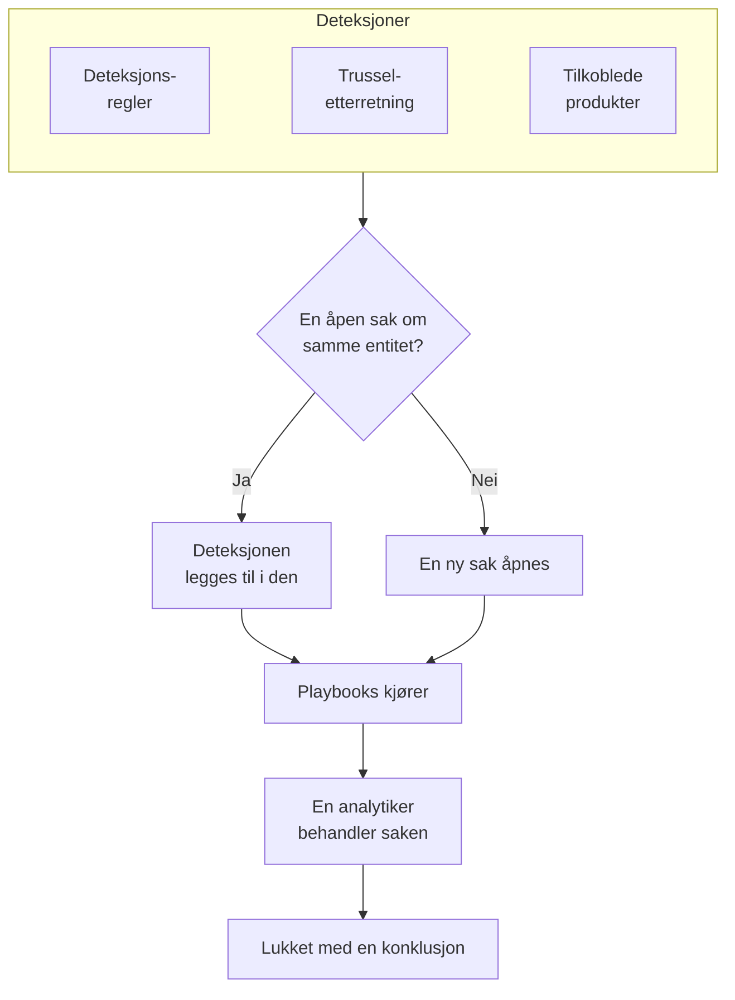

# Sikkerhetssaker og playbooks (SOAR)

Security Events gjør det deteksjonsreglene, trusseletterretningen og de tilkoblede sikkerhetsproduktene dine finner, om til saker: én sak for hver ting som er verdt å undersøke, med alle deteksjoner om samme bruker, vert eller adresse samlet i den. Analytikere behandler sakene i en kø, og playbooks reagerer på dem, av seg selv eller med et klikk.

:::cards
- [Hvor saker kommer fra](#hvor-saker-kommer-fra): Deteksjonsregler, trusseletterretning, tilkoblede produkter og personer.
- [Behandle en sak](#behandle-en-sak): Tildel den, undersøk entitetene, og lukk den med en konklusjon.
- [Playbooks](#playbooks): Steg som kjører på en sak, med godkjenning der det betyr noe.
- [Oversikten](#oversikten): Det som trenger noen nå, og hvor raskt saker blir håndtert.
:::

## Slik fungerer det

Åpne **Produkter → Security Events → Security Cases**. Køen viser først de åpne sakene; **Assigned to Me**, **Unassigned**, **Lukket** og **Alle** er de andre visningene.

## Før du begynner

Saker og playbooks følger de tre Security-rollene. Project Owner og Project Admin kan gjøre alt.

| Rolle | Hva den kan gjøre |
| --- | --- |
| Security Admin | Alt, også å slette saker og sette opp playbooks |
| Security Member | Åpne, tildele, endre og lukke saker, skrive notater, kjøre playbooks og godkjenne eller avvise stegene deres |
| Security Viewer | Lese saker, deteksjoner, notater, playbooks og kjøringene deres |

Hver av disse rettighetene kan også gis for seg, fra å opprette en sak til å godkjenne stegene i en playbook; se [Tillatelsesreferanse](/docs/permissions/reference).

## Hvor saker kommer fra

| Kilde | Åpner en sak når | Slås av med |
| --- | --- | --- |
| Deteksjonsregler | En regel treffer | **Open a Case on Match**, i regelens steg **Ved treff** |
| Trusseletterretning | En hendelse nevner en kjent indikator | **Open a Case on Match**, i feedens steg **Ved treff** |
| Tilkoblede produkter | Et varsel fra selve produktet importeres på eller over tilkoblingens terskel | **Open Cases From** satt til **Aldri**, i tilkoblingens steg **Polling** |
| Personer | Noen åpner en fra **Security Cases**, eller med **Open Case** i panelet til en hendelse | Ingen |

Alle kilder er på som standard. En tilkobling åpner saker for **High and above** med mindre du velger et annet nivå; varslene under det nivået importeres fortsatt som hendelser.

### Slik grupperes deteksjoner

En deteksjon gjelder en entitet: verdien regelen grupperer etter, for eksempel IP-adressen i en brute force-regel, eller indikatoren som et treff fra trusseletterretning nevner. En deteksjon uten entitet står alene.

- Når en åpen sak allerede gjelder den entiteten, legges deteksjonen til i den. Sakens entiteter og ATT&CK-tilordning vokser, og prioriteten heves til deteksjonens, men senkes aldri.
- Når ingen åpen sak gjør det, åpnes en ny sak, oppkalt etter deteksjonen, med deteksjonens prioritet.
- En deteksjon som slår til igjen, teller opp på sin egen rad i stedet for å legge til en ny.

Prioriteten til en sak kommer fra deteksjonens alvorlighetsgrad:

| Alvorlighetsgrad | Prioritet |
| --- | --- |
| Critical eller Fatal | Kritisk |
| High | High |
| Medium, Unknown eller Other | Medium |
| Low | Low |
| Informational | Til orientering |

## Behandle en sak

En sak går gjennom fire statuser. Den kan hoppe over en, for eksempel en false positive som lukkes rett fra Ny, og den kan åpnes på nytt.

| Status | Betyr |
| --- | --- |
| Ny | Ingen har sett på den ennå |
| Undersøker | Noen holder på å finne ut hva som skjedde |
| Contained | Trusselen kan ikke lenger gjøre skade; oppryddingen gjenstår |
| Lukket | Ferdig, med en konklusjon om hva det var |

Siden til saken har alt du trenger for å behandle den:

- Øverst: **Assign to Me**, **Run Playbook**, **Erklær hendelse** og **Close Case**, statusstegene, og prioriteten under menyen ved siden av dem.
- **Detections**: det som slo til og åpnet saken eller ble lagt til i den, hvor ofte, og den siste hendelsen som traff.
- **Entiteter**: brukerne, vertene og adressene saken gjelder, med aktiviteten deres på tvers av alle sikkerhetshendelsene dine de siste 7 dagene. Hver av dem åpnes i **Korreler**.
- **MITRE ATT&CK**: taktikkene og teknikkene deteksjonene i saken er tilordnet, hver med en lenke til sin side på attack.mitre.org.
- **Playbook Runs**: hva hver playbook gjorde på saken, steg for steg, og stegene som venter på godkjenning.
- **Notater** og **Tidslinje**: hva teamet skrev, og alt som skjedde, med hvem som gjorde det.

For å behandle flere saker samtidig merker du dem i køen og bruker **Assign to Me**, **Change Status** eller **Change Priority**.

### Lukk en sak

**Close Case** ber om en konklusjon og et valgfritt avslutningsnotat:

| Konklusjon | Betyr |
| --- | --- |
| True Positive | Ondsinnet eller uautorisert aktivitet fant faktisk sted |
| Benign Positive | Aktiviteten var ekte, men forventet, for eksempel en penetrasjonstest eller en administrasjonsoppgave |
| False Positive | Deteksjonen var feil: regelen eller dataene tolket normal aktivitet feil |
| Undetermined | Det fantes ikke nok informasjon til å avgjøre det |

Konklusjonene telles på oversikten. En regel der sakene stadig lukkes som False Positive, er en regel som bør justeres.

### Erklær en hendelse

**Erklær hendelse** åpner en OneUptime-hendelse (incident) for saken, med alvorlighetsgraden du velger, og kobler de to sammen begge veier: beskrivelsen av hendelsen nevner saken, og toppen av saken lenker til hendelsen. Vaktordningen, statussider og postmortem tar over derfra. Det krever en rolle som både kan behandle saker og opprette hendelser (incidents).

## Playbooks

En playbook er en liste med steg som kjører på en sak. Opprett en under **Produkter → Security Events → Playbooks**, fra en mal eller fra bunnen av, og legg til stegene på siden dens.

### Når en playbook kjører

| Kjøringer | Når |
| --- | --- |
| Case Opened | Én gang, når en sak åpnes |
| Detection Added | Hver gang en ny deteksjon legges til i en åpen sak |
| Manual | Bare når noen kjører den fra en sak |

Enhver aktivert playbook kan også kjøres manuelt, med **Run Playbook** på en sak. En playbook som kjører av seg selv, kan snevres inn:

- **For Cases At Least**: bare saker med denne prioriteten eller høyere.
- **Only For Detections From**: bare når deteksjonen bak saken kom fra denne kilden.
- **Only For These Detection Rules**: bare når den kom fra en av disse reglene.

En deaktivert playbook kjører verken av seg selv eller manuelt.

### Steg

| Kategori | Steg | Hva det gjør |
| --- | --- | --- |
| Case | Assign the case | Gir saken til en person, et team eller begge |
| Case | Set the priority | Hever eller senker prioriteten til saken |
| Case | Set the status | Flytter saken til Undersøker, Contained eller Lukket, med konklusjonen du velger |
| Case | Add a note | Skriver et notat på saken, for eksempel en sjekkliste for analytikeren |
| Case | Add labels | Merker saken med etiketter |
| Investigate | Check entities against threat intel | Slår opp hver entitet i trusseletterretningen din, og kan heve prioriteten ved et treff |
| Investigate | Look up entity activity | Teller sikkerhetshendelsene til hver entitet over et nylig tidsvindu, og noterer det på saken |
| Notify | Email people | Sender brukere og team en oppsummering av saken på e-post, med en lenke til den |
| Notify | Post to Slack | Legger ut en oppsummering av saken i en Slack-kanal |
| Notify | Post to Microsoft Teams | Legger ut en oppsummering av saken i en Microsoft Teams-kanal |
| Escalate | Page on-call | Kjører en vaktpolicy |
| Escalate | Declare an incident | Åpner en OneUptime-hendelse (incident) som er koblet til saken |
| Contain | Suspend the user in Okta | Suspenderer hver bruker i saken i Okta |
| Contain | End the user's Okta sessions | Logger hver bruker i saken ut av Okta og tilbakekaller tokenene deres |
| Contain | Contain the host in CrowdStrike | Isolerer hver vert i saken fra nettverket med CrowdStrike Falcon |
| Contain | Isolate the device in Microsoft Defender | Isolerer hver vert i saken med Microsoft Defender for Endpoint |
| Automate | Send a webhook | Sender saken som JSON til en URL |
| Automate | Run a workflow | Starter en OneUptime-arbeidsflyt med saken som input |

En playbook har høyst 25 steg. De kjører i rekkefølge, hvert steg når det forrige er ferdig. Hvert steg kan også:

- **Needs Approval**: stoppe kjøringen før steget til noen godkjenner det på saken. Det er på som standard for de fire Contain-stegene, som handler utenfor OneUptime.
- **Only If Threat Intel Matched**: hoppe over steget med mindre et tidligere steg **Check entities against threat intel** i kjøringen fant en kjent indikator.
- **Carry On If It Fails**: kjøre neste steg selv om dette feiler. Er det av, stopper et mislykket steg kjøringen.

### Inndemming

Contain-stegene handler gjennom en [tilkobling for sikkerhetshendelser](/docs/telemetry/security-events#koble-til-et-sikkerhetsprodukt) til produktet, og den trenger mer enn lesetilgang:

| Steg | Tilkobling | Trenger |
| --- | --- | --- |
| Suspend the user in Okta, End the user's Okta sessions | Okta System Log | Et API-token som har lov til å administrere brukere |
| Contain the host in CrowdStrike | CrowdStrike Falcon | En API-klient med skrivetilgang til scopet Hosts |
| Isolate the device in Microsoft Defender | Microsoft Defender XDR | En app med tillatelsen Machine.Isolate |

Et Contain-steg handler på høyst 10 av brukerne eller vertene i saken. Det finner hver av dem i produktet etter navn, og skriver på saken hva det gjorde med hver enkelt: inndemmet, allerede inndemmet, ikke funnet eller avvist.

### Meldinger

Et notat, en e-post, et Slack-innlegg og et Teams-innlegg kan bruke verdiene til saken:

| Plassholder | Blir til |
| --- | --- |
| `{{case.number}}` | Saksnummeret, for eksempel CASE-42 |
| `{{case.title}}` | Tittelen på saken |
| `{{case.priority}}` | Critical, High, Medium, Low eller Informational |
| `{{case.status}}` | New, Investigating, Contained eller Closed |
| `{{case.assignee}}` | Hvem saken er tildelt |
| `{{case.url}}` | En lenke til saken i OneUptime |
| `{{case.entities}}` | Brukerne, vertene og adressene saken gjelder |
| `{{case.detections}}` | Hvor mange deteksjoner saken har |

En e-post eller et innlegg uten egen melding sender en oppsummering av saken.

### Kjøringer og godkjenninger

Hver kjøring vises på saken sin og under **Produkter → Security Events → Playbooks → Playbook Runs**, steg for steg:

| Kjøringsstatus | Betyr |
| --- | --- |
| Queued | Venter på en worker |
| Kjører | Kjører stegene sine |
| Waiting for Approval | Holdt tilbake før et steg som krever godkjenning |
| Vellykket | Alle steg kjørte eller ble hoppet over |
| Mislyktes | Et steg feilet, og kjøringen stoppet |
| Avbrutt | Noen avbrøt den eller avviste et steg |

Et steg som venter på godkjenning, viser **Approve** og **Reject** på kjøringen, med en valgfri kommentar. Å godkjenne fører kjøringen videre fra det steget; å avvise avslutter den. Beslutningen, hvem som tok den, og kommentaren deres lagres på steget og på tidslinjen til saken. **Playbook Runs** viser først kjøringene som venter på godkjenning, og menypunktet **Playbooks** teller dem.

En kjøring som slutter å høre fra workeren sin, for eksempel etter en omstart, plukkes opp igjen: en kjøring i kø settes i kø på nytt etter 2 minutter, og en kjøring som ikke har sagt noe på 30 minutter, markeres som mislykket.

## Oversikten

**Produkter → Security Events → Oversikt** er der produktet åpner:

- De åpne sakene som er tildelt deg, de åpne sakene ingen har tatt, og playbook-stegene som venter på godkjenning.
- **Mean Time to Acknowledge**, **Mean Time to Contain** og **Mean Time to Close**, over sakene som er åpnet de siste 30 dagene: fra en sak åpnes til noen tar den (tildeler en person eller flytter den ut av Ny), til Contained og til Lukket. En sak som fortsatt venter, telles ikke med i et gjennomsnitt.
- Sakene som er åpnet hver dag i 30 dager, etter prioritet, og deteksjonene som er utløst hver dag i 14 dager, etter kilde.
- De åpne sakene etter prioritet og etter status, konklusjonene fra de siste 30 dagene, ATT&CK-taktikkene bak sakene, deteksjonene som slo til oftest, og entitetene som flest funn nevner.

Over dem viser en stripe hvordan sikkerhet er satt opp: kildene, deteksjonene, sakene og playbookene, hver med tallene sine. Et prosjekt som ennå ikke har satt det opp, ser **Turn on recommended** og **Send a test attack** der; se [Kom i gang med sikkerhet](/docs/telemetry/security-getting-started). Når ingenting trenger noen, sier siden **All quiet**, og diagrammene vises så snart det er noe å vise.

## Finn trusler

- **Entiteter** rangerer brukerne, vertene, adressene og hashene som funnene dine nevner oftest, over det siste døgnet, den siste uken eller måneden, og slår opp hvilken som helst verdi på tvers av 30 dager med hendelser.
- **Rule Library** har ferdige deteksjonsregler for trusler mot identitet, endepunkter, sky, nettverk, web og Kubernetes. Hver av dem er en Sigma-regel skrevet for feltene som alle tilkoblede kilder normaliseres til. **Legg til regel** oppretter den som din egen deteksjonsregel, slått på og med saker i stedet for varsler; endre den under **Detection Rules** som alle andre. Reglene merket **Anbefalt** finner trusler i data OneUptime allerede har, og én knapp legger til dem du ikke har ennå.
- **ATT&CK Coverage** tegner MITRE ATT&CK-matrisen, uthever teknikkene de aktiverte reglene dine dekker, og rammer inn teknikkene en regel fra biblioteket ville dekket.

## Automatiser

- **Arbeidsflyter**: en sak eller et notat kan starte en arbeidsflyt når den opprettes, oppdateres eller slettes. Et steg **Run a workflow** starter en arbeidsflyt som har en webhook som utløser.
- **API**: saker, notater, deteksjoner, playbooks og kjøringer har det samme REST-API-et som resten av OneUptime, under `/security-case`, `/security-case-note`, `/security-detection`, `/security-playbook` og `/security-playbook-run`. Se [API-referanse](/docs/api-reference/api-reference).
- AI-agenter: MCP-serveren har verktøy for saker, notater, deteksjoner og playbooks. Se [MCP-server](/docs/ai/mcp-server).

## Feilsøking

:::details En regel treffer, men ingen sak åpnes
Sjekk **Open a Case on Match** i regelens steg **Ved treff**. En deteksjon om en entitet som allerede har en åpen sak, legges til i den saken i stedet for å åpne en ny: se etter den under **Detections** på den åpne saken.
:::

:::details En playbook kjørte ikke
Sjekk at den er aktivert, at innstillingen **Trigger** passer (Case Opened kjører én gang, når en sak åpnes), og at saken oppfyller innstillingene **For Cases At Least**, **Only For Detections From** og **Only For These Detection Rules**. En sak som er åpnet manuelt, har ingen deteksjon, så en playbook som er begrenset til en kilde eller til regler, kjører ikke på den.
:::

:::details Et Contain-steg mislyktes
Åpne kjøringen på saken: steget forteller for hver bruker eller vert om produktet avviste den, ikke fant den eller ikke kunne nås. Sjekk at legitimasjonen til tilkoblingen har lov til å gjøre endringen, og bruk **Test tilkoblingen** i raden dens.
:::

## Neste steg

:::cards
- [Sikkerhetshendelser](/docs/telemetry/security-events): Send hendelser, skriv deteksjonsregler og koble til sikkerhetsprodukter.
- [Trusseletterretning](/docs/telemetry/threat-intelligence): Sammenlign hendelsene dine med STIX/TAXII-feeder.
- [Tillatelsesreferanse](/docs/permissions/reference): Security-rollene, og hva hver av dem kan gjøre.
:::
