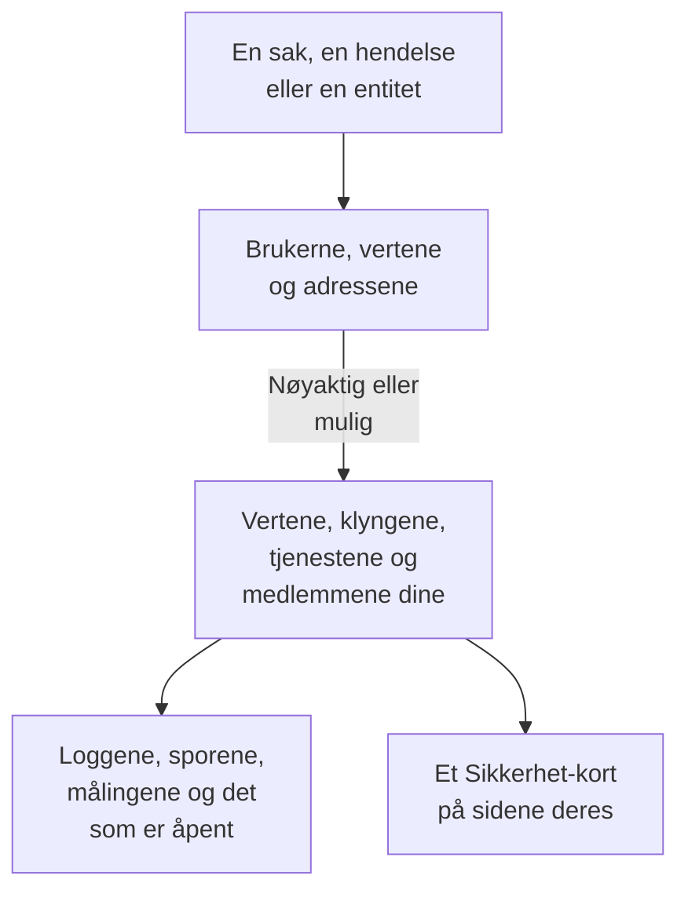

# Tilkoblede signaler

En sikkerhetssak sier hvilke brukere, verter og adresser den handler om. Tilkoblede signaler sier hvilke av dem OneUptime allerede kjenner - vertene, containervertene, Kubernetes-klyngene, nettverksenhetene, tjenestene og medlemmene dine - og hva som skjedde på hver av dem rundt saken: loggene, sporene og målingene, hendelsene og varslene som er åpne på den, monitorene som overvåker den, og hva som endret seg på den. Andre veien sier siden til en vert, en klynge, en tjeneste eller et medlem hva Security Events har funnet om den.

:::cards
- [Hvor du ser det](#hvor-du-ser-det): Siden til en sak, fanen til en hendelse, siden til en entitet og sidene til det de nevner.
- [Hvordan en verdi kobles](#hvordan-en-verdi-kobles): Hva som teller som den samme oppføringen, og hva som bare kanskje gjør det.
- [Hva hver oppføring viser](#hva-hver-oppføring-viser): Signalene rundt saken, og hva som er åpent på den.
- [Hvem ser hva](#hvem-ser-hva): Hver oppføring leses med leserens egen rolle.
:::

## Slik fungerer det

OneUptime slår opp hver verdi blant prosjektets oppføringer, sier hvor sikkert hvert treff er, og viser hva som skjedde på hver oppføring rundt saken.

## Før du begynner

- Sikkerhetshendelser som kommer inn, og verter, Kubernetes-klynger, tjenester eller medlemmer i prosjektet som de kan nevne. Se [Kom i gang med sikkerhet](/docs/telemetry/security-getting-started).
- En rolle som kan lese sikkerhetshendelser, og de typene oppføringer du vil se.

## Hvor du ser det

- **Tilkoblede signaler**, en side i hver sikkerhetssak: åpne en sak under **Produkter → Security Events → Sikkerhetssaker → Åpne saker**, og deretter **Tilkoblede signaler** etter **Entiteter** i menyen.
- **Tilkoblet**, en fane i hver sikkerhetshendelse: åpne en hendelse under **Produkter → Security Events → Hendelser**. Den viser hva hendelsen nevner, i timen rundt den.
- Siden til en entitet under **Produkter → Security Events → Entitetsrisiko**: hvor OneUptime kjenner brukeren, verten eller adressen, rundt den siste sikkerhetshendelsen.
- Et **Sikkerhet**-kort på siden til hver vert, Docker-vert, Podman-vert, Kubernetes-klynge, nettverksenhet, tjeneste, hvert medlem og hvert inventarelement: de åpne sikkerhetssakene som nevner den, hvor mange sikkerhetshendelser og funn som nevnte den de siste 7 dagene, den alvorligste av dem og risikoen. **Åpne i Security Events** åpner den der.
- Et **Sikkerhet**-kort på siden til en hendelse, når en sikkerhetssak erklærte hendelsen (**Erklært fra**), eller åpne saker nevner en vert eller klynge den berører (**Åpne saker som nevner det den berører**).

## Hvordan en verdi kobles

Hver bruker, vert og adresse en sak eller en hendelse nevner, slås opp blant prosjektets oppføringer:

| Det saken eller hendelsen nevner | Koblet til | Hvor sikkert |
| --- | --- | --- |
| Et verts- eller domenenavn som er det samme som navnet en vert, en containervert, en klynge eller en nettverksenhet rapporterer | Den oppføringen | Nøyaktig |
| Det samme navnet, gitt uten å si at det er en vert | Den oppføringen | Mulig |
| En kort eller full form av navnet til en oppføring, som `web-1` og `web-1.acme.internal` | Den oppføringen | Mulig |
| En offentlig IP-adresse som bare én oppføring har | Den oppføringen | Nøyaktig |
| En privat IP-adresse, eller en som flere oppføringer har | Hver oppføring som har den | Mulig |
| E-posten til et medlem | Det medlemmet | Nøyaktig |
| Oppføringen en logglinje ble sendt under, for hendelsene som leses fra loggene dine | Den verten, klyngen eller tjenesten | Nøyaktig |
| Et rent brukernavn, en URL, en filhash eller en prosess | Ingenting: ingen oppføring er nøklet etter dem | - |

- Et mulig treff viser **Mulig treff** ved siden av navnet og sier hvorfor. Det telles aldri på oppføringens side, og en hendelse saken erklærer, knyttes aldri til det.
- Det som ble lett etter og ikke er en oppføring i prosjektet, står under **Ikke i OneUptime**. En verdi står aldri der når en type oppføring den kunne være, ikke kunne leses.
- Det vises høyst 10 oppføringer for en sak, de nøyaktige først.

## Hva hver oppføring viser

- Signalene, hvert åpnet på oppføringen og sakens periode: **Logger**, **Spor** og **Målinger**, en tjenestes **Unntak**, en klynges **Kubernetes-hendelser**, oppføringens **Topologi** og elementet i **Inventory** når inventaret har et.
- Hendelsene og varslene som er åpne på den nå, og monitorene som overvåker den, hver med sin egen side.
- Hva som endret seg på den i perioden: en tjenestes utrullinger, en klynges rollouts og en verts rettinger.

| Hvor | Periode |
| --- | --- |
| En sak | Fra 30 minutter før den første deteksjonen til 30 minutter etter den siste, høyst de siste 24 timene |
| En hendelse | 30 minutter før og etter den |
| Siden til en entitet | 30 minutter før og etter den siste sikkerhetshendelsen |
| En oppførings **Sikkerhet**-kort | De siste 7 dagene |

## Hvem ser hva

- Tilkoblede signaler og en oppførings **Sikkerhet**-kort krever en rolle som kan lese sikkerhetshendelser: Security Admin, Security Member, Security Viewer, Project Owner eller Project Admin. Ingen andre ser sikkerhetsdata på noen side. Se [Roller](/docs/permissions/reference#roller).
- En hendelses **Sikkerhet**-kort krever en rolle som kan lese sikkerhetssaker.
- Hver oppføring leses med din egen rolle. En type oppføring rollen din ikke kan lese, utelates, og siden sier det; en som ikke kunne leses akkurat nå, sier det også, med **Prøv igjen**.
- Siden til en oppføring viser **Sikkerhet**-kortet bare i et prosjekt som bruker Security Events: et som har mottatt en sikkerhetshendelse de siste 7 dagene.

## Hendelser en sak erklærer

**Erklær hendelse** på en sak, eller et playbook-trinn som erklærer en, knytter hendelsen til vertene, Docker- og Podman-vertene, Kubernetes-klyngene og tjenestene saken er nøyaktig koblet til. Hendelsen vises på sidene deres, og eiernes regler gjelder for den, og feeden nevner saken og hva den ble knyttet til. Et mulig treff knyttes aldri.

## OneUptime AI

OneUptime AIs triage av en sak leser de tilkoblede signalene: hva som er åpent, og hva som endret seg på vertene, tjenestene og medlemmene saken nevner. Undersøkelsen av en hendelse leser sikkerhetssaken som erklærte den, og de åpne sakene som nevner det den berører. Se [OneUptime AI i sikkerhet](/docs/telemetry/security-ai).

## Feilsøking

:::details En vert saken nevner, står ikke på listen
Sjekk at saken nevner verten slik verten nevner seg selv, eller nevner en offentlig adresse bare den verten har. Et kort navn som `web-1` for `web-1.acme.internal` står som et mulig treff, og et rent brukernavn, en URL, en filhash eller en prosess slås ikke opp i det hele tatt.
:::

:::details Den riktige verten står som et mulig treff
Et mulig treff telles eller knyttes aldri, slik at et navn to maskiner deler aldri forteller deg noe om den gale. La loggene og deteksjonene dine nevne verten med navnet den rapporterer.
:::

:::details Siden til en vert har ikke noe Sikkerhet-kort
Kortet vises for en rolle som kan lese sikkerhetshendelser, i et prosjekt som har mottatt en sikkerhetshendelse de siste 7 dagene. En vert som ingenting har nevnt i den tiden, viser én linje som sier det.
:::

:::details Siden sier at rollen din ikke kan se en type oppføring
Hver oppføring leses med din egen rolle. Be en Project Owner eller Project Admin om en rolle som kan lese den typen oppføring.
:::

## Neste steg

:::cards
- [Sikkerhetssaker og playbooks](/docs/telemetry/security-cases): Arbeid med en sak, og erklær en hendelse ut fra den.
- [Sikkerhetshendelser (SIEM)](/docs/telemetry/security-events): Hendelsene bak en sak og loggene de leses fra.
- [Entitetsrisiko (risikobasert varsling)](/docs/telemetry/security-entity-risk): Siden til en entitet, risikoen og hvor OneUptime kjenner den.
- [OneUptime AI i sikkerhet](/docs/telemetry/security-ai): Hvordan en triage leser det en sak nevner.
:::
