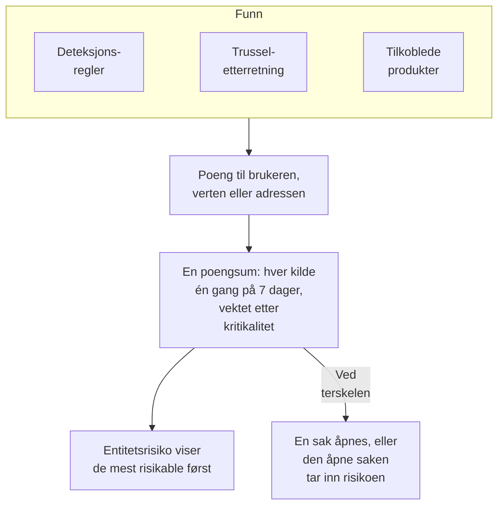

# Entitetsrisiko (risikobasert varsling)

Ett enkelt funn sier sjelden mye. En rekke mislykkede pålogginger, en første sudo på en vert og en pålogging fra et nytt land er hver for seg verdt et blikk; den samme kontoen i alle tre i løpet av en uke er verdt en sak. Entitetsrisiko legger sammen det deteksjonsreglene, trusseletterretningen og de tilkoblede produktene dine finner om hver bruker, vert og IP-adresse, viser de mest risikable først og åpner en sak om den som har en risiko som når prosjektets terskel.

:::cards
- [Slik telles en poengsum](#slik-telles-en-poengsum): Poeng etter alvorlighetsgrad, og hver kilde én gang i uken.
- [Risikonivåer og saker](#risikonivåer-og-saker): Hva en poengsum tilsvarer, og når en sak åpnes.
- [Entitetskritikalitet](#entitetskritikalitet): La det som betyr mer telle mer, og det som betyr mindre telle mindre.
- [En entitets side](#en-entitets-side): Hvorfor den er risikabel, måneden dens og sakene om den.
- [Risikopoeng på en deteksjonsregel](#risikopoeng-på-en-deteksjonsregel): En regels egen vekt i poengsummen.
:::

## Slik fungerer det

Åpne **Produkter → Security Events → Entitetsrisiko**: hver bruker, vert og IP-adresse med risiko nå, de mest risikable først, med nivå, hvor mye den betyr, hva som fant den og når. Hver av dem åpnes på sin egen side.

## Før du begynner

- Sikkerhetshendelser som kommer inn, og deteksjonsregler, trusseletterretning eller tilkoblede produkter som finner noe i dem. Se [Kom i gang med sikkerhet](/docs/telemetry/security-getting-started).
- Deteksjonsregler som grupperer etter et felt som nevner noen: **Grupperingsfelt**, for eksempel `principalUser`, `principalHost` eller `principalIp`, eller feltene en korrelasjon grupperer etter. En regel som ikke grupperer etter noe, legger ikke til risiko.
- For å endre **Risikovurdering**: Project Owner eller Project Admin for bryteren og terskelen, og en rolle som kan opprette deteksjonsregler for listen over entiteter. Security Viewer leser alt. Se [Roller](/docs/permissions/reference#roller).

## Slik telles en poengsum

Hvert funn gir risikopoeng til brukeren, verten eller IP-adressen det gjelder:

| Et funn med alvorlighetsgrad | Gir |
| --- | --- |
| Lav | 10 poeng |
| Middels | 25 poeng |
| Høy | 50 poeng |
| Kritisk | 75 poeng |

- Et informativt funn gir ingenting, og et funn med ukjent alvorlighetsgrad teller som Middels.
- En deteksjonsregels poeng går til verdien den grupperer etter. Et treff i trusseletterretning teller for IP-adressen indikatoren nevner. Et tilkoblet produkts varsel teller for brukeren og verten det nevner, ellers for IP-adressen.
- Hver kilde teller én gang. En deteksjonsregel, en trusseletterretningsfeed eller et tilkoblet produkts regel teller én gang på 7 dager, med det meste den la til, uansett hvor ofte den utløses: én støyende regel kan aldri få en entitet til å se verre ut enn tre ulike.
- En kilde som ikke har funnet noe på 7 dager, slutter å telle, og poengsummen faller. Poengsummene sjekkes hvert 15. minutt, så en poengsum faller i tide uten et nytt funn.

En entitets poengsum er summen av kildene, vektet etter kritikaliteten. Testangrepet fra **Send et testangrep**, og en sak noen åpner for hånd, legger ikke til risiko.

## Risikonivåer og saker

Hver poengsum tilsvarer et nivå mot prosjektets terskel, 100 med mindre du endrer den:

| Risikopoengsum | Tilsvarer | Hva som skjer |
| --- | --- | --- |
| 1 til 49 | Lav | Vises under Entitetsrisiko |
| 50 til 99 | Middels | Vises under Entitetsrisiko |
| 100 til 199 | Høy | En sak åpnes, som Høy |
| 200 eller mer | Kritisk | En sak åpnes, som Kritisk |

Når en entitets risiko når terskelen, utløses en deteksjon fra kilden Entitetsrisiko om den. Den blir med i den åpne saken om entiteten, eller åpner en som er oppkalt etter den, for eksempel `High risk — k.morgan@acme-commerce.example`, og viser kildene som bidro mest til risikoen, opptil 10, med poengene deres, hvor ofte hver ble utløst og når sist.

Når en sak er åpnet om en entitets risiko, telles ikke det som lå bak, på nytt: en ny sak åpnes bare når kilder som er nye siden da, når terskelen igjen. En sak som er lukket som håndtert, åpnes ikke igjen av de samme funnene.

Endre terskelen under **Produkter → Security Events → Innstillinger → Risikovurdering → Risikoterskel**: et heltall fra 10 til 10000. Middels starter på halvparten og Kritisk på det doble, på alle sider.

### Slå risikosaker på eller av

**Risikosaker**, under **Innstillinger → Risikovurdering**, avgjør om risiko åpner saker, og lagres når du slår den om. Nye prosjekter starter med den slått på. Et prosjekt som ble opprettet før entitetsrisiko, holder den av til noen slår den på, og **Entitetsrisiko** sier det over listen sin. Risiko vurderes og vises uansett.

## Entitetskritikalitet

Noen entiteter betyr mer enn andre: en domenekontroller, en leders konto, en betalingsserver. Andre betyr mindre, for eksempel en sårbarhetsskanner som skanner som forventet. List dem opp under **Innstillinger → Risikovurdering → Entitetskritikalitet** med **Legg til Entitet**:

| Kritikalitet | Teller risikoen |
| --- | --- |
| Lav | ×0.5 |
| Ikke oppført | ×1 |
| Høy | ×1.5 |
| Ekstrem | ×2 |

En oppføring er en verdi eller et `*`-mønster, uavhengig av store og små bokstaver: `dc-*` navngir hver domenekontroller, og `*@contractors.example` hver innleid konsulent. **Type** begrenser den til brukere, verter eller IP-adresser; tom passer på alle. Når flere oppføringer nevner en entitet, teller den mest spesifikke: en utskrevet verdi før et mønster, og et lengre mønster før et kortere. En endring når hver entitets poengsum i løpet av minutter.

## En entitets side

Klikk på **Vis** i en rad i **Entitetsrisiko**, eller på risikoen ved siden av en entitet på en saks side **Entiteter**:

| Del | Hva den viser |
| --- | --- |
| Toppteksten | Typen og kritikaliteten, poengsummen og nivået, og hvordan poengsummen regnes ut |
| **Aktivitet** | Sikkerhetshendelsene og funnene fra de siste 7 dagene |
| **Hva som øker risikoen** | Hver kilde, alvorlighetsgraden, poengene den gir, hvor ofte den ble utløst og når sist |
| **Risiko siste 30 dager** | Poengsummen ved slutten av hver dag, farget etter nivå |
| **Saker om den** | Sikkerhetssakene som er åpnet om den, de nyeste først |

**Åpne i Korreler** tegner en graf over hendelsene, og **Søk i hendelsene** åpner **Hendelser** på uken dens. **Tilbakestill risiko** tømmer poengsummen og kildene, for eksempel etter en planlagt test: det som finnes etterpå, teller fra null, og sakene endres ikke. Tilbakestilling krever en rolle som kan slette sikkerhetsdata, og [revisjonsloggen](/docs/configuration/audit-logs) registrerer det.

OneUptime AI leser risikoen for en saks entiteter når den vurderer saken. Se [OneUptime AI i sikkerhet](/docs/telemetry/security-ai).

## Risikopoeng på en deteksjonsregel

En deteksjonsregel gir poengene for nivået sitt, fra Sigma-`level`. For å gi den en egen vekt åpner du regelens skjema, går til **Ved treff**, åpner **Flere felt** og angir **Risikopoeng**, fra 0, som ikke gir risiko, til 100. La feltet stå tomt for poengene for nivået.

## Feilsøking

:::details En entitet står ikke under Entitetsrisiko
Sjekk at en deteksjonsregel, en trusseletterretningsfeed eller et tilkoblet produkt har funnet noe om den de siste 7 dagene, og at regelen grupperer etter et felt som nevner den. Informative funn gir ingenting, og en kilde som ikke har funnet noe på 7 dager, slutter å telle.
:::

:::details En entitets risiko nådde terskelen, og ingen sak ble åpnet
Sjekk at **Risikosaker** er slått på under **Innstillinger → Risikovurdering**. Hvis en sak allerede er åpnet om entitetens risiko, teller bare kilder som er nye siden da, mot den neste.
:::

:::details En regel utløses igjen og igjen, og entitetens poengsum stiger ikke
Slik telles det: en kilde teller én gang på 7 dager, med det meste den la til. Senk **Risikopoeng** for en støyende regel, eller gi en entitet med forventede funn lav kritikalitet.
:::

:::details En poengsum er ikke summen av kildene
Kritikaliteten vekter den. Entitetens side viser summen av kildene og vekten, for eksempel 100 fra kildene × 2 = 200.
:::

## Neste steg

:::cards
- [Sikkerhetssaker og playbooks](/docs/telemetry/security-cases): Arbeid med sakene risiko åpner, og lukk dem med en vurdering.
- [Sikkerhetshendelser (SIEM)](/docs/telemetry/security-events): Deteksjonsregler, Korreler og hendelsene bak hvert funn.
- [Trusseletterretning (STIX/TAXII)](/docs/telemetry/threat-intelligence): Treffene som bidrar til en adresses risiko.
- [OneUptime AI i sikkerhet](/docs/telemetry/security-ai): Hvordan en vurdering leser risikoen for en saks entiteter.
:::
