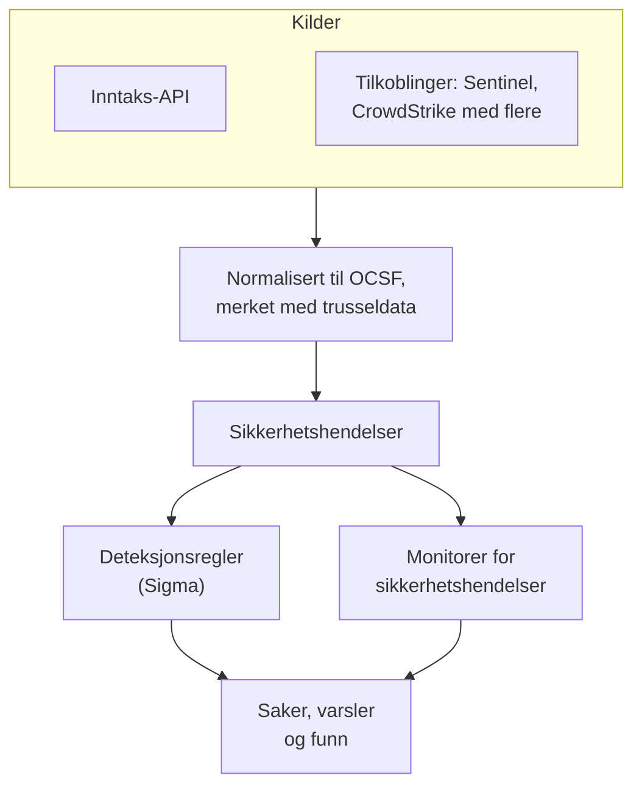
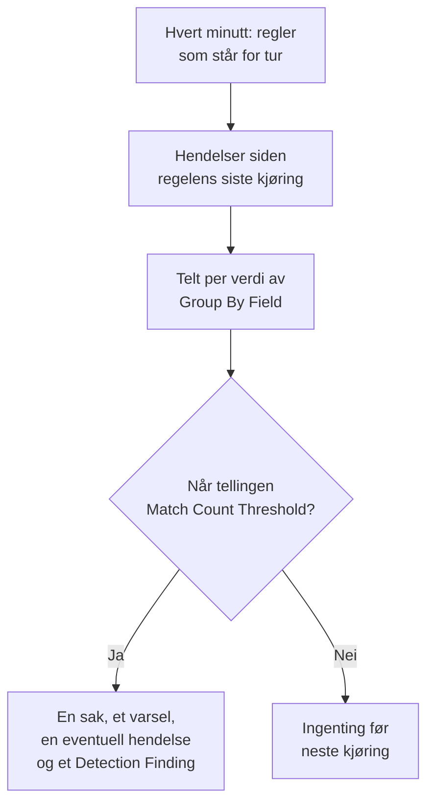

# Sikkerhetshendelser (SIEM)

OneUptime lagrer sikkerhetshendelser ved siden av loggene, trasene og målingene dine, og gir alle samme form, [OCSF](https://schema.ocsf.io/) (Open Cybersecurity Schema Framework), uansett hvilket format de kom i. Send hendelser fra hvilken som helst kilde, søk i dem, og finn de viktige med Sigma-deteksjonsregler, trusseletterretning og monitorer. Det de finner, blir [saker](/docs/telemetry/security-cases) som skal behandles, og playbooks reagerer på dem.

:::cards
- [Send hendelser](#send-sikkerhetshendelser): En HTTPS-POST, en Fluent Bit-utgang eller en tilkobling til et sikkerhetsprodukt.
- [Søk og korreler](#utforsk-sikkerhetshendelser): Hendelsesutforskeren og korrelasjonsgrafen.
- [Hunts](#hunts): Lagrede søk som kjører etter en tidsplan og varsler personer når de finner noe.
- [Deteksjonsregler](#deteksjonsregler): Sigma-regler som åpner saker og varsler.
- [Monitorer](#monitorer-for-sikkerhetshendelser): Tellinger over et glidende vindu, med en status som hentes inn igjen.
:::

## Slik fungerer det



Åpne **Produkter → Sikkerhetshendelser**, under **Sikkerhet**. Menyen har en seksjon for hver del av sikkerheten, og en egen side for hver ting i den:

| Side | Seksjon | Hva den er til |
| --- | --- | --- |
| **Oversikt** | Oversikt | Hvordan sikkerhet er satt opp, hva som trenger noen nå, og hvor raskt saker blir behandlet |
| **Åpne saker** | Sikkerhetssaker | Køen: hver sak som ikke er lukket ennå, gruppert etter hva den gjelder |
| **Tildelt meg** | Sikkerhetssaker | De åpne sakene som er tildelt deg |
| **Ikke tildelt** | Sikkerhetssaker | De åpne sakene ingen har tatt |
| **Lukkede saker** | Sikkerhetssaker | Sakene som er lukket med en vurdering, de nyeste først |
| **Alle saker** | Sikkerhetssaker | Hver sak, åpen eller lukket |
| **Hendelser** | Hendelser | Søk i og filtrer alle hendelser, og åpne en for å se alle feltene |
| **Hunts** | Hendelser | Søk lagret fra Hendelser, åpnet igjen med ett klikk eller kjørt etter en tidsplan som varsler personer når de finner noe |
| **Huntbibliotek** | Hendelser | Ferdige hunts du kan prøve under Hendelser eller legge til blant dine hunts, hver med hendelsene den leser og om de kommer |
| **Kampanjer** | Hendelser | Hver adresse som sendte angrepsforespørsler, og om noen av forespørslene kom gjennom |
| **Entitetsrisiko** | Hendelser | Hver bruker, vert og adresse, vurdert etter hva som er funnet om den denne uken, de mest risikable først |
| **Korreler** | Hendelser | En graf over hendelsene som deler en vert, en bruker eller en IP-adresse |
| **Deteksjonsregler** | Detections | Sigma-regler som kjører etter en tidsplan og åpner saker |
| **Regelunntak** | Detections | Det reglene dine hopper over med vilje, som en skanner eller en planlagt test, hver med hvem som la den til og hvorfor |
| **Overvåkingslister** | Detections | Listene reglene dine sammenligner med, som VIP-brukere, kritiske verter, kjente ondsinnede filhasher og adressene administratorer kan logge på fra |
| **Regelbibliotek** | Detections | Ferdige deteksjonsregler å legge til, hver med hendelsene den leser og om de kommer inn, med de anbefalte merket |
| **Trusselsinformasjon** | Detections | STIX/TAXII-feeder med kjente ondsinnede indikatorer |
| **ATT&CK-dekning** | Detections | MITRE ATT&CK-teknikkene som reglene dine dekker |
| **Playbooks** | Playbooks | Steg som kjører på saker, av seg selv eller manuelt |
| **Godkjenninger** | Playbooks | Playbook-stegene som venter på at noen godkjenner eller avviser dem |
| **Playbook-kjøringer** | Playbooks | Hva hver playbook gjorde, steg for steg |
| **Automatisk respons** | Playbooks | Policyene som utfordrer eller blokkerer en angripende adresse idet deteksjonen skjer, hver med prøveperiode og sikkerhetsrammer |
| **Blokkeringsliste** | Playbooks | Adressene prosjektet ditt blokkerer, til når, og hvor hver blokkering håndheves |
| **Blokkeringslistefeeder** | Playbooks | De hemmelige URL-ene brannmurene og proxyene dine leser blokkeringslisten fra, og hentingene deres |
| **Beskyttede entiteter** | Playbooks | Brukerne, vertene og adressene som ingen playbook demmer inn og ingen blokkering rører |
| **Innstillinger** | KI | Om OneUptime AI vurderer hver nye sak |
| **Tilkoblinger** | Connections | Loggene dine, sikkerhetsproduktene OneUptime henter fra, og SIEM-ene det sender til |
| **Oppsettveiledning** | Connections | Kodesnutter for å sende hendelser, fylt ut med inntaksnøkkelen din |
| **Saksprioriteter** | Innstillinger | Hvor mye en sak haster: prosjektets egne prioriteter, den som haster mest først |
| **Responsmål** | Innstillinger | Hvor raskt en sak med hver prioritet må tas og begrenses |
| **Saksstatuser** | Innstillinger | Trinnene en sak går gjennom, og hva en sak i hvert trinn teller som |
| **Egendefinerte felt** | Innstillinger | Feltene teamet ditt fyller ut i hver sak, for eksempel forretningsenheten den gjelder |
| **Notatmaler** | Innstillinger | Ferdig tekst til notatene teamet ditt skriver på sakene sine |
| **Nummerering** | Innstillinger | Teksten foran saksnumrene, og nummeret den neste saken får |
| **Risikovurdering** | Innstillinger | Om risikoen for en entitet åpner en sak, ved hvilken risiko, og hvor mye hver entitet betyr |
| **Sletteforespørsler** | Innstillinger | Personer som er slettet på forespørsel, og hva hver sletting endret |

**Deteksjoner**, **KI**, **Tilkoblinger** og **Innstillinger**, som settes opp én gang, er slått sammen til du åpner dem. Ny med sikkerhet? [Kom i gang med sikkerhet](/docs/telemetry/security-getting-started) setter det opp med to klikk.

## Før du begynner

Sikkerhetsdata kan bare leses av rollene Prosjekteier og Prosjektadministrator og av de tre Security-rollene; andre roller ser ingenting i Sikkerhetshendelser. Se [Roller](/docs/permissions/reference#roller).

| Rolle | Hva den kan gjøre |
| --- | --- |
| Sikkerhetsadministrator | Alt: hendelser, saker, playbooks, deteksjonsregler, threat intel-feeder og tilkoblinger |
| Sikkerhetsmedlem | Lese hendelser og threat intel, behandle saker, kjøre playbooks og godkjenne stegene deres, blokkere adresser, og opprette, endre og slette deteksjonsregler og feeder. Den kan ikke sette opp playbooks eller tilkoblinger, eller slette sikkerhetsdata. |
| Sikkerhetsleser | Lese hendelser, saker, playbooks, blokkeringslisten, regler, feeder, indikatorer og tilkoblinger |

## Send sikkerhetshendelser

:::steps
### Opprett en inntaksnøkkel

Åpne **Prosjektinnstillinger → Telemetri og APM → Inntaksnøkler**, og klikk på **Opprett inntaksnøkkel**. Sikkerhetshendelser bruker de samme nøklene som resten av telemetrien din.

### Send hendelsene dine

Send JSON til `/security-events/v1/ingest` med nøkkelen i `x-oneuptime-token`:

:::tabs
@tab OCSF
```bash
curl -X POST "https://oneuptime.com/security-events/v1/ingest?format=ocsf" \
  -H "Content-Type: application/json" \
  -H "x-oneuptime-token: YOUR_INGESTION_TOKEN" \
  -H "x-oneuptime-service-name: my-security-source" \
  -d '{ "events": [ { "class_uid": 3002, "severity_id": 4, "status": "Failure", "message": "Failed logon for alice", "actor": { "user": { "name": "alice" } }, "src_endpoint": { "ip": "203.0.113.7", "hostname": "laptop-alice" } } ] }'
```
@tab Google UDM
```bash
curl -X POST "https://oneuptime.com/security-events/v1/ingest?format=udm" \
  -H "Content-Type: application/json" \
  -H "x-oneuptime-token: YOUR_INGESTION_TOKEN" \
  -d '{ "events": [ { "metadata": { "event_type": "USER_LOGIN" }, "principal": { "hostname": "laptop-alice", "user": { "userid": "alice" }, "ip": ["203.0.113.7"] }, "security_result": [{ "severity": "HIGH", "action": ["BLOCK"] }] } ] }'
```
@tab Generic JSON
```bash
curl -X POST "https://oneuptime.com/security-events/v1/ingest" \
  -H "Content-Type: application/json" \
  -H "x-oneuptime-token: YOUR_INGESTION_TOKEN" \
  -d '{ "events": [ { "severity": "high", "event_type": "ssh_brute_force", "message": "12 failed SSH logins in 60s", "username": "root", "hostname": "web-01", "src_ip": "203.0.113.7" } ] }'
```
:::

Endepunktet svarer `200` så snart hendelsene står i kø. En hendelse sendt uten tidspunkt, som disse, plasseres i øyeblikket den kommer inn.

### Finn dem under Hendelser

Åpne **Produkter → Sikkerhetshendelser → Hendelser**. Hendelsene vises i løpet av noen sekunder, med alvorlighetsgrad, klasse, bruker, vert og IP-adresser fylt ut.
:::

### Formater

| `format` | Hva det leser | Godtas også |
| --- | --- | --- |
| `ocsf` | OCSF-hendelses-JSON (`class_uid`, `severity_id` og så videre) | Ingen |
| `udm` | UDM-hendelser fra Google SecOps (Chronicle) (`metadata.event_type` og så videre) | `chronicle`, `google-secops` |
| `google-secops-alert` | Deteksjoner og varsler fra Google SecOps: SOAR-webhooks og deteksjonsstrømmen | `secops-alert`, `detection` |
| `generic` | All annen JSON, lest ut fra vanlige feltnavn | Ingen |

Angi formatet med `?format=`, med hodet `x-oneuptime-security-event-format` eller med et felt `"format"` på øverste nivå. Utelater du det, bestemmes formatet for hver hendelse for seg, så én webhook kan blande deteksjoner med rå hendelser.

- Body kan være én hendelse, en matrise av hendelser eller `{ "events": [...] }`.
- En batch kan være gzip-komprimert og sendes med `Content-Encoding: gzip`: den leses som den samme batchen ukomprimert. I Fluent Bit komprimerer `http`-utgangen med `compress gzip`, i Vector `http`-sinken med `compression = "gzip"`, og i Logstash `http`-utgangen med `http_compression => true`. Bare JSON leses komprimert: en komprimert body av en hvilken som helst annen type avvises med `400`.
- Hodet `x-oneuptime-service-name` angir telemetritjenesten hendelsene hører til. Uten det hører de til tjenesten som er oppkalt etter produktet eller leverandøren til den første hendelsen, eller til `Security Events`.
- Ingenting forkastes fordi det ikke lot seg tilordne: hvert felt fra kilden havner i hendelsens attributter.

### Felt i generisk JSON

En generisk hendelse leses ut fra vanlige feltnavn:

| Hendelsens felt | Leses fra det første av |
| --- | --- |
| `message` | `message`, `msg`, `summary`, `description`, `title` |
| `severityName` | `severity`, `severity_name`, `level`, `priority`, `risk_level` |
| `time` | `timestamp`, `time`, `@timestamp`, `event_time`, `created_at` |
| `principalUser` | `user`, `username`, `user_name`, `account`, `actor` |
| `principalHost` | `host`, `hostname`, `computer`, `device`, `machine` |
| `principalIp` | `source_ip`, `src_ip`, `client_ip`, `ip` |
| `targetIp` | `destination_ip`, `dest_ip`, `dst_ip`, `target_ip` |
| `className` | `event_type`, `category`, `type`, `action` |
| `ruleName` | `rule`, `rule_name`, `signature`, `detection` |
| `productName` | `product`, `product_name`, `source`, `log_source` |
| `processName` | `process_name`, `process.name`, `proc.name`, `comm` |
| `processPath` | `process_path`, `Image`, `NewProcessName`, `exe`, `process.executable` |
| `processCommandLine` | `command_line`, `CommandLine`, `cmdline`, `process.command_line`, `proc.cmdline`, `process` |
| `parentProcessName` | `parent_process_name`, `process.parent.name`, `proc.pname` |
| `parentProcessPath` | `parent_process_path`, `ParentImage`, `ParentProcessName`, `process.parent.executable` |
| `parentProcessCommandLine` | `parent_command_line`, `ParentCommandLine`, `process.parent.command_line`, `proc.pcmdline` |

Et ord for alvorlighetsgrad blir et OCSF-nivå: `info` leses som Informational, `warning` som Low, `error` som Medium, `alert` som Critical og `emergency` som Fatal.

### Videresend med Fluent Bit

For å sende sikkerhetslogger du allerede samler inn, for eksempel auditd, syslog eller Falco, legger du til en `http`-utgang i Fluent Bit:

```ini title="fluent-bit.conf"
[OUTPUT]
    Name             http
    Match            security.*
    Host             oneuptime.com
    Port             443
    tls              On
    URI              /security-events/v1/ingest
    Format           json
    compress         gzip
    Json_date_key    timestamp
    Json_date_format iso8601
    Header           x-oneuptime-token YOUR_INGESTION_TOKEN
    Header           x-oneuptime-service-name my-security-source
    Retry_Limit      5
```

Siden **Oppsettveiledning**, under **Tilkoblinger**, har disse kodesnuttene med din egen vert og nøkkel fylt ut.

### Finn sikkerhetshendelser i loggene dine

Kortet **Loggene dine**, øverst på **Tilkoblinger**, gjør loggene du allerede sender til OneUptime, til en kilde. Med **Finn sikkerhetshendelser i loggene dine** slått på leses prosjektets nye logger hvert minutt, og hver SSH- eller Windows-pålogging, sudo-kommando, revisjonsoppføring fra en sky, CEF- eller LEEF-oppføring fra et sikkerhetsprodukt, oppføring fra en Palo Alto Networks-, FortiGate- eller Cisco ASA-brannmur, Kubernetes-revisjonsoppføring, hvert webangrep og hver forespørsel om en sensitiv fil i dem lagres som en sikkerhetshendelse. Se [Kom i gang med sikkerhet](/docs/telemetry/security-getting-started#finn-sikkerhetshendelser-i-loggene-dine) for hva hver type dekker.

Hver type når OneUptime som vanlige logger:

| Type | Send den fra |
| --- | --- |
| SSH-pålogginger, sudo | Journalen eller auth-loggen til en Linux-maskin, med [OpenTelemetry Collector](/docs/telemetry/host-otel-collector) |
| Windows-hendelser | Collectorens `windowseventlog`-receiver på maskinen, eller en videresender som skriver hver hendelse som JSON, for eksempel NXLog eller Winlogbeat. En [vert](/docs/telemetry/hosts) som er lagt til i OneUptime, leser også Sysmon, Microsoft Defender og PowerShell der den har dem |
| AWS CloudTrail | Et trail levert til CloudWatch Logs, lest av collectorens `awscloudwatch`-receiver, eller, for en konto som er koblet til under **Sky**, [Skyrevisjonslogger](#les-revisjonsloggene-til-skykontoene-dine) |
| Google Cloud-revisjonslogger | En logg-sink til Pub/Sub, lest av collectorens `googlecloudpubsub`-receiver med `encoding: raw_text`, eller, for et prosjekt som er koblet til under **Sky**, prosjektets [strøm](/docs/telemetry/cloud-streaming-google-cloud) eller [Skyrevisjonslogger](#les-revisjonsloggene-til-skykontoene-dine) |
| Azure-aktivitetslogger og Entra ID-logger | En diagnostikkinnstilling som strømmer til en Event Hub, lest av collectorens `azureeventhub`-receiver med `format: raw`, eller til hendelseshuben i [strømmen](/docs/telemetry/cloud-streaming-azure) til et tilkoblet abonnement, eller, for aktivitetsloggen til et abonnement som er koblet til under **Sky**, [Skyrevisjonslogger](#les-revisjonsloggene-til-skykontoene-dine) |
| Azure Key Vault-, Storage- og SQL-logger | Diagnoseinnstillingen til en ressurs, som strømmer til en Event Hub, lest av collectorens `azureeventhub`-receiver med `format: raw`, eller diagnoseinnstillingene i [strømmen](/docs/telemetry/cloud-streaming-azure) til et tilkoblet abonnement, med logger. Se [Azure-ressursenes egne revisjonslogger](#azure-ressursenes-egne-revisjonslogger) |
| OpenStack-revisjonsspor | Notifikasjonene og revisjonsfilteret til en sky, sendt til loggene med `driver = log` og lest av agentens [loggprofil](/docs/telemetry/openstack#hvem-gjorde-hva) |
| CEF, LEEF | Produktets syslog, videresendt av [rsyslog](/docs/telemetry/syslog) |
| Palo Alto Networks, FortiGate, Cisco ASA | Brannmurens egen syslog, videresendt av [rsyslog](/docs/telemetry/syslog) |
| Kubernetes-revisjonslogger | Revisjonsloggfilen til API-serveren, lest av collectorens `filelog`-receiver |
| Webangrep | Tilgangsloggen til en webserver, lest av collectorens `filelog`-receiver |

På **Loggene dine** viser hver type når den sist ble funnet, og **Sjekk en logglinje** viser hva en linje du limer inn, blir til, før noen kommer. OneUptime leser linjen slik skanningene leser loggene dine, med de [klarerte proxyene](#klarerte-proxyer) dine og innstillingene for tilgangsloggene dine, så den oppgir klienten den lagrede hendelsen vil oppgi, og lagrer ingenting.

En trussel som et sikkerhetsprodukt skriver i loggene dine, for eksempel et CEF- eller LEEF-funn eller en trussel fra Palo Alto Networks, FortiGate eller Cisco ASA, åpner en [sak](/docs/telemetry/security-cases) slik et tilkoblet produkts varsel gjør, og øker risikoen for brukeren, verten eller adressen den nevner. **Åpne saker fra** på **Loggene dine** angir fra hvilken alvorlighetsgrad: **Høy og høyere** med mindre du velger en annen, eller **Aldri**. Produktets pålogginger og blokkerte tilkoblinger forblir hendelser som reglene dine kan lese.

En oppføring som når OneUptime på to måter, lagres én gang: en Microsoft Entra ID-pålogging som tilkoblingen leser, og som Azure også eksporterer til loggene dine, en CloudTrail-oppføring i loggene dine og i revisjonsloggen til en tilkoblet AWS-konto, eller en revisjonsoppføring som strømmen til en skykonto sender, og som **Skyrevisjonslogger** også leser.

#### Azure-ressursenes egne revisjonslogger

Et Key Vault, en lagringskonto og en Azure SQL-database fører hver sin egen revisjonslogg, som registrerer hver forespørsel. Bare det et sikkerhetsteam ser på, blir en sikkerhetshendelse:

| Ressurs | Hva som blir en sikkerhetshendelse |
| --- | --- |
| Key Vault (`AuditEvent`) | En forespørsel hvelvet avviste; en hemmelighet som ble utlevert; en hemmelighet, en nøkkel, et sertifikat eller selve hvelvet som ble slettet, permanent fjernet eller sikkerhetskopiert; en endret tilgangspolicy; og en endring i det hvelvet inneholder. Ikke 401-svaret som hver Azure SDK-klient får ved sitt første kall, gjort uten token for å finne leieren: Key Vault logger det under operasjonen `Authentication` |
| Lagringskonto (`StorageRead`, `StorageWrite`, `StorageDelete`) | En forespørsel som ble avvist fordi en rettighet manglet; en som ble besvart helt uten legitimasjon, unntatt sidene til et statisk nettsted og en CORS-preflight; en endret tilgangsliste for en container, en filressurs, en kø eller en tabell, eller en av dem slettet i sin helhet; og en skriving eller sletting som en signatur for delt tilgang (SAS) signerte. Ikke en lesing som lyktes, heller ikke en med SAS |
| Azure SQL (`SQLSecurityAuditEvents`) | En mislykket pålogging; en pålogging på en ny tilkobling, ikke gjenbruk av en tilkobling fra en tilkoblingspool; en tillatelse som ble gitt, nektet eller tilbakekalt, et rollemedlem eller et passord som ble endret, en etterligning, og en påloggingskonto, en bruker eller en rolle som ble opprettet, endret eller fjernet; og en handling der tillatelseskontrollen mislyktes. Ikke en batch, hoveddelen av en revisjon |

En lagringskontos vellykkede lesinger er det meste av det den logger: en SAS er måten de fleste apper gir filer til nettlesere på. De blir værende i Logger, hele, på kontoens fane **Logger**: søk der etter `"type":"SAS"` for å se hva en signatur for delt tilgang leste. Hver hendelse nevner ressursen sin ved ID-en, og hendelsen til en lagringstjeneste nevner også kontoen, så den vises på siden **Sikkerhetshendelser** til den ressursen, og en oppføring som kommer to ganger, lagres én gang.

### Les revisjonsloggene til skykontoene dine

En AWS-konto, et Google Cloud-prosjekt eller et Azure-abonnement som er [koblet til under **Sky**](/docs/telemetry/cloud-accounts), trenger ingen loggpipeline. Slå på **Skyrevisjonslogger** under **OneUptime-dataene dine** på **Tilkoblinger**, så tar hver lesing av kontoen vare på revisjonsloggen som sikkerhetshendelser:

| Sky | Hva som leses |
| --- | --- |
| AWS | CloudTrails administrasjonshendelser som endrer noe, i hver region kontoen bruker: pålogginger til konsollen, endringer og kall som AWS avviste |
| Google Cloud | Revisjonsloggen Admin Activity: endringer i ressurser og i hvem som kan nå dem, og kall som Google avviste |
| Azure | Aktivitetsloggen: endringer i abonnementet, operasjoner som mislyktes, avvisninger fra Azure Policy og varsler fra Defender for Cloud |

- Hver oppføring leses slik **Loggene dine** leser den fra en pipeline, så regelbibliotekets CloudTrail-, Google Cloud- og Azure-regler treffer den.
- En hendelse får tidspunktet da den lagres, med oppføringens egen tid i `oneuptime.cloud.record_time`: En revisjonslogg når OneUptime minutter for sent, og en regel leser hendelser etter tiden deres.
- Kontoens egen lesing gir ikke mer: datahendelser, Data Access-logger og loggene til Microsoft Entra ID trenger fortsatt **Loggene dine** eller en [tilkobling](/docs/integrations/microsoft-entra-id).
- Hver hendelse nevner skyressursene posten gjelder, ved deres egne ID-er - en ARN, en Azure-ressurs-ID, et ressursnavn fra Google Cloud - så den vises på siden **Sikkerhetshendelser** til hver av dem, og på siden til en serverløs funksjon så snart telemetrien dens setter `cloud.account.id` og `cloud.region`.

### OneUptimes egne sonder i nettverksflyten din

Slå på **Nettverksflyt** under **OneUptime-dataene dine** på **Tilkoblinger**, så leses flytene nettverksenhetene dine eksporterer, etter portskanninger, nettverkssveip, trafikk med kjente ondsinnede adresser og store overføringer ut. En sondes eget arbeid ligner der på en skanning: å spørre 40 enheter over SNMP treffer port 161 på 40 verter hvert femte minutt. Derfor legges trafikk fra en av OneUptimes egne sonder som er nøyaktig det sonden er satt til å gjøre, til side:

- nettverksenhetene den spør, pinget og spurt over SNMP på porten deres;
- området til hver av oppdagelsene dens, mens skanningen pågår;
- vertene og portene monitorene dens sjekker.

Den lagres som en informativ hendelse, `oneuptime-probe-traffic`, som navngir sonden, og ingen regel leser den. **Nettverksflyt** viser hvor mange som ble lagt til side det siste døgnet, med **Se dem**. Alt annet fra en sondes adresse telles som alles trafikk, og et sveip eller en skanning utover sondens arbeid rapporteres med sondens navn. En sonde gjenkjennes på adressen den melder seg fra, og på adressene til sine egne nettverksgrensesnitt, som den lister opp hver gang den melder seg. En egendefinert sonde uten vertens nettverk, som en Kubernetes-pod eller en container på et Docker-bridgenettverk, gjenkjennes også på vertens adresser, som `PROBE_HOST_IP_ADDRESSES` gir den: til den har dem, forlater avspørringene dens maskinen fra en adresse den ikke gjenkjennes på, og rapporteres som sveip. Se [Hva en sonde sender når den sender livstegn](/docs/probe/custom-probe#hva-en-sonde-sender-når-den-sender-livstegn).

### Koble til et sikkerhetsprodukt

**Tilkoblinger** henter data fra et sikkerhetsprodukt for deg og importerer de nye postene som sikkerhetshendelser. En tilkobling inneholder produktets innstillinger og en kryptert legitimasjon; en worker henter fra den med intervallet du angir, og hopper over poster den allerede har importert.

| Produkt | Importerer | Oppsettveiledning |
| --- | --- | --- |
| Google SecOps (Chronicle) | Regeldeteksjoner, kuraterte deteksjoner og varsler, som Detection Findings | [Google SecOps](/docs/integrations/google-secops) |
| Microsoft Sentinel | Hendelser (incidents), som Incident Findings | [Microsoft Sentinel](/docs/integrations/microsoft-sentinel) |
| Microsoft Defender XDR | Varsler, som Detection Findings | [Microsoft Defender XDR](/docs/integrations/microsoft-defender-xdr) |
| CrowdStrike Falcon | Varsler, som Detection Findings | [CrowdStrike Falcon](/docs/integrations/crowdstrike-falcon) |
| Splunk Enterprise Security | Notable events, eller hvilket som helst søk, som Detection Findings | [Splunk Enterprise Security](/docs/integrations/splunk) |
| Elastic Security | Deteksjonsvarsler, som Detection Findings | [Elastic Security](/docs/integrations/elastic-security) |
| AWS Security Hub | Findings, som Detection og Compliance Findings | [AWS Security Hub](/docs/integrations/aws-security-hub) |
| Okta System Log | Hendelser for pålogging, MFA, kontoer og policyer | [Okta System Log](/docs/integrations/okta) |
| Microsoft Entra ID | Pålogginger, katalogendringer og risikoregistreringer, om du vil mislykkede bakgrunns- og apppålogginger, og fra Microsoft 365-revisjonsloggen videresending av e-post, deling og phishingdommer | [Microsoft Entra ID](/docs/integrations/microsoft-entra-id) |
| Google Workspace | Pålogginger, Googles egne funn, administratorendringer og apptilgang, og deling i Disk | [Google Workspace](/docs/integrations/google-workspace) |
| Cloudflare | Det brannmuren blokkerte, utfordret og logget ved kanten, som HTTP Activity | [Cloudflare](/docs/integrations/cloudflare) |

- Produktets egne varsler på eller over **Åpne saker fra** (**Høy og høyere** med mindre du velger et annet nivå, eller **Aldri**) åpner [saker](/docs/telemetry/security-cases), gruppert etter brukeren, verten eller adressen de gjelder.
- En tilkobling leser poster etter tidspunktet produktet opprettet dem, ikke etter tidspunktet for aktiviteten de beskriver. En SIEM-regel som kjører hver time, oppretter deteksjoner lenge etter hendelsene den traff, og de importeres likevel.
- Den første hentingen ser 24 timer tilbake, så en ny tilkobling viser nylige poster med en gang.
- **Test tilkoblingen**, i tilkoblingens rad, sjekker tilgangen til produktet og at OneUptimes egne workers kjører, og importerer ingenting. **Kjør nå** henter med en gang.

## Hva en hendelse inneholder

Hver hendelse lagres med typede felt og kildens nyttelast:

| Gruppe | Felt |
| --- | --- |
| Klassifisering | `categoryName`, `className`, `activityName`, `statusName`, med OCSF-ID-ene sine (`categoryUid`, `classUid`) |
| Alvorlighetsgrad | `severityName`, en av Unknown, Informational, Low, Medium, High, Critical, Fatal eller Other, og `severityId` |
| Hvem som gjorde det | `principalUser`, `principalHost`, `principalIp`, `principalProcess` |
| Hva det berørte | `targetUser`, `targetHost`, `targetIp`, `targetPort`, `targetResource` |
| Prosessen | `processName`, `processPath` og `processCommandLine`: ved prosessaktivitet prosessen som ble startet, åpnet, injisert i eller avsluttet, ellers prosessen som handlet. `parentProcessName`, `parentProcessPath` og `parentProcessCommandLine`: prosessen som startet den |
| Kilde | `productName`, `vendorName`, `ruleId`, `ruleName`, `eventUid` |
| Innhold | `message`, `mitreTactics`, `mitreTechniques` og `observables`: hver bruker, vert, IP-adresse, domene og hash hentet fra hendelsen |
| Attributter | Hele kildens nyttelast, flatet ut til nøkler med punktum |

Hendelser som ble lagret før OneUptime 14.0.84, lar prosessfeltene stå tomme og nevner bare prosessen sin som `principalProcess`, prosessen som handlet. De fylles ikke ut i etterkant: de beholder det de ble lagret med, til oppbevaringen deres går ut.

### Hvilken adresse en hendelse nevner

En hendelse nevner adressen en forespørsel kom fra, bare når avsenderen av forespørselen ikke selv kunne ha skrevet den. Den adressen er verifisert, og den blir hendelsens **Kilde-IP**: Deteksjonsregler teller den, trusseletterretning matcher den, og en saks **Responsplan** tilbyr å blokkere den. Enhver annen adresse en forespørsel nevner, er bare oppgitt: Hendelsen beholder den som **Oppgitt IP**, og ingenting teller eller blokkerer den.

- Tilkoblingens egen adresse er verifisert: `network.peer.address` i et serverspenn, eller det første feltet i en linje i tilgangsloggen til en webserver. Ingen kan skrive den inn i en forespørsel.
- Bak en proxy du stoler på, er tilkoblingens adresse proxyens, og klienten er adressen proxyen videresendte i `X-Forwarded-For`. Hver proxy legger til adressen den tok imot tilkoblingen fra, så OneUptime leser headeren fra høyre og tar den første adressen som ikke er en proxy du stoler på. Det en avsender skriver i headeren, havner til venstre for den og forblir en påstand.
- En adresse en forespørsel nevner om seg selv, er oppgitt: `client.address`, som instrumenteringen fyller ut fra venstre side av headeren, resten av `X-Forwarded-For` og `Forwarded`.

En oppgitt adresse blokkeres aldri fra en sak: Hvem som helst kan sende `X-Forwarded-For: 192.0.2.44`, og en blokkering ville stenge ute den som enn har 192.0.2.44. En hendelse med bare en oppgitt adresse har en **Responsplan** som ber deg finne den ekte adressen i loggene til lastbalansereren eller brannmuren din.

En hendelse der en proxy du stoler på, videresendte klienten, viser hvilke proxyer den kom gjennom, som **Videresendt av**: i den rekkefølgen `X-Forwarded-For` lister dem opp, med tilkoblingens egen adresse sist. De ligger i `oneuptime.request.forwarded_by`, og **Sjekk en logglinje** forteller hvorfor hver av dem er klarert.

Registrer to ting på serverspennene til appen din, så adressene er verifisert: tilkoblingens egen adresse, `network.peer.address`, som HTTP-instrumenteringene i OpenTelemetry setter, og bak en proxy headeren `X-Forwarded-For`, som de registrerer som `http.request.header.x-forwarded-for` når du oppgir den i `OTEL_INSTRUMENTATION_HTTP_CAPTURE_HEADERS_SERVER_REQUEST`. En JSON-tilgangslogg leses på samme måte: Klientfeltet, for eksempel `remote_addr`, er tilkoblingens adresse, og feltet `http_x_forwarded_for` er headeren.

#### Klarerte proxyer

Sikkerhetshendelser tror en proxy på hvem klienten var, når adressen dens er:

| Klarert | Hvorfor |
| --- | --- |
| Oppført under **Klarerte proxyer** | Du har oppført den |
| I de publiserte områdene til en kant du har koblet til, for eksempel [Cloudflare](/docs/integrations/cloudflare) | Så lenge tilkoblingen finnes |
| En av dine egne applikasjonslastbalanserere, eller et proxy-only-delnett i Google Cloud som bare applikasjonslastbalansererne dine kobler til fra | Med mindre du slår av **Lastbalansererne dine** |
| En av Googles front-ends, bak din Google Cloud Application Load Balancer | Sammen med lastbalansererne dine, med mindre en TCP- eller SSL-proxylastbalanserer du har, også kobler til fra dem |
| Privat, loopback eller link-local, for eksempel `10.0.0.5` | Så lenge **Private adresser** er slått på |

Adressene en av lastbalansererne dine som jobber på TCP-nivå, kobler til fra, blir aldri klarert, selv om de er oppført: se [Proxyer som jobber på TCP-nivå](#proxyer-som-jobber-på-tcp-nivå).

**Sikkerhetshendelser → Tilkoblinger → Flere innstillinger** inneholder **Klarerte proxyer**, listen du skriver, og **Klarert automatisk**, som viser resten og hvorfor. Før opp en proxy under **Klarerte proxyer**, én adresse eller ett område på hver linje, når ingenting annet stoler på den: et CDN du ikke har koblet til, en lastbalanserer som når appen din over internett, en omvendt proxy som nginx på en server med offentlig adresse foran appen din, eller, så lenge **Private adresser** er slått av, en HTTP-proxy i nettverket ditt, for eksempel ingressen din. Inntil du gjør det, tilskrives hvert angrep gjennom den selve proxyen. Et område som er bredere enn en proxys, for eksempel `0.0.0.0/0`, avvises: Det ville klarert alle adresser, så hvem som helst kunne velge adressen et angrep tilskrives. En Prosjekteier, Prosjektadministrator eller Sikkerhetsadministrator redigerer listen, og hver endring står i [revisjonsloggen](/docs/configuration/audit-logs) til prosjektet.

Dine egne applikasjonslastbalanserere er de som de [tilkoblede skykontoene](/docs/telemetry/cloud-accounts) dine viser: AWS Application Load Balancers, AWS Classic Load Balancers der hver lytter er HTTP eller HTTPS, Google Cloud Application Load Balancers og Azure Application Gateways, med de offentlige adressene sine. Hver av dem legger klienten den videresender, til i `X-Forwarded-For`. En lastbalanserer i Google Cloud legger til sin egen adresse etter klientens, og en Application Gateway når en offentlig backend fra sin egen adresse, så uten dem ville hvert angrep gjennom en av dem blitt tilskrevet lastbalansereren. **Lastbalansererne dine** på **Klarert automatisk** viser dem, og en Prosjekteier, Prosjektadministrator eller Sikkerhetsadministrator kan slå det av.

Bak en global ekstern Application Load Balancer i Google Cloud, eller en klassisk en, kommer appens tilkoblinger fra Googles front-ends, ikke fra lastbalansererens egen adresse. Så lenge et tilkoblet Google Cloud-prosjekt har en, stoler Sikkerhetshendelser derfor også på områdene til front-endene: `35.191.0.0/16`, `130.211.0.0/22` og `2600:2d00:1:1::/64`, slik Googles [brannmurregler for lastbalansering](https://cloud.google.com/load-balancing/docs/firewall-rules) lister dem opp. **Lastbalansererne dine** viser dem på den siste linjen i listen, sammen med lastbalansererne som tar dem med, og bryteren slår også dem av. Ingen utenfor Google kobler til fra disse områdene, og å stole på dem lar aldri noen oppgi en klient: En forespørsel gjennom noen andres lastbalanserer avslutter `X-Forwarded-For` med adressen til den lastbalansereren, som ikke er din, så hendelsen oppgir den. Men Googles TCP- og SSL-proxylastbalanserere kobler til fra de samme områdene og sender en forespørsel videre slik klienten sendte den, så så lenge en av dine finnes, eller ikke alle lastbalansererne kunne listes opp, er områdene ikke klarert, og linjen forteller hvorfor. Hvis en slik lastbalanserer ligger i et Google Cloud-prosjekt du ikke har koblet til, kobler du det til, eller slår av **Lastbalansererne dine**. Eldre versjoner av denne dokumentasjonen sa at du skulle føre opp `35.191.0.0/16` og `130.211.0.0/22` under **Klarerte proxyer**: Så lenge en TCP- eller SSL-proxylastbalanserer du har, kobler til fra dem, blir de ikke klarert selv om de er oppført, og **Klarerte proxyer** advarer om hvert av områdene dine som inneholder dem. Du kan ta dem ut av listen: **Lastbalansererne dine** klarerer dem når det er trygt.

Ingenting annet av ditt er klarert automatisk: ikke vertene, Kubernetes-nodene, sondene eller de virtuelle maskinene dine, en NAT-gateway eller en Network-, Gateway- eller Azure-lastbalanserer. De videresender ingen, eller de sender en forespørsel videre slik den kom, så det som kjører på dem, kunne oppgi hvilken som helst klient: en forespørsel en monitor sender med egne headere, en pod, en bærbar PC bak gatewayen. Hvis en av dem er proxyen din, legger du den til i **Klarerte proxyer**. En Kubernetes-ingress er klarert som den lastbalansereren den er: En GKE-ingress er en Google Cloud Application Load Balancer, en AKS-ingress for Application Gateway en Application Gateway, og en EKS-ingress av klassen `alb` en AWS Application Load Balancer. En ingress-kontroller i klyngen din videresender fra en privat adresse, som er klarert så lenge **Private adresser** er slått på; så lenge det er slått av, fører du opp adressene dens.

En endring i noen av disse trer i kraft innen ett minutt, og en ny lastbalanserer blir klarert innen fem.

#### Proxyer som jobber på TCP-nivå

En proxy som jobber på TCP-nivå, legger ikke til noe i `X-Forwarded-For`: Den sender videre headeren klienten skrev, og appen din ser tilkoblingen komme fra proxyen. Var den klarert, kunne en klient velge hvilken adresse et angrep tilskrives, og få en annens adresse blokkert. Eksempler er en AWS Network Load Balancer uten bevaring av klient-IP, Google Clouds proxy Network Load Balancere, HAProxy i `mode tcp`, `stream`-modulen til nginx og en Kubernetes-Service med `externalTrafficPolicy: Cluster`, som gir ingressen din hver tilkobling fra adressen til en node.

OneUptime finner dem de [tilkoblede skykontoene](/docs/telemetry/cloud-accounts) dine lister opp, og klarerer aldri adressene de kobler til fra, selv når **Klarerte proxyer** fører dem opp:

- En regional eller tverregional proxy Network Load Balancer i Google Cloud: proxy-only-delnettet for regionen og VPC-nettverket dens, som alle lastbalansererne der deler. Så lenge bare applikasjonslastbalansererne dine bruker et proxy-only-delnett, kan ingenting annet være i det, og det er klarert som deres.
- En global ekstern eller klassisk proxy Network Load Balancer i Google Cloud: Googles front-ends.
- En AWS Network Load Balancer som ikke bevarer klientens egen adresse, fra delnettene den ligger i: en med en målgruppe av instanser eller IP-adresser over TCP eller TLS der bevaring av klient-IP er slått av (IP-mål har den slått av med mindre du slår den på); en dual-stack-lastbalanserer, som gir en IPv6-klient til IPv4-mål fra sin egen adresse; eller en der OneUptime ikke kunne lese målgruppene.
- En AWS Classic Load Balancer med en TCP- eller SSL-lytter, fra delnettene den ligger i.

**Klarert automatisk** lister dem opp under **Ikke klarert, selv om de er lagt til**, hver med grunnen. Bak en av dem holder du klientens egen adresse på tilkoblingen: Slå på bevaring av klient-IP, eller sett en Application Load Balancer foran. AWS-lastbalanserere leses sammen med inventaret til skykontoen din, så en endring vises etter neste lesing.

For en proxy OneUptime ikke kan se, slår du av **Private adresser** på **Klarert automatisk**. Slått av er en privat adresse bare klarert når den er oppført under **Klarerte proxyer** eller tilhører en av lastbalansererne dine, så før først opp HTTP-proxyene i nettverket ditt: Inntil du gjør det, tilskrives hvert angrep gjennom en av dem selve proxyen. En AWS Application Load Balancer og en Azure Application Gateway når appen din fra private adresser i subnettene sine, som OneUptime ikke fører opp ennå: Før opp disse subnettene også. Et nytt prosjekt starter med **Private adresser** slått av. Et prosjekt fra før det fortsetter å klarere private adresser som før, og **Klarert automatisk** sier hva det risikerer. En Prosjekteier, Prosjektadministrator eller Sikkerhetsadministrator slår det om, og hver endring står i revisjonsloggen til prosjektet.

Uansett hva du velger, blokkeres en adresse aldri automatisk når den kom gjennom en privat adresse som verken er oppført eller tilhører en av lastbalansererne dine: [automatisk respons](/docs/telemetry/security-automatic-response) overlater den til en person, og trinnet **Blokker adresse** i en playbook venter på godkjenning, også et der godkjenningen er slått av, og nevner proxyen den kom gjennom. En person som blokkerer adressen fra **Responsplan** i en sak, avgjør det selv. Står en privat HTTP-proxy du har foran, fører du den opp under **Klarerte proxyer**, og automatisk respons handler på det den videresender.

#### Tilgangslogger som slutter med X-Forwarded-For

Bak en lastbalanserer logger mange webservere den videresendte adressen sist, slik nginx' eget format `main` gjør:

```nginx
log_format main '$remote_addr - $remote_user [$time_local] "$request" '
                '$status $body_bytes_sent "$http_referer" '
                '"$http_user_agent" "$http_x_forwarded_for"';
```

En linje sier aldri hva feltene er, så det siste feltet leses som `X-Forwarded-For` først når du slår på **Logger slutter med X-Forwarded-For** på **Tilgangslogger** under **Flere innstillinger**, og da bare:

- når linjens første felt er en proxy du stoler på: En linje fra en klient som nådde webserveren din direkte, tilhører den klienten;
- i formatet combined, med nøyaktig ett felt i anførselstegn etter user agent og ingenting etter det;
- når det feltet er `-` eller en liste over adresser der den siste ikke har port.

La den være av når formatet ditt slutter med en annen header som inneholder en adresse, for eksempel `X-Real-IP`, eller når webserveren din skriver headere uten å escape anførselstegnene deres, slik `morgan` for Express gjør: En forespørsels egen user agent kunne da legge til et felt. En JSON-tilgangslogg trenger ingen bryter, siden feltene har navn.

#### Ditt eget loggformat

Hvis webserverne dine setter `X-Forwarded-For` et annet sted enn sist, oppgir du formatet deres: **Loggformat** på **Tilgangslogger** under **Flere innstillinger**. Lim inn `log_format` for nginx slik `nginx.conf` skriver det, eller start fra et kjent format, `main` for nginx eller `upstreaminfo` for ingress-nginx. For eksempel et format som etter headeren logger hvor lang tid hver forespørsel tok:

```nginx
log_format timed '$remote_addr - $remote_user [$time_local] "$request" '
                 '$status $body_bytes_sent "$http_referer" '
                 '"$http_user_agent" "$http_x_forwarded_for" $request_time';
```

Hver linje i formatet ditt leses felt for felt: adressen som koblet til, fra `$remote_addr`, og `X-Forwarded-For` fra `$http_x_forwarded_for`, uansett hvor formatet plasserer den. Den leses som enhver `X-Forwarded-For`: bare når `$remote_addr` er en proxy du stoler på, og fra høyre. Ingen andre felt tas noen gang for noen av dem, og en linje som ikke er i formatet ditt, leses som før, der **Logger slutter med X-Forwarded-For** avgjør det siste feltet.

- nginx escaper anførselstegnene en klient sender, som `\x22`, så hvert anførselstegn i en linje hører til formatet ditt. En linje med flere anførselstegn enn formatet ditt, slik en server som ikke escaper dem, skriver (`escape=none`, `morgan` for Express), er ingen linje i formatet ditt, og ingenting i den leses som en slik.
- **Loggformat** avviser et format der `X-Forwarded-For` eller `$remote_addr` ikke kan skilles fra feltene ved siden av, for eksempel en header uten anførselstegn mellom to felt en klient skriver, og ber deg sette den i anførselstegn, som `"$http_x_forwarded_for"`.
- `upstreaminfo` for ingress-nginx logger ingen `X-Forwarded-For`, så klienten i hver linje er `$remote_addr`. Står en Application Load Balancer eller en annen HTTP-proxy foran den, legger du til `"$http_x_forwarded_for"` i `log-format-upstream` for å lese klienten den videresendte. Bak en Network Load Balancer, som sender videre headeren klienten skrev, skal du la være.
- Når nginx selv setter `$remote_addr` ut fra `X-Forwarded-For`, med realip-modulen eller `use-forwarded-headers` for ingress-nginx, tror den på alle som `set_real_ip_from` eller `proxy-real-ip-cidr` oppgir, og standarden for ingress-nginx oppgir alle. Logg adressen som faktisk koblet til, `$realip_remote_addr`, ved siden av `$http_x_forwarded_for`: Sikkerhetshendelser leser da `$realip_remote_addr` som tilkoblingen, `$remote_addr` bare som en påstand, og avgjør med de klarerte proxyene dine.

En Prosjekteier, Prosjektadministrator eller Sikkerhetsadministrator oppgir det, og hver endring står i revisjonsloggen til prosjektet.

### Skjult av en rensingsregel

En IP-adresseregel som sletter eller maskerer loggene eller trasene dine, skjuler adressen et angrep kom fra før Sikkerhetshendelser leser dem. Hendelsen lagres likevel, uten adresse, og overalt der den ville navngitt adressen, sier den at en scrub-regel skjulte den:

- **Kilde-IP** i hendelsens panel navngir regelen som skjulte adressen når den kan, som en lenke til **Scrub-regler** for loggene eller trasene. Filteret ved siden av viser hver hendelse der en scrub-regel skjulte adressen.
- **Mål-IP** sier det samme når en regel skjulte hvor en tilkobling gikk: en brannmurs destinasjon, eller hvor data ble sendt. Filteret ved siden av viser hver hendelse der en scrub-regel skjulte måladressen.
- **Hva som skjedde videre** sier at forespørselen kom fra en adresse som en scrub-regel skjulte, og **Kampanjer** samler slike forespørsler i én egen rad.
- En sak der alle hendelsene mistet adressen sin, sier det i **Responsplan**: I stedet for å blokkere adressen ber den deg finne den i loggene til lastbalansereren eller brannmuren din og blokkere den der, med **Åpne scrub-regler**.
- **Oversikt** navngir regelen som skjuler adressene Sikkerhetshendelser leser, også med **Åpne scrub-regler**.

En regel som hasher, lagrer adressen for Sikkerhetshendelser, så hendelsen navngir den, med mindre tokenet er eldre enn 30 dager eller ble laget før tokener hadde en nøkkel: se [Rens sensitive data](/docs/telemetry/drop-filters-and-scrub-rules#rens-sensitive-data). Søk etter `@oneuptime.request.client_address_hidden:scrub-rule` for å finne disse hendelsene. Det regelen la igjen i stedet for adressen, som `[REDACTED]`, står i `oneuptime.request.client_address_scrubbed`. Søk etter `@oneuptime.target_address_hidden:scrub-rule` for en destinasjon.

En deteksjonsregel som teller per adresse, bør telle per `principalIp` eller `targetIp`, som navngir adressen bak tokenet fra en regel som hasher, slik regelbibliotekets regler gjør. Et formats eget adressefelt, for eksempel `openstack.audit.initiator_address` eller `asa.src_ip`, inneholder bare en adresse som sto i loggen, så det forblir tomt overalt der en scrub-regel skjulte en.

En regel som sletter eller maskerer en bruker, skjuler den på samme måte: Der hendelsen ville navngitt brukeren, sier **Kildebruker** eller **Målbruker** at en scrub-regel skjulte den. Der Sikkerhetshendelser leser en bruker, lagrer en regel som hasher, brukeren for den: en forespørsels `enduser.id` eller `user.id`, et AI-kalls bruker og en bruker som en logglinje navngir, som principal i en revisjonslogg fra skyen. Så hendelsen navngir brukeren bak tokenet, en sak om brukeren navngir kontoen, og en playbook kan handle på den som på enhver annen bruker. Det regelen la igjen, står i `oneuptime.principal_user_hashed_as` eller `oneuptime.target_user_hashed_as`, så du kan finne brukeren i loggene og trasene dine, som bare inneholder tokenet. Et token som ingen bruker er lagret for, som et som ble laget før tokener hadde en nøkkel, forblir hendelsens bruker: Regler teller det som én konto, og ingen playbook handler på det.

Hendelsens panel sier det under brukeren den nevner i **Kildebruker** og **Målbruker**: «Hashet i loggene dine som …», eller «Hashet i sporene dine som …» for en bruker lest fra sporene dine, der … er tokenet. Tokenet er en lenke som søker etter det i loggene eller sporene dine, fra en dag før hendelsen til en dag etter, i feltet brukeren ble lest fra: brødteksten til en logglinje eller et av attributtene dens, eller et attributt i et span, som `user.id` eller et AI-kalls bruker. Det feltet står i `oneuptime.principal_user_hashed_field` eller `oneuptime.target_user_hashed_field`. En bruker som er slettet på forespørsel, viser i stedet **Slettet på forespørsel**, og hendelsen viser tokenet deres: se [Slett en person](#slett-en-person).

## Utforsk sikkerhetshendelser

**Hendelser** er en telemetriutforsker som utforskerne for logger og traser: et diagram over vinduets hendelser etter alvorlighetsgrad, et sidepanel med fasetter, listen, og et panel med hvert felt og attributt i hendelsen du åpner. Vinduet, filtrene og søket ligger alle i URL-en, så en filtrert visning kan deles og overlever en ny innlasting.

### Søk

Søkefeltet snakker samme språk som de andre telemetriutforskerne (se [Søkesyntaks](/docs/telemetry/search-syntax)):

| Syntaks | Betyr | Eksempel |
| --- | --- | --- |
| fritekst | Meldingen inneholder den | `failed logon` |
| `"quoted phrase"` | Hold ordene sammen | `"brute force"` |
| `<field>:<value>` | Et typet felt | `severity:Critical` |
| `@<attribute>:<value>` | Et kildeattributt | `@threat.matched:true` |
| `-<filter>` | Ikke dette | `-severity:Informational` |
| `<field>:(a OR b)` | Hvilken som helst av disse verdiene | `severity:(High OR Critical)` |
| `<field>:a*` | `*` er hvilken som helst tekst, `?` ett tegn | `host:web-*` |
| `@<attribute>:*` | Attributtet finnes | `@threat.indicator_id:*` |
| `@<attribute>:~text` | Attributtet inneholder teksten | `@finding_info.title:~ransom` |
| `<field>:%<watchlist>%` | Feltet står på en [overvåkingsliste](#overvåkingslister) | `user:%vip_users%` |

Et felt er enten et kort navn (`severity`, `class`, `category`, `activity`, `status`, `vendor`, `product`, `rule`, `user`, `host`, `ip`, `targetuser`, `targethost`, `targetip`, `processname`, `commandline`, `parentprocessname`, `observable`, `tactic`, `technique`, `requestoutcome`, `trace`, `session`) eller feltets eget navn, for eksempel `severityName` eller `principalHost`. Alle andre navn leses som et kildeattributt. `observable:<value>` finner hver hendelse som nevner en verdi, uansett hvilken side av aktiviteten den var på.

### Fasetter

Sidepanelet teller vinduets hendelser etter **Kilde**, **Alvorlighetsgrad**, **Resultat av forespørsel**, **Hendelsesklasse**, **Kategori**, **Aktivitet**, **Status**, **Leverandør**, **Produkt**, **Deteksjonsregel**, **Kildebruker**, **Kildevert**, **Prosess** og **Overordnet prosess**. Klikk på en verdi for å beholde bare hendelsene med den, eller på minustegnet ved siden av for å utelate dem. Klikk igjen for å angre. Diagrammet og hver telling beskriver nøyaktig hendelsene i listen.

### Hva som skjedde etterpå

En hendelse lest fra en logglinje som ble skrevet inne i en sporet forespørsel, følges inn i den forespørselen. Panelet viser hvor langt forespørselen kom (**Avvist**, **Nådde appen**, **Feilet** eller **Nådde databasen**), hvem som sendte den, og lenker til sporingen, unntaket, øktavspillingen og selve logglinjen. En logglinje, en sporing og et unntak som er del av et angrep, sier det også på sine egne sider.

### En sensitiv fil nettstedet ditt leverte

En forespørsel om en fil med hemmeligheter, for eksempel `/.env`, `/.git/config`, `/.aws/credentials` eller en kopi av `wp-config.php`, er en lekkasje når nettstedet ditt besvarte den med selve filen: Den som spurte, har nå passordene, nøklene og tokenene i den. En enkeltsideapp besvarer hver sti den ikke har, med sin egen side og status 200, så status 200 alene sier aldri det. OneUptime leser hva svaret inneholdt:

- En type som ikke er en nettside, for eksempel `text/plain` eller `application/octet-stream`: selve filen.
- En nettside, eller JSON for en fil som ikke er JSON: nettstedets egen side.
- Ingenting i svaret: ingenting ble tatt.
- En størrelse og ingen type, slik tilgangsloggen til en webserver registrerer svaret: selve filen når ingen annen sti fikk den størrelsen og nettstedet ditt svarer 404 for stiene det ikke har, og nettstedets egen side når samme størrelse besvarte to forskjellige stier. En forespørsel uten noe ved siden av, for eksempel en skanners enslige `/.env`, vurderes etter hva nettstedet ditt svarte det siste døgnet. Når ingenting avgjør det, blir forespørselen ikke en hendelse.

En levert fil får alvorlighetsgraden Kritisk, og regelbibliotekets regel **Sensitive file served** åpner en sak om den, med trinn for å ta ned filen og rotere det den inneholder. Hver av disse forespørslene teller også med i **Scanning for sensitive files**, også dem fra en enkeltsideapp. En administrasjonsside som nettstedet ditt leverer, for eksempel den i WordPress, er aldri en av dem, og en `wp-config.php` som WordPress kjørte, er nettstedets egen side. Cloudflares brannmurhendelser sier ikke hva opprinnelsen din sendte, så en forespørsel Cloudflare slapp gjennom, teller bare med i skanningen. Panelet til en hendelse viser hva nettstedet ditt sendte, under **Hva som skjedde videre**. Et prosjekt som slo på de anbefalte reglene før **Sensitive file served** var en av dem, og som kjører alle de andre, fikk den ved oppgraderingen, og **Oversikt** sier det.

### Campaigns

**Kampanjer** viser hver adresse som sendte angrepsforespørsler som én rad, med angrepstypene, verktøyene og forespørslene den sendte, og hvor mange som kom gjennom. Adressene med forespørsler som nådde appen din, kommer først. En rad som blokkeringslisten din allerede holder, sier til når den er blokkert eller utfordret, og nevner området eller nettverket som holder den.

For å blokkere flere angripere samtidig velger du radene deres og trykker på **Blokker adresser**. Én dialog viser hver adresse den blokkerer og hver adresse den utelater, med grunnen: allerede blokkert, en av dine egne eller en beskyttet, en som en pålogget bruker har brukt de siste 30 dagene, eller en som OneUptime ikke kunne kontrollere. Den blokkerer i 24 timer med mindre du velger en annen varighet, eller utfordrer med **Utfordre i stedet**, og hver blokkering havner på [blokkeringslisten](/docs/telemetry/security-cases#blokkeringsliste) din som din.

**Grupper etter nettverk** samler adressene fra ett nettverk på én rad: etter ASN-en der hendelsene fra [Cloudflare](/docs/integrations/cloudflare)-tilkoblingen din oppgir en, og ellers etter /24 for IPv4 eller /48 for IPv6. Raden til en ASN viser områdene adressene sendte fra. **Utfordre dette nettverket** sier hva det vil gjøre, hvor og hvor lenge, før det gjør det: 24 timer med mindre du velger en annen varighet, og neste trinn på stigen for et nettverk som er utfordret før. Cloudflare holder et område i utfordringslisten sin, og en ASN som en IP Access Rule, som alle planer har. **Vis forespørsler** på raden til et nettverk åpner det nettverket sendte, i **Hendelser**: for en ASN etter ASN-en som Cloudflare-hendelsene oppgir, og for et område som et søk etter adressene, for eksempel `ip:203.0.113.*`, som du kan endre.

- Et nettverk som inneholder en adresse en pålogget bruker har brukt de siste 30 dagene, eller en av dine egne, blir aldri utfordret, og dialogen nevner hvem eller hva.
- Et område som er bredere enn et /24 (et /48 for IPv6), og en hel ASN, krever en Sikkerhetsadministrator, en Prosjektadministrator eller en Prosjekteier. Raden til en ASN tilbyr også hvert av områdene, som alle som kan blokkere, kan utfordre.
- Når OneUptime ikke kan se hvem som bruker et nettverk, fordi det er en hel ASN eller fordi en scrub-regel skjuler klientadresser, kan bare en Sikkerhetsadministrator, en Prosjektadministrator eller en Prosjekteier utfordre det, etter å ha krysset av for at de vet det.
- Ingenting blir blokkert eller utfordret så lenge Sikkerhetshendelser er slått av på serveren.

### Korreler

**Korreler** tegner hendelsene rundt en vert, en bruker eller en IP-adresse: hendelsesklassene deres rundt det du søkte etter, merket med den verste alvorlighetsgraden, og de andre verdiene fra de samme hendelsene på den ytre ringen. Klikk på en klasse for å liste hendelsene i den, eller på en verdi for å korrelere på den neste gang. Hver observable i panelet til en hendelse under **Hendelser** åpner **Korreler** på den.

## Hunts

En hunt er et søk i sikkerhetshendelsene dine, lagret med et navn: teksten i søkefeltet, filtrene i sidepanelet og hvor langt tilbake den ser. Åpne den igjen med ett klikk, kjør den etter en tidsplan som varsler personer når den finner noe, og oppbevar hendelsene den finner, på en sak.

### Lagre et søk som en hunt

Søk og filtrer under **Hendelser** til listen viser det du leter etter, åpne så **Hunts** på verktøylinjen og velg **Lagre som hunt**. Gi den et navn, velg om den kjører etter en tidsplan, og siden dens åpnes. **Hendelser → Hunts** viser prosjektets hunts, hver med søket sitt, hvor ofte den kjører, hvem den varsler og hva den siste kjøringen fant; **Opprett Hunt** tar der søket slik du ville skrevet det under **Hendelser**. Et prosjekt kan ha opptil 200 hunts. Et søk kan lese en [overvåkingsliste](#overvåkingslister), slik `user:%vip_users%` gjør, og en hunt som leser en liste prosjektet ikke har, avvises når du lagrer den.

Siden til en hunt er søket dens, åpnet i hendelsesutforskeren. Endre søket eller filtrene der, så tilbyr overskriften til hunten **Lagre endringer** og **Forkast endringer**. **Rediger** endrer navnet, søket, hvor langt tilbake den ser, tidsplanen og hvem den varsler, og **Slett hunt** ligger i menyen dens. Fra Sikkerhetsmedlem og oppover kan man lagre, endre og slette hunts, og en Sikkerhetsleser kan åpne dem.

En hunt som er lagret med filtre fra sidepanelet under Hendelser, viser dem i **Rediger** under **Filtre**, slik Hendelser tegner dem, hvert med en x for å fjerne det. Legg til filtre på siden til hunten, fra sidepanelet.

### Start fra Huntbiblioteket

**Hendelser → Huntbibliotek** viser ferdige hunts for det sikkerhetsteam oftest ser etter, som mislykkede pålogginger, kodet PowerShell, AWS-rotkontoen og skall åpnet i Kubernetes-poder. Hver viser hva den finner, søket slik du ville skrevet det under **Hendelser**, og om hendelsene den leser kommer, slik **Regelbibliotek** gjør for sine regler. Avgrens dem etter **Huntkategori**, **Data** og **Status**, eller søk i dem.

**Prøv det** åpner søket under **Hendelser** over tidsvinduet til hunten og lagrer ingenting. **Legg til** lagrer den med en gang som en av prosjektets hunts, navngitt og beskrevet på ditt språk og uten tidsplan, som enhver ny hunt. Deretter står det **Lagt til**, og **Åpne** åpner den, der du kan gi den en tidsplan.

### Kjør en hunt etter en tidsplan

| Tidsplan | Kjører |
| --- | --- |
| **Ikke planlagt** | Bare når du åpner den |
| **Hver time**, **Hver 6. time**, **Hver dag**, **Hver uke** | Av seg selv, så ofte |

En planlagt hunt varsler personene og teamene du velger under **Varsle**: minst én og høyst 50 til sammen. Hver kjøring:

- leser hendelsene som kom inn etter kjøringen før, frem til for to minutter siden, uansett når de skjedde, så hver hendelse søkes gjennom én gang, også en som kommer sent. Den første kjøringen leser fra da tidsplanen ble satt eller søket sist ble endret, og etter et avbrudd henter en kjøring inn høyst én dag mer enn intervallet sitt. En hendelse som kommer mer enn en dag etter at den skjedde, lagres og kan søkes i, men ingen kjøring teller den.
- teller hendelsene søket finner der, nøyaktig slik **Hendelser** ville listet dem, og leser bare det personen den kjører som, kan lese.
- varsler, når den finner hendelser, personene hunten nevner, og medlemmene av teamene den nevner, som kan lese hunts og sikkerhetshendelser.

En kjøring åpner ingen sak og utløser ikke noe varsel: skriv det som skal åpne saker, som en [deteksjonsregel](#deteksjonsregler). En kjøring der søket tar for lang tid, eller som ikke kan lese hendelsene, sier hvorfor på hunten og prøves på nytt innen en time, fra der den stoppet.

En planlagt hunt kjører som personen som sist satte tidsplanen, endret søket eller lagret den med **Rediger**. En API-nøkkel kan ikke sette en tidsplan. Når den personen forlater prosjektet eller ikke lenger kan lese sikkerhetshendelser, sier hunten fra: åpne **Rediger** og lagre den for å kjøre den som deg.

### Kjøringshistorikk

Hver planlagte kjøring tas vare på i 90 dager. **Kjøringshistorikk**, på slutten av linjen som sier hva kjøringene til en hunt fant, viser dem med den nyeste først: når hver kjørte og når hendelsene den søkte i kom inn, deretter hvor mange den fant, med **Vis dem** for å åpne nettopp de hendelsene på siden til hunten; at den ikke fant noe; eller hvorfor den ikke kunne kjøre. Den som kan åpne en hunt, kan lese kjøringene dens.

### Hvem som varsles

Varslingen **En hunt fant sikkerhetshendelser** nevner hunten og søket, hvor mange hendelser kjøringen fant og når de kom inn, og lenker til siden til hunten på nettopp de hendelsene: filteret **Kommet inn** over dagen før dem, som du kan fjerne for å se alt annet fra den tiden; ingen av hendelsenes egne ord står i det. Alle får det på e-post og push, og velger kanalene under **Brukerinnstillinger → Varslingsinnstillinger**. Som andre rutinemessige e-poster kan det holdes tilbake i en [e-postsamling](/docs/emails/notification-rollup).

For å legge ut det hunts finner i Slack, Microsoft Teams eller Mattermost, legger du til en regel i **Regler for hunts** under **Produkter → Sikkerhetshendelser → Arbeidsområde → Slack** (eller **Microsoft Teams** eller **Mattermost**), under reglene som legger ut [sikkerhetssaker](/docs/telemetry/security-cases#legg-ut-i-slack-microsoft-teams-og-mattermost-kanaler). En regel navngir kanalene det skal legges ut i (og i Microsoft Teams chattene) og, om du vil, hvilke hunts den gjelder for, etter **Navn på hunt**: et navn som er teksten din, inneholder den, begynner eller slutter med den. Hver gang en planlagt kjøring finner hendelser, legger den ut hunten, søket, hvor mange hendelser og når, med en lenke til dem, og ingen av en hendelses egne ord. En huntregel settes opp av en rolle som kan sette opp sikkerhets-playbooks, som Prosjekteier, Prosjektadministrator eller Sikkerhetsadministrator.

### Oppbevar hendelser på en sak

Velg hendelser under **Hendelser** eller på siden til en hunt og velg **Massehandlinger → Legg til i sak**, eller åpne én hendelse og velg **Legg til i sak**. Velg en åpen sak etter nummer eller tittel. Opptil 100 hendelser om gangen.

OneUptime leser hver hendelse på nytt som deg og oppbevarer den slik den var, på sakens side **Bevis**, så saken fortsatt viser den etter at oppbevaringstiden for hendelsen er ute. En hendelse du ikke kan lese, oppbevares ikke, og en som saken allerede oppbevarer, blir stående som den er. En hendelse funnet via en hunt nevner hunten, og **Vis hendelse** åpner den slik den ble oppbevart.

Hunts har det samme REST-API-et som resten av OneUptime, under `/security-hunt`, og `POST /security-case-evidence/add-events` oppbevarer hendelser på en sak. Kjøringene til en hunt leses under `/security-hunt-run`. Se [API-referanse](/docs/api-reference/api-reference).

## Deteksjonsregler

En deteksjonsregel er en [Sigma](https://sigmahq.io/)-regel, et åpent YAML-format for å beskrive mistenkelig aktivitet, som OneUptime kjører etter en tidsplan mot hendelsene dine, eller på hver hendelse så snart den kommer inn. Når den treffer, åpner den en [sak](/docs/telemetry/security-cases) eller legger treffet til i en åpen sak, åpner et varsel, eventuelt en hendelse (incident), og skriver et Detection Finding tilbake blant sikkerhetshendelsene. **Regelbibliotek** har ferdige regler å starte fra.



### Opprett en regel

:::steps
1. Åpne **Produkter → Sikkerhetshendelser → Deteksjoner → Deteksjonsregler**, og klikk på **Opprett Deteksjonsregel**.
2. Lim inn regelens YAML i **Sigma-regel (YAML)** under **Sigma-regel**. Den tolkes når du lagrer, så en feil vises i skjemaet.
3. **Navn** fylles inn fra regelens `title`: skriv over det for å kalle regelen noe annet. En ny regel kjører; **Aktivert** står i redigeringsskjemaet.
4. La **Åpne en sak ved treff** stå på under **Ved treff** for å samle treffene i saker, etter verdien regelen grupperer etter.
5. Velg under **Varsler og hendelser** hva et treff ellers skal utløse: **Opprett et varsel** (standard), **Erklær en hendelse**, **Begge** eller **Ingen av dem**, med valgfri **Varselsalvor** eller **Hendelsesalvor**.
6. **Flere felt** har **Beskrivelse**, **Skriv Detection Finding ved treff** (på), **Kjør i sanntid** (av), hvordan treff telles, og **Responstrinn**: hva som skal gjøres når regelen åpner en sak, hvert steg under den delen av sakens Responsplan du velger, høyst 10. Dra et trinn i grepet, eller bruk **Flytt opp** og **Flytt ned**: sakens plan viser trinnene i hver del i den rekkefølgen du gir dem. Se [Evalueringsinnstillinger](#evalueringsinnstillinger).
:::

En første regel, som treffer mislykkede pålogginger fra utenfor `10.x.x.x`:

```yaml title="failed-logon-burst.yml"
title: Failed logon burst
description: Repeated authentication failures from one source.
level: high
tags:
  - attack.t1110
  - attack.ta0006
detection:
  selection:
    className: Authentication
    statusName: Failure
  filter_internal:
    principalIp|startswith: '10.'
  condition: selection and not filter_internal
```

### Hva en regel kan uttrykke

OneUptime kjører den boolske kjernen i Sigma:

- Seleksjoner er feltkart (hvert felt må treffe; en liste med verdier treffer hvilken som helst av dem) eller nøkkelordlister, som treffer hvor som helst i meldingen.
- Betingelser kombinerer seleksjoner med `and`, `or`, `not` og parenteser, eller med `1 of selection_*`, `all of selection_*`, `any of them` og `all of them`.
- Feltmodifikatorer: `contains`, `startswith`, `endswith`, `all`, `re`, `cased`, `gt`, `gte`, `lt`, `lte`, `cidr`, `exists`, `windash` og `expand`, som leser en [overvåkingsliste](#overvåkingslister). Tekst sammenlignes uten hensyn til store og små bokstaver, med mindre du legger til `cased`.
- Et felt er et typet felt (`principalUser`), en vanlig Sigma-skrivemåte av et (`CommandLine`, `src_ip`, `Hostname`), eller hvilken som helst attributtnøkkel, skrevet slik den er i hendelsen (`threat.matched`).
- `Image` og `CommandLine` leser prosessen hendelsen handler om, ved en prosessoppstart den som startet (`processPath`, `processCommandLine`), og `ParentImage` og `ParentCommandLine` prosessen som startet den (`parentProcessPath`, `parentProcessCommandLine`). `principalProcess` er prosessen som handlet, som ved en oppstart er den overordnede.
- `level` angir alvorlighetsgraden: `informational`, `low`, `medium`, `high` eller `critical`, og `medium` når den mangler. ATT&CK-ID-er i `tags` (`attack.t1110`, `attack.ta0006`) fyller ut funnets MITRE-felt.

Aggregeringer som `| count() by principalIp > 5` avvises når du lagrer: bruk en [korrelasjonsregel](#korrelasjonsregler), eller **Grupperingsfelt** og **Terskel for antall treff**, i stedet. `logsource` er bare informativ og snevrer ikke inn noe: legg det filteret i en seleksjon, for eksempel `className: Authentication`. En `timeframe` ignoreres, fordi regelens intervall bestemmer vinduet.

### Korrelasjonsregler

En [Sigma-korrelasjon](https://sigmahq.io/docs/meta/correlations.html) utløses av flere hendelser sammen i stedet for én. Lim den inn i **Sigma-regel (YAML)** sammen med reglene den leser, som YAML-dokumenter atskilt med `---`, eller navngi regler prosjektet allerede har, med Sigma-`name` eller -`id`. **Regelbibliotek** har ferdige, for eksempel mislykkede pålogginger fulgt av en vellykket.

| Type | Utløses når | Vises som |
| --- | --- | --- |
| `event_count` | Én gruppe når et antall hendelser innenfor `timespan` | Antall hendelser |
| `value_count` | Én gruppe viser et antall ulike verdier av et felt innenfor `timespan` | Ulike verdier |
| `temporal` | Hver regel treffer for den samme gruppen innenfor `timespan`, i vilkårlig rekkefølge | Hendelser sammen |
| `temporal_ordered` | Reglene treffer i sin rekkefølge for den samme gruppen innenfor `timespan` | Sequence |
| `new_value` | En gruppe viser en verdi av et felt den ikke har vist innenfor `timespan` | First seen |

```yaml title="failed-then-success.yml"
title: Failed sign-ins, then a success from the same address
level: high
correlation:
  type: temporal_ordered
  rules:
    - failed_sign_ins
    - successful_sign_in
  group-by:
    - principalIp
  timespan: 10m
---
title: Five failed sign-ins
name: failed_sign_ins
correlation:
  type: event_count
  rules:
    - failed_sign_in
  group-by:
    - principalIp
  timespan: 10m
  condition:
    gte: 5
---
title: Failed sign-in
name: failed_sign_in
detection:
  selection:
    className: Authentication
    statusName: Failure
  condition: selection
---
title: Successful sign-in
name: successful_sign_in
detection:
  selection:
    className: Authentication
    statusName: Success
  condition: selection
```

- En gruppe er verdien av feltene i `group-by`, for eksempel én adresse. Tellinger er rullerende: et utbrudd som to kjøringer deler, telles likevel helt innenfor sitt `timespan`, som er høyst 24 timer.
- `new_value` er OneUptimes egen type, siden Sigma ikke har noen korrelasjon for "sett første gang": den sammenligner med opptil 30 dagers historikk. `value_sum`, `value_avg`, `value_percentile` og `value_median` avvises når du lagrer.
- Kolonnen **Type** i **Deteksjonsregler** viser hver regels type, og skjemaet sier i én setning hva regelen ser etter.

### Evalueringsinnstillinger

| Felt | Hva det gjør |
| --- | --- |
| **Evalueringsintervall (minutter)** | Hvor ofte regelen kjører: hele minutter, 1 til 1440. Skjemaet for en ny regel starter på 5. I sanntid lengden på vinduene en tellende regel leser. |
| **Kjør i sanntid** | Av på en ny regel. Når den er på, sjekker regelen hver hendelse når den kommer inn, i stedet for hvert intervall; se [Sanntidsregler](#sanntidsregler). |
| **Grupperingsfelt** | Valgfritt. Treff som deler dette feltets verdi, for eksempel `principalHost`, telles, varsles og dedupliseres samlet: ett varsel per vert i stedet for hundrevis. |
| **Felt for unik telling** | Valgfritt. Tell de ulike verdiene i dette feltet i stedet for hendelsene som treffer. Tomme verdier telles ikke. |
| **Terskel for antall treff** | En gruppe slår bare til når tellingen når dette tallet innenfor ett vindu av regelens intervall: 1 til 1000000, og 1 slår til på hvert treff. |

Group By og Distinct Count tar de samme feltnavnene som regelen. Med dem sier terskelen «så mange, fra den samme tingen, i ett vindu», uten en monitor på toppen:

| Mål | Group By Field | Distinct Count Field | Terskel |
| --- | --- | --- | --- |
| Varsle på hvert treff | Tomt | Tomt | 1 |
| Ett varsel per vert | `principalHost` | Tomt | 1 |
| Brute force: 5 mislykkede pålogginger fra én IP | `principalIp` | Tomt | 5 |
| Password spraying: én IP som feiler mot 5 ulike kontoer | `principalIp` | `principalUser` | 5 |
| Portskanning: én IP som når 20 ulike porter | `principalIp` | `targetPort` | 20 |

En regel med et **Grupperingsfelt** som trenger mer enn én hendelse i en gruppe, gjennom en terskel over 1 eller et **Felt for unik telling**, utelater hendelsene som ikke har noen verdi for feltet: Talt med ville de alle lagt seg sammen som én verdi, hver mislykkede pålogging uten adresse som én IP-adresse. En regel som utløses av hver hendelse, fortsetter å utløses for dem. **Deteksjonsregler** viser under navnet på en regel hvor mange av det siste døgnets samsvarende hendelser den ikke kunne telle, og linjen åpner hvorfor: hvor mange som ikke hadde noen verdi, og hvor mange av dem en scrub-regel skjulte, med **Åpne scrub-regler**. En regel som ikke kunne telle noe av det den samsvarte med, kan ikke utløses, og **Status** sier **Krever oppmerksomhet**. **Kjør på tidligere hendelser** sier det samme for perioden den leser.

### Når en regel kjører

OneUptime sjekker hvert minutt etter aktiverte regler der intervallet har gått siden forrige kjøring. Hver kjøring leser hendelsene som kom frem til OneUptime mellom forrige kjøring og for to minutter siden, uansett når de skjedde, og går deretter videre. De to minuttene gir rom for hendelser som fortsatt skrives:

- En tellende regel og en korrelasjon teller i vinduer like lange som intervallet, etter hverandre etter klokken: med et intervall på 10 minutter havner feil kl. 09:58 og 10:01 i ulike vinduer og telles hver for seg, så legg inn margin når du velger en terskel.
- Etter et opphold, for eksempel et worker-avbrudd eller en regel som er slått på igjen, dekker neste kjøring hele oppholdet, opptil de siste 24 timene.
- En kjøring som mislykkes, for eksempel en som tar for lang tid, lar regelen bli der den var: **Status** sier **Kjøring mislyktes**, og den prøves igjen ved neste intervall, eller innen en time hvis intervallet er lengre. Kjøringen som lykkes, leser alt som har kommet inn siden den siste som lyktes, uansett hvor lenge siden, én dag om gangen. En kjøring som ble stoppet etter at den handlet på treffene sine, gjøres på nytt uten å legge dem til saken to ganger.
- En hendelse som kommer for sent, leses likevel én gang av neste kjøring og telles i vinduet den skjedde i: en gruppe slår til når vinduet når tellingen, og høyst én gang per vindu. En hendelse som kommer mer enn et døgn etter at den skjedde, lagres og er søkbar, men regelens kjøringer leser den ikke; **Kjør på tidligere hendelser** gjør det. Det er med vilje, slik at innlasting av historikk ikke åpner varsler om fortiden: når noen har kommet så sent de siste 7 dagene, sier en melding over reglene hvor mange, fra hvilke kilder og når de skjedde, og åpner **Kjør på tidligere hendelser** over den tiden.
- Hver gruppe som når terskelen, blir et Detection Finding, opptil 10 000 per kjøring. Varsler, hendelser og saker åpnes for de 100 med høyest telling; resten deler én sak om regelen, og regelens **Siste feil** sier hvor mange grupper som traff.

### Sanntidsregler

Enhver regel unntatt en med modifikatoren `re` kan kjøre i sanntid i stedet for etter intervallet sitt: slå på **Kjør i sanntid** under **Flere felt** i steget **Ved treff**. Hver hendelse OneUptime mottar, fra enhver kilde, sjekkes da mot regelen når den kommer inn:

- En regel som utløses av én hendelse, med en **Terskel for antall treff** på 1 og uten **Felt for unik telling**, åpner saken, varselet og funnet sitt i løpet av sekunder ved hvert treff, og har ikke noe intervall.
- En tellende regel og en korrelasjon teller i vinduene tidsplanen deres leser: etter hverandre etter klokken, hvert like langt som **Evalueringsintervall (minutter)**. En gruppe slår til i det øyeblikket vinduet når tellingen, også når hendelsen som gjør det kommer for sent, og høyst én gang per vindu, så et utbrudd som fortsetter slår til igjen i det neste. `timespan` for en korrelasjon ruller fortsatt over vinduene.
- Et prosjekt kjører høyst 50 regler i sanntid, siden hver hendelse sjekkes mot hver av dem.
- I **Deteksjonsregler** viser **Status** for en sanntidsregel **Sanntid**, og det gjør intervallkolonnen også, etter intervallet for en tellende regel. En sjekk som mislykkes, vises under **Siste feil**, slik som for en kjøring.
- Når den slås på, leser regelen først det som har kommet inn siden forrige kjøring, så ingenting faller mellom tidsplanen og sanntid. Når den slås av, går den tilbake til intervallet sitt, fra to minutter før.
- Deaktivert og aktivert igjen leser en sanntidsregel først tiden den var av, opptil de siste 24 timene, slik en planlagt regel gjør.
- Unntak og overvåkingslister gjelder for den som for enhver regel, og **Kjør på tidligere hendelser** leser den som enhver annen.

### Alvorlighetsgrad

Regelens `level` er alvorlighetsgraden til funnene: `informational`, `low`, `medium`, `high` og `critical` blir Informational, Low, Medium, High og Critical. Varslene og hendelsene (incidents) får en av prosjektets alvorlighetsgrader, i denne rekkefølgen:

1. Regelens **Varselsalvor** (eller **Hendelsesalvor**), når den er angitt.
2. Alvorlighetsgraden din som er oppkalt etter nivået, for eksempel High, uansett store og små bokstaver.
3. Etter rang: regler med `critical` og `high` får den alvorligste alvorlighetsgraden din, de andre den minst alvorlige.

> [!TIP]
> Gi varselalvorlighetsgradene dine navn etter Sigma-nivåene (Critical, High, Medium, Low, Informational), så havner hver regel på den riktige uten en innstilling per regel.

### Varsler og funn

Hver gruppe som slår til, åpner et varsel med tittelen `[Detection] <rule name> — <group value>`, eller `[Detection] <rule name>` for en regel uten Group By Field. Så lenge det er åpent, åpner nye treff for den gruppen ikke et nytt. En regel ser bare treff og kan ikke se at et angrep har stoppet, så varslene forblir åpne til noen løser dem.

Et Detection Finding er en sikkerhetshendelse av klassen `Detection Finding` (OCSF-klasse 2004) fra produktet `OneUptime Detections`, med regelens MITRE-tagger, gruppeverdien først i `observables`, og disse attributtene:

| Attributt | Verdi |
| --- | --- |
| `oneuptime.detection.rule_id` | ID-en til regelen som slo til |
| `oneuptime.detection.rule_name` | Regelens navn |
| `oneuptime.detection.match_count` | Hvor mange hendelser som ligger bak funnet |
| `oneuptime.detection.distinct_count` | Hvor mange ulike verdier som ligger bak det, for en regel med et Distinct Count Field |
| `oneuptime.detection.group_value` | Gruppens verdi, for en regel med et Group By Field |
| `oneuptime.detection.sigma_id` | Sigma-regelens egen `id` |

Funn er vanlige hendelser: søk etter dem under **Hendelser** og pivoter på dem i **Korreler**. For å prøve ut en ny regel i det stille slår du av alle handlinger unntatt funnet til du stoler på den.

### Unntak

Et unntak er noe en regel hopper over fordi du venter det, som en sårbarhetsskanner, en nattlig sikkerhetskopijobb eller en planlagt penetrasjonstest. Det gjør regelen stille for akkurat den ene tingen uten å slå den av, og regelens andre treff utløses fortsatt. Alle unntak står under **Produkter → Sikkerhetshendelser → Deteksjoner → Regelunntak**: legg til ett der med **Legg til Regelunntak**, med **Legg til unntak** i en regels rad, eller med **Legg til unntak** i en deteksjons rad på en sak, som starter med deteksjonens regel og det den ble utløst for.

| Det regelen hopper over | Hva det treffer |
| --- | --- |
| **En entitet** | En bruker, vert eller IP-adresse, hvor enn en hendelse nevner den: som den som handlet (`principalUser`, `principalHost`, `principalIp`), som den det ble handlet mot (`targetUser`, `targetHost`, `targetIp`), eller blant dens `observables` |
| **En verdi** | Verdien i ett felt, med feltet navngitt slik en regel navngir det: `processName`, `principalUser` eller en attributtnøkkel som `http.user_agent` |
| **Et tidsvindu** | Alle hendelser fra **Begynner den** til **Slutter den**, høyst 30 dager fra hverandre |

- Verdier treffer uansett store og små bokstaver, og `*` står for en hvilken som helst rekke tegn: `svc-*` hopper over alle tjenestekontoer, og `*.lab.example.com` alle verter i et domene. En IP-adresse kan være et område, som `10.20.0.0/16`. En verdi som bare er `*`, avvises: slå av en regel for å stoppe den.
- Hendelser fra OneUptimes egen revisjonslogg navngir en prosjekt-API-nøkkel i `principalUser` som `api-key:` etterfulgt av dens ID, så to nøkler med samme navn er to aktører, og ingen playbook tilbyr en nøkkel som en bruker som kan suspenderes. Nøkkelens navn står fortsatt i hendelsens melding og i `audit.api_key_name`. Et unntak for en nøkkels navn, som bruker eller som verdi av `principalUser`, hopper fortsatt over alle nøkler med det navnet, og et unntak for `api-key:` etterfulgt av nøkkelens ID hopper bare over den nøkkelen.
- Hvert unntak sier hvorfor i sin **Årsak**, som alle som leser listen, ser, og tar vare på hvem som la det til og når. En entitet eller en verdi kan ha en dato i **Utløper**, og etter den ser regelen den igjen; et tidsvindu slutter av seg selv.
- **Status** sier hvor hvert unntak står: **Aktiv**, **Kommende** for et vindu som ikke har begynt, **Utløpt** eller **Avsluttet**. Under en regels navn i **Deteksjonsregler** teller en linje de aktive unntakene, og **Vis unntak** i regelens rad åpner listen filtrert på regelen.
- Hendelser som hoppes over, holdes utenfor før regelen teller noe, så de teller aldri mot dens **Terskel for antall treff** og åpner ingen sak, varsel, hendelse eller funn. Unntak gjelder for hver kjøring av regelen, korrelasjoner inkludert, og for **Kjør på tidligere hendelser**, men aldri for et testangrep, som sjekker at hendelser kommer gjennom.
- En regel har høyst 100 unntak. Den som kan redigere deteksjonsregler, legger til, endrer og fjerner dem, alle Security-roller kan lese dem, og hver endring lagres i prosjektets revisjonslogg.

### Overvåkingslister

En overvåkingsliste er en liste teamet ditt holder én gang og som enhver regel kan lese, som VIP-brukere, kritiske verter, kjente ondsinnede filhasher eller adressene administratorer kan logge på fra. Alle lister ligger under **Produkter → Sikkerhetshendelser → Deteksjoner → Overvåkingslister**: Opprett en der med **Opprett Overvåkingsliste**, som spør om navnet og hva den inneholder, eller legg til en vanlig fra **Start med en vanlig liste**. Siden til en liste viser verdiene, og **Bruk denne listen** gir en seleksjon som leser listen, til å kopiere inn i en regel, og søket som leser den under **Hendelser** eller i en hunt.

En regel leser en liste med `expand` og navnet på listen mellom to `%`-tegn. Denne regelen utløses når en administrator logger på fra en adresse som ikke står på den tillatte listen:

```yaml title="admin-sign-in-from-outside.yml"
title: Admin sign-in from outside the allowed addresses
detection:
  admin_sign_in:
    className: Authentication
    principalUser|expand: '%admins%'
  allowed:
    principalIp|expand: '%admin_addresses%'
  condition: admin_sign_in and not allowed
level: high
```

- En liste inneholder brukere, verter, IP-adresser, filhasher, domener, URL-er, prosesser eller andre verdier, valgt når den opprettes. En verdi treffer uansett store og små bokstaver, og `*` står for en hvilken som helst rekke tegn: `svc-*` treffer alle tjenestekontoer. En liste med IP-adresser tar også områder som `10.20.0.0/16`, og en liste med filhasher MD5-, SHA-1-, SHA-256- og SHA-512-hasher.
- Legg til verdier én og én med **Legg til Verdi**, eller mange samtidig med **Importer verdier**: lim dem inn, eller velg en `.txt`- eller `.csv`-fil, én verdi per linje, med et valgfritt notat etter et komma. **Legg til i listen** beholder verdiene som allerede står på den, og **Erstatt listen** fjerner dem importen ikke har.
- En verdi kan ha en **Utløper**: Fra da av leser ingen regel, monitor, hunt eller søk den, og OneUptime fjerner den fra listen innen ett minutt. Står feltet tomt, blir verdien til noen fjerner den.
- **Eksporter verdier** laster ned verdiene i en liste som en CSV-fil med kolonnene `value`, `note` og `expires`, som **Importer verdier** leser inn igjen. En fil der den første linjen nevner disse kolonnene, gir hver verdi sitt notat og når den utløper: en dato som `2026-12-31`, eller en dato og et klokkeslett i UTC.
- En liste kan i stedet leses fra en fil på en https-adresse, på nytt **Hver time**, **Hver 6. time** eller **Hver dag**: Velg **En fil på en adresse** under **Flere felt** når du oppretter den. Hver lesing gjør listen til det filen inneholder, lest slik en import leser den. En mislykket lesing endrer ingen verdier, og siden til listen sier hvorfor, og **Les nå** leser den med en gang.
- I stedet for å holde verdier kan en liste med IP-adresser, filhasher, domener eller URL-er følge en feed med trusselsinformasjon: Verdiene er da de aktive indikatorene i feeden av listens type, holdt oppdatert etter hvert som feeden leses.
- `expand` brukes alene, siden verdiene i listen avgjør hvordan de treffer. Et felt med flere verdier, som `observables`, treffer når en av dem står på listen. **Leses av** nevner reglene, Sikkerhetshendelser-monitorene og hunts som leser hver liste, og under YAML-en til en regel nevner skjemaet listene regelen leser.
- En regel nevner en liste uansett store og små bokstaver. En regel, en monitor eller en hunt som nevner en liste prosjektet ikke har, avvises når du lagrer den, og en liste som en av dem leser, kan ikke gis nytt navn eller slettes før ingenting leser den.
- En endring i en liste når alle regler som leser den, ved regelens neste kjøring. Korrelasjonsregler og **Kjør på tidligere hendelser** leser også lister.
- En Sikkerhetshendelser-monitor leser lister i sin **Filtrer etter overvåkingslister**, og et søk under **Hendelser** eller i en hunt leser en som `user:%vip_users%`. Et minus foran, som i `-ip:%admin_addresses%`, beholder hendelsene der feltet ikke står på listen.
- En liste har høyst 5 000 verdier, av dem høyst 100 med `*` og 100 områder, og et prosjekt har høyst 200 lister: Følg en feed med trusselsinformasjon for en lengre liste. Den som kan opprette, redigere eller slette deteksjonsregler, kan gjøre det samme med lister, og den som kan redigere deteksjonsregler, legger til, endrer og fjerner verdiene deres. Alle Security-roller kan lese dem, og hver endring lagres i prosjektets revisjonslogg.

### Kjør på tidligere hendelser

**Kjør på tidligere hendelser** viser hva en regel ville ha funnet hvis den hadde kjørt, uten å åpne, sende eller skrive noe. Den finnes i en regels rad, for regelen slik den er lagret, og under **Sigma-regel (YAML)** i regelens skjema, for regelen slik den står der, før du lagrer den. Velg **Siste 24 timer**, **Siste 7 dager** eller **Siste 30 dager**.

- En regel telles slik kjøringene teller den: i vinduer like lange som dens **Evalueringsintervall (minutter)**, der en gruppe utløses i et vindu når antallet der når **Terskel for antall treff**. En korrelasjon leses over hele perioden og viser gruppene den ville ha truffet, hver med det som skjedde.
- Svaret sier hvor mange ganger regelen ville ha blitt utløst, hvor mange ganger om dagen, for hvor mange brukere, verter eller adresser, og hvor mange hendelser som traff. De 50 gruppene som ble utløst mest, vises, hver med sine hendelser og når den sist ble utløst.
- Unntakene til en lagret regel gjelder, og svaret sier hvor mange hendelser de hoppet over og hvor mange utløsninger de forhindret. En regel som ikke ville ha blitt utløst, sier hvor nær den var: hvor mange hendelser som traff, og terskelen ingen gruppe nådde i ett vindu.
- En regel som ville blitt utløst mer enn 20 ganger om dagen, utløses oftere enn et menneske rekker å se på, og svaret sier det, med måter å gjøre den roligere på.
- Den leser bare kildene du kan lese. En kjøring som tar mer enn 45 sekunder, stoppes og sier det: velg en kortere periode.

## Monitorer for sikkerhetshendelser

En monitor for sikkerhetshendelser teller hendelsene som treffer filtrene, over et glidende vindu, og kjører de vanlige monitorkriteriene på tellingen: den endrer monitorens status, åpner varsler eller hendelser (incidents), og varsler vakthavende. Opprett en under **Monitorer → Opprett monitor**, med **Sikkerhetshendelser** som type; den vises der sammen med de andre monitorene dine.

Skjemaet viser **Monitor events that include this text**, **Monitor Security Events for (time)**, **Event Severity** og **Hendelsesklasse**. **Filtrer etter tjeneste**, **Filtrer etter attributter** og **Filtrer etter overvåkingslister** venter under **Flere felt**, der overskriften viser hvilke en monitor bruker. **Filtrer etter overvåkingslister** beholder hendelsene der feltet står eller ikke står på en av [overvåkingslistene](#overvåkingslister) dine. Kriteriene sjekker **Antall sikkerhetshendelser**.

| | Deteksjonsregel | Monitor for sikkerhetshendelser |
| --- | --- | --- |
| Treffer | En Sigma-regel | Filtre på alvorlighetsgrad, klasse, melding, tjeneste, attributter og overvåkingslister |
| Vindu | Etter hverandre, ett per kjøring | Glidende: de siste 5 sekundene til 24 timer |
| Teller per gruppe | Ja, med **Grupperingsfelt** | Nei: én telling for alt som treffer |
| Åpner | Varsler, hendelser (incidents) og funn | En status, varsler og hendelser (incidents) |
| Hentes inn igjen | Nei: varsler forblir åpne til de løses | Ja: statusen går tilbake når tellingen gjør det |

Skriv selve deteksjonen som en regel, med terskelen sin. Bruk en monitor når du vil ha et glidende vindu, en status som hentes inn igjen av seg selv, en statusside eller ulike vaktpolicyer per kriterium.

### Følg med på deteksjonene dine

Funn er hendelser, så en monitor kan følge med på selve reglene:

- Stormer: en monitor på klassen `Detection Finding`, som teller hvert funn. Tjue ulike regler som slår til i løpet av en time, er et signal ingen enkeltregel kan se.
- Endringer i takt: filtrer på `oneuptime.detection.rule_id` for én regel. En regel som slår til ukentlig og plutselig slår til femti ganger i timen, trenger en annen respons.
- Stillhet: funn som faller til null når du vanligvis ser noen få, betyr som regel at en kilde har sluttet å sende. Bruk et kriterium som sjekker for en telling under et tall.

Handlingen **Opprett monitor** i raden til en regel åpner en ny monitor som allerede er satt opp slik: klassen `Detection Finding`, regelens ID (aldri navnet, som et nytt navn ville endre), og den siste timen. En slik monitor teller funn, ett per gruppe per kjøring, ikke hendelsene bak dem. For å kreve et antall hendelser før noe slår til, bruker du regelens **Terskel for antall treff**.

## Trusseletterretning

**Trusselsinformasjon** abonnerer på STIX/TAXII-feeder med kjente ondsinnede IP-adresser, domener, URL-er, e-postadresser og filhasher. Hendelser som nevner en av dem, merkes med `threat.*`-attributter når de kommer inn, som regler og monitorer kan filtrere på, og hvert minutt sammenlignes nylige hendelser med feedene, noe som åpner varsler og funn slik en regel gjør. Se [Trusseletterretning](/docs/telemetry/threat-intelligence).

## Oppbevaring og fakturering

Sikkerhetshendelser faktureres per GB som tas inn, som resten av telemetrien din, og oppbevares i telemetriens oppbevaringstid: prosjektets **Standard oppbevaring (dager)**, under **Prosjektinnstillinger → Telemetri og APM → Dataoppbevaring**, eller en oppbevaringstid som er angitt på telemetritjenesten de hører til. Når oppbevaringstiden for en hendelse er ute, slettes den.

Alt i Sikkerhetshendelser som leser tidligere hendelser, leser bare hendelsene som fortsatt oppbevares, og sier når det ville trengt flere:

- En **Først sett**-regel med et tidsrom som er lengre enn hendelsene oppbevares, avgjør ut fra de oppbevarte dagene om en verdi er ny: med et tidsrom på 30 dager og 15 dagers oppbevaring sier varslene og sakene dens `First awsRegion in 15 days`, og en verdi som sist ble sett for 20 dager siden, regnes som ny. Raden dens viser **Krever oppmerksomhet**, og **Vis feil** sier hva som må endres. Regelskjemaet og detaljene til en regel i regelbiblioteket sier det før den lagres eller legges til. En telling eller en sekvens med et vindu som er lengre enn hendelsene oppbevares, teller bare dem.
- **Kjør på tidligere hendelser** over en periode som begynner før de oppbevarte hendelsene, sier at sikkerhetshendelser oppbevares i 15 dager, så den så 15 dager tilbake, og det den ikke fant, gjelder bare de dagene. En hendelse som skjedde tidligere, men kom for sent, er fortsatt oppbevart og leses fortsatt. En **Først sett**-regel sier hvor mye av de 30 dagene før perioden den kunne se.
- En hunt med et **Tidsintervall** som er lengre enn hendelsene oppbevares, finner ingenting eldre, og skjemaet dens sier det.

**Prosjektinnstillinger → Telemetri og APM → Dataoppbevaring** viser de aktiverte reglene som ser lenger tilbake enn **Standard oppbevaring (dager)**. For å dekke dem, oppbevar hendelser lenger, med **Endre oppbevaring** under en regel, eller forkort tidsrommet til en regel til det som oppbevares. OneUptime oppbevarer 15 dager med mindre du endrer det, fordi oppbevaringen bestemmer hva telemetrien din koster og hvor lenge personopplysninger i hendelser, som adresser og brukernavn, oppbevares. En ny oppbevaring gjelder for hendelser som kommer inn fra da av, så reglene ser lenger tilbake etter hvert som de hendelsene blir eldre.

## Slett en person

Når noen ber deg slette dataene deres, for eksempel etter GDPR artikkel 17, sletter du dem i **Sikkerhetshendelser → Innstillinger → Sletteforespørsler**. Velg **Slett person**, og skriv inn bruker-ID-en eller e-postadressen slik loggene dine inneholdt den før Hash-skrubbregelen din skjulte den, eller tokenet en hendelse viser i stedet. En e-postadresse slettes også med små bokstaver. Legg inn din egen referanse under **Referanse**, for eksempel saksnummeret til forespørselen, aldri personens navn.

Hva forespørselen gjør:

- Innen et minutt slutter Sikkerhetshendelser å nevne personen. Brukerhvelvet avviser tokenene deres fra da av, så ingen hendelse, sak eller playbook nevner dem igjen, heller ikke når en senere hendelse har det samme tokenet: den hendelsen beholder tokenet som sin bruker, som for ethvert token uten en lagret bruker. Å lagre et token som kommer tilbake, ville nevne personen igjen, og det er nettopp det de har bedt deg slutte med.
- Innen noen få minutter sletter den hvelvets oppføringer om dem og setter tokenet tilbake på deres plass i hendelsene som nevnte dem via hvelvet: **Kildebruker**, **Målbruker**, observablene og attributtene. Det samme gjør den i Detection Findings som en deteksjonsregel eller en threat intel-feed skrev om dem, i meldingen, observablene og attributtene deres, og den merker hvert av disse funnene med `oneuptime.finding_user_erased`. Den fjerner dem fra titler, entiteter og lagrede hendelser i saker og deteksjoner, og fra entitetsrisiko, også der en korrelasjon setter dem sammen med en annen verdi, for eksempel `alice@example.com / 203.0.113.7`.
- Fingeravtrykkene i det som nevnte dem, endres også. En deteksjonsregel eller en threat intel-feed lager et fingeravtrykk av verdien den grupperer etter, for eksempel en bruker, med en nøkkel som tilhører prosjektet ditt, så ingen kan regne ut et fingeravtrykk fra en gjetning. Personens fingeravtrykk, i hendelses-ID-en til et Detection Finding, i deteksjoner og i varslene og insidentene en deteksjon åpnet, blir tokenets: fingeravtrykket en regel lager neste gang den treffer dem, så et åpent varsel fortsetter å samle disse treffene. Det gjelder også en korrelasjon som ikke skriver noen Detection Findings og ikke åpner noen saker: slettingen leser verdiene dens fra titlene på varslene og insidentene den åpnet, og fra risikoen til de andre entitetene i gruppen dens, og beholder bare verdiene som fingeravtrykkene bekrefter.
- Når en threat intel-feed lister e-postadressen deres, peker ingenting av det OneUptime skrev om treffet, lenger på feedens indikator. I det Detection Finding feeden skrev, i hendelsene feeden traff, i deteksjonen og saken og i varselet eller insidenten treffet åpnet, blir indikatorens ID til `[INDICATOR:…]`, et fingeravtrykk av tokenet, og indikatorens navn fjernes. Feeden, indikatorens type og dens confidence blir værende. Hendelsene mister også adressen feeden traff, `threat.indicator_value`, som får tokenet.
- En playbook-kjøring eller en handling fra OneUptime AI som venter på godkjenning for å handle på dem, trekkes tilbake og sier hvorfor.

Hver forespørsel viser statusen sin, **I kø**, **Sletter**, **Slettet** eller **Mislyktes**, og hva den endret: de slettede hvelvoppføringene, hendelsene og sakene som ikke lenger nevner dem, og de tilbaketrukne forslagene. Mens den viser **Sletter**, sier en linje under den hvor langt den har kommet: å fjerne personen fra saker og hendelser, å vente på at de endringene blir tatt i bruk, å lese Detection Findings (hvilken runde, og frem til hvilket funns tidspunkt), når sluttkontrollen starter, og selve sluttkontrollen. Slettingen starter to minutter etter at forespørselen er sendt inn, når ingen OneUptime-server lenger nevner personen, og en forespørsel viser **Slettet** først når hver endring er tatt i bruk og en siste lesing av prosjektets Detection Findings ikke finner mer å endre. Den lesingen venter til ingen deteksjon som leste personens navn, fortsatt kan være i gang, så en forespørsel viser vanligvis **Slettet** omtrent 15 minutter etter at den er sendt inn. Et prosjekt med flere Detection Findings enn én kjøring kan lese, leses over flere kjøringer, som hver fortsetter der den forrige stoppet. En forespørsel som mislykkes, prøves på nytt; etter fem forsøk viser den **Mislyktes** med årsaken, og prosjektets eiere får en e-post. Sikkerhetshendelser nekter fortsatt å nevne personen, og å sende inn forespørselen på nytt prøver igjen.

Hva den lar være:

- Det folk har skrevet: notater, avslutningsnotater, oppgaver, bevis, egendefinerte felt og det OneUptime AI har skrevet om en sak.
- Hendelser som nevnte personen fordi loggene dine, eller et produkt du har koblet til, inneholdt dem i klartekst, og loggene og sporene dine selv, som bare inneholder tokenet.
- Allerede sendte varslinger, titler og beskrivelser av insidenter og varsler som en deteksjon åpnet (bortsett fra indikator-ID-en til en threat intel-feed), en saks aktivitet, eksporter, sikkerhetskopier og revisjonsloggen.
- En threat intel-feeds egne indikatorer. Feeden fortsetter å liste adressen, og indikatorene dens forblir slik feeden har dem.
- Risikoen en korrelasjon tilskrev de andre entitetene i gruppen sin, når korrelasjonen også grupperer etter en verdi som ikke bærer noen risiko, for eksempel en prosess, og ikke åpner noe varsel, noen insident eller noen sak. Ingenting som er igjen, sier hva den verdien var, så fingeravtrykket til gruppen forblir som det var.
- På en selvhostet OneUptime der `ENCRYPTION_SECRET` er endret, tokener laget før endringen: slett hvert av dem via tokenet en hendelse viser.

Forespørselen lagrer hvem som sendte den inn og når, referansen din og personens tokener, som hvelvet fortsetter å avvise dem med. Bruker-ID-en eller e-postadressen, og navnene slettingen finner personen under, lagres kryptert, der ingen side, eksport eller API kan lese dem, og slettes når slettingen er ferdig; ClickHouse får bare tokenene. Forespørsler kan ikke redigeres eller slettes: de er din dokumentasjon på slettingen.

Prosjekteiere, Prosjektadministratorer, Sikkerhetsadministratorer og alle med Create Security Erasure Request, for eksempel personvernombudet ditt, kan sende inn en forespørsel, fra siden eller via API-ets `/security-user-erasure-request`. Alle sikkerhetsroller kan lese dem.

## Feilsøking

:::details Hendelsene vises ikke
Sjekk nøkkelen i `x-oneuptime-token` og stien, `/security-events/v1/ingest`. Sjekk deretter vinduet under **Hendelser**, det siste døgnet med mindre du endrer det: en hendelse plasseres på sitt eget tidspunkt, så en med et eldre tidsstempel faller utenfor.
:::

:::details En regel treffer aldri
Sjekk **Status**: med **Deaktivert** kjører ikke regelen, og med **Kjøring mislyktes** viser **Vis feil** i raden hvorfor. Åpne en hendelse du forventet at skulle treffe, og sammenlign den med regelen, felt for felt: en vanlig verdi må være lik hele feltet, så bruk `contains` eller `*` for en del av et felt. Et attributt navngis slik det er i hendelsen (`threat.matched`, ikke `attributes.threat.matched`). Med en terskel over 1 må treffene falle innenfor én kjøring, eller innenfor ett vindu for en regel i sanntid.
:::

:::details Kjør i sanntid kan ikke slås på
Regelen leser et regulært uttrykk, selv eller i en regel som korrelasjonen dens leser, og skjemaet forteller det: bruk `contains`, `startswith` eller `endswith` i stedet for `re`. Et prosjekt kjører høyst 50 regler i sanntid: slå det av på en annen regel først.
:::

:::details En tellende sanntidsregel slo bare til én gang ved et langt utbrudd
Den slår til i det øyeblikket en gruppe når tellingen sin i et vindu, og høyst én gang per vindu: hendelsene etter det i samme vindu gir ingen ny deteksjon. Fortsetter utbruddet, slår det neste vinduet til igjen. Etter tidsplanen sin ville den også ha slått til én gang for det vinduet, minutter senere.
:::

:::details En regel traff, men ingen varsler ble åpnet
**Varsler og hendelser** står på **Erklær en hendelse** eller **Ingen av dem**, eller et varsel for den samme regelen og gruppeverdien er fortsatt åpent, og senere treff legges inn i det. Et prosjekt må ha minst én varselalvorlighetsgrad for at regler skal kunne åpne varsler.
:::

:::details En regel åpner for mange varsler
Hver verdi av **Grupperingsfelt** får sitt eget varsel: grupper etter noe grovere, hev terskelen, eller legg til et Distinct Count Field. Bryr du deg om takten og ikke om hvert treff, setter du **Varsler og hendelser** til **Ingen av dem** og setter en monitor på regelens funn.
:::

:::details En regel utløses av noe du venter
Legg til et unntak for det i stedet for å slå av regelen: **Legg til unntak** i deteksjonens rad på saken starter med regelen og det den ble utløst for. For å endre selve regelen viser **Kjør på tidligere hendelser** under YAML-en hva endringen ville ha funnet, før du lagrer.
:::

:::details Et unntak hopper ikke over det det skal
Sjekk unntakets **Status** i **Regelunntak**: et unntak med status **Utløpt** hopper ikke over noe, og et tidsvindu hopper bare over hendelsene mellom sine to tidspunkter. En entitet letes etter som den som handlet, som den det ble handlet mot og blant hendelsens `observables`; for å hoppe over en verdi i et annet felt, legg til et unntak av typen **En verdi** som navngir feltet. Uten `*` må en verdi være lik hele feltet: `svc-*` hopper over `svc-backup`, og `svc-` gjør det ikke.
:::

:::details En regel som leser en overvåkingsliste, treffer ikke
Åpne listen og sjekk verdiene: En verdi uten `*` må være lik hele feltet, uansett store og små bokstaver, og en liste som følger en feed med trusselsinformasjon, inneholder bare de aktive indikatorene i feeden av sin type. Sjekk at regelen leser feltet hendelsene dine fyller: **Bruk denne listen** begynner med feltet en liste av sin type vanligvis står i. En endring i en liste når en regel ved dens neste kjøring.
:::

:::details En overvåkingsliste kan ikke gis nytt navn eller slettes
Regler, monitorer eller hunts leser den fortsatt via navnet, og meldingen nevner dem. Endre navnet i dem, eller ta listen ut av dem, og gi den deretter nytt navn eller slett den.
:::

:::details En liste som leses fra en adresse, viser en feil
Siden sier hvorfor under **Lest fra en adresse**, med det adressen svarte, og listen beholder verdiene fra den siste vellykkede lesingen. Adressen må begynne med `https`, svare fra internett uten pålogging og laste ned en tekst- eller CSV-fil på høyst 4 MB, ikke en nettside. Rett den under **Rediger**, og velg deretter **Les nå**.
:::

:::details Å kjøre en regel på tidligere hendelser finner ingenting
Den leser bare perioden du velger og kildene du kan lese. Når hendelser traff, men ingen gruppe nådde **Terskel for antall treff** i ett vindu, sier svaret hvor mange som traff: senk terskelen, eller tell over et lengre **Evalueringsintervall (minutter)**.
:::

## Neste steg

:::cards
- [Trusseletterretning](/docs/telemetry/threat-intelligence): Sammenlign hendelsene dine med STIX/TAXII-feeder.
- [Sikkerhetssaker og playbooks](/docs/telemetry/security-cases): Behandle det reglene dine finner, og reager med playbooks.
- [Google SecOps](/docs/integrations/google-secops): Hent inn deteksjonene og hendelsene fra Chronicle.
- [Søkesyntaks](/docs/telemetry/search-syntax): Alt søkefeltet forstår.
- [Tillatelsesreferanse](/docs/permissions/reference): Security-rollene, og hva hver av dem kan gjøre.
:::
