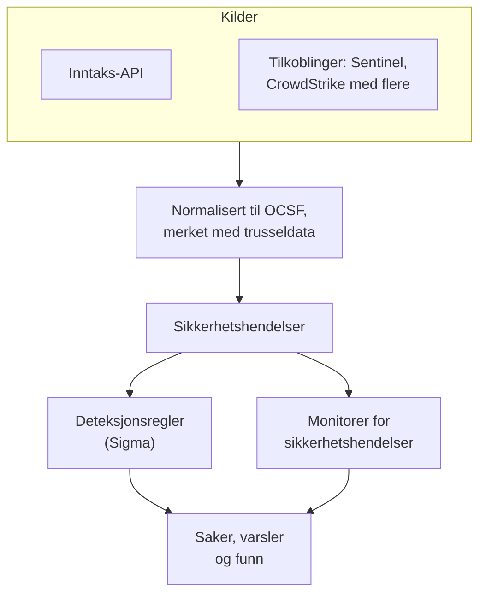
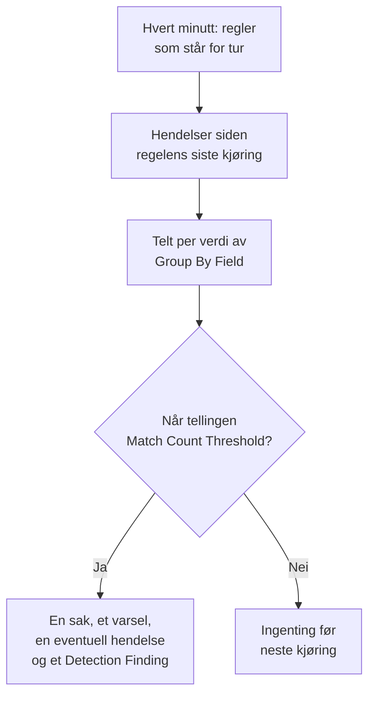

# Sikkerhetshendelser (SIEM)

OneUptime lagrer sikkerhetshendelser ved siden av loggene, trasene og metrikkene dine, og gir alle samme form, [OCSF](https://schema.ocsf.io/) (Open Cybersecurity Schema Framework), uansett hvilket format de kom i. Send hendelser fra hvilken som helst kilde, søk i dem, og finn de viktige med Sigma-deteksjonsregler, trusseletterretning og monitorer. Det de finner, blir [saker](/docs/telemetry/security-cases) som skal behandles, og playbooks reagerer på dem.

:::cards
- [Send hendelser](#send-sikkerhetshendelser): En HTTPS-POST, en Fluent Bit-utgang eller en tilkobling til et sikkerhetsprodukt.
- [Søk og korreler](#utforsk-sikkerhetshendelser): Hendelsesutforskeren og korrelasjonsgrafen.
- [Deteksjonsregler](#deteksjonsregler): Sigma-regler som åpner saker og varsler.
- [Monitorer](#monitorer-for-sikkerhetshendelser): Tellinger over et glidende vindu, med en status som hentes inn igjen.
:::

## Slik fungerer det



Åpne **Produkter → Security Events**, under **Observerbarhet**. Menyen har en seksjon for hver del av sikkerheten, og en egen side for hver ting i den:

| Side | Seksjon | Hva den er til |
| --- | --- | --- |
| **Oversikt** | Oversikt | Hvordan sikkerhet er satt opp, hva som trenger noen nå, og hvor raskt saker blir behandlet |
| **Åpne saker** | Sikkerhetssaker | Køen: hver sak som ikke er lukket ennå, gruppert etter hva den gjelder |
| **Tildelt meg** | Sikkerhetssaker | De åpne sakene som er tildelt deg |
| **Ikke tildelt** | Sikkerhetssaker | De åpne sakene ingen har tatt |
| **Lukkede saker** | Sikkerhetssaker | Sakene som er lukket med en vurdering, de nyeste først |
| **Alle saker** | Sikkerhetssaker | Hver sak, åpen eller lukket |
| **Hendelser** | Hendelser | Søk i og filtrer alle hendelser, og åpne en for å se alle feltene |
| **Entiteter** | Hendelser | Brukerne, vertene og adressene som funnene dine nevner oftest |
| **Entitetsrisiko** | Hendelser | Hver bruker, vert og adresse, vurdert etter hva som er funnet om den denne uken, de mest risikable først |
| **Korreler** | Hendelser | En graf over hendelsene som deler en vert, en bruker eller en IP-adresse |
| **Deteksjonsregler** | Detections | Sigma-regler som kjører etter en tidsplan og åpner saker |
| **Regelbibliotek** | Detections | Ferdige deteksjonsregler å legge til, hver med hendelsene den leser og om de kommer inn, med de anbefalte merket |
| **Trusselsinformasjon** | Detections | STIX/TAXII-feeder med kjente ondsinnede indikatorer |
| **ATT&CK-dekning** | Detections | MITRE ATT&CK-teknikkene som reglene dine dekker |
| **Playbooks** | Playbooks | Steg som kjører på saker, av seg selv eller manuelt |
| **Godkjenninger** | Playbooks | Playbook-stegene som venter på at noen godkjenner eller avviser dem |
| **Playbook-kjøringer** | Playbooks | Hva hver playbook gjorde, steg for steg |
| **Beskyttede entiteter** | Playbooks | Brukerne og vertene som ingen playbook demmer inn |
| **Innstillinger** | KI | Om OneUptime AI vurderer hver nye sak |
| **Tilkoblinger** | Connections | Loggene dine, sikkerhetsproduktene OneUptime henter fra, og SIEM-ene det sender til |
| **Oppsettveiledning** | Connections | Kodesnutter for å sende hendelser, fylt ut med ingestion-nøkkelen din |
| **Saksprioriteter** | Innstillinger | Hvor mye en sak haster: prosjektets egne prioriteter, den som haster mest først |
| **Saksstatuser** | Innstillinger | Trinnene en sak går gjennom, og hva en sak i hvert trinn teller som |
| **Risikovurdering** | Innstillinger | Om risikoen for en entitet åpner en sak, ved hvilken risiko, og hvor mye hver entitet betyr |

**Deteksjoner**, **KI**, **Tilkoblinger** og **Innstillinger**, som settes opp én gang, er slått sammen til du åpner dem. Ny med sikkerhet? [Kom i gang med sikkerhet](/docs/telemetry/security-getting-started) setter det opp med to klikk.

## Før du begynner

Sikkerhetsdata kan bare leses av rollene Project Owner og Project Admin og av de tre Security-rollene; andre roller ser ingenting i Security Events. Se [Roller](/docs/permissions/reference#roller).

| Rolle | Hva den kan gjøre |
| --- | --- |
| Security Admin | Alt: hendelser, saker, playbooks, deteksjonsregler, threat intel-feeder og tilkoblinger |
| Security Member | Lese hendelser og threat intel, behandle saker, kjøre playbooks og godkjenne stegene deres, og opprette, endre og slette deteksjonsregler og feeder. Den kan ikke sette opp playbooks eller tilkoblinger, eller slette sikkerhetsdata. |
| Security Viewer | Lese hendelser, saker, playbooks, regler, feeder, indikatorer og tilkoblinger |

## Send sikkerhetshendelser

:::steps
### Opprett en ingestion-nøkkel

Åpne **Prosjektinnstillinger → Telemetri og APM → Inntaksnøkler**, og klikk på **Opprett ingestion-nøkkel**. Sikkerhetshendelser bruker de samme nøklene som resten av telemetrien din.

### Send hendelsene dine

Send JSON til `/security-events/v1/ingest` med nøkkelen i `x-oneuptime-token`:

:::tabs
@tab OCSF
```bash
curl -X POST "https://oneuptime.com/security-events/v1/ingest?format=ocsf" \
  -H "Content-Type: application/json" \
  -H "x-oneuptime-token: YOUR_INGESTION_TOKEN" \
  -H "x-oneuptime-service-name: my-security-source" \
  -d '{ "events": [ { "class_uid": 3002, "severity_id": 4, "status": "Failure", "message": "Failed logon for alice", "actor": { "user": { "name": "alice" } }, "src_endpoint": { "ip": "203.0.113.7", "hostname": "laptop-alice" } } ] }'
```
@tab Google UDM
```bash
curl -X POST "https://oneuptime.com/security-events/v1/ingest?format=udm" \
  -H "Content-Type: application/json" \
  -H "x-oneuptime-token: YOUR_INGESTION_TOKEN" \
  -d '{ "events": [ { "metadata": { "event_type": "USER_LOGIN" }, "principal": { "hostname": "laptop-alice", "user": { "userid": "alice" }, "ip": ["203.0.113.7"] }, "security_result": [{ "severity": "HIGH", "action": ["BLOCK"] }] } ] }'
```
@tab Generic JSON
```bash
curl -X POST "https://oneuptime.com/security-events/v1/ingest" \
  -H "Content-Type: application/json" \
  -H "x-oneuptime-token: YOUR_INGESTION_TOKEN" \
  -d '{ "events": [ { "severity": "high", "event_type": "ssh_brute_force", "message": "12 failed SSH logins in 60s", "username": "root", "hostname": "web-01", "src_ip": "203.0.113.7" } ] }'
```
:::

Endepunktet svarer `200` så snart hendelsene står i kø. En hendelse sendt uten tidspunkt, som disse, plasseres i øyeblikket den kommer inn.

### Finn dem under Hendelser

Åpne **Produkter → Security Events → Hendelser**. Hendelsene vises i løpet av noen sekunder, med alvorlighetsgrad, klasse, bruker, vert og IP-adresser fylt ut.
:::

### Formater

| `format` | Hva det leser | Godtas også |
| --- | --- | --- |
| `ocsf` | OCSF-hendelses-JSON (`class_uid`, `severity_id` og så videre) | Ingen |
| `udm` | UDM-hendelser fra Google SecOps (Chronicle) (`metadata.event_type` og så videre) | `chronicle`, `google-secops` |
| `google-secops-alert` | Deteksjoner og varsler fra Google SecOps: SOAR-webhooks og deteksjonsstrømmen | `secops-alert`, `detection` |
| `generic` | All annen JSON, lest ut fra vanlige feltnavn | Ingen |

Angi formatet med `?format=`, med hodet `x-oneuptime-security-event-format` eller med et felt `"format"` på øverste nivå. Utelater du det, bestemmes formatet for hver hendelse for seg, så én webhook kan blande deteksjoner med rå hendelser.

- Body kan være én hendelse, en matrise av hendelser eller `{ "events": [...] }`.
- Hodet `x-oneuptime-service-name` angir telemetritjenesten hendelsene hører til. Uten det hører de til tjenesten som er oppkalt etter produktet eller leverandøren til den første hendelsen, eller til `Security Events`.
- Ingenting forkastes fordi det ikke lot seg tilordne: hvert felt fra kilden havner i hendelsens attributter.

### Felt i generisk JSON

En generisk hendelse leses ut fra vanlige feltnavn:

| Hendelsens felt | Leses fra det første av |
| --- | --- |
| `message` | `message`, `msg`, `summary`, `description`, `title` |
| `severityName` | `severity`, `severity_name`, `level`, `priority`, `risk_level` |
| `time` | `timestamp`, `time`, `@timestamp`, `event_time`, `created_at` |
| `principalUser` | `user`, `username`, `user_name`, `account`, `actor` |
| `principalHost` | `host`, `hostname`, `computer`, `device`, `machine` |
| `principalIp` | `source_ip`, `src_ip`, `client_ip`, `ip` |
| `targetIp` | `destination_ip`, `dest_ip`, `dst_ip`, `target_ip` |
| `className` | `event_type`, `category`, `type`, `action` |
| `ruleName` | `rule`, `rule_name`, `signature`, `detection` |
| `productName` | `product`, `product_name`, `source`, `log_source` |
| `processName` | `process_name`, `process.name`, `proc.name`, `comm` |
| `processPath` | `process_path`, `Image`, `NewProcessName`, `exe`, `process.executable` |
| `processCommandLine` | `command_line`, `CommandLine`, `cmdline`, `process.command_line`, `proc.cmdline`, `process` |
| `parentProcessName` | `parent_process_name`, `process.parent.name`, `proc.pname` |
| `parentProcessPath` | `parent_process_path`, `ParentImage`, `ParentProcessName`, `process.parent.executable` |
| `parentProcessCommandLine` | `parent_command_line`, `ParentCommandLine`, `process.parent.command_line`, `proc.pcmdline` |

Et ord for alvorlighetsgrad blir et OCSF-nivå: `info` leses som Informational, `warning` som Low, `error` som Medium, `alert` som Critical og `emergency` som Fatal.

### Videresend med Fluent Bit

For å sende sikkerhetslogger du allerede samler inn, for eksempel auditd, syslog eller Falco, legger du til en `http`-utgang i Fluent Bit:

```ini title="fluent-bit.conf"
[OUTPUT]
    Name             http
    Match            security.*
    Host             oneuptime.com
    Port             443
    tls              On
    URI              /security-events/v1/ingest
    Format           json
    Json_date_key    timestamp
    Json_date_format iso8601
    Header           x-oneuptime-token YOUR_INGESTION_TOKEN
    Header           x-oneuptime-service-name my-security-source
    Retry_Limit      5
```

Siden **Oppsettveiledning**, under **Tilkoblinger**, har disse kodesnuttene med din egen vert og nøkkel fylt ut.

### Finn sikkerhetshendelser i loggene dine

Kortet **Loggene dine**, øverst på **Tilkoblinger**, gjør loggene du allerede sender til OneUptime, til en kilde. Med **Finn sikkerhetshendelser i loggene dine** slått på leses prosjektets nye logger hvert minutt, og hver SSH-pålogging, sudo-kommando, Kubernetes-revisjonsoppføring, AWS CloudTrail-endring og hvert webangrep i dem lagres som en sikkerhetshendelse. Se [Kom i gang med sikkerhet](/docs/telemetry/security-getting-started#finn-sikkerhetshendelser-i-loggene-dine) for hva hver type dekker.

### Koble til et sikkerhetsprodukt

**Tilkoblinger** henter data fra et sikkerhetsprodukt for deg og importerer de nye postene som sikkerhetshendelser. En tilkobling inneholder produktets innstillinger og en kryptert legitimasjon; en worker henter fra den med intervallet du angir, og hopper over poster den allerede har importert.

| Produkt | Importerer | Oppsettveiledning |
| --- | --- | --- |
| Google SecOps (Chronicle) | Regeldeteksjoner, kuraterte deteksjoner og varsler, som Detection Findings | [Google SecOps](/docs/integrations/google-secops) |
| Microsoft Sentinel | Hendelser (incidents), som Incident Findings | [Microsoft Sentinel](/docs/integrations/microsoft-sentinel) |
| Microsoft Defender XDR | Varsler, som Detection Findings | [Microsoft Defender XDR](/docs/integrations/microsoft-defender-xdr) |
| CrowdStrike Falcon | Varsler, som Detection Findings | [CrowdStrike Falcon](/docs/integrations/crowdstrike-falcon) |
| Splunk Enterprise Security | Notable events, eller hvilket som helst søk, som Detection Findings | [Splunk Enterprise Security](/docs/integrations/splunk) |
| Elastic Security | Deteksjonsvarsler, som Detection Findings | [Elastic Security](/docs/integrations/elastic-security) |
| AWS Security Hub | Findings, som Detection og Compliance Findings | [AWS Security Hub](/docs/integrations/aws-security-hub) |
| Okta System Log | Hendelser for pålogging, MFA, kontoer og policyer | [Okta System Log](/docs/integrations/okta) |

- Produktets egne varsler på eller over **Open Cases From** (**Høy og høyere** med mindre du velger et annet nivå, eller **Aldri**) åpner [saker](/docs/telemetry/security-cases), gruppert etter brukeren, verten eller adressen de gjelder.
- En tilkobling leser poster etter tidspunktet produktet opprettet dem, ikke etter tidspunktet for aktiviteten de beskriver. En SIEM-regel som kjører hver time, oppretter deteksjoner lenge etter hendelsene den traff, og de importeres likevel.
- Den første hentingen ser 24 timer tilbake, så en ny tilkobling viser nylige poster med en gang.
- **Test tilkoblingen**, i tilkoblingens rad, sjekker tilgangen til produktet og at OneUptimes egne workers kjører, og importerer ingenting. **Kjør nå** henter med en gang.

## Hva en hendelse inneholder

Hver hendelse lagres med typede felt og kildens nyttelast:

| Gruppe | Felt |
| --- | --- |
| Klassifisering | `categoryName`, `className`, `activityName`, `statusName`, med OCSF-ID-ene sine (`categoryUid`, `classUid`) |
| Alvorlighetsgrad | `severityName`, en av Unknown, Informational, Low, Medium, High, Critical, Fatal eller Other, og `severityId` |
| Hvem som gjorde det | `principalUser`, `principalHost`, `principalIp`, `principalProcess` |
| Hva det berørte | `targetUser`, `targetHost`, `targetIp`, `targetPort`, `targetResource` |
| Prosessen | `processName`, `processPath` og `processCommandLine`: ved prosessaktivitet prosessen som ble startet, åpnet, injisert i eller avsluttet, ellers prosessen som handlet. `parentProcessName`, `parentProcessPath` og `parentProcessCommandLine`: prosessen som startet den |
| Kilde | `productName`, `vendorName`, `ruleId`, `ruleName`, `eventUid` |
| Innhold | `message`, `mitreTactics`, `mitreTechniques` og `observables`: hver bruker, vert, IP-adresse, domene og hash hentet fra hendelsen |
| Attributter | Hele kildens nyttelast, flatet ut til nøkler med punktum |

Hendelser som ble lagret før OneUptime 14.0.84, lar prosessfeltene stå tomme og nevner bare prosessen sin som `principalProcess`, prosessen som handlet. De fylles ikke ut i etterkant: de beholder det de ble lagret med, til oppbevaringen deres går ut.

## Utforsk sikkerhetshendelser

**Hendelser** er en telemetriutforsker som utforskerne for logger og traser: et diagram over vinduets hendelser etter alvorlighetsgrad, et sidepanel med fasetter, listen, og et panel med hvert felt og attributt i hendelsen du åpner. Vinduet, filtrene og søket ligger alle i URL-en, så en filtrert visning kan deles og overlever en ny innlasting.

### Søk

Søkefeltet snakker samme språk som de andre telemetriutforskerne (se [Søkesyntaks](/docs/telemetry/search-syntax)):

| Syntaks | Betyr | Eksempel |
| --- | --- | --- |
| fritekst | Meldingen inneholder den | `failed logon` |
| `"quoted phrase"` | Hold ordene sammen | `"brute force"` |
| `<field>:<value>` | Et typet felt | `severity:Critical` |
| `@<attribute>:<value>` | Et kildeattributt | `@threat.matched:true` |
| `-<filter>` | Ikke dette | `-severity:Informational` |
| `<field>:(a OR b)` | Hvilken som helst av disse verdiene | `severity:(High OR Critical)` |
| `<field>:a*` | `*` er hvilken som helst tekst, `?` ett tegn | `host:web-*` |
| `@<attribute>:*` | Attributtet finnes | `@threat.indicator_id:*` |
| `@<attribute>:~text` | Attributtet inneholder teksten | `@finding_info.title:~ransom` |

Et felt er enten et kort navn (`severity`, `class`, `category`, `activity`, `status`, `vendor`, `product`, `rule`, `user`, `host`, `ip`, `targetuser`, `targethost`, `targetip`, `processname`, `commandline`, `parentprocessname`, `observable`, `tactic`, `technique`) eller feltets eget navn, for eksempel `severityName` eller `principalHost`. Alle andre navn leses som et kildeattributt. `observable:<value>` finner hver hendelse som nevner en verdi, uansett hvilken side av aktiviteten den var på.

### Fasetter

Sidepanelet teller vinduets hendelser etter **Kilde**, **Alvorlighetsgrad**, **Hendelsesklasse**, **Kategori**, **Aktivitet**, **Status**, **Leverandør**, **Produkt**, **Deteksjonsregel**, **Kildebruker**, **Kildevert**, **Prosess** og **Overordnet prosess**. Klikk på en verdi for å beholde bare hendelsene med den, eller på minustegnet ved siden av for å utelate dem. Klikk igjen for å angre. Diagrammet og hver telling beskriver nøyaktig hendelsene i listen.

### Korreler

**Korreler** tegner hendelsene rundt en vert, en bruker eller en IP-adresse: hendelsesklassene deres rundt det du søkte etter, merket med den verste alvorlighetsgraden, og de andre verdiene fra de samme hendelsene på den ytre ringen. Klikk på en klasse for å liste hendelsene i den, eller på en verdi for å korrelere på den neste gang. Hver observable i panelet til en hendelse under **Hendelser** åpner **Korreler** på den.

## Deteksjonsregler

En deteksjonsregel er en [Sigma](https://sigmahq.io/)-regel, et åpent YAML-format for å beskrive mistenkelig aktivitet, som OneUptime kjører etter en tidsplan mot hendelsene dine. Når den treffer, åpner den en [sak](/docs/telemetry/security-cases) eller legger treffet til i en åpen sak, åpner et varsel, eventuelt en hendelse (incident), og skriver et Detection Finding tilbake blant sikkerhetshendelsene. **Regelbibliotek** har ferdige regler å starte fra.



### Opprett en regel

:::steps
1. Åpne **Produkter → Security Events → Deteksjoner → Deteksjonsregler**, og klikk på **Opprett Deteksjonsregel**.
2. Lim inn regelens YAML i **Sigma-regel (YAML)** under **Sigma-regel**. Den tolkes når du lagrer, så en feil vises i skjemaet.
3. **Navn** fylles inn fra regelens `title`: skriv over det for å kalle regelen noe annet. En ny regel kjører; **Aktivert** står i redigeringsskjemaet.
4. La **Åpne en sak ved treff** stå på under **Ved treff** for å samle treffene i saker, etter verdien regelen grupperer etter.
5. Velg under **Varsler og hendelser** hva et treff ellers skal utløse: **Opprett et varsel** (standard), **Erklær en hendelse**, **Begge** eller **Ingen av dem**, med valgfri **Varselsalvor** eller **Hendelsesalvor**.
6. **Flere felt** har **Beskrivelse**, **Skriv Detection Finding ved treff** (på) og hvordan treff telles; se [Evalueringsinnstillinger](#evalueringsinnstillinger).
:::

En første regel, som treffer mislykkede pålogginger fra utenfor `10.x.x.x`:

```yaml title="failed-logon-burst.yml"
title: Failed logon burst
description: Repeated authentication failures from one source.
level: high
tags:
  - attack.t1110
  - attack.ta0006
detection:
  selection:
    className: Authentication
    statusName: Failure
  filter_internal:
    principalIp|startswith: '10.'
  condition: selection and not filter_internal
```

### Hva en regel kan uttrykke

OneUptime kjører den boolske kjernen i Sigma:

- Seleksjoner er feltkart (hvert felt må treffe; en liste med verdier treffer hvilken som helst av dem) eller nøkkelordlister, som treffer hvor som helst i meldingen.
- Betingelser kombinerer seleksjoner med `and`, `or`, `not` og parenteser, eller med `1 of selection_*`, `all of selection_*`, `any of them` og `all of them`.
- Feltmodifikatorer: `contains`, `startswith`, `endswith`, `all`, `re`, `cased`, `gt`, `gte`, `lt`, `lte`, `cidr`, `exists` og `windash`. Tekst sammenlignes uten hensyn til store og små bokstaver, med mindre du legger til `cased`.
- Et felt er et typet felt (`principalUser`), en vanlig Sigma-skrivemåte av et (`CommandLine`, `src_ip`, `Hostname`), eller hvilken som helst attributtnøkkel, skrevet slik den er i hendelsen (`threat.matched`).
- `Image` og `CommandLine` leser prosessen hendelsen handler om, ved en prosessoppstart den som startet (`processPath`, `processCommandLine`), og `ParentImage` og `ParentCommandLine` prosessen som startet den (`parentProcessPath`, `parentProcessCommandLine`). `principalProcess` er prosessen som handlet, som ved en oppstart er den overordnede.
- `level` angir alvorlighetsgraden: `informational`, `low`, `medium`, `high` eller `critical`, og `medium` når den mangler. ATT&CK-ID-er i `tags` (`attack.t1110`, `attack.ta0006`) fyller ut funnets MITRE-felt.

Aggregeringer som `| count() by principalIp > 5` avvises når du lagrer: bruk en [korrelasjonsregel](#korrelasjonsregler), eller **Grupperingsfelt** og **Terskel for antall treff**, i stedet. `logsource` er bare informativ og snevrer ikke inn noe: legg det filteret i en seleksjon, for eksempel `className: Authentication`. En `timeframe` ignoreres, fordi regelens intervall bestemmer vinduet.

### Korrelasjonsregler

En [Sigma-korrelasjon](https://sigmahq.io/docs/meta/correlations.html) utløses av flere hendelser sammen i stedet for én. Lim den inn i **Sigma-regel (YAML)** sammen med reglene den leser, som YAML-dokumenter atskilt med `---`, eller navngi regler prosjektet allerede har, med Sigma-`name` eller -`id`. **Regelbibliotek** har ferdige, for eksempel mislykkede pålogginger fulgt av en vellykket.

| Type | Utløses når | Vises som |
| --- | --- | --- |
| `event_count` | Én gruppe når et antall hendelser innenfor `timespan` | Antall hendelser |
| `value_count` | Én gruppe viser et antall ulike verdier av et felt innenfor `timespan` | Ulike verdier |
| `temporal` | Hver regel treffer for den samme gruppen innenfor `timespan`, i vilkårlig rekkefølge | Hendelser sammen |
| `temporal_ordered` | Reglene treffer i sin rekkefølge for den samme gruppen innenfor `timespan` | Sequence |
| `new_value` | En gruppe viser en verdi av et felt den ikke har vist innenfor `timespan` | First seen |

```yaml title="failed-then-success.yml"
title: Failed sign-ins, then a success from the same address
level: high
correlation:
  type: temporal_ordered
  rules:
    - failed_sign_ins
    - successful_sign_in
  group-by:
    - principalIp
  timespan: 10m
---
title: Five failed sign-ins
name: failed_sign_ins
correlation:
  type: event_count
  rules:
    - failed_sign_in
  group-by:
    - principalIp
  timespan: 10m
  condition:
    gte: 5
---
title: Failed sign-in
name: failed_sign_in
detection:
  selection:
    className: Authentication
    statusName: Failure
  condition: selection
---
title: Successful sign-in
name: successful_sign_in
detection:
  selection:
    className: Authentication
    statusName: Success
  condition: selection
```

- En gruppe er verdien av feltene i `group-by`, for eksempel én adresse. Tellinger er rullerende: et utbrudd som to kjøringer deler, telles likevel helt innenfor sitt `timespan`, som er høyst 24 timer.
- `new_value` er OneUptimes egen type, siden Sigma ikke har noen korrelasjon for "sett første gang": den sammenligner med opptil 30 dagers historikk. `value_sum`, `value_avg`, `value_percentile` og `value_median` avvises når du lagrer.
- Kolonnen **Type** i **Deteksjonsregler** viser hver regels type, og skjemaet sier i én setning hva regelen ser etter.

### Evalueringsinnstillinger

| Felt | Hva det gjør |
| --- | --- |
| **Evalueringsintervall (minutter)** | Hvor ofte regelen kjører: hele minutter, 1 til 1440. Skjemaet for en ny regel starter på 5. |
| **Grupperingsfelt** | Valgfritt. Treff som deler dette feltets verdi, for eksempel `principalHost`, telles, varsles og dedupliseres samlet: ett varsel per vert i stedet for hundrevis. |
| **Felt for unik telling** | Valgfritt. Tell de ulike verdiene i dette feltet i stedet for hendelsene som treffer. Tomme verdier telles ikke. |
| **Terskel for antall treff** | En gruppe slår bare til når tellingen når dette tallet innenfor én kjøring: 1 til 1000000, og 1 slår til på hvert treff. |

Group By og Distinct Count tar de samme feltnavnene som regelen. Med dem sier terskelen «så mange, fra den samme tingen, i én kjøring», uten en monitor på toppen:

| Mål | Group By Field | Distinct Count Field | Terskel |
| --- | --- | --- | --- |
| Varsle på hvert treff | Tomt | Tomt | 1 |
| Ett varsel per vert | `principalHost` | Tomt | 1 |
| Brute force: 5 mislykkede pålogginger fra én IP | `principalIp` | Tomt | 5 |
| Password spraying: én IP som feiler mot 5 ulike kontoer | `principalIp` | `principalUser` | 5 |
| Portskanning: én IP som når 20 ulike porter | `principalIp` | `targetPort` | 20 |

### Når en regel kjører

OneUptime sjekker hvert minutt etter aktiverte regler der intervallet har gått siden forrige kjøring. Hver kjøring leser hendelsene der hendelsestidspunktet ligger mellom forrige kjøring og for to minutter siden, og går deretter videre. De to minuttene gir rom for hendelser som fortsatt er på vei, for eksempel en logglinje som leses et minutt etter at den ble skrevet:

- Vinduene ligger etter hverandre og glir ikke. Med et intervall på 10 minutter kan feil kl. 09:58 og 10:01 havne i ulike kjøringer og telles hver for seg, så legg inn margin når du velger en terskel.
- Etter et opphold, for eksempel et worker-avbrudd eller en regel som er slått på igjen, dekker neste kjøring hele oppholdet, opptil de siste 24 timene.
- En hendelse som kommer mer enn to minutter for sent, etter at en kjøring har dekket tidspunktet, lagres og er søkbar, men den regelen leser den aldri.
- Hver gruppe som når terskelen, blir et Detection Finding, opptil 10 000 per kjøring. Varsler, hendelser og saker åpnes for de 100 med høyest telling; resten deler én sak om regelen, og regelens **Siste feil** sier hvor mange grupper som traff.

### Alvorlighetsgrad

Regelens `level` er alvorlighetsgraden til funnene: `informational`, `low`, `medium`, `high` og `critical` blir Informational, Low, Medium, High og Critical. Varslene og hendelsene (incidents) får en av prosjektets alvorlighetsgrader, i denne rekkefølgen:

1. Regelens **Varselsalvor** (eller **Hendelsesalvor**), når den er angitt.
2. Alvorlighetsgraden din som er oppkalt etter nivået, for eksempel High, uansett store og små bokstaver.
3. Etter rang: regler med `critical` og `high` får den alvorligste alvorlighetsgraden din, de andre den minst alvorlige.

> [!TIP]
> Gi varselalvorlighetsgradene dine navn etter Sigma-nivåene (Critical, High, Medium, Low, Informational), så havner hver regel på den riktige uten en innstilling per regel.

### Varsler og funn

Hver gruppe som slår til, åpner et varsel med tittelen `[Detection] <rule name> — <group value>`, eller `[Detection] <rule name>` for en regel uten Group By Field. Så lenge det er åpent, åpner nye treff for den gruppen ikke et nytt. En regel ser bare treff og kan ikke se at et angrep har stoppet, så varslene forblir åpne til noen løser dem.

Et Detection Finding er en sikkerhetshendelse av klassen `Detection Finding` (OCSF-klasse 2004) fra produktet `OneUptime Detections`, med regelens MITRE-tagger, gruppeverdien først i `observables`, og disse attributtene:

| Attributt | Verdi |
| --- | --- |
| `oneuptime.detection.rule_id` | ID-en til regelen som slo til |
| `oneuptime.detection.rule_name` | Regelens navn |
| `oneuptime.detection.match_count` | Hvor mange hendelser som ligger bak funnet |
| `oneuptime.detection.distinct_count` | Hvor mange ulike verdier som ligger bak det, for en regel med et Distinct Count Field |
| `oneuptime.detection.group_value` | Gruppens verdi, for en regel med et Group By Field |
| `oneuptime.detection.sigma_id` | Sigma-regelens egen `id` |

Funn er vanlige hendelser: søk etter dem under **Hendelser** og pivoter på dem i **Korreler**. For å prøve ut en ny regel i det stille slår du av alle handlinger unntatt funnet til du stoler på den.

## Monitorer for sikkerhetshendelser

En monitor for sikkerhetshendelser teller hendelsene som treffer filtrene, over et glidende vindu, og kjører de vanlige monitorkriteriene på tellingen: den endrer monitorens status, åpner varsler eller hendelser (incidents), og varsler vakthavende. Opprett en under **Overvåkere → Opprett monitor**, med **Sikkerhetshendelser** som type; den vises der sammen med de andre monitorene dine.

Skjemaet viser **Monitor events that include this text**, **Monitor Security Events for (time)**, **Event Severity** og **Hendelsesklasse**. **Filtrer etter telemetritjeneste** og **Filtrer etter attributter** venter under **Flere felt**, der overskriften viser hvilke en monitor bruker. Kriteriene sjekker **Security Event Count**.

| | Deteksjonsregel | Monitor for sikkerhetshendelser |
| --- | --- | --- |
| Treffer | En Sigma-regel | Filtre på alvorlighetsgrad, klasse, melding, tjeneste og attributter |
| Vindu | Etter hverandre, ett per kjøring | Glidende: de siste 5 sekundene til 24 timer |
| Teller per gruppe | Ja, med **Grupperingsfelt** | Nei: én telling for alt som treffer |
| Åpner | Varsler, hendelser (incidents) og funn | En status, varsler og hendelser (incidents) |
| Hentes inn igjen | Nei: varsler forblir åpne til de løses | Ja: statusen går tilbake når tellingen gjør det |

Skriv selve deteksjonen som en regel, med terskelen sin. Bruk en monitor når du vil ha et glidende vindu, en status som hentes inn igjen av seg selv, en statusside eller ulike vaktpolicyer per kriterium.

### Følg med på deteksjonene dine

Funn er hendelser, så en monitor kan følge med på selve reglene:

- Stormer: en monitor på klassen `Detection Finding`, som teller hvert funn. Tjue ulike regler som slår til i løpet av en time, er et signal ingen enkeltregel kan se.
- Endringer i takt: filtrer på `oneuptime.detection.rule_id` for én regel. En regel som slår til ukentlig og plutselig slår til femti ganger i timen, trenger en annen respons.
- Stillhet: funn som faller til null når du vanligvis ser noen få, betyr som regel at en kilde har sluttet å sende. Bruk et kriterium som sjekker for en telling under et tall.

Handlingen **Opprett monitor** i raden til en regel åpner en ny monitor som allerede er satt opp slik: klassen `Detection Finding`, regelens ID (aldri navnet, som et nytt navn ville endre), og den siste timen. En slik monitor teller funn, ett per gruppe per kjøring, ikke hendelsene bak dem. For å kreve et antall hendelser før noe slår til, bruker du regelens **Terskel for antall treff**.

## Trusseletterretning

**Trusselsinformasjon** abonnerer på STIX/TAXII-feeder med kjente ondsinnede IP-adresser, domener, URL-er, e-postadresser og filhasher. Hendelser som nevner en av dem, merkes med `threat.*`-attributter når de kommer inn, som regler og monitorer kan filtrere på, og hvert minutt sammenlignes nylige hendelser med feedene, noe som åpner varsler og funn slik en regel gjør. Se [Trusseletterretning](/docs/telemetry/threat-intelligence).

## Oppbevaring og fakturering

Sikkerhetshendelser faktureres per GB som tas inn, som resten av telemetrien din, og oppbevares i telemetriens oppbevaringstid: prosjektets **Standard oppbevaring (dager)**, under **Prosjektinnstillinger → Telemetri og APM → Dataoppbevaring**, eller en oppbevaringstid som er angitt på telemetritjenesten de hører til. Når oppbevaringstiden for en hendelse er ute, slettes den.

## Feilsøking

:::details Hendelsene vises ikke
Sjekk nøkkelen i `x-oneuptime-token` og stien, `/security-events/v1/ingest`. Sjekk deretter vinduet under **Hendelser**, det siste døgnet med mindre du endrer det: en hendelse plasseres på sitt eget tidspunkt, så en med et eldre tidsstempel faller utenfor.
:::

:::details En regel treffer aldri
Sjekk **Status**: med **Deaktivert** kjører ikke regelen, og med **Kjøring mislyktes** viser **Vis feil** i raden hvorfor. Åpne en hendelse du forventet at skulle treffe, og sammenlign den med regelen, felt for felt: en vanlig verdi må være lik hele feltet, så bruk `contains` eller `*` for en del av et felt. Et attributt navngis slik det er i hendelsen (`threat.matched`, ikke `attributes.threat.matched`). Med en terskel over 1 må treffene falle innenfor én kjøring.
:::

:::details En regel traff, men ingen varsler ble åpnet
**Varsler og hendelser** står på **Erklær en hendelse** eller **Ingen av dem**, eller et varsel for den samme regelen og gruppeverdien er fortsatt åpent, og senere treff legges inn i det. Et prosjekt må ha minst én varselalvorlighetsgrad for at regler skal kunne åpne varsler.
:::

:::details En regel åpner for mange varsler
Hver verdi av **Grupperingsfelt** får sitt eget varsel: grupper etter noe grovere, hev terskelen, eller legg til et Distinct Count Field. Bryr du deg om takten og ikke om hvert treff, setter du **Varsler og hendelser** til **Ingen av dem** og setter en monitor på regelens funn.
:::

## Neste steg

:::cards
- [Trusseletterretning](/docs/telemetry/threat-intelligence): Sammenlign hendelsene dine med STIX/TAXII-feeder.
- [Sikkerhetssaker og playbooks](/docs/telemetry/security-cases): Behandle det reglene dine finner, og reager med playbooks.
- [Google SecOps](/docs/integrations/google-secops): Hent inn deteksjonene og hendelsene fra Chronicle.
- [Søkesyntaks](/docs/telemetry/search-syntax): Alt søkefeltet forstår.
- [Tillatelsesreferanse](/docs/permissions/reference): Security-rollene, og hva hver av dem kan gjøre.
:::
