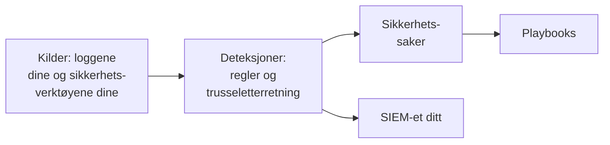

# Kom i gang med sikkerhet

OneUptime finner trusler i data du allerede har - loggene dine, sikkerhetsverktøyene du bruker og alt du sender det -, samler funnene i saker og svarer med playbooks. To klikk setter det opp, og det er ingenting å installere.

:::cards
- [Sett det opp](#sett-det-opp): Slå på det de fleste team trenger, og se et testangrep åpne en sak.
- [Slik fungerer det](#slik-fungerer-det): Kilder, deteksjoner, saker og playbooks, og hva hver av dem gjør.
- [Loggene dine](#finn-sikkerhetshendelser-i-loggene-dine): Sikkerhetshendelsene som allerede ligger i loggene du sender til OneUptime.
- [SIEM-et ditt](#send-det-oneuptime-finner-til-siem-et-ditt): Send det OneUptime finner til Google SecOps.
:::

## Før du begynner

Det kreves rollen Project Owner, Project Admin eller Security Admin for å sette opp sikkerhet. Rollene Security Member og Security Viewer leser det som blir funnet; se [Roller](/docs/permissions/reference#roller).

## Sett det opp

:::steps
### Slå på det de fleste team trenger

Åpne **Produkter → Security Events**. Klikk på **Slå på anbefalt** på **Oversikt**. Det slår på tre ting samtidig: **Finn sikkerhetshendelser i loggene dine**, de anbefalte deteksjonsreglene og **Enrich New Cases**, en playbook som sjekker hver nye sak mot trusseletterretning og legger igjen en sjekkliste for triage på den.

### Send et testangrep

Klikk på **Send et testangrep**. Et dusin mislykkede pålogginger fra én dokumentasjonsadresse går gjennom den virkelige behandlingen: De lagres, brute force-regelen fanger dem, og en sak åpnes. Ingen blir varslet, og ingen SIEM mottar dem.

### Åpne saken

Klikk på **Åpne saken**. Slik ser et ekte funn ut: hendelsene bak det, adressen det gjelder, og hva **Enrich New Cases** fant. Lukk den som en test når du er ferdig.
:::

Deretter åpner **Oversikt** på det som trenger noen, under **Krever oppmerksomhet**: de åpne sakene dine, de ingen har tatt, og playbook-trinnene som venter på en godkjenning. Når det ikke er noen, står det **Alt er rolig**.

## Slik fungerer det

| Del | Hvor | Hva den gjør |
| --- | --- | --- |
| **Kilder** | **Connections** | Loggene dine, sikkerhetsproduktene OneUptime henter fra, og alt du sender |
| **Detections** | **Detections** | Sigma-regler og feeder med trusseletterretning som ser etter trusler i hver hendelse |
| **Sikkerhetssaker** | **Sikkerhetssaker** | Det som ble funnet, gruppert etter brukeren, verten eller adressen det gjelder |
| **Playbooks** | **Playbooks** | Trinn som kjører på nye saker: beriker dem, varsler, åpner en hendelse eller demmer inn |

Øverst på **Oversikt**, under det som trenger noen, viser hver del tallene sine: kildene og hendelsene deres de siste 24 timene, reglene som er slått på, de åpne sakene og playbookene som svarer. En del som ikke er satt opp, sier det og åpner siden der du setter den opp.

## Finn sikkerhetshendelser i loggene dine

Kortet **Loggene dine**, øverst på **Connections**, trenger ingen installasjon. Med **Finn sikkerhetshendelser i loggene dine** slått på leser OneUptime prosjektets nye logger hvert minutt og gjør linjene det kjenner igjen til sikkerhetshendelser:

| Logger | Hva som blir en sikkerhetshendelse |
| --- | --- |
| SSH-pålogginger | Mislykkede og vellykkede SSH-pålogginger fra en servers auth-logg, journal eller syslog |
| sudo | Kommandoer kjørt som en annen bruker, feil sudo-passord og personer som ikke får bruke sudo |
| Kubernetes-revisjonslogger | Endringer i klyngen, skall åpnet i pods, leste hemmeligheter og avviste forespørsler |
| AWS CloudTrail | Pålogginger til konsollen, endringer i AWS-kontoene dine og kall som AWS avviste |
| Webangrep | Forespørsler i en webservers tilgangslogg som prøver SQL-injeksjon, path traversal eller Log4Shell |

Loggene dine forblir som de er. Bare linjene som betyr noe for sikkerheten, blir hendelser: aldri hver side en webserver har levert, eller hver lesing av et API.

## Send det OneUptime finner til SIEM-et ditt

Jobber teamet ditt allerede i et SIEM, sender OneUptime funnene sine dit også. Klikk på **Legg til mål** under **Connections → Send til SIEM-et ditt**, fyll inn region, instans og tjenestekontonøkkel for Google SecOps-instansen din, og klikk på **Send en testhendelse** før du lagrer. Se [Send sikkerhetshendelser til Google SecOps](/docs/integrations/google-secops#send-sikkerhetshendelser-til-google-secops).

## Feilsøking

:::details Turn on recommended er nedtonet
Rollen din kan ikke legge til deteksjonsregler, playbooks eller loggkilden. Spør en Project Owner, en Project Admin eller en Security Admin, eller be dem gi deg rollen Security Admin.
:::

:::details Turn on recommended kunne ikke slå på alt
Kortet nevner alt det ikke kunne slå på, og hvorfor: rollen din, planen din eller en feil hos OneUptime. Alt annet er slått på. Rett det kortet nevner, og klikk deretter på **Prøv igjen**: bare det som fortsatt mangler, slås på, og ingenting legges til to ganger.
:::

:::details Testangrepet åpnet ingen sak
Saken åpnes som regel før knappen svarer; når regelen fortsatt henger etter, sier den fra, og saken åpnes innen et minutt. Se under **Sikkerhetssaker** igjen, og sjekk under **Detections** at brute force-regelen er slått på.
:::

:::details Det kommer ingen sikkerhetshendelse fra loggene mine
Sjekk at **Finn sikkerhetshendelser i loggene dine** er slått på, og at kortet **Loggene dine** viser når det sist ble sjekket. Bare typene linjer i tabellen over blir hendelser: En server som ikke sender SSH-, sudo-, revisjons-, CloudTrail- eller tilgangslogger, har ingenting å finne.
:::

:::details Oversikt sier at den siste sikkerhetshendelsen kom for dager siden
Ingenting har nådd Security siden da. Åpne **Connections**, og sjekk at **Loggene dine** og hver tilkobling fortsatt er slått på, og når hver sist sjekket.
:::

:::details Kortet som slår på Security, er borte
Noen lukket det med **Lukk**. Så lenge ingenting overvåkes for trusler ennå, tilbyr **Oversikt** **Sett opp Security**, som henter det tilbake.
:::

## Neste steg

:::cards
- [Sikkerhetshendelser (SIEM)](/docs/telemetry/security-events): Send hendelser, søk i dem og skriv deteksjonsregler.
- [Sikkerhetssaker og playbooks (SOAR)](/docs/telemetry/security-cases): Behandle sakene og svare med playbooks.
- [Trusseletterretning (STIX/TAXII)](/docs/telemetry/threat-intelligence): Sammenlign hendelsene dine med kjente ondsinnede indikatorer.
- [Google SecOps](/docs/integrations/google-secops): Hent inn deteksjoner fra Google SecOps, og send det OneUptime finner dit.
:::
