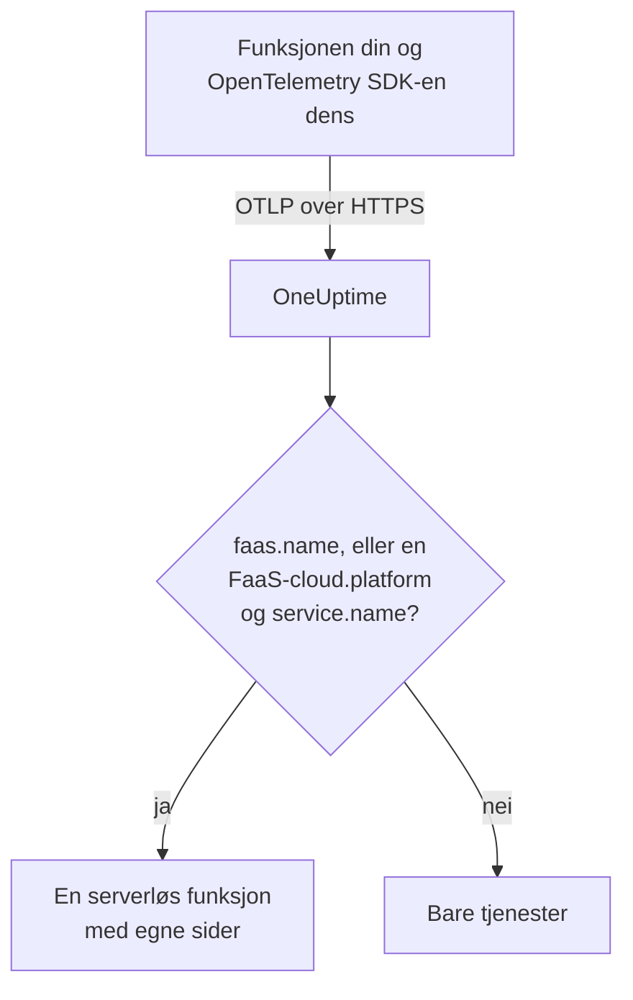

# Serverløse funksjoner

OneUptime gjenkjenner en serverløs funksjon i det øyeblikket den mottar OpenTelemetry-data fra den, og viser den under **Serverløse funksjoner** med sporene, loggene og metrikkene dens. Det fungerer for AWS Lambda, Google Cloud Functions, Azure Functions, Cloudflare Workers og alle andre FaaS-kjøretider som kan sende OpenTelemetry. Det er ingenting å opprette for hånd: instrumenter funksjonen med OpenTelemetry SDK-en for kjøretiden dens, og rett OTLP-eksportøren dens mot OneUptime.

:::cards
- [Slik identifiserer OneUptime en funksjon](#slik-identifiserer-oneuptime-en-funksjon): `faas.name`, eller en FaaS-`cloud.platform` med et `service.name`.
- [Send telemetrien til en funksjon](#send-telemetrien-til-en-funksjon): Eksportørinnstillingene og Lambda-laget.
- [Azure Functions](#azure-functions): Én funksjon per Function App, fra Functions-verten.
- [Feilsøking](#feilsøking): En funksjon som ikke dukker opp, eller som har tomme sider.
:::

## Slik fungerer det

OneUptime leser ressursattributtene i hver batch etter hvert som den kommer inn. En ressurs med et `faas.name`, eller med en FaaS-`cloud.platform` som `aws_lambda` eller `azure_functions` sammen med et `service.name`, er en serverløs funksjon: OneUptime oppretter den med de første dataene og arkiverer telemetrien under den.



## Før du begynner

- En inntaksnøkkel. Opprett en under **Prosjektinnstillinger → Telemetri og APM → Inntaksnøkler** og kopier verdien.
- OpenTelemetry SDK-en, eller et autoinstrumenteringslag, for språket til funksjonen din.

## Slik identifiserer OneUptime en funksjon

OneUptime identifiserer hver funksjon ut fra ressursattributtet `faas.name`. Ressursdetektorene på noen plattformer setter det aldri ([Azure Functions](#azure-functions) er det vanlige tilfellet), så når en ressurs ikke har noe `faas.name`, men `cloud.platform` er en FaaS-plattform, bruker OneUptime i stedet `service.name` som funksjonens identitet, og fyller inn `faas.name` med den verdien på hvert span, hver logg, hver metrikk og hver profil det lagrer, slik at sidene til funksjonen finner all telemetrien dens:

| Attributt | Påkrevd | Formål |
| --- | --- | --- |
| `faas.name` | **ja**, med mindre de to neste er satt | Funksjonens identitet (for eksempel `checkout-handler`) |
| `cloud.platform` | med `service.name`, når det ikke finnes noe `faas.name` | `aws_lambda`, `gcp_cloud_functions`, `azure_functions`, `tencent_cloud_scf` eller `alibaba_cloud_fc` |
| `service.name` | på en FaaS-`cloud.platform` uten `faas.name` | Funksjonens identitet, skrevet inn i telemetrien som `faas.name` |
| `faas.version` | nei | Vises på oversikten |
| `faas.instance` | nei | Spores per instans på siden **Instanser** |
| `cloud.provider` / `cloud.region` / `cloud.account.id` | nei | Vises på oversikten |
| `process.runtime.name` / `process.runtime.version` | nei | Vises som kjøretid på oversikten |

Et `faas.name` du setter selv, blir aldri erstattet. Verdien av `cloud.platform` må staves slik den er oppført (varianten med punktum, `azure.functions`, som noen Azure-detektorer sender, godtas også), og `service.name` må være et ressursattributt: headeren `x-oneuptime-service-name` navngir en tjeneste, ikke en funksjon.

> [!NOTE]
> En funksjon som også setter `service.name`, vises fortsatt også under **Tjenester**. **Serverløse funksjoner** er visningen som er laget for funksjoner, avgrenset av `faas.name`.

## Send telemetrien til en funksjon

:::steps
### Sett miljøvariablene for OTLP-eksportøren

De fleste autoinstrumenteringer for språk leser standard miljøvariabler fra OpenTelemetry:

```bash
OTEL_EXPORTER_OTLP_ENDPOINT="https://oneuptime.com/otlp"
OTEL_EXPORTER_OTLP_HEADERS="x-oneuptime-token=YOUR_TELEMETRY_INGESTION_TOKEN"
OTEL_RESOURCE_ATTRIBUTES="faas.name=checkout-handler,faas.version=1.4.2"
```

Hvis du er vert for OneUptime selv, erstatter du endepunktet med `https://YOUR-ONEUPTIME-HOST/otlp`. På Azure Functions skal du utelate `faas.name` fra `OTEL_RESOURCE_ATTRIBUTES` – se [Azure Functions](#azure-functions).

> [!WARNING]
> Inntaksnøkkelen er en hemmelighet. Bruk en inntaksnøkkel av typen **Server**, satt som en miljøvariabel for funksjonen. En nøkkel som når en nettleser, kan leses av alle som ser på kildekoden til siden.

### Legg til OpenTelemetry Lambda-laget (AWS Lambda)

På AWS Lambda er den enkleste veien [OpenTelemetry Lambda-laget](https://opentelemetry.io/docs/faas/lambda-auto/). Koble til laget for kjøretiden til funksjonen din, og sett:

```bash
AWS_LAMBDA_EXEC_WRAPPER=/opt/otel-handler
OTEL_EXPORTER_OTLP_ENDPOINT=https://oneuptime.com/otlp
OTEL_EXPORTER_OTLP_HEADERS=x-oneuptime-token=YOUR_TELEMETRY_INGESTION_TOKEN
```

Laget setter `faas.name` ut fra navnet på funksjonen, og ressursdetektoren fyller inn `cloud.platform`, `cloud.region` og `cloud.account.id`. På en annen plattform hopper du over dette trinnet.

### Kall funksjonen, og sjekk at den kommer inn

Sjekk at OneUptime godtar nøkkelen:

```bash
curl -i https://oneuptime.com/otlp/v1/validate \
  -H "x-oneuptime-token: YOUR_TELEMETRY_INGESTION_TOKEN"
```

`200` med `"valid": true` betyr at OneUptime godtar nøkkelen; `401` betyr at den er ukjent, tilbakekalt, deaktivert eller utløpt. Kall deretter funksjonen. Så snart den sender et span, en logg eller en metrikk, vises den under **Produkter → Infrastruktur → Serverløs → Alle funksjoner**.
:::

## Azure Functions

Azure Functions-verten kan sende OpenTelemetry selv, slik at en Function App rapporterer kallene sine (spor, logger og metrikker) uten kodeendringer, uansett hvilket språk den er skrevet i. Microsofts veiledning er [Use OpenTelemetry with Azure Functions](https://learn.microsoft.com/en-us/azure/azure-functions/opentelemetry-howto).

### Slik vises en Function App

Azures ressursdetektorer (Functions-vertens egen, den isolerte .NET-workerens i `Microsoft.Azure.Functions.Worker.OpenTelemetry` og Node.js-detektoren i `@opentelemetry/resource-detector-azure`) beskriver **Function App-en**, ikke én enkelt funksjon, og ingen av dem setter `faas.name`:

| Attributt | Verdi |
| --- | --- |
| `service.name` | Navnet på Function App-en, fra `WEBSITE_SITE_NAME` |
| `cloud.provider` | `azure` |
| `cloud.platform` | `azure_functions`; Node.js-detektoren skriver `azure.functions`, som OneUptime skriver om |
| `cloud.region` | Appens region, fra `REGION_NAME` |
| `cloud.resource_id` | `/subscriptions/<subscription>/resourceGroups/<group>/providers/Microsoft.Web/sites/<app>` |
| `faas.instance` | Instansen, fra `WEBSITE_INSTANCE_ID`: bare Node.js-detektoren |

Derfor identifiserer OneUptime funksjonen ut fra `service.name`, fyller inn `faas.name` med navnet på Function App-en og viser **én serverløs funksjon per Function App**. Ressursen beskriver appen, ikke én av funksjonene dens: hver instans rapporterer de samme attributtene på appnivå, uansett hvilken av appens funksjoner den kjører, og på Flex Consumption-planen skalerer noen funksjoner til og med ut på egne instanser. De enkelte funksjonene ligger i selve telemetrien:

- Verten starter et span for hvert kall, oppkalt etter funksjonen den kjørte: søk etter det navnet på funksjonens side **Spor**.
- Verten registrerer `faas.invoke_duration`, et histogram i sekunder, med funksjonens navn i datapunktattributtet `faas.name`: grupper metrikken etter det på siden **Målinger** eller i et dashbord for latensen til hver funksjon.

Ikke legg til `faas.name` i `OTEL_RESOURCE_ATTRIBUTES` på en Function App, slik det generelle eksempelet i [første trinn](#sett-miljøvariablene-for-otlp-eksportøren) gjør. Programinnstillinger når alle prosessene i appen, så telemetrien fra alle funksjonene ville bære det ene navnet, og OneUptime erstatter aldri et `faas.name` det får. Microsofts veiledning sier det samme: ikke legg funksjonsspesifikke verdier på ressursen. La det være usatt, så får funksjonen navn etter appen.

Verten og den isolerte .NET-workeren bruker `OTEL_SERVICE_NAME` i stedet for appens navn når den er satt. Hold alle prosessene i én app på det samme `service.name`: verten og språk-workeren sender begge telemetri, og en worker som rapporterer et annet navn, lager en ny serverløs funksjon. En worker der ressursen ikke har noen FaaS-`cloud.platform`, hører ikke til noen serverløs funksjon i det hele tatt – se [Instrumenter funksjonskoden din](#instrumenter-funksjonskoden-din-valgfritt).

:::steps
### Slå på OpenTelemetry i Functions-verten

Legg til `"telemetryMode": "OpenTelemetry"` i roten av appens `host.json`:

```json title="host.json"
{
  "version": "2.0",
  "telemetryMode": "OpenTelemetry"
}
```

Verten sender da, uansett appens språk, sine egne spor (et span per kall, pluss prosessor-spans fra Service Bus og Event Hubs bak utløste funksjoner), loggene sine og metrikker, blant annet `faas.invoke_duration`.

### Rett verten mot OneUptime

Sett eksportøren som programinnstillinger:

```bash
az functionapp config appsettings set \
  --name my-function-app \
  --resource-group my-rg \
  --settings \
    OTEL_EXPORTER_OTLP_ENDPOINT=https://oneuptime.com/otlp \
    OTEL_EXPORTER_OTLP_PROTOCOL=http/protobuf \
    "OTEL_EXPORTER_OTLP_HEADERS=x-oneuptime-token=YOUR_TELEMETRY_INGESTION_TOKEN"
```

Hvis du er vert for OneUptime selv, erstatter du endepunktet med `https://YOUR-ONEUPTIME-HOST/otlp`. `OTEL_EXPORTER_OTLP_PROTOCOL=http/protobuf` betyr noe: vertens .NET-eksportør bruker gRPC som standard, og med `http/protobuf` sender den til `/otlp/v1/traces`, `/otlp/v1/metrics` og `/otlp/v1/logs` under endepunktet. Verten sender OTLP bare så lenge `OTEL_EXPORTER_OTLP_ENDPOINT` er satt.

> [!WARNING]
> Dette tokenet er en hemmelighet: bruk en inntaksnøkkel av typen **Server**. Programinnstillinger er kryptert når de er lagret; vil du heller oppbevare tokenet i Key Vault, setter du `OTEL_EXPORTER_OTLP_HEADERS` til en Key Vault-referanse som `@Microsoft.KeyVault(SecretUri=https://my-vault.vault.azure.net/secrets/oneuptime-otlp-headers/)` og gir appens administrerte identitet rollen **Key Vault Secrets User** på hvelvet. Referansen løses opp til hemmelighetens verdi slik den er lagret, så lagre hele headeren, `x-oneuptime-token=YOUR_TELEMETRY_INGESTION_TOKEN`, ikke bare tokenet.

Behold `APPLICATIONINSIGHTS_CONNECTION_STRING` hvis du fortsatt vil ha Application Insights: med begge satt sender verten de samme OpenTelemetry-dataene til Application Insights og til OneUptime. Fjern den for å sende bare til OneUptime.

### Instrumenter funksjonskoden din (valgfritt)

Verten sporer allerede hvert kall. For å legge til spans og logger fra din egen kode, koblet til vertens, slår du også på OpenTelemetry i språk-workeren. Den sender med de samme `OTEL_EXPORTER_OTLP_*`-innstillingene:

- **C# (isolated worker)**: legg til NuGet-pakkene `Microsoft.Azure.Functions.Worker.OpenTelemetry`, `OpenTelemetry.Extensions.Hosting` og `OpenTelemetry.Exporter.OpenTelemetryProtocol`, og deretter i `Program.cs`: `builder.Services.AddOpenTelemetry().UseFunctionsWorkerDefaults().UseOtlpExporter();`
- **JavaScript / TypeScript**: `npm install @azure/functions-opentelemetry-instrumentation` sammen med OpenTelemetry Node.js SDK-en og OTLP-eksportørene dens, og registrer `AzureFunctionsInstrumentation` i en fil som feltet `main` i `package.json` tar med.
- **Java**: legg til Maven-avhengigheten `com.microsoft.azure.functions:azure-functions-java-opentelemetry`.
- **Python**: sett programinnstillingen `PYTHON_ENABLE_OPENTELEMETRY=true`, legg til OpenTelemetry-pakkene Microsoft lister opp (blant dem `opentelemetry-sdk` og `opentelemetry-exporter-otlp`) i `requirements.txt`, og konfigurer eksportørene i `function_app.py`.
- **PowerShell**: sett programinnstillingen `OTEL_FUNCTIONS_WORKER_ENABLED=True`, og last inn modulen `AzureFunctions.PowerShell.OpenTelemetry.SDK` fra `profile.ps1`.

Microsofts veiledning har den fullstendige koden for hvert språk. .NET-workeren (via `UseFunctionsWorkerDefaults()`) og Python-workeren (via `PYTHON_ENABLE_OPENTELEMETRY`) ber verten overlate loggene deres til dem, så de loggene ikke sendes to ganger.

En workers spans og logger når bare funksjonens sider når ressursen dens beskriver appen på samme måte som vertens: det samme `service.name` og en FaaS-`cloud.platform`. Den isolerte .NET-workeren (via `UseFunctionsWorkerDefaults()`) og Microsofts Node.js-eksempel (via Azure-detektorene som `getResourceDetectors()` inkluderer) rapporterer begge deler. Microsofts Python-eksempel bygger ressursen sin uten en Azure-detektor, så i utgangspunktet rapporterer det ingen av delene, og telemetrien når aldri funksjonen. For Python, eller enhver worker som er satt opp uten en Azure Functions-ressursdetektor, legger du til to programinnstillinger til. Alle prosessene i appen leser dem, også verten, slik at alle rapporterer den samme identiteten:

```bash
az functionapp config appsettings set \
  --name my-function-app \
  --resource-group my-rg \
  --settings \
    OTEL_SERVICE_NAME=my-function-app \
    "OTEL_RESOURCE_ATTRIBUTES=cloud.provider=azure,cloud.platform=azure_functions"
```

Sett `OTEL_SERVICE_NAME` til Function App-ens eget navn. Det er navnet verten og Node.js-detektoren rapporterer uten den, så funksjonen beholder identiteten den allerede har.
:::

### Begrensninger

- **C#-in-process-apper** kan ikke bruke OpenTelemetry: flytt dem først til modellen med isolert worker.
- **Loggstrømming** i Azure-portalen fungerer ikke mens verten er i OpenTelemetry-modus, og portalens liste _Recent function invocations_ trenger telemetrien i Application Insights. Bruk i stedet funksjonens sider **Logger** og **Spor** i OneUptime.
- Seksjonen `logging.applicationInsights` i `host.json` gjelder ikke lenger når `telemetryMode` er `OpenTelemetry`.
- **Instanser** viser `faas.instance`-verdier. Av detektorene ovenfor er det bare Node.js-detektoren som setter den, så siden forblir tom for telemetri fra verten og .NET-workeren.

## Hva du får

Så snart funksjonen sender et span, en logg eller en metrikk, vises den under **Serverløse funksjoner**. **Oversikt** for funksjonen viser:

- **Anrop**, **feilrate** og **p95-varighet**, beregnet ut fra sporene dine over et tidsrom du velger, med trenddiagrammer.
- **Instanser**: en direkteliste over `faas.instance`-verdiene funksjonen rapporterer.
- Fullstendige sider **Logger**, **Spor** og **Målinger**, avgrenset til denne funksjonen.

## Merk funksjoner, og tildel eiere

Et ressursattributt som starter med `oneuptime.label.`, blir en prosjektetikett på funksjonen: `oneuptime.label.team=payments` legger til etiketten `team:payments`. Legg til attributtene i `OTEL_RESOURCE_ATTRIBUTES`:

```bash
OTEL_RESOURCE_ATTRIBUTES="faas.name=checkout-handler,oneuptime.label.team=payments,oneuptime.label.env=production"
```

Vil du heller merke funksjoner eller tildele eiere ut fra navnene deres, åpner du **Produkter → Infrastruktur → Serverløs** og bruker **Etikettregler** og **Eierregler** i sidemenyen. Regler kjører når en funksjon opprettes, også automatisk oppdagede. For å bruke en regel på funksjonene du allerede har, bruker du dens **Run Now** (se [Kjøre regler på eksisterende ressurser](/docs/configuration/run-rules-now)).

## Feilsøking

:::details Funksjonen vises ikke under Serverløse funksjoner
Kontroller i denne rekkefølgen:

1. Funksjonen er kalt siden du satte variablene: den sender telemetri bare mens den kjører.
2. På AWS Lambda er laget koblet til for funksjonens kjøretid, og `AWS_LAMBDA_EXEC_WRAPPER` er `/opt/otel-handler`: uten wrapperen starter aldri lagets instrumentering.
3. Andre steder laster funksjonens kode inn OpenTelemetry SDK-en eller autoinstrumenteringen: variablene alene sender ingenting.
4. Ressursen har `faas.name`, eller en FaaS-`cloud.platform` og et `service.name`. Uten dem arkiveres telemetrien i stedet under **Tjenester**, som en tjeneste.
5. Funksjonen når OneUptime-URL-en din. En funksjon på et privat nettverk trenger en rute ut dit, for eksempel en NAT-gateway.
:::

:::details Funksjonen er oppført, men sidene er tomme
Funksjonens **Oversikt**, **Logger**, **Spor** og **Målinger** viser telemetri der `faas.name` er nøyaktig lik funksjonens navn, også store og små bokstaver. En funksjon som har fått navn via en FaaS-`cloud.platform` og sitt `service.name`, trenger ikke sitt eget `faas.name`: OneUptime skriver `service.name` inn i telemetrien som `faas.name` når den kommer inn. Telemetri som ble lagret før OneUptime begynte å fylle inn `faas.name`, oppdateres ikke og holdes utenfor sidene: kall funksjonen for å sende ny telemetri. Sjekk også tidsrommet øverst på siden.
:::

:::details Funksjonen vises som frakoblet
En funksjon blir frakoblet når OneUptime ikke har mottatt noe fra den på 15 minutter; OneUptime sjekker hvert 5. minutt, og tid da OneUptime selv ikke mottok data, teller ikke. En funksjon som bare kjører nå og da, er frakoblet mellom kjøringene: den blir tilkoblet igjen med neste telemetri.
:::

## Neste trinn

:::cards
- [OpenTelemetry](/docs/telemetry/open-telemetry): Send spor, logger og metrikker fra et hvilket som helst program.
- [Køer](/docs/telemetry/queues): Køene og emnene funksjonene dine publiserer til og konsumerer fra.
- [Trase-overvåking](/docs/monitor/traces-monitor): Varsle om mislykkede eller trege kall til en funksjon.
:::
