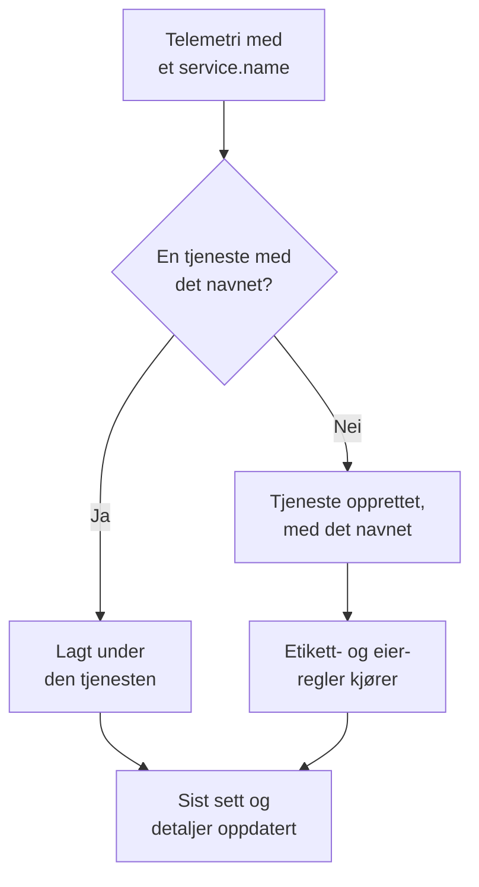

# Tjenestekatalog

Tjenestekatalogen viser applikasjonene og mikrotjenestene du kjører. OneUptime legger til en tjeneste første gang telemetrien dens kommer inn, og samler deretter loggene, sporene, målingene, unntakene, hendelsene og eierne dens på én side, slik at alle kan se hva en tjeneste gjør, hvem som eier den og hvordan den har det.

:::cards
- [Slik kommer en tjeneste inn i katalogen](#slik-kommer-en-tjeneste-inn-i-katalogen): Dens `service.name`, ved første telemetri.
- [Finn en tjeneste](#finn-en-tjeneste): Listen, filtrene og kolonnene.
- [Sidene til en tjeneste](#sidene-til-en-tjeneste): Alt om én tjeneste.
- [Arkiver eller slett en tjeneste](#arkiver-eller-slett-en-tjeneste): Behold historikken, eller fjern den.
:::

## Slik kommer en tjeneste inn i katalogen

Du trenger ikke å opprette tjenester. Hver batch med telemetri navngir tjenesten som sendte den, i ressursattributtet `service.name`. OneUptime legger batchen under tjenesten med det navnet, og oppretter tjenesten når prosjektet ikke har en ennå.

- **Navnet er tjenestens identitet.** Store og små bokstaver spiller ingen rolle i sammenligningen, så `Checkout-API` og `checkout-api` er én tjeneste. Et nytt `service.name` starter en ny tjeneste.
- **Containere navngir seg selv.** Telemetri fra Docker- og Podman-agentene navngir en tjeneste etter containeren når den ikke har et `service.name`.
- **En inntaksnøkkel kan bestemme tjenesten.** OpenTelemetry-data som sendes med en nøkkel med et **Festet tjenestenavn**, legges under det navnet, uansett hva `service.name` sier. Se [Inntaksnøkler](/docs/telemetry/ingestion-keys#lås-ned-en-nettlesernøkkel).
- **Nettlesere og telefoner er ikke tjenester.** Telemetri fra en nettleser eller en mobilapp hører i stedet til en [RUM-applikasjon](/docs/rum/applications).
- **Etiketter kan følge med telemetrien.** Et ressursattributt med navnet `oneuptime.label.<name>` gir tjenesten etiketten `<name>:<value>`, for eksempel `oneuptime.label.team=payments` for `team:payments`.

Hver gang telemetri kommer inn, flyttes tjenestens **Sist sett** frem, og detaljene oppdateres fra ressursattributtene som følger med:

| Detalj | Fra attributtet |
| --- | --- |
| Tjenesteversjon | `service.version` |
| Utrullingsmiljø | `deployment.environment.name` eller `deployment.environment` |
| Tjenestens navnerom | `service.namespace` |
| Kjøretidsmiljø | `process.runtime.name` og `process.runtime.version` |
| Teknologi | `telemetry.sdk.language` eller kjøretidsmiljøet |
| Sky | `cloud.provider`, `cloud.platform`, `cloud.region` og `cloud.account.id` |

## Før du begynner

- **Telemetri som kommer inn** med et `service.name`. Se [OpenTelemetry](/docs/telemetry/open-telemetry): `OTEL_SERVICE_NAME` setter det.
- **En rolle som kan lese tjenester.** Project Owner, Project Admin, Project Member, Viewer, Settings Admin, Settings Member eller Settings Viewer, eller en egendefinert rolle med tillatelsen Read Service. Å opprette, endre og slette tjenester krever Project Owner, Project Admin, Project Member, Settings Admin eller Settings Member, eller de tilsvarende tjenestetillatelsene.

## Finn en tjeneste

Gå til **Produkter → Ressurser → Tjenester**. **Alle tjenester** viser hver tjeneste med **Navn**, **Beskrivelse**, **Technology**, **Sist sett**, **Etiketter** og **Eiere**.

- Søk etter navn eller beskrivelse, og filtrer etter eier eller etikett med linjen over listen.
- Velg flere tjenester for å gi alle etiketter eller eiere på én gang, eller for å arkivere dem.
- Klikk på en tjeneste for å åpne sidene dens.

For å legge til en tjeneste før telemetrien dens kommer, for eksempel for å angi eierne først, klikker du på **Opprett Tjeneste** og skriver inn **Navn** nøyaktig slik `service.name` blir. Etikett- og eierregler kjører på den som på en oppdaget tjeneste. Når den er lagret, åpnes oppsettveiledningen for OpenTelemetry med det navnet i hvert kodeutdrag, og det siste trinnet, **Vent på tilkobling**, sier fra når de første dataene fra tjenesten kommer inn.

## Sidene til en tjeneste

Sidemenyen til en tjeneste har fem seksjoner:

| Seksjon | Sider |
| --- | --- |
| **Grunnleggende** | **Oversikt**: forespørsler, feilrate og p95-latens fra spannene, diagrammer og detaljene. **Anbefalinger**: ferdige monitorer for tjenesten, valgt etter språket. **Eiere**: personene og teamene som har ansvaret for den. **Feed**: alt som har skjedd med den, fra hvordan den ble opprettet til hver endring siden. |
| **Telemetri** | **Logger**, **Spor**, **Målinger**, **Ytelsesprofiler**, **Unntak** og **Source Maps**, allerede filtrert til denne tjenesten. |
| **Aktivitet** | **Hendelser**, **Varsler** og hendelser under **Planlagt vedlikehold** som berører den. |
| **Utvikler** | **Terraform**, **API** og **AI-assistenter**: tjenesten styrt fra kode. Seksjonen er slått sammen fra start. |
| **Avansert** | **Innstillinger**, **Revisjonslogger** og **Slett tjeneste**. **Avansert** er lukket i starten: åpne den først. |

Eiere betyr noe også utenfor siden: en rolle med omfanget Owned leser telemetrien til tjenestene som du eller teamene dine eier. Se [Telemetri](/docs/permissions/index#telemetri).

## Endre en tjeneste

:::steps
### Åpne innstillingene

Åpne tjenesten, åpne **Avansert** i sidemenyen, og klikk på **Innstillinger**.

### Gi den nytt navn eller beskriv den

Under **Tjenestedetaljer** klikker du på **Rediger detaljer** for å endre **Navn**, **Beskrivelse** eller **Etiketter**. Navnet må fortsatt samsvare med `service.name` som telemetrien rapporterer: endre det også i OpenTelemetry-oppsettet ditt, ellers oppretter neste telemetri en ny tjeneste.

### Velg farge og teknologistabel

Under **Tjenesteinnstillinger** klikker du på **Rediger innstillinger**. **Tjenestefarge** markerer tjenesten i diagrammer og lister; en ny tjeneste får sin egen. **Teknologistabel** er valgfri: la den stå tom for å vise språket som er oppdaget fra telemetrien.
:::

Den samme siden har tjenestens oppbevaring. Kortene **Oppbevaring av telemetridata** og **Oppbevaring etter telemetritype** oppbevarer telemetrien lenger eller kortere enn prosjektets standard oppbevaring. De er en del av [Enterprise Edition](/docs/self-hosted/enterprise) og av Scale-planen på OneUptime Cloud; uten dem viser siden hva de tilfører, og tjenesten beholder prosjektets oppbevaring.

## Gi etiketter og eiere automatisk

Regler gir nye tjenester etiketter og eiere når de opprettes, også oppdagede tjenester. Du finner dem under **Tjenester → Innstillinger → Eierregler** og **Tjenester → Innstillinger → Etikettregler**; **Innstillinger** er lukket i starten i sidemenyen. Se [Etikett- og eierregler](/docs/configuration/label-and-owner-rules).

## Arkiver eller slett en tjeneste

Arkiver en tjeneste du ikke lenger følger med på, men som du vil beholde historikken for. En arkivert tjeneste er skjult i **Alle tjenester**, men den fortsetter å samle inn telemetri. Arkiver den fra siden **Innstillinger**, eller velg flere i listen. For å hente tilbake en, åpner du **Tjenester → Avansert → Arkivert**.

> [!WARNING]
> Når du sletter en tjeneste, slettes også source maps for den, og pipelinereglene for målinger og LLM-kostnadsbudsjettene som er satt for den. Hvis OneUptime fortsatt mottar telemetrien, opprettes tjenesten på nytt, uten etikettene, eierne og innstillingene du ga den. For å ta den av listen og beholde alt, arkiverer du den i stedet.

## Feilsøking

:::details En tjeneste vises to ganger
To verdier av `service.name` nådde OneUptime, for eksempel fra to versjoner av oppsettet ditt, eller etter at navnet ble endret bare på én side. Telemetri kobles på navn: sørg for at hver instans rapporterer samme `service.name`, og arkiver eller slett deretter tjenesten du ikke trenger lenger.
:::

:::details Tjenesten min er ikke i katalogen
Kontroller at telemetrien har et `service.name`. Telemetri fra en nettleser eller en mobilapp går i stedet til Real User Monitoring, og en vert eller klynge uten tjenestenavn legges under den verten eller klyngen.
:::

:::details Sist sett henger etter
**Sist sett** oppdateres omtrent én gang i minuttet, ikke for hver batch, så den kan henge omtrent et minutt etter den levende telemetrien.
:::

## Neste steg

:::cards
- [Loggutforsker](/docs/telemetry/logs-explorer): Søk i loggene til en tjeneste.
- [Sporutforsker](/docs/telemetry/traces-explorer): Følg forespørslene dens.
- [Unntakssporing](/docs/telemetry/exceptions): Gå gjennom feilene den kaster.
- [Etikett- og eierregler](/docs/configuration/label-and-owner-rules): Gi nye tjenester etiketter og eiere.
:::
