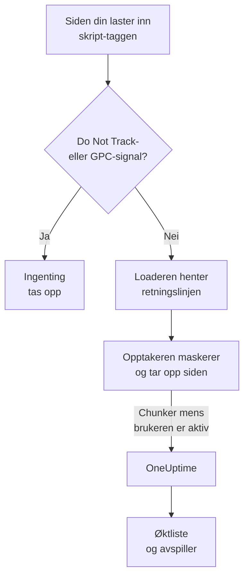
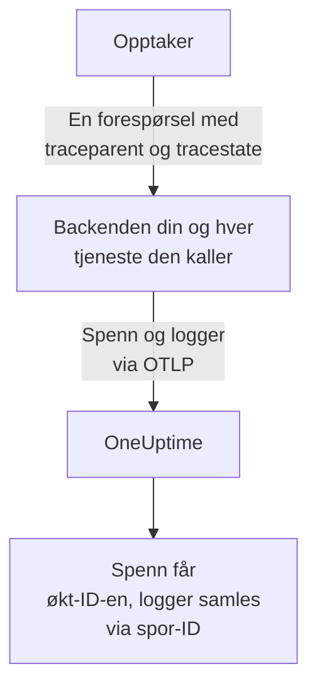
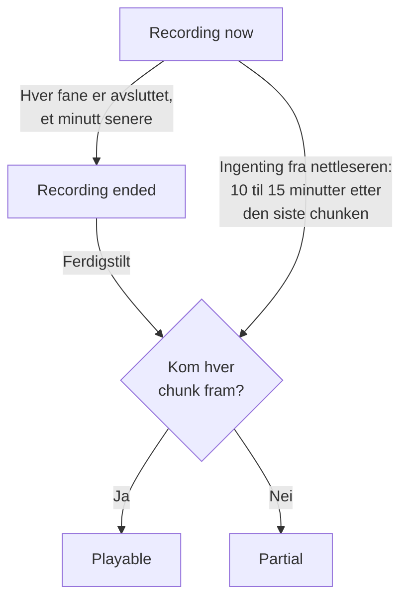
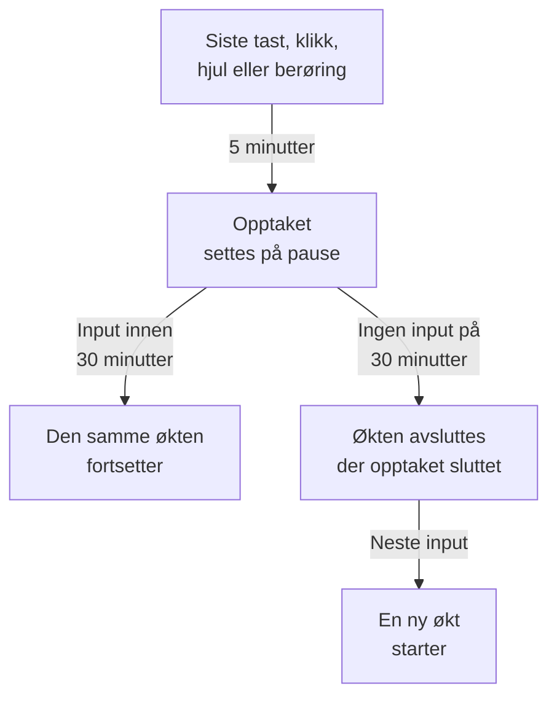

# Øktavspilling

Øktavspilling tar opp det ekte brukere så i web- eller React Native-appen din, og spiller det av ved siden av feil, spor og logger fra den samme økten. Du legger til én skript-tagg, velger hva som maskeres, og ser enhver økt fra RUM-applikasjonen dens.

:::cards
- [Slik fungerer det](#slik-fungerer-det): En loader, en retningslinje og en opptaker som laster opp underveis.
- [Installasjon](#installasjon): Én skript-tagg på hver side, eller React Native-SDK-et.
- [Personvern](#personvern): Hva som maskeres, samtykke, og hvem som kan sende opptak.
- [Korreler med resten av telemetrien din](#korreler-med-resten-av-telemetrien-din): Backend-spor, -logger og -feil, koblet uten kode.
- [Se en økt](#se-en-økt): Øktlisten, siden Brukere, brukerflyter og avspilleren.
- [Opptaksstatus](#opptaksstatus): Hvorfor ingenting kommer inn, og varsler før et budsjett er brukt opp.
:::

## Slik fungerer det

Skriptet på siden din er en liten loader. Den sjekker nettleserens personvernsignaler, henter applikasjonens retningslinje fra OneUptime og laster først deretter inn opptakeren, som maskerer siden mens den tar den opp, og laster den opp i chunker mens brukeren er aktiv.



Som standard tas hver økt opp og lastes opp mens den pågår, ikke bare de som gikk galt. Det er i øktene der ingenting gikk galt, at du finner kassen som ingen fullførte, skjemaet som alle ga opp, og siden som ifølge en kunde «så rar ut».

For å lagre mindre samarbeider to innstillinger i applikasjonens retningslinje:

| Innstilling | Standard | Hva den endrer |
| --- | --- | --- |
| **Utvalgsprosent** | 100 | Hvor mange økter som kvalifiserer. Halver den, og du halverer både de lagrede bytene og de lagrede sluttbrukerdataene. Beslutningen tas én gang per økt ut fra en hash av økt-ID-en, så en økt blir aldri tatt halvveis opp. |
| **Når et opptak skal lastes opp** | _Always_ | Med _On error or frustration_ holder opptakeren en ringbuffer i minnet og laster bare opp når noe går galt. Det finnes da et opptak av nesten hver mislykket økt, til en kostnad rundt 15 ganger lavere enn å ta opp alle, men du kan ikke se en økt som ikke gikk galt. |

## Før du begynner

- En RUM-applikasjon. Opprett en under **Produkter → Ressurser → Overvåking av reelle brukere**, eller la telemetrien din opprette den: se [Administrere applikasjoner](/docs/rum/applications).
- En **Nettleser**-inntaksnøkkel, fra **Prosjektinnstillinger → Telemetri og APM → Inntaksnøkler**. En Browser-nøkkel virker bare fra opprinnelsene du oppgir på den: se [Angi de tillatte opprinnelsene dine i produksjon](#angi-de-tillatte-opprinnelsene-dine-i-produksjon).

Øktavspilling er slått på som standard. Innstillingene finnes på tre steder:

| Hvor | Hva som er der |
| --- | --- |
| Applikasjonens side **Replay Policy** | Retningslinjen (opptak, maskering, samtykke, sporing og grenser), et sammendrag av **Opptakets tilstand**, kortet **Hva et opptak inneholder**, panelet **Test your installation** og **Record a specific user's next session**. |
| Applikasjonens side **Helse** | Om opptak kommer inn, og hvorfor ikke når de ikke gjør det. Se [Opptaksstatus](#opptaksstatus). |
| **Overvåking av reelle brukere → Innstillinger → Øktavspilling** | Bryteren for hele prosjektet som stopper alle applikasjoner på én gang, og en skrivebeskyttet liste over hver applikasjons retningslinje. |

## Installasjon

Legg til én skript-tagg på hver side du vil ta opp.

:::steps
### Opprett en Browser-nøkkel

Under **Prosjektinnstillinger → Telemetri og APM → Inntaksnøkler** klikker du på **Opprett ingestion-nøkkel**, velger **Nettleser** som **Nøkkeltype** og oppgir nettstedets opprinnelser under **Tillatte opprinnelser**. Kopier deretter nøkkelens **Hemmelig nøkkel**. [Nettleseroppsett](/docs/rum/browser-setup#sett-det-opp) viser hvert skjermbilde.

### Legg til skript-taggen

Sett taggen på hver side, med nøkkelen din og applikasjonens identifikator:

```html
<script
  src="https://oneuptime.com/telemetry/session-replay/v1/recorder.js"
  data-oneuptime-token="YOUR_TELEMETRY_INGESTION_KEY"
  data-oneuptime-app-identifier="storefront-web"
  crossorigin="anonymous"
  async
></script>
```

`data-oneuptime-app-identifier` må samsvare med RUM-applikasjonens identifikator, den samme verdien som du bruker for `service.name`. Applikasjonens side **Dokumentasjon**, i delen **Øktavspilling** i sidemenyen, viser denne snippeten med begge verdiene allerede fylt ut, sammen med variantene for Next.js / React og Google Tag Manager.

### Sjekk at opptak kommer inn

Åpne en av sidene dine, og klikk rundt i noen sekunder. Innen omtrent et minutt vises økten på applikasjonens side **Øktavspilling**, merket som **Tar opp nå**. Gjør den ikke det, sier applikasjonens side **Helse** hvorfor: se [Opptaksstatus](#opptaksstatus).
:::

Skriptet på `/v1/recorder.js` er en liten loader. Den sjekker Do Not Track, henter applikasjonens retningslinje og laster først deretter inn `/latest/recorder.js`. Retningslinjen og opptakeren leveres med `no-store`, så en endring i en av dem når neste sideinnlasting uten å vente på at en nettleserbuffer utløper.

### Skript-taggens attributter

| Attributt | Påkrevd | Hva den gjør |
| --- | --- | --- |
| `data-oneuptime-token` | Ja | Inntakstokenet ditt for telemetri. |
| `data-oneuptime-app-identifier` | Ja | RUM-applikasjonens identifikator. |
| `data-oneuptime-host` | Nei | OneUptime-opprinnelsen. Utelatt utledes den fra skriptets egen `src`, så du trenger den bare når du leverer skriptet via ditt eget domene. |
| `data-oneuptime-user-ref` | Nei | Sluttbrukerreferansen som er kjent ved sideinnlasting (en bruker-ID, aldri en e-postadresse du ikke vil lagre). Det samme som `identify()` setter senere; det er den eneste formen som virker for [Ta opp en bestemt brukers neste økt](#ta-opp-en-bestemt-brukers-neste-økt). |
| `data-oneuptime-respect-do-not-track` | Nei | Respekterer som standard Do Not Track og Global Privacy Control. Sett den til `"false"` for å ta opp uansett signalet; se [Do Not Track](#do-not-track). |
| `data-oneuptime-debug` | Nei | `"true"` skriver opptakerens beslutninger ut i konsollen. Se [Feilsøking av øktavspilling](/docs/rum/session-replay-troubleshooting). |
| `data-oneuptime-offline-storage` | Nei | Sett den til `"false"` for å holde chunker som tas opp mens den besøkende er frakoblet, bare i minnet i stedet for også å lagre dem i nettleserens IndexedDB. Se [Offlinemodus](#offlinemodus). |

De samme alternativene kan gis i en global i stedet for på taggen, og det er det tag managers og pakkede installasjoner bruker:

```js
window.__ONEUPTIME_SESSION_REPLAY__ = {
  host: "https://oneuptime.com",
  token: "YOUR_TELEMETRY_INGESTION_KEY",
  appIdentifier: "storefront-web",
  userRef: "user-123", // optional
  respectDoNotTrack: true, // optional
  debug: false, // optional
  offlineStorage: true, // optional; false keeps offline chunks in memory only
};
```

### Slik ser en sunn installasjon ut

Åpne DevTools → Network, og filtrer på `session-replay`. En fungerende side gir:

1. **Én `GET .../session-replay/v1/config`** per sideinnlasting — hentingen av retningslinjen.
2. **En `POST .../session-replay/v1/chunk` omtrent hvert 15. sekund mens brukeren gjør noe**, eller tidligere når 256 KB med hendelser har hopet seg opp. En inaktiv fane produserer ingen hendelser og derfor ingen POST-er: beveg musen eller klikk før du vurderer en installasjon ut fra fanen Network.
3. Når fanen skjules, og igjen når siden forsvinner, en `POST` som sendes med `keepalive`. Å forlate siden — fanen lukket, lastet inn på nytt eller sendt til en annen side, eller siden lagt i nettleserens back/forward-buffer (hver `pagehide`) — merker den som den siste, noe som forteller OneUptime at fanens opptak er ferdig; en side som brukeren henter tilbake fra back/forward-bufferen, fortsetter å ta opp som en ny fane i den samme økten. En fane som bare skjules, forblir åpen, så opptaket fortsetter når brukeren kommer tilbake til den. Hele bodyen holder seg under 56 KB — opptakerens andel av nettleserens keepalive-kvote på 64 KB per opprinnelse — og kan bære flere chunker som rammer i den ene forespørselen: den avsluttende chunken, bitene en stor avsluttende chunk ble delt i (høyst 48 KB med hendelser hver, så rammens header fortsatt får plass) og enhver chunk som fortsatt ventet på et nytt forsøk. En chunk som allerede er større enn det budsjettet når fanen bare skjules, går i stedet den vanlige veien, mens siden fortsatt lever og kan sende den.

Med utløseren _On error or frustration_ skjer ikke trinn 2 før en utløser går av — se [Feilsøking](#feilsøking).

## Installasjon i React Native

React Native-SDK-et tar opp hierarkiet av native visninger som syntetiske hendelser som er kompatible med rrweb, så mobilopptak åpnes i den samme øktlisten og den samme avspilleren som webopptak. Det tar ikke skjermbilder. Avspilleren merker hvert opptak som en React Native-app, og fanen **Fidelity** forklarer de native flatene som ikke kunne gjengis.

:::steps
### Installer SDK-et

SDK-et støtter React Native-apper for iOS og Android. Installer det med peer-avhengigheten for den varige utboksen:

```bash
npm install @oneuptime/react-native-replay @react-native-async-storage/async-storage
```

I et iOS-prosjekt uten Expo kjører du den vanlige CocoaPods-installasjonen etter å ha lagt til pakkene; gjeldende versjoner av React Native kobler Android automatisk uten manuell registrering. Opptakeren har sin egen native modul for visningstreet i tillegg til Async Storage, så Expo-prosjekter må bruke et egendefinert utviklings- eller produksjonsbygg (for eksempel EAS Build eller et prebuild). Expo Go kan ikke kjøre dette SDK-et, fordi ingen av de to native modulene kan legges til i Expo Gos faste binærfil.

### Start opptakeren, og pakk inn appen din

Start singletonen én gang, og plasser provideren over den delen av appen du vil ta opp:

```tsx
import {
  OneUptimeReplay,
  OneUptimeReplayProvider,
} from "@oneuptime/react-native-replay";

OneUptimeReplay.start({
  host: "https://oneuptime.com",
  token: "YOUR_TELEMETRY_INGESTION_KEY",
  appIdentifier: "storefront-mobile",
  mobileAppIdentifier: "com.example.storefront",
  appName: "Storefront", // optional, shown in session details
  appVersion: "4.2.0", // optional, shown in session details
});

export default function App() {
  return (
    <OneUptimeReplayProvider>
      <Navigation />
    </OneUptimeReplayProvider>
  );
}
```

`appIdentifier` er RUM-applikasjonens identifikator. `mobileAppIdentifier` er Android-application-ID-en eller iOS-bundle-identifikatoren som leveres i binærfilen, ikke et visningsnavn. Bruk den samme verdien i [`app://`-listene over tillatte opprinnelser](#angi-de-tillatte-opprinnelsene-dine-i-produksjon). SDK-et henter applikasjonens avspillingsretningslinje fra `host`; sampling, utløser, samtykke, oppbevaring og opplastingsbudsjetter forblir styrt av serveren.
:::

Provideren har en native rot som ikke kan slås sammen, og tar opp visningstreet sitt og start-, bevegelses- og slutthendelser for berøringer. Hvis du allerede bygger opptakerinstanser selv, sender du en med `<OneUptimeReplayProvider recorder={recorder}>`. `MobileReplayRecorder` eksporteres også for isolerte integrasjoner eller integrasjoner med flere klienter; de fleste apper bør bruke singletonen.

### React Native-API

Importer `OneUptimeReplay` direkte, eller kall `useOneUptimeReplay()` under provideren. Singletonen gjør dette tilgjengelig:

| Metode | Hva den gjør |
| --- | --- |
| `start(options)` | Henter retningslinjen og starter opptaket. Påkrevde alternativer er `host`, `token`, `appIdentifier` og `mobileAppIdentifier`; `appName` og `appVersion` er valgfrie visningsmetadata, og `connectivity` er en valgfri kilde til nettverksstatus for [offlinemodus](#offlinemodus). |
| `stop()` | Tømmer det som kan sendes, stopper opptaket og kobler fra livssyklushåndtererne. |
| `identify(userRef, traits?)` | Knytter den påloggede brukeren og valgfrie egenskaper til, avhengig av **Registrer sluttbrukerens identitet**. |
| `setTags(tags)` / `addTag(key, value)` | Erstatter alle øktens søkbare tagger, eller legger til én tagg uten å erstatte de andre. |
| `track(name, properties?)` | Plasserer en apphendelse på avspillingens tidslinje. |
| `setRoute(route)` | Tar opp et renset logisk skjermbilde eller en rute etter en navigasjon. Kall den fra navigatorens tilbakekall ved ruteendring. |
| `captureSession(reason?)` | Laster med _On error or frustration_ opp ringbufferen av en årsak appen definerer, som en bruker som trykker på «Rapporter et problem». |
| `captureError(error)` | Tar opp en håndtert JavaScript-feil og utløser feilstyrt opptak. |
| `grantConsent()` / `revokeConsent()` | Tillater opplastinger, eller sletter umiddelbart bufferen i minnet, den lagrede utboksen, økten og besøks-ID-en. Senere samtykke starter med nye identifikatorer. |
| `getSessionId()` / `onSessionChange(listener)` | Leser den gjeldende avspillingsøktens ID med samtykke, eller abonnerer på den, for å korrelere spor og logger. Lytteren mottar også `null` når opptaket eller samtykket opphører. |
| `getDiagnostics()` | Returnerer opptakerens tilstand og de siste beslutningene uten å returnere innholdet i de opptatte visningene. |

SDK-et lytter på React Natives `AppState`: å gå i bakgrunnen lukker og tømmer hendelser med samtykke, mens opptak fra før samtykke bare blir værende i minnet. Før opptaket i forgrunnen gjenopptas, oppdaterer SDK-et retningslinjen uten å bruke et bufret svar. Det oppdaterer også retningslinjen med jevne mellomrom mens det er aktivt, slik at deaktivering, samtykke, sampling, målretting og identitetsendringer trer i kraft i en app som står åpen lenge. Kall `stop()` når integrasjonen din demonteres permanent; vanlig navigasjon mellom skjermbilder skal bruke `setRoute()` i stedet for å stoppe og starte opptakeren på nytt.

**Når en mobiløkt avsluttes på grunn av inaktivitet.** Fem minutter uten input setter allerede opptaket på pause (se [Inaktiv tid](#inaktiv-tid)). Tretti minutter uten noen berøring og uten noe opptatt SDK-kall (`track()`, `setTags()`, `identify()` og lignende, gjort mens opptaket pågikk) avslutter økten. Den slutter ved den siste aktiviteten, eller for en økt på pause ved pausen, der opptaket sluttet — ikke når appen kommer tilbake eller opptakeren merker det — så tid i bakgrunnen eller på pause legges aldri til slutten av en økt. En app som står åpen i forgrunnen, starter ikke en ny økt hver halvtime. Neste økt begynner når brukeren kommer tilbake: den første berøringen, skjermtastaturet som vises eller skjules, appen som kommer tilbake til forgrunnen, eller et kall til `captureSession()`. Den åpner med et nytt øyeblikksbilde av skjermen. Inntil da returnerer `getSessionId()` `null`, og `onSessionChange()` kalles med `null`. Feil, navigasjon og kall til `track()` i mellomtiden tas ikke opp.

For å korrelere mobiltelemetri med en avspilling abonnerer du med `onSessionChange()` og setter den returnerte verdien som attributtet `session.id` i OpenTelemetry-instrumenteringen din. Erstatt det attributtet hver gang tilbakekallet utløses, og fjern det også når verdien er `null`. Avspillings-SDK-et endrer ikke det native nettverket og endrer ikke selv en OpenTelemetry-provider.

### Personvern og maskering i React Native

Mobilopptak er bevisst strengere enn webens maskeringsmoduser. Native UI-tekst, tilgjengelighetsverdier, inputverdier og bildepiksler serialiseres aldri; serveren mottar en wireframe-struktur selv når applikasjonens maskeringsmodus på web ville tillatt lesbar tekst. Metadata som kalleren leverer, som brukerreferanser, hendelsesnavn, ruter og søkbare tagger, følger API-kontrakten, så ikke legg hemmeligheter i de feltene. Pakk inn et spesielt følsomt undertre i `<ReplayMask>` for å erstatte det området med en personvernplassholder og beholde oppsettet rundt.

Samtykke utledes ikke fra en tillatelse i operativsystemet eller fra samtykkebanneret ditt. Med _Require explicit_ kaller du bare `grantConsent()` når appen din har det nødvendige samtykket. Å kalle `revokeConsent()` forkaster både usendte data i køen og lagrede data og identifikatorene som kunne knyttet en senere økt til den tilbakekalte.

Mobilopptakeren tar opp visningenes grenser og typer, berøringsposisjoner, logiske ruter, egendefinerte hendelser og JavaScript-feil. Disse begrensningene rapporteres alltid på avspillerens fane Fidelity:

- Piksler i native `Image` er ugjennomsiktige; bare rammen gjengis.
- Innholdet i `WebView` ligger utenfor React Native-treet. Installer webopptakeren inne i den hostede siden hvis den trenger sitt eget opptak.
- Canvas, Skia, OpenGL, kart, kameraforhåndsvisninger, video og andre spesialtegnede flater er ugjennomsiktige.
- Berøringsbaner inne i `ReplayMask` eller en ugjennomsiktig flate tas ikke opp. Den native broen sjekker berøringens faktiske mål og forfedrene til det, og undertrykker gesten hvis den personvernsjekken ikke kan fullføres.
- Animasjoner fra Reanimated, native-driver og UI-tråden samples ved øyeblikksbilder av visningstreet og gjenskapes ikke bilde for bilde.
- Native krasj som avslutter JavaScript før det kan tømme, krever et native krasj-SDK; `captureError()` dekker håndterte JavaScript-feil, ikke krasjdumper på prosessnivå.

## Identifiser brukerne dine

Hver økt er anonym til siden din sier hvem den tilhører. Uten det kan listen fortsatt gruppere en nettlesers økter under en anonym besøks-ID (se [Anonyme besøkende](#anonyme-besøkende) nedenfor), men ingenting nevner personen eller knytter den andre nettleseren til den første. Kall `identify()` så snart du vet det, eller legg det i kø før skriptet lastes inn — i begge tilfeller brukes det før den første chunken lastes opp, så økten kan søkes opp etter bruker fra det øyeblikket den vises:

```js
// After the script has loaded:
OneUptimeReplay.identify("user-123", { plan: "pro", tenant: "acme" });

// Or at any time, whether or not the script has loaded yet:
(window.OneUptimeReplayQueue = window.OneUptimeReplayQueue || []).push([
  "identify",
  "user-123",
  { plan: "pro", tenant: "acme" },
]);
```

- Referansen er det øktlisten viser, og det søk med `user:` samsvarer med. Egenskaper vises i avspillerens header og i øktens detaljpanel.
- **Identiteten tilhører økten, ikke bare siden.** En økt omfatter hver sideinnlasting og hver fane i besøket, og så snart en hvilken som helst av sidene kaller `identify()`, er hele økten den brukerens — også sidene fra før påloggingen, siden de er det samme besøket. Hver senere side og fane i økten nevner også brukeren, selv en som aldri kaller `identify()` selv: målsiden for omdirigeringen etter pålogging, en lenke som er åpnet i en ny fane. Så lenge **Registrer sluttbrukerens identitet** er slått på, husker opptakeren hvem den gjeldende økten tilhører, i `localStorage` under `oneuptime.replay.user` — økt-ID-en og referansen, ingenting annet, og med samtykket _Require explicit_ først etter at samtykke er gitt — og bare for den økten: neste økt (etter 30 minutter inaktivitet eller grensen på 4 timer) starter anonymt til en side identifiserer den, med mindre siden som startet den, selv hadde identifisert brukeren. Kall derfor `identify()` ved hver sideinnlasting der appen din kjenner brukeren, ikke bare rett etter pålogging.
- **En annen bruker får sin egen økt.** Når `identify()` nevner en annen enn brukeren økten allerede tilhører — én person logget av og en annen logget på i den samme nettleseren, i denne fanen eller en annen —, avsluttes den gjeldende økten, fortsatt arkivert under den første brukeren, og en ny økt begynner for den andre. Lyttere på `onSessionChange` får beskjed, og avspilleren viser byttet som slutten på ett opptak og begynnelsen på det neste. Å identifisere den samme brukeren igjen endrer ingenting; referanser sammenlignes etter at mellomrom i endene er fjernet, og med forskjell på store og små bokstaver, nøyaktig slik serveren sammenligner dem.
- Det `identify()` gir opptakeren, lastes bare opp med opptaket mens **Registrer sluttbrukerens identitet** er slått på for applikasjonen (standard). Er det slått av, utelater opptakeren referansen og egenskapene fra chunken, og serveren lagrer **overhodet ingenting** om personen — ingen referanse, ingen nøkkelbasert hash av den, ingen egenskaper. De øktene er virkelig pseudonyme, og prisen er at de ikke kan slettes _per bruker_: en sletteforespørsel har ingenting å samsvare med, så bruk i stedet `BySessionId`, `ByDateRange` eller `ByRumApplication` (se [Slett økter](#slett-økter)). Hvis det betyr mer for deg å kunne etterkomme en sletteforespørsel per bruker enn å ikke lagre noen identifikator, lar du bryteren stå på — den lagrede nøkkelen er en enveis nøkkelbasert hash som kan sammenlignes, men ikke leses, og bare den separate etiketten bærer selve referansen.
- Én referanse forlater nettleseren uansett den bryteren, med vilje: den siden din leverer **ved innlasting** via `data-oneuptime-user-ref` eller `userRef` på init-globalen, reiser som en forespørselsheader ved hentingen av retningslinjen ved hver sideinnlasting, fordi det er slik [Ta opp en bestemt brukers neste økt](#ta-opp-en-bestemt-brukers-neste-økt) gjenkjenner en besøkende før noen opptaker finnes. Serveren sammenligner den med det aktiverte målet og forkaster den; den skrives ikke inn i økten med mindre identitetsopptak er slått på og opptakeren sender den igjen med opptaket. En referanse som sendes til `identify()`, sendes aldri på denne måten.
- Egenskaper er begrenset til 20 nøkler, 40 tegn per nøkkel og 200 per verdi, gjøres om til strenger og går gjennom applikasjonens maskeringsmodus: under _Mask all text_ maskeres de før opplasting.
- Å lese identiteten tilbake i dashbordet krever den samme tillatelsen som å se opptaket (se [Hvem kan se et opptak](#hvem-kan-se-et-opptak)); andre roller ser «Identity hidden».

### Anonyme besøkende

En side som aldri kaller `identify()`, trenger fortsatt at øktene dens kan grupperes, ellers forteller en liste med førti _Anonymous_-rader deg ikke om én person hadde den samme feilen førti ganger, eller om førti personer hadde den én gang. Derfor oppretter opptakeren en tilfeldig besøks-ID per nettleserprofil og per opprinnelse — 32 heksadesimale tegn med små bokstaver, lagret i `localStorage` under `oneuptime.replay.visitor` ved siden av øktposten, slik at et nettsted som leveres fra to vertsnavn eller porter, vises som to besøkende og bare `identify()` forener dem — og sender den som `meta.visitorId` på hver chunk som bærer metadata: den første chunken, den avsluttende chunken og chunken etter et kall til `identify()` eller `setTags()`. Serveren sjekker formen og lagrer den på økten med de samme tilgangsreglene som resten av øktens header. Den overlever økt-ID-en med vilje: byttet etter 30 minutter inaktivitet og grensen på 4 timer starter en ny økt, og den nye økten bærer den samme besøks-ID-en, så to besøk fra den samme nettleseren med en ukes mellomrom vises sammen på [siden Brukere](#siden-brukere) og i avspillerens meny med andre økter (se [Avspilleren](#avspilleren)).

Vær presis om hva den ikke er:

- **Den er ikke en identitet.** Den er tilfeldig, opprettes i nettleseren og er ikke avledet av noe siden din leverte eller av noe ved enheten. To nettlesere på den samme bærbare, eller den samme personen på en telefon og en datamaskin, er to besøkende; bare `identify()` forener dem. Et privat vindu får en ny ID som forsvinner med vinduet, og der ingenting kan skrives til lagringen (Safaris private modus, blokkerte nettstedsdata), varer ID-en én sideinnlasting.
- **Den avhenger ikke av Capture end-user identity.** Den bryteren avgjør om referansen og egenskapene forlater nettleseren; besøks-ID-en sendes uansett, fordi den ikke nevner noen. Hvis du ikke vil at noen ID skal opprettes, er svaret ingen opptaker: slå av øktavspilling for applikasjonen, eller la [Do Not Track](#do-not-track) bli respektert.
- **Den følger økt-ID-ens samtykkeregler.** `revokeConsent()` fjerner den fra lagringen sammen med økten, ingenting skrives mens samtykket er trukket tilbake, og en senere `grantConsent()` oppretter en ny — så en bruker som trekker samtykket tilbake og kommer tilbake, kobles ikke igjen til øktene vedkommende ba deg glemme. Under Do Not Track eller Global Privacy Control kjører ingen opptaker, så ingen ID opprettes.
- **Den reiser aldri på dine egne forespørsler.** Sporingskonteksten som opptakeren legger til i sidens forespørsler til dens egen opprinnelse, nevner økten, aldri den besøkende (se [Hva dine egne forespørsler bærer](#hva-dine-egne-forespørsler-bærer)); besøks-ID-en går bare til OneUptime, med opptaket.
- **Den kan ikke være målet for en sletteforespørsel.** Forespørselstypene er ikke endret (se [Slett økter](#slett-økter)); et søk med `visitor:` snevrer listen inn til én nettlesers økter, og derfra tar du økt-ID-ene som skal slettes.

`OneUptimeReplay.getVisitorId()` returnerer den gjeldende ID-en, eller en tom streng før opptakeren starter, etter `stop()` og mellom en `revokeConsent()` og neste `grantConsent()`. Opptakere som ble bygget før dette fantes, sendte ingen, så øktene de tok opp, har en tom `visitorId`: listen viser dem som _Anonymous_, og siden Brukere arkiverer dem under **Unlinked sessions**. En opptaker som oppretter en, oppgir `visitor-id` blant sine `capabilities` i `getDiagnostics()` og på siden **Helse**.

## JavaScript-API

Opptakeren publiserer `window.OneUptimeReplay`. Fordi den lastes inn asynkront, må alt siden din kaller før den har kommet, gå gjennom kommandokøen — `window.OneUptimeReplayQueue` er en vanlig matrise av `[command, ...arguments]`-oppføringer som opptakeren tømmer så snart den starter, og den godtar hver kommando nedenfor etter navn:

```js
(window.OneUptimeReplayQueue = window.OneUptimeReplayQueue || []).push(
  ["grantConsent"],
  ["identify", "user-123", { plan: "pro" }],
  ["setTags", { build: "1.4.2" }],
  ["onSessionChange", (sessionId, tabId) => console.log(sessionId)],
);
```

`grantConsent`, `revokeConsent`, `stop`, `identify`, `setTags` og `addTag` brukes før opptakeren starter, så en samtykkebeslutning i køen avgjør om noe lastes opp, og en identitet i køen reiser allerede på den første chunken. `track`, `captureSession` og `onSessionChange` kjører rett etter at den starter.

| Metode | Hva den gjør |
| --- | --- |
| `identify(userRef, traits?)` | Knytter sluttbrukeren til økten — til hver side og fane i den, fra begynnelsen (se [Identifiser brukerne dine](#identifiser-brukerne-dine)). `traits` er et objekt med streng-, tall- eller boolske verdier (≤ 20 nøkler, nøkkel ≤ 40 tegn, verdi ≤ 200 tegn), maskert under _Mask all text_ og bare lastet opp når **Registrer sluttbrukerens identitet** er slått på. Å kalle den igjen for den samme brukeren sender identiteten (og eventuelle nye egenskaper) på nytt på neste chunk; å nevne en annen bruker avslutter økten og starter en ny for vedkommende. |
| `track(name, properties?)` | Tar opp en forretningshendelse (`"checkout_failed"`) på tidslinjen. `name` ≤ 64 tegn, ≤ 20 egenskapsnøkler med de samme verdigrensene som egenskaper. Opptil 50 per chunk på 15 sekunder; utover det bærer chunken én markør «events dropped» med antallet. |
| `setTags(tags)` / `addTag(key, value)` | Tagger per økt (`{ build: "1.4.2", experiment: "new-checkout" }`), ≤ 20 tagger, nøkkel ≤ 32 tegn, verdi ≤ 128. Søkbare fra øktlisten med `tag:key=value` og vist i øktdetaljene. `setTags` **erstatter** hele kartet, så en ny `setTags({ experiment })` fjerner en tagg `build` som den første satte; `addTag` setter én nøkkel og beholder resten. Bygg kartet i ett kall til `setTags`, eller bruk `addTag` etter hvert som du får vite hver verdi. |
| `captureSession(reason?)` | Tvinger med _On error or frustration_ denne økten til å laste opp fra ringbufferen og fremover; med _Always_ endrer den ingenting ved opplasting, men `reason` (≤ 80 tegn) merkes likevel på tidslinjen. Bruk den fra din egen knapp «rapporter et problem». |
| `onSessionChange(listener)` | `listener(sessionId, tabId)` kalles umiddelbart hvis det finnes en økt, og igjen hver gang ID-en endres — når brukeren kommer tilbake etter 30 minutter inaktivitet, ved grensen på 4 timer, når `identify()` nevner en annen bruker, eller når en annen fane fra den samme besøkende byttet økt først. Returnerer en funksjon som avslutter abonnementet. **Valgfritt**: forespørsler til din egen opprinnelse kobler backendens spenn, logger og unntak til opptaket uten den (se [Korreler med resten av telemetrien din](#korreler-med-resten-av-telemetrien-din)). Bruk den til å sette `session.id` på telemetri som siden selv produserer, som spenn fra OpenTelemetry-SDK-et for nettleser; se [Din egen sides nettlesertelemetri](#din-egen-sides-nettlesertelemetri). |
| `grantConsent()` | Tillater opplastinger i samtykkemodusen _Require explicit_. Før dette lastes ingenting opp. |
| `revokeConsent()` | Forkaster alt i bufferen og stopper opplastinger. Opptakeren fortsetter å kjøre bare i minnet, så en senere `grantConsent()` fortsetter med en ny økt-ID. |
| `getSessionId()` | Den gjeldende økt-ID-en, eller `null` når ingenting tas opp. Foretrekk `onSessionChange()`, som også følger øktbytter. |
| `getVisitorId()` | Den [anonyme besøks-ID-en](#anonyme-besøkende) — 32 heksadesimale tegn, én per nettleserprofil, den samme på tvers av øktbytter — eller `""` før opptakeren starter, etter `stop()` og mens samtykket er trukket tilbake. Tilfeldig og ikke en identitet; avhenger ikke av **Registrer sluttbrukerens identitet**. |
| `stop()` | Laster opp den siste chunken, forsegler økten og stopper resten av sidens levetid. |
| `setDebug(enabled)` | Skriver fra nå av opptakerens beslutninger ut i konsollen. |
| `getDiagnostics()` | Alt opptakeren bestemte, uansett om diagnostikk var slått på. Se nedenfor. |

### `getDiagnostics()`

Det første du skal lime inn i en supportsak. Den inneholder i kraft av oppbygningen ikke noe sideinnhold (se [Hva diagnostikken aldri inneholder](/docs/rum/session-replay-troubleshooting#hva-diagnostikken-aldri-inneholder)).

```js
copy(JSON.stringify(OneUptimeReplay.getDiagnostics(), null, 2));
```

| Felt | Betydning |
| --- | --- |
| `state` | `none` (ingen opptaker ble bygget), `not-started`, `recording` (bare i minnet), `uploading`, `paused` (ingen har berørt siden på fem minutter, så ingenting fanges før neste input — se [Inaktiv tid](#inaktiv-tid)), `not-sampled` eller `stopped`. |
| `stopReason` | Hvorfor den stoppet, hvis den gjorde det: `api` (din `stop()`), `server-directive`, `transport-failure` eller `chunk-cap`. |
| `bootstrapDecision` | Hvorfor artefaktet bygde en opptaker eller ikke: `started`, `privacy-signal`, `directive-stop`, `already-started`, `cancelled-before-start` (en `revokeConsent`/`stop` i køen) eller `not-started`. |
| `decisions` | Svaret fra hver port: `isSampled`, `captureTrigger`, `consentMode`, `consentState`, `uploadsAllowed`, `uploadBlockedBy` (`consent`, `transport` eller `null`), `lastDirective` og årsaken til den, og `startDecision` (`recording-and-uploading`, `recording-into-memory`, `not-sampled`, `not-started`). |
| `capabilities` | Hva dette bygget av opptakeren fanger: `click-events`, `web-vitals`, `custom-events`, `traits`, `tags`, `visibility`, `visitor-id`. Dashbordets side **Helse** viser den samme listen for den nyeste økten, så det er lett å oppdage et opptak fra en gammel side som har stått åpen lenge. |
| `tags`, `hasTraits`, `triggerReason`, `isRecording`, `isUploading`, `sessionId`, `tabId`, `visitorId`, `version` | Øktens gjeldende tilstand. `isRecording` er bare true mens opptakeren faktisk tar opp. `visitorId` er `null` til det finnes en opptaker, og `""` mens samtykket er trukket tilbake. |
| `records` | De siste 250 beslutningene med stabile koder — inkludert loaderens, fra før artefaktet fantes. Hver kode forklares i [Feilsøking av øktavspilling](/docs/rum/session-replay-troubleshooting#koder). |

## Personvern

**Maskering skjer ved opptaket, på sluttbrukerens enhet, før noe lastes opp.** Serveren mottar aldri det som ble maskert, så en maskeringsbeslutning kan ikke angres i etterkant og heller ikke brukes med tilbakevirkende kraft. På web avhenger det som maskeres, av modusen; React Native sender alltid den strengere wireframe-strukturen som er beskrevet i [Personvern og maskering i React Native](#personvern-og-maskering-i-react-native). Kortet **Hva et opptak inneholder** på applikasjonens side **Replay Policy** omformulerer disse beslutningene til vanlige setninger for det du har konfigurert.

Retningslinjens personverninnstillinger, med navnet som **Rediger policy** gir dem:

| Innstilling | Standard | Hva den gjør |
| --- | --- | --- |
| **Ta opp økter for denne applikasjonen** | På | Applikasjonens egen bryter. Slå den av for å slutte å ta opp denne applikasjonen. |
| **Maskeringsmodus** | _Mask sensitive inputs only_ | Passord, kortfelt og felt for engangskoder maskeres. Resten av siden, den statiske teksten og vanlige inputverdier, tas opp slik den så ut. Se [Velg en maskeringsmodus med omhu](#velg-en-maskeringsmodus-med-omhu). |
| **Samtykke** | _Not required_ | Opplastinger starter umiddelbart. Velg _Require explicit_ hvis du trenger en samtykkeutveksling for hver økt, slik de fleste deployments i EU vil trenge. |
| **Når et opptak skal lastes opp** | _Always_ | Hver samplet økt lastes opp fra den første hendelsen. Velg _On error or frustration_ for bare å laste opp når noe går galt. |
| **Utvalgsprosent** | 100 % | Andelen økter som kan tas opp, og kostnadsbryteren. 0 % sammen med _Always_ tar ikke opp noe som helst, og retningslinjesiden advarer når du setter det. |
| **Tillatte opprinnelser** | Tom: enhver opprinnelse | Oppgi domenene dine for å begrense hvem som kan sende opptak. Se [Angi de tillatte opprinnelsene dine i produksjon](#angi-de-tillatte-opprinnelsene-dine-i-produksjon). |
| **Registrer sluttbrukerens identitet** | På | Sluttbrukerens referanse og egenskaper som siden din leverer, lagres, slik at du kan finne en navngitt kundes økt. Slå det av for å holde opptak pseudonyme: slått av lagres ingenting om personen, ikke engang nøkkelen en sletteforespørsel per bruker måtte samsvare med ([Identifiser brukerne dine](#identifiser-brukerne-dine)). Påvirker ikke den [anonyme besøks-ID-en](#anonyme-besøkende), som er tilfeldig, ikke nevner noen og sendes uansett. |
| **Sporvideresending fra samme opprinnelse** | På | Mens en økt laster opp, bærer sidens forespørsler til dens egen opprinnelse en W3C-`traceparent` og en `tracestate` som nevner økten, så backendens telemetri kobles til opptaket uten kode. Backendens OpenTelemetry videresender begge til hver tjeneste den kaller. Se [Hva dine egne forespørsler bærer](#hva-dine-egne-forespørsler-bærer). |
| **Registrer land** | På | Bare landet, aldri en IP-adresse. |
| **Ta opp canvasinnhold** | Av | Canvas og WebGL tas ikke opp. |
| **Oppbevaring** | 7 dager | Kortere enn resten av telemetrien din, med vilje. 1, 14, 30 og 90 dager er også tilgjengelige. |
| **Månedlig budsjett (GB)** | Tom | En valgfri grense for opplastede byte per kalendermåned for denne applikasjonen. Tom eller 0 betyr ingen grense. |

### Velg en maskeringsmodus med omhu

> [!WARNING]
> Standarden tar opp en lesbar side, fordi en wireframe sjelden er nok til feilsøking. Alt som vises på siden din, er i opptaket: et ordrenummer, en e-postadresse i en header, et feilbanner som siterer brukerdata. Og alt som skrives i et felt som markupen din ikke erklærer som følsomt. Maskering skjer i nettleseren før opplasting, så en strengere modus senere renser ikke opptak som allerede er gjort.

De tre modusene, fra minst til mest privat:

| Modus | Sidens statiske tekst | Vanlige inputverdier | Felt for passord, kort og OTP |
| --- | --- | --- | --- |
| Mask sensitive inputs only *(standard)* | tatt opp | tatt opp | maskert |
| Mask inputs only | tatt opp | maskert | maskert |
| Mask all text | maskert | maskert | maskert |

Under _Mask all text_ er avspillingen en wireframe: tekstnoder, etikettene som opptakeren knytter til klikk, egenskaper fra `identify()` og egenskaper fra `track()` maskeres før opplasting, og avspilleren laster ikke inn noen av sidens bilder eller webskrifttyper fra adressene deres. Opptaket beholder fortsatt de adressene, og en økt som er tatt opp i denne modusen, spilles av uten dem, med ett unntak: et bilde som siden hadde som `data:`-URL, er en del av selve opptaket og vises fortsatt. Blokker elementer som på den måten kan vise et personlig bilde, som forhåndsvisningen av et dokument brukeren laster opp. Stilark lastes fortsatt inn, så oppsettet beholder formen sin (se [Bilder, stiler og skrifttyper under avspilling](#bilder-stiler-og-skrifttyper-under-avspilling)).

Hvis sidene dine viser personopplysninger, hever du modusen eller legger til maskerings- eller blokkeringsvelgere for de konkrete elementene: se [Merk ditt eget innhold](#merk-ditt-eget-innhold). Velgere er det riktige verktøyet når bare noen få områder er følsomme; en strengere modus er det riktige verktøyet når du ikke kan ramse dem opp.

### Angi de tillatte opprinnelsene dine i produksjon

Øktavspilling virker fra starten med en tom liste over tillatte opprinnelser, som godtar opptak fra enhver opprinnelse. Det er praktisk for å komme i gang og feil for produksjon.

Inntakstokenet ditt leveres til klienten — i sidens JavaScript eller i mobilappens binærfil — så det finnes to porter, og de kombineres:

- **På nøkkelen.** Opprett inntaksnøkkelen med **Nettleser** som **Nøkkeltype**. For web oppgir du dens **Tillatte opprinnelser** (`https://app.example.com`, eller `https://*.example.com` for ett underdomenenivå). For React Native legger du til den nøyaktige appidentiteten som `app://com.example.storefront`. Gi også nøkkelen en **Utløper**: da slutter et kopiert token å virke på en dato du velger, i stedet for aldri.
- **På applikasjonen.** **Replay Policy → Tillatte opprinnelser** begrenser hvem som kan skrive opptak til denne applikasjonen, uansett hvilken nøkkel som presenteres. Legg til de samme webopprinnelsene og de nøyaktige mobile `app://`-identitetene her.

En `app://`-oppføring er det bokstavelige prefikset pluss den normaliserte Android-application-ID-en eller iOS-bundle-identifikatoren som leveres som `mobileAppIdentifier`. Sammenligningen skiller ikke mellom store og små bokstaver, etter at mellomrom er fjernet og en gyldig reverse-DNS-identifikator er gjort om til små bokstaver. Mobile identiteter godtar **ikke** jokertegn: `app://*.example.com` er ugyldig. Mobil-SDK-et sender ingen nettleser-`Origin`; det sender opptakertypen og appidentiteten i egne headere. Hvis en forespørsel bærer en ekte `Origin`, vinner alltid den opprinnelsen — de mobile headerne kan aldri brukes til å omgå nettleserens opprinnelsessjekk.

Den mobile identiteten er selvoppgitte HTTP-metadata, ikke en plattformattestering fra Apple/Google og ikke et bevis på at forespørselen kom fra den signerte binærfilen din. Den som trekker tokenet ut av klienten, kan sende en forespørsel som ikke kommer fra en nettleser, med den samme appidentitetsheaderen. Nøyaktige `app://`-oppføringer hindrer fortsatt utilsiktet bruk på tvers av apper og skiller de mobile identitetene du vil godta, men ikke kall dem en ekthetsgrense. Sett en utløpsdato, roter eksponerte nøkler og la hastighets- og bytebudsjettene stå på for å begrense misbruk; legg aldri en serverhemmelighet i appen som beskyttelse, fordi den kan trekkes ut.

En forespørsel må gjennom begge listene over tillatte opprinnelser. På webforespørsler hindrer nettleserens kontrollerte sjekk av `Origin` at et nettsted gjenbruker et annet nettsteds nøkkel; på native forespørsler begrenser og deler kontrollene over opp en selvoppgitt identitet. Angi begge listene før du sender ekte trafikk til noen av opptakerne; avviste opplastinger vises på siden **Helse** som `origin-not-allowed`.

### Alltid maskert

Alltid maskert uansett modus, og ikke konfigurerbart:

- **Passord**, også etter en knapp «vis passord». Et felt som en gang har vært et passordfelt, forblir maskert, og selve typebyttet undertrykkes.
- **Kortfelt**, gjenkjent via `autocomplete` (`cc-number`, `cc-csc`, `cc-exp`), fordi kortinput er `type="text"` og ellers ville vært usynlige for typebasert maskering.
- **Engangskoder** (`autocomplete="one-time-code"`).
- **Verdier i filinput** — nettleseren avslører det faktiske filnavnet, og filnavn er ofte personlige.
- **Spørrestrenger og fragmenter**: fjernes fra side-URL-ene som opptaket beholder, og fra hver nettverksforespørsels URL, og banesegmenter som ser ut som identifikatorer (UUID-er, e-postadresser, lange tallrekker, lange ugjennomsiktige tokener), erstattes. Det er den ene kanalen tekstmaskering ikke dekker: ellers ville en lenke for tilbakestilling av passord havne i øktlisten. Adresser inne på siden er noe annet. En lenkes mål renses bare på denne måten under _Mask all text_; i de to andre modusene tas det opp som resten av siden. Adresser til bilder, stilark og skrifttyper beholdes slik siden skrev dem, i alle moduser, spørrestreng inkludert, fordi avspillingen laster dem inn derfra (under _Mask all text_ bare stilark; se [Bilder, stiler og skrifttyper under avspilling](#bilder-stiler-og-skrifttyper-under-avspilling)). Blokker et element der bildeadressen bærer noe følsomt, som et signert token.
- **Utklippstavlehendelser**: tas aldri opp.
- **Tastetrykkenes rytme** kvantiseres, fordi tiden mellom tastetrykk avslører det som ble skrevet, selv når verdien er maskert.
- **Bodyer og headere i forespørsler og svar**: tas aldri opp. En nettverksrad i avspilleren bærer metoden, URL-en, statusen, tidsforløpet, antall byte og spor-ID-en — ingenting annet. (Opptakeren _legger til_ sporingskontekst i forespørsler til din egen opprinnelse; se [Hva dine egne forespørsler bærer](#hva-dine-egne-forespørsler-bærer).)
- **Klikketiketter**: kommer fra et elements `aria-label` eller synlige tekst, aldri fra verdien til en skjemakontroll, og utelates helt inne i maskerte områder.

Maskerte verdier beholder ikke lengden. Et maskert felt er en plassholder med fast bredde, så det kan ikke brukes til å utlede lengden på et passord eller et kortnummer.

### Merk ditt eget innhold

```html
<!-- Not recorded at all: the element and its subtree are omitted. -->
<div class="oneuptime-block">...</div>

<!-- Recorded, but all text inside is masked. -->
<div class="oneuptime-mask">...</div>

<!-- Recorded, but input events inside are dropped. -->
<div class="oneuptime-ignore">...</div>
```

Du kan også legge til **Ekstra maskeringsselektorer** og **Blokkeringsselektorer** på applikasjonens side **Replay Policy** uten å endre markupen din. Med standardmodusen for maskering er de det viktigste verktøyet for å beskytte innhold som markupen din ikke erklærer som følsomt.

### Hva dine egne forespørsler bærer

Opptakeren tar aldri opp en forespørsels headere eller body, men den **legger til** sporingskontekst i noen av din egen sides forespørsler, og det går til backenden din i stedet for til OneUptime. Det er det som kobler backend-telemetri til et opptak (se [Korreler med resten av telemetrien din](#korreler-med-resten-av-telemetrien-din)):

```text
traceparent: 00-<32 hex trace id>-<16 hex parent id>-01
tracestate:  oneuptime=sid:<32 hex session id>;p:<16 hex parent id>
```

- **Hvilke forespørsler.** Kall til `fetch` og `XMLHttpRequest` til sidens **egen opprinnelse**, gjort mens økten **laster opp**, unntatt sidens egne OpenTelemetry-eksporter (`POST`-forespørsler til baner som ender på `/v1/traces`, `/v1/logs` eller `/v1/metrics`). Ingenting legges til før samtykke under _Require explicit_, etter `revokeConsent()`, under _On error or frustration_ til en utløser går av, i en økt som ikke er samplet, mens opptaket er [satt på pause fordi ingen er på siden](#inaktiv-tid), eller etter `stop()`. En `traceparent` eller `tracestate` som forespørselen allerede bærer, erstattes aldri: den beholder sin egen, og opptakeren legger bare til det som mangler. `;p:` vises bare når opptakeren selv opprettet `traceparent`. Forespørsler til andre opprinnelser får ingenting, med mindre du oppgir opprinnelsen i **Opprinnelser for sporvideresending**, og da bare en `traceparent`, som ikke bærer noen økt-ID.
- **Hva økt-ID-en er.** Den samme tilfeldige ID-en på 32 heksadesimale tegn som opptaket arkiveres under. Den sier ingenting om personen og forblir den samme gjennom hele besøket, til 30 minutter inaktivitet eller grensen på 4 timer avslutter økten, `identify()` nevner en annen bruker, eller en `revokeConsent()` etterfulgt av `grantConsent()` oppretter en ny. En økt som ble avsluttet på grunn av inaktivitet, sender ingen ID før brukeren kommer tilbake, noe som starter neste økt. Den [anonyme besøks-ID-en](#anonyme-besøkende), brukerreferansen og egenskapene reiser aldri på denne måten.
- **Hvor den havner.** Backendens OpenTelemetry holder `tracestate` sammen med sporet og videresender den på hvert kall den gjør, til de andre tjenestene dine og til ethvert tredjeparts-API den kaller med sporingskontekst, nøyaktig som spor-ID-en. OneUptime leser medlemmet på hvert spenn ved inntak, lagrer økt-ID-en i spennets kolonne for økt-ID og fjerner medlemmet fra trace state som det lagrer.
- **Hva den kobler.** Et backend-spenn, en logg eller et unntak som nevner brukeren (et attributt `enduser.id`, en e-postadresse i en logglinje), er nå ett klikk unna opptaket, selv med **Registrer sluttbrukerens identitet** slått av: den bryteren avgjør hva opptaket beholder, ikke hva backenden din logger. Hvis opptak ikke skal kunne kobles til hvem brukeren var, slår du også av **Sporvideresending fra samme opprinnelse**.
- **Hvem som kan påstå det.** Som all sporingskontekst skrives medlemmet av klienten. Den som kjente en økt-ID, kunne sende den til API-et ditt og få spennene fra sine egne forespørsler arkivert under den økten. Økt-ID-er er tilfeldige verdier på 128 bit, så vedkommende måtte først ha ID-en. Det samme gjelder sporet en klient nevner: en forespørsel som sender en `traceparent` fra et spor den kjenner, sammen med medlemmet for sin egen økt, trekker det sporets backend-rader inn i øktens panel og innenfor rekkevidden av den øktens sletting. Sletting fjerner bare et helt spor når det utelukkende tilhører de slettede øktene; fra et spor som deles med andre økter, fjerner den bare radene som er merket med de slettede ID-ene (se [Slett økter](#slett-økter)).

Slå det av per applikasjon med **Sporvideresending fra samme opprinnelse** på siden **Replay Policy**; se [Slå av automatisk kobling](#slå-av-automatisk-kobling).

### Samtykke

```js
// After the user accepts. Nothing is uploaded before this.
window.OneUptimeReplay.grantConsent();

// Drops everything buffered and stops uploading. A later grantConsent()
// continues on a fresh session.
window.OneUptimeReplay.revokeConsent();
```

Banneret ditt avgjøres vanligvis før opptakerens skript lastes inn, så legg beslutningen i kø i stedet for å vente på globalen:

```js
(window.OneUptimeReplayQueue = window.OneUptimeReplayQueue || []).push(["grantConsent"]);
```

Under _Require explicit_ tar opptakeren opp i minnet fra den første hendelsen og laster opp hele bufferen så snart samtykket kommer, så sekundene før banneret ble godtatt, går ikke tapt. Til det kommer, sier siden **Helse** «waiting for consent», som er et svar fra retningslinjen og ikke en feil.

`revokeConsent()` glemmer tre ting, og en senere `grantConsent()` gjenskaper de to første:

- Økt-ID-en, slik at en bruker som trekker samtykket tilbake og kommer tilbake, ikke kobles til den samme økten igjen.
- Den [anonyme besøks-ID-en](#anonyme-besøkende), som fjernes fra lagringen sammen med økten. Ingenting skrives mens samtykket er trukket tilbake, og `getVisitorId()` svarer `""` til neste samtykke — så økter som tas opp etter fornyet samtykke, grupperes med hverandre, aldri med dem brukeren ba deg glemme.
- Hvem økten tilhørte (`oneuptime.replay.user`), som fjernes fra lagringen sammen med økten. En side som kalte `identify()`, beholder referansen i minnet, og økten som et senere samtykke starter, tilhører igjen den brukeren; ingenting er igjen av den tilbakekalte øktens bruker som en senere side kunne plukke opp.

Den samme porten styrer [sporingskonteksten som opptakeren legger til i dine egne forespørsler](#hva-dine-egne-forespørsler-bærer): ingen økt-ID sendes før `grantConsent()` eller etter `revokeConsent()`, og etter fornyet samtykke bærer forespørsler den nye øktens ID, aldri den tilbakekalte.

### Do Not Track

`navigator.doNotTrack` og `navigator.globalPrivacyControl` respekteres før konfigurasjonsforespørselen gjøres: en side som ikke sier noe på skript-taggen, trekker seg for en bruker som sender et av signalene, uten at det gjøres noen forespørsel om vedkommende bare for å finne ut om vedkommende ville blitt tatt opp. Loaderen logger `privacy-signal`, og ingenting annet skjer.

Regelen har ett unntak. Sett `data-oneuptime-respect-do-not-track="false"` (eller `respectDoNotTrack: false` på init-globalen) for å ta opp uansett signalet, hvis rettsgrunnlaget ditt virkelig ikke avhenger av det. Bare sidens egen markup kan si det: ingenting i dashbordets retningslinje lemper på det, og en side som ikke sier noe, respekterer signalet.

## Content Security Policy

> [!IMPORTANT]
> Hvis nettstedet ditt sender en Content Security Policy, feiler opptakeren stille til du tillater den. Ingen feil når OneUptime fra brukernes nettlesere, så det er det første du bør sjekke når ingen opptak vises.

Legg til OneUptime-opprinnelsen i direktivene du allerede har. Ikke erstatt dem, ellers stenger du dine egne skript ute fra siden din:

```text
script-src  'self' https://oneuptime.com;
connect-src 'self' https://oneuptime.com;
```

Hvis du hoster OneUptime selv, bruker du din egen vert i stedet.

Én ting til knyttet til CSP, som handler om stilark og ikke om retningslinjen din: opptakeren kan bare beholde et stilark den kan lese. Et stilark fra en annen opprinnelse kan bare leses når serveren dets sender en header `Access-Control-Allow-Origin` som tillater nettstedet ditt, **og** `<link>`-en din bærer `crossorigin="anonymous"`. Ellers beholder opptaket bare adressen, og avspillingen laster det inn derfra i nettleseren til den som ser på; se [Bilder, stiler og skrifttyper under avspilling](#bilder-stiler-og-skrifttyper-under-avspilling). Legg bare til attributtet når headeren er på plass: `crossorigin` uten headeren får din egen side til å avvise stilarket.

Bruk panelet **Test your installation** på applikasjonens side **Replay Policy** for å bekrefte tokenet, retningslinjens brytere og listene over tillatte opprinnelser fra serversiden. Det kan ikke sjekke CSP-en din: en CSP er en header som ditt eget nettsted sender til dine egne besøkende, og ingenting på serversiden ser den noen gang. En CSP-blokkering viser seg bare indirekte der: `script-src` blokkerer opptakeren, så panelets rad _Recorder loaded on your site_ fortsetter å vente; `connect-src` blokkerer opplastingen, så den raden består mens raden for det mottatte opptaket under fortsetter å vente. I begge tilfeller logger nettleserkonsollen på den blokkerte siden avvisningen, og det er det eneste positive beviset.

## Korreler med resten av telemetrien din

Å installere opptakeren er nok til å koble et opptak til backendens spor, logger og unntak. Det er ingen kode å legge til på siden eller i tjenestene dine.



Mens en økt laster opp, bærer hver `fetch` og `XMLHttpRequest` som siden din gjør **til sin egen opprinnelse**, øktens W3C-sporingskontekst:

- en `traceparent`, opprettet av opptakeren, med mindre forespørselen allerede har en, eller en annen sporingsagent på siden er konfigurert til å spore den, og da overlater opptakeren den til agenten;
- et `tracestate`-medlem, `oneuptime=sid:<session id>`, med mindre forespørselen allerede bærer en `tracestate`.

Opptakeren overlater bare `traceparent` til en annen agent når den agenten er konfigurert til å spore forespørselen: fetch- eller XMLHttpRequest-instrumenteringen i OpenTelemetry-SDK-et for nettleser; Datadog RUM, når den har startet og sporer økten, når den første oppføringen i dens `allowedTracingUrls` som samsvarer med forespørselens URL, bruker propagatoren `tracecontext` (en oppføring uten `propagatorTypes` bruker den); en aktiv Elastic APM RUM-agent med distribuert sporing slått på og standard headernavn `traceparent` (`distributedTracingHeaderName`); eller New Relic med distribuert sporing slått på. Den legger fortsatt til sitt `tracestate`-medlem. Med de tre første kobles forespørselen bare hvis den agenten faktisk sender en W3C-`traceparent` med den, og Datadog sender bare en i en sporet Datadog-økt som er samplet for spor. New Relic sender sin egen `tracestate` med sin `traceparent`, og den tar medlemmets plass, så New Relic-forespørsler merkes aldri med økten og kobles bare via spor-ID (se [Hva som ikke kobles automatisk](#hva-som-ikke-kobles-automatisk)). En agent som bare er lastet inn, hindrer ikke opptakeren i å opprette en: Datadog RUM uten en oppføring i `allowedTracingUrls` for opprinnelsen din, før den har startet eller `trackingConsent` er gitt, eller i en økt den ikke sporer.

Forespørsler til samme opprinnelse gjør ingen CORS-preflight, så disse headerne utløser ikke API-ets CORS-regler; det eneste unntaket er en [omdirigering til en annen opprinnelse](#omdirigeringer-til-en-annen-opprinnelse).

Backendens OpenTelemetry-SDK henter ut begge headerne, hvert spenn den registrerer for forespørselen, arver trace state, og hvert kall den gjør til en annen tjeneste, videresender den. Ved inntak merker derfor OneUptime spennene fra **hver tjeneste som fortsetter W3C-sporingskonteksten** med økt-ID-en, og unntakene som er registrert på de spennene. OTLP-loggposter bærer ingen trace state, så backend-logger, og unntak rapportert via logger, samles med opptaket **via spor-ID** når du åpner det. Når opptakeren opprettet `traceparent`, bærer medlemmet også den overordnede ID-en (`;p:<parent id>`): det nettleserspennet eksporteres aldri, og inntaket bruker ID-en til å holde backendens inngangsspenn som rotspenn i stedet for et som mangler sin overordnede. Et spenn som bærer både medlemmet og et attributt `session.id`, arkiveres under medlemmets ID, fordi `session.id` også er samtalenøkkelen i flere LLM-SDK-er.

Avspillerens faner **Logger**, **Spor** og **Feil** viser da de radene på opptakets klokke, og hver forespørsels rad på fanen **Nettverk** lenker til backend-sporet. Hva disse headerne betyr for personvernet, står i [Hva dine egne forespørsler bærer](#hva-dine-egne-forespørsler-bærer).

### API-er på en annen opprinnelse

En forespørsel til en annen opprinnelse får ingenting som standard: å legge til en hvilken som helst header gjør en enkel forespørsel på tvers av opprinnelser om til en med preflight, og et API som ikke tillater headeren, ville begynne å feile fordi du installerte en opptaker. For å koble en legger du opprinnelsen til i **Opprinnelser for sporvideresending** på siden **Replay Policy**, i trinnet **Ytelse og sporing** i **Rediger policy**. Oppgi bare en opprinnelse der API-et tillater `traceparent` i `Access-Control-Allow-Headers`; det er hele grunnen til at det er en eksplisitt liste.

Forespørsler til en opprinnelse på listen får bare en `traceparent`, ingen `tracestate` og derfor ingen økt-ID, og backend-telemetrien deres matches med opptaket **via spor-ID**, gjennom spor-ID-ene som opptaket observerte. Forespørsler som allerede bærer en `traceparent`, og `fetch`-kall med et `Request`-objekt i stedet for en URL, berøres ikke på denne veien.

### Sampling av spor startet i nettleseren

Opptakeren oppretter sin `traceparent` med samplingsflagget satt (`-01`), fordi en backend som følger beslutningen til sin overordnede, ellers ville kastet hvert spenn i forespørselen. Baksiden er at standardsamplerne `ParentBased` beholder hvert spor opptakeren starter, selv om backenden din sampler sine egne rotspor med for eksempel 10 %: forespørslene til samme opprinnelse i hver økt som laster opp, og forespørslene til opprinnelsene i **Opprinnelser for sporvideresending** i hver økt der opptakeren kjører, tatt opp eller ikke. Sporvolum og inntakskostnader kan øke når sidene dine kjører opptakeren. `OTEL_TRACES_SAMPLER=parentbased_traceidratio` oppfører seg på samme måte: forholdet gjelder bare for rotspenn.

For å beholde forholdsbasert sampling på spor som er startet i nettleseren, gir du en forholdsbasert sampler for samplede eksterne overordnede **bare til den eller de tjenestene sidene dine kaller direkte**. La standardsampleren `ParentBased` stå på hver tjeneste de kaller, slik at de følger beslutningen til det første hoppet:

:::tabs
@tab Node.js
```js
import {
  ParentBasedSampler,
  TraceIdRatioBasedSampler,
} from "@opentelemetry/sdk-trace-base";

const sampler = new ParentBasedSampler({
  root: new TraceIdRatioBasedSampler(0.1),
  remoteParentSampled: new TraceIdRatioBasedSampler(0.1),
});
```
@tab Java
```java
Sampler sampler = Sampler.parentBasedBuilder(Sampler.traceIdRatioBased(0.1))
    .setRemoteParentSampled(Sampler.traceIdRatioBased(0.1))
    .build();
```
@tab Python
```python
from opentelemetry.sdk.trace.sampling import ParentBased, TraceIdRatioBased

sampler = ParentBased(
    root=TraceIdRatioBased(0.1),
    remote_parent_sampled=TraceIdRatioBased(0.1),
)
```
@tab Go
```go
sampler := sdktrace.ParentBased(
    sdktrace.TraceIDRatioBased(0.1),
    sdktrace.WithRemoteParentSampled(sdktrace.TraceIDRatioBased(0.1)),
)
```
:::

Ikke sett denne delegaten på tjenester lenger ned i kjeden. `TraceIdRatioBased` hasher spor-ID-en forskjellig i hvert språks SDK: JavaScript gjør XOR av sine 32-biters ord, Go og Python bruker de nederste 64 bitene, og Java bruker absoluttverdien av de nederste 64 bitene med fortegn. En tjeneste lenger ned i et annet språk ville kastet spenn fra spor som det første hoppet beholdt, og ville også samplet spor som begynner i backenden din, på nytt. OpenTelemetry-spesifikasjonen anbefaler denne sampleren bare for rotspenn. For en jevn samplingsrate på tvers av tjenester bruker du i stedet tail sampling i en OpenTelemetry Collector.

Et spor som backenden din da kaster, når aldri OneUptime, så det kobles heller ikke. Eller slå av [automatisk kobling](#slå-av-automatisk-kobling). En `traceparent` som sidens egen instrumentering setter, bærer den instrumenteringens beslutning, ikke opptakerens.

### Slå av automatisk kobling

**Sporvideresending fra samme opprinnelse**, på siden **Replay Policy** ved siden av **Opprinnelser for sporvideresending**, er slått på som standard for hver applikasjon. Slått av legger opptakeren ikke til noe i forespørsler til samme opprinnelse fra neste sideinnlasting, og **Opprinnelser for sporvideresending** fortsetter å virke som før for hver opprinnelse den inneholder. Så hvis du har lagt din egen opprinnelse der (tidligere versjoner av denne siden sa at du skulle), fjerner du den også, ellers fortsetter dine egne forespørsler å få en `traceparent`. Med diagnostikk slått på sier opptakeren ved oppstart hvilken som gjelder: `same-origin-propagation`, med `enabled` og en `reason` (se [Feilsøking av øktavspilling](/docs/rum/session-replay-troubleshooting#koder)).

### Omdirigeringer til en annen opprinnelse

En forespørsel til samme opprinnelse som serveren din omdirigerer til en annen opprinnelse (en nedlasting som omdirigeres til en forhåndssignert URL hos S3, GCS eller Azure Blob, en avatar som leveres fra et CDN), tar med seg de tillagte headerne, og nettleseren må da først be den opprinnelsen om tillatelse med en CORS-preflight. Hvis den opprinnelsen ikke tillater `traceparent` og `tracestate`, feiler forespørselen.

Opptakeren merker det. Når en forespørsel den la til headere i, feiler på nettverksnivå, slutter den å legge dem til resten av sideinnlastingen og logger `same-origin-propagation-tripped`. En `fetch` `GET` eller `HEAD` uten body prøves på nytt én gang, nøyaktig slik siden din gjorde det, og siden din får resultatet av det nye forsøket. Ingenting annet prøves på nytt: en `XMLHttpRequest` kan ikke prøves på nytt, og heller ikke en `fetch` med en annen metode eller med body, så den forespørselen feiler. For å løse det permanent tillater du `traceparent` og `tracestate` i den andre opprinnelsens CORS-konfigurasjon (bucketens `AllowedHeaders` på S3), eller slår av **Sporvideresending fra samme opprinnelse** og fjerner din egen opprinnelse fra **Opprinnelser for sporvideresending** hvis du har lagt den der.

### Hva som ikke kobles automatisk

- **Forespørsler opptakeren ikke ser:** dokumentnavigasjoner og skjemainnsendinger, serverrendering av en side, WebSocket og server-sent events, `navigator.sendBeacon` og forespørsler fra Web Workers eller Service Workers.
- **Forespørsler som gjøres før opptakeren starter** ved hver sideinnlasting. Opptakeren lastes inn asynkront, ofte etter at sidens første forespørsler har gått.
- **Forespørsler som gjøres mens økten ikke laster opp:** før samtykke under _Require explicit_, etter `revokeConsent()`, før en utløser under _On error or frustration_ (de bufrede sekundene før utløseren kobles bare via en `traceparent` som din egen side satte) og i en økt som ikke er samplet.
- **Forespørsler som allerede bærer en `tracestate`**, fra Datadog RUM, Elastic RUM eller din egen instrumentering, og hver forespørsel som New Relic sporer. Opptakeren skriver ikke i en annen leverandørs header. Disse forespørslene kobles fortsatt via spor-ID når opptaket observerte `traceparent` deres. New Relic sender med distribuert sporing slått på sin egen `tracestate` med hver `traceparent` den legger til, i stedet for medlemmet, så ingen av forespørslene dens merkes med økten. Dens `XMLHttpRequest`-kall og dens `fetch`-kall med et `Request`-objekt kobles fortsatt via spor-ID. En `fetch` som kalles med en URL, kobles ikke i det hele tatt når New Relic lastes inn først (snippeten står i sidens `<head>`), fordi New Relic da legger headerne sine til i en kopi av forespørselens alternativer som opptakeren aldri ser.
- **Forespørsler uten `traceparent`.** Trace state reiser bare med et spor, så en forespørsel som din egen instrumentering bevisst lar være usporet (en URL i dens `ignoreUrls`), kobles ikke.
- **Forespørsler som en annen sporingsagent skulle spore, men sendte uten en W3C-`traceparent`.** Når Datadog RUM sporer økten og har URL-en med i `allowedTracingUrls`, eller en Elastic APM RUM-agent er aktiv med distribuert sporing slått på, overlater opptakeren `traceparent` til den agenten og legger bare til sitt `tracestate`-medlem. Hvis agenten så ikke sender noen `traceparent`, kaster backenden din den ensomme `tracestate`, og ingenting kobles. Datadog sender bare en i øktene den sampler for spor: med en `traceSampleRate` under 100 og standarden `traceContextInjection: "sampled"` kobles ikke forespørslene i de andre øktene dens. `traceSampleRate: 100` kobler hver økt Datadog sporer. `traceContextInjection: "all"` får Datadog til også å sende en `traceparent` i de andre øktene, men merket som ikke samplet, så de kobles bare hvis backenden din beholder de sporene (standardsampleren `ParentBased` kaster dem). Med diagnostikk slått på nevner `same-origin-propagation` med `reason: "agent-stand-down"` agenten første gang opptakeren trekker seg i en sideinnlasting. Hvis agenten hoppet over forespørselen av en annen grunn (i Elastic `fetch` eller `xmlhttprequest` i dens `disableInstrumentations`), konfigurerer du den til å sende en W3C-`traceparent` til din egen opprinnelse.
- **Sidens egne OpenTelemetry-eksporter.** En `POST` til samme opprinnelse der banen ender på `/v1/traces`, `/v1/logs` eller `/v1/metrics` (nettlesereksportøren som sender gjennom en proxy på din egen opprinnelse), får ingenting fra opptakerens vei for samme opprinnelse, så eksport av nettlesertelemetrien din legger ikke til et backend-spor per batch i opptaket. Andre forespørsler til slike baner, som en `GET /api/v1/logs` på ditt eget API, kobles som alltid. Hvis din egen opprinnelse også står i **Opprinnelser for sporvideresending** (tidligere versjoner av denne siden sa at du skulle legge den der), får de eksportene fortsatt den listens `traceparent`, så fjern opprinnelsen din fra listen.
- **Backender som ikke fortsetter W3C-sporingskonteksten:** en tjeneste der propagatorene utelater W3C-`tracecontext` (OpenTelemetry-SDK-et for Go videreformidler ingenting før du kaller `otel.SetTextMapPropagator(propagation.TraceContext{})`; oppsett med bare B3 eller bare X-Ray), og proxyer eller CDN-er som fjerner `traceparent` og `tracestate` før backenden din ser dem.
- **API-er på en annen opprinnelse** som du ikke har oppgitt i [Trace propagation origins](#api-er-på-en-annen-opprinnelse).
- **Sider uten en ekte egen opprinnelse:** sandkassede iframes, `about:blank`, `srcdoc` og `file:`-sider.
- **React Native.** SDK-et instrumenterer ikke nettverket, så koble mobiltelemetri selv med `onSessionChange()` (se [React Native-API](#react-native-api)).

### Din egen sides nettlesertelemetri

Backend-telemetri trenger ingenting av dette. Hvis siden også kjører [OpenTelemetry-SDK-et for nettleser](/docs/rum/browser-setup), er dets egne spenn (dokumentinnlastinger, ruteendringer, feilene du rapporterer) separat telemetri som headerne ikke berører. For også å arkivere dem under opptaket merker du hvert spenn med `session.id` når det starter, ved hjelp av `onSessionChange`, som utløses umiddelbart når det finnes en økt, og igjen ved hvert øktbytte:

```js
let replaySessionId = null;

(window.OneUptimeReplayQueue = window.OneUptimeReplayQueue || []).push([
  "onSessionChange",
  (sessionId) => {
    replaySessionId = sessionId;
  },
]);

// Add to the spanProcessors of your WebTracerProvider.
const replaySessionSpanProcessor = {
  onStart: (span) => {
    if (replaySessionId) {
      span.setAttribute("session.id", replaySessionId);
    }
  },
  onEnd: () => {},
  forceFlush: () => Promise.resolve(),
  shutdown: () => Promise.resolve(),
};
```

En spennprosessor merker hvert spenn med ID-en som gjaldt da det startet. Å skrive ID-en i `resource.attributes` i stedet ville merket om spenn som fortsatt venter i eksportbatchen når økten bytter. I motsetning til de automatiske headerne får lytteren ID-en så snart opptakeren starter, før samtykke eller en utløser, så gjør merkingen betinget av din egen samtykkestatus hvis det betyr noe. [Nettleseroppsett](/docs/rum/browser-setup#knytt-spor-til-øktavspilling) viser hvor dette hører hjemme i et komplett oppsett.

### Hvor koblingene er

Et unntak i dashbordet viser et kort **Watch what the user saw** når det finnes et opptak av en økt som hadde den feilen, og åpner avspilleren ti sekunder før unntaket med fanen Errors valgt. Detaljene for et spenn tilbyr **Watch session at this span**; detaljene for en loggrad tilbyr **View session replay** på linjens tidspunkt når loggen selv bærer økt-ID-en, og en logg som er koblet via spor-ID, når opptaket gjennom sporet sitt. I den andre retningen lenker hver nettverks-, logg-, spor- og feilrad i avspilleren til sporvisningen, loggutforskeren avgrenset til økten på det tidspunktet, eller unntaksgruppen.

## Se en økt

### Øktlisten

Applikasjonens side **Øktavspilling** viser øktene i det valgte tidsrommet (som standard de siste 24 timene), fra nyeste til eldste. Om opptak kommer inn akkurat nå, og hvorfor ikke når de ikke gjør det, står på applikasjonens side **Helse** (se [Opptaksstatus](#opptaksstatus)); når listen er tom, nevner den tomme tilstanden den samme årsaken.

Hver rad viser:

| Kolonne | Hva den viser |
| --- | --- |
| **Økt** | Inngangsbanen og under den opptil tre av sidene som ble besøkt etterpå («→ /cart → /checkout → /pay +2»), deretter når økten startet og, der det er plass, den korte økt-ID-en. En pulserende prikk markerer en økt som fortsatt tas opp. |
| **User & device** | En avatar og et navn: den identifiserte brukerens referanse; _Visitor a1b2c3_ (de seks første tegnene i den [anonyme besøks-ID-en](#anonyme-besøkende)) for en uidentifisert økt fra en gjeldende opptaker; _Anonymous_ når økten ikke bærer noen av dem; eller _Hidden_ når rollen din ikke kan lese identiteten. Deretter nettleser, operativsystem, enhetstype og land. Klikk på navnet for å snevre listen inn til den personen: et `user:`-token for en identifisert bruker (vises i søkefeltet), et `visitor:`-token for en besøkende og et filter på pseudonym nøkkel når etiketten er skjult for deg. |
| **Varighet** | Varighet, sider, klikk og den inaktive andelen («idle 40%»). Tall vises først når de er målt; en økt som ennå ikke er ferdigstilt, sier «counting». |
| **Signaler** | Feil, raseri-, døde og feilklikk, raseri-innlastinger, spor, unntaksgrupper og _Slow_ (et ytelsesbudsjett gikk av). Hvert merke åpner avspilleren på den tilsvarende fanen i hendelsespanelet. En ferdigstilt økt uten noe å rapportere sier _Clean_; en som ennå ikke er ferdigstilt, _Not counted yet_. |
| **Opptak** | Et merke som ærlig sier om det finnes opptak å se, pluss utløserens årsak («Always-on», «Sampled (25%)», «Error», «Frustration», «Slow page», «Manual»). |
| **Handlinger** | **Watch** er radens knapp. Radens meny **⋯** har **Vis ID**, øktens hele ID til å kopiere, og, når økten hadde en feil, **Watch from first error**, som åpner avspilleren ved den første feilen med fanen Errors valgt. **Watch** tilbys bare der det finnes opptak; ellers sier raden _Signals only_. Klikk hvor som helst på en rad for å åpne den; Cmd/Ctrl-klikk åpner en ny fane. |

Opptaksmerkets tilstander:

| Merke | Betydning |
| --- | --- |
| **Tar opp nå** | Økten tas muligens fortsatt opp; opptaket spilles av etter hvert som det kommer inn, og avspilleren oppdateres hvert 30. sekund. Går over til _Recording ended_ omtrent et minutt etter at hver fane i økten er avsluttet. Varighet, sider og signaler telles når økten ferdigstilles (se nedenfor). |
| **Opptak avsluttet** — finalizing | Alle øktens faner er avsluttet, så ingenting tas opp lenger. Opptaket kan allerede spilles av; varighet, sider og signaler telles kort etter, når økten ferdigstilles og raden går over til _Playable_ eller _Partial_. |
| **Kan spilles av** — expires in 6d | Opptaket er lagret, med datoen da det går ut av oppbevaringen. |
| **Delvis** — about 45s missing | Noen chunker kom aldri fram. Avspilleren hopper over hullene og markerer dem på tidslinjen. |
| **Bare metadata** | Bare øktens metadata er igjen — signalene, enheten og sidelisten — og opptaket er ikke lenger lagret. |
| **Opptak tapt** | En økt ble åpnet, men opptaket kom aldri fram, eller det utløp før det kunne behandles. Signaler og tall er fortsatt riktige; det er ingenting å spille av. |



**Når en økt avsluttes på grunn av inaktivitet.** Tretti minutter uten tastetrykk, klikk, musebevegelse, rullehjul eller berøring i noen av øktens faner avslutter den — der opptaket sluttet, ikke når opptakeren merket det —, så en side som står åpen på en datamaskin, vises i listen med den tiden noen faktisk brukte på den, og varigheten samsvarer med opptaket du kan spille av. Opptaket hadde allerede vært [satt på pause](#inaktiv-tid) i 25 av de minuttene, så ingenting fra dem ble fanget eller lagret. Etter det tar fanen ikke opp noe før brukeren kommer tilbake; det første klikket, rullingen eller tastetrykket starter en ny økt på et nytt øyeblikksbilde, med den samme besøks-ID-en. En fane som står åpen hele natten, gir derfor én økt, ikke én hver halvtime.

**Når en økt ferdigstilles.** En økts varighet, sider og signaler telles, og merket faller på plass som _Playable_ eller _Partial_, så snart det ikke kommer mer for den. En fane er avsluttet når siden forsvant — lukket, lastet inn på nytt, forlatt for en annen side eller lagt i back/forward-bufferen — eller når den nådde grensen for chunker (480 chunker, rundt to timers sammenhengende opptak), som OneUptime ikke godtar noe mer fra den etter. Når hver fane i en økt er avsluttet, venter OneUptime rundt et minutt i tilfelle neste side i den samme appen tar opp økten; gjør ingen det, sier raden **Opptak avsluttet**, og økten ferdigstilles vanligvis innen rundt ett minutt til. Når nettleseren aldri sier at fanen er avsluttet — en mobilnettleser som er sveipet bort, en nettleser som krasjet eller forkastet en fane i bakgrunnen —, ferdigstilles økten i stedet 10 til 15 minutter etter den siste chunken, og sier **Tar opp nå** til da. Det samme gjelder en side som fortsatt kjører en eldre opptaker enn den denne versjonen av OneUptime publiserer, når den går inn i back/forward-bufferen: eldre opptakere merket ikke det som en avslutning.

Mens listesiden du er på, viser en økt som ikke er ferdigstilt, oppdaterer listen seg selv hvert 30. sekund og beholder filtrene og siden din — bare mens nettleserfanen er synlig, og i opptil 10 minutter etter at du sist lastet inn listen eller kom tilbake til fanen; etter det leser **Oppdater** i menyen **⋯** den på nytt og starter de 10 minuttene på nytt. En oppdatering venter mens pekeren din er over listen eller en rad har fokus, slik at raden du skal til å åpne, ikke flytter seg under hånden din.

En rad med brikker over listen avgrenser den, hver brikke etter ett felt. **Signal** beholder én slags økt: Errors, Frustration, Identified (siden kalte `identify()`), Playable, Slow (ytelsesutløser), Live (ennå ikke ferdigstilt: tar fortsatt opp, eller avsluttet og telles fortsatt) eller Traced (bærer minst én backend-spor-ID). **Nettleser**, **Operativsystem**, **Enhet**, **Land**, **Utløser** og **Varighet** beholder én verdi hver; **Tøm alt** på slutten av raden tømmer dem alle. Delen **Sorter** i menyen **⋯** ved siden av søkefeltet ordner listen etter Nyeste, Lengste, Flest feil eller Mest frustrasjon. Sidestørrelsen er 20, 50 eller 100.

**Søk.** Søkefeltet er feltet **Søk …** øverst i listen; `/` åpner det fra hvor som helst på siden, og så lenge det er tomt, lister det opp tokenene det godtar. Det godtar fritekst og tokener, som kombineres:

| Token | Samsvarer med |
| --- | --- |
| `user:jane@acme.com` | Den identifiserte brukerens referanse. Skrives aldri i URL-en. |
| `visitor:<id>` | Hver økt fra én nettleser, via den fullstendige [anonyme besøks-ID-en](#anonyme-besøkende). Å klikke på et _Visitor_-navn, eller på **Økter** i en rad på siden Brukere, setter den for deg; den skrives i URL-en som `visitor`. |
| `url:/checkout` eller `page:/checkout` | Økter der inngangs-URL-en eller en besøkt rute starter med den banen (en fullstendig `https://`-URL virker også). |
| `tag:build=1.4.2` | En tagg som er satt med `setTags()` / `addTag()`. Gjenta tokenet for flere tagger. |
| `browser:Chrome` `os:macOS` `device:mobile` `country:DE` | Enhetsopplysninger. `device:` er `desktop`, `mobile` eller `tablet`. |
| `trigger:error` | Utløserens årsak: `error`, `frustration` (eller `rage`), `slow` (eller `performance`), `sampled` (eller `always`), `manual`. |
| `min:2m` | Minste varighet: `90`, `90s`, `2m`, `1h30m` eller `1:30`. |
| `id:<sessionId>` | Snevrer listen inn til ID-er med det prefikset; å trykke på `Enter` åpner økten direkte. |

Tekst uten token leses ut fra formen: det som starter med `/` eller `http`, er et URL-prefiks, det som inneholder `@`, er en brukerreferanse, og alt annet er et fritekstsøk i prefikset til økt-ID-en, inngangs- og utgangs-URL-er, besøkte ruter, nøyaktige spor-ID-er og — når rollen din kan lese den — brukerens etikett. Fritekst er begrenset til 200 tegn og et vindu på 30 dager; et større tidsrom svarer «narrow the range» i stedet for en tom liste. Sett anførselstegn rundt en verdi som inneholder mellomrom. Feltet beholder det du søker etter, og brikkene viser resten: et token `browser:`, `os:`, `device:`, `country:`, `trigger:` eller `min:` snevrer inn listen mens du skriver, og `Enter` flytter det over i brikken sin. **Filter** i menyen **⋯** åpner de samme feltene som et skjema, pluss et filter på nøyaktig rute som feltet ikke dekker.

Listens URL bærer hele tilstanden — `signal`, `browser`, `os`, `device`, `country`, `route`, `urlPrefix`, `tag` (kan gjentas), `minDuration`, `trigger`, `sort`, `q`, `visitor`, `userKey`, `range` eller et absolutt par `startTime`/`endTime`, og `page` —, så en filtrert visning kan lenkes fra en hendelse. Brukerens referanse er det eneste filteret som aldri skrives i URL-en. De to personfiltrene som skrives, nevner ikke noen i seg selv: `visitor` er opptakerens tilfeldige ID, og `userKey` er den pseudonyme nøkkelen serveren lagrer en identifisert bruker under — filteret listen bruker når du klikker på et navn som rollen din ser som _Hidden_. Den rå nøkkelen vises aldri; filterets etikett sier «pseudonymous key».

Hvis rollen din ikke kan lese sluttbrukerens identitet, dropper serveren et `user:`-filter, og listen viser en melding **User filter ignored** i stedet for å svare stille for alle. Filtre på `visitor:` og på pseudonym nøkkel har ikke den porten, fordi ingen av de tokenene sier hvem personen er.

**Når hver økt er anonym.** Hvis hver rad på siden er uidentifisert, sier et diskret notat over listen det — _No session here is linked to a signed-in user_ — og forklarer at et kall til `OneUptimeReplay.identify()` når siden din vet hvem som er pålogget, grupperer økter per person her og i avspilleren, og at økter fra den samme nettleseren inntil da grupperes etter besøks-ID. Det lenker til oppsettsveiledningen og til siden Brukere, og å lukke det gjør det stille for den fanen. Det trenger minst tre rader for å vises, og det vises ikke når en rads identitet bare er skjult for rollen din, siden den raden godt kan være en identifisert person.

### Siden Brukere

Siden Brukere er en egen side ved siden av øktlisten: **Replay Users** i delen **Øktavspilling** i applikasjonens sidemeny, på `.../session-replay-users`, og den kan nås fra banneret om `identify()` over øktlisten. Den viser det samme tidsrommet gruppert per person. Der øktlisten svarer på «hva skjedde», svarer siden Brukere på «hvem hadde problemer, og hvor ofte»: én rad per identifisert bruker, én per [anonym besøkende](#anonyme-besøkende) og høyst én rad **Unlinked sessions** for opptak fra en opptaker som ikke sendte noen besøks-ID. Radene sorteres etter når personen sist ble sett. Siden har ingen søke-, sorterings- eller filterkontroller, fordi grupperingen ikke støtter noen; bare tidsrommet gjelder, og det er det eneste de to sidene deler — URL-en bærer det med de samme nøklene `range` eller `startTime`/`endTime`, så en lenke til den ene siden åpner den andre på det samme vinduet.

En rad for en besøkende teller bare øktene der ingen ble identifisert; å åpne øktene dens viser hver økt fra den nettleseren, også dem som ble tatt opp etter at personen logget på, så listen kan ha flere rader enn tallet.

| Kolonne | Hva den viser |
| --- | --- |
| **Bruker** | Avataren og navnet etter de samme reglene som øktlisten — referansen, _Visitor a1b2c3_ eller _Hidden_ —, med nettleser, operativsystem og land fra personens nyeste økt og, for en identifisert bruker, hvor mange egenskaper den bar. |
| **Økter** | Hvor mange økter det er i tidsrommet, og hvor mange som fortsatt tas opp («2 live»), eller, når det ikke er noen, når personen først ble sett. |
| **Sist sett** | Når den nyeste økten deres startet. |
| **Tid** | Den opptatte tiden lagt sammen på tvers av øktene deres, og det totale antallet sider. |
| **Signaler** | Totaler for feil og frustrasjon på tvers av øktene deres (feilmerket sier i hvor mange økter de oppsto); _Clean_ når det ikke er noen. |
| **Handlinger** | **Økter** åpner øktlisten filtrert på den personen, med det samme tidsrommet — for en identifisert bruker viser listen `user:<reference>` i søkefeltet, for en besøkende `visitor:` og den pseudonyme nøkkelen når etiketten er skjult for deg. Selve referansen reiser aldri i URL-en: lenken bærer bare den pseudonyme nøkkelen, og listen slår opp navnet fra din egen nettleserfane. **Watch latest** åpner den nyeste økten deres i avspilleren — fra radens meny **⋯** når **Økter** tilbys, eller som radens egen lenke når det ikke gjør det. |

Identifiserte brukere grupperes etter den pseudonyme nøkkelen serveren lagrer referansen under, så grupperingen virker for roller som ikke kan lese identiteten; etiketten og egenskapene sendes bare til roller som kan det, og ellers sier raden _Hidden_. Besøkende grupperes etter besøks-ID. Det er også sidens ærlige begrensning: en person som surfet anonymt og deretter logget på i den samme nettleseren, telles i besøksraden sin for øktene før `identify()` og i brukerraden sin etterpå. Avspillerens meny med andre økter forener begge; grupperingen gjør det ikke. Raden **Unlinked sessions** tilbyr ikke filteret **Økter** — ingenting i de øktene gjør det mulig å velge dem som en gruppe —, selv om **Watch latest** fortsatt åpner den nyeste.

Grupperingen beregnes på serveren (`POST /telemetry/rum/session-replay/users`, med de samme tillatelsene som listen) i stedet for ved å gruppere øktlisten i nettleseren, fordi listen pagineres med keyset: en side med 20 økter ville sagt «3 sessions» om en person som hadde 30, med de andre 27 på sider du ikke hadde hentet. Serveren grupperer hele tidsrommet og paginerer i stedet personene.

### Brukerflyter

**User Flows** ligger i delen **Øktavspilling** i applikasjonens sidemeny, på `.../user-flows`. Den tegner hvordan folk beveger seg gjennom appen din fra side til side, ut fra opptakene i det valgte tidsrommet (som standard en uke): hvor de lander, hvilken side de går til etterpå, hvor de forlater den, og hvor de går i ring.

Flytkartet har én kolonne per trinn. En side er en boks der høyden er antallet økter på det trinnet, og et bånd mellom to bokser er like tykt som antallet økter som gjorde den bevegelsen. En rød stump som går ut fra en boks, er øktene som forlot appen der; en grå uttoning betyr at banen fortsetter forbi den siste kolonnen. Et bånd tegnet i rav er et der de fleste øktene gikk tilbake til en side de allerede hadde sett. En rød prikk på en boks betyr at økter hadde en feil på den siden. Hold pekeren over en boks eller et bånd for å følge trafikken gjennom kartet; klikk for detaljpanelet.

| Kontroll | Hva den gjør |
| --- | --- |
| **From session start** | Trinn 1 er hver økts landingsside. |
| **After a page** | Forankrer kartet ved én side og følger øktene fra første gang de nådde den — «hvor går folk etter `/pricing`?» |
| **Before a page** | Følger økter bakover fra første gang de nådde en side — «hvordan kommer folk til `/checkout`?» Ankeret tegnes til høyre. |
| **Trinn** / **Pages per step** | Hvor mange kolonner som tegnes, og hvor mange sider en kolonne nevner før resten samles i **Other pages** (klikk på den for å se hva den inneholder). |
| **Økter** | Alle økter, bare økter med feil eller bare økter med frustrasjonssignaler (raseriklikk, døde klikk, feilklikk, raseri-innlastinger). |
| **Enhet** | Bare økter fra datamaskin, mobil eller nettbrett. |
| **Group IDs in URLs** | Slått på som standard: `/orders/1042` og `/orders/1043` er én side, `/orders/:id`. Tall, heksadesimale ID-er og lange tokener av bokstaver og sifre grupperes, akkurat som hvert segment opptakeren allerede har erstattet med `[redacted]`. |
| **Hide this page** | I en sides detaljpanel. Fjerner siden fra hver bane, slik at en mellomside for pålogging eller samtykke slutter å dele baner i to; skjulte sider vises over kartet og kan vises igjen. |

En sides detaljpanel viser hvor mange økter som nådde den på det trinnet, hvor mange som forlot den der, hvor mange som hadde en feil der, hvor besøkende kom fra og hvor de gikk etterpå i hele tidsrommet, opptil fem økter å se og en lenke til øktlisten filtrert på hver økt som besøkte siden. For et bånd viser det hver sides andel og øktene som gjorde nøyaktig den bevegelsen.

Over kartet nevner noen få funn sidene du bør se på først: siden der den største andelen besøkende hadde en feil, siden der flest baner som var på vei et sted, slutter (sider som nesten ingen fortsetter fra, som en ordrebekreftelse, behandles som naturlige avslutninger og nevnes aldri), siden med mest frustrasjon, og sideparet folk går fram og tilbake mellom (A → B → A). Hvert funn krever minst tre økter. Klikk på ett for å rette kartet mot den siden. Under kartet viser **Top paths** hele baner etter hvor mange økter som gikk dem, **Pages** har hver sides innganger, utganger, utgangsrate, feil og frustrasjon, og **Back and forth** viser sløyfene.

Hver kontroll beholdes i URL-en, så et kart er en lenke du kan dele.

Hva kartet er bygget av: hver opptakschunk bærer i rekkefølge sidene som ble besøkt mens den var åpen, og chunker sorteres etter tid på tvers av faner (opptakeren starter en ny fane ved hver fullstendig sideinnlasting). En side som gjentas rett etter hverandre — en ny innlasting eller to chunker på én side — teller én gang, og to besøk på den samme siden innenfor én chunk teller også én gang, så kartet viser baner i stedet for nøyaktige antall sidevisninger. Feil og frustrasjon tilskrives siden en chunk ble tømt fra. Siden leser de 5000 nyeste opptatte øktene i tidsrommet og sier det når tidsrommet hadde flere; bare opptatte økter vises, så sampling og opptaksutløsere former den slik de former øktlisten. Siden leveres av `POST /telemetry/rum/session-replay/user-flow` med de samme tillatelsene og det samme abonnementet som øktlisten.

### Avspilleren

Avspilleren åpnes i bred modus som standard — RUM-sidemenyen flytter seg, slik at scenen og hendelsespanelet får bredden; trykk på `W` eller bruk **Wide** i headeren for å få den tilbake. Headeren er en kompakt linje i stedet for et sammendragskort, fordi hver rad den ikke tar, er en rad opptaket får. Den første linjen bærer **All recordings** (tilbake til listen med filtrene dine intakte), brukeren (eller _Visitor a1b2c3_ for en anonym økt som bærer en [besøks-ID](#anonyme-besøkende), _Anonymous_ når den ikke gjør det, _Identity hidden_ når rollen din ikke kan lese identiteten), denne personens andre økter og knappene **Kopier lenke**, **Øktdetaljer**, **Wide** og **Theater**. Den andre linjen bærer nettleser, operativsystem, viewport og land, når økten ble tatt opp, den korte økt-ID-en og avspillingshodet som forskyvning og som faktisk klokkeslett, slik at du kan krysssjekke paneler med et blikk.

Fra 1280px bredde og oppover tilpasser avspilleren seg vinduet: scenen tar hver piksel som headeren, tidslinjen og kontrollene ikke tar, så opptaket tegnes så stort som skjermen tillater, i stedet for i en fast boks. Den er aldri lavere enn 720px, så i et lavt vindu på en bærbar ruller siden litt i stedet for å presse opptaket inn i stripen som er igjen etter rammen — å skjule tidslinjens signalbaner fra kontrollmenyen gir rundt 90px mer tilbake til bildet. Under den bredden faller siden tilbake til en vanlig flyt — scenen beholder opptakets sideforhold, høyst 70 % av vinduets høyde, og hendelsespanelet flytter seg ned under den.

**Denne personens andre økter.** Ved siden av identiteten sier headeren hvor mange økter det er, for eksempel _3 sessions_: hver økt fra den samme personen i de 30 dagene før denne, fram til nå — matchet via den pseudonyme brukernøkkelen for en identifisert bruker, ellers via besøks-ID-en, og via begge når økten bærer begge, så økter som en bruker tok opp før vedkommende logget på i den samme nettleseren, er med. Tretti dager er et fast vindu som holder oppslaget billig; oppbevaringen kan nå 90 dager, og eldre økter kan fortsatt nås med listens filtre `user:` og `visitor:`. Tallet åpner en nedtrekksmeny som viser dem fra nyeste til eldste — når, inngangssiden, nettleser og enhet, varighet, et antall feil, en rød prikk for den som fortsatt tas opp, og _Watching_ på den som er på skjermen —, og knappene **Older** / **Newer** ved siden av går gjennom dem; `{` og `}` gjør det samme fra tastaturet og står på hurtigtastoversikten `?`. En økt uten andre i vinduet sier _Only session in 30 days_. En økt som verken bærer en brukernøkkel eller en besøks-ID — tatt opp av en eldre opptaker for en side som aldri identifiserte noen —, sier _Not linked to other sessions_, fordi det ikke finnes noe å slå opp de andre øktene etter. Når et opptak er spilt av til slutten og den samme personen har en nyere økt, tilbyr sluttkortet over scenen **Next session by this user** ved siden av **Watch again**, som åpner det samme opptaket som `}` ville åpnet.

Over scenen viser en URL-linje siden brukeren var på ved avspillingshodet, med knapper for å kopiere og åpne, og en etikett viser den opptatte viewporten og skalaen den tegnes i. Ved siden av har scenens tilpasning tre valg: **Fit** skalerer hele siden til scenen, **Bredde** fyller scenens bredde og ruller opptaket loddrett — slik leser du en høy side i detalj i stedet for som et miniatyrbilde — og **1:1** tegner den i opptatte piksler og ruller i begge retninger (etiketten utelater prosenten der, siden 1:1 per definisjon er 100 %). `Z` bytter mellom de tre, og valget huskes til neste opptak du åpner. Mobilopptak tegnes i en telefonformet ramme.

Bruk **Select text** i den linjen for å sette avspillingen på pause og kopiere synlig tekst fra den opptatte siden til en feilrapport, et søk eller en terminal. Siden forblir skrivebeskyttet: lenker navigerer ikke, kontroller og medier virker ikke, og redigering, innliming, klipping, dra-og-slipp og innsending av skjemaer er blokkert. All rulling under inspeksjonen gjenopprettes når du går ut; å starte avspilling, hoppe i tid eller bytte opptatt fane går først ut av markeringsmodusen. Kopiering kan ikke avsløre innhold som ble maskert eller blokkert ved opptak; opptak med _Mask all text_ inneholder fortsatt plassholdere i stedet for de opprinnelige ordene.

Mens avspillingen er på pause, tilbyr en skjermbildedokk i scenens nedre høyre hjørne **Copy image** og **Last ned**. Begge tar scenens bilde som PNG — i den opptatte viewportens størrelse, eller opptil det dobbelte på en skjerm med høy tetthet, med pekeren der scenen tegner den — og et miniatyrbilde bekrefter hva som ble tatt. **Copy image** legger det på utklippstavlen, klart til å limes inn i en issue eller en chat; **Last ned** lagrer det som `session-replay-<session>-<offset>.png`, med navn etter økten og avspillingshodet (og fanen, når økten har mer enn én). Bildet tegnes på nytt i nettleseren din ut fra selve avspillingen, og ingenting hentes for å lage det, så det kan være enklere enn scenen: de fleste bildene scenen lastet inn fra andre nettsteder, tegnes som grå bokser i samme størrelse, fordi nettleseren ikke lar en side lese pikslene deres; CSS-bakgrunnsbilder og webskrifttyper utelates, så tekst tegnes i en reserveskrifttype; og reglene i et stilark fra et annet nettsted som nettleseren ikke lar siden lese, utelates, bortsett fra at det det skjuler med `display: none` eller `visibility`, forblir skjult. Derfor kan tekst som bare er ment for skjermlesere, og alt annet som det stilarket beskjærer, transformerer eller flytter ut av skjermen, vises i bildet selv om scenen ikke viser det. Et bilde som scenen ikke klarte å laste inn, tegnes ødelagt; et som fortsatt lastes inn, forblir tomt, også et der adressen nettopp er endret mens scenen fortsatt viser det forrige bildet; og innhold som ble maskert eller blokkert ved opptak, forblir maskert. Nettlesere lar bare en sikker side (`https`) kopiere bilder; på en installasjon med vanlig http sier **Copy image** det og tilbyr **Last ned** i stedet. Dokken flytter seg mens **Select text** er slått på.

Kontrollene under scenen står på én rad: spill av/pause, gjeldende tid og varighet, −10s / +10s, en hastighetsmeny (0,25× til 8×), **Skip idle**, forrige / neste feil, neste frustrasjon, en knapp **?** som viser alle hurtigtaster, og en meny for musesporet, panelets følgefunksjon, tidslinjens signalbaner og om avspillingen fortsetter på tvers av faner.

**Tidslinjen** viser hvilket opptak som finnes, og hva som skjedde i det:

- Sporet er farget etter hva som er lastet inn, og hva som fortsatt er på serveren. **Gaps** — strekninger opptakeren aldri leverte — er skravert i rav og merket («18s missing»); avspillingen hopper over dem med en melding på to sekunder i stedet for å spille av mutasjoner over et hull. **Inaktiv**-strekninger (fem sekunder eller mer uten mus, rulling, input eller klikk) er skravert i grått og merket; **Skip idle** hopper over dem, og en etikett over scenen tilbyr det samme hoppet når avspillingshodet er i en. En strekning der fanen var i bakgrunnen (brukeren byttet fane), tegnes prikket. En strekning **Recording paused**, der opptakeren stoppet fordi ingen berørte siden (se [Inaktiv tid](#inaktiv-tid)), tegnes med loddrette streker og en stiplet kant. Avspillingen hopper alltid over den, med en melding som _Skipped 23m: recording paused while the page was idle_, fordi ingenting ble tatt opp der, og hendelsespanelet markerer hvor opptaket tok pause og hvor det fortsatte.
- Aktivitetsbanen viser hvor mye som skjedde i hvert segment. Tre markørbaner viser Errors (klientfeil, serverunntak og feillogger), Network / Traces (4xx-, 5xx- og mislykkede forespørsler, trege forespørsler, spenn med feil) og Navigation / Frustration (ruteendringer, raseri-, døde og feilklikk, raseri-innlastinger). Markører som overlapper, samles i en pille med et tall. Markører som tegnes hule, er omtrentlige — segmentet de tilhører, er ikke dekodet ennå — og fylles når det lastes inn. **Hide signal lanes** i kontrollmenyen fjerner de tre banene og forklaringen og gir den høyden tilbake til opptaket; sporet beholder fargene og markørene som advarer om at en strekning ikke kan spilles av, og valget huskes.
- Hold pekeren over for en forhåndsvisning av tiden, den nærmeste ruten og signalene innenfor to sekunder; klikk på en markør for å hoppe til et sekund før den og velge den i hendelsespanelet; dra for å spole; bruk rullehjulet for å gå ett sekund om gangen.

**Faner.** En økt har ett opptak per fane, og opptakeren starter en ny fane-ID ved hver sideinnlasting — så en besøkende som gikk gjennom fire sider, kommer inn som fire «faner» i én økt, og en besøkende med to vinduer åpne legger til flere. Velgeren i headeren viser først fanene som fortsatt er åpne, hver med en grønn prikk som viser at den fortsatt tar opp, og deretter de lukkede; hver pille nevner siden fanen var på, og hvor lenge den varte («Tab 3 · /checkout · 30s»), og en linje over dem teller dem («3 tabs · 1 open · 2 closed»). Å bytte fane holder avspillingshodet der det er på øktens klokke. Pillene brytes over på ekstra rader i stedet for å rulle vannrett, og en fane uten lagret opptak er deaktivert og sier det.

Over seks faner slutter stripen å vokse: den viser de åpne fanene og den du ser på, og _All 11 tabs_ åpner en velger som viser alle. Velgeren grupperer dem i åpne, lukkede eller uten opptak, med et tall på hver overskrift, filtrerer mens du skriver en side eller et fanenummer, og gir hver rad siden, når fanen ble åpnet, hvor lenge den varte, feilene og frustrasjonssignalene, en linje som plasserer fanen på øktens klokke slik at «den som var åpen da det gikk i stykker» kan finnes etter posisjonen, og **Watching** på fanen som er på skjermen. Når en økt er avsluttet, er ingenting åpent lenger, så overskriftene faller sammen til én liste.

**Spill av et helt besøk.** Fordi hver sideinnlasting er en annen fane, ville avspillingen ellers stoppet ved hver side i et besøk. Det gjør den ikke: når fanen du ser på, slutter og en annen har senere opptak, går avspilleren videre til den fanen og fortsetter å spille av, og sier hvilken den gikk til. Så et besøk på fire sider spilles av fra start til slutt med ett trykk på Spill av. Gjennomgangen følger øktens klokke, går inn i hver fane høyst én gang og stopper når det ikke er noe etter — der sluttkortet tilbyr **Watch again** og, når den samme personen har en, **Next session by this user**.

Den tvinger seg aldri på deg. En fane du har satt på pause ved slutten, forblir på pause, og å velge en fane selv i velgeren gir deg kontrollen over gjennomgangen tilbake for den strekningen. For å se én sideinnlasting om gangen slår du det av med **Stop at the end of each tab** i kontrollenes nedtrekksmeny; valget huskes, og etiketten _Continue in Tab 2_ i headeren og på sluttkortet er da måten å gå videre på — ett klikk bytter fane og fortsetter. Den etiketten er også det du får der gjennomgangen nekter å flytte deg — stoppet på pause over, og en fane den allerede har gått inn i én gang. En side som brukeren kom tilbake til via nettleserens back/forward-buffer, vises som en egen fane.

**Direkteøkter.** Mens en økt fortsatt tas opp, viser headeren en rød pille **Direkte**, og avspilleren henter nytt opptak hvert 30. sekund uten å skrive ekstra oppføringer i tilgangsloggen. Pillen slukker omtrent et minutt etter at hver fane i økten er avsluttet; avspilleren fortsetter å sjekke hvert 30. sekund til økten er ferdigstilt, så tallene vises uten ny innlasting.

**Teatermodus og lenker.** `F` eller **Theater** går til fullskjerm med hendelsespanelet ved siden av; `Esc` avslutter. **Kopier lenke** (eller `C`) kopierer en URL til det gjeldende øyeblikket, inkludert den valgte raden og fanen i hendelsespanelet, slik at en kollega åpner nøyaktig det du ser. URL-parameterne er `t` (sekunder fra start), `at` (et absolutt tidspunkt i Unix-millisekunder — det lenker fra logger og unntak bruker; går foran `t`), `tab`, `rail`, `signal` og `q` (et søk i hendelsespanelet).

**Øktdetaljer** (`I`) åpner et sidepanel med tre faner: **Økt** (opplysningene, de observerte spor-ID-ene og unntaksgruppene, øktens tagger og egenskaper), **Personvern** (maskeringsmodusen, samtykkestatusen og opptakerversjonen økten ble tatt opp med) og **Fidelity** (hver melding om hva opptaket ikke kunne fange — et stilark fra en annen opprinnelse, et canvas, en iframe, et øyeblikksbilde som var for stort til å lagres, opptakerfeil —, med hva hver av dem betyr for avspillingen, og under **Missing assets** bildene og stilarkene som ikke ble lastet inn i nettleseren din mens du så).

### Hendelsespanelet

Ved siden av scenen viser panelet alt som skjedde, på opptakets klokke, med en fast skillelinje «now» som følger avspillingshodet. Klikk på en rad for å hoppe til et sekund før den; utvid den for detaljen. Hver fane viser et tall så snart det er hentet — aldri en antatt null. `R` skjuler og viser panelet igjen i enhver bredde; skjult etterlater det en smal stripe **Hendelser** ved kanten som åpner det igjen. (Sammenslåingsknappen i panelets egen header er et alternativ for datamaskin, så på en smal skjerm bruker du `R`.)

| Fane | Hva den viser |
| --- | --- |
| **Alle** | Alt nedenfor, samlet. |
| **Konsoll** | Utdata fra `console.error` og `console.warn`, med argumenter som er overfladisk serialisert og maskert. |
| **Nettverk** | Hver `fetch` og XHR: metode, URL, status, varighet, byte i forespørsel og svar, initiativtaker. Når det finnes et backend-spor for forespørselen, viser raden det innebygd: rotspenn, tjeneste, varighet, status, antall spenn og eventuelle feillogger fra det sporet. Opptakeren fanger høyst 500 forespørsler per økt. |
| **Nav** | Ruteendringer, fullstendige sideinnlastinger og gjenopprettinger fra back/forward-bufferen, med sidens LCP når den ble målt. |
| **Interaksjoner** | Klikk med elementets velger og etikett, pluss raseri-, døde og feilklikk og raseri-innlastinger. Opptak fra før klikketiketter fantes, viser bare koordinater. |
| **Ytelse** | Web vitals (LCP, CLS, INP, FCP, TTFB med vurderingene sine) og hendelsene for ytelsesbudsjetter som gikk av. |
| **Feil** | Opptakets feil på klientsiden samlet med unntakene på serversiden som er koblet til økten, merket med ID-en dens eller i et av sporene dens; en klientfeil og et serverunntak med den samme meldingen innenfor to sekunder av hverandre knyttes til hverandre, men slås aldri sammen. |
| **Logger** | Backendens logger i denne øktens spor, samlet via spor-ID, pluss enhver logg som selv bærer økt-ID-en, fra loggutforskeren. Se [Korreler med resten av telemetrien din](#korreler-med-resten-av-telemetrien-din). |
| **Spor** | Backendens spor som er koblet til denne økten: spennene som ved inntak ble merket med ID-en dens, og sporene forespørslene dens bar. Én rad per spor med et lite fossefallsdiagram i detaljen. |

Logs, Traces og serverhalvdelen av Errors leses med de samme tillatelsene som sidene Logs, Traces og Exceptions; en rolle uten dem ser en låst fane som nevner tillatelsen. Rader som serveren har merket, plasseres på opptakets klokke ved å forankre dem til spor som opptaket selv observerte; panelet sier om forankringen lyktes («server times anchored via 6 traces»), eller om radens tid er omtrentlig.

Panelets søkefelt (`/`) godtar fritekst og tokener: `status:500`, `status:>=400`, `status:5xx`, `status:failed`, `level:error`, `kind:network`, `trace:<id>`, `method:post`, `url:/api/orders`, `service:payment`. En omfangsvelger snevrer enhver fane inn til ±30 sekunder rundt avspillingshodet. Panelet følger avspillingshodet til du ruller det; en etikett **Resume following** (eller `M`) slår følgefunksjonen på igjen.

### Hurtigtaster

Trykk på `?` i avspilleren for denne listen. Hurtigtaster utløses aldri mens du skriver i et felt.

| Taster | Handling |
| --- | --- |
| `Space`, `K` | Spill av eller sett på pause |
| `J` / `L` | 10 sekunder tilbake / fram |
| `ArrowLeft` / `ArrowRight` | 5 sekunder tilbake / fram |
| `Shift + ArrowLeft` / `Shift + ArrowRight` | 30 sekunder tilbake / fram |
| `,` / `.` | 1 sekund tilbake / fram |
| `0` … `9` | Hopp til 0 % til 90 % av økten |
| `Home` / `End` | Hopp til start / slutt |
| `<` / `>` | Saktere / raskere |
| `S` | Hopp over den gjeldende inaktive strekningen |
| `Shift + S` | Slå hopping over inaktiv tid på eller av |
| `E` / `Shift + E` | Neste / forrige feil |
| `N` | Neste frustrasjon |
| `[` / `]` | Forrige / neste rad i panelets gjeldende fane |
| `{` / `}` | Forrige / nyere økt fra denne brukeren |
| `J` / `K` (panel i fokus) | Neste / forrige rad i panelet |
| `Enter` (panel i fokus) | Hopp til den valgte raden i panelet |
| `Escape` | Fjern markeringen, eller lukk et modalvindu |
| `F` | Teatermodus |
| `W` | Bredt oppsett |
| `M` | Følg avspillingshodet i panelet |
| `R` | Vis eller skjul hendelsespanelet |
| `Z` | Bytt scenens tilpasning (Fit, Width, 1:1) |
| `/` | Søk i panelet |
| `C` | Kopier en lenke til dette øyeblikket |
| `I` | Øktdetaljer |
| `?` | Hurtigtastoversikt |

## Opptaksstatus

Applikasjonens side **Helse**, i delen **Øktavspilling** i sidemenyen, svarer fra serversiden på «tas det opp noe, og hvis ikke, hvorfor?», og siden **Replay Policy** gjentar diagnosen på én linje over retningslinjen. Diagnosen nevner én årsak, tallfester den og tilbyr én handling; den sier aldri «disconnected» uten en grunn. Tilstandene, i den rekkefølgen de sjekkes:

| Tilstand | Hva den betyr | Hva du gjør |
| --- | --- | --- |
| `disabled-project` | Hovedbryteren for hele prosjektet er slått av. | Slå den på under **Overvåking av reelle brukere → Innstillinger → Øktavspilling**. |
| `disabled-app` | Øktavspilling er slått av for denne applikasjonen. | Slå den på under **Replay Policy**. |
| `budget-paused` | Applikasjonens månedlige budsjett eller deploymentens daglige bytegrense er brukt opp; aktive opptakere har fått beskjed om å stoppe. | Øk budsjettet, eller vent til neste dag / måned. Sett opp [varsler for lagringsbudsjettet](#varsler-for-lagringsbudsjettet) for å få vite det før det skjer. |
| `refusing` | Opplastinger kommer inn og avvises — diagnosen sier den viktigste årsaken og antallet de siste 24 timene, for eksempel `origin-not-allowed` (212 opplastinger fra en opprinnelse som ikke er blant de tillatte opprinnelsene dine) eller `not-sampled`. | Følg årsaken: rediger de tillatte opprinnelsene, øk samplingsprosenten og så videre. |
| `never-loaded` | Ingen nettleser har noen gang hentet denne applikasjonens retningslinje. Skript-taggen er ikke på siden, eller identifikatoren samsvarer ikke. | Oppsettsveiledningen på applikasjonens side **Dokumentasjon**, i delen **Øktavspilling**, leder deg gjennom det. |
| `loaded-never-uploaded` | Opptakeren hentet retningslinjen sin nylig, men ingen chunk har noen gang kommet fram. Detaljen forklarer det ut fra retningslinjen: sampling står på 0 %, samtykkemodusen er _Require explicit_ og siden har ikke gitt det, utløseren er _On error or frustration_ og ingenting har gått av — eller, med en sunn retningslinje, avviser en CSP eller en annonseblokkering inntaks-URL-en. | Handlingen samsvarer med årsaken. |
| `stale` | Opptakere fortsetter å hente retningslinjen, men ingen chunk har kommet fram på mer enn seks timer. | De samme årsakene som over, på en side som pleide å virke: sjekk hva som er endret. |
| `healthy-quiet` | Ingen chunk på mer enn seks timer, **og** ingen side har hentet retningslinjen de siste 24 timene heller, uten at noe er slått av, over budsjett eller avvist. Ingen opptaker kjører på denne applikasjonen akkurat nå — en app med lite trafikk eller en stagingapp, eller en snippet som ikke lenger er på siden. Siden tallfester begge stillhetene. | Hvis sidene dine leveres, sjekker du at skript-taggen fortsatt står på dem; ellers ingenting. |
| `healthy` | Chunker kommer inn: diagnosen viser alderen på den siste chunken, dagens økter og samplingsprosenten. | Ingenting. |
| `unknown` | Statusendepunktet kunne ikke leses. | Prøv på nytt; sjekk tillatelsesfeilen som siden viser. |

Under diagnosen deler siden et opptak opp i fire faser — **Recorder loaded**, **Recording allowed**, **Chunks received** og **Sessions in 24h** —, hver merket med grønt, rav eller rødt etter hva serveren vet om den, så den første fasen i rav eller rødt er der opptakene stopper. Under det viser den per årsak opplastinger som ble avvist ved porten, og chunker som ble kastet etter at de ble godtatt, bytene som er brukt i dag og denne måneden mot grensene, retningslinjen slik opptakeren mottar den, etiketten på det publiserte opptakerartefaktet og egenskapene til den nyeste opptakeren som rapporterte. Tellere som kommer fra Valkey, viser **ukjent** — aldri 0 — når Valkey ikke kan nås. Nederst tar **Ask the browser** utdataene fra `getDiagnostics()` og forklarer hver kode i dem.

### Varsler for lagringsbudsjettet

De to lagringsbudsjettene — prosjektets daglige opplastingsgrense og en applikasjons valgfrie **Månedlig budsjett (GB)** — håndheves stille: så snart ett er brukt opp, får opptakerne beskjed om å stoppe, og opptakene slutter rett og slett å komme inn. For at noen skal få vite det, helst før det skjer, skriver OneUptime hvert 5. minutt som målinger hvor mye av hvert som er brukt, og vanlige [metrikk-overvåkinger](/docs/monitor/metrics-monitor) varsler på dem.

**Sette dem opp.** Fire ferdige varsler overvåker disse budsjettene, på applikasjonens fane **Anbefalinger** under **Øktavspilling**:

| Anbefaling | Alvorlighetsgrad | Varsler når |
| --- | --- | --- |
| **Session Replay Daily Budget Nearly Spent** | Advarsel | Prosjektet har brukt 80 % av dagens grense. |
| **Session Replay Daily Budget Spent** | Kritisk | Prosjektets daglige grense er brukt opp: hver opptaker i prosjektet har fått beskjed om å stoppe til 00:00 UTC. |
| **Session Replay Monthly Budget Nearly Spent** | Advarsel | Applikasjonen har brukt 80 % av det månedlige budsjettet sitt. |
| **Session Replay Monthly Budget Spent** | Kritisk | Applikasjonens månedlige budsjett er brukt opp: opptakerne har fått beskjed om å stoppe til den 1. i neste måned (UTC) eller til budsjettet økes. |

Så lenge øktavspilling er slått på for applikasjonen, tilbys det daglige paret så snart den har tatt opp en avspilling, og det månedlige paret så snart den også har et **Månedlig budsjett (GB)** på siden **Replay Policy**; mangler ett av dem på en applikasjon der du bruker øktavspilling, sier fanen hvorfor. Så snart det daglige paret tilbys, åpner **Sett opp varsler** i panelet **Storage budget** på siden **Helse** fanen filtrert på budsjettvarslene, inkludert dem du allerede har opprettet. Hvert varsel du oppretter, er en vanlig metrikk-overvåking på applikasjonen, og hendelsen og varselet den åpner, sier hva du skal gjøre. For å få et budsjett til å vare lenger senker du **Utvalgsprosent**, laster bare opp _On error or frustration_ eller snevrer inn **Tillatte opprinnelser** på **Replay Policy** — hver av dem stopper en opplasting før den telles — eller øker **Månedlig budsjett (GB)**. Den daglige grensen kan ikke økes fra dashbordet; på en egenhostet installasjon er den `SESSION_REPLAY_MAX_BYTES_PER_PROJECT_PER_DAY` (se [Merknader om egen hosting](#merknader-om-egen-hosting)).

**Én daglig overvåking dekker prosjektet.** Den daglige grensen tilhører prosjektet, ikke en applikasjon: alle applikasjonene bruker av den sammen, og hver applikasjon som tar opp, bærer prosjektets tall, så det daglige paret tilbys på hver av dem, og en daglig overvåking på en hvilken som helst av dem dekker dem alle. Opprett det daglige paret på én applikasjon, en som holder øktavspilling slått på (overvåkingen dens ser bare punktene som er skrevet for den applikasjonen), og avvis de daglige kortene på de andre; ellers gir én oppbrukt dag ett varsel per applikasjon. Det månedlige paret tilhører hver applikasjon: opprett det overalt der du setter et budsjett.

**Målingene.**

| Måling | Enhet | Aggregering | Hva den inneholder |
| --- | --- | --- | --- |
| `oneuptime.rum.session.replay.budget.project.daily.used.bytes` | `By` | Max | Opplastingsbytene fra øktavspilling som er talt mot prosjektets daglige grense siden 00:00 UTC, alle applikasjonene samlet, slik opptakerne sendte dem (vanligvis komprimert). |
| `oneuptime.rum.session.replay.budget.project.daily.used.percent` | `%` | Max | Det samme, som prosent av den daglige grensen. Ved 100 eller mer får hver opptaker i prosjektet beskjed om å stoppe til 00:00 UTC. |
| `oneuptime.rum.session.replay.budget.application.monthly.used.bytes` | `By` | Max | Opplastingsbytene fra øktavspilling som er talt mot applikasjonens månedlige budsjett siden den 1. i måneden (UTC). |
| `oneuptime.rum.session.replay.budget.application.monthly.used.percent` | `%` | Max | Det samme, som prosent av dens **Månedlig budsjett (GB)**. Ved 100 eller mer får opptakerne beskjed om å stoppe til den 1. i neste måned (UTC) eller til budsjettet økes. |

Prosentene rundes ned til 0,01, så 100 eller mer betyr nøyaktig det opplastingsporten mener med oppbrukt. De har ikke noe tak: opplastingen som krysser en grense, avvises, men forblir talt med, så et oppbrukt budsjett kan vise litt over 100, og et månedlig budsjett som er senket under det som allerede er brukt, viser godt over.

Hvert punkt arkiveres under RUM-applikasjonen det ble skrevet for, og det er slik en overvåking som er opprettet fra en anbefaling, bare overvåker sin egen applikasjon. Prosjektets daglige tall skrives derfor én gang for hver applikasjon som tar opp, med den samme verdien på hver: aggreger det med Max, legg det aldri sammen.

| Attributt | På | Verdi |
| --- | --- | --- |
| `projectId` | Alle fire | Prosjektets ID. |
| `rumApplicationId` | Det månedlige paret | Applikasjonens ID. Filtrer på denne: den endres aldri. |
| `rumApplicationName` | Det månedlige paret | Applikasjonens navn da punktet ble skrevet; utelatt når det er tomt. |

Det daglige paret bærer bare `projectId`: tallet er prosjektets, og ingenting i et daglig punkt sier hvilken applikasjon som brukte det.

**Når ingen punkter skrives.** Et manglende punkt er et hull i grafen, aldri en 0:

- Ingen opplasting er talt ennå i dag, eller denne måneden for det månedlige paret — for eksempel mellom 00:00 UTC og dagens første opplasting.
- Bruks-tellerne kan ikke leses fra Valkey. Et ukjent tall skrives aldri som 0, akkurat som siden Health viser **ukjent** i stedet for 0. Åpne varsler løses så snart vinduet deres ikke inneholder noe punkt, og åpnes igjen, med nytt varsel, når tellerne kan leses og budsjettet fortsatt er over terskelen.
- Øktavspilling er slått av for applikasjonen (**Replay Policy**) eller for hele prosjektet (**Overvåking av reelle brukere → Innstillinger → Øktavspilling**).
- Applikasjonen har aldri tatt opp en avspilling.
- Applikasjonen har ikke noe månedlig budsjett: ingenting telles mot et budsjett som ikke er satt, så det finnes ikke noe månedlig par i det hele tatt. Å fjerne budsjettet gjør de månedlige overvåkingene stille, og det månedlige tallet teller bare opplastinger som gjøres mens et budsjett er satt: et som settes første gang midt i måneden, teller fra det øyeblikket, ikke fra den 1., mens et som fjernes og settes igjen i samme måned, fortsetter månedens tidligere telling.

**Lag din egen overvåking.** En [metrikk-overvåking](/docs/monitor/metrics-monitor) som du lager selv, trenger de samme innstillingene som anbefalingene bruker:

- Finn målingene i prosjektets målingsutforsker (**Målinger** i hovednavigasjonen) og i en overvåkings målingsvelger når det første punktet deres er skrevet. De står ikke på applikasjonens egen fane **Målinger**.
- Sett det [rullerende tidsvinduet](/docs/monitor/metrics-monitor#glidende-tidsvindu) til 15 minutter eller mer. Et punkt kommer hvert 5. minutt, så et kortere vindu kan inneholde ett punkt eller ingen, og et tomt vindu løser varselet: én forsinket kjøring ville fått det til å blafre.
- Sett spørringens aggregering til **Maks.** og kriteriets til **Maximum Value**. **Sum** legger sammen avlesninger — kopiene av det daglige tallet, én per applikasjon som tar opp, og i kriteriet hver avlesning i vinduet — og **Antall** teller avlesningene i stedet for å bruke verdiene deres.
- Filtrer det månedlige paret på `rumApplicationId` for å overvåke én applikasjon, eller [grupper etter](/docs/monitor/metrics-monitor#varsler-per-serie-group-by) den for ett varsel per applikasjon. Det daglige paret trenger ikke noe filter: én overvåking dekker prosjektet.
- La **Hvis ingen data** (under kriteriets **Flere felt**) stå på **Ignore**. Hull er normale her — ingenting skrives før dagens eller månedens første opplasting, eller mens tellerne ikke kan leses — og **Utløser** ville varslet ved hvert av dem.
- Varsle på prosenten, ikke på bytene. Grensene telles i binære enheter — «GB» på siden Health er 1024³ byte — mens grafer skalerer byte i desimale enheter, så en dag som bruker opp standardgrensen på 1 GB, vises i grafen som omtrent 1,07 GB.

**Når varsler åpnes og løses.** En overskridelse skrives ved neste kjøring hvert 5. minutt, så et varsel åpnes innen omtrent 6 minutter. Det løses 10 til 15 minutter etter at verdien har falt under terskelen igjen, når den siste avlesningen på eller over den har forlatt vinduet på 15 minutter: de daglige varslene av seg selv rundt 00:10–00:15 UTC, de månedlige på samme tid den 1. i måneden, eller 10 til 15 minutter etter at budsjettet er økt. En daglig grense som brukes opp i de siste minuttene før 00:00 UTC, gir kanskje ikke noe varsel i det hele tatt: dagen er over før neste kjøring kan skrive den.

**Oppbevaring og bruk.** Disse seriene oppbevares like lenge som overvåkingsmålinger: **30 dager** som standard, satt på en egenhostet installasjon av **Metrikkoppbevaring for overvåking (dager)** i Admin Dashboards innstillinger for **Dataoppbevaring**. De teller ikke som telemetribruk. Målingsnavn som starter med `oneuptime.rum.session.replay.`, uansett store og små bokstaver, er reservert for dem: målinger som dine egne applikasjoner sender under et slikt navn, eller gir et slikt navn med en regel i en målingspipeline, kastes ved inntak, og en opptaksregel kan ikke lagres med et slikt navn som utdata.

## Ytelsesutløsere for opptak

Under standardutløseren _Always_ lastes hver samplet økt opp, så disse budsjettene endrer ingenting ved hva som tas opp — de merker bare hendelsene som overskred dem, på tidslinjen og på fanen **Ytelse**. Når utløseren er _On error or frustration_, utvider de utløserne til økter som bare var *trege*. Sett dem på siden **Replay Policy**, i trinnet **Ytelse og sporing** i **Rediger policy**:

| Budsjett | Går av når | Foreslått utgangspunkt |
| --- | --- | --- |
| **Budsjett for Largest Contentful Paint (ms)** | Sidens LCP overskrider budsjettet | 4000 — grensen for en «poor» LCP |
| **Budsjett for lange oppgaver (ms)** | En enkelt oppgave på hovedtråden blokkerer i minst budsjettet | 200+ — nettlesere rapporterer bare oppgaver over 50 ms |
| **Budsjett for trege forespørsler (ms)** | En `fetch`/XHR lykkes, men tar minst budsjettet | API-ets forventede tidsavbrudd |

Hvert budsjett er slått av ved `0` (standard). Økter som fanges på denne måten, vises med utløserårsaken `performance` (_Slow_ i listen). Mislykkede og avbrutte forespørsler telles ikke her — en 5xx eller en nettverksfeil utløser allerede via feilveien.

Uavhengig av budsjettene rapporterer opptakeren hver sides Core Web Vitals — LCP, CLS, INP, FCP og TTFB med vurderingen good / needs-improvement / poor — som **Ytelse**-rader. Vitals utløser aldri en opplasting av seg selv. CLS og INP dekker hele sidens levetid: vokser en av dem etter at den besøkende har kommet tilbake til fanen, rapporteres den på nytt som en ny rad, og detaljene til de to radene lenker til hverandre.

Opptakeren måler hver vital slik Googles bibliotek `web-vitals` gjør, så et opptak gir de samme tallene som din egen web-vitals-telemetri for det samme besøket. Tre slags sideinnlasting måles annerledes enn en vanlig:

- En side som nettleseren forhåndsgjengav før den besøkende åpnet den, slik Chrome gjør med en side den forventer blir åpnet fra adresselinjen, måles fra øyeblikket den ble åpnet: FCP, LCP og TTFB utelater tiden den ventet usett, og det gjør LCP-budsjettet også. Hver av sidens vitals sier det i detaljene sine.
- En side som ble åpnet i en fane i bakgrunnen, rapporterer ingen FCP, LCP eller CLS. Nettleseren tegner en skjult side først når den vises, så de tallene ville målt fanen, ikke siden.
- En side som ble gjenopprettet fra back/forward-bufferen, rapporterer et eget sett: TTFB 0, FCP og LCP fram til det første bildet tilbake på skjermen, deretter CLS og INP for det besøket. Hver av dem sier det i detaljene sine.

INP rapporteres per visning, ikke per sideinnlasting. I en enkeltsideapp lukker hver ruteendring (`pushState`, `replaceState`, tilbake/fram eller en hash-rute `#/`) den gjeldende visningen og starter en ny, så et besøk gjennom fem ruter får opptil fem INP-rader, hver merket med sin rute. En interaksjon tilhører visningen den startet i: klikket som navigerte fra `/products` til `/cart`, teller for `/products`, som er siden som var treg til å svare. Hver INP-rad sier også hva den trege interaksjonen var — peker eller tastatur, elementet (en strukturell velger som `div#checkout > button.pay`, bygget som et klikks og uten noen gang å inneholde tekst eller attributtverdier), og hvordan tiden fordelte seg på inputforsinkelse, behandling og presentasjon. En visning rapporteres omtrent et sekund etter at brukeren forlater den, eller når fanen skjules.

Feil kan være en for støyende utløser: et tredjepartsskript som kaster en feil på hver side, ville lastet opp hver økt. Oppgi meldingene deres i **Mønstre for ignorerte feil**, i trinnet **Opptak** i **Rediger policy**, som bare viser det under _On error or frustration_, den eneste utløseren det endrer: en JSON-matrise med opptil 20 regulære uttrykk på opptil 200 tegn hver, som sammenlignes med meldingen og kilde-URL-en i en ufanget feil, for eksempel `["ResizeObserver loop"]`. En feil som samsvarer, tas fortsatt opp i økten; den starter bare ikke lenger en opplasting. Støy fra `Script error.` uten stakk fra andre opprinnelser ignoreres automatisk.

## Ta opp en bestemt brukers neste økt

Når en navngitt kunde rapporterer et problem du ikke kan gjenskape, aktiverer du et engangsmål i stedet for å vente på en feil.

:::steps
### Åpne retningslinjen

Åpne applikasjonens side **Replay Policy**, og finn **Record a specific user's next session**.

### Aktiver målet

Skriv inn den samme sluttbrukerreferansen som siden din leverer, og klikk på **Record next session**.

### Vent på besøket

Den brukerens neste besøk tas opp fra den første hendelsen, med utløserårsaken `manual`.
:::

Begrensningene, slik at «aktivert» ikke leses som «garantert»:

- Siden din må levere referansen **ved innlasting** — attributtet `data-oneuptime-user-ref` eller `userRef` på init-globalen —, fordi målet sammenlignes når retningslinjen hentes, før opptakerens artefakt finnes. En referanse som settes senere via `identify()`, kommer for sent for den sideinnlastingen, selv om den fortsatt gjør økten søkbar med `user:`.
- Samtykke gjelder fortsatt. En målrettet økt i modusen _Require explicit_ laster ikke opp noe før siden din gir samtykke.
- Målet utløper etter 24 timer, brukes opp av den første samsvarende sideinnlastingen, og bare en nøkkelbasert hash av referansen lagres på serveren.

## Inaktiv tid

En fane som ingen bruker, slutter å koste noe etter fem minutter.



- **Hva som teller som at noen er der.** Et tastetrykk, en museknapp, en mus som beveger seg, rullehjulet eller en berøring på siden. Det siden gjør av seg selv, teller ikke, uansett hvor mye det endrer siden: et dashbord som tegnes på nytt etter hver spørring, en klokke som tikker, en karusell som ruller av seg selv, et rammeverk som skriver i et felt, en animasjon, en video som spilles av.
- **De første fem minuttene tas opp som vanlig.** Ingen kan vite at en bruker har gått før vedkommende har vært borte en stund, så til da tas siden opp som et hvilket som helst annet øyeblikk. En side som ikke endrer seg, laster ikke opp noe i den tiden, fordi opptakeren bare sender det som endret seg; en side som endrer seg av seg selv, laster opp de endringene.
- **Etter fem minutter uten input settes opptaket på pause.** Opptakeren setter en markør _Recording paused_ på slutten av opptaket, sender det den holdt på, og slutter å observere siden: ingen DOM-endringer, ingen øyeblikksbilder, ingen fangst av konsoll, nettverk eller feil, ingen opplastinger, ingenting lagret og ikke noe arbeid på siden din. Forespørsler som siden din gjør til sin egen opprinnelse, bærer ingen økt-ID mens den er på pause. En feil eller en 5xx i bakgrunnen teller verken mot økten eller starter, under _On error or frustration_, en opplasting, og et kall til `track()` droppes. Før pausen rapporterer opptakeren sidens web vitals slik den ville gjort når fanen skjules, så en fane som senere lukkes av noen som hadde gått, fortsatt har dem.
- **Neste input gjenopptar den samme økten.** Innen 30 minutter etter siste input gjenopptar brukerens neste tast, klikk, rulling eller berøring opptaket i den samme økten og den samme fanen, på et nytt øyeblikksbilde av siden slik den er da, etterfulgt av en markør _Recording resumed_. Etter 30 minutter er økten avsluttet, ved slutten av opptaket, og det inputet starter en ny økt under den samme besøks-ID-en. I begge tilfeller viser det første øyeblikksbildet etter pausen siden slik brukeren fant den da vedkommende kom tilbake. Det som endret seg mens ingen var der, tas ikke opp.
- **Varigheten teller opptak, ikke fravær.** En økt som avsluttes under pausen, slutter ved markøren _Recording paused_, enten fanen lukkes, `stop()` kalles eller de 30 minuttene renner ut, så en fane som står åpen gjennom lunsjen, vises ikke som en time lang i listen. En økt som fortsetter, vises fra det første opptaket til det siste, med strekningen på pause inni, og listens inaktive andel teller den strekningen som inaktiv.
- **Avspillingen hopper over strekningen på pause.** Avspilleren tegner den på tidslinjen som _Recording paused_ og hopper over den av seg selv, med en melding, uansett hva **Skip idle** er satt til, fordi det ikke finnes noe opptatt å se. Vanlige inaktive strekninger, som er opptak der ingenting skjedde, følger **Skip idle** som før.
- **Lagring og kostnad.** Ingenting lastes opp under pausen, så inaktiv tid utover de første fem minuttene legger ingenting til de lagrede bytene, til de daglige og månedlige budsjettene dine eller til dataene brukernes nettlesere sender. Oppbevaringen regnes fra øktens start og avhenger ikke av inaktiv tid.
- **Ikke en innstilling.** De fem minuttene og de 30 minuttene er faste. Fem minutter er godt over den lengste tiden noen leser ett skjermbilde uten å rulle eller bevege musen, og det en side gjør etter det, uten at noen ser på den, er ikke det en avspilling er til for. For å ta opp et øyeblikk mens ingen er ved siden, kaller du `OneUptimeReplay.captureSession()`. Det gjenopptar opptaket med en gang, og opptaket settes på pause igjen ved neste sjekk hvis det fortsatt ikke er noen der.
- **React Native** settes på pause på samme måte. Etter fem minutter uten en berøring stopper samplingen av visningstreet (`getDiagnostics().status` viser `paused`) til neste berøring, skjermtastaturet som vises eller skjules, eller appens retur til forgrunnen gjenopptar den i den samme økten. Den settes aldri på pause mens skjermtastaturet er oppe, fordi skriving på det ikke når noen visning som SDK-et kan se.

Sider tar dette i bruk neste gang de lastes inn. En fane som har stått åpen siden før OneUptime ble oppdatert, fortsetter å ta opp inaktiv tid til den lastes inn på nytt.

## Offlinemodus

Begge opptakerne fortsetter å ta opp når enheten mister tilkoblingen, og laster opp alt de har tatt opp, i rekkefølge og under den samme økten, når den kommer tilbake. Det er ingenting å konfigurere.

- **Et brudd er ikke en feil.** En forespørsel som aldri når OneUptime, teller ikke mot opptakerens kretsbryter eller mot chunken, uansett hvor lenge bruddet varer. Begrensninger fra serveren ventes ut på samme måte. (Nettleseropptakeren teller fortsatt en feil før sin aller første vellykkede opplasting, fordi det også er slik en annonseblokkering som avviser opplastings-URL-en, ser ut.)
- **Den laster opp så snart den kan.** Nettleseropptakeren sender ingenting mens nettleseren melder seg frakoblet, og tømmer etterslepet ved nettleserens hendelse `online`; React Native-SDK-et prøver på nytt med en mild tilbaketrekking, igjen når appen kommer tilbake til forgrunnen, og umiddelbart hvis du gir den en kilde `connectivity` som NetInfo: `connectivity: { subscribe: (listener) => NetInfo.addEventListener((state) => listener(state.isConnected)) }`.
- **En lukket fane eller en avsluttet app mister ingenting.** Nettleseropptakeren skriver også det den har i kø, til nettleserens IndexedDB (databasen `oneuptime-session-replay`), inkludert de siste sekundene av en fane som ble lukket frakoblet, og neste side i appen din som lastes inn med tilkobling, laster det opp. React Native-SDK-et holder køen sin i AsyncStorage, komprimert, og laster den opp ved neste oppstart. En app som startes uten tilkobling, tar opp under den siste retningslinjen den fikk (høyst tre dager gammel), og henter en ny når den kan.
- **Opptak beholder sin faktiske tid.** En økt som ble tatt opp under en flytur og lastet opp ved landing, vises i øktlisten på tidspunktet den skjedde, ikke tidspunktet den kom inn.
- **Begrenset og privat.** Nettleserens kø rommer opptil 240 chunker eller 4 MB, den mobile utboksen 240 chunker eller 3 MB komprimert; utover det kastes de eldste chunkene, og avspilleren viser hullet. Det som lagres, er det samme maskerte innholdet som ville blitt lastet opp, slettes etter tre dager hvis det aldri ble sendt, og slettes umiddelbart av `revokeConsent()`. En side som ikke har fått samtykke, laster ikke opp noe av det en tidligere side har lagret. Sett `data-oneuptime-offline-storage="false"` for å holde chunker i kø bare i minnet.

En nettside som _lastes inn_ frakoblet, tar ikke opp: opptakeren må hente applikasjonens retningslinje fra OneUptime før den starter.

## Hva som ikke tas opp

De fleste av disse nevnes på avspillerens fane **Fidelity** i stedet for å stå tomme uten varsel, og listen **Missing assets** på den samme fanen nevner bildene og stilarkene som ikke ble lastet inn mens du så:

| Ikke fanget | Hvorfor |
| --- | --- |
| Canvas / WebGL | Av som standard. Kan slås på per applikasjon; det er dyrt og kan fange tegnede brukerdata. |
| Iframes fra andre opprinnelser | Betalings-iframes forblir svarte bokser. Det er tilsiktet. |
| Lukkede shadow roots | Kan ikke gjennomgås, så de tas ikke opp i stedet for å bli tatt opp umaskert. |
| Bilder | Beholdes som adresser i stedet for filer, og lastes inn fra det opprinnelige nettstedet mens du ser — aldri under _Mask all text_. Et bilde som er innebygd som en `data:`-URL, er en del av opptaket og vises i alle moduser. Se [Bilder, stiler og skrifttyper under avspilling](#bilder-stiler-og-skrifttyper-under-avspilling). |
| Webskrifttyper | For store til å tas opp. Avspillingen laster dem inn fra de opprinnelige adressene når skrifttypens server tillater det — aldri under _Mask all text_ — og faller tilbake på en systemskrifttype når den ikke gjør det. Se [Bilder, stiler og skrifttyper under avspilling](#bilder-stiler-og-skrifttyper-under-avspilling). |
| `<video>` / `<audio>` | De spilles ikke av i avspillingen: kildene deres er ofte signerte URL-er som utløper, og avspillingsposisjonen kan ikke synkroniseres. Et plakatbilde vises der siden har satt et (ikke under _Mask all text_); en plakatadresse som siden skrev relativt, løses først mot den opptatte sidens adresse, så den hentes fra nettstedet ditt, aldri fra OneUptime. |
| Stilark fra andre opprinnelser | Tas ikke opp, med mindre de leveres med `Access-Control-Allow-Origin` og lenkes med `crossorigin`. Avspillingen laster dem i stedet inn fra de opprinnelige adressene, og en melding sier det. Se [Ta opp et stilark fra en annen opprinnelse](#ta-opp-et-stilark-fra-en-annen-opprinnelse). |
| Et svært stort DOM-øyeblikksbilde | Et øyeblikksbilde som opptakeren ikke kunne lagre, rapporteres, og avspillingen starter fra det neste. |
| Signaler over en grense | Konsollutdata, nettverksforespørsler og klikk er begrenset per økt eller per chunk; hendelsespanelet markerer hvor fangsten stoppet. |
| Bildepiksler i React Native | Bildets ramme beholdes som en ugjennomsiktig plassholder; brukernes bilder og nedlastede piksler kopieres ikke. |
| WebViews i React Native | Utenfor det native visningstreet. Ta opp den hostede siden separat med webopptakeren om nødvendig. |
| Canvas og egendefinert tegning i React Native | Skia, OpenGL, kart, forhåndsvisninger fra kamera/video og lignende flater er ugjennomsiktige plassholdere. |
| Animasjonsbilder i React Native | Native bevegelse og bevegelse på UI-tråden samples ved øyeblikksbilder i stedet for å gjenskapes bilde for bilde. |

## Bilder, stiler og skrifttyper under avspilling

Et opptak beholder sidens struktur, tekst og stiler, men ikke filene siden lastet inn. For et bilde beholder det adressen — `src`, `srcset`, en videos `poster`, en `url()` i sidens CSS — og aldri selve bildet. Et stilark som opptakeren kan lese, kopieres i sin helhet inn i opptaket; et den ikke kan lese, et stilark fra en annen opprinnelse som ikke deles med siden din via CORS, beholdes bare som adressen. Webskrifttyper beholdes som adressene deres `@font-face`-regler nevner. Opptakeren laster aldri ned et bilde eller en skrifttype for å lagre det (et bilde som siden din bygger inn som en `data:`-URL, er en del av markupen og tas opp sammen med den).

**Avspillingen laster de filene inn fra de opprinnelige adressene, i nettleseren din, mens du ser.** Bilder (inkludert `srcset`-kandidater, videoplakater og CSS-bakgrunnsbilder), stilarkene opptakeren ikke kunne lese, og webskrifttyper hentes fra nettstedene siden din lastet dem inn fra, slik brukerens nettleser hentet dem, bortsett fra at forespørselen kommer fra din nettleser og fra OneUptime-opprinnelsen. En videoplakat som siden din skrev adressen til relativt (`poster="/media/hero.jpg"`), tas opp slik, så før avspillingen løser avspilleren den mot den opptatte sidens adresse slik opptaket beholder den (opprinnelse og bane): den går også til nettstedet ditt, aldri til OneUptime, og der avspilleren ikke har noen sideadresse å løse den mot, utelates plakaten. Det virker for opptakene du allerede har, også dem som ble gjort før OneUptime lastet inn disse filene under avspilling: ingenting i et opptak må endres, fordi det er avspilleren som laster dem inn.

Alt annet forblir blokkert inne i avspillingen: skript, `fetch`-, XHR- og WebSocket-tilkoblinger, innlasting av en side i en ramme, `<object>` og `<embed>`, video og lyd og innsending av skjemaer. En opptatt side kan ikke kjøre kode, åpne en tilkobling, bygge inn en annen side eller sende et skjema mens du ser på den.

Under _Mask all text_ laster avspilleren verken bilder eller webskrifttyper inn fra adressene deres. Opptaket beholder de adressene, men avspillingen forblir wireframen som den modusen lover, og et opptaksnotat under avspilleren sier _Images and web fonts are not loaded_. Stilark lastes fortsatt inn, slik at oppsettet beholder formen, og nettleseren din kontakter fortsatt nettstedene de kommer fra (se [Hva det avslører å se en avspilling](#hva-det-avslører-å-se-en-avspilling)). Et bilde som siden din hadde som en `data:`-URL, er unntaket: det er en del av opptaket i stedet for en adresse, så det vises fortsatt, i denne modusen som i de andre. Blokker et element som på den måten kan vise et personlig bilde, som forhåndsvisningen av et dokument brukeren laster opp (se [Merk ditt eget innhold](#merk-ditt-eget-innhold)).

En økt der maskeringsmodusen ikke ble rapportert, eller ikke er en som dette dashbordet gjenkjenner, spilles også av uten bildene og webskrifttypene sine, for sikkerhets skyld; teksten spilles av slik den ble tatt opp. Avspilleren går ut fra maskeringsmodusen økten rapporterer, som er modusen for den siste sideinnlastingen: en økt der retningslinjen ble lempet på mens den tok opp, spilles av under den lempede modusen og laster inn bildene sine.

### Hva en fil trenger for å vises i avspillingen

Fordi forespørselen kommer fra din nettleser i stedet for brukerens, og fra OneUptime-opprinnelsen i stedet for nettstedets, vises en fil bare når:

- **Den ikke krever pålogging.** Nettleseren din har ingenting av brukerens økt, så en fil som bare en pålogget bruker kan hente — en privat avatar, et vedlegg, et bilde bak en pålogging — lastes ikke inn.
- **Den ikke krever en `Referer` fra nettstedet ditt.** Forespørsler etter bilder og stilark fra avspillingen bærer ingen `Referer`, og forespørsler fra sidens CSS (bakgrunnsbilder, skrifttyper) bærer OneUptime-opprinnelsen din i Chrome og Edge, så en hotlink-beskyttelse som bare godtar ditt eget nettsteds adresse, avviser dem. Få den til å godta forespørsler uten `Referer` og forespørsler der `Referer` er OneUptime-opprinnelsen din.
- **Serveren lar andre nettsteder bruke den.** `Cross-Origin-Resource-Policy: same-origin` eller `same-site` avviser ethvert annet nettsted, også avspillingen; send `cross-origin` på statiske filer, eller ingen slik header i det hele tatt. Webskrifttyper, og bilder som siden din laster inn med et attributt `crossorigin`, trenger også `Access-Control-Allow-Origin` satt til `*` eller til OneUptime-opprinnelsen din.
- **Den fortsatt finnes.** Avspillingen ber om filen slik den er nå. En utrulling som ga de hashede filene nye navn, et slettet bilde eller en utløpt signert lenke etterlater et hull der brukeren din så filen. Å holde den forrige utrullingens filer tilgjengelige så lenge du beholder opptak, unngår det.
- **Nettleseren din kan nå den.** Filer på et intranett, bak et VPN eller bak en liste over tillatte IP-adresser lastes bare inn på et nettverk som kan nå dem.
- **Den leveres via `https` når dashbordet gjør det.** På et `https`-dashbord blokkerer nettleseren stilark, skrifttyper, `srcset`-kandidater og bilder inne i `<picture>` via `http://` som blandet innhold, og oppgraderer andre `http://`-bilder (en vanlig ``, en videoplakat, en CSS-bakgrunn) til `https://`, noe som feiler der verten ikke svarer på `https`.
- **Ingenting i din egen nettleser avviser den.** En annonse- eller sporingsblokkering, eller en annen utvidelse, avviser filene fra vertene på listene sine i en avspilling slik den gjør overalt ellers, selv der brukeren din så dem.

Ikoner som tegnes fra en SVG-sprite-fil (`<use href="/icons.svg#close">`), gjengis aldri. Nettlesere lar bare `<use>` peke på en fil på sidens egen opprinnelse, og avspillingens opprinnelse er OneUptimes, så en sprite på ditt eget domene er også utenfor rekkevidde. En sprite som er bygget inn i siden (`<use href="#close">`), virker.

**Egen hosting:** hvis en omvendt proxy foran OneUptime legger til en header `Content-Security-Policy` på dashbordet, gjelder den retningslinjen også inne i avspillingen. Dens `img-src`, `style-src` og `font-src` må tillate nettstedene de opptatte sidene dine laster inn filer fra (`https:` dekker dem), ellers vises ikke de filene.

### Ta opp et stilark fra en annen opprinnelse

Et stilark som opptakeren kunne lese, er en del av opptaket, så reglene spilles av uansett hva seerens nettleser kan nå (bildene og skrifttypene det nevner, lastes fortsatt inn fra adressene sine). For å få et fra en annen opprinnelse tatt opp leverer du det med en header `Access-Control-Allow-Origin` som tillater nettstedet ditt (`*`, eller nettstedets opprinnelse), **og** legger til `crossorigin="anonymous"` på `<link>`-en:

```html
<link rel="stylesheet" href="https://cdn.example.com/app.css" crossorigin="anonymous" />
```

Sett opp headeren først, og legg aldri til attributtet alene: med `crossorigin` og uten header avviser din egen side stilarket, for brukerne dine så vel som i avspillingen.

### Hva det avslører å se en avspilling

Å laste inn disse filene får nettleseren din til å kontakte nettstedene den opptatte siden brukte:

- De nettstedene ser IP-adressen og user agent-en din, og når du så.
- Forespørsler etter bilder og stilark bærer ingen `Referer`. Avspilleren fjerner også den opptatte sidens egne referrer-innstillinger — et attributt `referrerpolicy`, en tagg `<meta name="referrer">` — fra opptaket før det spilles av, slik at ingenting på siden kan legge en tilbake. Forespørsler fra den opptatte sidens CSS — bakgrunnsbildene og skrifttypene — bærer OneUptime-opprinnelsen din (`https://oneuptime.com/`, eller din egen vert) i Chrome og Edge, og forespørslene som et stilark som er lastet inn fra sin egen adresse, gjør, bærer høyst det stilarkets adresse, slik de gjør på nettstedet ditt. Ingen forespørsel til et annet nettsted bærer avspillingens URL eller økt-ID-en. En forespørsel som sidens CSS gjør tilbake til selve OneUptime-verten, er unntaket: Chrome og Edge sender den med avspillerens fullstendige adresse.
- En `` der attributtene `width` og `height` begge er 1 eller mindre, slik sporings- og konverteringspiksler som regel er, hentes aldri under avspilling. Ethvert annet bilde som siden din bruker som sporer (et som er skalert eller skjult med CSS, for eksempel), hentes på nytt fra nettleseren din hver gang avspillingen ses, og kan telle en ny sidevisning, konvertering eller et nytt salg i den tjenesten, sendt med de informasjonskapslene nettleseren din lagrer for den. Hold slike elementer utenfor opptaket med **Blokkeringsselektorer** eller `.oneuptime-block`.
- Adresser lastes inn slik siden skrev dem, spørrestreng inkludert, så en signert lenke som fortsatt er gyldig, virker. For å holde et elements adresser helt utenfor opptaket blokkerer du det med `.oneuptime-block` eller en oppføring i **Blokkeringsselektorer** (se [Merk ditt eget innhold](#merk-ditt-eget-innhold)): et blokkert element tas ikke opp i det hele tatt. Blokkering når ikke en adresse som er skrevet i et stilark: den er en del av stilarket, ikke av elementet.

### Når en fil ikke lastes inn

Avspilleren sier fra. Når bilder eller stilark ikke lastes inn i nettleseren din, sier det første opptaksnotatet under avspilleren det — _2 images didn't load in this replay_, med nettstedene de kom fra og hva som kan stoppe en fil, fra brukerens pålogging til en annonse- eller sporingsblokkering i din egen nettleser — og **Øktdetaljer** (`I`) → **Fidelity** → **Missing assets** viser hver adresse. Begge dekker hver fane avspilleren har spilt av siden du åpnet økten, ikke bare siden på scenen. Listen beholder de første 200 adressene: utover det sier notatet det, for eksempel _At least 200 images didn't load in this replay_, og listen slutter med _More failed than this; only the first 200 are listed._ Begge lenker til [Bilder, ikoner eller stiler mangler i avspillingen](/docs/rum/session-replay-troubleshooting#bilder-ikoner-eller-stiler-mangler-i-avspillingen), som går gjennom årsakene og hva som må endres. Listen dekker ``-bilder og `<link>`-stilark. Et CSS-bakgrunnsbilde eller en skrifttype som feiler, vises ikke, og heller ikke noe inne i en shadow root eller en ramme, så se etter dem i nettleserens utviklerverktøy. Et bilde som siden din laget i nettleseren (en `blob:`-adresse, slik forhåndsvisninger av opplastinger og bilder hentet med et token ofte er), lastes aldri inn i en avspilling, fordi adressen bare betyr noe inne i brukerens fane, og det vises heller ikke.

## Oppbevaring og sletting

Opptak oppbevares som standard i 7 dager; 1, 14, 30 og 90 dager er også tilgjengelige per applikasjon. Utløpet beregnes fra øktens start, ikke fra når hver chunk kom fram, så en økt utløper som en helhet i stedet for å miste de siste minuttene først. Øktlisten viser utløpet på hver rad («expires in 6d»).

Vær oppmerksom på at øktraden utløper sammen med opptaket: antall feil, frustrasjonssignaler, enhetsopplysninger og resten av metadataene deler opptakets oppbevaring og er borte når det er borte. Spennene og unntakene som er merket med øktens ID, følger i stedet applikasjonens oppbevaring av telemetri og kan fortsatt søkes opp etter økt-ID i sine egne utforskere; backend-logger som er koblet via spor-ID, kan fortsatt søkes opp etter den spor-ID-en. Fjerningen kjører i bakgrunnen, så en kort stund etter utløpet kan en økt fortsatt stå i listen mens avspilleren forklarer at opptaket er utløpt; når raden er borte, svarer en lagret lenke «expired on ⟨date⟩ under the application's N-day retention».

### Slett økter

For å etterkomme en sletteforespørsel sender du inn en sletteforespørsel via OneUptimes API — ressursen `/rum-session-erasure-request`; det finnes ennå ikke noe skjema i dashbordet for det. En forespørsel krever `CreateRumSessionErasureRequest` (eller en prosjekteier / -administrator) og tar:

| Felt | Verdier |
| --- | --- |
| `requestType` | `BySessionId`, `ByIdentifiedUserKey`, `ByDateRange` eller `ByRumApplication`. |
| `targetValue` | Økt-ID-en, sluttbrukernøkkelen slik den er lagret på økten (den enveis avledningen av referansen — den rå referansen godtas aldri, med vilje), eller applikasjonens ID. Brukes ikke for et datointervall. |
| `startDate` / `endDate` | Vinduet for `ByDateRange`. |
| `rumApplicationId` | Applikasjonen forespørselen gjelder for. |

To ærlige begrensninger ved `ByIdentifiedUserKey`. Nøkkelen vises ingen steder i dashbordet: den kommer tilbake som `identifiedUserKey` på hver rad i øktlistens API (`POST /telemetry/rum/session-replay/list`), så i dag starter en sletting per bruker med et søk `user:` der og en kopi av det feltet. Og en økt som ble tatt opp mens **Registrer sluttbrukerens identitet** var slått av, har ingen nøkkel i det hele tatt — ingenting om personen ble lagret —, så den kan bare nås via økt-ID, datointervall eller applikasjon.

Hver forespørsel registrerer sin `status` (`Pending`, `InProgress`, `Completed`, `Failed`), tallene `sessionsDeleted` og `chunksDeleted` og en eventuell `failureReason`; `ReadRumSessionErasureRequest` lar noen gjennomgå dem. Sletting fjerner opptaket og telemetrien som er koblet til de øktene, og ethvert opptak som fortsatt er underveis når forespørselen fullføres, kastes i stedet for å skrives. En lenke til en slettet økt svarer «erased» i stedet for «not found». Den koblede telemetrien er:

- hvert spenn og hvert unntak som er merket med øktens ID, inkludert backend-spennene som er merket [automatisk](#korreler-med-resten-av-telemetrien-din) i hver tjeneste som videresendte sporingskonteksten, og enhver logg som selv bærer ID-en;
- loggene, unntakene og spennene i hvert spor som bare tilhører de slettede øktene: hvert merket spenn i sporet bærer en av ID-ene deres, og ingenting i sporet startet mer enn ti minutter før det første eller etter det siste av de spennene. Det dekker backend-loggene fra forespørslene sidene dine gjorde til sin egen opprinnelse, som deler en spor-ID med de merkede spennene.

Sletting følger ikke en spor-ID lenger, så den lar stå:

- telemetri som avspilleren bare matchet med opptaket via en spor-ID som opptaket observerte, fordi ingenting i det sporet bærer økt-ID-en: forespørsler til API-er på en annen opprinnelse som er oppgitt i [Trace propagation origins](#api-er-på-en-annen-opprinnelse), forespørsler som allerede bar en `tracestate`, og andre spor-ID-er som siden din satte på forespørsler som ikke bar noen økt-ID;
- resten av et spor som deles med andre økter, eller av et som startet mer enn ti minutter før sitt første merkede spenn eller fortsatte mer enn ti minutter etter sitt siste (en spor-ID som siden din gjenbruker på tvers av besøkende, et langvarig spor som forespørselen ble med i): bare radene som er merket med en slettet ID, fjernes, fordi de andre kan tilhøre andre personer;
- resten av et spor som bare deles av slettede økter som slettingen behandler i ulike batcher. Sletting vurderer eierskap per batch på opptil 1000 økter, så i en sletting som dekker flere økter enn det (vanligvis per applikasjon eller per datointervall), kan et spor som to av dem deler, telle som delt i hver batch, og bare radene som er merket med en slettet ID, fjernes.

Slett den telemetrien selv etter spor-ID, eller la oppbevaringen av telemetri fjerne den. Sletting fjerner bare rader i dette prosjektet. Og en fane som fortsatt er åpen når økten dens slettes, fortsetter å sende den slettede ID-en på forespørslene sine til den økten avsluttes (30 minutter inaktivitet, eller grensen på 4 timer), så backend-spenn som merkes etter slettingen, fjernes ikke; oppbevaringen av telemetri fjerner dem.

Fordi merkingen når hver tjeneste en nettleserforespørsel gikk gjennom, fjerner en sletting per applikasjon eller per datointervall også backend-spenn, -logger og -unntak fra den nettlesertrafikken, innenfor begrensningene over, noe som på en travel applikasjon er mange rader. Sletting etter brukernøkkel, datointervall eller applikasjon finner øktene sine via øktlisten, som utløper sammen med opptaket (se over); når et opptak er utløpt, sletter du telemetrien med `BySessionId`, siden ID-en står på de merkede spennene, eller lar oppbevaringen av telemetri fjerne den.

## Hvem kan se et opptak

Å se et opptak er en annen tillatelse enn å liste opp økter, og ingen av dem gis av Viewer-rollen for hele prosjektet. Prosjekteiere og -administratorer har alle.

| Tillatelse | Låser opp |
| --- | --- |
| `ReadRumSessionReplay` (_List Session Replays_) | Øktlisten, siden Brukere og hver økts metadata: tall, signaler, enhet, besøks-ID-en — men ikke opptaket, og ikke hvem brukeren var. En supportmedarbeider kan sortere hvilke økter som hadde feil, uten å spille av noens skjerm. |
| `ReadRumSessionReplayPayload` (_Watch Session Replays_) | Å spille av et opptak og lese den identifiserte brukerens referanse og egenskaper i listen, avspilleren og filteret `user:`. |
| `ReadRumSessionReplayAudit` (_Read Session Replay Audit_) | **Tilgangslogg for avspillinger** — hvem som så hva. |
| `DeleteRumSessionReplay` (_Delete Session Replays_) | Å slette opptak. |
| `CreateRumSessionErasureRequest` / `ReadRumSessionErasureRequest` | Å sende inn og gjennomgå sletteforespørsler. |

Etikettbasert tilgang gjelder: et medlem som er begrenset til et sett etiketter, kan bare nå applikasjoner som har en av dem, og identitetsporten respekterer det samme omfanget. Et medlem der tildelingen er begrenset til **Owned**, når applikasjonene som vedkommende eller et av vedkommendes team eier, og en blokkering med etiketter på en av disse tillatelsene fjerner applikasjonene som har de etikettene, uansett hva medlemmet ellers har. Se [Telemetri](/docs/permissions/index) i Brukere, team og tillatelser.

Hver avspilling registreres i et revisjonsspor på applikasjonens side **Tilgangslogg for avspillinger**: hvem som så hvilken økt, når, fra hvilken IP-adresse og user agent, hvor lenge (rapportert i blokker på 15 sekunder mens avspilleren faktisk spiller av, så «< 15s» betyr at den ble åpnet og lukket), og årsaken — hendelsen eller unntaket seeren kom fra, når det fantes ett. Å oppdatere en direkteøkt legger ikke til oppføringer; hver åpning av avspilleren legger til én.

## Feilsøking

Under standardutløseren _Always_ sender en fungerende side en chunk omtrent hvert 15. sekund mens brukeren gjør noe; en inaktiv side sender ingenting, så samhandle med den før du bestemmer at installasjonen er ødelagt. Under _On error or frustration_ gjør en sunn side nøyaktig én forespørsel til OneUptime per sideinnlasting, hentingen av konfigurasjonen, og sender ingenting annet før det oppstår en feil, en 5xx, et frustrasjonssignal eller en overskridelse av et ytelsesbudsjett. Sett fra en Nettverk-fane ser det nøyaktig ut som en installasjon som ikke virker.

To ting forteller deg hvilken av dem du har foran deg:

- **Fra serversiden** applikasjonens side **Helse** (se [Opptaksstatus](#opptaksstatus)) og panelet **Test your installation** på **Replay Policy**.
- **Fra nettlesersiden** opptakerens egen diagnostikk. Slå den på, og last inn på nytt:

  ```js
  localStorage.setItem("oneuptime.sessionReplay.debug", "true");
  // then reload the page
  ```

  Hver beslutning opptakeren tar, skrives da ut med en stabil kode, og `OneUptimeReplay.getDiagnostics()` returnerer de siste 250 med opptakerens `state`, `decisions` og `capabilities`, uansett om diagnostikk var slått på da de skjedde. Den bærer ikke noe sideinnhold, så den kan trygt limes inn i en supportsak, og siden **Helse** har et felt som forklarer den for deg.

[Feilsøking av øktavspilling](/docs/rum/session-replay-troubleshooting) forklarer hver kode og hva du gjør med den. Hvis opptak kommer inn og spilles av, men bilder, ikoner eller stiler mangler i dem, se [Bilder, ikoner eller stiler mangler i avspillingen](/docs/rum/session-replay-troubleshooting#bilder-ikoner-eller-stiler-mangler-i-avspillingen).

## Merknader om egen hosting

- Øktavspilling er slått på som standard på deploymentnivå. Sett `SESSION_REPLAY_ENABLED_BY_DEFAULT=false` for å slå den av for hele instansen — opptakere som allerede kjører på kunders sider, slutter da å ta opp, ikke bare å laste opp.
- Sett `SESSION_REPLAY_MAX_BYTES_PER_PROJECT_PER_DAY` for å begrense diskbruken. Avspilling er den største tabellen i systemet, og en ubegrenset konfigurasjon kan presse ClickHouse ut i kapasitetsbeskjæring. Når grensen er brukt opp, sier siden **Helse** «Uploads paused for today». Appen håndhever grensen, og bakgrunnsarbeideren beregner prosentene bak [varslene for lagringsbudsjettet](#varsler-for-lagringsbudsjettet) ut fra sin egen kopi av variabelen, så begge trenger den samme verdien. Med Docker Compose setter du den i `config.env`: én `app`-container kjører begge. Med Helm setter du den i chartets felles `extraEnv`, og også i `app.extraEnv` eller `worker.extraEnv` hvis du setter en av dem, fordi en komponent som setter sin egen `extraEnv`, erstatter chartets felles liste i stedet for å legge til i den. Bruks-tellerne holdes i Valkey, som som standard kjører uten persistens, så en omstart av Valkey nullstiller dem: dagens bruk, og hver applikasjons måned, starter på nytt fra 0.
- Opptak lagres i ClickHouse. Ingen objektlagring kreves.
- En header `Content-Security-Policy` som en omvendt proxy legger til på OneUptime-dashbordet, gjelder også inne i avspillingen, så dens `img-src`, `style-src` og `font-src` må tillate nettstedene de opptatte sidene dine laster inn bilder, stilark og skrifttyper fra. Se [Bilder, stiler og skrifttyper under avspilling](#bilder-stiler-og-skrifttyper-under-avspilling).
- `SESSION_REPLAY_DEBUG=true` får hver opptaker denne deploymenten leverer, til å skrive beslutningene sine ut i nettleserkonsollen. Det er den ene diagnostikkbryteren som ikke krever noen ved nettleseren der det går galt, så den er nyttig når en kunde rapporterer «ingenting skjer» på en side der du ikke kan åpne en konsoll. Den endrer ingen retningslinje — verken sampling, maskering eller samtykke —, men den logger på hver side hver opptaker kjører på, så slå den på, samle inn én ny innlasting og slå den av igjen.

## Neste steg

:::cards
- [Feilsøking av øktavspilling](/docs/rum/session-replay-troubleshooting): Hver kode fra opptakeren, og hva du gjør med den.
- [Nettleseroppsett](/docs/rum/browser-setup): Legg til OpenTelemetry-spor, -logger og Core Web Vitals på de samme sidene.
- [Administrere applikasjoner](/docs/rum/applications): Oppbevaring, etiketter og hvem som kan se opptak.
- [Metrikk-overvåking](/docs/monitor/metrics-monitor): Varsle på lagringsbudsjettets målinger, eller på alt annet appen din sender.
:::
