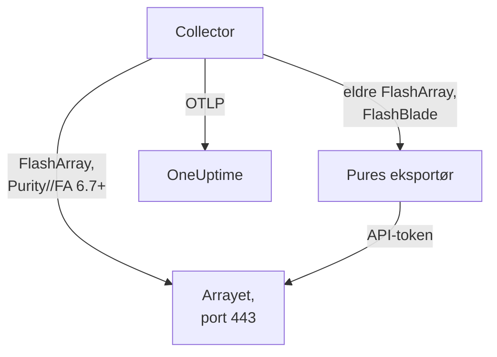

# Lagringsarray-agent

OneUptimes Storage Array-agent overvåker lagringsarrayer: kapasitet og datareduksjon, latens, IOPS og båndbredde, volumer, verter, pods og replikering, maskinvaretilstand, filsystemer og buckets. Den er en vanlig OpenTelemetry Collector som scraper arrayets OpenMetrics-endepunkter med API-tokenet til en skrivebeskyttet bruker, stempler hver metrikk med arrayets identitet og sender den til OneUptime. [Lagringsarray-overvåkere](/docs/monitor/storage-array-monitor) varsler ut fra det som kommer inn.

:::cards
- [Installer agenten](#installer-agenten): En skrivebeskyttet bruker, deretter installasjonsskriptet eller Docker Compose.
- [Hva agenten samler inn](#hva-agenten-samler-inn): Hvert endepunkt, og sidene som bygges fra det.
- [Overvåke flere arrayer](#overvåke-flere-arrayer): Én agent per array, på én maskin.
- [Feilsøking](#feilsøking): Et diagnoseskript, og de vanlige problemene.
:::

## Slik fungerer det

Storage Arrays er et produkt som fungerer likt for alle leverandører. Det støtter:

| Array | Slik leser agenten det | Collector-konfigurasjon |
| --- | --- | --- |
| **Pure Storage FlashArray**, Purity//FA 6.7 og nyere | Arrayets eget OpenMetrics-endepunkt (`https://<array>/metrics/...?namespace=purefa`): ingenting kjører ved siden av collectoren | `otel-collector-config.yaml` (standard) |
| **Pure Storage FlashArray**, eldre Purity//FA | Pures FlashArray OpenMetrics-eksportør, som den samme Compose-filen kjører som tjenesten `pure-fa-exporter` | `otel-collector-config.flasharray-exporter.yaml` |
| **Pure Storage FlashBlade** | Pures FlashBlade OpenMetrics-eksportør, som den samme Compose-filen kjører som tjenesten `pure-fb-exporter` | `otel-collector-config.flashblade.yaml` |

Pure Storage endret navn til **Everpure** i februar 2026. FlashArray, FlashBlade og Purity beholdt navnene sine, og det gjorde også metrikkene `purefa_*` og `purefb_*`, så alt på denne siden gjelder arrayer som selges under begge navnene.



Én agent overvåker ett array: Kjør én agent per array (se [Overvåke flere arrayer](#overvåke-flere-arrayer)). Arrayet registrerer seg med de første dataene sine, under navnet agenten stempler på hver metrikk som `storage.array.name`.

## Før du begynner

- Docker Engine 20.10 eller nyere med Docker Compose v2-pluginen, på en maskin som når arrayets administrasjonsgrensesnitt over HTTPS (TCP 443).
- En administratorkonto på arrayet, for å opprette en bruker med den innebygde rollen **readonly** og et API-token for den.
- En inntaksnøkkel. Opprett en under **Prosjektinnstillinger → Telemetri og APM → Inntaksnøkler** og kopier verdien.

### Hvor du kjører agenten

Agenten snakker med arrayets administrasjonsgrensesnitt over HTTPS, så den kan kjøre på hvilken som helst maskin med Docker og en rute til administrasjonsnettverket på TCP 443: en overvåkingsvert eller en liten administrasjons-VM. Foretrekk en maskin der egen lagring ikke ligger på arrayet den overvåker: Hvis arrayet går ned, bør ikke overvåkingen din gå ned med det. Den valgfrie syslog-lytteren krever også at arrayet når agenten på syslog-porten (se [Send arrayets syslog](#valgfritt-send-arrayets-syslog)).

## Installer agenten

:::steps
### Opprett den skrivebeskyttede brukeren og API-tokenet

Agenten leser bare. Gi den en egen bruker med den innebygde rollen **readonly**, aldri en administrator, og et API-token for den brukeren. Opprett tokenet **uten utløpsdato**, ellers stopper agenten den dagen tokenet utløper.

:::tabs
@tab Purity CLI
Koble til FlashArray med SSH som administrator. Den første kommandoen spør etter den nye brukerens passord; den andre skriver ut API-tokenet, en UUID:

```bash
pureadmin create --role readonly oneuptime
pureadmin create --api-token oneuptime
```
@tab FlashArray GUI
1. Åpne _Settings → Users and Policies_ (_Settings → Access_ i eldre utgivelser).
2. Velg **Create User…** fra ⋮-menyen i panelet **Users**, gi brukeren navnet `oneuptime` og gi den rollen readonly.
3. Velg **Create API Token…** fra den nye brukerens ⋮-meny, la **Expires In** stå tomt og kopier tokenet.
@tab FlashBlade
Opprett på samme måte en bruker med rollen **readonly** og et API-token for den: i brukerinnstillingene i FlashBlade-GUI-en, eller med `pureadmin` i Purity//FB-CLI-en. I en utgivelse uten lokale brukere bruker du en konto fra en katalogtjeneste (LDAP eller Active Directory) der gruppen er knyttet til rollen readonly. FlashBlade-API-tokener starter med `T-`.
:::

### Sjekk om FlashArray leverer sine egne metrikker

Pure dokumenterer det native OpenMetrics-endepunktet for **Purity//FA 6.7.0 og nyere** (utfasingsmeldingen for Pures FlashArray-eksportør sier 6.6.11 og nyere). Den raskeste måten å finne det ut på er å spørre arrayet, fra maskinen agenten skal kjøre på:

```bash
curl -k 'https://<array>/metrics/array?namespace=purefa' --header 'Authorization: Bearer <api-token>' | grep purefa_info
```

En linje `purefa_info{...} 1` betyr at arrayet leverer metrikkene sine nativt: Bruk standardkonfigurasjonen. En `404` betyr at det ikke gjør det: Bruk eksportørkonfigurasjonen, som kjører Pures eksportør ved siden av collectoren. Pure har faset ut den eksportøren, så gå over til den native konfigurasjonen når arrayet er oppgradert. En FlashBlade går alltid gjennom Pures FlashBlade-eksportør, så hopp over dette trinnet for den.

### Installer og start agenten

:::tabs
@tab install.sh
Last ned installasjonsskriptet og kjør det på maskinen som skal være vert for agenten:

```bash
curl -sSL https://raw.githubusercontent.com/OneUptime/oneuptime/master/agents/StorageArrayAgent/install.sh -o install.sh
bash install.sh
```

Skriptet spør hvilket array dette er (en FlashArray som leverer native metrikker, en FlashArray med eldre Purity//FA eller en FlashBlade), deretter etter OneUptime-URL-en din, inntaksnøkkelen, et navn på arrayet, arrayets administrasjonsadresse og API-tokenet til den skrivebeskyttede brukeren (lest uten ekko). Det installerer til `/opt/oneuptime-storage-array-agent`, laster ned Compose-filen og alle tre collector-konfigurasjonene, skriver en fil med `0600` kalt `.env` med samsvarende konfigurasjon og Compose-profil, og starter agenten med Docker Compose. Det setter hver verdi i anførselstegn for Docker Compose slik du skrev den. Å kjøre det igjen gjenbruker alt i en eksisterende `.env`-fil i stedet for å spørre på nytt, og beholder en fil du har redigert som `<file>.bak.<timestamp>` før den erstattes.
@tab Docker Compose
Last ned `docker-compose.yml` og de tre filene `otel-collector-config*.yaml` fra [StorageArrayAgent-mappen](https://github.com/OneUptime/oneuptime/tree/master/agents/StorageArrayAgent) til en ny mappe:

```bash
curl -fsSLO https://raw.githubusercontent.com/OneUptime/oneuptime/master/agents/StorageArrayAgent/docker-compose.yml
curl -fsSLO https://raw.githubusercontent.com/OneUptime/oneuptime/master/agents/StorageArrayAgent/otel-collector-config.yaml
curl -fsSLO https://raw.githubusercontent.com/OneUptime/oneuptime/master/agents/StorageArrayAgent/otel-collector-config.flasharray-exporter.yaml
curl -fsSLO https://raw.githubusercontent.com/OneUptime/oneuptime/master/agents/StorageArrayAgent/otel-collector-config.flashblade.yaml
```

Opprett en `.env`-fil ved siden av dem. Den inneholder API-tokenet, så hold den privat med `chmod 600 .env`. For en FlashArray som leverer native metrikker:

```bash title=".env"
ONEUPTIME_URL=YOUR_ONEUPTIME_URL
ONEUPTIME_TELEMETRY_INGESTION_KEY=YOUR_TELEMETRY_INGESTION_TOKEN
STORAGE_ARRAY_NAME=my-storage-array
STORAGE_SYSTEM=purestorage.flasharray
STORAGE_ARRAY_COLLECTOR_CONFIG=otel-collector-config.yaml
COMPOSE_PROFILES=
PURE_FA_ENDPOINT=fa-prod-01.example.com
PURE_FA_API_TOKEN=YOUR_READ_ONLY_API_TOKEN
PURE_FB_ENDPOINT=
PURE_FB_API_TOKEN=
STORAGE_ARRAY_INSECURE_SKIP_VERIFY=true
```

For en FlashArray med eldre Purity//FA setter du `STORAGE_ARRAY_COLLECTOR_CONFIG=otel-collector-config.flasharray-exporter.yaml` og `COMPOSE_PROFILES=flasharray-exporter`. For en FlashBlade setter du `STORAGE_SYSTEM=purestorage.flashblade`, `STORAGE_ARRAY_COLLECTOR_CONFIG=otel-collector-config.flashblade.yaml` og `COMPOSE_PROFILES=flashblade`, og fyller inn `PURE_FB_ENDPOINT` og `PURE_FB_API_TOKEN` i stedet for paret `PURE_FA_*`. Start agenten:

```bash
docker compose up -d
```
:::

### Sjekk at agenten kjører

```bash
docker compose ps
docker logs -f oneuptime-storage-array-agent
```

`docker compose ps` viser collectoren (`oneuptime-storage-array-agent`) og, med en eksportørkonfigurasjon, eksportøren (`pure-fa-exporter` eller `pure-fb-exporter`). Collectorens logger skal vise denne linjen når den har startet:

```text
Everything is ready. Begin running and processing data.
```

### Finn arrayet i OneUptime

Åpne **Produkter → Infrastruktur → Storage Arrays → All Storage Arrays**. Etter den første scrapen (omtrent ett minutt) er arrayet der med kapasitet, ytelse, åpne varsler og maskinvare. Volumer, verter og pods følger innen 2 minutter, en FlashBlades filsystemer og buckets innen 5, og FlashArray-kataloger innen 30.
:::

## Miljøvariabler

Installasjonsskriptet skriver disse til `/opt/oneuptime-storage-array-agent/.env`; en Docker Compose-installasjon leser dem fra `.env` ved siden av `docker-compose.yml`. Etter at du har endret en, kjør `docker compose up -d` i den mappen.

| Variabel | Påkrevd | Beskrivelse |
| --- | --- | --- |
| `ONEUPTIME_URL` | Ja | OneUptime-URL-en din, for eksempel `https://oneuptime.com` eller den selvhostede instansen din. Bruk `http://` og porten hvis instansen bare bruker HTTP. |
| `ONEUPTIME_TELEMETRY_INGESTION_KEY` | Ja | Inntaksnøkkelen fra **Prosjektinnstillinger → Telemetri og APM → Inntaksnøkler**. |
| `STORAGE_ARRAY_NAME` | Ja | Navnet arrayet registreres under i OneUptime, stemplet på hver metrikk som ressursattributtet `storage.array.name`. Hold det stabilt: å endre det senere registrerer et nytt array. Collectoren nekter å starte uten det. |
| `STORAGE_SYSTEM` | Nei | Plattformen, stemplet som ressursattributtet `storage.system`: `purestorage.flasharray` eller `purestorage.flashblade`. Standard er `purestorage.flasharray`. |
| `STORAGE_ARRAY_COLLECTOR_CONFIG` | Nei | Hvilken medfølgende collector-konfigurasjon som kjører: `otel-collector-config.yaml` (FlashArray, nativ: standard), `otel-collector-config.flasharray-exporter.yaml` (eldre FlashArray) eller `otel-collector-config.flashblade.yaml` (FlashBlade). |
| `COMPOSE_PROFILES` | Nei | Starter eksportøren som den valgte konfigurasjonen scraper: tom for den native FlashArray-konfigurasjonen, `flasharray-exporter` eller `flashblade` for de to andre. |
| `PURE_FA_ENDPOINT` | FlashArray | FlashArrayens administrasjonsadresse: et vertsnavn eller en IP, uten `https://`. |
| `PURE_FA_API_TOKEN` | FlashArray | API-tokenet til FlashArray-brukeren med rollen readonly. |
| `PURE_FB_ENDPOINT` | FlashBlade | FlashBladens administrasjonsadresse: et vertsnavn eller en IP, uten `https://`. |
| `PURE_FB_API_TOKEN` | FlashBlade | API-tokenet til FlashBlade-brukeren med rollen readonly. |
| `STORAGE_ARRAY_INSECURE_SKIP_VERIFY` | Nei | `true` godtar arrayets selvsignerte sertifikat på det native endepunktet; `false` verifiserer det. Standard er `true`. Pures eksportører verifiserer aldri arrayets sertifikat, så det gjelder ikke for dem. |

## Slik scraper agenten

- **Én scrape-jobb per endepunkt, hver lest så ofte som det er verdt.** FlashArray: `/metrics/array` hvert 60. sekund; `/metrics/volumes`, `/metrics/hosts` og `/metrics/pods` hvert 2. minutt; `/metrics/directories` hvert 30. minutt, som er Pures eget råd, siden plassen til kataloger er krevende for arrayet å beregne. FlashBlade: `/metrics/array` hvert 60. sekund; `/metrics/filesystems` og `/metrics/objectstore` hvert 5. minutt, igjen etter Pures råd om å lese endepunktene for filsystemer og objektlager sjeldnere enn arrayet.
- **Hver jobb merker seriene sine med `scrape_endpoint: <endpoint>`.** Hvert endepunkt eksporterer også `purefa_info` eller `purefb_info`, så OneUptime vet hvilke familier en batch er den fullstendige listen over: Det er slik et slettet volum, en vert, en pod, et filsystem eller en bucket forlater inventaret i stedet for å bli hengende. Behold etikettene slik de leveres.
- **Latens per volum og per vert beholder tre dimensjoner.** Hvert volum og hver vert eksporterer latensen sin i opptil seksten `dimension`-er. En regel `metric_relabel_configs` beholder `usec_per_read_op`, `usec_per_write_op` og `usec_per_mirrored_write_op` og dropper oppdelingen etter QoS-hastighetsgrense, kø, SAN og tjenestetid, som mangedobler seriene i et stort array. Den arrayomfattende oppdelingen på `purefa_array_performance_latency_usec` beholdes. Slett regelen for også å beholde oppdelingen per volum.
- **API-tokenet er et Bearer-token.** Den native konfigurasjonen sender det til selve arrayet; eksportørkonfigurasjonene sender det bare til eksportøren over Compose-nettverket, og eksportørenes porter publiseres aldri.
- **Ingen `send_batch_max_size`.** OneUptime bygger inventaret på nytt fra én hel scrape per forespørsel, så den medfølgende prosessoren `batch` deler aldri en scrape over flere eksporter. Behold batch-innstillingene slik de leveres.

## Hva agenten samler inn

Pures semantiske konvensjoner deles av det native FlashArray-endepunktet og begge eksportørene. Hver verdi er en gauge som arrayet selv beregner (latenser i mikrosekunder per operasjon, gjennomstrømning per sekund), så ingen rater må beregnes, og objekter navngis med **datapunktetiketter**: `name` for volumer, pods, kataloger, filsystemer og buckets, `host` for verter, `component_name` for FlashArray-maskinvare. Agenten legger til ressursattributtene `storage.array.name` og `storage.system`, så OneUptime arkiverer alt under arrayet ditt:

| Endepunkt | Metrikkfamilier | Hva OneUptime bygger av dem |
| --- | --- | --- |
| FlashArray `/metrics/array` | `purefa_info`, `purefa_alerts_open`, `purefa_array_space_*`, `purefa_array_performance_*`, `purefa_hw_component_status`, `purefa_hw_component_temperature_celsius`, `purefa_hw_controller_info`, `purefa_drive_capacity_bytes`, `purefa_network_interface_*` | Arrayets navn, Purity-versjon og system-ID; kapasitet, brukt plass og datareduksjon; antall åpne varsler; arrayets tilstand; siden **Hardware** (komponenter, disker, kontrollere, nettverksgrensesnitt) |
| FlashArray `/metrics/volumes` | `purefa_volume_performance_*`, `purefa_volume_space_*`, `purefa_volume_qos_*` | Siden **Volumer**: tildelt og fysisk størrelse, datareduksjon, lese- og skrivelatens, IOPS og båndbredde per volum |
| FlashArray `/metrics/hosts` | `purefa_host_connectivity_info`, `purefa_host_connections_info`, `purefa_host_performance_*`, `purefa_host_space_*` | Siden **Verter**: tilkobling (redundante stier eller ikke), tilkoblede volumer, latens, IOPS og båndbredde per vert |
| FlashArray `/metrics/pods` | `purefa_pod_performance_*`, `purefa_pod_space_*`, `purefa_pod_replica_links_*`, `purefa_pod_mediator_status` | Siden **Replication**: ActiveCluster- og ActiveDR-pods, status og etterslep for replikalenker |
| FlashArray `/metrics/directories` | `purefa_directory_performance_*`, `purefa_directory_space_*` | Siden **Directories** (FlashArray File Services) |
| FlashBlade `/metrics/array` | `purefb_info`, `purefb_alerts_open`, `purefb_array_space_*`, `purefb_array_performance_*`, `purefb_hardware_health` | FlashBladens navn, Purity-versjon og system-ID; kapasitet og datareduksjon; antall åpne varsler; arrayets tilstand; siden **Hardware** |
| FlashBlade `/metrics/filesystems` | `purefb_file_systems_space_*`, `purefb_file_systems_performance_*` | Siden **File Systems**: tildelt og brukt plass, datareduksjon, latens, IOPS og båndbredde per filsystem |
| FlashBlade `/metrics/objectstore` | `purefb_buckets_space_*`, `purefb_buckets_quota_space_bytes`, `purefb_buckets_object_count`, `purefb_buckets_performance_*`, `purefb_object_store_accounts_*` | Siden **Buckets**: plass, kvote, antall objekter og ytelse per bucket, gruppert etter konto |

Arrayets tilstand på siden **Oversikt** er **Kritisk** så lenge det rapporterer et åpent kritisk varsel, eller en maskinvarekomponent, disk eller kontroller som er kritisk, har feilet, mangler eller er usunn; **Warning** så lenge det rapporterer et åpent advarselsvarsel, eller en degradert eller ukjent komponent; og ellers **OK**. I overvåkingskriterier får arrayets attributter prefikset `resource.` (`resource.storage.array.name`, `resource.storage.system`), mens datapunktetikettene står uten prefiks (`name`, `host`, `dimension`, `space`).

## Valgfritt — Send arrayets syslog

Som standard sender agenten bare metrikker, så arrayets side **Logger** forblir tom. Arrayer videresender varslene og revisjonshendelsene sine som syslog, og hver medfølgende collector-konfigurasjon har et utkommentert mottakerpar `syslog` (TCP og UDP på port 5514, RFC 3164), koblet til en utkommentert pipeline `logs` som stempler `storage.array.name`, så loggene havner på arrayet ditt.

:::steps
### Slå på mottakerne

Fjern kommentarene rundt de to mottakerne `syslog/*` og pipelinen `logs` i collector-konfigurasjonen du bruker. Tidsstempler etter RFC 3164 har ingen tidssone: Sett `location` til arrayets tidssone, med mindre klokken går på UTC.

### Åpne porten

Fjern kommentaren rundt blokken `ports:` i `docker-compose.yml`, så maskinen publiserer `5514/tcp` og `5514/udp`, og kjør deretter `docker compose up -d`. Åpne porten i maskinens brannmur for arrayets administrasjonsnettverk.

### Pek arrayet mot agenten

Gjør dette som administrator, ikke som den skrivebeskyttede overvåkingsbrukeren. På en FlashArray åpner du _Settings → System → Syslog Servers_, legger til `udp://<agent-host>:5514` (eller `tcp://<agent-host>:5514`) og sender en testmelding. På en FlashBlade legger du til en syslog-server med samme URI i syslog-innstillingene. Begge arrayene godtar formen `PROTOCOL://HOST:PORT`, også via REST-API-ene sine (`syslog-servers`).
:::

En syslog-mottaker lytter bare på én transport, og derfor er TCP og UDP to mottakere: La den ene stå utkommentert hvis du bare trenger den andre. Collectorens standardimage leser syslog som det er: Det trengs ikke noe eget image.

## Merk arrayet med prosjektetiketter

Et ressursattributt som starter med `oneuptime.label.`, blir en prosjektetikett på lagringsarrayet: `oneuptime.label.<dimension>=<value>` er etiketten `<dimension>:<value>`. Legg til attributtene i prosessoren `resource` i collector-konfigurasjonen du bruker, ved siden av `storage.array.name`:

```yaml
processors:
  resource:
    attributes:
      # ...existing attributes...
      - key: oneuptime.label.team
        value: storage
        action: upsert
      - key: oneuptime.label.env
        value: production
        action: upsert
```

Collectoren leser konfigurasjonen bare når den starter: Kjør `docker compose restart oneuptime-storage-array-agent`. Arrayet viser deretter etikettene `team:storage` og `env:production`. Etiketter sammenlignes uten hensyn til store og små bokstaver, så en eksisterende etikett `Production` gjenbrukes i stedet for å dupliseres, og agenten fjerner aldri en etikett som noen har lagt til i OneUptime.

## Overvåke flere arrayer

Én agent leser ett array. For å overvåke flere fra samme maskin installerer du hver i sin egen mappe med sin egen `.env`, for eksempel `INSTALL_DIR=/opt/oneuptime-storage-array-agent-fa02 bash install.sh`, og gir hver sitt eget `container_name` i sin `docker-compose.yml` (for eksempel `oneuptime-storage-array-agent-fa02`): To containere kan ikke dele et navn. Send mappen til diagnoseskriptet med `-d`.

## Kjør som en systemd-tjeneste

For å starte agenten sammen med maskinen og starte den på nytt når den feiler, installer systemd-enheten dens. Den forutsetter at agenten ligger i `/opt/oneuptime-storage-array-agent`, der installasjonsskriptet legger den:

```bash
sudo curl -fsSL https://raw.githubusercontent.com/OneUptime/oneuptime/master/agents/StorageArrayAgent/systemd/oneuptime-storage-array-agent.service -o /etc/systemd/system/oneuptime-storage-array-agent.service
sudo systemctl daemon-reload
sudo systemctl enable --now oneuptime-storage-array-agent
```

## Oppgradere agenten

Agenten rapporterer collector-versjonen som filene dens fester, som sin **Agentversjon**. Når den er eldre enn versjonen denne OneUptime-utgivelsen fester, vises et varseltegn ved siden av den på arrayets side **Oversikt**. Velg det for å se disse kommandoene. En agent som ble installert før filene rapporterte en versjon, viser ingen før den er oppgradert på denne måten.

Collector-imaget er festet i `docker-compose.yml`, og konfigurasjonene er filer ved siden av, så å hente nye images alene flytter ikke agenten fremover. Kjør `install.sh` igjen: det gjenbruker hver verdi i den eksisterende `.env`-filen din (ingenting spørres om igjen), fornyer `docker-compose.yml` og de tre collector-konfigurasjonene (en fil du har redigert, beholdes som `<file>.bak.<timestamp>`) og oppretter agenten på nytt, slik at collectoren leser den nye konfigurasjonen. En agent som er installert utenfor `/opt/oneuptime-storage-array-agent`, trenger mappen sin: `INSTALL_DIR=<folder> bash install.sh`.

```bash
curl -sSL https://raw.githubusercontent.com/OneUptime/oneuptime/master/agents/StorageArrayAgent/install.sh -o install.sh
bash install.sh
```

Installerte du den med Docker Compose i stedet? I agentens mappe, last ned Compose-filen og de tre collector-konfigurasjonene på nytt (og gjør eventuelle endringer du hadde gjort i dem, på nytt), hent deretter imagene og opprett agenten på nytt:

```bash
curl -fsSLO https://raw.githubusercontent.com/OneUptime/oneuptime/master/agents/StorageArrayAgent/docker-compose.yml
curl -fsSLO https://raw.githubusercontent.com/OneUptime/oneuptime/master/agents/StorageArrayAgent/otel-collector-config.yaml
curl -fsSLO https://raw.githubusercontent.com/OneUptime/oneuptime/master/agents/StorageArrayAgent/otel-collector-config.flasharray-exporter.yaml
curl -fsSLO https://raw.githubusercontent.com/OneUptime/oneuptime/master/agents/StorageArrayAgent/otel-collector-config.flashblade.yaml
docker compose pull
docker compose up -d --force-recreate
```

## Avinstallere agenten

```bash
cd /opt/oneuptime-storage-array-agent
docker compose down
```

Slett deretter den skrivebeskyttede brukeren og API-tokenet dens på arrayet hvis du ikke lenger trenger dem.

## Feilsøking

:::details Kjør diagnoseskriptet først
Agenten leveres med et skript, [`troubleshoot.sh`](https://github.com/OneUptime/oneuptime/blob/master/agents/StorageArrayAgent/troubleshoot.sh), som sjekker hele kjeden: container-kjøretiden; arrayets endepunkt akkurat slik collectoren når det (det native endepunktet eller Pures eksportør: DNS, TLS, om en FlashArray i det hele tatt har det native endepunktet, og om arrayet godtar API-tokenet, som skriptet gir til curl via stdin); arraynavnet som er stemplet på hver metrikk; tokenets form; collectorens egne metrikker; og om OneUptime godtar inntaksnøkkelen. Den siste sjekken betyr mest. OneUptime avviser en dårlig nøkkel med `401` (`422` for en deaktivert nøkkel eller en nettlesernøkkel), og collectoren behandler begge som permanente: den dropper batchen og logger én `Exporting failed`-feil, som er lett å overse mens containeren forblir sunn. Skriptet spør `GET <url>/otlp/v1/validate` innenfra agentens nettverk for et direkte `200` (gyldig) eller `401` (ugyldig), og faller tilbake til `POST /fluentd/v1/logs` på eldre servere.

```bash
curl -sSL https://raw.githubusercontent.com/OneUptime/oneuptime/master/agents/StorageArrayAgent/troubleshoot.sh -o troubleshoot.sh
bash troubleshoot.sh    # add -d <dir> if you installed outside /opt/oneuptime-storage-array-agent
```

Det avslutter med en dom som navngir den mest sannsynlige årsaken.
:::

:::details Det vises ikke noe array i OneUptime
1. Les collectorens logger: `docker logs oneuptime-storage-array-agent`. `server returned HTTP status 401` betyr at arrayet avviste API-tokenet, `404` at FlashArray ikke har noe nativt endepunkt, `x509` at TLS-verifisering er på mot arrayets selvsignerte sertifikat, `no such host` eller `connection refused` feil `PURE_FA_ENDPOINT` eller `PURE_FB_ENDPOINT`, og en `401` ved eksport en dårlig inntaksnøkkel.
2. Spør arrayet fra agentens nettverk. Collector-imaget har verken skall eller curl, så spør fra en container i nettverket dens: `docker run --rm --network container:oneuptime-storage-array-agent curlimages/curl -sk -H 'Authorization: Bearer <api-token>' 'https://<array>/metrics/array?namespace=purefa'` skal skrive ut `purefa_*`-linjer.
3. Sjekk at `STORAGE_ARRAY_NAME` er satt: Arrayet finnes ut fra ressursattributtet `storage.array.name`, og collectoren nekter å starte uten det.
:::

:::details Arrayet vises som frakoblet
Et array blir frakoblet når OneUptime ikke har mottatt noe fra det på 15 minutter; OneUptime sjekker hvert 5. minutt, og tid da OneUptime selv ikke mottok data, teller ikke. Sjekk at collectoren kjører (`docker compose ps`), at loggene ikke viser scrape- eller eksportfeil, og at maskinen fortsatt når arrayet og OneUptime-URL-en din. Arrayet blir tilkoblet igjen med de neste dataene.
:::

:::details FlashArray svarer 404
Purity//FA-versjonen har ikke noe nativt OpenMetrics-endepunkt. Kjør `install.sh` igjen og velg alternativet for eldre Purity, eller sett `STORAGE_ARRAY_COLLECTOR_CONFIG=otel-collector-config.flasharray-exporter.yaml` og `COMPOSE_PROFILES=flasharray-exporter` i `.env` og kjør `docker compose up -d`. Etter at arrayet er oppgradert til Purity//FA 6.7 eller nyere, bytter du tilbake til den native konfigurasjonen og fjerner profilen.
:::

:::details Arrayet avviser API-tokenet
Sjekk at du limte inn API-tokenet og ikke brukerens passord, at brukeren fortsatt finnes og har rollen readonly, og at tokenet ikke har utløpt. Opprett et nytt token (`pureadmin create --api-token oneuptime` på en FlashArray), legg det i `.env` og kjør `docker compose up -d`. Gjennom Pures eksportører vises et avvist token i collectorens logg som en HTTP `400` fra eksportøren, med innholdet `failed to login`.
:::

:::details x509- eller TLS-feil
Arrayer presenterer som standard et selvsignert sertifikat, som ingen Docker-image stoler på. Sett enten `STORAGE_ARRAY_INSECURE_SKIP_VERIFY=true` (det praktiske valget på et privat administrasjonsnettverk), eller installer et sertifikat på arrayet fra en CA som collector-imaget stoler på.
:::

:::details pure-fa-exporter eller pure-fb-exporter kan ikke slås opp
Eksportøren kjører ikke: `COMPOSE_PROFILES` må samsvare med `STORAGE_ARRAY_COLLECTOR_CONFIG` (`flasharray-exporter` for FlashArray-eksportørkonfigurasjonen, `flashblade` for FlashBlade-konfigurasjonen). Rett `.env` og kjør `docker compose up -d`; `docker compose ps` viser da eksportøren.
:::

:::details Slettede volumer eller verter blir værende i inventaret
OneUptime fjerner et objekt når en fullstendig scrape av endepunktet ikke lenger har det, noe den kjenner igjen på etiketten `scrape_endpoint`. Hvis du har erstattet den medfølgende collector-konfigurasjonen med din egen, behold etikettene `scrape_endpoint` på scrape-jobbene; ellers forlater objekter inventaret først når de blir foreldet.
:::

:::details Metrikker havner under feil array
OneUptime registrerer et lagringsarray etter `storage.array.name`, som agenten tar fra `STORAGE_ARRAY_NAME`. Å endre det etter de første dataene oppretter et nytt array i stedet for å gi det første nytt navn.
:::

:::details Sende metrikker uten agenten
Agenten er én vanlig collector-konfigurasjon, så collectorer du allerede kjører, kan gjøre den samme jobben: Kopier scrape-jobbene og prosessoren `resource` fra den medfølgende konfigurasjonen inn i din egen. Ressursattributtet `storage.array.name` er det som registrerer arrayet i OneUptime, og slettingene av `service.name` / `service.instance.id` hindrer at dataene arkiveres under en tjeneste: Behold begge, og behold etikettene `scrape_endpoint`.
:::

## Neste trinn

:::cards
- [Lagringsarray-overvåking](/docs/monitor/storage-array-monitor): Varsle om varsler, kapasitet, latens, maskinvare, vertsstier, replikering og filsystemer.
- [VMware-agent](/docs/telemetry/vmware): Kjører du VMware på arrayet? Se også datastorene og VM-ene.
- [OpenTelemetry-collector på verten](/docs/telemetry/host-otel-collector): Operativsystemets visning av maskinene som bruker arrayet.
:::
