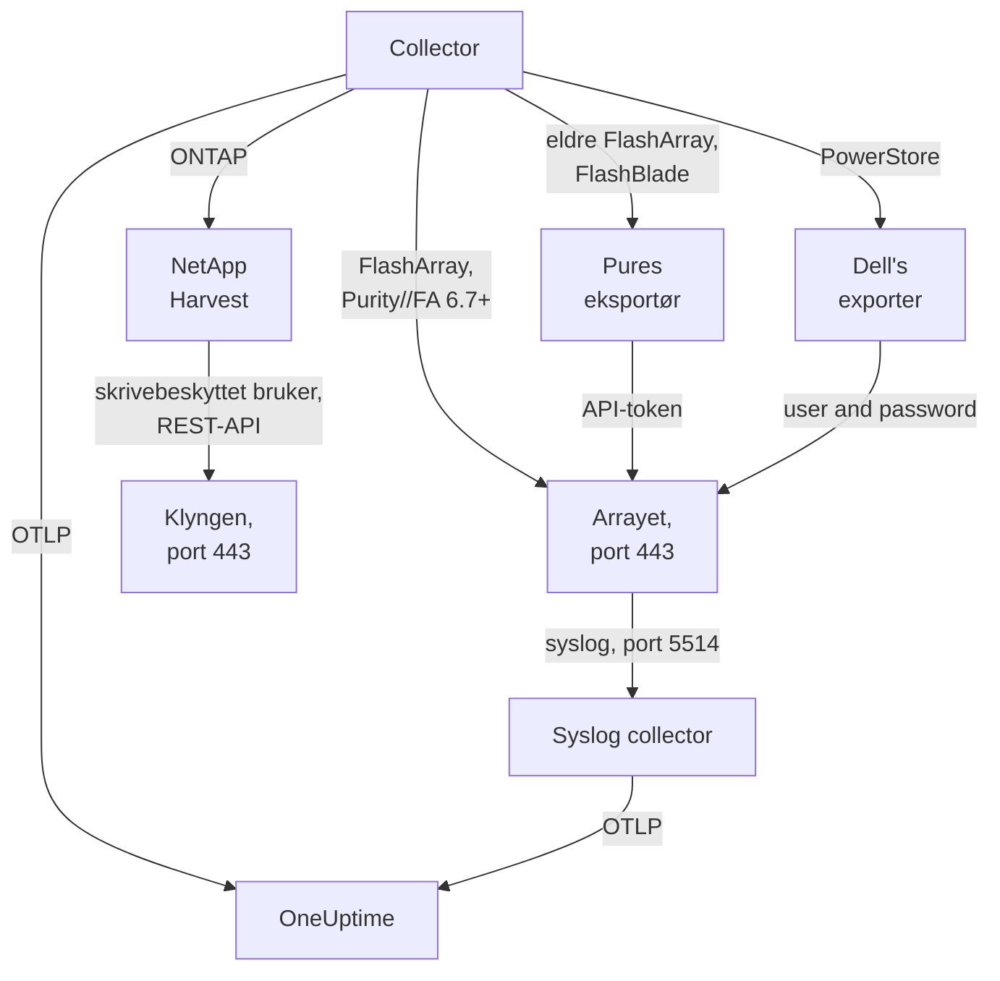

# Lagringsarray-agent

OneUptimes Lagringsarray-agent overvåker lagringsarrayer: kapasitet og datareduksjon, latens, IOPS og båndbredde, volumer, verter, pods og replikering, maskinvaretilstand, filsystemer og buckets, og på NetApp ONTAP aggregatene, SVM-ene, LUN-ene og SnapMirror-relasjonene. Den er en vanlig OpenTelemetry Collector som scraper arrayets OpenMetrics-endepunkter med API-tokenet til en skrivebeskyttet bruker (eller, for ONTAP, NetApps egen Harvest-eksportør ved siden av), stempler hver måling med arrayets identitet og sender den til OneUptime. [Lagringsarray-monitorer](/docs/monitor/storage-array-monitor) varsler ut fra det som kommer inn.

:::cards
- [Installer agenten](#installer-agenten): En skrivebeskyttet bruker, deretter installasjonsskriptet eller Docker Compose.
- [Dell PowerScale](#dell-powerscale): SNMP på klyngen, hver node avspurt, og hva sidene viser.
- [Hva agenten samler inn](#hva-agenten-samler-inn): Hvert endepunkt, og sidene som bygges fra det.
- [Overvåke flere arrayer](#overvåke-flere-arrayer): Én agent per array, på én maskin.
- [Dell PowerMax](#dell-powermax): Ingen agent: en sonde leser hvert array bak Unisphere.
- [Feilsøking](#feilsøking): Et diagnoseskript, og de vanlige problemene.
:::

## Slik fungerer det

Storage Arrays er et produkt som fungerer likt for alle leverandører. Det støtter:

| Array | `storage.system` | Slik leser agenten det | Collector-konfigurasjon |
| --- | --- | --- | --- |
| **Pure Storage FlashArray**, Purity//FA 6.7 og nyere | `purestorage.flasharray` | Arrayets eget OpenMetrics-endepunkt (`https://<array>/metrics/...?namespace=purefa`): ingenting kjører ved siden av collectoren | `otel-collector-config.yaml` (standard) |
| **Pure Storage FlashArray**, eldre Purity//FA | `purestorage.flasharray` | Pures FlashArray OpenMetrics-eksportør, som den samme Compose-filen kjører som tjenesten `pure-fa-exporter` | `otel-collector-config.flasharray-exporter.yaml` |
| **Pure Storage FlashBlade** | `purestorage.flashblade` | Pures FlashBlade OpenMetrics-eksportør, som den samme Compose-filen kjører som tjenesten `pure-fb-exporter` | `otel-collector-config.flashblade.yaml` |
| **Dell PowerStore** | `dell.powerstore` | Dells PowerStore Metrics Exporter, som den samme Compose-filen bygger og kjører som tjenesten `powerstore-exporter`; klyngens varsler kommer via syslog til tjenesten `powerstore-syslog` | `otel-collector-config.powerstore.yaml` |
| **NetApp ONTAP** 9.12.1 og nyere (AFF, FAS, ASA, ONTAP Select, Cloud Volumes ONTAP), og **Amazon FSx for NetApp ONTAP** | `netapp.ontap` | [NetApp Harvest](https://github.com/NetApp/harvest) 26.11, som den samme Compose-filen kjører som tjenesten `netapp-harvest`: den logger inn på klyngens REST-API med en skrivebeskyttet bruker og et passord | `otel-collector-config.netapp-ontap.yaml` |
| **Dell PowerScale** (Isilon), OneFS 8.0 og nyere | `dell.powerscale` | Hver node over SNMP (Dells ISILON-MIB), med collectorens egen SNMP-mottaker: ingenting kjører ved siden av collectoren | `otel-collector-config.powerscale.yaml` |

ONTAP har ikke sitt eget målingsendepunkt, så agenten kjører NetApps eksportør med åpen kildekode, Harvest, ved siden av collectoren. Harvest leser klyngens REST-API og leverer det den har lest, på Compose-nettverket, med hver serie navngitt `netapp_<object>_<counter>`; collectoren scraper Harvest og sender dataene videre. Harvest skriver aldri til klyngen, og AutoSupport-rapporten til NetApp er slått av.

**Dell PowerMax** (`dell.powermax`) trenger ingen agent: en OneUptime-sonde leser med en skrivebeskyttet konto hvert array som en Unisphere for PowerMax administrerer. Se [Dell PowerMax](#dell-powermax).

Pure Storage endret navn til **Everpure** i februar 2026. FlashArray, FlashBlade og Purity beholdt navnene sine, og det gjorde også målingene `purefa_*` og `purefb_*`, så alt på denne siden gjelder arrayer som selges under begge navnene.

En **Dell PowerScale**-klynge leses på en annen måte: agenten avspør hver av nodene over SNMP, med en skrivebeskyttet community eller SNMPv3-bruker og uten API-token. [Dell PowerScale](#dell-powerscale) tar deg fra å slå på SNMP til hva sidene viser; installasjonstrinnene nedenfor gjelder Pure Storage.



Én agent overvåker ett array: Kjør én agent per array (se [Overvåke flere arrayer](#overvåke-flere-arrayer)). Arrayet registrerer seg med de første dataene sine, under navnet agenten stempler på hver måling som `storage.array.name`.

## Før du begynner

- Docker Engine 20.10 eller nyere med Docker Compose v2-pluginen, på en maskin som når arrayets administrasjonsgrensesnitt over HTTPS (TCP 443).
- En administratorkonto på arrayet, for å opprette en bruker med den innebygde rollen **readonly** og et API-token for den. På ONTAP en klyngeadministrator (på Amazon FSx for NetApp ONTAP `fsxadmin`), for å opprette en skrivebeskyttet REST-bruker med passord.
- For en Dell PowerStore en x86-64-maskin (Dell bygger eksportøren sin bare for x86-64) og en PowerStore-bruker for agenten: se [Dell PowerStore](#dell-powerstore).
- En inntaksnøkkel. Opprett en under **Prosjektinnstillinger → Telemetri og APM → Inntaksnøkler** og kopier verdien.

### Hvor du kjører agenten

Agenten snakker med arrayets administrasjonsgrensesnitt over HTTPS, så den kan kjøre på hvilken som helst maskin med Docker og en rute til administrasjonsnettverket på TCP 443: en overvåkingsvert eller en liten administrasjons-VM. Foretrekk en maskin der egen lagring ikke ligger på arrayet den overvåker: Hvis arrayet går ned, bør ikke overvåkingen din gå ned med det. Den valgfrie syslog-lytteren krever også at arrayet når agenten på syslog-porten (se [Send arrayets syslog](#valgfritt-send-arrayets-syslog)).

## Installer agenten

:::steps
### Opprett den skrivebeskyttede brukeren og API-tokenet

Agenten leser bare. Gi den en egen bruker med den innebygde rollen **readonly**, aldri en administrator, og et API-token for den brukeren. Opprett tokenet **uten utløpsdato**, ellers stopper agenten den dagen tokenet utløper.

:::tabs
@tab Purity CLI
Koble til FlashArray med SSH som administrator. Den første kommandoen spør etter den nye brukerens passord; den andre skriver ut API-tokenet, en UUID:

```bash
pureadmin create --role readonly oneuptime
pureadmin create --api-token oneuptime
```
@tab FlashArray GUI
1. Åpne _Settings → Users and Policies_ (_Settings → Access_ i eldre utgivelser).
2. Velg **Create User…** fra ⋮-menyen i panelet **Users**, gi brukeren navnet `oneuptime` og gi den rollen readonly.
3. Velg **Create API Token…** fra den nye brukerens ⋮-meny, la **Expires In** stå tomt og kopier tokenet.
@tab FlashBlade
Opprett på samme måte en bruker med rollen **readonly** og et API-token for den: i brukerinnstillingene i FlashBlade-GUI-en, eller med `pureadmin` i Purity//FB-CLI-en. I en utgivelse uten lokale brukere bruker du en konto fra en katalogtjeneste (LDAP eller Active Directory) der gruppen er knyttet til rollen readonly. FlashBlade-API-tokener starter med `T-`.
@tab ONTAP CLI
Koble til klyngens administrasjonsadresse med SSH som administrator. Den første kommandoen oppretter en REST-rolle som kan lese alle API-er og ingenting annet; den andre oppretter en HTTP-bruker som har rollen, og spør etter passordet:

```bash
security login rest-role create -role oneuptime-readonly -api /api -access readonly
security login create -user-or-group-name oneuptime -application http -authentication-method password -role oneuptime-readonly
```

Agenten logger inn med denne brukeren og passordet. Det brukes ikke noe API-token.
@tab ONTAP System Manager
1. Åpne _Cluster → Settings → Users and Roles_.
2. Velg **Add** under **Roles**, gi rollen navnet `oneuptime-readonly`, skriv inn `/api` som **REST API path** og velg tilgangen **Read-Only**.
3. Velg **Add** under **Users**, gi brukeren navnet `oneuptime`, gi den den nye rollen, legg til påloggingsmetoden **HTTP** med **Password** og angi passordet.
@tab Amazon FSx for NetApp ONTAP
Koble til filsystemets administrasjonsendepunkt (DNS-navnet eller IP-en fra FSx-konsollen) med SSH som `fsxadmin`, og opprett brukeren med den forhåndsdefinerte skrivebeskyttede rollen til FSx. Kommandoen spør etter passordet:

```bash
security login create -user-or-group-name oneuptime -application http -authentication-method password -role fsxadmin-readonly
```

AWS drifter maskinvaren til filsystemet, så FSx svarer ikke på noens spørsmål om disker, diskhyller eller sensorer: arrayets side **Maskinvare** viser nodene og portene og sier fra om det.
:::

### Sjekk om FlashArray leverer sine egne målinger

Pure dokumenterer det native OpenMetrics-endepunktet for **Purity//FA 6.7.0 og nyere** (utfasingsmeldingen for Pures FlashArray-eksportør sier 6.6.11 og nyere). Den raskeste måten å finne det ut på er å spørre arrayet, fra maskinen agenten skal kjøre på:

```bash
curl -k 'https://<array>/metrics/array?namespace=purefa' --header 'Authorization: Bearer <api-token>' | grep purefa_info
```

En linje `purefa_info{...} 1` betyr at arrayet leverer målingene sine nativt: Bruk standardkonfigurasjonen. En `404` betyr at det ikke gjør det: Bruk eksportørkonfigurasjonen, som kjører Pures eksportør ved siden av collectoren. Pure har faset ut den eksportøren, så gå over til den native konfigurasjonen når arrayet er oppgradert. En FlashBlade går alltid gjennom Pures FlashBlade-eksportør, og en ONTAP-klynge gjennom NetApp Harvest, så hopp over dette trinnet for dem.

### Installer og start agenten

Hver OneUptime leverer agentens installasjonsskript og filer fra sin egen utgivelse: Kommandoene nedenfor laster dem ned fra `https://oneuptime.com`, så på en selvdriftet OneUptime erstatter du den adressen med URL-en din. Installasjonsskriptet lagres først som `install.sh`, slik at du kan lese det før du kjører det.

:::tabs
@tab install.sh
Last ned installasjonsskriptet og kjør det på maskinen som skal være vert for agenten:

```bash
curl -fsSL https://oneuptime.com/install/storage-array-agent -o install.sh
bash install.sh
```

Skriptet spør hvilket array dette er (en FlashArray som leverer native målinger, en FlashArray med eldre Purity//FA, en FlashBlade eller en NetApp ONTAP-klynge), deretter etter OneUptime-URL-en din, inntaksnøkkelen, et navn på arrayet, arrayets administrasjonsadresse og API-tokenet til den skrivebeskyttede brukeren, eller for ONTAP navnet og passordet til den skrivebeskyttede brukeren (lest uten ekko). Det installerer til `/opt/oneuptime-storage-array-agent`, laster ned Compose-filen, alle collector-konfigurasjonene og Harvests fire filer, skriver en fil med `0600` kalt `.env` med samsvarende konfigurasjon og Compose-profil, og starter agenten med Docker Compose. Det setter hver verdi i anførselstegn for Docker Compose slik du skrev den. Å kjøre det igjen gjenbruker alt i en eksisterende `.env`-fil i stedet for å spørre på nytt, og beholder en fil du har redigert som `<file>.bak.<timestamp>` før den erstattes.
@tab Docker Compose
Last ned `docker-compose.yml` og de tre filene `otel-collector-config*.yaml` fra din OneUptime til en ny mappe:

```bash
curl -fsSLO https://oneuptime.com/install/storage-array-agent/docker-compose.yml
curl -fsSLO https://oneuptime.com/install/storage-array-agent/otel-collector-config.yaml
curl -fsSLO https://oneuptime.com/install/storage-array-agent/otel-collector-config.flasharray-exporter.yaml
curl -fsSLO https://oneuptime.com/install/storage-array-agent/otel-collector-config.flashblade.yaml
```

Opprett en `.env`-fil ved siden av dem. Den inneholder API-tokenet, så hold den privat med `chmod 600 .env`. For en FlashArray som leverer native målinger:

```bash title=".env"
ONEUPTIME_URL=YOUR_ONEUPTIME_URL
ONEUPTIME_TELEMETRY_INGESTION_KEY=YOUR_TELEMETRY_INGESTION_TOKEN
STORAGE_ARRAY_NAME=my-storage-array
STORAGE_SYSTEM=purestorage.flasharray
STORAGE_ARRAY_COLLECTOR_CONFIG=otel-collector-config.yaml
COMPOSE_PROFILES=
PURE_FA_ENDPOINT=fa-prod-01.example.com
PURE_FA_API_TOKEN=YOUR_READ_ONLY_API_TOKEN
PURE_FB_ENDPOINT=
PURE_FB_API_TOKEN=
POWERSCALE_ENDPOINT=
POWERSCALE_SNMP_COMMUNITY=
STORAGE_ARRAY_INSECURE_SKIP_VERIFY=true
POWERSTORE_ENDPOINT=
POWERSTORE_PASSWORD=
POWERSTORE_USERNAME=
POWERSTORE_BULK_METRICS=
POWERSTORE_API_VERSION=
POWERSTORE_REQUEST_LIMIT=
POWERSTORE_SYSLOG_PORT=
STORAGE_ARRAY_AGENT_CONTAINER_NAME=oneuptime-storage-array-agent
```

For en Dell PowerStore laster du også ned `otel-collector-config.powerstore.yaml`, `powerstore-exporter.Dockerfile` og `powerstore-syslog.yaml`, setter `STORAGE_SYSTEM=dell.powerstore`, `STORAGE_ARRAY_COLLECTOR_CONFIG=otel-collector-config.powerstore.yaml` og `COMPOSE_PROFILES=powerstore`, og fyller inn `POWERSTORE_ENDPOINT`, `POWERSTORE_USERNAME` og `POWERSTORE_PASSWORD`, passordet i enkle anførselstegn.

For en FlashArray med eldre Purity//FA setter du `STORAGE_ARRAY_COLLECTOR_CONFIG=otel-collector-config.flasharray-exporter.yaml` og `COMPOSE_PROFILES=flasharray-exporter`. For en FlashBlade setter du `STORAGE_SYSTEM=purestorage.flashblade`, `STORAGE_ARRAY_COLLECTOR_CONFIG=otel-collector-config.flashblade.yaml` og `COMPOSE_PROFILES=flashblade`, og fyller inn `PURE_FB_ENDPOINT` og `PURE_FB_API_TOKEN` i stedet for paret `PURE_FA_*`.

For en NetApp ONTAP-klynge eller Amazon FSx for NetApp ONTAP laster du også ned ONTAP-konfigurasjonen og Harvests fire filer:

```bash
curl -fsSLO https://oneuptime.com/install/storage-array-agent/otel-collector-config.netapp-ontap.yaml
curl -fsSLO https://oneuptime.com/install/storage-array-agent/netapp-harvest.yml
curl -fsSLO https://oneuptime.com/install/storage-array-agent/netapp-harvest-rest.yaml
curl -fsSLO https://oneuptime.com/install/storage-array-agent/netapp-harvest-keyperf.yaml
curl -fsSLO https://oneuptime.com/install/storage-array-agent/netapp-harvest-restperf.yaml
```

og bruk denne `.env`-filen. Sett passordet i enkle anførselstegn, som her: Docker Compose leser det da nøyaktig slik det er skrevet, uansett hva det inneholder. Et passord med en `'` i skal i stedet i doble anførselstegn, med `\"`, `\\` og `$$` for en `"`, en `\` og en `$`:

```bash title=".env"
ONEUPTIME_URL=YOUR_ONEUPTIME_URL
ONEUPTIME_TELEMETRY_INGESTION_KEY=YOUR_TELEMETRY_INGESTION_TOKEN
STORAGE_ARRAY_NAME=ontap-prod-01
STORAGE_SYSTEM=netapp.ontap
STORAGE_ARRAY_COLLECTOR_CONFIG=otel-collector-config.netapp-ontap.yaml
COMPOSE_PROFILES=netapp-ontap
NETAPP_ONTAP_ENDPOINT=ontap-prod-01.example.com
NETAPP_ONTAP_USERNAME=oneuptime
NETAPP_ONTAP_PASSWORD='YOUR_READ_ONLY_USER_PASSWORD'
STORAGE_ARRAY_INSECURE_SKIP_VERIFY=true
STORAGE_ARRAY_AGENT_CONTAINER_NAME=oneuptime-storage-array-agent
```

Start agenten:

```bash
docker compose up -d
```
:::

### Sjekk at agenten kjører

```bash
docker compose ps
docker logs -f oneuptime-storage-array-agent
```

`docker compose ps` viser collectoren (`oneuptime-storage-array-agent`) og, med en eksportørkonfigurasjon, eksportøren (`pure-fa-exporter`, `pure-fb-exporter` eller `netapp-harvest`). Collectorens logger skal vise denne linjen når den har startet:

```text
Everything is ready. Begin running and processing data.
```

### Finn arrayet i OneUptime

Åpne **Produkter → Infrastruktur → Lagringsarrayer → Alle lagringsarrayer**. Etter den første scrapen (omtrent ett minutt) er arrayet der med kapasitet, ytelse, åpne varsler og maskinvare. Volumer, verter og pods følger innen 2 minutter, en FlashBlades filsystemer og buckets innen 5, og FlashArray-kataloger innen 30. En ONTAP-klynge vises når Harvest har lest den, og hele inventaret innen omtrent 3 minutter, så ofte som Harvest samler inn konfigurasjonen. Arrayets side **Topologi** tegner vertene, volumene, filsystemene og maskinvaren på ett kart: se [Topologi](/docs/telemetry/topology#åpne-en-ressurs-sitt-eget-kart).
:::

## Dell PowerStore

Agenten leser en PowerStore-klynge gjennom Dells PowerStore Metrics Exporter, versjon `powerstore-metrics-exporter_v1.0.3`. Dell publiserer den som binærfil, ikke som image, så tjenesten `powerstore-exporter` bygger ved første oppstart imaget Dell dokumenterer fra `powerstore-exporter.Dockerfile` og kontrollerer binærfilens SHA-256; det bygget trenger `quay.io` og `github.com` én gang.

Dells eksportør logger på med brukernavn og passord, siden PowerStore ikke har API-tokener. Legg i PowerStore Manager under _Settings → Users_ til en lokal bruker bare for agenten, med rollen **Storage Operator**: eksportøren leser ytelsen fra PowerStores femminutters arkiv med massemålinger, som den slår på selv og som PowerStoreOS 4.1 og nyere krever, og ifølge Dells README kan ikke rollen Operator slå det på. På en eldre PowerStoreOS holder den skrivebeskyttede rollen **Operator** med `POWERSTORE_BULK_METRICS=false`. Bare eksportøren leser passordet, fra `.env`.

Dells eksportør leser ingen varsler, så klyngen sender sine egne: tjenesten `powerstore-syslog` tar imot fjern-sysloggen på port 5514, via TCP og UDP, og legger hver linje på arrayets side **Logger** med PowerStores post i attributter (`powerstore.alert.id`, `powerstore.alert.state`, `powerstore.event.code`) og en alvorlighetsgrad fra Dells hendelseskoder (`powerstore.alert.severity`). Åpne _Settings → Security → Remote Logging_ i PowerStore Manager, legg til denne maskinen på port 5514, og åpne porten i brannmuren. Syslog over TLS på port 6514 er beskrevet i `powerstore-syslog.yaml`.

Dells eksportør rapporterer ingen verter og ingen replikeringsøkter, så denne versjonen har ingen.

## Miljøvariabler

Installasjonsskriptet skriver disse til `/opt/oneuptime-storage-array-agent/.env`; en Docker Compose-installasjon leser dem fra `.env` ved siden av `docker-compose.yml`. Etter at du har endret en, kjør `docker compose up -d` i den mappen.

| Variabel | Påkrevd | Beskrivelse |
| --- | --- | --- |
| `ONEUPTIME_URL` | Ja | OneUptime-URL-en din, for eksempel `https://oneuptime.com` eller den selvhostede instansen din. Bruk `http://` og porten hvis instansen bare bruker HTTP. |
| `ONEUPTIME_TELEMETRY_INGESTION_KEY` | Ja | Inntaksnøkkelen fra **Prosjektinnstillinger → Telemetri og APM → Inntaksnøkler**. |
| `STORAGE_ARRAY_NAME` | Ja | Navnet arrayet registreres under i OneUptime, stemplet på hver måling som ressursattributtet `storage.array.name`. Hold det stabilt: å endre det senere registrerer et nytt array. Collectoren nekter å starte uten det. |
| `STORAGE_SYSTEM` | Nei | Plattformen, stemplet som ressursattributtet `storage.system`: `purestorage.flasharray`, `purestorage.flashblade` eller `netapp.ontap`. Standard er `purestorage.flasharray`. |
| `STORAGE_ARRAY_COLLECTOR_CONFIG` | Nei | Hvilken medfølgende collector-konfigurasjon som kjører: `otel-collector-config.yaml` (FlashArray, nativ: standard), `otel-collector-config.flasharray-exporter.yaml` (eldre FlashArray), `otel-collector-config.flashblade.yaml` (FlashBlade) eller `otel-collector-config.netapp-ontap.yaml` (ONTAP). |
| `COMPOSE_PROFILES` | Nei | Starter eksportøren som den valgte konfigurasjonen scraper: tom for den native FlashArray-konfigurasjonen, `flasharray-exporter`, `flashblade` eller `netapp-ontap` for de andre. |
| `PURE_FA_ENDPOINT` | FlashArray | FlashArrayens administrasjonsadresse: et vertsnavn eller en IP, uten `https://`. |
| `PURE_FA_API_TOKEN` | FlashArray | API-tokenet til FlashArray-brukeren med rollen readonly. |
| `PURE_FB_ENDPOINT` | FlashBlade | FlashBladens administrasjonsadresse: et vertsnavn eller en IP, uten `https://`. |
| `PURE_FB_API_TOKEN` | FlashBlade | API-tokenet til FlashBlade-brukeren med rollen readonly. |
| `POWERSTORE_ENDPOINT` | PowerStore | Administrasjonsadressen til PowerStore-klyngen: et vertsnavn eller en IP, uten `https://`. |
| `POWERSTORE_USERNAME` | PowerStore | PowerStore-brukeren Dells eksportør logger på som. |
| `POWERSTORE_PASSWORD` | PowerStore | Passordet til den brukeren. Bare eksportøren leser det. |
| `POWERSTORE_BULK_METRICS` | Nei | `true` leser ytelsen fra PowerStores arkiv med massemålinger; `false` leser hvert objekt for seg. Standard er `true`. |
| `POWERSTORE_API_VERSION` | Nei | `v3` for PowerStoreOS 3.6 og nyere, eller `v1`. Standard er `v3`. |
| `POWERSTORE_REQUEST_LIMIT` | Nei | Hvor mange forespørsler eksportøren sender klyngen samtidig. Standard er `16`. |
| `POWERSTORE_SYSLOG_PORT` | Nei | Porten denne maskinen tar imot klyngens syslog på, via TCP og UDP. Standard er `5514`. |
| `NETAPP_ONTAP_ENDPOINT` | ONTAP | Klyngens administrasjonsadresse (på FSx filsystemets administrasjonsendepunkt): et vertsnavn eller en IP, uten `https://`. |
| `NETAPP_ONTAP_USERNAME` | ONTAP | Den skrivebeskyttede REST-brukeren, for eksempel `oneuptime`. |
| `NETAPP_ONTAP_PASSWORD` | ONTAP | Passordet til brukeren. Bare Harvest leser det, nøyaktig slik det er skrevet. |
| `POWERSCALE_NODES` | PowerScale | Adressene til alle nodene, atskilt med komma, aldri navnet på SmartConnect-sonen. Installasjonsskriptet skriver avspørringene nedenfor ut fra den. |
| `POWERSCALE_ENDPOINT` | PowerScale | Noden som klyngens egen helse, kapasitet og kvoter leses gjennom: den første i `POWERSCALE_NODES`. |
| `POWERSCALE_SNMP_RECEIVERS` | PowerScale | Avspørringene collectoren kjører: `snmp/cluster`, `snmp/quotas`, deretter `snmp/node-1` og videre, én per node. |
| `POWERSCALE_NODE_<n>` | PowerScale | Adressen til node `<n>`, fra `1` til `252`. En IPv6-adresse står i hakeparenteser, for eksempel `[fd00::11]`. |
| `POWERSCALE_SNMP_VERSION` | Nei | `v2c` eller `v3`. Standard er `v2c`. |
| `POWERSCALE_SNMP_COMMUNITY` | SNMP v2c | Klyngens skrivebeskyttede community. |
| `POWERSCALE_SNMP_USER` | SNMPv3 | Klyngens skrivebeskyttede SNMPv3-bruker. |
| `POWERSCALE_SNMP_SECURITY_LEVEL` | Nei | `auth_priv`, `auth_no_priv` eller `no_auth_no_priv`. Standard er `auth_priv`. |
| `POWERSCALE_SNMP_AUTH_PROTOCOL` | Nei | `MD5`, `SHA`, `SHA224`, `SHA256`, `SHA384` eller `SHA512`, slik `isi snmp settings view` viser det. Standard er `SHA`. |
| `POWERSCALE_SNMP_AUTH_PASSWORD` | SNMPv3 | Autentiseringspassordet til SNMPv3-brukeren. |
| `POWERSCALE_SNMP_PRIVACY_PROTOCOL` | Nei | `DES`, `AES`, `AES192`, `AES256`, `AES192C` eller `AES256C`. Standard er `AES`. |
| `POWERSCALE_SNMP_PRIVACY_PASSWORD` | SNMPv3 | Personvernpassordet til SNMPv3-brukeren, på nivået `auth_priv`. |
| `STORAGE_ARRAY_INSECURE_SKIP_VERIFY` | Nei | `true` godtar arrayets selvsignerte sertifikat på det native endepunktet og i Harvest; `false` verifiserer det. Standard er `true`. Pures eksportører verifiserer aldri arrayets sertifikat, så det gjelder ikke for dem. |
| `STORAGE_ARRAY_AGENT_CONTAINER_NAME` | Nei | Containernavnet til agenten. Standard er `oneuptime-storage-array-agent`. Agenten for et andre array på samme maskin trenger sitt eget: se [Overvåke flere arrayer](#overvåke-flere-arrayer). Installasjonsskriptet navngir en ny agent etter mappen dens med mindre du angir det, og beholder det når du kjører skriptet igjen. |

## Slik scraper agenten

- **Én scrape-jobb per endepunkt, hver lest så ofte som det er verdt.** FlashArray: `/metrics/array` hvert 60. sekund; `/metrics/volumes`, `/metrics/hosts` og `/metrics/pods` hvert 2. minutt; `/metrics/directories` hvert 30. minutt, som er Pures eget råd, siden plassen til kataloger er krevende for arrayet å beregne. FlashBlade: `/metrics/array` hvert 60. sekund; `/metrics/filesystems` og `/metrics/objectstore` hvert 5. minutt, igjen etter Pures råd om å lese endepunktene for filsystemer og objektlager sjeldnere enn arrayet.
- **Hver jobb merker seriene sine med `scrape_endpoint: <endpoint>`.** Hvert endepunkt eksporterer også `purefa_info` eller `purefb_info`, så OneUptime vet hvilke familier en batch er den fullstendige listen over: Det er slik et slettet volum, en vert, en pod, et filsystem eller en bucket forlater inventaret i stedet for å bli hengende. Behold etikettene slik de leveres.
- **Latens per volum og per vert beholder tre dimensjoner.** Hvert volum og hver vert eksporterer latensen sin i opptil seksten `dimension`-er. En regel `metric_relabel_configs` beholder `usec_per_read_op`, `usec_per_write_op` og `usec_per_mirrored_write_op` og dropper oppdelingen etter QoS-hastighetsgrense, kø, SAN og tjenestetid, som mangedobler seriene i et stort array. Den arrayomfattende oppdelingen på `purefa_array_performance_latency_usec` beholdes. Slett regelen for også å beholde oppdelingen per volum.
- **API-tokenet er et Bearer-token.** Den native konfigurasjonen sender det til selve arrayet; eksportørkonfigurasjonene sender det bare til eksportøren over Compose-nettverket, og eksportørenes porter publiseres aldri.
- **En PowerStore hvert 5. minutt.** Dells eksportør leverer hver del av klyngen på `/metrics/<cluster>/<part>`: konfigurasjonen leser `cluster` hvert 60. sekund, hjerteslaget, og `appliance`, `capacity`, `hardware`, `port`, `volume`, `volumeGroup`, `nas` og `file` hvert 5. minutt, siden PowerStore beregner dem i femminuttersprøver.
- **Ingen `send_batch_max_size`.** OneUptime bygger inventaret på nytt fra én hel scrape per forespørsel, så den medfølgende prosessoren `batch` deler aldri en scrape over flere eksporter. Behold batch-innstillingene slik de leveres.
- **ONTAP: Harvest henter fra klyngen, collectoren scraper Harvest.** Harvest leser klyngens konfigurasjon og tilstand hvert 3. minutt, ytelsen hvert minutt (latenser i mikrosekunder per operasjon, operasjoner og byte per sekund) og EMS-hendelsene hvert 3. minutt, og leverer det siste av alt på `netapp-harvest:12990`, som collectoren scraper hvert 60. sekund med etiketten `scrape_endpoint: harvest`. De tre filene `netapp-harvest-*.yaml` begrenser Harvest til det OneUptime leser. Harvests egne serier `netapp_metadata_*` sier hvilke objekter den har listet fullstendig, så et slettet volum forlater inventaret, mens et objekt Harvest ikke kunne lese, beholder sitt siste antall. Collectoren dropper Harvests målinger av seg selv og ytelsesseriene per disk, og gjør tidsplanen til hver SnapMirror-relasjon om til `netapp_snapmirror_schedule_seconds` (en tidsplan hver time er 3600), som SnapMirror Behind Schedule sammenligner etterslepet med.

## Hva agenten samler inn

Pures semantiske konvensjoner deles av det native FlashArray-endepunktet og begge eksportørene; ONTAPs er Harvests, beskrevet etter tabellen. Hver verdi er en gauge som arrayet selv beregner (latenser i mikrosekunder per operasjon, gjennomstrømning per sekund), så ingen rater må beregnes, og objekter navngis med **datapunktetiketter**: `name` for volumer, pods, kataloger, filsystemer og buckets, `host` for verter, `component_name` for FlashArray-maskinvare. Agenten legger til ressursattributtene `storage.array.name` og `storage.system`, så OneUptime arkiverer alt under arrayet ditt:

| Endepunkt | Målingsfamilier | Hva OneUptime bygger av dem |
| --- | --- | --- |
| FlashArray `/metrics/array` | `purefa_info`, `purefa_alerts_open`, `purefa_array_space_*`, `purefa_array_performance_*`, `purefa_hw_component_status`, `purefa_hw_component_temperature_celsius`, `purefa_hw_controller_info`, `purefa_drive_capacity_bytes`, `purefa_network_interface_*` | Arrayets navn, Purity-versjon og system-ID; kapasitet, brukt plass og datareduksjon; antall åpne varsler; arrayets tilstand; siden **Maskinvare** (komponenter, disker, kontrollere, nettverksgrensesnitt) |
| FlashArray `/metrics/volumes` | `purefa_volume_performance_*`, `purefa_volume_space_*`, `purefa_volume_qos_*` | Siden **Volumer**: tildelt og fysisk størrelse, datareduksjon, lese- og skrivelatens, IOPS og båndbredde per volum |
| FlashArray `/metrics/hosts` | `purefa_host_connectivity_info`, `purefa_host_connections_info`, `purefa_host_performance_*`, `purefa_host_space_*` | Siden **Verter**: tilkobling (redundante stier eller ikke), tilkoblede volumer, latens, IOPS og båndbredde per vert |
| FlashArray `/metrics/pods` | `purefa_pod_performance_*`, `purefa_pod_space_*`, `purefa_pod_replica_links_*`, `purefa_pod_mediator_status` | Siden **Replikering**: ActiveCluster- og ActiveDR-pods, status og etterslep for replikalenker |
| FlashArray `/metrics/directories` | `purefa_directory_performance_*`, `purefa_directory_space_*` | Siden **Kataloger** (FlashArray File Services) |
| FlashBlade `/metrics/array` | `purefb_info`, `purefb_alerts_open`, `purefb_array_space_*`, `purefb_array_performance_*`, `purefb_hardware_health` | FlashBladens navn, Purity-versjon og system-ID; kapasitet og datareduksjon; antall åpne varsler; arrayets tilstand; siden **Maskinvare** |
| FlashBlade `/metrics/filesystems` | `purefb_file_systems_space_*`, `purefb_file_systems_performance_*` | Siden **Filsystemer**: tildelt og brukt plass, datareduksjon, latens, IOPS og båndbredde per filsystem |
| FlashBlade `/metrics/objectstore` | `purefb_buckets_space_*`, `purefb_buckets_quota_space_bytes`, `purefb_buckets_object_count`, `purefb_buckets_performance_*`, `purefb_object_store_accounts_*` | Siden **Buckets**: plass, kvote, antall objekter og ytelse per bucket, gruppert etter konto |
| PowerStore `cluster`, `appliance`, `capacity` | `powerstore_cluster`, `powerstore_metro_*`, `powerstore_appliance`, `powerstore_perf_*`, `powerstore_cap_*` | Klyngens navn og tilstand; siden **Appliances**: kapasitet, datareduksjon, forsinkelse, IOPS og båndbredde for hver appliance |
| PowerStore `hardware`, `port` | `powerstore_hardware_*`, `powerstore_wear_metrics_by_drive`, `powerstore_fc_port_*`, `powerstore_eth_port_*`, `powerstore_metricFcPort_*`, `powerstore_metricEthPort_*` | Siden **Maskinvare**: noder, vifter, strømforsyninger, batterier, disker og frontendporter, hver med sin appliance |
| PowerStore `volume`, `volumeGroup`, `nas`, `file` | `powerstore_volume_*`, `powerstore_metricVolume_*`, `powerstore_volumegroup_*`, `powerstore_metricVg_*`, `powerstore_nas_server_operational_status`, `powerstore_metricNas_*`, `powerstore_filesystem_*`, `powerstore_metricFilesystem_*` | Sidene **Volumer**, **Volumgrupper**, **NAS-servere** og **Filsystemer** |
| ONTAP, gjennom Harvest | `netapp_cluster_*`, `netapp_node_*`, `netapp_aggr_*`, `netapp_svm_*`, `netapp_volume_*`, `netapp_lun_*`, `netapp_snapmirror_*` | Klyngens navn, utgivelse og UUID; kapasiteten (summen av dataaggregatenes) og datareduksjonen; siden **Volumer**; sidene **Aggregater**, **SVM-er**, **LUN-er** og **SnapMirror**, én side per objekt |
| ONTAP-maskinvare, gjennom Harvest | `netapp_disk_*`, `netapp_shelf_*`, `netapp_environment_sensor_*`, `netapp_net_port_*`, `netapp_nic_*`, `netapp_fcp_*` | Siden **Maskinvare**: noder, disker, diskhyller, strømforsyningene, viftene, modulene og sensorene deres, nodenes sensorer, og Ethernet- og Fibre Channel-porter |
| ONTAPs åpne problemer og hendelser | `netapp_health_*`, `netapp_ems_events` | Antallet åpne varsler og kortet **Aktive varsler** (defekte disker, feil på diskhyller, HA-overtakelse, porter som er nede, varsler om systemhelse), og EMS-malene |
| PowerScale `snmp/cluster` | `powerscale_cluster_*`, `powerscale_ifs_*` | Klyngens navn, OneFS-versjon, helse og antall noder; kapasiteten til `/ifs`; gjennomstrømning, nettverk og CPU på tvers av klyngen |
| PowerScale `snmp/quotas` | `powerscale_quota_*` | Siden **Kvoter**: bruken av hver kvote, grensene og hvor nær den er dem |
| PowerScale `snmp/node-<n>` | `powerscale_node_*`, `powerscale_protocol_*`, `powerscale_drive_*`, `powerscale_fan_*`, `powerscale_temperature_*`, `powerscale_power_sensor_*`, `powerscale_interface_*`, `powerscale_chassis_*` | Siden **Noder**: helse, CPU, gjennomstrømning og protokollytelse for hver node; siden **Maskinvare**: diskene, sensorene og portene |

På ONTAP er hver serie Harvests: et objekt navngis med etikettene sine (`volume` innenfor sin `svm`, `aggr`, `lun`, `node`, `disk`, `shelf`, `destination_location` for en SnapMirror-relasjon), en tilstand er en `netapp_*_new_status` på 1 eller 0 eller en serie `netapp_*_labels` der etikettene angir den, og hvert åpent problem er en serie `netapp_health_*_alerts` som finnes så lenge det varer.

Kolonnen **Helse** under **Alle lagringsarrayer** leser arrayets egne varsler og maskinvare i de nyeste dataene: **Kritisk** så lenge det rapporterer et åpent kritisk varsel, eller en maskinvarekomponent, disk eller kontroller som er kritisk, har feilet, mangler eller er usunn; **Advarsel** så lenge det rapporterer et åpent advarselsvarsel, eller en degradert eller ukjent komponent; ellers **OK**; og **Ukjent** mens agenten er frakoblet. Arrayets **Oversikt** vurderer mer, som neste avsnitt sier. I monitorkriterier får arrayets attributter prefikset `resource.` (`resource.storage.array.name`, `resource.storage.system`), mens datapunktetikettene står uten prefiks (`name`, `host`, `dimension`, `space`).

Helsen til en PowerStore er maskinvarens, siden varslene kommer som logger. Agenten beregner selv `powerstore_cap_physical_used_percent` og `powerstore_filesystem_logical_used_percent`, og leser tilstanden til en node som 1 mens den er Healthy.

## Hva arrayets sider viser

Arrayets **Oversikt** sier tilstanden, **Feilfri**, **Redusert** eller **Ikke feilfri**, ut fra det som trenger oppmerksomhet, og viser det under **Krever oppmerksomhet**, det mest presserende først, hvert ett steg fra der du skal se:

- **Selve arrayet.** Et åpent varsel som arrayet utløste med kritisk alvorlighet, er kritisk, og et med advarselsnivå trenger en titt. Over 80 % av den brukbare kapasiteten trenger det en titt, og over 90 % er det kritisk, der varslene Capacity Above 80% og Capacity Above 90% utløses. En FlashArray med gjennomsnittlig lese- eller skrivelatens over 5 ms, eller en FlashBlade der lesinger tar lengre tid enn 10 ms, trenger en titt.
- **Maskinvare.** En komponent, disk, kontroller eller et nettverksgrensesnitt som arrayet rapporterer som kritisk, feilet, manglende eller usunn, er kritisk: redundansen er borte til delen er byttet. En som rapporteres som degradert, ukjent, ikke gjenkjent eller ikke klar, trenger en titt. Deler som ikke er installert, er slått av eller er ubrukt, vises aldri.
- **Verter.** En vert som ikke lenger når arrayet gjennom begge kontrollerne, trenger en titt, med årsaken: gjennom bare én kontroller, over ujevne baner eller helt uten bane.
- **Poder.** En pod som arrayet rapporterer replikakoblingen til som usunn, er kritisk, og en som ligger mer enn ett minutt etter, trenger en titt.
- **Filsystemer.** Et FlashBlade-filsystem med under 10 % av sin tildelte størrelse igjen trenger en titt.
- **En ONTAP-klynges egne objekter.** Et volum, et aggregat eller en LUN som ONTAP rapporterer som offline, en defekt disk, en hylledel med feil, en nodesensor over sin kritiske grense og en port som er nede, er kritiske; en stoppet SVM, en node med en defekt vifte eller strømforsyning og en sensor over sin advarselsgrense trenger en titt, med ONTAPs egne ord for årsaken. En SnapMirror-relasjon som ONTAP rapporterer som usunn, er kritisk, og en som ligger mer enn halvannet tidsplanintervall etter, trenger en titt.

Listene **Verter**, **Replikering** og **Filsystemer** sier tilstanden til hver del etter de samme reglene, med årsaken under, og det gjør også en ONTAP-klynges lister **Volumer**, **Aggregater**, **SVM-er**, **LUN-er** og **SnapMirror**, der hver rad åpner en egen side: tilstanden, hva som trenger oppmerksomhet, hva som er åpent på den, klyngens varsler som overvåker den, hva ONTAP rapporterer om den, og diagrammene. Sidene til hver plattform bruker plattformens egne ord: et ONTAP-volum viser sin SVM, sitt aggregat og hvor fullt det er, og siden viser ONTAPs serier i diagrammer. På Amazon FSx for NetApp ONTAP viser siden **Maskinvare** nodene og portene og sier hvorfor det ikke finnes disker eller diskhyller. Den egne siden til en vert og et filsystem sier hva ved den som trenger oppmerksomhet og hvilke av arrayets varsler som overvåker den, med ett steg for å slå på resten, og siden til hver del, også et volums og en buckets, sier hva som er åpent på den. Mens agenten er frakoblet, viser tilstanden **Tilstand ukjent**: arrayets siste rapport er ikke lenger sannheten. Hver grense ovenfor er den varselmalen utløses ved, slik [lagringsarray-monitoren](/docs/monitor/storage-array-monitor) lister dem.

På en PowerStore viser fanene **Appliances**, **Volumgrupper** og **NAS-servere** delene bare en PowerStore har, og siden **Maskinvare** navngir appliancen til hver del, siden hver appliance navngir delene sine likt.

## Valgfritt — Send arrayets syslog

Syslog-collectoren til en PowerStore kjører slik den leveres (se [Dell PowerStore](#dell-powerstore)): denne delen gjelder Pures arrayer.

Som standard sender agenten bare målinger, så arrayets side **Logger** forblir tom. Arrayer videresender varslene og revisjonshendelsene sine som syslog, og hver medfølgende collector-konfigurasjon har et utkommentert mottakerpar `syslog` (TCP og UDP på port 5514, RFC 3164), koblet til en utkommentert pipeline `logs` som stempler `storage.array.name`, så loggene havner på arrayet ditt.

:::steps
### Slå på mottakerne

Fjern kommentarene rundt de to mottakerne `syslog/*` og pipelinen `logs` i collector-konfigurasjonen du bruker. Tidsstempler etter RFC 3164 har ingen tidssone: Sett `location` til arrayets tidssone, med mindre klokken går på UTC.

### Åpne porten

Fjern kommentaren rundt blokken `ports:` i `docker-compose.yml`, så maskinen publiserer `5514/tcp` og `5514/udp`, og kjør deretter `docker compose up -d`. Åpne porten i maskinens brannmur for arrayets administrasjonsnettverk.

### Pek arrayet mot agenten

Gjør dette som administrator, ikke som den skrivebeskyttede overvåkingsbrukeren. På en FlashArray åpner du _Settings → System → Syslog Servers_, legger til `udp://<agent-host>:5514` (eller `tcp://<agent-host>:5514`) og sender en testmelding. På en FlashBlade legger du til en syslog-server med samme URI i syslog-innstillingene. Begge arrayene godtar formen `PROTOCOL://HOST:PORT`, også via REST-API-ene sine (`syslog-servers`).
:::

En syslog-mottaker lytter bare på én transport, og derfor er TCP og UDP to mottakere: La den ene stå utkommentert hvis du bare trenger den andre. Collectorens standardimage leser syslog som det er: Det trengs ikke noe eget image.

## Merk arrayet med prosjektetiketter

Et ressursattributt som starter med `oneuptime.label.`, blir en prosjektetikett på lagringsarrayet: `oneuptime.label.<dimension>=<value>` er etiketten `<dimension>:<value>`. Legg til attributtene i prosessoren `resource` i collector-konfigurasjonen du bruker, ved siden av `storage.array.name`:

```yaml
processors:
  resource:
    attributes:
      # ...existing attributes...
      - key: oneuptime.label.team
        value: storage
        action: upsert
      - key: oneuptime.label.env
        value: production
        action: upsert
```

Collectoren leser konfigurasjonen bare når den starter: Kjør `docker compose restart oneuptime-storage-array-agent`. Arrayet viser deretter etikettene `team:storage` og `env:production`. Etiketter sammenlignes uten hensyn til store og små bokstaver, så en eksisterende etikett `Production` gjenbrukes i stedet for å dupliseres, og agenten fjerner aldri en etikett som noen har lagt til i OneUptime.

## Overvåke flere arrayer

Én agent leser ett array. For å overvåke flere fra samme maskin installerer du hver i sin egen mappe med sin egen `.env` og sitt eget containernavn, for to containere kan ikke dele et navn: `INSTALL_DIR=/opt/oneuptime-storage-array-agent-fa02 STORAGE_ARRAY_AGENT_CONTAINER_NAME=oneuptime-storage-array-agent-fa02 bash install.sh`. Uten `STORAGE_ARRAY_AGENT_CONTAINER_NAME` navngir skriptet containeren etter mappen, noe som her gir det samme navnet. Det lagrer navnet i `.env`-filen til den agenten, så når du kjører skriptet igjen for å oppgradere agenten, beholdes navnet også, og en agent der du en gang redigerte `container_name` i `docker-compose.yml`, beholder det navnet. Med Docker Compose setter du i stedet `STORAGE_ARRAY_AGENT_CONTAINER_NAME` i `.env`-filen til hver agent. Send mappen til diagnoseskriptet med `-d`.

En annen PowerStore-agent trenger også sin egen syslog-port: sett `POWERSTORE_SYSLOG_PORT`, for eksempel `5515`, i dens `.env`.

## Kjør som en systemd-tjeneste

For å starte agenten sammen med maskinen og starte den på nytt når den feiler, installer systemd-enheten dens. Den forutsetter at agenten ligger i `/opt/oneuptime-storage-array-agent`, der installasjonsskriptet legger den:

```bash
sudo curl -fsSL https://oneuptime.com/install/storage-array-agent/systemd/oneuptime-storage-array-agent.service -o /etc/systemd/system/oneuptime-storage-array-agent.service
sudo systemctl daemon-reload
sudo systemctl enable --now oneuptime-storage-array-agent
```

## Oppgradere agenten

Agenten rapporterer collector-versjonen som filene dens fester, som sin **Agentversjon**. Når den er eldre enn versjonen denne OneUptime-utgivelsen fester, vises et varseltegn ved siden av den på arrayets side **Oversikt**. Velg det for å se disse kommandoene. En agent som ble installert før filene rapporterte en versjon, viser ingen før den er oppgradert på denne måten.

Collector-imaget er festet i `docker-compose.yml`, og konfigurasjonene er filer ved siden av, så å hente nye images alene flytter ikke agenten fremover. Kjør `install.sh` igjen: det gjenbruker hver verdi i den eksisterende `.env`-filen din (ingenting spørres om igjen), fornyer `docker-compose.yml`, alle collector-konfigurasjonene og Harvests filer (en fil du har redigert, beholdes som `<file>.bak.<timestamp>`) og oppretter agenten på nytt, slik at collectoren leser den nye konfigurasjonen. En agent som er installert utenfor `/opt/oneuptime-storage-array-agent`, trenger mappen sin: `INSTALL_DIR=<folder> bash install.sh`. Den beholder containernavnet sitt.

```bash
curl -fsSL https://oneuptime.com/install/storage-array-agent -o install.sh
bash install.sh
```

Installerte du den med Docker Compose i stedet? I agentens mappe, last ned Compose-filen og collector-konfigurasjonene på nytt (for ONTAP også ONTAP-konfigurasjonen og Harvests fire filer, og gjør eventuelle endringer du hadde gjort i dem, på nytt), hent deretter imagene og opprett agenten på nytt:

```bash
curl -fsSLO https://oneuptime.com/install/storage-array-agent/docker-compose.yml
curl -fsSLO https://oneuptime.com/install/storage-array-agent/otel-collector-config.yaml
curl -fsSLO https://oneuptime.com/install/storage-array-agent/otel-collector-config.flasharray-exporter.yaml
curl -fsSLO https://oneuptime.com/install/storage-array-agent/otel-collector-config.flashblade.yaml
curl -fsSLO https://oneuptime.com/install/storage-array-agent/otel-collector-config.powerstore.yaml
curl -fsSLO https://oneuptime.com/install/storage-array-agent/powerstore-exporter.Dockerfile
curl -fsSLO https://oneuptime.com/install/storage-array-agent/powerstore-syslog.yaml
curl -fsSLO https://oneuptime.com/install/storage-array-agent/otel-collector-config.netapp-ontap.yaml
curl -fsSLO https://oneuptime.com/install/storage-array-agent/netapp-harvest.yml
curl -fsSLO https://oneuptime.com/install/storage-array-agent/netapp-harvest-rest.yaml
curl -fsSLO https://oneuptime.com/install/storage-array-agent/netapp-harvest-keyperf.yaml
curl -fsSLO https://oneuptime.com/install/storage-array-agent/netapp-harvest-restperf.yaml
curl -fsSLO https://oneuptime.com/install/storage-array-agent/otel-collector-config.powerscale.yaml
docker compose pull
docker compose up -d --force-recreate
```

En PowerStore-agent laster også ned `otel-collector-config.powerstore.yaml`, `powerstore-exporter.Dockerfile` og `powerstore-syslog.yaml` på nytt; `docker compose up` bygger eksportørens image på nytt når en ny versjon flytter taggen.

## Avinstallere agenten

```bash
cd /opt/oneuptime-storage-array-agent
docker compose down
```

Slett deretter den skrivebeskyttede brukeren og API-tokenet dens på arrayet hvis du ikke lenger trenger dem. På ONTAP kjører du `security login delete -user-or-group-name oneuptime -application http -authentication-method password` og deretter `security login rest-role delete -role oneuptime-readonly -api /api`.

På en PowerStore kjører du `docker compose --profile powerstore down`, så også eksportøren og syslog-collectoren stopper.

## Dell PowerMax

En Dell PowerMax trenger ingen agent. En OneUptime-sonde logger seg på REST API i Unisphere for PowerMax med en skrivebeskyttet konto hvert 5. minutt og leser hvert array som den Unisphere-en administrerer. Hvert array vises i **Lagringsarrayer** under sin Symmetrix ID, for eksempel `000220200269`, og du kan gi det nytt navn. Passordet lagres kryptert, vises aldri igjen og sendes bare til sonden du velger.

- **Unisphere for PowerMax 10.1 eller nyere**, som administrerer arrayer med PowerMaxOS 10 eller 5978. Fra Unisphere 10.3 ser en skrivebeskyttet konto også porter og SRDF-grupper.
- **En sonde som når Unisphere på TCP 8443**, vanligvis en [egendefinert sonde](/docs/probe/custom-probe) i Unispheres nettverk. På OneUptime Cloud mottar en delt sonde aldri et lagringspassord, så velg en av prosjektets egne.
- **En Unisphere-bruker med rollen Monitor** på hvert array den skal lese, og rollen **PerfMonitor** for ytelse. Mer trenger den ikke: OneUptime endrer aldri arrayet.

:::steps
### Opprett den skrivebeskyttede brukeren

I Unisphere for PowerMax oppretter du en lokal bruker under **Settings → Users and Groups** eller velger en katalogbruker. Gi den rollen **Monitor** på hvert array, og **PerfMonitor** for ytelse.

### Sjekk at Unisphere samler inn ytelsesdata

Sjekk under **Settings → Performance → System Registrations** at innsamlingen **Diagnostic** er slått på for hvert array: uten den viser OneUptime arrayets inventar og varsler, men tegner ingen ytelsesgrafer. For å se en lagringsgruppe hvert 5. sekund registrerer du den også for **Real Time** der, opptil 100 per array.

### Koble til Unisphere

Gå til **Produkter → Infrastruktur → Lagringsarrayer → Tilkoblinger** og klikk på **Koble til Unisphere**. Skriv inn adressen du åpner Unisphere på, for eksempel `https://unisphere.example.com:8443`, brukernavnet og passordet, og velg sonden.

### Test tilkoblingen

**Test tilkoblingen** får sonden til å logge på og lese det kontoen kan se: hvert array, lagringsgruppene og volumene, og om Unisphere samler inn ytelsesdataene. Unisphere signerer som standard sitt eget sertifikat: testen viser det, og **Stol på dette sertifikatet** setter SHA-256-fingeravtrykket inn i skjemaet. Sammenlign først fingeravtrykket med Unispheres eget, for eksempel med `openssl s_client -connect unisphere.example.com:8443` fra sondens maskin.

### Gi den et navn og koble til

Gi tilkoblingen et navn, eller behold vertsnavnet, og klikk på **Koble til**. Siden for tilkoblingen viser den første innsamlingen i løpet av noen minutter, og hvert array den fant, hvert med en lenke til siden sin i **Lagringsarrayer**.
:::

Sonden leser Unispheres dokumenterte REST-endepunkter: det klassiske `/univmax/restapi` for arrayene, kapasitet, helse, varsler og pooler, og bulk-API-et `/univmax/rest/v1` for lagringsgruppene, volumene, directorene, portene, SRDF-gruppene og ytelsen. Hvert kall er en lesing. Den sender det den leser som disse seriene, med Unispheres millisekunder som mikrosekunder og MB per sekund som byte per sekund:

| Serier | Hva de inneholder |
| --- | --- |
| `powermax_array_*` | Arrayet: modell og mikrokode, brukbar, brukt og lovet kapasitet, datareduksjon, helsescorer, om Unisphere samler inn ytelsesdata, og 5-minutters svartider, IOPS, gjennomstrømning, hurtigbuffer- og belastningstall |
| `powermax_alert_open` | Én serie per varsel Unisphere har åpent for arrayet, fra Minor og oppover, til noen bekrefter eller fjerner det |
| `powermax_storage_group_*` | Hver lagringsgruppe: kapasitet og volumer, 5-minutters svartider, IOPS og gjennomstrømning, og 5-sekunders tall når den er registrert for sanntid |
| `powermax_volume_*` | Hvert volum i en lagringsgruppe: kapasiteten, og tallene når lagringsgruppen er registrert for sanntid |
| `powermax_srp_*` | Hver lagringsressurspool: kapasitet og svartid |
| `powermax_director_*` | Hver director: rolle, status og belastningstall, og `powermax_director_offline` så lenge den ikke er online |
| `powermax_port_*` | Hver port: protokoll, hastighet, lysnivåer og belastningstall, og `powermax_port_offline` så lenge en port noen er avhengig av, er nede |
| `powermax_srdf_group_*` | Hver SRDF-gruppe: eksternt array og moduser, etterslep og gjennomstrømning, og `powermax_srdf_group_not_healthy` så lenge den er suspendert eller offline |

- **Hvert 5. minutt**, eller hvert 10. for å skåne en travel Unisphere (**Flere felt** i tilkoblingens skjema): Unisphere beregner ytelse hvert 5. minutt.
- **Bare arrayene Unisphere selv administrerer.** De eksterne arrayene den ser via SRDF, vises på tilkoblingens side og leses av Unisphere-en på deres egen lokasjon: koble til den også.
- **Opptil 5,000 lagringsgrupper og 10,000 volumer per array**, og 200 nye varsler per innsamling (resten kommer i de neste). Er en liste avkortet, står det på tilkoblingens side.
- **Unisphere 10.1 og 10.2** viser ingen porter eller SRDF-grupper til en skrivebeskyttet konto: sonden leser directorene én etter én, henter SRDF-gruppene fra lagringsgruppene og sier fra om det.

## Dell PowerScale

Agenten leser en Dell PowerScale-klynge (Isilon) over SNMP, fra Dells ISILON-MIB, med collectorens egen SNMP-mottaker: uten API-token, og ingenting kjører ved siden av collectoren. En klynge er ett lagringsarray, og nodene, kvotene, diskene, sensorene og portene er inventaret.

- **Hver node avspørres på sin egen adresse.** En node svarer på SNMP bare for sine egne disker, sensorer og porter, så agenten avspør hver node via adressen på nettverket agenten når, aldri via navnet på SmartConnect-sonen, som sender hver avspørring videre til en node den selv velger. En klynge har opptil 252 noder.
- **Klyngens egne objekter leses én gang, gjennom den første noden:** helse, kapasitet, gjennomstrømning, CPU og antall noder hvert 60. sekund (`snmp/cluster`), og SmartQuotas hvert 5. minutt (`snmp/quotas`). Hver nodes helse, CPU, protokollytelse (NFS, SMB, S3, HDFS og resten), disker, sensorer og porter leses fra noden selv hvert 60. sekund (`snmp/node-<n>`).
- **Avlesninger OneFS gir som tekst eller i andre enheter** (sensoravlesninger, CPU i tideler av en prosent, gjennomstrømning i bit) gjøres om til tall av collectoren før den sender dem, så hvert diagram og hver mal leser en enkel gauge.

### Slå på SNMP på klyngen

Koble til en hvilken som helst node med SSH som administrator: OneFS bruker SNMP-innstillingene på hele klyngen. Hvis klyngen allerede svarer på SNMP for et annet verktøy, gir du agenten samme skrivebeskyttede community eller SNMPv3-bruker og hopper over dette trinnet. Ellers slår du på SNMP-tjenesten og SNMP v2c med en egen skrivebeskyttet community, ikke OneFS' standard-community `I$ilonpublic`:

```bash
isi snmp settings modify --service yes
isi snmp settings modify --snmp-v1-v2c-access yes -c '<read-only-community>'
```

Eller slå på SNMPv3, som autentiserer og krypterer hver avspørring. OneFS har én skrivebeskyttet SNMPv3-bruker, `general`, til du gir den nytt navn: gi den passord på minst åtte tegn, uten mellomrom:

```bash
isi snmp settings modify --service yes
isi snmp settings modify --snmp-v3-access yes -u '<read-only-user>' --snmp-v3-password '<authentication-password>' --snmp-v3-priv-password '<privacy-password>'
```

`isi snmp settings view` viser innstillingene, med autentiserings- og personvernprotokollene til brukeren. Tillat UDP 161 fra maskinen til agenten til hver node, og vis adressene til nodene med `isi network interfaces list`.

### Installer agenten på en PowerScale-klynge

Kjør installasjonsskriptet med PowerScale-konfigurasjonen:

```bash
curl -fsSL https://oneuptime.com/install/storage-array-agent -o install.sh
STORAGE_ARRAY_COLLECTOR_CONFIG=otel-collector-config.powerscale.yaml bash install.sh
```

Skriptet spør etter OneUptime-URL-en din, inntaksnøkkelen og et navn på klyngen, deretter etter adressene til alle nodene, atskilt med komma, og SNMP-versjonen, deretter etter den skrivebeskyttede communityen, eller SNMPv3-brukeren og de to passordene, som hvert leses uten ekko. En bruker med andre protokoller enn SHA og AES trenger `POWERSCALE_SNMP_AUTH_PROTOCOL` og `POWERSCALE_SNMP_PRIVACY_PROTOCOL` foran `bash install.sh`, og en bruker uten personvern `POWERSCALE_SNMP_SECURITY_LEVEL=auth_no_priv`. Skriptet skriver én avspørring per node i `.env`:

```bash title=".env"
STORAGE_SYSTEM=dell.powerscale
STORAGE_ARRAY_COLLECTOR_CONFIG=otel-collector-config.powerscale.yaml
POWERSCALE_ENDPOINT='10.20.0.11'
POWERSCALE_SNMP_COMMUNITY='YOUR_READ_ONLY_COMMUNITY'
POWERSCALE_SNMP_VERSION='v2c'
POWERSCALE_NODES='10.20.0.11,10.20.0.12,10.20.0.13'
POWERSCALE_SNMP_RECEIVERS='[snmp/cluster, snmp/quotas, snmp/node-1, snmp/node-2, snmp/node-3]'
POWERSCALE_NODE_1='10.20.0.11'
POWERSCALE_NODE_2='10.20.0.12'
POWERSCALE_NODE_3='10.20.0.13'
```

Når klyngen får en ny node, legger du adressen til i `POWERSCALE_NODES` i `.env` og kjører `install.sh` på nytt: det skriver avspørringen for noden og oppretter agenten på nytt. Med Docker Compose laster du ned `docker-compose.yml` og `otel-collector-config.powerscale.yaml` og setter disse linjene i hurtigstartens `.env` i stedet for linjene `STORAGE_SYSTEM`, `STORAGE_ARRAY_COLLECTOR_CONFIG` og `POWERSCALE_*` der. `troubleshoot.sh` spør hver node om klyngens navn med `snmpget` når maskinen har det.

### Hva sidene til en PowerScale viser

Klyngens **Oversikt** henter helsen fra den OneFS selv rapporterer, teller nodene og kvotene og tegner latens og belastning for hver protokoll, gjennomstrømning, de travleste nodene og brukt kapasitet. **Noder** viser hver node med helse, modell, OneFS-versjon, CPU og gjennomstrømning; **Kvoter** viser hver kvote med hvor mye av grensen den bruker, den største først; **Maskinvare** viser diskene til hver node, viftene og temperatur- og strømsensorene med avlesningene, og portene. Kapasiteten er den til `/ifs`, og plassen OneFS holder av til virtuelle hot spares, teller som brukt: den er ikke tilgjengelig for skrivinger.

### Hva agenten ikke leser ennå

- **Hendelsene til OneFS og lagringspoolene.** SNMP bærer ingen av dem: de kommer fra OneFS-API-et, som en OneUptime-sonde skal lese ([#11249](https://github.com/OneUptime/oneuptime/issues/11249)). Inntil da sender du hendelsene som SNMP-traps til en [egendefinert sonde](/docs/probe/custom-probe) og legger til nodene i klyngen i den som [nettverksenheter](/docs/monitor/network-device-monitor): trapsene kommer inn på UDP 162, og kriteriene **SNMP-trap mottatt (trap-OID)** varsler på dem. For SNMPv3-traps gir du nettverksenhetene klyngens SNMPv3-bruker ([SNMPv3-traps og -informs](/docs/monitor/network-device-monitor#snmpv3-traps-og-informs)). Opprett kanalen på klyngen og send et varsel til den:

```bash
isi event channels create oneuptime snmp --host <probe-address> --community '<trap-community>' --use-snmp-trap true
isi event alerts modify <alert> --channel oneuptime
```

- **Datareduksjon**, som OneFS bare rapporterer over API-et sitt, kommer med den samme sonden.

## Feilsøking

:::details Kjør diagnoseskriptet først
Agenten leveres med et skript, [`troubleshoot.sh`](https://oneuptime.com/install/storage-array-agent/troubleshoot.sh), som sjekker hele kjeden: container-kjøretiden; arrayets endepunkt akkurat slik collectoren når det (det native endepunktet eller Pures eksportør: DNS, TLS, om en FlashArray i det hele tatt har det native endepunktet, og om arrayet godtar API-tokenet, som skriptet gir til curl via stdin); arraynavnet som er stemplet på hver måling; tokenets form; collectorens egne målinger; og om OneUptime godtar inntaksnøkkelen. Den siste sjekken betyr mest. OneUptime avviser en dårlig nøkkel med `401` (`422` for en deaktivert nøkkel eller en nettlesernøkkel), og collectoren behandler begge som permanente: den dropper batchen og logger én `Exporting failed`-feil, som er lett å overse mens containeren forblir sunn. Skriptet spør `GET <url>/otlp/v1/validate` innenfra agentens nettverk for et direkte `200` (gyldig) eller `401` (ugyldig), og faller tilbake til `POST /fluentd/v1/logs` på eldre servere.

```bash
curl -fsSL https://oneuptime.com/install/storage-array-agent/troubleshoot.sh -o troubleshoot.sh
bash troubleshoot.sh    # add -d <dir> if you installed outside /opt/oneuptime-storage-array-agent
```

Det avslutter med en dom som navngir den mest sannsynlige årsaken.
:::

:::details Det vises ikke noe array i OneUptime
1. Les collectorens logger: `docker logs oneuptime-storage-array-agent`. `server returned HTTP status 401` betyr at arrayet avviste API-tokenet, `404` at FlashArray ikke har noe nativt endepunkt, `x509` at TLS-verifisering er på mot arrayets selvsignerte sertifikat, `no such host` eller `connection refused` feil `PURE_FA_ENDPOINT` eller `PURE_FB_ENDPOINT`, og en `401` ved eksport en dårlig inntaksnøkkel.
2. Spør arrayet fra agentens nettverk. Collector-imaget har verken skall eller curl, så spør fra en container i nettverket dens: `docker run --rm --network container:oneuptime-storage-array-agent curlimages/curl -sk -H 'Authorization: Bearer <api-token>' 'https://<array>/metrics/array?namespace=purefa'` skal skrive ut `purefa_*`-linjer.
3. Sjekk at `STORAGE_ARRAY_NAME` er satt: Arrayet finnes ut fra ressursattributtet `storage.array.name`, og collectoren nekter å starte uten det.
:::

:::details Arrayet vises som frakoblet
Et array blir frakoblet når OneUptime ikke har mottatt noe fra det på 15 minutter; OneUptime sjekker hvert 5. minutt, og tid da OneUptime selv ikke mottok data, teller ikke. Sjekk at collectoren kjører (`docker compose ps`), at loggene ikke viser scrape- eller eksportfeil, og at maskinen fortsatt når arrayet og OneUptime-URL-en din. Arrayet blir tilkoblet igjen med de neste dataene.
:::

:::details FlashArray svarer 404
Purity//FA-versjonen har ikke noe nativt OpenMetrics-endepunkt. Kjør `install.sh` igjen og velg alternativet for eldre Purity, eller sett `STORAGE_ARRAY_COLLECTOR_CONFIG=otel-collector-config.flasharray-exporter.yaml` og `COMPOSE_PROFILES=flasharray-exporter` i `.env` og kjør `docker compose up -d`. Etter at arrayet er oppgradert til Purity//FA 6.7 eller nyere, bytter du tilbake til den native konfigurasjonen og fjerner profilen.
:::

:::details Arrayet avviser API-tokenet
Sjekk at du limte inn API-tokenet og ikke brukerens passord, at brukeren fortsatt finnes og har rollen readonly, og at tokenet ikke har utløpt. Opprett et nytt token (`pureadmin create --api-token oneuptime` på en FlashArray), legg det i `.env` og kjør `docker compose up -d`. Gjennom Pures eksportører vises et avvist token i collectorens logg som en HTTP `400` fra eksportøren, med innholdet `failed to login`.
:::

:::details x509- eller TLS-feil
Arrayer presenterer som standard et selvsignert sertifikat, som ingen Docker-image stoler på. Sett enten `STORAGE_ARRAY_INSECURE_SKIP_VERIFY=true` (det praktiske valget på et privat administrasjonsnettverk), eller installer et sertifikat på arrayet fra en CA som collector-imaget stoler på.
:::

:::details pure-fa-exporter, pure-fb-exporter eller netapp-harvest kan ikke slås opp
Eksportøren kjører ikke: `COMPOSE_PROFILES` må samsvare med `STORAGE_ARRAY_COLLECTOR_CONFIG` (`flasharray-exporter` for FlashArray-eksportørkonfigurasjonen, `flashblade` for FlashBlade-konfigurasjonen, `netapp-ontap` for ONTAP-konfigurasjonen). Rett `.env` og kjør `docker compose up -d`; `docker compose ps` viser da eksportøren.
:::

:::details ONTAP: Harvest kan ikke logge inn, eller et objekt mangler
Les Harvests logg: `docker compose logs netapp-harvest`. En `401` eller `Unauthorized` betyr at klyngen avviste brukeren eller passordet: Sjekk at brukeren har påloggingsmetoden **http** og den skrivebeskyttede REST-rollen (`security login show -user-or-group-name oneuptime`), rett `.env` og kjør `docker compose up -d`. En `403` eller `not authorized` på ett objekt betyr at rollen ikke når det API-et; rollen ovenfor når hele `/api`. På Amazon FSx for NetApp ONTAP svarer FSx slik for disker, diskhyller og sensorer, uansett hvem som spør: Det er forventet, og siden **Maskinvare** sier det. `connection refused` eller `no such host` betyr feil `NETAPP_ONTAP_ENDPOINT`: Det er klyngens administrasjonsadresse (på FSx administrasjonsendepunktet), ikke adressen til en node eller en SVM. Diagnoseskriptet sjekker også alt dette.
:::

:::details En PowerStore sender ingenting
Les eksportørens logg med `docker compose logs powerstore-exporter`: en `401` betyr feil brukernavn eller passord, og en `403` på `latest_five_min_metrics` betyr at brukerens rolle ikke kan slå på arkivet med massemålinger (gi den **Storage Operator**, eller sett `POWERSTORE_BULK_METRICS=false` på en PowerStoreOS eldre enn 4.1). Eksportøren trenger et minutt etter oppstart før den svarer. Ingen varsler på siden **Logger**: sjekk klyngens innstillinger for _Remote Logging_, brannmuren på port 5514 og `docker compose logs powerstore-syslog`.
:::

:::details En PowerScale-klynge eller -node sender ingenting
`Error scraping metrics` med `request timeout` i loggen til collectoren peker på en node som ikke svarer på SNMP fra maskinen til agenten: SNMP er slått av for versjonen agenten bruker, communityen eller SNMPv3-brukeren er ikke klyngens, eller UDP 161 er blokkert. `bash troubleshoot.sh` spør hver node med `snmpget`. En node som svarer, men mangler under **Noder**, står ikke i `POWERSCALE_NODES`: legg den til og kjør `install.sh` på nytt.
:::

:::details Slettede volumer eller verter blir værende i inventaret
OneUptime fjerner et objekt når en fullstendig scrape av endepunktet ikke lenger har det, noe den kjenner igjen på etiketten `scrape_endpoint`. Hvis du har erstattet den medfølgende collector-konfigurasjonen med din egen, behold etikettene `scrape_endpoint` på scrape-jobbene; ellers forlater objekter inventaret først når de blir foreldet.
:::

:::details Målinger havner under feil array
OneUptime registrerer et lagringsarray etter `storage.array.name`, som agenten tar fra `STORAGE_ARRAY_NAME`. Å endre det etter de første dataene oppretter et nytt array i stedet for å gi det første nytt navn.
:::

:::details Sende målinger uten agenten
Agenten er én vanlig collector-konfigurasjon, så collectorer du allerede kjører, kan gjøre den samme jobben: Kopier scrape-jobbene og prosessoren `resource` fra den medfølgende konfigurasjonen inn i din egen. Ressursattributtet `storage.array.name` er det som registrerer arrayet i OneUptime, og slettingene av `service.name` / `service.instance.id` hindrer at dataene arkiveres under en tjeneste: Behold begge, og behold etikettene `scrape_endpoint`.
:::

:::details Tilkoblingstesten sier at Unispheres sertifikat ikke er klarert
Unisphere for PowerMax signerer sitt eget sertifikat med mindre noen har installert et fra en sertifiseringsinstans. Sammenlign fingeravtrykket testen viser, med Unispheres eget, klikk deretter på **Stol på dette sertifikatet**, og test på nytt. Når Unispheres sertifikat fornyes, stopper innsamlingen med **Serverens sertifikat er endret** til du stoler på det nye: ingenting sendes til Unisphere før det.
:::

:::details Tilkoblingstesten sier at kontoen ikke har tilgang til å lese arrayene
Unisphere svarer `403` for en konto uten rolle på arrayet. Gi brukeren rollen **Monitor** på hvert array under **Settings → Users and Groups**, og **PerfMonitor** for ytelse. Et array kontoen ikke har noen rolle på, vises på tilkoblingens side med årsaken, og de andre leses.
:::

:::details En PowerMax viser ingen svartider eller IOPS
Unisphere samler ikke inn ytelsesdata for arrayet, eller kontoen mangler **PerfMonitor**: tilkoblingens side sier hvilken av delene. Slå på innsamlingen **Diagnostic** under **Settings → Performance → System Registrations**. Tallene for et volum, og for en lagringsgruppe hvert 5. sekund, krever at lagringsgruppen også er registrert for **Real Time** der.
:::

## Neste trinn

:::cards
- [Lagringsarray-monitor](/docs/monitor/storage-array-monitor): Varsle om varsler, kapasitet, latens, maskinvare, vertsstier, replikering og filsystemer.
- [VMware-agent](/docs/telemetry/vmware): Kjører du VMware på arrayet? Se også datastorene og VM-ene.
- [OpenTelemetry-collector på verten](/docs/telemetry/host-otel-collector): Operativsystemets visning av maskinene som bruker arrayet.
:::
