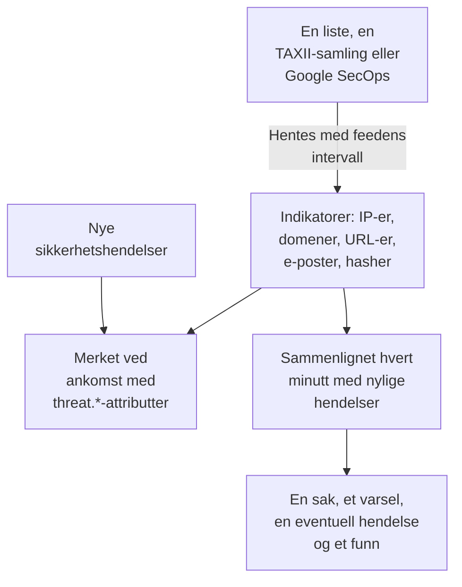

# Trusseletterretning (STIX/TAXII)

En threat intel-feed henter kjente ondsinnede IP-adresser, domener, URL-er, e-postadresser og filhasher inn i OneUptime, og forteller deg når [sikkerhetshendelsene](/docs/telemetry/security-events) dine nevner en av dem. En feed leser én kilde: en liste med indikatorer på en https-adresse, som de gratis listene OneUptime legger til med ett klikk, en TAXII 2.1-samling med STIX 2.1-indikatorer fra din egen MISP-, OpenCTI- eller OpenTAXII-server eller fra en leverandør, eller indikatorene Google SecOps fant i hendelsene dine.

:::cards
- [Legg til en gratis liste](#legg-til-en-gratis-liste): Feodo Tracker, Emerging Threats og Tor-utgangsnodene, med ett klikk.
- [Abonner på en feed](#abonner-på-en-feed): Adressen til en liste, en TAXII-samling eller en Google SecOps-tilkobling.
- [Hva som tas inn](#hva-som-tas-inn): Indikatormønstrene OneUptime beholder, og hvor lenge.
- [Slik finnes treff](#slik-finnes-treff): Merket når hendelser kommer inn, og sammenlignet hvert minutt.
- [Trusselnivåer](#trusselnivåer): Hvordan en indikators confidence blir en alvorlighetsgrad.
:::

## Slik fungerer det



## Før du begynner

- For en liste: en `https`-adresse som laster ned en tekstfil med én indikator per linje.
- For en TAXII-feed: en TAXII 2.1-server som publiserer STIX 2.1-objekter av typen `indicator`, og ID-en til samlingen som skal hentes. En TAXII-feed logger på anonymt, med et bearer-token eller med HTTP Basic-autentisering.
- For en Google SecOps-feed: en [Google SecOps-tilkobling](/docs/integrations/google-secops#sett-opp-den-administrerte-koblingen) der tjenestekontoen kan søke i indikatortreff: rollen `roles/chronicle.viewer` kan det.
- Servere som krever et TLS-klientsertifikat (mutual TLS), for eksempel CISA AIS, støttes ikke. MITREs offentlige ATT&CK-server publiserer teknikker og grupper i stedet for indikatorer, så en feed som peker dit, forblir tom.
- En rolle som kan opprette feeder: Project Owner, Project Admin, Security Admin eller Security Member. Security Viewer kan lese feeder og indikatorer. Se [Roller](/docs/permissions/reference#roller).

## Legg til en gratis liste

Kortet **Gratis lister** på **Trusselsinformasjon** legger til en gratis blokkeringsliste med ett klikk: klikk på **Legg til liste** ved en liste, så oppretter OneUptime en feed som laster den ned etter listens tidsplan. En liste prosjektet allerede leser, viser **Lagt til**.

| Liste | Publisert av | Leses | Confidence | Et treff åpner |
| --- | --- | --- | --- | --- |
| Feodo Trackers botnett-C2-servere | abuse.ch | Hver time | 90, Critical | En sak og et varsel |
| Kompromitterte verter fra Emerging Threats | Proofpoint Emerging Threats | Hver dag | 70, High | En sak og et varsel |
| Tor-utgangsnoder | The Tor Project | Hver time | 30, Low | En sak |

Flisen til en liste lenker til vilkårene: Feodo Tracker er fri for all bruk (CC0), og Emerging Threats-listen er BSD-lisensiert. En feed som er lagt til fra en liste, redigeres og slettes som alle andre.

## Abonner på en feed

:::steps
### Gå til Threat Intel

Åpne **Produkter → Security Events → Deteksjoner → Trusselsinformasjon**.

### Opprett feeden

Klikk på **Opprett Feed med trusselsinformasjon**, og velg **Kilde**: **Liste over indikatorer**, **TAXII-samling** eller **Google SecOps**. Neste steg spør bare om den kilden: en listes **Liste-URL**, en samlings **TAXII-server** og **Pålogging**, eller **Google SecOps-tilkobling**. **Ved treff** kommer sist. Feltene står i tabellen nedenfor.

### Sjekk den første hentingen

I løpet av et minutt eller to viser feedens rad **Sist hentet**, og **Sammendrag av siste henting** forteller hva hentingen fikk med seg. Indikatorene vises i tabellen **Indikatorer** under feedene.
:::

| Felt | Hva du skal fylle inn |
| --- | --- |
| **Kilde** | Hvor indikatorene kommer fra. Den settes når feeden opprettes: en feed fra en annen kilde er en ny feed. |
| **Liste-URL** | For en liste: `https`-adressen til en tekstfil med én IP-adresse, ett domene, én URL eller én filhash per linje. |
| **Sikkerhet** | For en liste: hvor sikker listen er, 1 til 100. Hver indikator på listen får verdien, og den bestemmer [trusselnivået](#trusselnivåer); tom er Medium. |
| **Google SecOps-tilkobling** | For Google SecOps: tilkoblingen der nøkkelen leser indikatorene Google SecOps fant. **Koble til Google SecOps** åpner **Tilkoblinger** når det ikke finnes noen. |
| **Rot-URL for TAXII-API** | Serverens TAXII 2.1-API-rot, for eksempel `https://taxii.example.com/api1/`. Samlingene adresseres under den. |
| **Samlings-ID** | Samlingen som publiserer indikatorene. |
| **Henteintervall (minutter)** | Hvor ofte kilden leses: 1 til 1440 minutter, 60 som standard. En liste leses høyst hvert 15. minutt. |
| **Minste sikkerhet** | For en TAXII-samling eller Google SecOps: indikatorer med lavere confidence hoppes over, 0 til 100, og 0 beholder alt. Indikatorer uten confidence slipper alltid gjennom. |
| **Pålogging** | Hvordan OneUptime logger på: **Ingen pålogging** for en offentlig samling, **Bearer-token** for et token fra operatøren av serveren eller **Brukernavn og passord** for HTTP Basic-autentisering. |
| **API-token**, **Brukernavn for Basic Auth** og **Passord for Basic Auth** | Spørres bare om for påloggingen som er valgt. |
| **Åpne en sak ved treff** | På som standard: hver hendelse som nevner en indikator, åpner en [sak](/docs/telemetry/security-cases) om den, eller legges til i den åpne saken som allerede gjelder den. |
| **Varsler og hendelser** | **Opprett et varsel** som standard: hver indikator som treffer, åpner et varsel. |
| **Varselsalvor** | Alvorlighetsgraden til hvert varsel denne feeden åpner. La den stå tom for å bruke trusselnivået til hver indikator. |
| **Erklær en hendelse** eller **Begge** | Under **Varsler og hendelser**. Hendelser (incidents) driver vakteskalering, SLA-er og statussider, og for indikatortreff er varsler som regel nok. |
| **Hendelsesalvor** | Som **Varselsalvor**, for hendelser (incidents). |
| **Skriv Detection Finding ved treff** | På som standard: hvert treff skriver et funn inn i hendelsesstrømmen. |

En TAXII-feeds tokener og passord krypteres og vises aldri igjen etter at du har lagret dem. For å endre dem velger du **Oppdater påloggingsinformasjon** i feedens rad og deretter **Bearer-token**, **Brukernavn og passord** eller **Ingen pålogging**, som fjerner det lagrede: valget ditt erstatter feedens pålogging, så å lagre et token fjerner et lagret passord, og omvendt.

### Slik hentes en feed

Hver henting ber om objektene som er lagt til siden forrige gang, gjennom TAXII-markøren `added_after`, og leser opptil 10 sider med 500 objekter. En stor samling synkroniseres derfor over flere hentinger: **Sammendrag av siste henting** sier fra når det gjenstår flere sider. For å bli ferdig med en stor første synkronisering raskere senker du **Henteintervall (minutter)**, helt ned til 1, til den har tatt igjen.

Hentingene presenterer seg med brukeragenten `OneUptime/<version> (+https://oneuptime.com)`. Hvis leverandørens brannmur svarer `403`, be dem om å tillate den: mange brannmurer blokkerer forespørsler som ser ut som et navnløst skript.

En deaktivert feed hentes ikke og sammenlignes ikke. Indikatorene den allerede har, fortsetter å merke nye hendelser til de utløper.

### Slik leses en liste

- Hver henting laster ned hele listen og leser den én linje om gangen: den første verdien på en linje, frem til et mellomrom, en tabulator, et komma eller et semikolon. Linjer som starter med `#`, `;` eller `//`, er kommentarer, en port etter en adresse eller et domene fjernes, og et adresseområde som `198.51.100.0/24` hoppes over.
- En verdi forblir en aktiv indikator i 2 dager etter hentingen som sist leste den, og en verdi listen fjerner, slutter å treffe ved neste henting. En liste som ikke er endret, skrives på nytt én gang om dagen.
- En liste rommer høyst 50 000 indikatorer. **Sammendrag av siste henting** forteller hvor mange som ble lest, hvor mange linjer som ble hoppet over, og hvor mange som ble utelatt.
- Adressen må bruke `https` og følger de samme utgående reglene som en tilkobling: på OneUptime Cloud avvises en privat adresse.

### Slik leses Google SecOps

- Hver henting leser indikatortreffene Google SecOps har registrert siden forrige henting, med Mandiants attributter: det treffende domenet, adressen eller filhashen, dens confidence, dens kategori og kampanjene og aktørene den er knyttet til. Den første hentingen leser de siste 7 dagene.
- En indikator forblir aktiv i 30 dager etter at Google SecOps sist så den, eller til kilden sier at den ikke lenger er aktiv, og en som en analytiker har dempet i Google SecOps, slutter også å treffe her.
- Et treff Google SecOps merker som et aktivt innbrudd, er Critical, og et med høy prioritet er minst High.

## Hva som tas inn

Fra en TAXII-samling beholder OneUptime STIX-objekter av typen `indicator` der mønsteret er ren likhet på en av disse typene. En liste og Google SecOps gir de samme typene:

| Type | Eksempelmønster |
| --- | --- |
| IPv4-adresse (`ipv4-addr`) | `[ipv4-addr:value = '198.51.100.7']` |
| IPv6-adresse (`ipv6-addr`) | `[ipv6-addr:value = '2001:db8::7']` |
| Domenenavn (`domain-name`) | `[domain-name:value = 'evil.example']` |
| URL (`url`) | `[url:value = 'http://evil.example/payload']` |
| E-postadresse (`email-addr`) | `[email-addr:value = 'billing@evil.example']` |
| Filhash, SHA-256 (`file-hash-sha256`) | `[file:hashes.'SHA-256' = 'e3b0…b855']` |
| Filhash, SHA-1 (`file-hash-sha1`) | `[file:hashes.'SHA-1' = 'da39…0709']` |
| Filhash, MD5 (`file-hash-md5`) | `[file:hashes.MD5 = 'd41d…427e']` |

Sammenligninger som er koblet med `OR`, innenfor én `[...]` eller på tvers av flere, går fint, og hver verdi blir en egen indikator:

```text
[domain-name:value = 'evil.example' OR domain-name:value = 'evil2.example']
[ipv4-addr:value = '198.51.100.7'] OR [url:value = 'http://evil.example/x']
```

Alle andre mønstre, med `AND`, `FOLLOWEDBY`, `NOT`, `LIKE`, `MATCHES`, en tidsbetingelse som `WITHIN`, eller en annen objekttype, hoppes over i sin helhet og telles som ikke støttet i **Sammendrag av siste henting**. Å oversette bare en del av et `AND`-mønster ville treffe langt mer enn feedens forfatter mente.

### Hvor lenge en indikator er aktiv

- En indikator treffer fra `valid_from` til `valid_until`. Uten `valid_until` er den aktiv i 365 dager fra `valid_from`, og en ny henting forlenger ikke det.
- En tilbakekalt indikator, eller en som er oppdatert med en `valid_until` i fortiden, slutter å treffe så snart oppdateringen er hentet. Det samme gjelder en verdi som leverandøren fjerner fra et oppdatert mønster.
- Verdier lagres med små bokstaver og treffer uansett store og små bokstaver.

Tabellen **Indikatorer** viser indikatorene slik de er lagret, med en **Status** som er **Aktiv**, **Utløpt** eller **Tilbakekalt**. En indikator som er hentet på nytt, kan vises to ganger en stund, og en utløpt eller tilbakekalt rad blir stående i listen til lageropprydningen fjerner den, opptil omtrent en måned etter at den utløper. Sammenligningen sjekker alltid gyldighet og tilbakekalling, så en slik rad treffer aldri.

## Slik finnes treff

### Merket når hendelser kommer inn

Hver innkommende sikkerhetshendelse, fra inntaks-API-et eller en tilkobling, sjekkes mot de aktive indikatorene dine før den lagres. Når en av observablene (IP-ene, vertene, domenene, hashene og brukerne hentet fra hendelsen) er lik verdien til en indikator, stemples hendelsen med disse attributtene:

| Attributt | Verdi |
| --- | --- |
| `threat.matched` | Alltid `"true"` på en merket hendelse |
| `threat.indicator_id` | ID-en til STIX-indikatoren, eller `list` eller `google-secops` for de kildene |
| `threat.indicator_type` | Indikatorens type, for eksempel `ipv4-addr` eller `file-hash-sha256` |
| `threat.indicator_value` | Verdien som traff, med små bokstaver |
| `threat.feed` / `threat.feed_id` | Feeden indikatoren kom fra |
| `threat.confidence` | Indikatorens STIX-confidence |
| `threat.match_count` | Hvor mange av hendelsens observables som traff en indikator |

Når flere indikatorer treffer én hendelse, er det den med høyest confidence som fyller ut disse verdiene. De er vanlige attributter, så du kan søke på dem under **Hendelser**, filtrere monitorer for sikkerhetshendelser med dem og bruke dem i deteksjonsregler:

```yaml title="threat-intel-logon.yml"
title: High-confidence indicator in a successful logon
level: critical
detection:
  selection:
    threat.matched: 'true'
    threat.confidence|gte: 80
    className: Authentication
    statusName: Success
  condition: selection
```

Merkingen kjenner bare indikatorene som finnes når en hendelse kommer inn: hendelser merkes aldri på nytt senere.

### Sammenlignet hvert minutt

Hvert minutt sammenlignes de aktive indikatorene til hver aktiverte feed med hendelsene der hendelsestidspunktet ligger etter feedens forrige sjekk. Det fanger opp etterretning som kom etter at en hendelse ble merket.

- Den første sjekken dekker de siste 15 minuttene. Etter et avbrudd tar neste sjekk igjen høyst de siste 24 timene.
- Hvert vindu sjekkes én gang. Etterretning som kommer etter at vinduet er sjekket, gjelder bare for senere hendelser.
- En hendelse som kommer sent, med et tidspunkt fra før forrige sjekk, merkes fortsatt når den kommer inn, men sammenlignes ikke.
- Hver sjekk registrerer hver indikatorverdi som traff, som et Detection Finding, opptil 10 000 per feed. Varsler, hendelser og saker åpnes for de 100 verdiene som finnes i flest hendelser; resten deler én sak om feeden, og feedens **Siste samsvarsfeil** sier hvor mange som traff.

### Hva et treff gjør

- Et varsel med tittelen `[Threat Intel] <feed name> — <indicator value>`, ett per feed og verdi så lenge det er åpent. Når det er løst, åpner neste treff et nytt. Varsler løses ikke automatisk.
- En hendelse (incident), bare med **Erklær en hendelse** eller **Begge** under **Varsler og hendelser**, deduplisert på samme måte.
- Et Threat Intel-funn, med **Skriv Detection Finding ved treff**: en hendelse `Detection Finding` (OCSF-klasse 2004) fra produktet `OneUptime Threat Intel`, med indikatorens trusselnivå som alvorlighetsgrad, og disse attributtene:

| Attributt | Verdi |
| --- | --- |
| `oneuptime.threat.feed_id` / `oneuptime.threat.feed_name` | Feeden |
| `oneuptime.threat.indicator_id` | ID-en til STIX-indikatoren, eller `list` eller `google-secops` for de kildene |
| `oneuptime.threat.indicator_type` / `oneuptime.threat.indicator_value` | Det som traff |
| `oneuptime.threat.confidence` | Indikatorens confidence |
| `oneuptime.threat.match_count` | Hvor mange hendelser som ligger bak dette funnet |

Funn sammenlignes aldri selv, så ett treff kan ikke utløse et annet.

## Trusselnivåer

Indikatorer har ikke noe Sigma-nivå: STIX-`confidence` gir dem i stedet et trusselnivå.

| Indikatorens confidence | Trusselnivå |
| --- | --- |
| 90 til 100 | Critical |
| 70 til 89 | High |
| 40 til 69 | Medium |
| 1 til 39 | Low |
| Uten poengsum (0 eller mangler) | Medium |

En indikator uten poengsum teller som Medium: noen valgte likevel å legge den i en feed. Trusselnivået er funnets alvorlighetsgrad, og velger varselets alvorlighetsgrad blant prosjektets alvorlighetsgrader, i denne rekkefølgen:

1. Feedens **Varselsalvor** (eller **Hendelsesalvor**), når den er angitt: den gjelder for hvert treff fra feeden.
2. Alvorlighetsgraden din som er oppkalt etter trusselnivået, for eksempel High, uansett store og små bokstaver.
3. Etter rang: Critical og High får den alvorligste alvorlighetsgraden din, Medium og Low den minst alvorlige.

Trusselnivået hører til hver indikator, ikke til feeden, så én feed kan åpne et Critical-varsel og et Low-varsel i samme minutt. **Minste sikkerhet** filtrerer på det samme tallet: et minimum på 70 beholder bare High- og Critical-indikatorer, pluss de uten poengsum, som alltid slipper gjennom.

## Følg med på treffene til en feed

Handlingen **Opprett monitor** i raden til en feed åpner en ny monitor for sikkerhetshendelser som teller feedens funn: hendelsesklassen `Detection Finding`, filtrert på feedens ID i `oneuptime.threat.feed_id` (aldri navnet, som et nytt navn ville endre), over den siste timen. Bruk den for en plutselig bølge av treff, eller for en travel feed som blir stille.

## Oppbevaring og fakturering

Indikatorer er konfigurasjon, ikke telemetri, og faktureres ikke som innhentede data. Funnene et treff skriver, er vanlige sikkerhetshendelser, som faktureres og oppbevares som resten: se [Sikkerhetshendelser](/docs/telemetry/security-events#oppbevaring-og-fakturering).

## Feilsøking

:::details Last Error er satt etter en henting
`401` eller `403`: legitimasjonen er feil eller mangler; erstatt den med **Oppdater påloggingsinformasjon**. En `403` kan også være leverandørens brannmur som blokkerer brukeragenten. `404`: sjekk **Rot-URL for TAXII-API**, som vanligvis slutter med en sti som `/api1/`, og **Samlings-ID**. Feilen forsvinner ved neste vellykkede henting.
:::

:::details Feeden hentes, men ingen indikatorer vises
Les **Sammendrag av siste henting**. Ingen objekter hentet: samlingen er tom eller publiserer ingen indikatorer. Mønstre som ikke støttes: leverandøren bruker mønsterfunksjoner som denne siden oppgir som hoppet over. Under minimum confidence: senk **Minste sikkerhet**. Allerede inaktive: leverandøren sendte indikatorer som allerede var tilbakekalt eller utløpt.
:::

:::details Det finnes indikatorer, men ingenting treffer
Sammenligningen sammenligner en indikators verdi med en hendelses observables, ikke med hvert felt: åpne en hendelse du forventet at skulle treffe, under **Hendelser**, og sjekk at observablene inneholder verdien. Bare indikatorer med statusen **Aktiv** treffer. Står det **Sammenligning mislyktes** i feedens **Status**, viser **Vis feil** i raden hvorfor.
:::

:::details Siste feil for en listefeed sier at adressen svarte med en nettside
**Liste-URL** åpner en side, for eksempel en påloggings- eller feilside, ikke listen: åpne den i en nettleser og kopier adressen til selve filen. En liste der teksten ikke har noen IP-adresse, noe domene, noen URL eller noen filhash, avvises på samme måte, og feedens indikatorer beholdes som de var.
:::

:::details Siste feil for en Google SecOps-feed sier HTTP 403
Tilkoblingens tjenestekonto kan ikke søke i indikatortreff: gi den `roles/chronicle.viewer`. Hvis tilkoblingen ble slettet, sier feeden det: rediger den og velg en annen **Google SecOps-tilkobling**.
:::

:::details Et treff åpnet ikke noe varsel
**Varsler og hendelser** står på **Erklær en hendelse** eller **Ingen av dem**, eller et varsel for den samme feeden og verdien er fortsatt åpent, og senere treff legges inn i det. Et prosjekt må ha minst én varselalvorlighetsgrad for at en feed skal kunne åpne varsler.
:::

## Neste steg

:::cards
- [Sikkerhetshendelser](/docs/telemetry/security-events): Send hendelser, søk i dem og skriv deteksjonsregler.
- [Google SecOps](/docs/integrations/google-secops): Hent inn deteksjonene og hendelsene fra Chronicle.
- [Tillatelsesreferanse](/docs/permissions/reference): Security-rollene, og hva hver av dem kan gjøre.
:::
