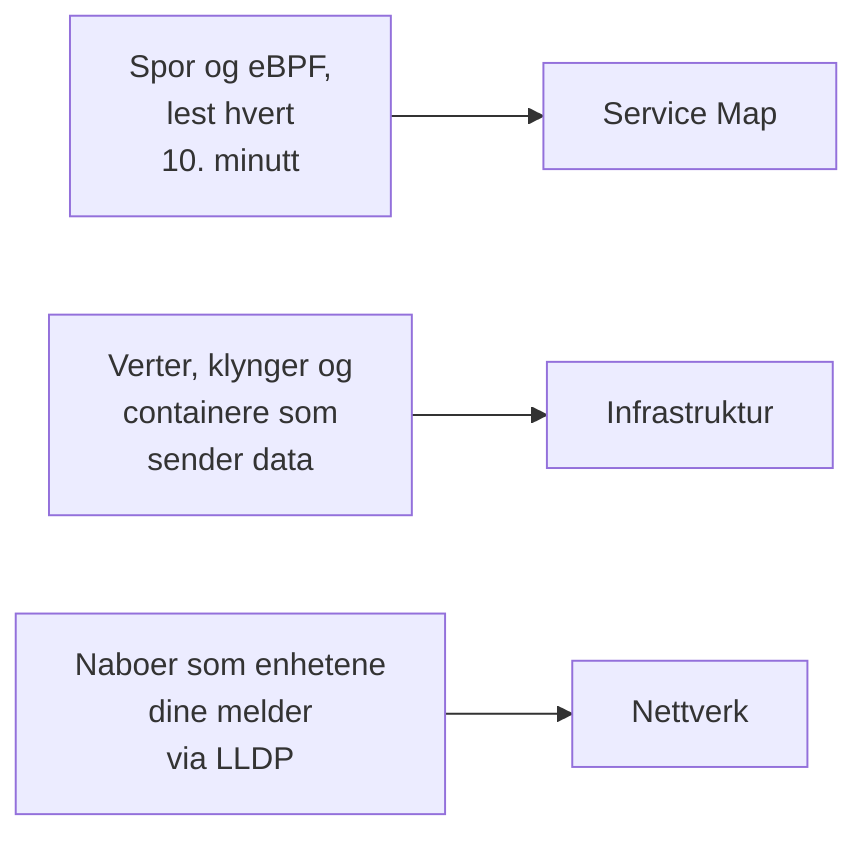

# Topologi

Topologi tegner hvordan systemene dine henger sammen: hvilke tjenester som kaller hvilke, hva som kjører hvor, og hvordan nettverksenhetene dine er kablet. OneUptime bygger den fra telemetrien du allerede sender, så det er ingenting å tegne for hånd, og den viser med et blikk hvor feil og hendelser sitter.

:::cards
- [Åpne Topologi](#åpne-topologi): Tre visninger av én side.
- [Les tjenestekartet](#les-tjenestekartet): Hvem som kaller hvem, og hvor sunne kallene er.
- [Utforsk infrastrukturen din](#utforsk-infrastrukturen-din): Hvor hver tjeneste kjører.
- [Åpne en ressurs sitt eget kart](#åpne-en-ressurs-sitt-eget-kart): Ett vCenter, én klynge eller én vert i dybden.
- [Se nettverket ditt](#se-nettverket-ditt): Enheter og forbindelsene deres, live.
:::

## Slik bygges kartet

Hver visning i Topologi bygges fra en annen type telemetri:

- **Bare det som var aktivt, tegnes.** En visning viser tjenestene og ressursene som sendte data i tidsrommet, og forbindelsene som ble sett i det. Slå på **Vis inaktive** for også å tegne de stille.
- **Kall telles over et nylig vindu.** OneUptime ser etter kall mellom tjenester hvert 10. minutt, og trafikktallene dekker de siste 15 minuttene, ikke hele tidsrommet.
- **Nettverksvisningen er live.** Den viser enhetene dine slik de er koblet nå, så den har ikke noe tidsrom.

## Før du begynner

- **Telemetri som kommer inn.** Tjenestekartet trenger spor: se [OpenTelemetry](/docs/telemetry/open-telemetry). Infrastrukturvisningen trenger en vert eller en klynge som sender data: se [Kubernetes-agenten](/docs/telemetry/kubernetes-agent). Nettverksvisningen trenger nettverksenheter: se [Nettverksenhets-overvåking](/docs/monitor/network-device-monitor).
- **En rolle som leser telemetri.** Project Owner, Project Admin, Project Member, Viewer, Telemetry Admin, Telemetry Member eller Telemetry Viewer, eller en egendefinert rolle med tillatelsen Read Telemetry Service.

## Åpne Topologi

Gå til **Produkter → Observerbarhet → Topologi**. **Inventar → Topology Map** åpner den samme siden. Den åpnes på **Service Map**, for **Siste døgn**.

| Visning | Spørsmålet den besvarer |
| --- | --- |
| **Service Map** | Hvilke tjenester er avhengige av hverandre? |
| **Infrastruktur** | Hva kjører hvor i infrastrukturen din? |
| **Nettverk** | Hvordan er nettverksenhetene dine koblet sammen? |

Ved siden av tidsvelgeren legger **Vis inaktive** til det som ikke sendte data i tidsrommet, og oppdateringsknappen laster visningen på nytt. **Hva som vises · Om disse dataene** forteller hva visningen tegner og hvor ofte den beregnes. Adressefeltet husker visningen du er i, så en lenke du deler, åpner den samme visningen.

## Les tjenestekartet

**Service Map** tegner hver tjeneste som sendte data, og databasene, API-ene og meldingsmeglerne de kaller, også når disse ikke sender egen telemetri. Piler peker fra den som kaller til den som blir kalt, og tykkere linjer bærer flere forespørsler. Tallene over den sier hvor mange tjenester, avhengigheter og forbindelser den tegner, og hvor mange som krever oppmerksomhet.

Hver tjeneste viser statusen sin, beregnet fra kallene den mottok de siste 15 minuttene:

| Status | Når |
| --- | --- |
| **Feilfri** | Høyst 1 % av de mottatte kallene feilet. |
| **Some errors** | Mer enn 1 % og mindre enn 5 % feilet. |
| **High error rate** | 5 % eller mer feilet. |
| **Entry point** | Den mottok ingen kall, men gjorde noen: en webfrontend eller en planlagt jobb. |
| **No calls observed** | Den verken gjorde eller mottok et kall. |

En tjeneste med en aktiv hendelse eller et aktivt varsel viser i stedet hvor mange, og i likhet med en tjeneste med **Some errors** eller en **High error rate** teller den som en som krever oppmerksomhet.

:::steps
### Finn tjenestene som krever oppmerksomhet

Klikk på **Krever oppmerksomhet** for å beholde bare de tjenestene og de direkte forbindelsene deres, eller søk etter navn i feltet over kartet.

### Åpne en tjeneste

Klikk på en tjeneste for å se forespørslene, feilene og gjennomsnittlig ventetid de siste 15 minuttene, **Aktive hendelser** og **Aktive varsler**, og lenker til **Spor for denne tjenesten** og **Inventardetaljer**.

### Åpne en forbindelse

Klikk på en pil for å se forespørselsraten, feilraten og gjennomsnittlig ventetid. Mellom to tjenester du instrumenterer, har den også en **History** over kall, feil og ventetid.
:::

**Tilkoblingsetiketter** skriver et tall på hver pil: **Forespørselshastighet**, **Feilrate** eller **Gjennomsnittlig latens**, eller ingenting før du holder musen over. **Tabell** viser de samme tjenestene med **Forespørsler**, **Feilrate**, **Gj.sn. latens** og **Tilkoblinger**, og **Vis på kartet** tegner én av dem.

## Utforsk infrastrukturen din

**Infrastruktur** viser hvor tjenestene dine kjører: klynger, verter, poder, containere og de andre ressursene som sender data. Replikaer av samme arbeidslast samles i én oppføring, og du kan åpne hva som helst for å se inni.

- **Bla gjennom den på din måte.** Vis den som **Liste** eller **Kart**, fra hele infrastrukturen ned til én pod. Tallene over den sier hvor mange ressurser og arbeidslaster den tegner, hvor mange tjenester den kan plassere, og hvor mange stille ressurser den utelater.
- **Finn en ressurs.** Søk etter den med navn, og klikk på **Vis detaljer** for å åpne siden dens.
- **Bytt mellom visninger.** En tjeneste som står på en ressurs, åpnes på **Service Map**, og ressursene en tjeneste kjører på, åpnes på **Infrastruktur**.

## Åpne en ressurs sitt eget kart

Et vCenter, en Kubernetes-klynge, en vert, en Docker- eller Podman-vert, en Docker Swarm-, Proxmox- eller Ceph-klynge og et lagringsarray har hver sin egen side **Topologi**. Den tegner nettopp den ressursen i dybden ut fra dens eget inventar: hva som ligger i hva, hver del farget etter hvordan den har det, og hver åpen hendelse og hvert åpent varsel på delen det gjelder.

- **Les det som et tre.** Ressursen står øverst, og delene i hver del tegnes til høyre for den, koblet til den med en linje som blir rød eller oransje der noe krever oppmerksomhet. Deler med problemer inni åpner seg selv, den runde knappen på en del åpner eller lukker den, og piltastene beveger seg gjennom kartet.
- **Finn det som krever oppmerksomhet.** **Krever oppmerksomhet** beholder bare delene med problemer og veien til hver av dem, og søket finner en del hvor som helst i ressursen.
- **Se nærmere.** Klikk på en del for å se hva den er, med en lenke til dens egen side, og på **Fokuser på dette** for å tegne bare den delen, hva den inneholder og hva den henger sammen med.
- **Gå begge veier.** **Åpne i Topologi** åpner ressursen på **Infrastruktur**, og knappen **Åpne vCenter-topologi**, **Åpne klyngetopologi**, **Åpne vertstopologi** eller **Åpne topologien til lagringsarrayet** fører tilbake.

## Se nettverket ditt

**Nettverk** er det levende kartet over nettverksenhetene dine, bygget fra naboene de melder via LLDP, og via CDP på Cisco-enheter. Det har ingen tidsvelger: forbindelsene oppdaterer seg selv.

Hvis du grupperer enheter i lokasjoner, åpnes visningen på lokasjonene dine: velg én, eller bytt til **All devices**. **Map options** ordner kartet og velger hva det tar med, og **Eksporter PDF** lagrer kartet du ser. Sidene for nettverksenheter tegner det samme kartet: se [Nettverkstopologi](/docs/monitor/network-device-monitor#nettverkstopologi).

## Feilsøking

:::details Tjenestekartet viser tjenester, men ingen forbindelser
OneUptime finner kall mellom tjenester i sporene dine hvert 10. minutt. Den ser et kall når en forespørsel bærer sporkontekst, `traceparent`-headeren, fra én instrumentert tjeneste til den neste, slik OpenTelemetrys HTTP- og gRPC-instrumenteringer gjør; når en tjeneste melder klient-spans for databasene og API-ene den kaller; eller når Kubernetes-agenten kjører med eBPF.
:::

:::details En tjeneste jeg har fjernet, er fortsatt på kartet
Den sendte data innenfor tidsrommet. Velg et kortere tidsrom, eller vent til den siste telemetrien dens faller utenfor tidsrommet. Med **Vis inaktive** slått på tegner kartet også det som har sluttet å sende data.
:::

:::details Kartet sier at bare en del av det vises
Et svært stort prosjekt når kartets grenser, og en melding sier hvor mange ressurser eller forbindelser det viser. Søk etter en tjeneste, eller bruk **Vis på kartet** i tabellen, for å tegne en lesbar del av det.
:::

## Neste steg

:::cards
- [Tjenestekatalog](/docs/telemetry/services): Alt om én tjeneste.
- [Sporutforsker](/docs/telemetry/traces-explorer): Forespørslene bak hver pil.
- [Inventar – Oversikt](/docs/inventory/overview): Hver ressurs kartet tegner.
- [Nettverksenhets-overvåking](/docs/monitor/network-device-monitor): Sett nettverket ditt på kartet.
:::
