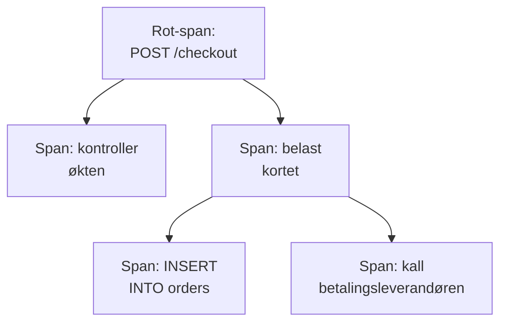

# Sporutforsker

Sporutforskeren finner forespørslene som har gått gjennom tjenestene dine: de trege, de mislykkede, de som berørte kontoen til én bestemt kunde. Søk i og filtrer spannene tjenestene dine sender, og åpne deretter et spor for å se hvert trinn i forespørselen som foss, flammegraf eller tjenestekart.

:::cards
- [Finn en forespørsel](#finn-en-forespørsel): Søk i spans, og filtrer deretter etter tjeneste, status eller type.
- [Les et spor](#les-et-spor): Hvor tiden gikk, og hvilket trinn som feilet.
- [Vis spannene dine i diagrammer](#vis-spannene-dine-i-diagrammer): Antall forespørsler og svartider, gruppert slik du vil.
- [Innsikt i spor](#innsikt-i-spor): Feilrater, latens og de tregeste forespørslene.
- [Finn og rett trege og feilende operasjoner med KI](#finn-og-rett-trege-og-feilende-operasjoner-med-ki): Pull-forespørsler som retter dem og legger til sporingen et spor mangler.
:::

## Spor og spans

Et spor er én forespørsel på vei gjennom systemet ditt. Hvert trinn den tar, som en HTTP-handler, en databasespørring eller et kall til en annen tjeneste, er et span, og spans ligger inne i spannene som startet dem. Det første spannet i et spor, uten forelder, er rot-spannet: forespørselens inngangspunkt.

Hver rad i utforskeren er et span. Som standard viser listen **Entry spans**, spanene der en forespørsel eller melding kommer inn i en tjeneste, slik at en forespørsel vises én gang for hver tjeneste den når, mens databasespørringer og interne kall holdes utenfor listen. For å vise én rad per forespørsel velger du **Root spans** under **Span-kategori** i sidepanelet; for å vise hver operasjon velger du **All spans**.

Utforskeren har fem faner:

| Fane | Hva den er til |
| --- | --- |
| **Leser** | Søk i og filtrer spans, og åpne sporene deres. Den åpner på siste time, nyeste først, 50 spans per side. |
| **Innsikt** | Antall forespørsler, feilrater og latens per tjeneste, og forespørslene som er verdt en titt. |
| **KI** | De trege og feilende operasjonene og den manglende sporingen OneUptime finner i sporene dine, og hva OneUptime AI gjorde med dem. Se [Finn og rett trege og feilende operasjoner med KI](#finn-og-rett-trege-og-feilende-operasjoner-med-ki). |
| **Oppsettveiledning** | Hvordan du sender spor med OpenTelemetry med en av [inntaksnøklene](/docs/telemetry/ingestion-keys) dine. |
| **Innstillinger** | Hva som skjer med spans når de kommer inn: **Pipelines**, **Drop-filtre**, **Scrub-regler** og **Opptaksregler**. |

## Før du begynner

- **Spor som kommer inn.** Instrumenter tjenestene dine med [OpenTelemetry](/docs/telemetry/open-telemetry). Fanen **Oppsettveiledning** viser koden for språket ditt.
- **En rolle som kan lese telemetri.** Project Owner, Project Admin, Project Member, Viewer, Telemetry Admin, Telemetry Member eller Telemetry Viewer, eller en egendefinert rolle med tillatelsen Read Telemetry Service Traces. Omfanget avgjør hvem sine spans du ser: se [Telemetri](/docs/permissions/index#telemetri).

## Finn en forespørsel

:::steps
### Åpne Viser

Gå til **Produkter → Observerbarhet → Spor**. **Leser** viser spannene fra siste time, nyeste først, hver med status, tjeneste, navn og varighet.

### Velg tidsintervallet

Velg et intervall i tidsvelgeren, eller dra over diagrammet over listen for å zoome inn på en topp. Dobbeltklikk på diagrammet for å zoome ut igjen. Se [Zoome inn på et tidsintervall](/docs/telemetry/charts-and-time-ranges).

### Søk

Skriv et søk og trykk Enter, for eksempel `service:checkout status:error duration:>500`. Løse ord søker i span-navn, og `@key:value` søker i et attributt som `@http.route:/orders`. Se [Søkesyntaks](/docs/telemetry/search-syntax#spor).

### Snevre inn med filtre

Klikk på en verdi i sidepanelet **Filtre** for å legge den til som en brikke. Sidepanelet filtrerer etter **Tjeneste**, etter verten, klyngen eller den andre ressursen som sendte spannet, etter **Status**, **Span-kategori**, **Har unntak**, **Span-type**, **Span-navn**, **Tjenesteinstans** og **Vertens navn**.

### Åpne et span

Klikk på en rad for å folde den ut: attributtene, og loggene og unntakene den registrerte. Klikk på **See full trace** for å åpne hele sporet.
:::

Søket ditt, brikkene dine og tidsintervallet lagres i sidens adresse, så en ny innlasting, et bokmerke eller en delt lenke åpner de samme spannene.

## Les et spor

Siden til et spor begynner med tallene for forespørselen:

| Tall | Hva det er |
| --- | --- |
| Varighet | Hvor lang tid hele forespørselen tok. |
| Spans | Hvor mange spans sporet har. |
| Tjenester | Hvor mange tjenester forespørselen gikk gjennom. |
| Feil | Hvor mange spans som endte med feilstatus. Klikk på det for å vise bare dem. |
| Dybde | Den dypeste kjeden av nestede spans. |

Under dem velger du én av fire visninger:

| Visning | Hva den viser |
| --- | --- |
| **Waterfall** | Hvert span på en tidslinje, nestet under spannet som startet det. Slå på **Critical path** for å fremheve kjeden av spans som avgjorde hvor lang tid forespørselen tok. |
| **Flammegraf** | Det samme treet som stablede søyler, der de bredeste søylene tok lengst tid. |
| **Service map** | Tjenestene forespørselen gikk gjennom, og kallene mellom dem. |
| **Operations** | Én rad per tjeneste og span-navn, med kall, feil, egen tid og total tid. En operasjon som kalles 10 ganger eller mer fra ett forelder-span, markeres: ofte en N+1-spørring eller en løkke som kunne vært samlet. |

Klikk på et span i en hvilken som helst visning for å åpne panelet, med faner for attributter, hendelser, logger, unntak og lenker, og for profilen eller LLM-kallet når det har et. Søk i sporets spans etter navn, ID eller tjeneste med søkefeltet ved siden av visningene (trykk `/`), og slå på **Errors only** for bare å beholde spannene som feilet.

Et stort spor laster 500 spans om gangen. Klikk på knappen nederst i sporet for å laste flere, eller alle.

> [!TIP]
> **Fiks ytelsen med AI** vises bare på et spor som er verdt å rette: et med en N+1-spørring, kall etter hverandre som kunne kjørt parallelt, eller ett kall som tar mesteparten av forespørselen, når det koster reell tid (100 ms eller mer for kallene til sammen, 500 ms eller mer for ett enkelt kall og minst en tidel av forespørselen). Den sier hva den fant, for eksempel "Den samme databasespørringen kjørte 40 ganger i ReportService.build", og starter en AI-oppgave som åpner en pull request som retter det. Når en rettelse av sporet allerede har gjort jobben sin, lenker sporet til oppgaven i stedet for å tilby en til. Når noe annet hindrer AI i å jobbe, som abonnementet, oppbrukte AI-kreditter eller ingen Runner på nett, sier sporet hva, med lenken som løser det. Se [Kode](/docs/ai/ai-agent).

## Vis spannene dine i diagrammer

Diagrammet over listen viser antall spans over tid, fordelt på status. Velg et annet mål i diagrammets topp for i stedet å vise gjennomsnittlig, median (P50) eller P95-svartid.

For mer bytter du listen fra **Spans** til **Analytics**. Velg en tidsserie, en toppliste eller en tabell; mål antall forespørsler, antall feil eller svartider (gjennomsnitt, P50, P90, P95, P99, minimum eller maksimum); og grupper etter span-navn, tjeneste, status, span-type eller et hvilket som helst attributt, deretter etter et felt til. En toppliste eller en tabell viser fra 5 til 100 grupper.

## Følg, lagre og del

- Klikk på **Pauset** over listen for å slå på direkteoppdateringer. Knappen viser da **Direkte**, og listen ser etter nye spans hvert 10. sekund. Klikk igjen for å sette på pause.
- **Lagrede visninger** tar vare på et søk, filtrene og tidsintervallet under et navn, for alle i prosjektet. Lagrede visninger fungerer som i [Loggutforsker](/docs/telemetry/logs-explorer#lagre-en-visning).
- Knappene **Logger** og **Målinger** åpner de utforskerne for det samme tidsvinduet, med så mye av filtreringen din som de kan bruke. Pek på en knapp for å se hva den ikke kan ta med.

## Innsikt i spor

Fanen **Innsikt** oppsummerer forespørslene i et tidsintervall:

- antall forespørsler, feilraten og P50-, P95- og P99-latensen;
- en helsetabell over tjenestene dine, sortert etter feilrate, slik at tjenestene som trenger oppmerksomhet, kommer først;
- de siste mislykkede forespørslene, og de tregeste.

Begrens den til bestemte tjenester med nedtrekkslisten ved siden av tidsvelgeren.

## Finn og rett trege og feilende operasjoner med KI

Hver time går OneUptime gjennom sporene fra siste time til hver tjeneste etter operasjoner som er trege, som feiler, eller der sporene ikke kan si hvorfor, og registrerer det den finner som KI-innsikt, med bevisene. Deretter undersøker OneUptime AI hvert funn og åpner en pull-forespørsel som retter det. Ingenting flettes noen gang: teamet ditt gjennomgår hver pull-forespørsel.

En operasjon er en tjenestes spans med samme navn, for eksempel `GET /orders`. OneUptime leser en tjeneste så snart den har sendt minst 100 spans i siste time, og registrerer tre typer funn:

| Funn | Når OneUptime registrerer det | Pull-forespørselen |
| --- | --- | --- |
| **Treg operasjon** | Operasjonens P99 er 1 sekund eller mer over minst 20 spans, og den tregeste forespørselen gjentar et mønster som koster reell tid: det samme kallet igjen og igjen, kall etter hverandre som kunne kjørt parallelt, eller ett kall som tar mesteparten av forespørselen. | Gjør operasjonen raskere. |
| **Feilende operasjon** | Minst 20 av operasjonens spans feilet, 5 % eller flere av dem, og de siste feilene sier hvorfor, med et unntak eller en feilmelding. | Retter årsaken til at den feiler. |
| **Manglende sporing** | Sporene kan ikke si hvorfor: hver av en tjenestes 500 eller flere spans var roten i sporet sitt, uten noe span fra tjenesten under seg, en treg forespørsel brukte 60 % eller mer av tiden sin (og 500 ms eller mer) i ett span uten noe sporet under seg, eller en operasjons feil registrerte verken en feilmelding eller et unntak. | Legger til sporingen som mangler. |

OneUptime AI åpner bare selv pull-forespørselen for en feilende operasjon når den finner koden som har skylden. En feil som kommer fra et annet sted, for eksempel en avhengighet som er nede, får ingen pull-forespørsel med mindre noen ber om en med **Fiks med AI**.

### Slå det på

**Spor → KI → Innstillinger** har bryteren **Finn og rett trege og feilende operasjoner**, som er på for nye prosjekter. Når **Aktiver AI** er av, blir trege og feilende operasjoner fortsatt funnet, men OneUptime AI gjør ingenting med dem. For å åpne pull-forespørsler trenger OneUptime AI et kodelager koblet til i [Kode](/docs/ai/ai-agent): siden sier først hva som mangler. Koden i hvert kodelager endres på Runneren kodelageret velger i Kode.

OneUptime AI åpner selv høyst 5 pull-forespørsler per dag (UTC), én for hvert funn, og aldri flere enn et kodelagers grense for åpne KI-pull-forespørsler.

### KI-regler

Uten regler undersøker OneUptime AI hvert problem den finner i sporene dine med en gang, og åpner en pull-forespørsel for hvert den kan rette. **AI-regler** under **Flere innstillinger** snevrer det inn, i tre trinn:

| Trinn | Hva det avgjør |
| --- | --- |
| **Treff** | Hvilke tjenester: de valgte, de med bestemte etiketter eller de der navnet passer til et mønster. |
| **Undersøke** | **Med en gang**, eller **Bare hvis fortsatt funnet etter en ventetid**: et problem som forsvinner i ventetiden, blir ikke undersøkt. |
| **Rettelse** | **Ikke rett**, **Spør før retting** eller **Rett uten å spørre**. Å spørre først overlater pull-forespørselen til en person: funnet tilbyr **Fiks med AI**. |

Under **Flere felt** velger en regel kodelagrene, MCP-serverne og LLM-leverandøren OneUptime AI kan bruke for den. Er ingenting valgt, kan den bruke alle, og prosjektets standard LLM-leverandør.

### Se hva den gjorde

- **Spor → KI → Innsikt** viser hva OneUptime fant, hvert funn med bevisene og **Åpne i Spor**, som åpner spansene det gjelder, fra timen det ble funnet i, i **Leser**. For en feilende operasjon setter **Opprett monitor** opp en spormonitor på de feilede spansene.
- **Spor → KI → Logger** viser hver undersøkelse og hver pull-forespørsel, nyeste først, med status for hver og hva hver undersøkelse fant.
- I Kode sier oppgaven at OneUptime startet den, med en lenke til funnet, og pull-forespørselen sier hvorfor den ble åpnet.

## Hva som skjer med spans når de kommer inn

Fanen **Innstillinger** inneholder reglene OneUptime bruker på spans når de kommer inn, som for logger. De virker på spannene som kommer inn etterpå, ikke på lagrede. Hvor lenge hvert span beholdes, avgjøres også når det kommer inn: se [Dataoppbevaring](/docs/telemetry/data-retention).

| Regel | Hva den gjør |
| --- | --- |
| **Drop-filtre** | Forkast spans du ikke vil beholde, eller behold bare et utvalg av dem. Se [Forkast poster eller ta utvalg](/docs/telemetry/drop-filters-and-scrub-rules#forkast-poster-eller-ta-utvalg). |
| **Scrub-regler** | Masker sensitive data i span-attributter. Se [Rens sensitive data](/docs/telemetry/drop-filters-and-scrub-rules#rens-sensitive-data). |
| **Pipelines** | Endre og berike spans: hver pipeline velger ut spans med et filter og kjører deretter prosessorene sine i rekkefølge. |
| **Opptaksregler** | Gjør hvert minutt antall spans, antall feil og varigheter om til nye målinger. Se [Opptaksregler for logger](/docs/telemetry/log-recording-rules). |

## Feilsøking

:::details Et spor sier at ingen spans ble funnet
Spans kommer vanligvis innen ett minutt etter at forespørselen er ferdig. Klikk på **Oppdater** på sporets side for å sjekke igjen.
:::

:::details Noen spans står på øverste nivå i fossen
De viser til et forelder-span som OneUptime ikke har mottatt, ofte fordi tjenesten som skrev forelderen, ikke sender spor til OneUptime ennå. Instrumenter den tjenesten også.
:::

:::details Listen viser langt flere rader enn forespørsler
Hver rad er et span, ikke en forespørsel: med **Entry spans**, som er standard, vises en forespørsel én gang for hver tjeneste den når, og med **All spans** én gang for hver operasjon. Velg **Root spans** under **Span-kategori** i sidepanelet for å vise én rad per forespørsel.
:::

## Neste steg

:::cards
- [Søkesyntaks](/docs/telemetry/search-syntax): Hvert filter søkefeltet forstår.
- [Trase-overvåking](/docs/monitor/traces-monitor): Få varsel om mislykkede eller trege forespørsler.
- [Unntakssporing](/docs/telemetry/exceptions): Gå gjennom feilene spannene dine registrerer.
- [Loggutforsker](/docs/telemetry/logs-explorer): Les logglinjene en forespørsel skrev.
:::
