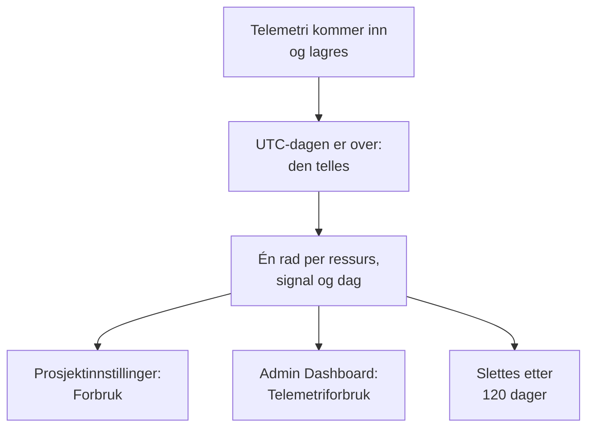

# Telemetriforbruk

Se hvor mye telemetri hvert prosjekt, og hver tjeneste eller ressurs i det, sender: logger, målinger, spor, unntak, profiler, øktavspillinger og sikkerhetshendelser. Forbruk telles på alle OneUptime-installasjoner, med eller uten fakturering, slik at du kan finne det som fyller lagringen din, uten å spørre ClickHouse.

:::cards
- [Slik telles forbruk](#slik-telles-forbruk): Én gang om dagen, for hver ressurs og hvert signal.
- [Se forbruket til et prosjekt](#se-forbruket-til-et-prosjekt): Prosjektinnstillinger → Telemetri og APM → Forbruk.
- [Se forbruket til alle prosjekter](#se-forbruket-til-alle-prosjekter): Admin Dashboard, for instansadministratoren.
- [Hvor lenge forbruk oppbevares](#hvor-lenge-forbruk-oppbevares): 120 dager, med mindre du endrer det.
:::

## Slik telles forbruk

Én gang om dagen, etter at en dag er over i UTC, teller OneUptime hva hver ressurs i hvert prosjekt sendte den dagen, for hvert signal, og lagrer tellingen som én rad per ressurs, signal og dag.



- **En dag telles når den er over.** Hver dag telles innen omtrent kl. 08:00 UTC dagen etter, så dagens forbruk vises i morgen. En dag som ikke kunne telles, forsøkes på nytt i en uke.
- **Størrelsen er den lagrede størrelsen.** Hvert signal telles som størrelsen på radene det lagres i, før komprimering. Øktavspillinger telles som bytene opptakerne lastet opp.
- **Unntak vises for seg.** Unntakene som registreres på spans og i logger, har sin egen total, kolonne og del av diagrammet, og **Spor** teller spans. De har ingen egen rad: hver rad for spor sier hvor mye av den som var unntak. En dag som ble telt før unntak ble vist for seg, har dem fortsatt med i **Spor**, som før.
- **Profiler inkluderer samplene sine.**
- **OneUptimes egen telemetri telles ikke.** Målinger fra monitorer, varsler, hendelser og SLO-er, målinger fra Dataobserverbarhet og budsjettmålingene for øktavspillinger skrives av OneUptime selv.
- **På OneUptime Cloud er det disse radene telemetri faktureres etter.** På en installasjon uten fakturering telles forbruk uten kostnad, og det belastes ingenting for det, heller ikke om fakturering slås på senere.
- **Unntak faktureres som en del av Spor.** På OneUptime Cloud faktureres spor for spanene og unntakene sine samlet, til prisen for spor, slik det alltid har vært. At unntak vises for seg, endrer ingenting ved det du faktureres for, og de belastes aldri to ganger.
- **Et budsjett telles atskilt fra forbruket.** Et [inntaksbudsjett](/docs/telemetry/ingestion-budgets) teller telemetri etter hvert som den kommer inn, dekomprimert, slik at det kan stoppe en dags telemetri samme dag. Mens et er angitt, åpnes denne siden med dagens budsjetter. Unntak har ikke sitt eget budsjett: de telles med i budsjettet til sporene eller loggene de kommer inn i.

## Før du begynner

- **En rolle som leser prosjektets telemetri.** Prosjekteier, Prosjektadministrator, Prosjektmedlem, Leser, Telemetriadministrator, Telemetrimedlem eller Telemetrileser, eller en av faktureringsrollene. Rollen må omfatte hele prosjektet: en rolle som er begrenset til noen etiketter, viser ikke forbruk.
- **Telemetri i prosjektet.** Forbruk telles for telemetrien som prosjektets [inntaksnøkler](/docs/telemetry/ingestion-keys) sender.

## Se forbruket til et prosjekt

:::steps
### Åpne Forbruk

Gå til **Prosjektinnstillinger → Telemetri og APM → Forbruk**. **Telemetri og APM** starter sammenslått i sidemenyen: klikk på den for å åpne den.

### Velg en periode

Siden åpnes på **Siste 30 dager**. Velg **Siste 7 dager** eller **Siste 90 dager** i boksen øverst til høyre på kortet **Telemetriforbruk**. En periode slutter med i går, den nyeste dagen som er telt.

### Finn det som har vokst

Kortet **Forbruk per ressurs** viser hver tjeneste og ressurs som har sendt noe i perioden, de største først. Klikk på tittelen til en kolonne for å sortere etter den, og på navnet til en ressurs for å åpne siden for den.
:::

Siden har tre kort:

| Kort | Hva det viser |
| --- | --- |
| **Telemetriforbruk** | **Totalt** for perioden, en total for hvert signal og et diagram over hver dag, med signalene stablet. |
| **Forbruk per ressurs** | Hver **Ressurs** med typen sin, en kolonne for hvert signal, **Totalt** og **Oppbevaring** for telemetrien dens. |
| **Bruksshistorikk for telemetri** | Én rad per produkt, ressurs og dag, med filtre for **Produkt**, **Dag** og **Tjeneste**. En rad for **Spor** inneholder spans og unntak samlet, slik spor faktureres, og viser under **Data inntatt (i GB)** hvor mye av den som var unntak. |

Telemetri som ikke oppga en tjeneste, vises som **Ukjent tjeneste**. En ressurs som er slettet siden, eller som har en type rollen din ikke leser, vises med typen sin og starten av ID-en sin.

## Hvem ser hva

| Rolle | Ser |
| --- | --- |
| Prosjekteier, Prosjektadministrator, Faktureringsadministrator, Faktureringsmedlem, Faktureringsleser, Manage Billing | Hvor mye hver ressurs sendte og hvor lenge det oppbevares, og på OneUptime Cloud hva det kostet |
| Prosjektmedlem, Leser, Telemetriadministrator, Telemetrimedlem, Telemetrileser | Hvor mye hver ressurs sendte og hvor lenge det oppbevares |

Hva forbruket kostet, vises bare på OneUptime Cloud: en installasjon uten fakturering tar ingenting betalt for det. Se [Fakturering og bruk](/docs/configuration/billing#brukshistorikk) for prisene.

## Se forbruket til alle prosjekter

På en selvhostet installasjon ser instansadministratoren forbruket til alle prosjekter i Admin Dashboard:

:::steps
### Åpne Telemetriforbruk

Åpne menyen i Admin Dashboard, og klikk på **Telemetriforbruk**. Listen viser hvert prosjekt som har sendt noe i perioden, de største først, med en kolonne for hvert signal og **Totalt**.

### Finn de største prosjektene

Velg en periode øverst til høyre på kortet, og klikk på tittelen til en kolonne for å sortere etter den: **Totalt**, et signal eller **Prosjekt** for navnet.

### Åpne et prosjekt

Klikk på navnet til et prosjekt. Siden **Telemetriforbruk** for det, under **Prosjekter** i Admin Dashboard, viser forbruket per dag, signal og ressurs, slik medlemmene ser det.
:::

## Hvor lenge forbruk oppbevares

Forbruk oppbevares i 120 dager, med mindre du endrer det, med fakturering slått på eller av. Dette er hvor lenge forbrukstellingene oppbevares, ikke selve telemetrien: se [Dataoppbevaring](/docs/telemetry/data-retention) for den.

:::steps
### Åpne Dataoppbevaring

Gå til **Innstillinger → Dataoppbevaring** i Admin Dashboard.

### Angi antall dager

Klikk på **Rediger oppbevaring av telemetriforbruk** på kortet **Oppbevaring av telemetriforbruk**, skriv inn **Oppbevaring av telemetriforbruk (dager)** fra 30 til 1095, og klikk på **Lagre endringer**. La feltet stå tomt for 120 dager.
:::

Forbruk som er eldre enn det, slettes én gang om dagen. Oppbevaringen er aldri kortere enn 30 dager: en dag som er telt, blir aldri slettet for så å bli telt på nytt.

## Les forbruket med API-et

`GET /api/telemetry-usage/project` svarer med forbruket til ett prosjekt over en periode med UTC-dager, slik siden viser det. Kall det med en [API-nøkkel](/docs/permissions/index#api-nøkler) som har en av rollene ovenfor:

```bash
curl 'https://oneuptime.com/api/telemetry-usage/project?startDay=2026-10-01&endDay=2026-10-31' \
  -H "ApiKey: $ONEUPTIME_API_KEY"
```

`startDay` og `endDay` er dager skrevet `YYYY-MM-DD`, begge inkludert, og en periode kan være opptil 1095 dager lang. Svaret inneholder totalene, hver dag per signal og hver ressurs per signal, i GB, med kostnaden bare der fakturering er slått på og nøkkelen leser fakturering. Unntak ligger under `Exceptions`, atskilt fra `Traces`, og en dag som ble telt før unntak ble vist for seg, har dem med i `Traces`.

## Feilsøking

:::details Siden Forbruk viser Ingen telemetriforbruk ennå
En dag telles når den er over i UTC, innen omtrent kl. 08:00 UTC dagen etter: et prosjekt som begynte å sende i dag, viser sin første dag i morgen. Sjekk at prosjektet mottar telemetri i utforskerne.
:::

:::details Tallene er større enn ClickHouse-disken min
Forbruk er størrelsen på radene før komprimering. ClickHouse komprimerer det den lagrer, så disken den bruker, er flere ganger mindre.
:::

:::details En ressurs vises med typen sin og en ID
Ressursen er slettet siden den sendte telemetrien, eller rollen din leser ikke den typen ressurs. Forbruket dens telles fortsatt.
:::

:::details Spor gikk ned den dagen Unntak dukket opp
Unntak ble tidligere telt med i **Spor**. Fra den første dagen som ble telt med unntak for seg, teller **Spor** spans, og **Unntak** teller unntakene. Til sammen er de det **Spor** var, og det spor faktureres for.
:::

## Neste steg

:::cards
- [Drop-filtre og scrub-regler](/docs/telemetry/drop-filters-and-scrub-rules): Slutt å lagre telemetrien du ikke trenger.
- [Dataoppbevaring](/docs/telemetry/data-retention): Oppbevar telemetri så lenge som nødvendig, og ikke lenger.
- [Fakturering og bruk](/docs/configuration/billing): Hva telemetri koster på OneUptime Cloud.
- [Inntaksnøkler](/docs/telemetry/ingestion-keys): Send telemetri til prosjektet ditt.
- [Inntaksbudsjetter](/docs/telemetry/ingestion-budgets): Begrens hvor mye av hvert signal et prosjekt sender på en dag.
:::
