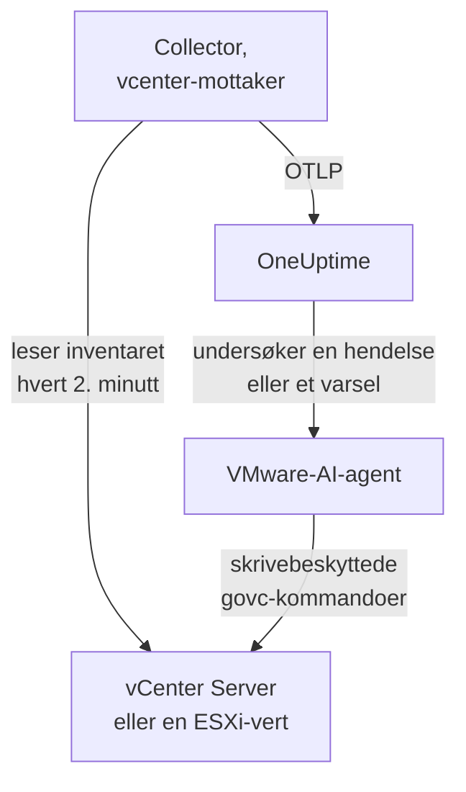

# VMware-agent

OneUptimes VMware-agent overvåker VMware vSphere: vCenter Server, ESXi-verter, virtuelle maskiner, datastores, klynger, ressurspooler og vSAN. Den er en vanlig OpenTelemetry Collector der [`vcenter`-mottakeren](https://github.com/open-telemetry/opentelemetry-collector-contrib/tree/main/receiver/vcenterreceiver) leser vSphere-API-et med en skrivebeskyttet bruker, stempler hver metrikk med navnet på vCenter-et ditt og sender den til OneUptime: ingen plugin på vCenter og ingenting inne i VM-ene. [VMware-overvåkere](/docs/monitor/vmware-monitor) varsler ut fra det som kommer inn.

:::cards
- [Installer agenten](#installer-agenten): En skrivebeskyttet bruker, deretter installasjonsskriptet, Docker Compose eller systemd.
- [Hva agenten samler inn](#hva-agenten-samler-inn): Hvert vSphere-objekt, identiteten og metrikkene.
- [AI-agent](#ai-agent): La OneUptime AI lese vCenter mens den undersøker.
- [Feilsøking](#feilsøking): Et diagnoseskript, og de vanlige problemene.
:::

## Slik fungerer det

Én agent overvåker ett vSphere-endepunkt: en **vCenter Server**, som dekker hvert datasenter, hver klynge og hver vert den administrerer, eller en **frittstående ESXi-vert** som ingen vCenter administrerer. Kjør én agent per vCenter. Collectoren går gjennom hele inventaret én gang per innsamling (hvert 2. minutt som standard) og sender én ressurs per objekt. Den samme Compose-filen kjører VMware-AI-agenten ved siden av, for OneUptime AI. Vil du helst slippe Docker? Den samme collectoren, med samme konfigurasjon, kjører også som systemd-tjeneste på hvilken som helst Linux-maskin.



vCenter-et registrerer seg med de første dataene sine, under navnet agenten stempler på hver metrikk som `vmware.vcenter.name`. For å overvåke et vCenter uten å kjøre agenten i det hele tatt, se [VMware uten agent](/docs/telemetry/vmware-agentless): En av probene dine samler inn de samme dataene med en skrivebeskyttet konto.

## Før du begynner

- Docker Engine 20.10 eller nyere med Docker Compose v2-pluginen, eller, for å installere uten Docker, en Linux-maskin (x86_64 eller arm64) med systemd 235 eller nyere. Uansett må maskinen nå vCenter over HTTPS (TCP 443).
- vCenter Server eller ESXi 7.0 eller nyere: Mottakeren støtter vSphere 7 og 8.
- En konto som kan opprette en vSphere-bruker og gi den en rolle på det øverste vCenter-objektet.
- En inntaksnøkkel. Opprett en under **Prosjektinnstillinger → Telemetri og APM → Inntaksnøkler** og kopier verdien.

### Hvor du kjører agenten

Agenten snakker med vCenter over HTTPS, så den trenger ikke å kjøre i nærheten, og ideelt sett bør den verken kjøre på vCenter Server Appliance eller i en VM på klyngen den overvåker: Hvis den klyngen går ned, går overvåkingen din ned med den. En liten administrasjons-VM på separat maskinvare, en overvåkingsvert eller en hvilken som helst maskin som kjører Docker (eller, uten Docker, en hvilken som helst Linux-maskin med systemd) og når vCenter på TCP 443, er riktig sted. Den valgfrie syslog-lytteren krever også at ESXi-vertene når agenten på syslog-porten (se [Send ESXi-syslog](#valgfritt-send-esxi-syslog)).

## Installer agenten

:::steps
### Opprett den skrivebeskyttede vSphere-brukeren

Agenten leser bare: inventaret, ytelsestellere og vSAN-statistikk. Gi den en egen konto med den innebygde rollen **Read-Only**, aldri en administrator.

:::tabs
@tab vSphere Client
1. Opprett kontoen: Åpne _Menu → Administration → Single Sign On → Users and Groups_, velg domenet `vsphere.local` (eller identitetskilden din), klikk **Add**, gi brukeren navnet `oneuptime` og angi et passord. Brukeren er da `oneuptime@vsphere.local`.
2. Tildel rollen: Velg det øverste objektet **vCenter Server** i inventaret _Hosts and Clusters_, åpne fanen **Permissions**, klikk **Add**, velg brukeren, sett rollen til **Read-Only** og huk av for **Propagate to children**.
@tab govc
Fra en maskin med administratorlegitimasjon:

```bash
govc sso.user.create -p 'a-strong-password' -R ReadOnly oneuptime
govc permissions.set -principal oneuptime@vsphere.local -role ReadOnly -propagate=true /
```
@tab PowerCLI
Fra en økt som er koblet til vCenter som administrator:

```powershell
New-SsoPersonUser -UserName oneuptime -Password 'a-strong-password'
New-VIPermission -Entity (Get-Folder -NoRecursion) -Principal 'VSPHERE.LOCAL\oneuptime' -Role ReadOnly -Propagate:$true
```
@tab ESXi Host Client
For en frittstående ESXi-vert (uten vCenter) oppretter du brukeren under _Host → Manage → Security & Users → Users_ og gir den rollen Read-Only under _Host → Manage → Security & Users → Permissions_. Eller kjør `esxcli system account add` i vertens skall, og deretter `esxcli system permission set --id oneuptime --role ReadOnly`.
:::

> [!IMPORTANT]
> Propagering er delen folk overser. Mottakeren går gjennom datasentre, klynger, verter, VM-er, datastores og ressurspooler, og hvert objekt brukeren ikke kan se, utelates i det stille. En Read-Only-rolle tildelt på vCenter-objektet _uten_ propagering gir et inventar uten innhold og et dashbord fullt av nuller.

### Installer og start agenten

:::tabs
@tab install.sh
Last ned installasjonsskriptet og kjør det på maskinen som skal være vert for agenten:

```bash
curl -sSL https://raw.githubusercontent.com/OneUptime/oneuptime/master/agents/VMwareAgent/install.sh -o install.sh
bash install.sh
```

Skriptet spør etter OneUptime-URL-en din, inntaksnøkkelen, et navn på vCenter-et, vCenter-endepunktet og den skrivebeskyttede legitimasjonen (det leser passordet uten ekko), og om AI-agenten kan bruke rettinger (i så fall etter en egen vSphere-bruker for den og VM-ene den aldri må endre). Det installerer til `/opt/oneuptime-vmware-agent`, skriver en fil med `0600` kalt `.env` og starter agenten med Docker Compose. Det setter hver verdi i anførselstegn for Docker Compose slik du skrev den, så et passord med `$`, `#`, mellomrom eller anførselstegn fungerer slik du skrev det. Å kjøre skriptet igjen gjenbruker alt i en eksisterende `.env`-fil i stedet for å spørre på nytt, og det er slik du [oppgraderer agenten](#oppgradere-agenten).
@tab Docker Compose
Last ned `docker-compose.yml` og `otel-collector-config.yaml` fra [VMwareAgent-mappen](https://github.com/OneUptime/oneuptime/tree/master/agents/VMwareAgent) til en ny mappe, og opprett deretter en `.env`-fil ved siden av dem. Den inneholder et passord, så hold den privat med `chmod 600 .env`:

```bash title=".env"
ONEUPTIME_URL=YOUR_ONEUPTIME_URL
ONEUPTIME_TELEMETRY_INGESTION_KEY=YOUR_TELEMETRY_INGESTION_TOKEN
VMWARE_VCENTER_NAME=my-vcenter
VCENTER_ENDPOINT=https://vcsa.example.com
VCENTER_USERNAME=oneuptime@vsphere.local
VCENTER_PASSWORD=a-strong-password
VCENTER_INSECURE_SKIP_VERIFY=true
VCENTER_COLLECTION_INTERVAL=2m
```

Et passord med `$`, `#`, mellomrom eller anførselstegn skal i enkle anførselstegn (se [vCenter avviser påloggingen](#feilsøking)). Start agenten:

```bash
docker compose up -d
```
@tab systemd
Agenten trenger ikke Docker: Den er én OpenTelemetry Collector-binærfil og én konfigurasjonsfil. På en Linux-maskin (x86_64 eller arm64) med systemd 235 eller nyere (Ubuntu 18.04, Debian 10, RHEL 8 eller nyere) kjører du utgivelsen av `otelcol-contrib` som agenten fester, med den samme `otel-collector-config.yaml`, som en systemd-tjeneste. Enheten agenten leverer for dette, [`oneuptime-vmware-agent-native.service`](https://github.com/OneUptime/oneuptime/blob/master/agents/VMwareAgent/systemd/oneuptime-vmware-agent-native.service), kjører collectoren som en midlertidig, upriviligert bruker uten capabilities og uten noe den kan skrive til.

Last ned collectoren, konfigurasjonen og enheten, og installer dem til `/opt/oneuptime-vmware-agent`:

```bash
cd "$(mktemp -d)"
VERSION=0.161.0   # the collector release the agent pins
ARCH=$(uname -m | sed 's/x86_64/amd64/;s/aarch64/arm64/')
curl -fL -o otelcol-contrib.tar.gz \
  https://github.com/open-telemetry/opentelemetry-collector-releases/releases/download/v${VERSION}/otelcol-contrib_${VERSION}_linux_${ARCH}.tar.gz
curl -fsSLO https://raw.githubusercontent.com/OneUptime/oneuptime/master/agents/VMwareAgent/otel-collector-config.yaml
curl -fsSL -o oneuptime-vmware-agent.service \
  https://raw.githubusercontent.com/OneUptime/oneuptime/master/agents/VMwareAgent/systemd/oneuptime-vmware-agent-native.service

sudo install -d -m 0755 /opt/oneuptime-vmware-agent
sudo tar --no-same-owner --preserve-permissions -xzf otelcol-contrib.tar.gz -C /opt/oneuptime-vmware-agent otelcol-contrib
sudo install -m 0644 otel-collector-config.yaml /opt/oneuptime-vmware-agent/otel-collector-config.yaml
sudo install -m 0644 oneuptime-vmware-agent.service /etc/systemd/system/oneuptime-vmware-agent.service
```

Innstillingene skal i `/opt/oneuptime-vmware-agent/.env`: de samme variablene som i `.env`-filen til Docker-installasjonen. Den inneholder et passord, så gjør den lesbar bare for root før du åpner den:

```bash
sudo touch /opt/oneuptime-vmware-agent/.env
sudo chmod 600 /opt/oneuptime-vmware-agent/.env
sudoedit /opt/oneuptime-vmware-agent/.env
```

Legg inn dette:

```bash
ONEUPTIME_URL=YOUR_ONEUPTIME_URL
ONEUPTIME_TELEMETRY_INGESTION_KEY=YOUR_TELEMETRY_INGESTION_TOKEN
VMWARE_VCENTER_NAME=my-vcenter
VCENTER_ENDPOINT=https://vcsa.example.com
VCENTER_USERNAME="oneuptime@vsphere.local"
VCENTER_PASSWORD="a-strong-password"
VCENTER_INSECURE_SKIP_VERIFY=true
VCENTER_COLLECTION_INTERVAL=2m
```

systemd leser denne filen, ikke et skall: Hold brukernavnet og passordet i doble anførselstegn, der hver `\` skrives `\\` og hver `"` skrives `\"` — `DOMAIN\user` er `"DOMAIN\\user"` —, mens `$`, `#`, `'` og mellomrom går inn som de er. Det er formen alle systemd-versjoner leser likt; eldre versjoner (RHEL 8 sin, for eksempel) dropper en omvendt skråstrek selv innenfor enkle anførselstegn. Start deretter agenten, og la den starte ved hver oppstart:

```bash
sudo systemctl daemon-reload
sudo systemctl enable oneuptime-vmware-agent
sudo systemctl restart oneuptime-vmware-agent
```

Denne installasjonen kjører bare collectoren: [AI-agenten](#ai-agent) leveres bare som containerimage. Kjør én agent per vCenter: Hvis du går bort fra Docker-installasjonen, kjør `docker compose down` der først, ellers kommer hver metrikk inn to ganger.
:::

### Bekreft installasjonen

Sjekk at agenten kjører, og les collectorens logger:

```bash
docker compose ps
docker logs -f oneuptime-vmware-agent
```

Installert med systemd? Sjekk tjenesten og journalen dens i stedet:

```bash
systemctl status oneuptime-vmware-agent --no-pager
sudo journalctl -u oneuptime-vmware-agent -f
```

Collectorens logger skal vise denne linjen når den har startet:

```text
Everything is ready. Begin running and processing data.
```

### Finn vCenter-et i OneUptime

Ingenting sendes før den første fullstendige gjennomgangen av inventaret er ferdig, så gi det ett innsamlingsintervall (2 minutter som standard). Åpne deretter **Produkter → Infrastruktur → VMware → Alle vCenter**: vCenter-et er der, med datasentrene, klyngene, ESXi-vertene, de virtuelle maskinene, datastorene og ressurspoolene sine.
:::

## Miljøvariabler

Docker Compose leser disse fra `.env` ved siden av `docker-compose.yml`; systemd-installasjonen leser dem fra `/opt/oneuptime-vmware-agent/.env`, og enheten dens gir de samme standardverdiene.

| Variabel | Påkrevd | Beskrivelse |
| --- | --- | --- |
| `ONEUPTIME_URL` | Ja | OneUptime-URL-en din, for eksempel `https://oneuptime.com` eller den selvhostede instansen din. Bruk `http://` og porten hvis instansen bare bruker HTTP. |
| `ONEUPTIME_TELEMETRY_INGESTION_KEY` | Ja | Inntaksnøkkelen fra **Prosjektinnstillinger → Telemetri og APM → Inntaksnøkler**. |
| `VMWARE_VCENTER_NAME` | Ja | vCenter-ets navn i OneUptime, stemplet på hver metrikk som ressursattributtet `vmware.vcenter.name`. Hold det stabilt: å endre det senere registrerer et nytt vCenter. Standard er `vmware-vcenter`. |
| `VCENTER_ENDPOINT` | Ja | Skjemaet og verten til vCenter Server eller en frittstående ESXi-vert, **uten** `/sdk`, for eksempel `https://vcsa.example.com`. |
| `VCENTER_USERNAME` | Ja | vSphere-brukeren med rollen Read-Only, for eksempel `oneuptime@vsphere.local` (eller `DOMAIN\user` for en Active Directory-identitetskilde). |
| `VCENTER_PASSWORD` | Ja | Passordet til den brukeren. Hvis det inneholder `$`, `#`, mellomrom eller anførselstegn, setter du det i enkle anførselstegn i `.env`-filen til Docker-installasjonen (`install.sh` gjør dette for deg), og i doble i den til systemd-installasjonen (se [Feilsøking](#feilsøking)). |
| `VCENTER_INSECURE_SKIP_VERIFY` | Nei | `true` godtar vCenters selvsignerte standardsertifikat (VMCA); `false` holder TLS-verifiseringen på. Standard er `false`. |
| `VCENTER_COLLECTION_INTERVAL` | Nei | Hvor ofte hele inventaret leses. Øk det til `5m` eller `10m` for svært store vCenter. Standard er `2m`. |

AI-agentens egne innstillinger står under [AI-agent](#ai-agent).

## Hva agenten samler inn

Ved hvert `VCENTER_COLLECTION_INTERVAL` går mottakeren gjennom hele vSphere-inventaret og sender én OpenTelemetry-ressurs per objekt. Identiteten til hvert objekt ligger i **ressursattributtene** — `vcenter.datacenter.name`, `vcenter.cluster.name`, `vcenter.host.name`, `vcenter.vm.name` / `vcenter.vm.id`, `vcenter.datastore.name`, `vcenter.resource_pool.name` / `vcenter.resource_pool.inventory_path` — og agenten legger `vmware.vcenter.name` på toppen, så OneUptime arkiverer alt under vCenter-et ditt:

| vSphere-objekt | Identitet (ressursattributter) | Metrikker |
| --- | --- | --- |
| Datasenter | `vcenter.datacenter.name` | `vcenter.datacenter.cluster.count`, `vcenter.datacenter.host.count`, `vcenter.datacenter.vm.count`, `vcenter.datacenter.datastore.count`, `vcenter.datacenter.disk.space`, `vcenter.datacenter.cpu.limit`, `vcenter.datacenter.memory.limit` |
| Klynge | + `vcenter.cluster.name` | `vcenter.cluster.cpu.effective`, `vcenter.cluster.cpu.limit`, `vcenter.cluster.memory.effective`, `vcenter.cluster.memory.limit`, `vcenter.cluster.host.count`, `vcenter.cluster.vm.count`, `vcenter.cluster.vm_template.count`, `vcenter.cluster.vsan.*` (gjennomstrømning, operasjoner, latens, overbelastninger) |
| ESXi-vert | + `vcenter.host.name` (og `vcenter.cluster.name` når verten er i en klynge) | `vcenter.host.cpu.usage` / `.capacity` / `.utilization` / `.reserved`, `vcenter.host.memory.usage` / `.utilization` / `.capacity`, `vcenter.host.disk.latency.avg` / `.latency.max` / `.throughput`, `vcenter.host.network.usage` / `.throughput` / `.packet.rate` / `.packet.drop.rate` / `.packet.error.rate`, `vcenter.host.vsan.*` |
| Virtuell maskin | + `vcenter.host.name`, `vcenter.vm.name`, `vcenter.vm.id` (instans-UUID); `vcenter.resource_pool.*` eller `vcenter.virtual_app.*` | `vcenter.vm.disk.usage`, `vcenter.vm.disk.utilization`, `vcenter.vm.memory.usage` / `.utilization` / `.ballooned` / `.swapped` / `.swapped_ssd`; bare påslåtte VM-er: `vcenter.vm.cpu.usage`, `vcenter.vm.cpu.readiness`, `vcenter.vm.cpu.utilization`, `vcenter.vm.disk.latency.avg` / `.latency.max` / `.throughput`, `vcenter.vm.network.*`, `vcenter.vm.vsan.*` |
| VM-mal | `vcenter.vm_template.name`, `vcenter.vm_template.id` | bare `vcenter.vm.disk.usage` |
| Datastore | + `vcenter.datastore.name` | `vcenter.datastore.disk.usage`, `vcenter.datastore.disk.utilization` |
| Ressurspool | + `vcenter.resource_pool.name`, `vcenter.resource_pool.inventory_path` | `vcenter.resource_pool.cpu.usage` / `.cpu.shares`, `vcenter.resource_pool.memory.usage` / `.memory.shares` / `.memory.ballooned` / `.memory.swapped` / `.memory.granted` |

Tellings- og kapasitetsmetrikker fordeles over **datapunktattributter**, som er nøyaktig det du filtrerer og grupperer etter i overvåkingskriterier:

| Attributt | Verdier | Båret av |
| --- | --- | --- |
| `direction` | `read` / `write` for disk, `transmitted` / `received` for nettverk | Disklatens og -gjennomstrømning, nettverksgjennomstrømning og pakkerater |
| `disk_state` | `available` / `used` | `vcenter.datastore.disk.usage`, `vcenter.vm.disk.usage`, `vcenter.datacenter.disk.space` |
| `status` | `red` / `yellow` / `green` / `gray` (den samlede statusen til objektet i vSphere) | `vcenter.datacenter.cluster.count` / `.host.count` / `.vm.count` |
| `power_state` | Verter: `on` / `off` / `standby` / `unknown`; VM-er: `on` / `off` / `suspended` / `unknown` | `vcenter.datacenter.host.count` / `.vm.count`, `vcenter.cluster.vm.count` |
| `effective` | `true` / `false` (lagret som strenger) | `vcenter.cluster.host.count` |
| `object` | NIC-, disk- eller vCPU-instansen (for eksempel `vmnic0`) | Disk- og nettverksserier per enhet for verter og VM-er |
| `cpu_reservation_type` | `total` / `used` | `vcenter.host.cpu.reserved` |
| `type` | Minne: `guest` / `host` / `overhead`, `private` / `shared`; vSAN: `read` / `write` / `unmap` | Minneserier for ressurspooler, vSAN-latens og -operasjoner |

Enhetene er mottakerens egne OTLP-enheter, som OneUptime skalerer for visning: `MHz` for CPU-bruk og -kapasitet, `%` for utnyttelse og CPU ready, `MiBy` for minne i verter, VM-er og ressurspooler, `By` for minne i klynger og datasentre og all diskplass, `ms` for disklatens i verter og VM-er, og `us` (mikrosekunder) for vSAN-latens. I overvåkingskriterier får identitetsattributtene prefikset `resource.` (`resource.vcenter.host.name`, `resource.vmware.vcenter.name`), mens datapunktattributter står uten prefiks (`disk_state`, `power_state`, `status`).

`vcenter.host.memory.capacity` er av som standard upstream; den medfølgende konfigurasjonen slår den på, fordi OneUptime deler på den for minneutnyttelsen til verter. En kommentar i `otel-collector-config.yaml` lister opp de andre valgfrie metrikkene (`vcenter.vm.cpu.time`, `vcenter.vm.memory.granted`, `vcenter.host.memory.active`, `vcenter.host.memory.ballooned`, `vcenter.host.memory.granted`, `vcenter.vm.network.broadcast.packet.rate`, `vcenter.vm.network.multicast.packet.rate`): Slå på hvilken som helst av dem på samme måte.

### Strømtilstanden til VM-er

Mottakeren sender ingen metrikk for strømtilstanden til en VM. Den sender `vcenter.vm.cpu.*` **bare for påslåtte VM-er**, så OneUptime utleder tilstanden fra det som kom inn i hver innsamling: En VM som rapporterte CPU-metrikker, er **Powered on**; en som bare rapporterte minne- og diskbruk, er **Powered off** (eller suspendert: vSphere skiller ikke mellom de to her). VM-maler har ingen strømtilstand. Dette leser **en hel innsamling om gangen**, og derfor har den medfølgende prosessoren `batch` en stor `send_batch_size` og med vilje ingen `send_batch_max_size`: En innsamling fordelt over to eksporter ville nullstille inventartellingene og "slå av" VM-er. Behold batch-innstillingene slik de leveres.

## vCenter-et i OneUptime


Siden **Oversikt** svarer først på "er dette vCenter-et friskt": de effektive vertene, vertenes CPU og minne vektet etter kapasitet, den fulleste datastoren og den verste CPU ready-tiden for en VM. Når noe er degradert, navngir den objektet som er ansvarlig, så du slipper å lete.

### ESXi-verter


### Virtuelle maskiner


Avslåtte virtuelle maskiner og maler vises også. vCenter rapporterer CPU-tellere bare for påslåtte VM-er, så CPU-kolonnene deres viser N/A i stedet for en villedende null.

### Datastores


## Valgfritt — Send ESXi-syslog

Som standard sender agenten bare metrikker, så vCenter-ets side **Logger** forblir tom. ESXi-verter (og vCenter selv) kan videresende syslog til en hvilken som helst lytter, og den medfølgende `otel-collector-config.yaml` har et utkommentert mottakerpar `syslog` (TCP og UDP på port 5514, RFC 3164: ESXi sitt eget format), koblet til en utkommentert pipeline `logs` som stempler `vmware.vcenter.name`, så loggene havner på vCenter-et ditt.

:::steps
### Slå på mottakerne

Fjern kommentarene rundt de to mottakerne `syslog/*` og pipelinen `logs` i `otel-collector-config.yaml`.

### Åpne porten

Fjern kommentarene rundt blokken `ports:` i `docker-compose.yml`, så maskinen publiserer `5514/tcp` og `5514/udp`, og kjør deretter `docker compose up -d`. Med systemd er det ingen port å publisere, siden collectoren lytter på selve maskinen: Kjør `sudo systemctl restart oneuptime-vmware-agent` i stedet. Åpne porten i maskinens brannmur for ESXi-administrasjonsnettverket.

### Pek hver ESXi-vert mot agenten

Velg verten i vSphere Client, åpne _Configure → System → Advanced System Settings_, rediger `Syslog.global.logHost` og sett den til `udp://<agent-host>:5514` (eller `tcp://<agent-host>:5514`; skill flere mål med komma). Tillat deretter den utgående trafikken under _Configure → System → Firewall → Edit → syslog_. Eller, på hver vert, med `esxcli`:

```bash
esxcli system syslog config set --loghost='udp://<agent-host>:5514'
esxcli system syslog reload
esxcli network firewall ruleset set --ruleset-id=syslog --enabled=true
```

Med PowerCLI, for en hel klynge: `Get-VMHost | Get-AdvancedSetting -Name Syslog.global.logHost | Set-AdvancedSetting -Value 'udp://<agent-host>:5514' -Confirm:$false`.
:::

En syslog-mottaker lytter bare på én transport, og derfor er TCP og UDP to mottakere: La den ene stå utkommentert hvis du bare trenger den andre. TLS-syslog (`ssl://`) må termineres foran agenten; selve mottakeren snakker vanlig TCP og UDP. Collectorens standardimage leser syslog som det er: Det trengs ikke noe eget image.

## Merk vCenter-et med prosjektetiketter

Et ressursattributt som starter med `oneuptime.label.`, blir en prosjektetikett på vCenter-et: `oneuptime.label.<dimension>=<value>` er etiketten `<dimension>:<value>`. Legg til attributtene i prosessoren `resource` i `otel-collector-config.yaml`, ved siden av `vmware.vcenter.name`:

```yaml
processors:
  resource:
    attributes:
      # ...existing attributes...
      - key: oneuptime.label.team
        value: platform
        action: upsert
      - key: oneuptime.label.env
        value: production
        action: upsert
```

Collectoren leser konfigurasjonen bare når den starter: Kjør `docker compose restart oneuptime-vmware-agent`, eller `sudo systemctl restart oneuptime-vmware-agent` med systemd. vCenter-et viser deretter etikettene `team:platform` og `env:production`. Etiketter sammenlignes uten hensyn til store og små bokstaver, så en eksisterende etikett `Production` gjenbrukes i stedet for å dupliseres, og agenten fjerner aldri en etikett som noen har lagt til i OneUptime.

## Kjør som en systemd-tjeneste

Docker-installasjonen kan også kjøre under systemd, slik at den starter med maskinen og starter på nytt når den feiler. Enheten dens pakker inn Docker Compose og forutsetter at agenten ligger i `/opt/oneuptime-vmware-agent`, der installasjonsskriptet legger den:

```bash
sudo curl -fsSL https://raw.githubusercontent.com/OneUptime/oneuptime/master/agents/VMwareAgent/systemd/oneuptime-vmware-agent.service -o /etc/systemd/system/oneuptime-vmware-agent.service
sudo systemctl daemon-reload
sudo systemctl enable --now oneuptime-vmware-agent
```

Installasjonen uten Docker er allerede en systemd-tjeneste, med en egen enhet.

## Oppgradere agenten

Agenten rapporterer collector-versjonen som filene dens fester, som sin **Agentversjon**. Når den er eldre enn versjonen denne OneUptime-utgivelsen fester, vises et varseltegn ved siden av den, på vCenter-ets side **Oversikt** og i listen **Alle vCenter**. Velg det for å se disse kommandoene. En agent som ble installert før filene rapporterte en versjon, viser ingen før den er oppgradert på denne måten.

Collectoren er festet i `docker-compose.yml` (eller, uten Docker, av utgivelsen du lastet ned), og konfigurasjonen er en fil ved siden av, så å hente nye images alene flytter ikke agenten fremover:

:::tabs
@tab install.sh
Kjør `install.sh` igjen: Det gjenbruker hver verdi i den eksisterende `.env`-filen din (ingenting spørres om igjen), fornyer `docker-compose.yml` og `otel-collector-config.yaml` og oppretter agenten på nytt, slik at collectoren leser den nye konfigurasjonen.

```bash
curl -sSL https://raw.githubusercontent.com/OneUptime/oneuptime/master/agents/VMwareAgent/install.sh -o install.sh
bash install.sh
```
@tab Docker Compose
I agentens mappe, last ned begge filene på nytt (og gjør eventuelle endringer du hadde gjort i dem, på nytt), hent deretter imagene og opprett agenten på nytt:

```bash
curl -fsSLO https://raw.githubusercontent.com/OneUptime/oneuptime/master/agents/VMwareAgent/docker-compose.yml
curl -fsSLO https://raw.githubusercontent.com/OneUptime/oneuptime/master/agents/VMwareAgent/otel-collector-config.yaml
docker compose pull
docker compose up -d --force-recreate
```
@tab systemd
Kjør installasjonskommandoene igjen: De laster ned utgivelsen denne OneUptime fester, med den nyeste `otel-collector-config.yaml` og enheten, og lar `.env`-filen din være som den er (gjør eventuelle endringer i konfigurasjonen på nytt). Start deretter tjenesten på nytt:

```bash
cd "$(mktemp -d)"
VERSION=0.161.0   # the collector release the agent pins
ARCH=$(uname -m | sed 's/x86_64/amd64/;s/aarch64/arm64/')
curl -fL -o otelcol-contrib.tar.gz \
  https://github.com/open-telemetry/opentelemetry-collector-releases/releases/download/v${VERSION}/otelcol-contrib_${VERSION}_linux_${ARCH}.tar.gz
curl -fsSLO https://raw.githubusercontent.com/OneUptime/oneuptime/master/agents/VMwareAgent/otel-collector-config.yaml
curl -fsSL -o oneuptime-vmware-agent.service \
  https://raw.githubusercontent.com/OneUptime/oneuptime/master/agents/VMwareAgent/systemd/oneuptime-vmware-agent-native.service

sudo install -d -m 0755 /opt/oneuptime-vmware-agent
sudo tar --no-same-owner --preserve-permissions -xzf otelcol-contrib.tar.gz -C /opt/oneuptime-vmware-agent otelcol-contrib
sudo install -m 0644 otel-collector-config.yaml /opt/oneuptime-vmware-agent/otel-collector-config.yaml
sudo install -m 0644 oneuptime-vmware-agent.service /etc/systemd/system/oneuptime-vmware-agent.service
sudo systemctl daemon-reload
sudo systemctl restart oneuptime-vmware-agent
```
:::

## Avinstallere agenten

:::tabs
@tab Docker Compose
```bash
cd /opt/oneuptime-vmware-agent
docker compose down
```
@tab systemd
```bash
sudo systemctl disable --now oneuptime-vmware-agent
sudo rm /etc/systemd/system/oneuptime-vmware-agent.service
sudo systemctl daemon-reload
sudo rm -r /opt/oneuptime-vmware-agent
```
:::

Fjern deretter tillatelsen til brukeren `oneuptime` i vCenter hvis du ikke lenger trenger den, og AI-agentens egen bruker hvis du opprettet en.

## AI-agent

Agentens `docker-compose.yml` kjører også **VMware-AI-agenten**, `oneuptime-vmware-ai-agent` (image `oneuptime/resource-ai-agent:release`). Mens OneUptime AI undersøker en hendelse eller et varsel på dette vCenter-et, kjører den skrivebeskyttede `govc`-kommandoer gjennom den — `govc vm.info web-01`, `govc events -n 50 /DC/vm/web-01`, `govc metric.sample -n 12 /DC/vm/web-01 cpu.usage.average` — og bruker, bare hvis du tillater det, rettinger som å slå en VM på igjen. Den registrerer seg som vCenter-et med navnet `VMWARE_VCENTER_NAME`, slik collectoren gjør, og vises på vCenter-ets side **KI → AI-agent** i OneUptime.

- **AI-undersøkelser er på som standard.** Så snart agenten kobler seg til, undersøker OneUptime AI hendelser og varsler på dette vCenter-et med den, og vCenter-ets side **Oversikt** viser agentens status. For å stoppe, sett `ONEUPTIME_AI_INVESTIGATION=false` der agenten kjører (**Endre** under **Hva AI kan gjøre** på AI-agentsiden viser hvordan), eller utelat agenten.
- **vSphere-rollen er den harde grensen.** Undersøkelser logger inn som collectorens bruker **Read-Only** (`VCENTER_USERNAME` / `VCENTER_PASSWORD`), som kan lese og ingenting annet. Rettinger krever en egen bruker for AI-agenten med en rolle som kan slå VM-er på og av og tilbakestille dem (`VirtualMachine.Interact.PowerOn`, `PowerOff` og `Reset`), tildelt bare på mappene AI kan rette, og satt som `ONEUPTIME_AI_VCENTER_USERNAME` / `ONEUPTIME_AI_VCENTER_PASSWORD`.
- Den er **skrivebeskyttet** med mindre du setter `ONEUPTIME_AI_ALLOW_WRITES=true`; `ONEUPTIME_AI_WRITE_TARGETS` (VM- og vertsnavn eller inventarstier) begrenser hva en retting kan røre. Den endrer aldri VM-en som er oppkalt etter verten i `VCENTER_ENDPOINT` — normalt vCenter-appliancen — og kjenner appliancen bare ved det navnet: Når `VCENTER_ENDPOINT` er en IP-adresse, eller appliancens VM har et annet navn, legg den VM-en i `ONEUPTIME_AI_PROTECTED_TARGETS`, sammen med VM-en agenten kjører på. `ONEUPTIME_AI_FIXES` i samme `.env` sier hvordan rettinger kjøres — `ask-for-approval` (en person godkjenner hver enkelt), `automatic` eller `bypass-approval` — og AI-agentsiden viser det skrivebeskyttet ([Hva AI kan gjøre, fastsatt av agenten](/docs/ai/infrastructure-ai-agents#what-ai-may-do-set-by-the-agent)).
- For å verifisere vCenters sertifikat i stedet for å hoppe over verifiseringen, monterer du CA-en inn i containeren og setter `VCENTER_CA_FILE`; på et vCenter med flere datasentre setter du `GOVC_DATACENTER`.
- Den kjører som UID 1000 uten capabilities og kjører aldri gjesteoperasjoner, snapshots, `esxcli` eller noe som oppretter eller ødelegger en VM. Slett tjenesten `oneuptime-vmware-ai-agent` fra `docker-compose.yml` hvis du ikke bruker OneUptime AI.
- Installasjonen uten Docker har ingen AI-agent: Den leveres bare som containerimage. For å legge til en, kjør den med Docker på en hvilken som helst maskin som når vCenter — last ned `docker-compose.yml`, skriv en `.env` ved siden av med innstillingene fra `/opt/oneuptime-vmware-agent/.env`, i enkle anførselstegn slik Docker Compose vil ha dem, og start AI-agenten alene med `docker compose up -d oneuptime-vmware-ai-agent` (ikke collectoren, som allerede kjører).

Hva den kan kjøre, hvordan rettinger fungerer og hvordan du feilsøker den: [Infrastructure AI Agents](/docs/ai/infrastructure-ai-agents#vmware-vcenter). Agentens README har de nøyaktige kommandoene for rollen for rettinger.

## Feilsøking

:::details Kjør diagnoseskriptet først
Agenten leveres med et skript, [`troubleshoot.sh`](https://github.com/OneUptime/oneuptime/blob/master/agents/VMwareAgent/troubleshoot.sh), som sjekker hele kjeden: container-kjøretiden, om vCenter svarer og godtar legitimasjonen, vCenter-navnet som er stemplet på hver metrikk, tokenets form, collectorens egne metrikker, og om OneUptime godtar inntaksnøkkelen. Den siste sjekken betyr mest. OneUptime avviser en dårlig nøkkel med `401` (`422` for en deaktivert nøkkel eller en nettlesernøkkel), og collectoren behandler begge som permanente: den dropper batchen og logger én `Exporting failed`-feil, som er lett å overse mens containeren forblir sunn. Skriptet spør `GET <url>/otlp/v1/validate` innenfra agentens nettverk for et direkte `200` (gyldig) eller `401` (ugyldig), faller tilbake til `POST /fluentd/v1/logs` på eldre servere og spør etter `<VCENTER_ENDPOINT>/sdk/vimServiceVersions.xml` på samme måte, så DNS-, brannmur- og TLS-feil viser seg akkurat slik collectoren møter dem.

```bash
curl -sSL https://raw.githubusercontent.com/OneUptime/oneuptime/master/agents/VMwareAgent/troubleshoot.sh -o troubleshoot.sh
bash troubleshoot.sh    # add -d <dir> if you installed outside /opt/oneuptime-vmware-agent
```

Det avslutter med en dom som navngir den mest sannsynlige årsaken.
:::

:::details Installert uten Docker
Diagnoseskriptet krever Docker. Uten det kjører collectoren på selve maskinen, så sjekk den samme kjeden direkte: tjenesten og loggen dens, vCenters API på collectorens egen nettverksvei, om OneUptime godtar inntaksnøkkelen (`"valid":true` med `"keyType":"Server"`) og collectorens egne tellere, som den leverer på `127.0.0.1:8890` i stedet for `8888` slik at den kan kjøre ved siden av en annen collector:

```bash
systemctl status oneuptime-vmware-agent --no-pager
sudo journalctl -u oneuptime-vmware-agent -n 100 --no-pager
curl -sk https://<vcenter-host>/sdk/vimServiceVersions.xml
curl -s -H "x-oneuptime-token: <key>" https://<oneuptime-host>/otlp/v1/validate
curl -s http://127.0.0.1:8890/metrics | grep -E 'otelcol_(receiver_accepted|exporter_sent|exporter_send_failed)_metric_points'
```

Loggen leses som containerens, så punktene nedenfor gjelder. En tjeneste som stadig starter på nytt, logger hvorfor: `Failed with result 'resources'` betyr at systemd ikke kan lese `/opt/oneuptime-vmware-agent/.env`, og `cannot unmarshal the configuration` eller `requires positive value` betyr at en verdi i den ikke er en som collectoren godtar. systemd leser `.env` med egne regler, og eldre versjoner (RHEL 8 sin, for eksempel) dropper en omvendt skråstrek selv innenfor enkle anførselstegn: Hold brukernavnet og passordet i doble anførselstegn, der hver `\` skrives `\\` og hver `"` skrives `\"`, den ene formen alle versjoner leser slik den er skrevet. Siden collectoren stoler på maskinens CA-lager, kan du holde TLS-verifiseringen på: Legg vCenters rotsertifikat (`.0`-filene under `certs/lin/` i `https://<vcenter>/certs/download.zip`) til `/usr/local/share/ca-certificates/` med et `.crt`-navn og kjør `update-ca-certificates` på Debian og Ubuntu, eller til `/etc/pki/ca-trust/source/anchors/` og kjør `update-ca-trust` på RHEL; start deretter tjenesten på nytt.
:::

:::details Det vises ikke noe vCenter i OneUptime
1. Les collectorens logger: `docker logs oneuptime-vmware-agent`. En påloggingsfeil (`incorrect user name or password`, `InvalidLogin`) betyr feil legitimasjon, `x509: certificate signed by unknown authority` betyr at TLS-verifisering er på mot et selvsignert sertifikat, `connection refused` eller `no such host` betyr feil `VCENTER_ENDPOINT`, og en `401` ved eksport betyr en dårlig inntaksnøkkel.
2. Sjekk at vCenter svarer fra agentens nettverk. Collector-imaget har verken skall eller curl, så spør fra en container i nettverket dens: `docker run --rm --network container:oneuptime-vmware-agent curlimages/curl -sk https://<vcenter-host>/sdk/vimServiceVersions.xml` skal skrive ut et XML-dokument som nevner `urn:vim25`.
3. Sjekk at `VMWARE_VCENTER_NAME` er satt: vCenter-et finnes ut fra ressursattributtet `vmware.vcenter.name`.
4. Gi det ett innsamlingsintervall: Ingenting sendes før den første fullstendige gjennomgangen av inventaret er ferdig.
:::

:::details vCenter-et vises som frakoblet
Et vCenter blir frakoblet når OneUptime ikke har mottatt noe fra det på 15 minutter; OneUptime sjekker hvert 5. minutt, og tid da OneUptime selv ikke mottok data, teller ikke. Sjekk at collectoren kjører, at loggene ikke viser eksportfeil, og at en innsamling blir ferdig innenfor `VCENTER_COLLECTION_INTERVAL` (se punktet om store inventarer nedenfor). vCenter-et blir tilkoblet igjen med de neste dataene.
:::

:::details x509- eller TLS-feil
vCenter-appliancer presenterer et sertifikat som deres egen VMCA har utstedt, og som ingen Docker-image stoler på. Sett enten `VCENTER_INSECURE_SKIP_VERIFY=true` (det praktiske valget på et privat administrasjonsnettverk), eller erstatt vCenters maskinsertifikat med ett fra en CA som collector-imaget stoler på. **Ikke** pek endepunktet mot en `http://`-URL: vCenter leverer API-et sitt bare over HTTPS.
:::

:::details vCenter avviser påloggingen (401 eller InvalidLogin)
Bruk hele principal-navnet — `oneuptime@vsphere.local`, eller `DOMAIN\user` / `user@domain.example` for en Active Directory-identitetskilde — og sjekk hvordan passordet er skrevet i `.env`. Docker Compose v2 utvider `$VAR`-referanser i verdier uten anførselstegn og i doble anførselstegn, og leser et mellomrom etterfulgt av `#` som starten på en kommentar, så et passord som inneholder `$`, `#`, mellomrom eller anførselstegn, må stå i enkle anførselstegn — `VCENTER_PASSWORD='p@ss$word'` —, som er det `install.sh` skriver. Et passord som selv inneholder et enkelt anførselstegn, skal i doble anførselstegn, med hver `$` skrevet som `$$` og `"` / `\` escapet med en omvendt skråstrek. En låst konto (for mange mislykkede forsøk) avviser også et riktig passord: Sjekk _Administration → Single Sign On → Users and Groups_.
:::

:::details Verter vises, men ingen VM-er, datastores eller klynger (NoPermission)
Rollen Read-Only ble tildelt på vCenter-objektet uten **Propagate to children**, eller på et snevrere objekt enn vCenter-roten. Objekter brukeren ikke kan se, utelates i det stille. Rett tillatelsen på det øverste vCenter-objektet med propagering på; den neste innsamlingen fyller inventaret.
:::

:::details Alle VM-er vises som avslått
Strømtilstanden til en VM utledes fra `vcenter.vm.cpu.*`-datapunkter som kommer i den samme innsamlingen som minne- og diskdatapunktene dens (se [Strømtilstanden til VM-er](#strømtilstanden-til-vm-er)). Hvis du endret prosessoren `batch` og la til en `send_batch_max_size`, deles et stort inventar over flere eksporter, og CPU-datapunktene havner i en annen forespørsel enn resten: Sett tilbake de medfølgende batch-innstillingene.
:::

:::details Store inventarer: trege innsamlinger, feil med vpxd.stats.maxQueryMetrics
Hver innsamling går gjennom hele inventaret og gjør én ytelsesspørring per batch med objekter. For vCenter med tusenvis av VM-er:

- Øk `VCENTER_COLLECTION_INTERVAL` til `5m` eller `10m`. En innsamling som tar lengre tid enn intervallet, hoppes over, ikke overlappet, så et for kort intervall etterlater bare hull.
- Mottakeren ber om opptil `max_query_metrics: 256` entiteter per ytelsesspørring. vCenter begrenser dette med `vpxd.stats.maxQueryMetrics` (256 som standard i vCenter 7 og 8). Hvis en administrator har senket det, logger collectoren `The maximum number of performance metrics per query exceeded`: Senk `max_query_metrics` i `otel-collector-config.yaml` tilsvarende, eller øk vCenter-innstillingen under _vCenter → Configure → Advanced Settings_.
- Følg med på collectorens minne: Den medfølgende `memory_limiter` tillater 512 MiB. Hvis loggen sier at limiteren dropper data, øk `limit_mib` (og gi containeren mer minne).
:::

:::details Overvåke en frittstående ESXi-vert (uten vCenter)
Pek `VCENTER_ENDPOINT` mot selve verten (`https://esxi01.example.com`), med en lokal ESXi-bruker som har rollen Read-Only. Alt én vert vet om, samles inn: verten, VM-ene, datastorene og ressurspoolene. En frittstående vert har ikke noe datasenter- eller klyngeobjekt, så de sidene forblir tomme, og den har ikke noe vCenter-REST-API, så diagnoseskriptet rapporterer sjekken av legitimasjonen som uavklart (collectorens logg har svaret der).
:::

:::details Metrikker havner under feil vCenter
OneUptime registrerer et vCenter etter `vmware.vcenter.name`, som agenten tar fra `VMWARE_VCENTER_NAME`. Å endre det etter de første dataene oppretter et nytt vCenter i stedet for å gi det første nytt navn.
:::

:::details Sende metrikker uten agenten
vSphere har ingen egen OpenTelemetry-push, så agenten (eller en hvilken som helst OpenTelemetry Collector med `vcenter`-mottakeren) er veien inn. Kjører du allerede collectorer, legg `vcenter`-mottakeren til i en av dem i stedet for å kjøre denne agenten: Kopier `vcenter`-mottakeren og prosessoren `resource` fra den medfølgende `otel-collector-config.yaml` inn i din egen konfigurasjon. Ressursattributtet `vmware.vcenter.name` er det som registrerer vCenter-et i OneUptime, og slettingene av `service.name` / `service.instance.id` hindrer at dataene arkiveres under en tjeneste: Behold begge.
:::

## Neste trinn

:::cards
- [VMware-overvåking](/docs/monitor/vmware-monitor): Varsle om verter, VM-er, datastores, klynger, datasentre og vSAN.
- [VMware uten agent](/docs/telemetry/vmware-agentless): La en probe samle inn vCenter-et i stedet.
- [Infrastructure AI Agents](/docs/ai/infrastructure-ai-agents): Hva VMware-AI-agenten kan kjøre, og hvordan rettinger fungerer.
- [OpenTelemetry-collector på verten](/docs/telemetry/host-otel-collector): Operativsystemets visning inne i VM-ene, eller av agentens maskin.
:::
