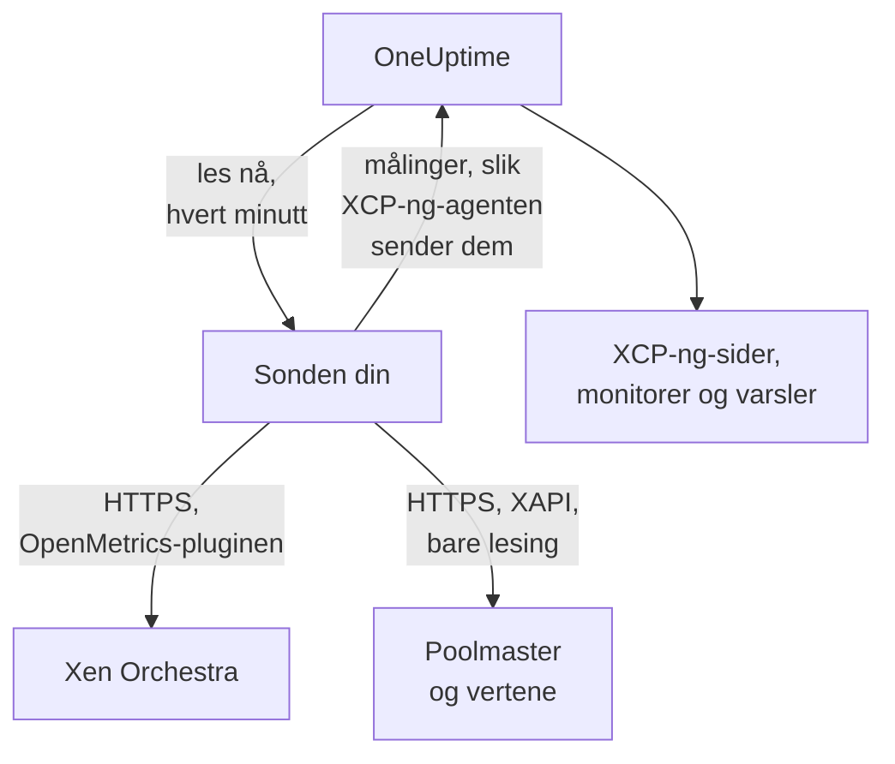

# XCP-ng uten agent

Overvåk XCP-ng-pooler uten å installere noe: En OneUptime-sonde leser dem, enten via Xen Orchestra-instansen som administrerer dem, eller, for en pool uten Xen Orchestra, direkte fra XAPI på poolens master. Hver pool får de samme sidene, [XCP-ng-monitorene](/docs/monitor/xcp-ng-monitor) og malene som en pool [XCP-ng-agenten](/docs/telemetry/xcp-ng) sender. Det finnes ingen agent å installere, oppgradere eller holde i gang.

:::cards
- [Før du begynner](#før-du-begynner): En sonde som når Xen Orchestra eller poolen, og skrivebeskyttet tilgang.
- [Koble til Xen Orchestra](#koble-til-xen-orchestra): Hver pool den administrerer, via én tilkobling.
- [Koble til en pool uten Xen Orchestra](#koble-til-en-pool-uten-xen-orchestra): Én pool, lest fra masteren.
- [Alarmer, HA og sikkerhetskopier](#alarmer-ha-og-sikkerhetskopier): Hva en sonde leser utover målingene, og varslene den tilbyr.
- [Feilsøking](#feilsøking): Hva hver melding betyr, og hva som løser den.
:::

## Slik fungerer det

Hvert minutt leser sonden hver tilkobling og sender det den leste, til OneUptime:

- **Xen Orchestra**: Sonden leser OpenMetrics-pluginen til Xen Orchestra med pluginens hemmelighet, akkurat slik XCP-ng-agenten gjør, så hver pool Xen Orchestra administrerer, kommer med de samme seriene. Med et API-token leser den også hver pools alarmer, HA og sikkerhetskopier fra REST-API-et til Xen Orchestra.
- **En pools XAPI**: Sonden logger inn på poolmasteren og gjør de lesingene som pluginen til Xen Orchestra selv gjør: poolens poster og målingene for hver vert som kjører, lest fra den verten. Den gjør dem om til de samme seriene som pluginen leverer, så poolen leses akkurat slik den ville blitt lest via Xen Orchestra. Den legger også poolens XAPI-meldinger, som en VM som krasjet eller en vert HA mistet, i poolens feed.

Hver pool registrerer seg etter UUID ved første lesing, slik agentens pooler gjør, og vises under **XCP-ng → Alle pooler**.

## Hvilken måte å koble til på

| | Xen Orchestra, fra en sonde | En pools XAPI, fra en sonde | XCP-ng-agenten |
|---|---|---|---|
| Hva du kjører | En sonde du allerede kjører, eller en ny | En sonde du allerede kjører, eller en ny | Agenten, på en egen maskin |
| Hva den leser | Hver pool Xen Orchestra administrerer | Én pool | Hver pool Xen Orchestra administrerer |
| Hva den trenger | OpenMetrics-pluginens hemmelighet, og eventuelt et skrivebeskyttet API-token | En konto i poolen: root, eller en Active Directory-bruker med rollen read-only | OpenMetrics-pluginens hemmelighet |
| Hvor hemmelighetene lagres | Kryptert i OneUptime, bare sendt til sonden | Kryptert i OneUptime, bare sendt til sonden | I agentens fil `.env` |
| Alarmer, HA og sikkerhetskopier | Alle tre, og manglende oppdateringer, med et API-token | Alarmer og HA, uten sikkerhetskopier | Ikke med |

Alle tre sender de samme seriene. En pool leses av én av dem om gangen, så historikken forblir én linje uansett hvem som leser den.

## Før du begynner

- **En sonde som når adressen på TCP 443.** Det er som regel en [egendefinert sonde](/docs/probe/custom-probe) i samme nettverk. I OneUptime Cloud mottar de delte sondene aldri XCP-ng-hemmeligheter, så legg til en egen sonde. På en selvhostet instans kan også instansens egne sonder lese.
- **For Xen Orchestra:** Xen Orchestra 6.9 eller nyere med OpenMetrics-pluginen slått på: Følg [Slå på OpenMetrics-pluginen](/docs/telemetry/xcp-ng#slå-på-openmetrics-pluginen) og kopier hemmeligheten. Eventuelt et API-token for en Xen Orchestra-bruker med den innebygde rollen **Read only**: OneUptime kontrollerer at det bare leser, og varsler deg før det utløper.
- **For en pool uten Xen Orchestra:** XCP-ng 8.2 eller nyere, og adressen til masteren. XAPIs roller gjelder bare Active Directory-brukere, så den eneste lokale kontoen, `root`, kan endre alt i poolen. For skrivebeskyttet tilgang melder du poolen inn i Active Directory og gir en bruker rollen `read-only`.

> [!IMPORTANT]
> Koble til en pool via Xen Orchestra eller via XAPI-en dens, ikke begge: Den andre tilkoblingen som leser en pool, overlater den til den første.

## Koble til Xen Orchestra

:::steps
### Åpne tilkoblinger
Åpne **XCP-ng → Tilkoblinger** i OneUptime, og klikk på **Koble til XCP-ng**.

### Velg Xen Orchestra
Under **Hva som skal leses** velger du **Xen Orchestra**. Skriv inn **Xen Orchestra-adresse**, den du åpner den på i nettleseren, for eksempel `https://xo.example.com`, og velg sonden som når den.

### Skriv inn pluginens hemmelighet
Lim inn **OpenMetrics-hemmelighet**. Legg til et **API-token** for den skrivebeskyttede brukeren hvis du har et.

### Test tilkoblingen og stol på sertifikatet
Klikk på **Test tilkoblingen**. Xen Orchestra signerer sitt eget sertifikat, så testen viser det: Kontroller fingeravtrykket, og klikk deretter på **Stol på dette sertifikatet**. Resultatet viser poolene Xen Orchestra leverer, med vertene, VM-ene og lagringsrepositoriene deres.

### Gi den et navn og koble til
Navnet er som standard vertsnavnet til Xen Orchestra, og hver pool den leser, viser det. Klikk på **Koble til XCP-ng**, så åpnes siden for tilkoblingen.
:::

## Koble til en pool uten Xen Orchestra

:::steps
### Start fra tilkoblingene
Åpne **XCP-ng → Tilkoblinger** i OneUptime, og klikk på **Koble til XCP-ng**.

### Velg poolen
Under **Hva som skal leses** velger du **En pool uten Xen Orchestra**. Skriv inn **Adressen til poolmasteren**, for eksempel `https://10.0.0.10`, og velg sonden som når den.

### Skriv inn kontoen
Skriv inn **Brukernavn** og **Passord**: `root`, eller en Active Directory-bruker med rollen read-only, skrevet med domenet sitt, for eksempel `EXAMPLE\oneuptime`.

### Test tilkoblingen og stol på masterens sertifikat
Klikk på **Test tilkoblingen**. Hver XCP-ng-vert signerer sitt eget sertifikat, så testen viser masterens: Kontroller fingeravtrykket, og klikk deretter på **Stol på dette sertifikatet**. Resultatet sier hvilken XCP-ng masteren kjører og hva kontoen kan lese, og varsler deg når kontoen kan endre poolen.

### Gi poolen et navn og koble til
Klikk på **Koble til XCP-ng**, så åpnes siden for tilkoblingen.
:::

Siden for tilkoblingen viser hvordan lesingen står. Den viser **Kontrollerer** fram til første lesing, som starter innen ett minutt, deretter **Samler inn**, og poolene den leser, vises under **Pooler den leser**.

Kommer ingen sonde for tilkoblingen på 20 minutter, fordi den er frakoblet eller for gammel, viser siden **Samler ikke inn** og sier det. Når ingen sonde har lov til å lese tilkoblingen, viser den **Samler ikke inn** med en gang og sier hva som må endres: en hemmelighet, et brukernavn eller et passord mangler, ingen sonde er satt til å lese den, sonden har ikke lov til å lese den (en delt sonde i OneUptime Cloud, eller et annet prosjekts), eller sonden er frakoblet.

## Pooler agenten allerede sender

En pool som XCP-ng-agenten registrerte, overtas av den første tilkoblingen som leser den: historikken fortsetter som én linje, og poolens feed sier at agenten kan stoppes.

> [!WARNING]
> Stopp XCP-ng-agenten så snart en sonde leser poolene dens. Så lenge begge kjører, kommer hver måling to ganger.

For å bytte tilbake åpner du siden **Innstillinger** for poolen. Kortet **Datainnsamling** der tilbyr **Bruk XCP-ng-agenten** for en pool en sonde leser, og **Samle inn med en sonde** for en pool agenten sender. En pool som er byttet tilbake til agenten, blir værende hos den, uansett hva tilkoblingen leser.

## Sertifikater

Sonden hopper aldri over sertifikatkontrollen. Hver tilkobling fullfører et fullt TLS-håndtrykk, og deretter:

- uten et klarert sertifikat må sertifikatet komme fra en utsteder som sondens maskin stoler på, for adressen du skrev inn;
- med et klarert sertifikat må adressen vise nøyaktig det sertifikatet, gjenkjent på SHA-256-fingeravtrykket, uansett hvilket navn sertifikatet har. Xen Orchestras eget sertifikat nevner ingen adresse og klareres på denne måten.

For å kontrollere et fingeravtrykk kjører du `openssl s_client -connect xo.example.com:443 </dev/null | openssl x509 -noout -fingerprint -sha256` fra sondens maskin og sammenligner det med selve sertifikatet: på en poolmaster `openssl x509 -noout -fingerprint -sha256 -in /etc/xensource/xapi-ssl.pem`.

For en pool stoler du på masterens sertifikat. Poolen viser selv sertifikatet hver av vertene leverer, og sonden leser hver av de andre vertene låst til det. Når en annen vert blir master, følger sonden bare etter til en vert poolen gikk god for ved forrige lesing. Når et sertifikat endres, stopper lesingen med **Sertifikatet er endret**, og det nye sertifikatet vises: Ingenting sendes før du stoler på det, på siden for tilkoblingen.

## De lagrede hemmelighetene

Hemmeligheten, tokenet og passordet er kryptert og bare skrivbare: Ingen kan lese dem tilbake, og API-et returnerer dem aldri. De sendes bare til sonden som leser tilkoblingen, og den holder dem i minnet.

En lagret hemmelighet sendes bare til adressen, via sonden og til sertifikatet den ble skrevet inn for. Endrer du adressen, sonden eller det klarerte sertifikatet under **Rediger tilkobling**, må den skrives inn på nytt, så ingen som kan redigere tilkoblingen, kan sende den et annet sted, og et lagret API-token som ikke skrives inn på nytt, glemmes. Å stole på sertifikatet sonden fant på den lagrede adressen, beholder dem. **Fjern API-tokenet** sletter tokenet fra OneUptime: Tilbakekall det også i Xen Orchestra.

## API-tokenet

Et API-token er valgfritt: Målingene kommer via pluginens hemmelighet, og tokenet leser hver pools alarmer, HA og sikkerhetskopier. Med et token kontrollerer hver lesing det høyst én gang i timen:

- **Det bare leser.** Et token der brukeren er administrator, eller der rollen kan endre noe, består ikke testen og vises som et problem på siden for tilkoblingen. OneUptime lagrer bare skrivebeskyttede tokener.
- **Det leser det OneUptime trenger.** Xen Orchestra svarer på en liste en bruker ikke kan lese, med en tom liste, så tokenet må kunne lese alarmer, meldinger og logger for sikkerhetskopier. Den innebygde rollen **Read only** leser alle tre.
- **Når det utløper.** Xen Orchestra glemmer et token i det øyeblikket det utløper. To uker før sier siden for tilkoblingen og feeden for hver pool den leser, fra om det. Opprett et nytt token for den samme brukeren, og skriv det inn under **Rediger tilkobling**.

## Alarmer, HA og sikkerhetskopier

I tillegg til målingene leser en sonde det XCP-ng og Xen Orchestra rapporterer om hver pool. Hva den leser, avhenger av tilkoblingen:

| | Xen Orchestra, med et API-token | En pools XAPI |
|---|---|---|
| XAPI-meldinger og alarmer | Leses | Leses |
| HA og poolmasteren | Leses | Leses, med HAs egen plan |
| Sikkerhetskopieringsjobber og kjøringene deres | Leses | Leses ikke: Sikkerhetskopier hører til Xen Orchestra |
| Manglende oppdateringer | Leses hver sjette time, der abonnementet til Xen Orchestra omfatter dem | Leses ikke: Xen Orchestra finner dem selv |

En Xen Orchestra-tilkobling uten API-token leser bare målingene, slik XCP-ng-agenten gjør.

- **På poolens sider.** Poolens **Oversikt** viser HA-tilstanden og de siste kjøringene for hver sikkerhetskopieringsjobb, siden til en vert de manglende oppdateringene og siden til en VM den siste sikkerhetskopien. Meldinger med prioritet 1 til 4, et bytte av master, HA som slås på eller av eller ikke lenger tåler en vertssvikt, og mislykkede sikkerhetskopieringskjøringer havner i poolens **Feed**, og hver melding og hver sikkerhetskopieringskjøring er en post på siden **Logger** for poolen.
- **Som varsler.** Poolens **Anbefalinger** tilbyr en mal for hver under **XCP-ng-alarmer** og **Sikkerhetskopier**: VM Crashed, HA Host Failed, HA State File Lost, HA Protected VM Restart Failed, Storage Failed to Plug, Storage GC Out of Space, XAPI Alarm, Pool Master Changed og Backup Job Failed. [XCP-ng-monitoren](/docs/monitor/xcp-ng-monitor) legger til HA Cannot Tolerate a Host Failure og VM Not Backed Up.
- **Fra og med første lesing.** Det XAPI sa før en pools første lesing, rapporteres ikke, og hver melding rapporteres bare én gang. Den første lesingen av loggene for sikkerhetskopier ser en uke og en dag tilbake, så de siste kjøringene for hver jobb vises med en gang.

## Referanse

| Innstilling | Standard | Merknader |
|---|---|---|
| Les hvert | 1 minutt | Fra 1 til 60 minutter. Hvert minutt tilsvarer XCP-ng-agenten; les en stor Xen Orchestra sjeldnere for å skåne den. |
| Lesinger samtidig | 4 per sonde | En lesing som er tregere enn intervallet, hoppes over og stables aldri. |
| Største lesing | Omtrent 48 MiB | Større Xen Orchestra-instanser trenger XCP-ng-agenten. |
| XAPI-meldinger | 200 per lesing | Fra det øyeblikket poolen er tilkoblet, hver levert én gang, den eldste først. |
| Sikkerhetskopieringskjøringer | 20 per lesing | Den første lesingen ser en uke og en dag tilbake. På en kjøring som Xen Orchestra fortsatt oppgir som ventende etter tre dager, ventes det ikke lenger. |
| Manglende oppdateringer | Hver 6. time | Via Xen Orchestra, for opptil 100 verter per kontroll. |
| Tilkoblingstest | 90 sekunder til start | En test ingen sonde plukker opp i tide, eller som varer lenger enn 150 sekunder, besvares som mislykket. |

## Feilsøking

:::details Sertifikatet er ikke klarert
Xen Orchestra og XCP-ng-verter signerer sine egne sertifikater som standard. Sammenlign fingeravtrykket som vises, med sertifikatet, og klikk deretter på **Stol på dette sertifikatet**.
:::

:::details Sertifikatet er endret
Ingenting sendes før du stoler på det nye sertifikatet. Har du fornyet det, kontrollerer du det nye fingeravtrykket, stoler på det og skriver inn hemmelighetene på nytt under **Rediger tilkobling**.
:::

:::details Xen Orchestra avviste hemmeligheten
Kopier hemmeligheten på nytt fra **Settings → Plugins → openmetrics** i Xen Orchestra, og skriv den inn under **Rediger tilkobling**.
:::

:::details OpenMetrics-pluginen svarer ikke
Last inn **openmetrics** under **Settings → Plugins** i Xen Orchestra, og slå på **Auto-load** så den kommer tilbake etter en omstart.
:::

:::details Denne Xen Orchestra-instansen har ingen OpenMetrics-plugin
Pluginen krever Xen Orchestra 6.9 eller nyere og en Premium-lisens på en Xen Orchestra Appliance. Uten den kobler du heller til hver pool via XAPI-en dens.
:::

:::details Ingen pool er tilkoblet
Xen Orchestra rapporterer ingen tilkoblet pool. Legg til eller koble til poolene på nytt i Xen Orchestra, og test igjen.
:::

:::details API-tokenet kan endre Xen Orchestra
OneUptime lagrer bare skrivebeskyttede tokener. Opprett et for en bruker som har en kopi av den innebygde rollen **Read only** og ingen annen rolle.
:::

:::details API-tokenet kan ikke lese alarmer, meldinger eller sikkerhetskopier
Gi brukeren av tokenet en kopi av Xen Orchestras innebygde rolle **Read only**, som leser alle tre.
:::

:::details API-tokenet er utløpt
Opprett et nytt token for den skrivebeskyttede brukeren i Xen Orchestra, og skriv det inn under **Rediger tilkobling**. Målingene fortsetter å komme i mellomtiden.
:::

:::details XAPI avviste påloggingen
Kontroller brukernavn og passord. En Active Directory-bruker skrives med domenet sitt, for eksempel `EXAMPLE\oneuptime`.
:::

:::details Denne verten er ikke poolmasteren
Et medlem av poolen svarer med adressen til masteren sin, som meldingen nevner. Skriv inn den adressen, og test på nytt.
:::

:::details Kontoen kan ikke lese poolen
Gi Active Directory-brukeren rollen read-only på poolen, eller bruk en konto som har den.
:::

:::details Sonden får ikke noe svar
Sondens nettverk kan ikke nå adressen på TCP 443. Tillat det i brannmuren, eller velg en sonde i samme nettverk.
:::

:::details Sonden plukket ikke opp dette
Sonden er offline, eller kjører en OneUptime-versjon som er eldre enn lesing av XCP-ng. Kontroller i tabellen **Egendefinerte sonder** at den er tilkoblet, og oppdater den.
:::

:::details Denne tilkoblingen er for stor til å leses fra en sonde
Målingene er større enn én opplasting fra en sonde kan være. Bruk [XCP-ng-agenten](/docs/telemetry/xcp-ng) for den.
:::

## Neste trinn

:::cards
- [XCP-ng-monitor](/docs/monitor/xcp-ng-monitor): Varsle om pooler, verter, VM-er og lagringsrepositorier.
- [Egendefinert sonde](/docs/probe/custom-probe): Kjør en sonde i poolenes nettverk.
- [XCP-ng-agent](/docs/telemetry/xcp-ng): Les Xen Orchestra med agenten i stedet.
:::
