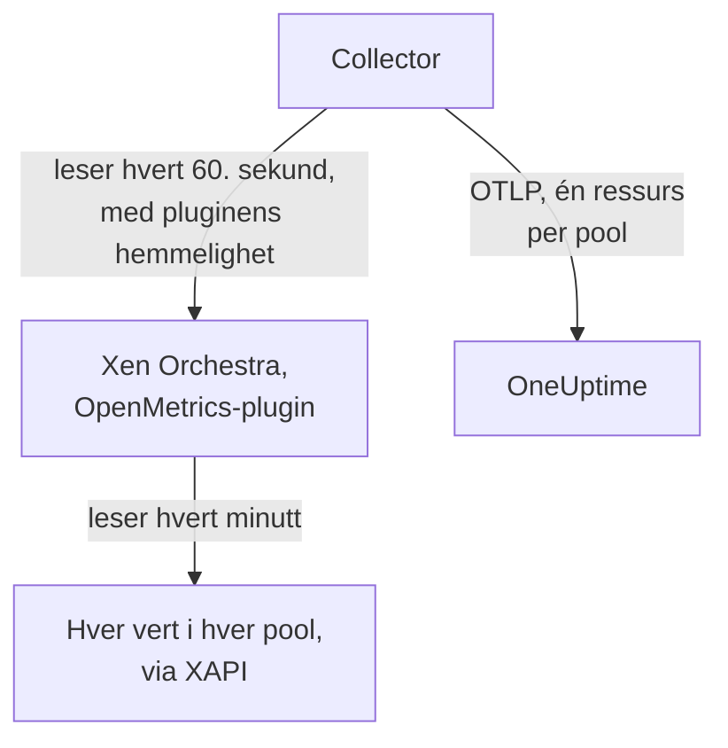

# XCP-ng-agent

OneUptimes XCP-ng-agent overvåker XCP-ng-poolene som en Xen Orchestra administrerer: vertene, VM-ene, lagringsrepositoriene og de virtuelle diskene deres. Den er en standard OpenTelemetry Collector som leser Xen Orchestras egen OpenMetrics-plugin med pluginens hemmelighet og sender det den leser, til OneUptime, der hver pool vises med inventaret sitt. Ingen passord til en pool eller til Xen Orchestra når noen gang frem til agenten. [XCP-ng-monitorer](/docs/monitor/xcp-ng-monitor) varsler på det som kommer inn. Vil du lese de samme poolene uten å installere noe, fra en OneUptime-sonde, se [XCP-ng uten agent](/docs/telemetry/xcp-ng-agentless).

:::cards
- [Installer agenten](#installer-agenten): Slå på pluginen, og bruk deretter installasjonsskriptet eller Docker Compose.
- [Sertifikatet til Xen Orchestra](#sertifikatet-til-xen-orchestra): Hvordan agenten stoler på Xen Orchestra, aldri ved å hoppe over kontrollen.
- [Hva agenten samler inn](#hva-agenten-samler-inn): Hver serie fra pluginen, og tellerne som egentlig er rater.
- [Feilsøking](#feilsøking): Et diagnoseskript, og de vanlige problemene.
:::

## Hva du får

- **Hver pool for seg.** Hver pool som Xen Orchestra administrerer, blir en XCP-ng-pool i OneUptime, gjenkjent på XAPI-UUID-en sin og navngitt slik Xen Orchestra navngir den. To pooler bak én Xen Orchestra er to pooler, og det er trygt å gi en pool nytt navn i OneUptime: telemetri knyttes til den via UUID-en.
- **Inventaret.** Poolens verter, VM-er, lagringsrepositorier og virtuelle disker med tilstanden og målingene sine. Kontrolldomener (dom0) rapporterer seg som VM-er, og poolens sider skjuler dem med mindre du ber om dem.
- **Én agent per Xen Orchestra.** Pluginen leverer hver pool som Xen Orchestra-en er koblet til, så én agent leser alle, og en pool som kobles til senere, vises ved neste lesing.

## Slik fungerer det

Agenten er én container som du kjører med Docker Compose på én maskin: en standard OpenTelemetry Collector, uten noe eget OneUptime-image. Hvert 60. sekund ber den Xen Orchestra om `/openmetrics/metrics`, med pluginens hemmelighet som Bearer-token, over Xen Orchestras egen adresse og eget sertifikat. Pluginen leser hver verts målinger via XAPI med en oppløsning på 60 sekunder. Collectoren beholder poolenes serier, grupperer dem per pool og sender dem til OneUptime over OTLP.



Hver pool registrerer seg selv med de første dataene sine, under UUID-en som agenten setter på seriene som `xcp_ng.pool.id`, og navnet Xen Orchestra gir den, `xcp_ng.pool.name`. En pool uten navn i Xen Orchestra heter "Pool" etterfulgt av begynnelsen på UUID-en, til du gir den nytt navn.

## Før du begynner

- Xen Orchestra 6.9 eller nyere, koblet til poolene du vil overvåke, med OpenMetrics-pluginen. På en Xen Orchestra Appliance (XOA) krever pluginen en Premium-lisens; en Xen Orchestra bygget fra kildekoden inneholder den.
- Docker Engine 20.10 eller nyere med Docker Compose v2-pluginen, `curl` og `openssl`, på en maskin som når Xen Orchestra over HTTPS.
- Et sertifikat på Xen Orchestra som nevner adressen agenten kobler til. Det selvsignerte sertifikatet Xen Orchestra lager til seg selv, nevner ingen, så ingen nåværende TLS-klient kan kontrollere det, og en Xen Orchestra bygget fra kildekoden serverer vanlig HTTP til du gir den et: se [Sertifikatet til Xen Orchestra](#sertifikatet-til-xen-orchestra).
- En inntaksnøkkel. Opprett en under **Prosjektinnstillinger → Telemetri og APM → Inntaksnøkler** og kopier verdien.
- Utgående HTTPS fra den maskinen til OneUptime-URL-en din.

### Støttede versjoner

| | Støttet | Hvorfor |
| --- | --- | --- |
| Xen Orchestra | 6.9 eller nyere, med OpenMetrics-pluginen `xo-server-openmetrics` 1.9 | Pluginen beholder hemmeligheten sin når Xen Orchestra starter på nytt, har rettelsene for minnelekkasjene ved lesing og leverer hver serie som poolens sider leser: tilstanden til verter og VM-er, lagringsrepositorier og virtuelle disker. En eldre plugin kunne lage en ny hemmelighet ved en omstart og stenge agenten ute til noen kopierte den på nytt. |
| XCP-ng | 8.3 LTS | Støttet av Vates til 30. november 2028. XCP-ng 8.2 nådde slutten av levetiden 16. september 2025. |
| XenServer | Ikke prøvd ennå | Xen Orchestra rapporterer en XenServer-pool den administrerer, med de samme seriene, så det burde fungere, men ingen har prøvd en med OneUptime ennå. |

### Hvor du kjører agenten

Agenten snakker med Xen Orchestra over HTTPS, så den kan kjøre på hvilken som helst maskin med Docker og en rute dit: selve maskinen til Xen Orchestra, en overvåkingsvert eller en liten administrasjons-VM. Velg helst en maskin der VM-en ikke kjører på poolene den overvåker: når en pool går ned, skal ikke overvåkingen gå ned med den. Én agent leser én Xen Orchestra; for flere, se [Lese flere Xen Orchestra-er](#lese-flere-xen-orchestra-er).

## Slå på OpenMetrics-pluginen

Agenten leser hver pool via Xen Orchestras OpenMetrics-plugin, med pluginens hemmelighet.

:::steps
### Slå på pluginen

Åpne *Settings → Plugins* i Xen Orchestra, finn **openmetrics** og slå den på. Første gang den starter, lager den en hemmelighet, og Xen Orchestra beholder den ved omstarter.

### Kopier hemmeligheten

Åpne pluginens innstillinger og kopier **Prometheus secret**: du gir den til agenten i neste trinn. Du kan også skrive inn en egen hemmelighet der og lagre den. Hold den privat: den som har den, kan lese målingene til hver pool.

### Sjekk at den svarer

Pluginen svarer på Xen Orchestras egen adresse og med dens eget sertifikat, på `/openmetrics/metrics`, og bare på en forespørsel som sender med hemmeligheten. Helsesjekken trenger ingen, så akkurat denne forespørselen kan hoppe over sertifikatkontrollen med `-k`; agenten gjør aldri det:

```bash
curl -k https://xo.example.com/openmetrics/health
```

Den svarer `{"status":"ok"}` så lenge pluginen kjører. En `404` betyr at pluginen ikke er slått på.
:::

## Installer agenten

:::steps
### Installer og start agenten

Hver OneUptime leverer agentens installasjonsskript og filer fra sin egen utgivelse: Kommandoene nedenfor laster dem ned fra `https://oneuptime.com`, så på en selvdriftet OneUptime erstatter du den adressen med URL-en din. Installasjonsskriptet lagres først som `install.sh`, slik at du kan lese det før du kjører det.

:::tabs
@tab install.sh
Last ned installasjonsskriptet og kjør det på maskinen som skal være vert for agenten:

```bash
curl -fsSL https://oneuptime.com/install/xcp-ng-agent -o install.sh
bash install.sh
```

Skriptet spør om OneUptime-URL-en din, inntaksnøkkelen, adressen til Xen Orchestra slik du åpner den i en nettleser (for eksempel `https://xo.example.com` eller `https://10.0.0.5:8443`), pluginens hemmelighet (vises ikke mens du skriver) og hva denne Xen Orchestra-en skal hete i OneUptime. Deretter leser det sertifikatet til Xen Orchestra: et sertifikat denne maskinen allerede stoler på, kontrolleres mot CA-pakken dens; alle andre vises med SHA-256-fingeravtrykket sitt, og du svarer **y** for å stole på det sertifikatet og ingenting annet, når du har sammenlignet fingeravtrykket med det på maskinen til Xen Orchestra. Det slår aldri av kontrollen. Til slutt ber det pluginen om målingene med hemmeligheten og nevner poolene Xen Orchestra rapporterer, før det installerer noe. Det installerer i `/opt/oneuptime-xcp-ng-agent`, skriver med rettighetene `0600` en `.env`-fil og `xo-ca.pem`, sertifikatene agenten stoler på for Xen Orchestra, og starter agenten med Docker Compose. Hvis du kjører skriptet på nytt, gjenbruker det alt i den `.env`-en i stedet for å spørre igjen; slik [oppgraderer du agenten](#oppgradere-agenten).
@tab Docker Compose
Last ned `docker-compose.yml` og `otel-collector-config.yaml` fra din OneUptime til en ny mappe:

```bash
mkdir oneuptime-xcp-ng-agent && cd oneuptime-xcp-ng-agent
curl -fsSLO https://oneuptime.com/install/xcp-ng-agent/docker-compose.yml
curl -fsSLO https://oneuptime.com/install/xcp-ng-agent/otel-collector-config.yaml
```

Opprett en `.env`-fil ved siden av dem. Den inneholder pluginens hemmelighet, så hold den privat med `chmod 600 .env`:

```bash title=".env"
ONEUPTIME_URL=YOUR_ONEUPTIME_URL
ONEUPTIME_TELEMETRY_INGESTION_KEY=YOUR_TELEMETRY_INGESTION_TOKEN
XO_SCHEME=https
XO_ADDRESS=xo.example.com
XO_OPENMETRICS_SECRET='your-plugin-secret'
XO_NAME='Xen Orchestra'
XO_TLS_SERVER_NAME=
```

`XO_ADDRESS` er Xen Orchestras `host` eller `host:port`, uten `https://`. Sett pluginens hemmelighet i enkle anførselstegn, og skriv hvert `$` i den som `$$`: collectoren leser verdien én gang til og ville ta et `$` for starten på en variabel. En hemmelighet med en `'` i kan ikke stå i enkle anførselstegn: la installasjonsskriptet skrive den, eller velg en annen hemmelighet i Xen Orchestra.

Lagre deretter sertifikatet til Xen Orchestra som `xo-ca.pem` ved siden av `docker-compose.yml`: agenten kontrollerer Xen Orchestra mot denne filen og ingenting annet. For å stole på Xen Orchestras eget sertifikat leser du det og sammenligner fingeravtrykket med det på maskinen til Xen Orchestra før du bruker det:

```bash
openssl s_client -connect xo.example.com:443 -servername xo.example.com </dev/null 2>/dev/null \
  | openssl x509 -out xo-ca.pem
openssl x509 -in xo-ca.pem -noout -fingerprint -sha256
```

Har din egen CA utstedt sertifikatet, kopierer du i stedet sertifikatet til den CA-en til `xo-ca.pem`; har en offentlig CA utstedt det, kopierer du denne maskinens CA-pakke (`cp /etc/ssl/certs/ca-certificates.crt xo-ca.pem`). Start agenten:

```bash
docker compose up -d
```
:::

### Sjekk at agenten kjører

```bash
docker compose ps
docker logs -f oneuptime-xcp-ng-agent
```

`docker compose ps` viser collectoren, `oneuptime-xcp-ng-agent`. Loggene bør vise denne linjen når den har startet:

```text
Everything is ready. Begin running and processing data.
```

### Finn poolene i OneUptime

Åpne **Produkter → Infrastruktur → XCP-ng → Alle pooler**. Hver pool Xen Orchestra rapporterer, vises omtrent et minutt etter den første lesingen, under navnet Xen Orchestra gir den, med vertene, VM-ene og lagringen sin. Siden **Topologi** tegner dem som ett kart: se [Topologi](/docs/telemetry/topology#åpne-en-ressurs-sitt-eget-kart).
:::

## Sertifikatet til Xen Orchestra

Agenten kontrollerer sertifikatet til Xen Orchestra ved hver lesing, mot `xo-ca.pem` og ingenting annet, og hopper aldri over kontrollen: pluginens hemmelighet følger med i hver forespørsel. `xo-ca.pem` inneholder én av tre ting:

- **Xen Orchestras eget sertifikat**, festet via SHA-256-fingeravtrykket (`XO_TLS_FINGERPRINT`): agenten stoler på det sertifikatet og ikke noe annet.
- **CA-en som utstedte det** (`XO_CA_FILE`), for et sertifikat fra din egen CA.
- **Denne maskinens CA-pakke**, for et sertifikat denne maskinen allerede stoler på, for eksempel et fra en offentlig CA.

Uansett må sertifikatet nevne adressen agenten kobler til. Agenten kontrollerer navnene et sertifikat er utstedt til, de alternative emnenavnene (subject alternative names), slik hver nåværende TLS-klient gjør, og aldri selve emnet. Det selvsignerte sertifikatet Xen Orchestra lager til seg selv, nevner ingen, så agenten kan ikke stole på det, festet eller ikke, og feiler med `x509: certificate is not valid for any names`; installasjonsskriptet stopper ved et slikt sertifikat og sier hvorfor.

### Gi Xen Orchestra et sertifikat som nevner adressen

Bruk et sertifikat fra din egen CA eller fra en offentlig, eller lag et selvsignert på maskinen til Xen Orchestra som nevner adressen til Xen Orchestra, med navnet og adressen i de alternative emnenavnene:

```bash
sudo mkdir -p /etc/ssl/xo
sudo openssl req -x509 -newkey rsa:2048 -nodes -days 825 \
  -subj "/CN=xo.example.com" \
  -addext "subjectAltName=DNS:xo.example.com,IP:10.0.0.5" \
  -keyout /etc/ssl/xo/key.pem -out /etc/ssl/xo/cert.pem
```

Pek HTTPS-lytteren til xo-server på de to filene, som brukeren xo-server kjører som (root som standard), må kunne lese, i en egen konfigurasjonsfil: `/etc/xo-server/config.httpscert.toml` på en XOA, eller ved siden av `config.toml` til xo-server for en Xen Orchestra bygget fra kildekoden. Lytterne til Xen Orchestra er nummererte, og den andre, `http.listen.1`, er HTTPS-lytteren:

```toml
[http.listen.1]
port = 443
cert = '/etc/ssl/xo/cert.pem'
key = '/etc/ssl/xo/key.pem'
```

Start deretter xo-server på nytt med `systemctl restart xo-server`, og installer agenten, eller kjør installasjonsskriptet på nytt: det leser det nye sertifikatet og viser fingeravtrykket for kontroll. Eller la Xen Orchestra selv bestille et Let's Encrypt-sertifikat, slik en XOA kan (se dokumentasjonen til Xen Orchestra): det er offentlig klarert, så agenten trenger ingen innstilling. Med et sertifikat som nevner Xen Orchestra med et annet navn enn adressen i `XO_ADDRESS`, setter du `XO_TLS_SERVER_NAME` til det navnet; installasjonsskriptet fyller det inn fra sertifikatet når det kan.

Når et festet sertifikat fornyes, slutter agenten å lese Xen Orchestra til den stoler på det nye. Kjør installasjonsskriptet på nytt: det viser det nye fingeravtrykket og stopper uten å endre noe. Kontroller det fingeravtrykket på maskinen til Xen Orchestra, og kjør deretter skriptet én gang til med det: `XO_TLS_FINGERPRINT=<new fingerprint> bash install.sh`. Installert med Docker Compose: skriv `xo-ca.pem` på nytt og kjør `docker compose up -d --force-recreate`.

## Miljøvariabler

Installasjonsskriptet skriver disse til `/opt/oneuptime-xcp-ng-agent/.env`; en Docker Compose-installasjon leser dem fra `.env` ved siden av `docker-compose.yml`. Når du har endret en variabel, kjører du `docker compose up -d` i den mappen.

| Variabel | Påkrevd | Beskrivelse |
| --- | --- | --- |
| `ONEUPTIME_URL` | Ja | OneUptime-URL-en din, for eksempel `https://oneuptime.com` eller den selvhostede instansen din. Bruk `http://` og porten hvis instansen bare bruker HTTP. |
| `ONEUPTIME_TELEMETRY_INGESTION_KEY` | Ja | Inntaksnøkkelen fra **Prosjektinnstillinger → Telemetri og APM → Inntaksnøkler**. |
| `XO_URL` | Installasjonsskript | Adressen til Xen Orchestra slik du åpner den i en nettleser, for eksempel `https://xo.example.com` eller `https://10.0.0.5:8443`. Installasjonsskriptet utleder `XO_SCHEME` og `XO_ADDRESS` fra den. |
| `XO_SCHEME` | Nei | `https`, standarden. `http` bare i et laboratorium: hemmeligheten går da ukryptert over nettverket. |
| `XO_ADDRESS` | Ja | Xen Orchestras `host` eller `host:port`, uten skjema. |
| `XO_OPENMETRICS_SECRET` | Ja | Hemmeligheten til OpenMetrics-pluginen, sendt som Bearer-token. Hvert `$` i den skrives som `$$`. |
| `XO_NAME` | Nei | Hva denne Xen Orchestra-en heter i OneUptime, satt som `xen_orchestra.name` på hver pool den leser, og vist i **Innstillinger** for hver pool. Standard er adressen til Xen Orchestra. |
| `XO_TLS_FINGERPRINT` | Installasjonsskript | SHA-256-fingeravtrykket til Xen Orchestras eget sertifikat, slik `openssl x509 -fingerprint -sha256` viser det, kolon valgfritt, når agenten stoler på det sertifikatet og ingenting annet. Installasjonsskriptet avviser et sertifikat som ikke passer. |
| `XO_CA_FILE` | Installasjonsskript | En CA-pakke som utstedte sertifikatet til Xen Orchestra; installasjonsskriptet kontrollerer sertifikatet mot den og kopierer den til `xo-ca.pem`. |
| `XO_TLS_SERVER_NAME` | Nei | Navnet sertifikatet til Xen Orchestra kontrolleres mot, når `XO_ADDRESS` er en adresse sertifikatet ikke nevner. Tom: verten i `XO_ADDRESS`. |
| `ONEUPTIME_AI_XO_READ_TOKEN` | Nei | Et token fra en Xen Orchestra-bruker med en kopi av den innebygde rollen **Read only** og ingenting annet: [AI-agenten](#ai-agent) kjører når det er satt, og leser med det. |
| `ONEUPTIME_AI_XO_WRITE_TOKEN` | Nei | Bare for rettelser: et token fra en annen bruker med en rolle som tillater dem. Uten det endrer AI-agenten ingenting. |
| `XCP_NG_POOL_ID` | Nei | XAPI-UUID-en til poolen AI-agenten betjener. Tom: den ene poolen lesetokenet kan se. |
| `ONEUPTIME_AI_AGENT_RESOURCE_NAME` | Nei | Overstyrer `XCP_NG_POOL_ID` som poolen AI-agenten registrerer seg som. |
| `ONEUPTIME_AI_INVESTIGATION` | Nei | `true` eller `false`: om OneUptime AI kan kjøre AI-agentens skrivebeskyttede kommandoer mens den undersøker. Tom: på. |
| `ONEUPTIME_AI_FIXES` | Nei | `off`, `ask-for-approval`, `automatic` eller `bypass-approval`: hvordan OneUptime AI kan utføre en rettelse. Tom: `ask-for-approval` når skriving er tillatt, ellers `off`. |
| `ONEUPTIME_AI_ALLOW_WRITES` | Nei | `true` lar AI-agenten utføre rettelser, med tokenet for endringer. Alt annet holder den skrivebeskyttet. |
| `ONEUPTIME_AI_WRITE_TARGETS` | Nei | `vm/<uuid>`, `host/<uuid>`, `pbd/<uuid>` eller `schedule/<uuid>` som en rettelse kan røre, kommaseparert, `*` for en vilkårlig rekke tegn. Tom: alle. |
| `ONEUPTIME_AI_PROTECTED_TARGETS` | Nei | Det samme, for det OneUptime AI aldri må endre, uansett hvem som godkjenner det: VM-en AI-agenten kjører i, og Xen Orchestras egen. |
| `LOG_LEVEL` | Nei | Loggnivået til AI-agenten: `debug`, `info` (standarden), `warn` eller `error`. |
| `COMPOSE_PROFILES` | Nei | `xcp-ng-ai-agent` starter AI-agenten. Installasjonsskriptet skriver det når lesetokenet er satt, og fjerner det når det ikke er det. |

## Hva agenten samler inn

Hvert minutt leser agenten pluginen, som via XAPI leser round-robin-databasene til hver vert med en oppløsning på 60 sekunder. Den beholder seriene `xcp_*` og flytter poolen til hver serie over på ressursen den sender dem på, som `xcp_ng.pool.id` (poolens UUID, som aldri endres) og `xcp_ng.pool.name`:

| Kategori | Serier |
| --- | --- |
| Pool | `xcp_pool_connected`, til stede så lenge Xen Orchestra er koblet til poolen |
| Verter | `xcp_host_status` (strømtilstanden, og om den er aktivert), `xcp_host_uptime_seconds`, `xcp_host_cpu_average`, `xcp_host_cpu_core_usage`, `xcp_host_load`, `xcp_host_load_average`, `xcp_host_memory_*`, `xcp_host_running_vcpus`, `xcp_host_network_*` per fysisk grensesnitt, `xcp_host_disk_*` per lagringsrepositorium, `xcp_host_power_consumption_watts` |
| VM-er | `xcp_vm_status`, `xcp_vm_uptime_seconds`, `xcp_vm_cpu_usage`, `xcp_vm_cpu_core_usage`, `xcp_vm_runstate_*` (CPU-konkurranse), `xcp_vm_memory_*`, `xcp_vm_network_*` per grensesnitt, `xcp_vm_disk_*` per disk, `xcp_vm_power_consumption_watts` |
| Lagring | `xcp_sr_physical_size_bytes`, `xcp_sr_physical_usage_bytes`, `xcp_sr_virtual_size_bytes`, `xcp_vdi_virtual_size_bytes`, `xcp_vdi_physical_usage_bytes` |
| XOSTOR | `xcp_xostor_*`, på pooler som kjører XOSTOR |

Kontrolldomener rapporterer seg som VM-er med `is_control_domain="true"`. Hver serie fra Xen Orchestra beholder navnet og etikettene sine, for eksempel `uuid`, `host_name`, `vm_name`, `sr_name` og `tags`; [XCP-ng-monitoren](/docs/monitor/xcp-ng-monitor#innsamlede-målinger) nevner dem alle.

### Tellerne som er rater

Xen Orchestra typer åtte gjennomstrømningsserier som tellere og kaller dem `_total`, selv om hver inneholder XAPIs rate per sekund: `xcp_host_network_receive_bytes_total`, `xcp_host_network_transmit_bytes_total`, `xcp_vm_network_receive_bytes_total`, `xcp_vm_network_transmit_bytes_total`, `xcp_vm_network_receive_errors_total`, `xcp_vm_network_transmit_errors_total`, `xcp_vm_disk_read_bytes_total` og `xcp_vm_disk_write_bytes_total`. Lest som tellere ville hvert diagram over nettverks- og diskgjennomstrømning være feil: en rate som synker, leses som en nullstilling av telleren. Agentens prosessor `transform/xcp-ng-rates` gjør dem til gauges med uendrede navn og verdier, så OneUptime lagrer dem som ratene de er, i byte eller feil per sekund. OneUptime konverterer også alle serier som fortsatt kommer som tellere, fra en collector du har konfigurert selv.

### Hva OneUptime legger til

OneUptime utleder fire 0/1-serier for hver pool mens dataene kommer inn, og varslingsmalene leser dem:

| Serie | 1 så lenge |
| --- | --- |
| `xcp_ng.host.running` | Xen Orchestra rapporterer verten som Running; 0 mens den er Halted, eller tilstanden er Unknown |
| `xcp_ng.host.enabled` | verten er aktivert; 0 i vedlikeholdsmodus eller under en evakuering, når XAPI ikke starter noen VM på den |
| `xcp_ng.vm.running` | VM-en er Running; 0 mens den er Halted, Paused eller Suspended |
| `xcp_ng.vm.stopped_after_running` | en VM som kjørte de siste 24 timene, er Halted eller Paused |

Den setter også `xcp_ng.scope` (`pool`, `host`, `vm`, `sr`, `vdi` eller `xostor`) og `xcp_ng.id` (UUID-en til det objektet) på hvert punkt, og monitorer og dashbord filtrerer på dem: se [Ressursidentitet](/docs/monitor/xcp-ng-monitor#ressursidentitet).

### Hva agenten ikke beholder

- Xen Orchestras egne prosesserier (`xo_*`), som ikke hører til noen pool, og collectorens egne leseserier.
- Effekten til en vert som Xen Orchestra leser via IPMI: pluginen sender den målingen uten poolen, så den hører heller ikke til noen pool. Hver VMs anslåtte andel, `xcp_vm_power_consumption_watts`, beholdes.

## Hva sidene til en pool viser

Åpne en pool fra **Produkter → Infrastruktur → XCP-ng → Alle pooler**. Menyen inneholder:

| Side | Hva den viser |
| --- | --- |
| **Oversikt** | Poolens helse og det som krever oppmerksomhet, vertene, VM-ene og lagringen, de travleste VM-ene og vertene, og Xen Orchestra-en den leses fra, med agentens versjon. |
| **Verter**, **VM-er**, **Lagring** | Hver vert, VM og hvert lagringsrepositorium, hver med sin egen side og diagrammene sine. **VM-er** skjuler kontrolldomener med mindre du ber om dem, og siden til et lagringsrepositorium viser de virtuelle diskene. |
| **Topologi** | Poolen, vertene, VM-ene på hver vert og lagringsrepositoriene de bruker, som ett kart. |
| **Ressursbruk** | Diagrammer over poolens verter, VM-er, lagring, disker og nettverk over tid, én linje per vert, VM eller lagringsrepositorium. |
| **Anbefalinger** | [Varslingsmalene](/docs/monitor/xcp-ng-monitor#ferdige-varslingsmaler) som kan slås på, hver én monitor. |
| **Målinger**, **Logger** | Hver av poolens serier i utforskerne, avgrenset til den. Agenten sender bare målinger, så **Logger** viser bare logger du sender med poolens `xcp_ng.pool.id`. |
| **Hendelser**, **Varsler**, **Planlagt vedlikehold** | De som nevner poolen. |
| **Feed** | Hva som skjedde med poolen i OneUptime: når den ble lagt til, endret, arkivert eller gjenopprettet, hvem eierne er, og eier- og etikettreglene som kjørte på den. |
| **Eiere** | Hvem som får beskjed om den, manuelt eller via eierregler. |
| **Innstillinger** | Navnet, Xen Orchestra-en den leses fra, navnet der og agentens versjon, og hvor lenge telemetrien beholdes. |
| **Dokumentasjon** | Dette oppsettet, med URL-en og nøkkelen din allerede fylt inn. |

Poolens **Oversikt** angir helsen, **Feilfri**, **Redusert** eller **Ikke feilfri**, ut fra det som krever oppmerksomhet, og viser det under **Krever oppmerksomhet**, det mest presserende først:

- **Kritisk:** en vert som er Halted, eller i en tilstand Xen Orchestra ikke kan fastslå (Unknown); et lagringsrepositorium som er mer enn 95 % fullt, der VM-er ikke lenger kan skrive.
- **Verdt en titt:** en deaktivert vert, i vedlikeholdsmodus eller under evakuering; en VM som er Halted eller Paused og kjørte de siste 24 timene; et lagringsrepositorium som er mer enn 90 % fullt, der varselet Storage Repository Near Full utløses, eller som er tildelt utover størrelsen sin via thin provisioning.

En suspendert VM (Suspended) er suspendert med vilje og telles aldri, heller ikke en VM ingen har sett kjøre på et døgn, eller et kontrolldomene. ISO-biblioteker og flyttbare medier inneholder ingen VM-disker, så poolens lagringstall utelater dem.

Når Xen Orchestra slutter å rapportere en pool i 15 minutter, blir poolen **Frakoblet**, og sidene beholder det den sist rapporterte. En vert, VM, et lagringsrepositorium eller en virtuell disk som ikke lenger finnes i rapportene til Xen Orchestra, forlater inventaret 15 minutter senere; å stoppe en VM fjerner den aldri.

## Merk poolene med prosjektetiketter

Et ressursattributt som begynner med `oneuptime.label.`, blir en prosjektetikett på hver pool agenten leser: `oneuptime.label.<dimension>=<value>` er etiketten `<dimension>:<value>`. Legg attributtene til prosessoren `resource` i `otel-collector-config.yaml`, ved siden av `oneuptime.agent.version`:

```yaml
processors:
  resource:
    attributes:
      # ...existing attributes...
      - key: oneuptime.label.team
        value: platform
        action: upsert
      - key: oneuptime.label.env
        value: production
        action: upsert
```

Collectoren leser konfigurasjonen sin bare ved oppstart: kjør `docker compose restart oneuptime-xcp-ng-agent`. Poolene viser da etikettene `team:platform` og `env:production`. Etiketter sammenlignes uten hensyn til store og små bokstaver, så en eksisterende etikett `Production` gjenbrukes i stedet for å dobles, og agenten fjerner aldri en etikett noen har lagt til i OneUptime. Når du kjører installasjonsskriptet på nytt, erstattes en redigert `otel-collector-config.yaml`, og din lagres ved siden av som `otel-collector-config.yaml.bak.<timestamp>`.

## Lese flere Xen Orchestra-er

Én agent leser én Xen Orchestra og hver pool den administrerer. For å lese en annen Xen Orchestra fra samme maskin installerer du en ny agent i en egen mappe med en egen `.env`, for eksempel `INSTALL_DIR=/opt/oneuptime-xcp-ng-agent-lab bash install.sh`, og gir den et eget `container_name` i `docker-compose.yml` (for eksempel `oneuptime-xcp-ng-agent-lab`): to containere kan ikke dele et navn. Gi hver sitt eget `XO_NAME`, så **Innstillinger** for hver pool sier hvilken Xen Orchestra som leser den, og gi mappen til diagnoseskriptet med `-d`.

La aldri to agenter lese samme pool via to Xen Orchestra-er som begge administrerer den: den er én pool i OneUptime via UUID-en og ville blitt rapportert to ganger.

## AI-agent

Agentens `docker-compose.yml` har også **XCP-ng-AI-agenten**, `oneuptime-xcp-ng-ai-agent` (image `oneuptime/resource-ai-agent:release`), under profilen `xcp-ng-ai-agent`. Mens OneUptime AI undersøker en hendelse eller et varsel på en pool, kjører den skrivebeskyttede `xo-cli`-REST-kommandoer gjennom den, for eksempel `xo-cli rest get vms fields=name_label,power_state filter=power_state:Halted` eller `xo-cli rest get pbds fields=attached,host,SR filter=!attached?`, og, bare hvis du tillater det, utfører rettelser som å starte en VM eller koble til PBD-en til et lagringsrepositorium. Det finnes ingen `xo-cli`-binærfil i den: hver kommando blir nøyaktig ett kall til REST-API-et til Xen Orchestra, på adressen og med den `xo-ca.pem` som collectoren bruker. Den vises på poolens side **AI-agent** i OneUptime.

- **Den trenger et eget token, skrivebeskyttet.** OpenMetrics-hemmeligheten leser bare målinger, så AI-agenten leser REST-API-et til Xen Orchestra (Xen Orchestra 6.9 eller nyere) med `ONEUPTIME_AI_XO_READ_TOKEN`, et token fra en Xen Orchestra-bruker med en kopi av den innebygde rollen **Read only** og ingenting annet. Kjør `install.sh` med det satt, eller skriv det inn når en første installasjon spør: skriptet spør Xen Orchestra om det kjenner tokenet, lagrer det i `.env` med modus 600 og starter AI-agenten. Før agenten kjører noe, og hvert 5. minutt, kontrollerer den at tokenet bare kan lese: tokenet til en administrator, eller et token med roller som tillater en endring, kjører ingenting.
- **Én pool per AI-agent.** `XCP_NG_POOL_ID` er poolen den betjener, XAPI-UUID-en dens slik poolens **Innstillinger** viser den. Står den tom, betjener den den ene poolen tokenet kan se. For en Xen Orchestra med flere pooler viser agentens README hvordan du kjører én til per pool. En pool som en sonde leser, trenger ingen XCP-ng-agent: README-en viser også hvordan du kjører AI-agenten alene for den, fra den samme `docker-compose.yml`.
- **AI-undersøkelser er på som standard.** Så snart agenten kobler seg til, undersøker OneUptime AI hendelser og varsler på poolen med den, og poolens **Oversikt** viser agentens status. For å stoppe, sett `ONEUPTIME_AI_INVESTIGATION=false` der agenten kjører (**Endre** under **Hva AI kan gjøre** på AI-agentsiden viser hvordan), eller utelat tokenet.
- **Rettelser krever et andre token.** Agenten er skrivebeskyttet med mindre du setter `ONEUPTIME_AI_ALLOW_WRITES=true` og `ONEUPTIME_AI_XO_WRITE_TOKEN`, et token fra en annen bruker med en rolle som tillater rettelsene (en kopi av rollen **VMs power state manager**, med rettighetene agentens README viser lagt til). Det brukes til selve endringen og ingenting annet. `ONEUPTIME_AI_WRITE_TARGETS` (`vm/<uuid>`, `host/<uuid>`, `pbd/<uuid>`, `schedule/<uuid>`) begrenser hva en rettelse kan røre; legg UUID-ene til VM-en agenten kjører i, og til Xen Orchestras egen VM, i `ONEUPTIME_AI_PROTECTED_TARGETS`. `ONEUPTIME_AI_FIXES` i den samme `.env`-filen sier hvordan rettelser kjører — `ask-for-approval` (en person godkjenner hver av dem), `automatic` eller `bypass-approval` — og AI-agentsiden viser det skrivebeskyttet ([Hva AI kan gjøre, satt av agenten](/docs/ai/infrastructure-ai-agents#hva-ki-en-kan-gjøre-satt-av-agenten)).
- **Den kontrollerer sertifikatet til Xen Orchestra slik collectoren gjør**, etter subjectAltName og bare mot `xo-ca.pem`, så sertifikatet Xen Orchestra lager for seg selv, avvises her også ([Sertifikatet til Xen Orchestra](#sertifikatet-til-xen-orchestra)). Den leser aldri Xen Orchestra over `http://`: tokenene ville gått ukryptert over nettverket.
- Den kjører som UID 1000 uten capabilities og med et skrivebeskyttet rotfilsystem, og leser aldri Xen Orchestras brukere, roller, servere, plugins eller remoter, filtrerer aldri på en egenskap som inneholder hemmeligheter, og redigerer, sletter, tilbakestiller eller kloner aldri noe.

Hva den kan kjøre, hvordan rettelser fungerer og hvordan du feilsøker den: [Infrastructure AI Agents](/docs/ai/infrastructure-ai-agents#xcp-ng-pooler). Agentens README har rollene og rettighetene for begge tokenene.

## Kjør som en systemd-tjeneste

For å starte agenten sammen med maskinen og starte den på nytt når den feiler, installerer du systemd-enheten. Den forutsetter at agenten ligger i `/opt/oneuptime-xcp-ng-agent`, der installasjonsskriptet legger den:

```bash
sudo curl -fsSL https://oneuptime.com/install/xcp-ng-agent/systemd/oneuptime-xcp-ng-agent.service -o /etc/systemd/system/oneuptime-xcp-ng-agent.service
sudo systemctl daemon-reload
sudo systemctl enable --now oneuptime-xcp-ng-agent
```

## Oppgradere agenten

Agenten rapporterer collector-versjonen som filene låser, som sin **Agentversjon**, på **Oversikt** og **Innstillinger** for hver pool. Når den er eldre enn versjonen denne OneUptime-utgivelsen låser, vises et advarselstegn ved siden av den. Velg det for å se disse kommandoene.

Collector-imaget er låst i `docker-compose.yml`, og konfigurasjonen er en fil ved siden av, så et pull alene flytter ikke agenten fremover. Kjør `install.sh` på nytt: det gjenbruker hver verdi i den eksisterende `.env`-en din (ingenting spørres om igjen), kontrollerer sertifikatet til Xen Orchestra på samme måte, fornyer `docker-compose.yml` og `otel-collector-config.yaml` (en fil du har redigert, beholdes som `<file>.bak.<timestamp>`), henter imaget og oppretter agenten på nytt, så collectoren leser den nye konfigurasjonen. En agent installert utenfor `/opt/oneuptime-xcp-ng-agent` trenger mappen sin: `INSTALL_DIR=<folder> bash install.sh`.

```bash
curl -fsSL https://oneuptime.com/install/xcp-ng-agent -o install.sh
bash install.sh
```

Installerte du den med Docker Compose i stedet? Last ned begge filene på nytt i agentens mappe (og gjør eventuelle endringer du hadde gjort i dem, på nytt), hent deretter imaget og opprett agenten på nytt. `.env` og `xo-ca.pem` blir værende:

```bash
curl -fsSLO https://oneuptime.com/install/xcp-ng-agent/docker-compose.yml
curl -fsSLO https://oneuptime.com/install/xcp-ng-agent/otel-collector-config.yaml
docker compose pull
docker compose up -d --force-recreate
```

## Avinstallere agenten

```bash
cd /opt/oneuptime-xcp-ng-agent
docker compose down
```

Slå deretter av OpenMetrics-pluginen i Xen Orchestra hvis ingenting annet leser den.

## Feilsøking

:::details Kjør diagnoseskriptet først
Agenten har et skript, [`troubleshoot.sh`](https://oneuptime.com/install/xcp-ng-agent/troubleshoot.sh), som kontrollerer hele kjeden i den rekkefølgen dataene reiser: containeren; adressen til Xen Orchestra fra agentens eget nettverk; pluginens helsesjekk; sertifikatet til Xen Orchestra mot `xo-ca.pem`, og om et festet sertifikat fortsatt er det det viser; pluginens hemmelighet; poolene Xen Orchestra rapporterer; formen på inntaksnøkkelen; collectorens egne målinger; og om OneUptime godtar inntaksnøkkelen. Den siste kontrollen veier tyngst. OneUptime avviser en feil nøkkel med `401` (`422` for en deaktivert nøkkel eller en nettlesernøkkel), og collectoren behandler begge som permanente: den kaster batchen og logger én feil `Exporting failed`, som er lett å overse mens containeren forblir frisk. Skriptet kaller `GET <url>/otlp/v1/validate` fra agentens nettverk for et umiddelbart `200` (gyldig) eller `401` (ugyldig) og faller tilbake til `POST /fluentd/v1/logs` på eldre servere. Det viser aldri hemmeligheten eller nøkkelen.

```bash
curl -fsSL https://oneuptime.com/install/xcp-ng-agent/troubleshoot.sh -o troubleshoot.sh
bash troubleshoot.sh    # add -d <dir> if you installed outside /opt/oneuptime-xcp-ng-agent
```

Det avslutter med en dom som navngir den mest sannsynlige årsaken.
:::

:::details Xen Orchestra avviser hemmeligheten (401)
Collectoren logger `server returned HTTP status 401 Unauthorized`. Kopier hemmeligheten på nytt fra *Settings → Plugins → openmetrics*, sett `XO_OPENMETRICS_SECRET` til den i `.env`, i enkle anførselstegn og med hvert `$` skrevet som `$$`, og kjør `docker compose up -d` i agentens mappe. Før 6.8 kunne Xen Orchestra lage en ny hemmelighet ved en omstart: oppgrader den.
:::

:::details Pluginen svarer ikke (404, 500, 502 eller 503)
Xen Orchestra svarer, men OpenMetrics-pluginen gjør det ikke. Slå på pluginen under *Settings → Plugins → openmetrics*, og kontroller at Xen Orchestra er 6.9 eller nyere. En XOA trenger en Premium-lisens for pluginen. `/openmetrics/health` svarer `{"status":"ok"}` uten hemmelighet så lenge pluginen kjører.
:::

:::details Sertifikatfeil
- `x509: certificate is not valid for any names`: sertifikatet nevner ingen adresse, slik Xen Orchestras eget selvsignerte sertifikat. [Gi Xen Orchestra et sertifikat som nevner adressen](#gi-xen-orchestra-et-sertifikat-som-nevner-adressen).
- `x509: certificate is valid for <names>, not <address>`: koble til ett av de navnene, eller sett `XO_TLS_SERVER_NAME` til ett av dem.
- `x509: cannot validate certificate for <IP> because it doesn't contain any IP SANs`: `XO_ADDRESS` er en IP-adresse sertifikatet ikke nevner. Sett `XO_TLS_SERVER_NAME` til et navn det nevner, eller kjør installasjonsskriptet på nytt, som gjør det.
- `x509: certificate signed by unknown authority`: `xo-ca.pem` inneholder verken dette sertifikatet eller CA-en som utstedte det. Sertifikatet er fornyet, eller filen inneholder et annet: kontroller det nye fingeravtrykket på maskinen til Xen Orchestra og kjør installasjonsskriptet med det, `XO_TLS_FINGERPRINT=<new fingerprint> bash install.sh`, eller skriv filen på nytt.
- `unable to read CA cert`: `xo-ca.pem` mangler eller kan ikke leses. Kjør installasjonsskriptet på nytt.
:::

:::details Lesingen får tidsavbrudd (context deadline exceeded)
Xen Orchestra brukte mer enn 50 sekunder, agentens grense, på å samle inn målingene, så den lesingen sender ingenting: oftest svarer ikke en vert i en av poolene. Kontroller vertene til poolene i Xen Orchestra; agenten leser igjen et minutt senere.
:::

:::details En pool er Frakoblet
OneUptime markerer en pool som Frakoblet når ingenting er lest for den på 15 minutter; OneUptime sjekker hvert 5. minutt, og tid da den selv ikke mottok data, teller ikke.

1. Er alle poolene til denne Xen Orchestra-en Frakoblet, kontrollerer du agenten: `docker compose ps` og `docker logs oneuptime-xcp-ng-agent`, i agentens mappe.
2. Er det bare én, rapporterer ikke Xen Orchestra den lenger: under *Settings → Servers* i Xen Orchestra må poolens server være tilkoblet. Poolens verter, VM-er og lagring blir værende slik Xen Orchestra sist rapporterte dem.
:::

:::details En pool mangler
Xen Orchestra rapporterer bare poolene den er koblet til, og agenten leser bare den Xen Orchestra-en. Koble til poolens server under *Settings → Servers* i Xen Orchestra; poolen vises i OneUptime ved neste lesing. En pool som en annen Xen Orchestra administrerer, trenger sin egen agent, ved siden av den Xen Orchestra-en.
:::

:::details Gjennomstrømningsdiagrammer ser feil ut
De åtte seriene `_total` som inneholder rater, må nå OneUptime som gauges. Har du erstattet den medfølgende `otel-collector-config.yaml` med din egen, beholder du prosessoren `transform/xcp-ng-rates` i den. Les dem som de er, i byte eller feil per sekund: en rate per sekund av dem ville vært en rate av en rate.
:::

:::details Sende målinger uten agenten
Agenten er én standardkonfigurasjon av collectoren, så en collector du allerede kjører, kan gjøre samme jobb: kopier lesejobben og prosessorene fra den medfølgende konfigurasjonen til din. Ressursattributtet `xcp_ng.pool.id` registrerer hver pool i OneUptime, prosessoren `groupbyattrs` gjør hver pool til én ressurs, og fjerningen av `service.name` og `service.instance.id` hindrer at dataene havner under en tjeneste: behold alle tre, og `transform/xcp-ng-rates`.
:::

## Hva pluginen ikke dekker ennå

Xen Orchestras OpenMetrics-plugin leverer målinger, så en del av det du følger med på i en XCP-ng-pool, finnes ikke der ennå:

- **Alarmer** utover XOSTORs, **HA-tilstanden**, **pool-masteren**, **manglende oppdateringer**, **sikkerhetskopier** og **øyeblikksbilder**, og **koblingstilstanden** til en verts fysiske grensesnitt (PIF-er). De kommer fra REST-API-et til Xen Orchestra, i [#10997](https://github.com/OneUptime/oneuptime/issues/10997).
- **Pooler uten Xen Orchestra**, eller bak en XOA uten Premium-lisensen pluginen trenger: En OneUptime-sonde leser dem direkte via XAPI ([#10999](https://github.com/OneUptime/oneuptime/issues/10999)), se [XCP-ng uten agent](/docs/telemetry/xcp-ng-agentless).
- **Tilkobling uten agent**: En OneUptime-sonde leser selv pluginen til Xen Orchestra, slik VMware kan ([#10996](https://github.com/OneUptime/oneuptime/issues/10996)), på samme side.

## Neste trinn

:::cards
- [XCP-ng-monitor](/docs/monitor/xcp-ng-monitor): Varsler for pooler, verter, VM-er og lagringsrepositorier.
- [Proxmox-agent](/docs/telemetry/proxmox): Overvåk Proxmox VE-klynger på samme måte.
- [OpenTelemetry-collector på verten](/docs/telemetry/host-otel-collector): Operativsystemets innsyn fra innsiden av VM-ene dine.
:::
